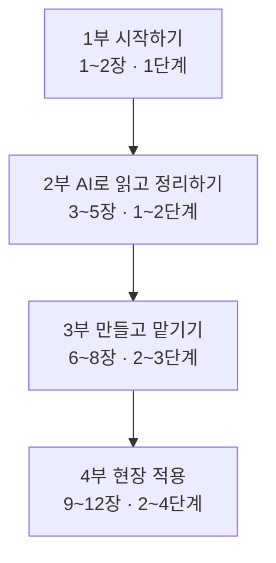

# 교과서 기획

> **한 줄 요약**
> 3-1B 보조자료(덱 116개 · 3,404장, md · 키트 · 영상)를 **처음 보는 자동차 산업 실무자가 혼자 읽고 따라 할 수 있는 교과서 한 권**으로 다시 엮는다. 날짜 순서가 아니라 배우는 순서로 묶고, 각 장 끝에서 3-1B의 실습 자료 폴더로 바로 넘어가게 한다.

## 1. 누구를 위한 책인가

- **독자**: 자동차 부품사 · 완성차 · 딜러 · 금융 계열의 비개발 실무자(기획 · 영업 · 품질 · 생산 · 구매 · 인사). 코드를 써 본 적이 없어도 된다.
- **목표**: 책을 다 읽으면 ① AI에게 일을 정확히 시키고 ② 반복 업무를 에이전트로 만들고 ③ 내 업무 웹앱을 배포하고 ④ 여러 AI를 팀으로 굴릴 수 있다.
- **도구**: Claude 데스크톱 앱의 Code 탭(Claude Code)이 기본이다. 사람은 프롬프트를 붙여 넣고 결과를 확인하며, 설치 · 코드 · 오류 수정은 Claude Code가 한다.

## 2. 책의 뼈대 — 4부 12장 + 부록 3



| 장 | 파일 | 제목 | 난이도 | 원재료 (3-1B 폴더) |
|---|---|---|---|---|
| 1 | `01장_AI와_일하는_준비.md` | AI와 일하는 준비 — Claude · Claude Code · 스킬 | 1 | Day0 01·02 · Day2 01 · Day4 01 |
| 2 | `02장_산업의_전환점_읽기.md` | 자동차 산업의 전환점 읽기 — 테슬라 2008 · GM 2009 · BYD | 1 | Day1 01 · Day3 01 · SupplyChain_Special 01 |
| 3 | `03장_데이터를_그림으로.md` | 데이터를 그림으로 — 스킬 · 인포그래픽 · 대시보드 · 브라우저 자동화 | 1~2 | Day2 02·03·04·05·06 |
| 4 | `04장_AI에게_일_잘_시키기.md` | AI에게 일 잘 시키기 — 프롬프트 · 하네스 · 세컨드 브레인 · RAG | 1~2(RAG 3) | Day4 02·03·04·05 |
| 5 | `05장_숫자로_경쟁사_읽기.md` | 숫자로 경쟁사 읽기 — 공시 실적 · 자동차 금융 · 지식그래프 · 예측시장 | 1~2(심화 3~4) | Day3 02·03·04·05·06 |
| 6 | `06장_GitHub로_내_자료_관리.md` | GitHub로 내 자료 관리하기 | 2~3 | Day0 03·04·05·06 |
| 7 | `07장_업무_에이전트_만들기.md` | 업무 에이전트 만들기 — 판정 · 메신저 · 메일 · 심사 | 2~3(심화 4) | Day4 07·09·10·12·13·14 |
| 8 | `08장_에이전트를_팀으로.md` | 에이전트를 팀으로 — 역할 분담 · 여러 AI · 시각화 · 투자위원회 | 2~3(심화 4) | Day4 08·11 · Day6 02·04·05·09·12 |
| 9 | `09장_스마트팩토리와_예지보전.md` | 스마트팩토리와 예지보전 | 1~3 | Day5 01~06 |
| 10 | `10장_업무_웹앱_처음부터_끝까지.md` | 업무 웹앱 처음부터 끝까지 — 요구사항에서 배포까지 | 2~4 | Day4 06 · Day6 01·07·10·14·15·16·17 |
| 11 | `11장_나만의_AI_업무시스템.md` | 나만의 AI 업무 시스템 — 포트폴리오 · SSR+ · 강의 만들기 · 콘텐츠 | 2~3 | Day6 03·06·08·11·13 · Day5 04(완성 예) |
| 12 | `12장_로봇과_스마트팩토리_특강.md` | 로봇과 스마트팩토리 특강 — SI 제안과 새 유형 대응 | 2~3 | Robot_Special 01·02 |
| 부록 A | `부록A_16주_자율학습_캠프.md` | 이 책 다음 — 16주 자율학습 캠프 | — | 자동차AI_자율학습16주캠프 |
| 부록 B | `부록B_용어집.md` | 용어집 | — | 12개 장에서 모음 |
| 부록 C | `부록C_자료_찾아보기.md` | 3-1B 자료 찾아보기 — 폴더 → 장 | — | 3-1B 전체 |

**장 순서의 원칙 — 난이도 순서.** 1부는 보고 읽는 1단계, 2부는 채팅 · 스킬 설치 · 프롬프트 붙여 넣기(1~2단계), 3부는 계정 연결 · 자동 실행(2~3단계), 4부는 앞 장을 모두 묶는 종합(2~4단계)이다. 4부 안의 순서는 난이도보다 «앞 장의 결과물을 쓰는 순서»를 따른다 — 9장 판정 에이전트 → 10장 웹앱 → 11장 웹앱을 모은 포트폴리오 · 업무 시스템 → 12장 특강. 장마다 실습 길잡이 표도 쉬운 것부터 놓고, 그 장의 평균보다 두 단계 이상 높은 실습은 «심화»로 표시해 나중에 돌아오게 한다.

목차 겸 첫 화면은 `README.md`(이 폴더)다.

## 3. 장 하나의 짜임 (모든 장 공통)

```text
---
title / chapter / part / days / sources / tags   ← frontmatter
---
# N장 제목
> [!summary] 이 장의 한 줄
## 이 장에서 배우는 것        ← 학습 목표 3~5개
## 큰 그림                    ← mermaid 한 장 (TD, 한 노드 아래 자식 4개 이하)
## 1. … ## 2. … ## 3. …       ← 본문 3~5절
## 실습 길잡이                 ← 3-1B 폴더 · 난이도 · 순서 · 대표 프롬프트 1~2개 발췌
## 자동차 현장에 옮기기         ← 부서별 적용 예 3~5개
## 정리                       ← 핵심 5줄 이내
## 확인 문제                   ← 3~5문항, 답은 접힌 callout(> [!note]- 답)
## 더 보기                     ← 관련 장 위키링크 · 원자료 링크
```

분량은 장마다 250~450줄. 본문은 큰 그림과 줄거리만 쓰고, 근거 · 기준 · 예외 · 숫자 상세는 각주(`[^1]`)나 접힌 callout으로 뺀다.

## 4. 글쓰기 규칙

1. **처음 나오는 말은 그 자리에서 푼다** — 약어 · 전문용어는 첫 등장에 `원어(뜻)` 형식. 예: RAG(Retrieval-Augmented Generation, 내 문서를 찾아 근거로 답하는 방식). 같은 말을 부록 B 용어집에도 올린다.
2. **처음 보는 사람 기준** — 다른 장을 읽지 않아도 그 장이 이해되게 쓴다. 앞 장 개념이 필요하면 한 줄로 다시 설명하고 위키링크를 단다.
3. **자연스러운 한국어** — 번역투 · 과장 · 상투어 금지(`korean-md-standard`의 상투어 목록과 과장된 꾸밈말). 별표는 쓰지 않는다 — 난이도는 «1단계~4단계» 숫자로 쓴다(3-1B 목록의 별 개수 = 단계). 결론은 평서문으로.
4. **숫자는 출처가 있는 것만** — 원재료 덱 · md에 있는 수치만 쓰고, 가상 데이터는 «가상»이라고 밝힌다. 원재료에 없는 최신 수치를 지어내지 않는다.
5. **사람과 AI의 역할** — 실습 설명은 «사람이 할 일(로그인 · 키 입력 · 화면 확인 · 승인)»과 «Claude Code가 할 일»을 나눠 쓴다. 사람에게 터미널 명령을 직접 치게 하지 않는다.
6. **프롬프트 인용** — 원재료의 프롬프트를 그대로 옮길 때는 언어 표시가 `text`인 코드 블록에 넣는다. 길면 핵심 부분만 옮기고 «전문은 3-1B 폴더» 링크.
7. **그림** — mermaid는 한 화면에 들어오게(TD 우선, 한 노드 아래 자식 4개 이하, 노드 글자는 짧게). 표가 더 명확하면 표를 쓴다.
8. **수식** — 꼭 필요할 때만. 옵시디언 수식 4규칙(＜p＞ 금지 · 디스플레이 수식 한 줄 · `|` 대신 `\mid`)을 지킨다.

## 5. 원자료 링크 방식

교과서 파일은 `3-1B/Textbook/`에 있으므로 원자료는 상대 경로로 건다.

```markdown
[해외 5개사 실적 비교 덱](../Day3_경쟁사재무/02_해외자동차5사_실적비교/)
```

폴더 이름에 공백이 없으므로 그대로 쓴다. 파일 이름에 공백이 있으면 `%20`으로 바꾼다. **경로 고정** 폴더(Day2 03 · Day5 03 · Day6 06)는 이름을 바꾸지 않는다.

## 6. 점검 (장마다 쓴 직후)

- `korean-md-standard` 점검: 별표 밀도 · 연속 별표 · 상투어 · 수식 4규칙 위반 0
- 상대 링크가 실제 폴더 · 파일을 가리키는지
- mermaid 블록이 열리고 닫히는지, 자식 4개 이하인지
- 처음 나오는 약어가 풀어져 있는지

## 7. 진행 기록

- 2026-11-01 기획 · 12장 + 부록 3 초판 작성 (장마다 250~450줄, 전 파일 점검 합격). 난이도 표기는 별 대신 «1~4단계»로 통일.
- 2026-11-01 장 순서를 난이도 순으로 다시 짰다. 옛 2장 GitHub → 6장, 옛 3장 산업 → 2장, 옛 5장 시각화 → 3장, 옛 6장 프롬프트 → 4장, 옛 4장 경쟁사 → 5장. 부 이름도 «시작하기 · AI로 읽고 정리하기 · 만들고 맡기기 · 현장 적용»으로 바꿨다. 장 안의 실습 길잡이 표도 쉬운 것부터 다시 놓았다(3 · 8 · 10 · 11장).
- 2026-11-01 그림 98개 추가(장마다 7~9개: SVG 인포그래픽 · matplotlib 차트 · 덱 장표 캡처). 공용 도구 `_build/tbviz.py`, 장별 생성 스크립트 `_build/chNN_figs.py`, 결과 `images/chNN/`. Day6 17 웹 배포(Vercel · Cloudflare · Netlify)를 10장 3.2절로 넣었다.

## 8. 원재료에서 찾은 어긋남 — 처리 기록

장을 쓰다 찾은 원재료끼리의 어긋남과 처리 결과다(2026-11-01). 덱을 고친 경우 원본은 같은 폴더 `_구판/`에 두었고, PDF가 함께 있는 덱은 PDF도 다시 만들었다.

| 자료 | 어긋남 | 처리 |
|---|---|---|
| Day0 03 덱 · 04 · 05 md, Day4 05 L1 덱, Day4 09 · 14 · 11 · 08, Day5 03, Day6 16 일반판, 에고라이트 덱 | 사람이 터미널에 직접 명령을 치는 흐름(구판) | 그대로 둠 — 틀린 것이 아니라 설치 경로가 다르다. 교과서는 데스크톱 앱 Code 탭 기준. 바꾸려면 확장판으로 |
| Day2 01 덱 2개 · Day6 15 덱 | 다운로드 주소 `claude.ai/download` | 고침 → `claude.com/download`(옛 주소는 이리로 넘어간다) |
| Day0 06 노트 | 옛 경로 `Day0_4_Claude_설치가이드` | 고침 → `01_Claude_설치가이드` |
| Day1 01 | 폴더 이름 «테슬라2008»과 영상 내용(배터리 기술) 불일치 | 고침 → `01_테슬라_배터리기술혁신_영상` |
| Day3 05 케이스 덱 35장 | 공개 덱에 «모범답안» 장 | 그대로 둠 — 강사 자료도 실습에 필요하면 공개하는 방침(2026-10-31) |
| Day3 06 `00_여기서_시작.md` | 폴더 지도에 옛 이름 `11_KAuto_KG_지식그래프_실습/` | 고침 → `06_자동차지식그래프_Neo4j_실습/` |
| Day4 12 GWS 덱 III 19 · 20장 | «ID · 시크릿을 클로드에게 보내기» — 설치가이드 md는 «채팅에 올리지 않는다» | 고침 → «JSON을 제자리에 두고 위치만 알리기» |
| Day4 02 Part 4 덱 2장 | «3시간을 닫으며» — 과정은 4시간 | 고침 → «4시간을 닫으며» |
| Day5 02 덱 11 · 20장 · 빌드 원본 | ISO 10816-3(옛 번호), 정지 11시간 · 9시간 혼재 | 고침 → «ISO 20816-3(옛 10816-3)», «정지 11시간 = 냉각 2시간 + 작업 9시간»(키트 작업지시서와 같음) |
| Day6 02 IC Roast Room 덱 29장 · 빌드 원본 | 예시는 8% 재심의(B 7.4)인데 동봉 예제는 6% 간이 위원회(B 6.0) | 고침 → 부제에 «동봉 예제는 6% 간이 위원회» 명시. PDF · zip · 연기금 강의노트 사본까지 같게 |
| Day6 04 노트 3개 · 09_P8 덱, Day6 05 매뉴얼 · 덱 | harness 플러그인 설치 명령 `harness@harness` | 고침 → `harness@harness-marketplace`(revfactory/harness의 marketplace.json 이름) |
| 3-1B README Day6 06 | 덱 장수 «32장» vs 실제 IV 50장 · 확장판 51장 | 고침 → IV 50장 · 확장판 51장 · Lite 28장 |
| Day6 12 `Case_III.pptx` | 표지가 «구현 실습편 · II» | 고침 → «III» |
| Robot 02 si-forge README | 옛 경로 `01_로봇SI_제안덱/` · course-forge 덱 이름 · 장 번호 | 고침 → 실제 경로 · `Course_Forge_Lecture_IV_확장판.pptx` 50장 |
| Day6 07 | «기존 anon · service_role 키 2026년 말 폐기 예정» | 확인 — Supabase 공식 문서(2026-11-01 확인)와 같다 |

그림 작업 중 더 찾은 것(원본은 그대로, 교과서에 반영):

| 자료 | 어긋남 | 교과서 처리 |
|---|---|---|
| BYD 덱 그림 `c01_sales.png` | 2025년 BYD 2.26백만 대 — 원재료 2,254,714대는 2.25 | 그림 2-8을 원재료 숫자로 새로 그림 |
| Day1 01 영상 받아쓰기 | LFP 비용 «22에서 30% 저렴» | 본문 · 그림은 «20~30%»(음성 인식 오류로 판단, 재청취 확인 전) |
| Day3 CSV 도요타 FY2025 | 5장(2024.4~2025.3)과 6장 예시 표(2025.4~2026.3)의 기간이 다름 | 6장에 기간 차이 명시 |
| Day5 실습 B 단위혼재 CSV 로거4 | 행마다 단위가 섞임(in/s · mm/s, bar · psi) | 8장 각주를 행별 판별로 고침 |
| Day5 06 덱 25장 | «평상 범위 첫 경보 15:40» 표시가 온도 패널에 붙음(실제는 진동) | 그림 9-4는 진동 패널에 표시 |
| Day4 10 카톡 덱 41장 | 수량뿐 아니라 날짜도 어긋난 사례 | 그림 7-4에 둘 다 표시 |
| `learn-auto-pdm.zip` | 한글 파일명에 UTF-8 표시 없음(그냥 열면 깨짐) | 그림 스크립트에서 보정 |
