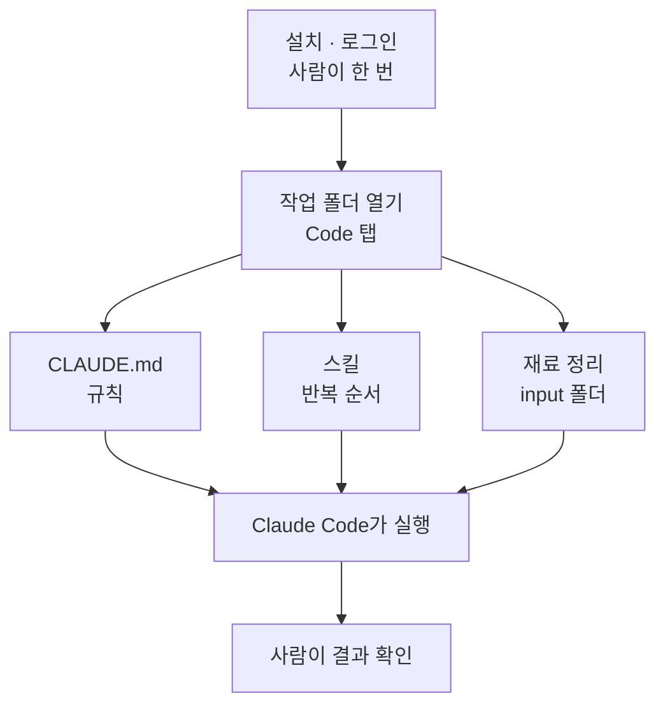
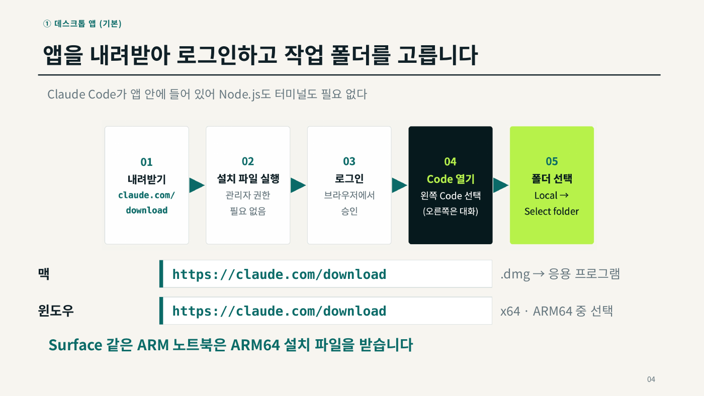
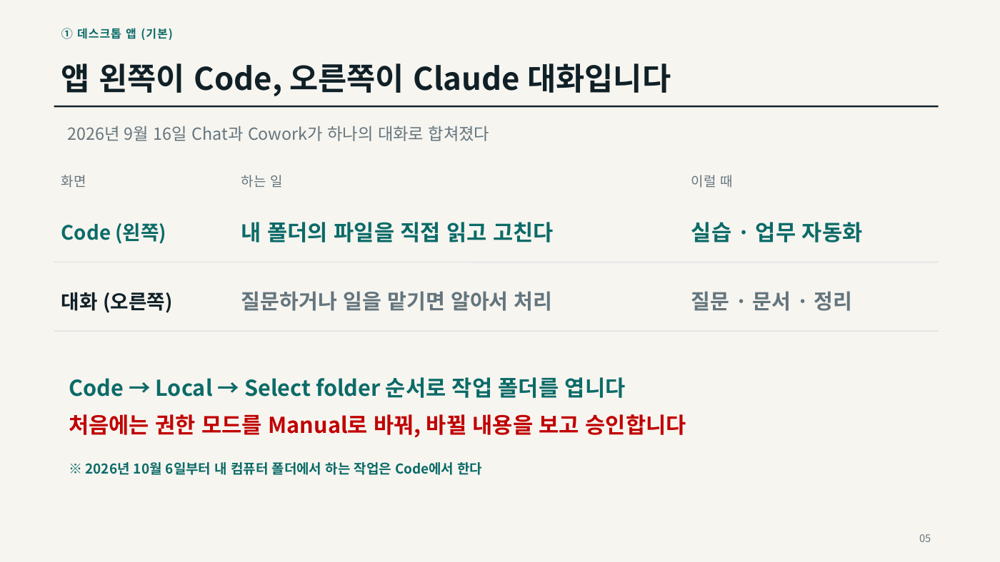
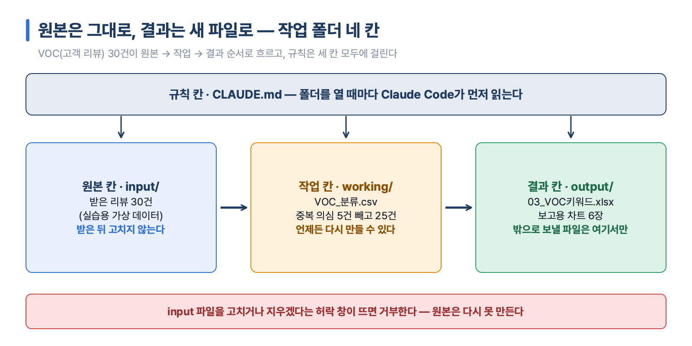
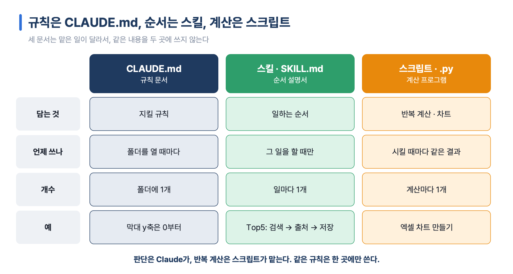
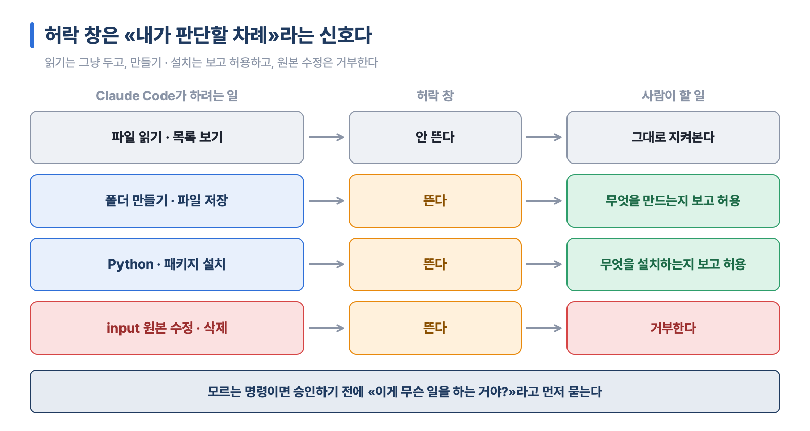
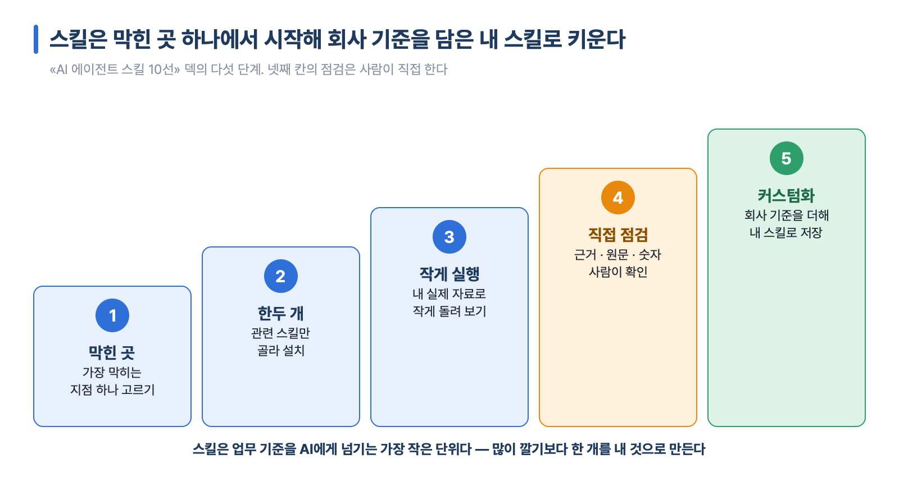
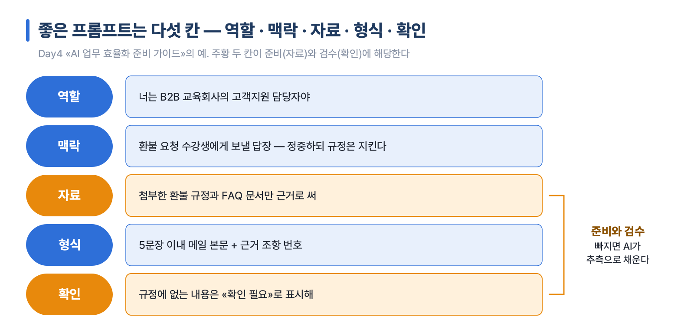
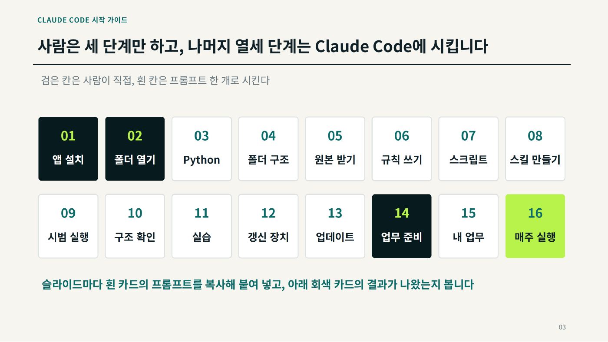

# 1장 AI와 일하는 준비 — Claude · Claude Code · 스킬

> **이 장의 한 줄**
> 설치는 사람이 한 번 하고, 일은 폴더 안에서 Claude Code에게 시킨다. 규칙은 CLAUDE.md에, 반복하는 순서는 스킬에 적어 두고, 결과는 마지막에 사람이 직접 확인한다.

## 이 장에서 배우는 것

1. Claude 데스크톱 앱을 설치하고, 앱 안의 **Code** 탭으로 내 작업 폴더를 연다.
2. 채팅으로 묻는 Claude와 폴더 안에서 일하는 Claude Code가 어떻게 다른지 설명한다.
3. 작업 폴더를 원본 · 작업 · 결과 · 규칙의 네 칸으로 나누고, CLAUDE.md와 스킬의 역할을 구분한다.
4. 내 업무에서 막힌 곳 하나에 맞는 스킬을 한두 개 골라 작게 시험하는 순서를 안다.
5. AI에게 일을 넘기기 전에 재료를 정리하고, 결과를 사람이 검수하는 습관을 들인다.

## 큰 그림



## 1. 설치 — 데스크톱 앱 하나가 기본이다

먼저 이름부터 정리한다.

- **Claude**: Anthropic(앤트로픽)이 만든 AI다. 질문에 답하고 글을 쓰고 자료를 정리한다.
- **Claude Code**: 내 컴퓨터의 폴더 안에서 파일을 직접 읽고, 고치고, 프로그램을 실행하는 Claude다. 이 과정에서는 줄여서 «클코»라고도 부른다.
- **Claude 데스크톱 앱**: 컴퓨터에 설치하는 Claude 프로그램이다. Claude Code가 이 앱 안에 들어 있다.

설치 가이드의 결론은 짧다. **대부분의 일은 데스크톱 앱 하나로 끝난다.** VS Code(마이크로소프트의 무료 코드 편집기)는 Claude Code를 편집기 안에서 쓰고 싶을 때만 보완으로 설치한다.[^install]

### 1-1. 설치 전에 세 가지를 확인한다

셋 중 하나라도 안 맞으면 설치는 되어도 로그인이나 Code 탭에서 막힌다.

| 확인할 것 | 기준 |
|---|---|
| 요금제 | Code는 유료 요금제(Pro · Max · Team · Enterprise)에서 쓸 수 있다. 무료 요금제는 대화만 된다 |
| 컴퓨터 | macOS 13 이상 또는 Windows 10 이상, 메모리 4GB 이상 |
| 회사망 | `claude.ai` · `claude.com` · `api.anthropic.com` · `downloads.claude.ai`가 열려 있어야 한다 |

회사망에서 로그인 창이 멈추면 위 주소를 정보화 부서에 허용해 달라고 요청한다.

### 1-2. 사람이 할 일 — 내려받기, 로그인, 폴더 고르기

설치는 사람이 직접 한다. 터미널(글자로 명령을 입력하는 검은 창)은 열 필요가 없다.

1. `https://claude.com/download`에서 내 컴퓨터에 맞는 설치 파일을 받는다. 맥은 `.dmg` 파일을 응용 프로그램 폴더로 옮기고, 윈도우는 x64와 ARM64 중에서 고른다(Surface 같은 ARM 노트북은 ARM64).
2. 앱을 열고 Pro 이상 계정으로 로그인한다.
3. 앱의 **Code → Local → Select folder** 순서로 작업 폴더를 연다.
4. 처음에는 권한 모드를 **Manual**로 바꾼다. Manual은 Claude Code가 파일을 바꾸기 전에 바뀔 내용을 보여 주고 사람의 승인을 기다리는 방식이다.



*그림 1-1. 내려받기 → 설치 → 로그인 → Code 열기 → 폴더 선택. 맥과 윈도우 모두 `claude.com/download`에서 받는다. 출처: Day0 01 Claude 설치가이드 간단판 4장.*

앱 화면은 두 쪽으로 나뉜다. 왼쪽 **Code**는 내 폴더의 파일을 직접 읽고 고치는 곳(실습 · 업무 자동화), 오른쪽 **대화**는 질문하거나 일을 맡기는 곳(질문 · 문서 · 정리)이다.



*그림 1-2. 폴더 파일을 직접 다루는 일은 왼쪽 Code에서, 질문 · 문서 정리는 오른쪽 대화에서 한다. 처음에는 권한 모드를 Manual로 둔다. 출처: Day0 01 설치가이드 5장.*

> **설치에 따로 필요한 프로그램 — Node.js와 Git**
> - **Node.js**(웹 프로그램을 돌리는 실행 환경)는 설치하지 않는다. 데스크톱 앱과 VS Code 확장에 이미 들어 있다.
> - **Git**(파일의 변경 이력을 기록하는 프로그램)은 선택이다. 맥은 대부분 기본으로 깔려 있고, 윈도우는 깔아 두기를 권한다. 앱에 «Git is required»가 뜰 때만 `https://git-scm.com/downloads/win`에서 기본값으로 설치하거나 앱을 업데이트한다. Git은 [06장 GitHub로 내 자료 관리](06장_GitHub로_내_자료_관리.md)에서 자세히 다룬다.
> - **VS Code를 쓸 때**: `https://code.visualstudio.com`에서 받는다. 윈도우는 관리자 권한 없이 설치되는 User Installer를 고른다. VS Code 1.94.0 이상에서 확장 `anthropic.claude-code`(제작자 Anthropic)를 설치하고, 데스크톱 앱과 같은 계정으로 로그인한다.

### 1-3. 첫 프롬프트는 «읽고 설명해 줘»로 시작한다

프롬프트(prompt)는 AI에게 주는 작업 지시문이다. 처음에는 고치게 하지 말고 읽고 설명하게 한다. 설치 가이드가 권하는 첫 프롬프트 네 개다.

```text
이 폴더가 어떤 작업을 하는 곳인지 처음 보는 사람도 알게 설명해줘
input 폴더의 파일을 열어 보고, 무엇이 들어 있는지 표로 정리해줘
바로 고치지 말고 계획만 먼저 보여줘. 내가 승인하면 그때 진행해줘
원본은 그대로 두고, 결과는 output 폴더에 새 파일로 저장해줘
```

필요한 파일은 Claude가 스스로 찾아 읽는다. 파일 내용을 미리 붙여 넣지 않아도 된다.

> **막힐 때 먼저 볼 표**
> | 증상 | 원인 | 해결 |
> |---|---|---|
> | Code에서 업그레이드 안내가 뜬다 | 무료 요금제 | Pro 이상 요금제 |
> | 로그인 창이 멈춘다 | 회사 방화벽 | 정보화 부서에 주소 허용 요청 |
> | VS Code에 확장 아이콘이 안 보인다 | VS Code 1.94 미만 | 업데이트 후 재시작 |
> | 확장이 계속 로그인을 요구한다 | 창 새로고침 필요 | Reload Window |
>
> 그래도 안 되면 오류 화면을 캡처해 Claude 대화에 붙여 넣고 묻는다.

## 2. Claude Code는 폴더 안에서 일한다

### 2-1. 채팅 Claude와 무엇이 다른가

채팅 Claude는 붙여 넣은 글만 보고 답한다. Claude Code는 폴더의 파일을 읽고, 쓰고, 실행한다. 같은 일을 시켜도 남는 것이 다르다. Day2 기초지식 덱의 예는 «2026년 8월 국내 전기차(EV, Electric Vehicle) 등록 상위 5개 모델을 표와 막대 차트로 정리하는 일»이다.

| | 채팅 Claude | Claude Code |
|---|---|---|
| 결과 | 답이 글로 끝난다 | 파일이 남는다(`01_EV시장_Top5.xlsx`) |
| 표 · 차트 | 표를 복사해 엑셀에 붙이고, 차트는 손으로 그린다 | 엑셀 파일 안에 막대 차트까지 들어 있다 |
| 다음 달 | 처음부터 다시 | 한 줄로 다시 만든다 |

정리하면 **옮겨 적는 일은 Claude가, 판단과 확인은 사람이 맡는다.** 그래서 Claude Code로 일할 때는 «폴더를 어떻게 나누나»가 먼저다.

### 2-2. 경로와 확장자 읽기

경로(path)는 파일이 어느 폴더 안에 있는지 적은 주소다. 경로의 `/`는 «안에»로 읽는다. `working/scripts/`는 «working 폴더 안의 scripts 폴더»다. 끝이 `/`이면 폴더이고, `.xlsx`처럼 끝에 확장자가 붙으면 파일이다.

확장자는 파일 이름 끝의 점 뒤 글자로, 무엇으로 여는 파일인지 알려 준다. 이 과정에서 자주 보는 것은 `.csv`(쉼표로 나눈 표 데이터, 엑셀 · 메모장), `.xlsx`(엑셀 파일, 차트 포함), `.html`(웹 화면, 브라우저), `.md`(마크다운 — 기호 몇 개로 제목 · 목록을 표시하는 글 문서, 메모장), `.py`(Python 스크립트, 열 필요 없음), `.png`(그림)다. Python(파이썬)은 널리 쓰이는 프로그래밍 언어다. 윈도우에서 확장자가 안 보이면 탐색기 «보기» 메뉴에서 «파일 확장명»을 켠다.

### 2-3. 작업 폴더는 네 칸으로 나눈다

작업 폴더는 원본 · 작업 · 결과 · 규칙의 네 칸으로 나눈다. 어느 파일이 어디에 있어야 하는지 Claude와 사람이 같은 지도를 보게 하기 위해서다.

| 칸 | 폴더 · 파일 | 규칙 |
|---|---|---|
| 원본 | `input/` | 받은 뒤 고치지 않는다 |
| 작업 | `working/` | 다시 만들 수 있는 중간 표를 둔다 |
| 결과 | `output/` | 사람이 보는 결과만 둔다. 밖으로 보내는 파일은 여기서만 고른다 |
| 규칙 | `CLAUDE.md` | 지킬 규칙을 적는다 |

**원본과 결과를 섞지 않는 것이 첫 번째 규칙이다.** 덱의 예로 보면, 아이오닉5 리뷰 30건에서 중복 의심 5건을 빼야 할 때 원본 파일에 덮어쓰면 원래 30건은 사라지고 다시 만들 수 없다. 원본은 그대로 두고 25건짜리 표를 `working/`에 새 파일로 남기면 언제든 처음부터 다시 만들 수 있다. 같은 리뷰 30건은 `input/` → `working/VOC_분류.csv`(리뷰마다 주제 · 감정을 붙인 표) → `output/03_VOC키워드.xlsx`(보고용 차트 6장)로 흘러간다. VOC(Voice of Customer)는 고객 리뷰 · 불만처럼 고객이 남긴 말이다. 이 리뷰는 실습용 가상 데이터다.



*그림 1-3. 원본(input) → 작업(working) → 결과(output) 순서로 파일이 흐르고, 규칙(CLAUDE.md)은 세 칸 모두에 걸린다. 리뷰 30건은 실습용 가상 데이터. 출처: Day2 Claude Code 기초지식 덱.*

## 3. 규칙은 CLAUDE.md, 순서는 스킬, 계산은 스크립트

### 3-1. CLAUDE.md — 폴더를 열 때마다 먼저 읽는 규칙 문서

CLAUDE.md는 폴더 맨 위에 두는 글 문서 한 개다. Claude Code는 폴더를 열 때마다 이 파일을 먼저 읽는다. 여기에 지킬 규칙, 멈춰서 물을 지점, 폴더 안내를 적어 두면 같은 당부를 프롬프트마다 반복하지 않아도 된다.

문장 한 줄이 행동을 바꾼다. Day2 실습 폴더의 CLAUDE.md에 실제로 들어 있는 문장과 그 결과다.

| CLAUDE.md에 적은 문장 | 그래서 일어나는 일 |
|---|---|
| 수치가 등록대수면 «등록»으로 적는다 | 엑셀 열 이름이 «등록대수(대)»로 적힌다 |
| 막대 차트의 y축은 0에서 시작한다 | 엑셀 막대 차트의 세로축이 0부터 그려진다 |
| 가상 데이터는 «실습용»으로 표기한다 | VOC 그래프마다 «가상 데이터(실습용)»가 붙는다 |
| 집계기준을 정할 때는 멈춘다 | Claude가 «판매인가요, 등록인가요?» 묻고 기다린다 |

규칙은 «정확히 써라»처럼 쓰지 않고, **지켰는지 확인할 수 있는 문장**으로 쓴다.

> **Day2 CLAUDE.md의 «이날의 핵심 함정»**
> 기사가 «판매»라고 써도 수치가 등록대수면 «등록»으로 적는다. 실습 데이터 `Day2_국내EV판매_Top5_실데이터.csv`는 열 이름이 `판매량(대)`이지만 값은 신규등록 대수다. 기준이 다른 숫자(판매와 등록, 내수와 수출 포함 등)는 한 차트 · 한 합계에 섞지 않는다. 출처마다 값이 다르면 고르지 말고 둘 다 적는다. CLAUDE.md에 실린 예: 2025년 전기차 신규등록 KAMA(한국자동차모빌리티산업협회) 220,177대 · 데일리카 220,896대.[^d2claude]

### 3-2. 스킬 — 자주 하는 일의 순서를 적은 설명서

스킬(skill)은 AI가 읽고 따르는 지침 파일(`SKILL.md`)이다. `.claude/skills/` 폴더 안에 스킬 하나당 폴더 하나를 두고, 그 안에 `SKILL.md`를 넣는다. SKILL.md에는 세 가지를 적는다.

- **언제 쓰나**(description, 이 스킬을 꺼낼 상황을 적은 설명)
- **어떤 순서로** 하나
- **무엇을 남기나**

하고 싶은 일을 말하면 Claude Code가 요청을 description과 맞춰 보고 맞는 스킬을 꺼낸다. Day2 폴더의 예다.

| 내가 쓴 말 | 꺼내지는 스킬 | 하는 일 → 남는 파일 |
|---|---|---|
| 리뷰 분석해줘 | VOC-감정분석 | 주제 · 감정 분류 → 03 엑셀 |
| 이 차트 좀 봐줘 | 차트-클리닉 | 6개 항목 진단 → 04 엑셀 |
| 이번 주 가격 모아줘 | 주간-수집레시피 | 가격 변동 표 → 05 엑셀 |
| input 바꿨어 | Day2-전체갱신 | 바뀐 파일을 찾아 결과 다시 만들기 |

스킬 이름을 몰라도 되지만, 이름을 넣으면 더 정확히 꺼낸다. **잘 된 작업은 대화로 끝내지 말고 스킬로 남긴다.**

### 3-3. 두 문서를 나누는 기준

| | CLAUDE.md | 스킬(SKILL.md) |
|---|---|---|
| 언제 읽나 | 폴더를 열 때마다 | 그 일을 할 때만 |
| 담는 것 | 지킬 규칙 | 일하는 순서 |
| 개수 | 폴더에 1개 | 일마다 1개 |
| 예 | 막대 y축은 0부터 | Top5: ① 검색 ② 출처 확인 ③ 저장 |

같은 규칙을 두 곳에 쓰면, 한쪽만 고쳤을 때 어느 쪽이 맞는지 알 수 없다. 그래서 Day2 폴더의 스킬은 첫 줄에 «규칙은 CLAUDE.md에 있다. 여기에 다시 쓰지 않는다»고 적어 둔다.

여기에 세 번째 문서가 붙는다. **스크립트**(`.py`)는 같은 입력이면 매번 같은 결과를 내는 프로그램이다. 판단은 Claude가, 반복 계산과 차트는 스크립트가 맡는다. 스크립트는 사람이 직접 짜지 않고 «이 작업을 스크립트로 만들어 둬»라고 시킨다.



*그림 1-4. 규칙은 CLAUDE.md, 순서는 스킬, 반복 계산은 스크립트에 둔다. 같은 규칙을 두 곳에 쓰지 않는다. 출처: Day2 실습 폴더(Day2_클로드코드).*

### 3-4. 허락 창 · 멈추는 지점 · 결과 확인

Claude Code는 파일을 바꾸거나 명령을 실행하기 전에 허락을 묻는다. 허락 창은 Claude가 무엇을 하려는지 보여 주고 사람이 고르는 창이다.

| Claude가 하려는 일 | 허락 창 | 사람이 할 일 |
|---|---|---|
| 파일 읽기 · 목록 보기 | 안 뜬다 | — |
| 폴더 만들기 · 파일 저장 | 뜬다 | 무엇을 만드는지 보고 허용 |
| Python · 패키지(추가 기능 묶음) 설치 | 뜬다 | 무엇을 설치하는지 보고 허용 |
| input 파일 수정 · 삭제 | 뜬다 | 거부한다. 원본은 고치지 않는다 |

모르는 명령이면 «이게 무슨 일을 하는 거야?»라고 먼저 묻는다.



*그림 1-5. 읽기는 허락 창이 뜨지 않고, 만들기 · 설치는 무엇인지 보고 허용하고, 원본 수정 · 삭제는 거부한다. 출처: Day2 Claude Code 기초지식 덱.*

Claude가 스스로 멈추고 묻는 것은 **사람이 판단할 차례**이기 때문이다. 멈춤은 고장이 아니라 확인 요청이다. Day2에서는 CLAUDE.md에 멈출 지점 세 곳을 적어 둔다.

1. 데이터 수집 뒤 — 집계기준 확정(판매인가, 등록인가)
2. VOC 분류 중 — 키워드 묶기 확정(«충전소 부족»과 «충전 대기»를 같은 말로 볼까)
3. 제출 전 — 역검토(가상 데이터를 사실처럼 썼나)

결과를 받으면 세 가지만 확인한다. `output/01_EV시장_Top5.xlsx`를 받았다면 ① 파일이 탐색기에서 보이는가 ② 숫자가 원본과 맞는가(엑셀 9,638 ↔ CSV 9638) ③ 기준 · 기간 · 출처 한 줄이 적혀 있는가. **Claude가 만든 숫자도 사람이 한 번은 원본과 맞춰 본다.**

## 4. 스킬 고르기 — 막힌 곳 하나에 한두 개

3절의 스킬은 내가 만든 것이다. 남이 만들어 공개한 스킬도 많다. «비개발자를 위한 AI 에이전트 스킬 10선» 덱의 첫 메시지는 이렇다. **모든 스킬을 설치하라는 목록이 아니다.** 지금 업무에서 막히는 지점에 맞는 스킬을 한두 개 골라 작게 시험하고, 쓸 만하면 조직 기준을 더해 커스텀 스킬로 만든다. 여기서 AI 에이전트(agent)는 지시를 받아 여러 단계를 스스로 실행하는 AI를 말한다.

최신 모델은 스킬 없이도 잘한다. 스킬이 쓸모 있는 때는 낯선 분야를 체계적으로 할 때, 조직 방식에 맞출 때, 모델이 놓치는 부분을 챙길 때다. 스킬이 많다고 결과가 좋아지지는 않는다.

### 4-1. 이름이 같아 보여도 설치 대상은 네 종류다

| 구분 | 뜻 | 예 |
|---|---|---|
| 스킬 | AI가 읽고 따르는 지침 파일(SKILL.md) | grill-me, seo-audit |
| 저장소 | 스킬을 모아 둔 GitHub 저장소 | mattpocock/skills, marketingskills |
| 브라우저 앱 | 사람이 설치해 쓰는 실제 브라우저 | EGO Lite |
| CLI · 분석 도구 | 스킬과 별도로 설치 · 연결하는 실행 프로그램 | gws, REA 분석 도구 |

CLI(Command Line Interface)는 글자 명령으로 쓰는 프로그램이고, MCP(Model Context Protocol)는 AI가 바깥 도구 · 데이터에 연결되는 표준 방식이다. 스킬 파일만으로 끝나지 않는 도구가 있으므로, 설치 전에 네 가지를 에이전트와 함께 확인한다.

1. **지원 환경** — 내 에이전트와 운영체제에서 쓸 수 있는가(예: EGO Lite는 macOS부터)
2. **설치 범위** — 스킬 파일만이면 되는가, 앱 · CLI · 분석 엔진도 필요한가(예: REA는 MCP 서버 필요)
3. **필요한 인증** — 로그인 · API 권한 · 계정 연결이 필요한가(예: gws는 구글 인증). API(Application Programming Interface)는 프로그램끼리 데이터를 주고받는 창구다.
4. **작은 시험** — 실제 업무 하나를 작게 맡겨 결과를 본 뒤 범위를 넓힌다(예: 읽기 작업부터)

로그인과 계정 권한 승인은 **사람이 내용을 보고 직접** 한다. 설치는 Claude Code에게 맡기되, 설치 전 점검부터 요청한다. 덱의 공통 설치 프롬프트다.

```text
이 저장소의 스킬을 설치해서 쓰고 싶다.
https://github.com/mattpocock/skills
설치하기 전에 다음을 먼저 정리해 줘.
1) 내 환경(macOS, Claude Code)에서 쓸 수 있는지
2) 스킬 파일만 필요한지, 앱·CLI·MCP도 필요한지
3) 로그인·API 권한이 필요한 단계
로그인과 권한 승인 단계에서는 멈추고
내가 직접 하도록 알려 줘.
설치 후 grill-me 하나만 작은 과제로 시험해 줘.
```

### 4-2. 업무 단계별 7묶음과 참고 도구 3가지

| # | 단계 | 스킬 | 이럴 때 꺼낸다 |
|---|---|---|---|
| 1 | 기획 | Grill Me | 잘 모르는 분야의 기획을 빠짐없이 잡을 때. AI가 질문을 하나씩 하고 질문마다 추천 답을 단다 |
| 2 | 리서치 | EGO Lite | 로그인이 필요한 플랫폼에서 자료를 모을 때. 사람 탭과 AI 작업 공간을 나눈다 |
| 3 | 제작 | REA | 다른 서비스의 특정 기능이 어떻게 동작하는지 근거를 모아 내 프로젝트에 비슷하게 붙일 때 |
| 4 | 디자인 | Impeccable | 원하는 디자인을 용어로 설명하기 어려울 때. UX(사용자 경험) 비평, 규칙 문서 DESIGN.md |
| 5 | 글쓰기 | Humanizer + humanize-korean | 글이 AI스럽거나 문체를 맞추고 싶을 때. 그대로 쓰기보다 팀 문체 스킬의 재료로 |
| 6 | 마케팅 | marketingskills(seo-audit 등) | 마케팅 · 검색 준비의 방향을 잡을 때. SEO(검색엔진 최적화) 점검, 순위 상승 보장은 아니다 |
| 7 | 보안 | Cloudflare security-audit | 결과물을 공개하기 전에 점검할 때. 확정 · 확인 필요 · 기각의 세 판정으로 나눈다 |
| 8 | 참고 | Supabase Postgres 스킬 | 시트 · 엑셀을 넘어 웹앱용 데이터베이스가 필요할 때 |
| 9 | 참고 | Vercel 배포 스킬 | 만든 웹앱을 주소 하나로 공유할 때. 기본은 미리보기(preview) 주소 |
| 10 | 참고 | Google Workspace CLI(gws) | 플러그인으로 Gmail · 드라이브 · 시트 작업이 잘 안 될 때. 읽기 작업부터 |

참고 도구 세 가지는 설치와 인증이 따로 필요하다. 공통 주의는 권한은 사람이 승인하고, 비밀정보 노출을 확인하고, 되돌리기 어려운 작업(발송 · 삭제 · 정식 배포)은 실행 전에 사람이 확인하는 것이다.

> **사용예 하나 — Grill Me로 사내 교육 과정 기획**
> ```text
> /grill-me
> 다음 분기 신입 직원 대상 사내 AI 교육 과정을
> 기획하려고 한다. 대상·목표·일정·예산·평가
> 방식은 아직 정하지 않았다.
> 질문을 한 번에 하나씩 하고,
> 질문마다 추천 답을 함께 달아 줘.
> 끝나면 결정·보류·다음 질문을 표로 정리하고
> 최종 기획안을 1쪽으로 써 줘.
> ```
> 결과로 «결정 · 보류 · 다음 질문» 표와 1쪽 기획안이 나온다. 추천 답은 받거나 내 답으로 바꾸고, 표는 인수인계 · 보고에 결정 근거로 붙인다. 잘 아는 업무라면 생략해도 된다. 나머지 아홉 개의 사용예 프롬프트는 [스킬 10선 덱](../보충교재/Day0_강의소개/02_AI에이전트_스킬10선/)에 있다.

### 4-3. 내 업무에 붙이는 다섯 단계

1. **막힌 곳** — 지금 업무에서 가장 막히는 지점 하나를 고른다.
2. **한두 개** — 관련 스킬을 한두 개만 골라 설치한다.
3. **작게 실행** — 내 실제 자료로 작게 실행해 본다.
4. **직접 점검** — 결과를 사람이 직접 점검한다(근거 · 원문 · 숫자).
5. **커스텀화** — 회사 검토 기준을 더해 커스텀 스킬로 저장한다.



*그림 1-6. 막힌 곳 하나 → 한두 개 설치 → 작게 실행 → 사람이 직접 점검 → 회사 기준을 담은 커스텀 스킬. 출처: Day0 02 AI 에이전트 스킬 10선 덱.*

회사 기준을 담은 스킬 하나가 생기면, 필요할 때마다 더해 가며 업무 시스템을 키운다. 덱의 마지막 문장대로 스킬은 업무 기준을 AI에게 넘기는 가장 작은 단위다. 스킬을 직접 골라 설치하는 실습은 [03장 데이터를 그림으로](03장_데이터를_그림으로.md)에서 이어진다.

## 5. AI에게 넘기기 전에 — 재료 정리와 사람 검수

Day4 첫 덱 «AI 업무 효율화 준비 가이드»의 제목은 «비결은 프롬프트가 아니라 준비»다. 원문 작성자가 1년 동안 콘텐츠 · 계약 · 정산 · 채용 · 고객 응대에 AI를 붙여 본 경험을 24가지 메모로 정리한 글에, 강사가 보강 지침을 더했다.[^prep]

### 5-1. AI의 품질은 재료의 품질을 넘지 못한다

AI는 넘겨받은 재료로 초안을 쓴다(입력 → 초안 → 검수). 흩어진 재료는 읽지 못하고, 검수에서 나온 오류는 재료로 되돌려 고친다. 그래서 첫 단계는 자료를 한 곳에 모으는 일이다.

| 메모 | 무엇을 모으나 | 효과 |
|---|---|---|
| 1 · 2 | 사진 · 영상은 한 폴더, 메모는 옵시디언 · 노션 같은 한 곳 | «이 폴더 보고 만들어줘» 한 마디로 지시가 줄어든다. 태그는 나중에 AI가 단다 |
| 3 | 모든 도구를 회사 명의 계정으로 | 직원이 바뀌어도 AI가 쌓은 데이터가 남는다 |
| 4 | 흩어진 고객 엑셀을 표 하나로 | 합치는 1주일이 매달 수십 시간을 돌려준다 |
| 5 · 6 | 따라갈 레퍼런스, 경쟁사 링크 | 취향은 설명하지 말고 보여 준다. 반응 패턴을 표로 만들면 감이 숫자로 바뀐다 |
| 10 · 15 | FAQ(자주 묻는 질문) 문서, 구독 서비스 목록 | 답변 기준이 한 곳에 생기고, 새는 고정 지출을 찾는다 |

정리가 귀찮으면 쌓기만 해도 된다. 원문 작성자도 처음 석 달은 쌓기만 했다.

### 5-2. 좋은 프롬프트의 다섯 칸

덱은 좋은 프롬프트를 **역할 · 맥락 · 자료 · 형식 · 확인**의 다섯 칸으로 설명한다. 칸이 빠질수록 AI가 추측으로 채운다.

```text
[역할] 너는 B2B 교육회사의 고객지원 담당자야.
[맥락] 환불을 요청한 수강생에게 보낼 답장이 필요해. 정중하지만 규정은 지켜야 해.
[자료] 첨부한 환불 규정과 FAQ 문서만 근거로 써.
[형식] 5문장 이내 메일 본문 + 근거 조항 번호.  [확인] 규정에 없는 내용은 "확인 필요"로 표시해.
```



*그림 1-7. 위 프롬프트를 다섯 칸으로 나눈 모습. 주황 두 칸(자료 · 확인)이 빠지면 AI가 추측으로 채운다. 출처: Day4 01 AI 업무 효율화 준비 가이드 덱.*

다섯 칸 중 «자료»와 «확인»이 앞에서 말한 준비와 검수에 해당한다. 재료를 정리하라고 시킬 때는 «원문 문장은 고치지 마»를 함께 적는다. 1~3절의 «원본 보존» 규칙과 같은 이야기다.

### 5-3. 작은 일부터 맡기고, 세 번 반복되면 자동화한다

- **작은 일부터(메모 23)** — 첫 달은 회의록 · 메일만 맡긴다. 작은 일에서 신뢰를 쌓는다.
- **세 번 규칙(메모 17)** — 한 번 쓴 프롬프트를 두 번 쓰면 저장하고, 세 번째부터 자동화한다. 거창하게 시작하지 않는다. 원문 작성자는 입금 알림 하나로 시작했다.
- **지침 파일(보강 3)** — 좋은 결과를 낸 지시는 프로젝트마다 지침 파일로 굳힌다(말투 · 금지어 · 형식 규칙, 자주 쓰는 지시문, 검수 체크리스트). 덱은 그 예로 CLAUDE.md를 든다. **프롬프트는 개인의 요령, 지침 파일은 회사의 자산**이다. 원본과 AI 수정본은 나눠 보관하고, 파일명에 날짜 · 버전을 붙인다.

### 5-4. 보안 원칙과 마지막 검수

자료를 한 곳에 모으면 한 번에 새어 나갈 수도 있다. 보안 원칙을 먼저 세운다.

| 영역 | 원칙 |
|---|---|
| 민감정보 | 넣기 전에 가린다. 주민 · 계좌번호는 지우고, 이름은 ID로 바꾸고, 금액은 필요할 때만 |
| 계정 · 권한 | 회사 명의 + 2단계 인증, 퇴사자 계정 회수, 공유 링크 기한, 접근 권한 최소화 |
| AI 서비스 | 약관과 설정에서 학습 활용 여부 확인, 팀 · 기업 요금제, 외부 전송 승인 |

마지막 검수는 사람이 한다(메모 24). AI는 그럴듯하게 틀리고, 모르는 일은 틀려도 모른다. 직접 만져 본 사람만 오류가 보인다. 산출물마다 확인할 항목을 정해 둔다.

| 산출물 | 반드시 확인할 것 | 확인 방법 |
|---|---|---|
| 계약서 | 빠진 조항 · 금액 · 기간 | 원문과 조항 번호 대조 |
| 정산 · 영수증 | 합계 · 누락 · 중복 | 카드 명세서와 대조 |
| 보도자료 · 공고 | 고유명사 · 날짜 · 숫자 | 출처 문서와 대조 |
| 고객 답변 | 약속 · 환불 조건 | FAQ · 약관과 대조 |

AI에게 «확인이 필요한 부분을 따로 표시해줘»라고 요청하면 검수 시간이 줄어든다. 덱의 마지막 장은 이렇게 끝난다. «정리된 재료, 그 재료를 직접 만져 본 사람. 둘 다 AI가 대신 못 합니다.»

## 실습 길잡이

| 순서 | 3-1B 폴더 | 난이도 | 할 일 |
|---|---|---|---|
| 1 | [Day0 01 Claude 설치가이드](../보충교재/Day0_강의소개/01_Claude_설치가이드/) | 1단계 | 맨 먼저. 데스크톱 앱 설치 · 로그인 · 작업 폴더 열기 |
| 2 | [Day2 01 Claude Code 시작가이드](../보충교재/Day2_데이터시각화/01_ClaudeCode_시작가이드_Day2작업폴더/) | 1단계 | 기초지식 덱(21장)을 읽고, 시작가이드 덱(20장)의 16단계를 따라 한다 |
| 3 | [Day0 02 AI 에이전트 스킬 10선](../보충교재/Day0_강의소개/02_AI에이전트_스킬10선/) | 1단계 | 읽기. 내 업무의 막힌 곳에 맞는 스킬 하나를 고른다 |
| 4 | [Day4 01 AI 쓰기 전 자료 정리부터](../보충교재/Day4_업무자동화/01_AI쓰기전_자료정리부터/) | 1단계 | 읽기(도구 없음). 내 자료 폴더 하나를 정리한다 |

난이도는 3-1B 목록의 단계(1~4단계)를 따른다.

시작가이드의 16단계 중 **사람이 직접 하는 것은 세 단계뿐**이다. 나머지 열세 단계는 프롬프트 한 개씩으로 Claude Code에게 시킨다.



*그림 1-8. 검은 칸(01 · 02 · 14)만 사람이 직접 하고, 흰 칸은 덱의 프롬프트를 복사해 붙여 넣는다. 출처: Day2 01 Claude Code 시작가이드 덱 3장.*

| 누가 | 단계 | 내용 |
|---|---|---|
| 사람 | STEP 01 · 02 | 데스크톱 앱 설치 · 로그인, Code 탭에서 새 폴더 `Day2_실습`을 만들어 연다 |
| Claude Code | STEP 03 ~ 13 | Python과 표 처리 도구(pandas · openpyxl) 설치, 폴더 구조, 원본 데이터 받기, CLAUDE.md, 공통 스크립트, 스킬 4개, 시범 실행, 갱신 스킬, 강사 저장소에서 바뀐 규칙 받기 |
| 사람 | STEP 14 | 내 업무의 목적 · 원본 · 견본 세 가지 준비 |
| Claude Code | STEP 15 · 16 | 견본과 같은 결과를 만드는 CLAUDE.md · 스킬 작성, 다음 주부터 한 줄로 실행 |

대표 프롬프트 두 개를 옮긴다. 전문은 [운영안내 폴더의 시작가이드](../보충교재/Day2_데이터시각화/01_ClaudeCode_시작가이드_Day2작업폴더/Day2_클로드코드.zip)에 있다.

```text
이 폴더 안에 아래 구조로
빈 폴더를 만들어줘.
· input
· working  (안에 scripts)
· output  (안에 운영안내)
· docs
· .claude  (안에 skills)
input은 원본 전용이다.
다 만들면 나무 모양으로 보여줘.
```

```text
같은 저장소 Day2 폴더의 강의 PDF를 읽고, 주의사항을 CLAUDE.md 규칙으로
써줘. 원본 보존, 숫자마다 기준·기간·출처, 가상·추정 표기, 차트 원칙,
멈춰서 나에게 확인받을 지점을 꼭 넣어줘.
```

CLAUDE.md가 만들어지면 사람이 메모장으로 열어 읽고, 고칠 곳은 «3번 규칙을 이렇게 바꿔줘»처럼 다시 시킨다.

> **다 만든 폴더를 미리 보고 싶다면**
> 시범 실행을 끝낸 완성 폴더가 [Day2_클로드코드](../보충교재/Day2_데이터시각화/01_ClaudeCode_시작가이드_Day2작업폴더/Day2_클로드코드.zip)에 있다. `CLAUDE.md`, 스킬 5개(`.claude/skills/`), 결과 엑셀 01~05와 결과 화면 `00_Day2_결과화면.html`을 열어 보면 1~3절의 짜임이 실제로 어떤 모양인지 보인다. 시범 실행 결과는 2026년 8월 국내 EV 신규등록 1위 Model Y 9,638대, 2위 EV3 3,174대(2위의 3.0배)다.

## 자동차 현장에 옮기기

원재료에 실린 예를 부서별로 옮기면 다음과 같다. 영업기획 예는 시작가이드에 실린 가상 예다.

- **영업기획** — 팀장이 매주 월요일 경쟁 EV 가격 변동을 보고 판촉 대응을 정한다. 업무 목적은 CLAUDE.md 맨 위에, 매주 들어오는 가격표 · 기사 목록은 `input/`에, 사람이 만든 지난주 보고서는 `input/견본/`에 둔다. 견본이 있어야 Claude가 결과 모양을 추측하지 않는다. 다음 주부터는 «이번 주 가격표를 넣었어. 주간가격보고 스킬로 만들어줘» 한 줄이면 된다.
- **품질 · CS(고객 서비스)** — 고객 리뷰를 주제 · 감정으로 나누는 일은 VOC-감정분석 스킬 하나로 굳힌다. 같은 뜻의 키워드를 하나로 묶는 표(키워드 사전)는 사람이 확정한다.
- **시장 조사 · 경영기획** — 판매 · 출고 · 등록처럼 기준이 다른 숫자를 섞지 않는 규칙을 CLAUDE.md에 적어 두면, 보고서마다 같은 실수를 반복하지 않는다.
- **구매 · 재무** — 계약서 1차 검토(빠진 조항과 근거 조항 번호), 정산 엑셀 검산(수식 오류 · 합계 불일치를 셀 주소와 함께)을 AI에게 먼저 맡기고 사람이 마무리한다. AI는 변호사 · 회계사를 대신하지 않고 검토 범위를 좁혀 줄 뿐이다.
- **인사 · 교육** — 신입 교육 과정처럼 덜 정리된 기획은 Grill Me로 질문을 받아 «결정 · 보류 · 다음 질문» 표로 남긴다. 고객 정보 · 내부 단가 같은 민감한 자료는 가리거나 예시 값으로 바꿔 넣는다.

## 정리

1. 설치는 사람이 데스크톱 앱 하나로 끝내고, 일은 Code 탭에서 폴더를 열어 Claude Code에게 시킨다.
2. 작업 폴더는 input(원본) · working(작업) · output(결과) · CLAUDE.md(규칙)의 네 칸이고, input은 고치지 않는다.
3. 규칙은 CLAUDE.md에, 반복하는 순서는 스킬에, 반복 계산은 스크립트에 나눠 적는다.
4. 남의 스킬은 막힌 곳 하나에 한두 개만 골라 작게 시험하고, 인증 · 권한 승인은 사람이 한다.
5. AI의 결과는 재료를 넘지 못한다. 재료는 미리 정리하고, 마지막 검수는 사람이 원본과 대조해 한다.

## 확인 문제

**문제 1.** Claude 데스크톱 앱을 설치하고 로그인했는데 Code 탭에서 업그레이드 안내가 뜬다. 원인과 해결은?

> **답**
> 무료 요금제이기 때문이다. Code는 Pro · Max · Team · Enterprise 같은 유료 요금제에서 쓸 수 있으므로 Pro 이상으로 바꾼다.

**문제 2.** 아이오닉5 리뷰 30건에서 중복 의심 5건을 빼야 한다. 결과 파일은 어디에 어떻게 두는가?

> **답**
> `input/`의 원본 30건은 그대로 두고, 25건짜리 표를 `working/`에 새 파일로 저장한다. 보고용 결과는 `output/`에 둔다. 원본에 덮어쓰면 처음으로 돌아갈 수 없다.

**문제 3.** «막대 차트의 y축은 0에서 시작한다»는 문장은 CLAUDE.md와 스킬 중 어디에 적는가? 그 이유는?

> **답**
> CLAUDE.md에 적는다. 폴더에서 하는 모든 일에 늘 지킬 **규칙**이기 때문이다. 스킬에는 그 일을 하는 **순서**와 남길 파일만 적는다. 같은 규칙을 두 곳에 쓰면 한쪽만 고쳤을 때 어느 쪽이 맞는지 알 수 없다.

**문제 4.** 공개된 스킬 저장소를 Claude Code에게 설치시키기 전에 먼저 확인하게 할 네 가지는?

> **답**
> ① 지원 환경(내 에이전트 · 운영체제에서 되는가) ② 설치 범위(스킬 파일만인가, 앱 · CLI · MCP도 필요한가) ③ 필요한 인증(로그인 · API 권한) ④ 작은 시험(실제 업무 하나를 작게, 읽기 작업부터). 로그인과 권한 승인 단계에서는 멈추고 사람이 직접 하게 한다.

**문제 5.** 좋은 프롬프트의 다섯 칸을 쓰고, 그중 «준비»와 «검수»에 해당하는 칸을 고르라.

> **답**
> 역할 · 맥락 · 자료 · 형식 · 확인. «자료»가 준비, «확인»이 검수에 해당한다.

## 더 보기

- 다음 장: [02장 산업의 전환점 읽기](02장_산업의_전환점_읽기.md) — 테슬라 · GM · BYD 세 케이스로 자동차 산업의 전환점을 읽는다.
- 관련 장: [06장 GitHub로 내 자료 관리](06장_GitHub로_내_자료_관리.md) — 작업 폴더를 GitHub에 올려 백업하고 매일 갱신한다.
- 스킬을 골라 설치하고 결과를 그림으로 만드는 실습: [03장 데이터를 그림으로](03장_데이터를_그림으로.md)
- 프롬프트 · 하네스(AI 작업 규칙) 심화: [04장 AI에게 일 잘 시키기](04장_AI에게_일_잘_시키기.md)
- 원자료: [Claude 설치가이드 간단판](../보충교재/Day0_강의소개/01_Claude_설치가이드/) · [AI 에이전트 스킬 10선](../보충교재/Day0_강의소개/02_AI에이전트_스킬10선/) · [Claude Code 기초지식 · 시작가이드 덱](../보충교재/Day2_데이터시각화/01_ClaudeCode_시작가이드_Day2작업폴더/Day2_가이드덱/) · [Day2 작업 폴더의 CLAUDE.md](../보충교재/Day2_데이터시각화/01_ClaudeCode_시작가이드_Day2작업폴더/Day2_클로드코드.zip) · [AI 업무 효율화 준비 가이드](../보충교재/Day4_업무자동화/01_AI쓰기전_자료정리부터/)

[^install]: 설치 가이드 간단판은 «2026년 10월 기준»이고, 근거는 support.claude.com(Install Claude Desktop · Cowork 통합 안내)과 code.claude.com(Desktop · VS Code · Setup), 2026-10-17 확인이다. 덱에 따르면 2026년 9월 16일 Chat과 Cowork가 하나의 대화로 합쳐졌고, 2026년 10월 6일부터 내 컴퓨터 폴더에서 하는 작업은 Code에서 한다. 앱 화면과 메뉴 이름은 이후 바뀔 수 있다.
[^d2claude]: Day2 작업 폴더 `CLAUDE.md` §2. 같은 파일 §7에 멈추는 지점 세 곳, §9에 input이 바뀌었을 때의 규칙(결과는 자동으로 바뀌지 않으며 Day2-전체갱신 스킬로 다시 만들고, 예전 결과는 `output/_이전판/`으로 옮긴다)이 있다.
[^prep]: 원문은 오현진, «AI로 회사 일을 많이 효율화시키고 줄였는데, 비결은 AI가 아니었습니다»(페이스북 게시글)다. 메모 번호는 원문 순서를 따른다. 원문 사례는 교육 · 콘텐츠 회사의 것이고, 자동차 현장 적용은 이 책의 정리다.
