# 2장 자동차 산업의 전환점 읽기 — 테슬라 2008 · GM 2009 · BYD

> **이 장의 한 줄**
> 산업의 전환점은 뉴스가 아니라 **현금 · 추세 · 원가 구조**에 먼저 나타난다. 파산 사흘 전의 테슬라(2008), 77년 1위였던 GM의 파산(2009), 분해해 보니 원가가 크게 낮았던 BYD — 세 이야기를 같은 눈으로 읽는 법을 익힌다.

## 이 장에서 배우는 것

1. 테슬라 2008년 위기와 그 뒤의 배터리 기술 여섯 층위를 이야기 순서로 설명할 수 있다.
2. GM의 몰락에서 «매출 추이 · 수익성 · 현금» 세 지표가 각각 어떤 경고를 보냈는지 짚을 수 있다.
3. BYD 분해(티어다운) 결과를 CTB · LFP · 8-in-1 · 존 아키텍처 · 수직계열화라는 다섯 낱말로 정리할 수 있다.
4. 세 회사를 겹쳐 보고 «우리 회사의 레거시 비용 · 협력사 단계 · 현금»에 대한 질문을 스스로 만들 수 있다.

## 큰 그림

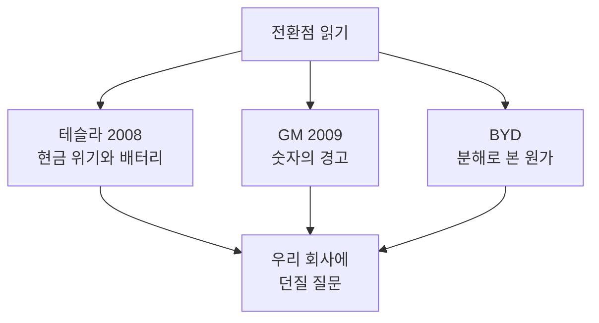

세 케이스는 모두 3-1B에서 «보기 · 읽기» 자료다. 코드나 설치가 필요 없고, 영상과 PDF · md를 보며 토론 질문에 답하면 된다. 이 장은 그 영상들의 줄거리와 숫자를 글로 옮기고, 세 이야기를 한 표로 겹쳐 읽는 데까지 간다. 숫자로 경쟁사를 직접 해독하는 실습은 [05장 숫자로 경쟁사 읽기](05장_숫자로_경쟁사_읽기.md)에서 이어진다.

## 1. 케이스를 읽는 관전법

3-1 과정은 하루를 «훅(Hook) 케이스»로 연다. 훅 케이스는 그날 배울 개념이 몸으로 느껴지게 만드는 짧은 실화다. 테슬라 이야기는 Day1(산업 구조와 소프트웨어 전환), GM 이야기는 Day3(경쟁사 재무)의 문을 연다. BYD 분해 자료는 공급망 특강(SupplyChain_Special) 자료다.

세 케이스를 볼 때는 같은 질문 하나를 계속 던진다.

> **관전법**
> «내가 그때 그 자리에 있었다면 **어느 숫자**를 봤을까?» — GM 케이스 영상이 제안하는 관전법이다. 테슬라는 잔고(현금), GM은 점유율 추세와 레거시 비용, BYD는 원가 격차가 그 숫자다.

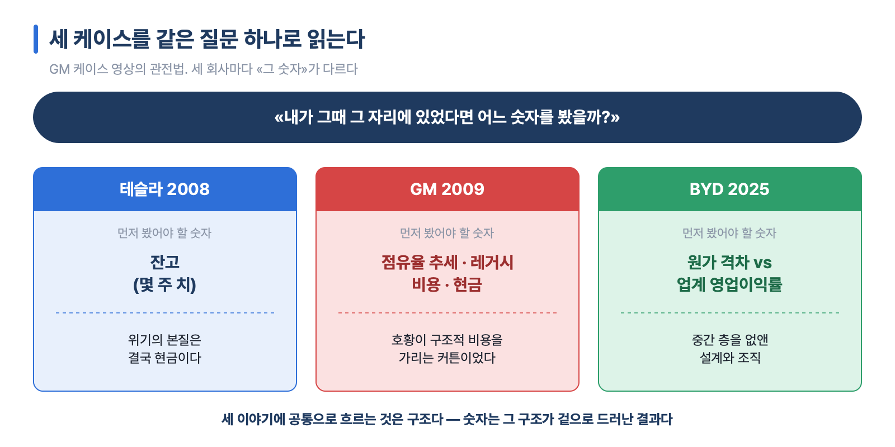

*그림 2-1. 같은 질문 하나로 세 회사를 읽는다. 테슬라는 잔고, GM은 점유율 추세 · 레거시 비용 · 현금, BYD는 원가 격차와 업계 영업이익률. 출처: Day3 01 GM 케이스 영상 · 이 장 5절 표.*

케이스의 수치는 대부분 공개 보도 기준의 **개략치**다. 영상도 «정확한 값보다 규모감과 방향을 잡는 것이 목적»이라고 밝힌다. 이 장도 그 수치를 그대로 옮기고, 출처를 각주에 적는다.

## 2. 테슬라 — 파산 사흘 전에서 배터리 해자까지

### 2-1. 2008년 겨울

3-1B의 테슬라 폴더 이름은 «테슬라_배터리기술혁신»이다. 2008년 위기 이야기는 3-1 본편 Day1 훅 덱 «파산 3일 전 — 2008년 겨울의 테슬라»에 있고[^t1], 3-1B 폴더의 영상은 그 뒤 테슬라가 쌓은 배터리 기술을 설명한다. 두 이야기를 이어 읽으면 «위기 → 생존 → 기술 해자»라는 한 줄이 된다.

| 장면 | 무슨 일이 있었나 | 이 장면이 말하는 것 |
|---|---|---|
| ① 로드스터의 지옥 (2008) | 첫 차 로드스터는 원가가 판매가를 넘었다. 변속기 결함과 부품 수급 지연으로 출고가 밀렸다 | 자동차는 2~3만 부품이 맞물리는 산업이라 소프트웨어처럼 밤새 고칠 수 없다 |
| ② 동시에 무너지다 (2008 가을) | 리먼 사태로 투자 시장이 얼었고, 머스크의 다른 회사 스페이스X는 로켓 발사에 세 번 연속 실패했다. 잔고는 몇 주 치뿐이었다 | 위기의 본질은 결국 현금이다 |
| ③ 크리스마스이브 (2008.12.24) | 머스크가 남은 개인 자금을 회사에 넣었고, 투자 라운드가 마감 직전에 닫혔다 | 투자자가 산 것은 지금의 차가 아니라 미래의 이야기였다 |
| ④ 구원과 반전 (2009~2012) | 다임러가 약 5천만 달러를 투자하고 배터리 기술 협력에 나섰다. 미 에너지부 대출 약 4.65억 달러는 전액 조기 상환됐다. 2012년 무선 업데이트로 진화하는 모델 S가 나왔다 | 백 년 산업이 신인을 구했고, 그 신인이 산업의 규칙을 바꿨다 |

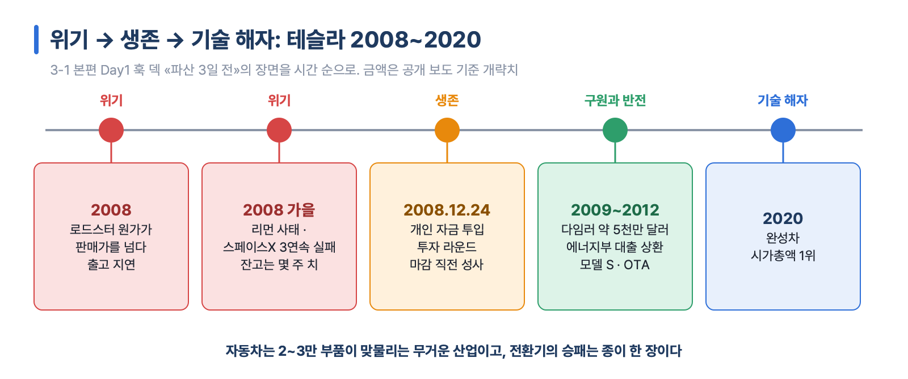

*그림 2-2. 위기(2008) → 생존(2008.12.24) → 구원과 반전(2009~2012) → 기술 해자(2020). 금액은 공개 보도 기준 개략치. 출처: 3-1 본편 Day1 훅 덱 «파산 3일 전».*

훗날 머스크는 «2008년, 우리는 파산까지 3일 남아 있었다»고 회고했다. 그 회사가 2020년에는 완성차 시가총액 1위에 오른다. 덱이 남기는 교훈은 세 가지다.

1. **자동차는 무거운 산업이다.** 부품 · 양산 · 품질의 무게를 아는 것이 분석의 출발점이다.
2. **관점이 자본과 미래를 부른다.** 차를 «탈것»으로 볼지, «업데이트되는 컴퓨터»로 볼지의 차이다.
3. **전환기의 승패는 종이 한 장이다.** 위기와 기회는 같은 시기에 온다.

모델 S에 쓰인 OTA(Over-the-Air, 무선 소프트웨어 업데이트)는 SDV(Software-Defined Vehicle, 기능을 하드웨어가 아니라 소프트웨어가 정하는 차)의 원형으로 소개된다.

### 2-2. 영상이 다루는 배터리 기술 여섯 층위

3-1B 폴더의 영상(약 4분 36초)은 테슬라 배터리 기술 분석 보고서를 나레이션으로 읽어 준다[^t2]. 영상이 짚는 기술은 여섯 가지이고, 결론은 «여섯 층위가 서로 강화하는 복합적 해자(moat, 경쟁사가 넘기 어려운 방어벽)»다.

| 층위 | 기술 | 한 줄 설명 | 영상의 대표 수치 |
|---|---|---|---|
| 화학(셀) | NCA → LFP 이중 전략 | 고급 차종은 고니켈, 보급 차종은 LFP | LFP 사이클 수명 최대 약 5천 회, 비용 20~30% 저렴 |
| 설계(셀) | 4680 탭리스 | 전극 전체 폭을 탭으로 써서 전류 경로를 줄인다 | 2170 대비 용량 약 5배, 출력 약 6배 |
| 공정(전극) | 건식 전극 | 독성 용매와 대형 건조 오븐을 없앤다 | 에너지 소비 약 10분의 1, 전극 2~3배 두껍게 |
| 소프트웨어 | BMS | 수백만 대 주행 데이터로 계속 최적화한다 | 프리컨디셔닝으로 저온 급속충전 시간 약 25~35% 단축 |
| 시스템(팩) | 구조용 배터리 팩 | 배터리 팩이 차체 구조의 일부가 된다 | 비틀림 강성 약 10% 향상, 무게 약 10% 감소 |
| 열관리 | 옥토밸브 | 밸브 하나가 여덟 갈래 열 흐름을 바꿔 준다 | 겨울철 주행거리 약 10~20% 개선 |

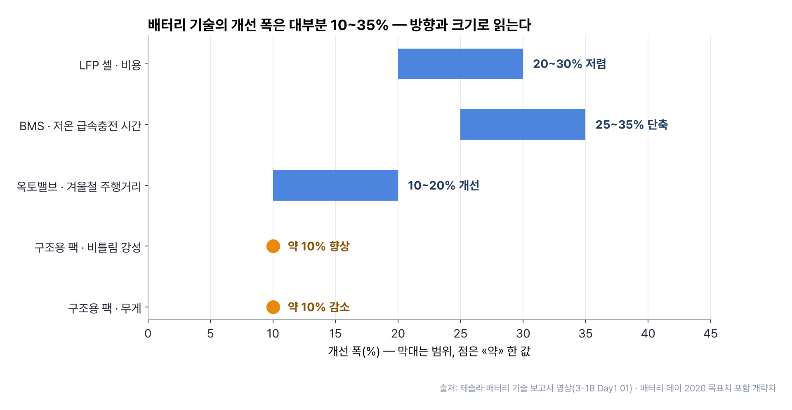

*그림 2-3. % 단위로 말하는 다섯 수치만 모았다. 4680 셀(용량 약 5배)과 건식 전극(에너지 소비 약 10분의 1)은 배수라 빠졌다. 배터리 데이 2020 목표치가 섞인 개략치다. 출처: 3-1B Day1 01 배터리 기술 영상.*

처음 나오는 말을 풀어 둔다.

- **NCA · NMC · LFP**: 배터리 양극재(cathode) 화학 조성의 이름이다. NCA는 니켈·코발트·알루미늄, NMC(업계에서는 NCM이라고도 쓴다)는 니켈·망간·코발트, LFP(Lithium Iron Phosphate)는 리튬인산철이다. LFP는 에너지 밀도가 낮은 대신 코발트를 쓰지 않아 싸고 열에 강하다.
- **4680 · 2170**: 원통형 셀의 크기 이름이다. 앞 두 자리가 지름이라 4680은 지름 46mm, 2170은 21mm다.
- **탭리스(tabless)**: 전극 끝에 작은 금속 탭을 붙이는 대신 전극 가장자리 전체를 전류 통로로 쓰는 설계다.
- **BMS(Battery Management System)**: 셀의 전압 · 온도 · 건강 상태를 감시하고 충전을 조절하는 장치와 소프트웨어다.
- **구조용 배터리 팩**: 배터리 상판이 실내 바닥을 대신해, 차체와 팩이 따로 갖던 구조를 하나로 합친 방식이다. BYD의 CTB(4절)와 같은 방향이다.

> **수치를 읽는 법**
> 보고서는 «4680 + 구조용 팩 + 건식 전극을 합치면 비용 약 56% 절감, 주행거리 약 54% 향상»이라고 정리하지만, 이는 **테슬라 2020년 배터리 데이 발표 기준의 목표치**이고 실제 양산 수치는 공정 성숙도에 따라 달라진다고 스스로 단서를 단다. 건식 전극의 양극 공정은 당초 예상보다 늦어졌다는 점도 같은 보고서에 적혀 있다. 영상의 숫자는 «방향과 크기»로 읽는다.

보고서가 가장 오래 가는 우위로 꼽는 것은 플릿 데이터(fleet data, 운행 중인 차 전체에서 모은 데이터) 기반 BMS 학습이다. 차가 많이 팔릴수록 데이터가 쌓여 기술 격차가 커지는 **네트워크 효과**가 있기 때문이다. 2008년에 «미래의 이야기»를 팔았던 회사가, 그 이야기를 이런 기술로 채워 넣은 셈이다.

## 3. GM — 숫자에 미리 쓰여 있던 몰락

GM(제너럴 모터스)은 77년 동안 세계 판매 1위를 지켰고, «GM에 좋은 것은 미국에 좋다»는 말까지 듣던 회사다. 그 회사가 2009년 6월 1일 법원에 파산보호를 신청했다. 케이스 영상의 메시지는 한 줄이다. **몰락의 신호는 파산 10년 전부터 재무제표에 적혀 있었다.**[^g1]

영상은 오늘 추적할 지표를 세 개로 정한다. **매출 추이 · 수익성 · 현금**이다.

| 장면 | 무슨 일이 있었나 | 걸린 지표 |
|---|---|---|
| ① 영원할 것 같던 1위 | 브랜드 수십 개의 제국. 높은 임금 · 평생 의료 · 연금을 약속했다 | 규모가 안전이 아니라 관성이 됐다 |
| ② 숫자의 경고 | 미국 시장 점유율이 약 50%에서 수십 년에 걸쳐 20%대로 내려갔다. 퇴직자 의료 · 연금(레거시 비용)이 차 한 대 원가에 수천 달러씩 얹혔다 | 매출 추이 · 수익성 |
| ③ 현금이 마르다 | 2005년부터 누적 수백억 달러 규모의 적자, 2008년 금융위기로 판매 급감. 월 단위로 잔고를 세는 처지가 됐다 | 현금 |
| ④ 챕터 11 | 2009.6.1 파산보호 신청(당시 미국 제조업 사상 최대급). 정부 구제금융 약 500억 달러 투입. 브랜드 정리 후 «새 GM»으로 재출발 | 구조조정 |

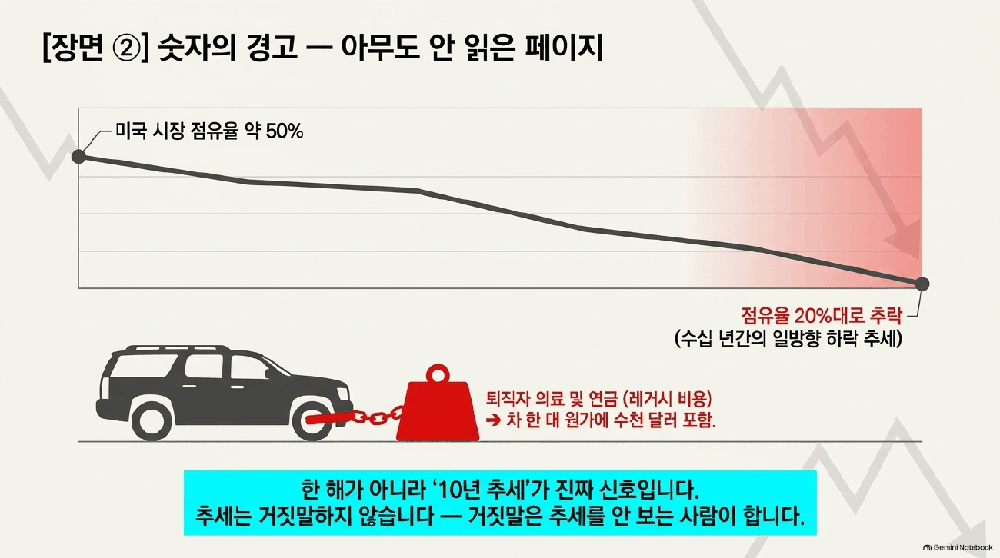

*그림 2-4. 미국 시장 점유율 약 50%에서 20%대로 — 한 해가 아니라 수십 년의 추세가 신호였다. 차 한 대에 수천 달러씩 얹힌 레거시 비용도 같은 장에 있다. 출처: Day3 01 GM 케이스 PDF 4장.*

용어 두 개를 풀어 둔다.

- **레거시 비용(legacy cost)**: 좋은 시절에 약속한 퇴직자 의료 · 연금처럼, 지금 차를 팔지 않아도 계속 나가는 과거의 고정비다.
- **챕터 11(Chapter 11)**: 미국 연방파산법 11장에 따른 파산보호 절차다. 회사를 없애지 않고 법원 감독 아래 빚과 구조를 정리해 다시 출발한다.

장면 ②의 핵심은 «호황은 구조적 비용을 가리는 커튼»이라는 문장이다. SUV(스포츠 유틸리티 차량) 호황이 벌어 준 이익이 점유율 하락과 레거시 비용이라는 경고를 가려 주었다. 장면 ③에서는 «이익은 의견이고 현금은 사실이다»라는 격언이 나온다. 장부에 이익이 찍혀도 현금이 마르면 회사는 버티지 못한다. 이를 **흑자도산**이라고 부른다.

파산 청문회를 앞두고 시장은 «언제부터 알 수 있었는가?»라고 물었다. 영상의 답은 «읽으려 한 사람에게는, 오래전부터»다. 경고는 비밀 문서가 아니라 누구나 볼 수 있는 공시 재무제표 안에 있었다. 문제는 접근이 아니라 독해였다. 한국에서는 DART(전자공시시스템)와 회사 IR(Investor Relations, 투자자 대상 공개 자료)이 누구에게나 열려 있다.

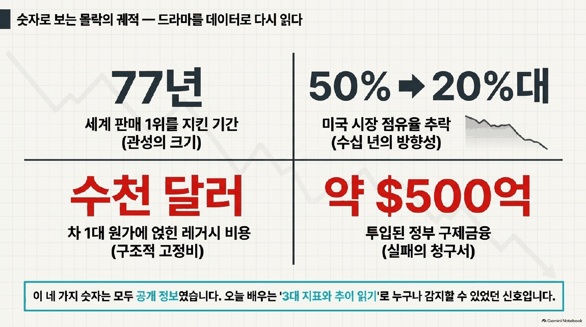

*그림 2-5. 77년 · 50%→20%대 · 수천 달러 · 약 500억 달러. 네 숫자 모두 공개 정보였다. 출처: Day3 01 GM 케이스 PDF 10장.*

> **케이스가 오늘 강의와 만나는 지점**
>
> | 케이스의 장면 | 배우는 도구 | 우리 업무로 번역하면 |
> |---|---|---|
> | 점유율의 긴 하락 추세 | 매출 추이 — 3개년으로 읽기 | 경쟁사의 방향을 추세로 진단한다 |
> | 호황에 가려진 레거시 비용 | 영업이익률 — 수익 구조 해부 | 이익 뒤에 숨은 구조적 비용을 묻는다 |
> | 장부 이익에도 마르는 현금 | 흑자도산 — 현금의 눈 | 이익률만 보고 안심하지 않는다 |

GM 이야기는 금융 쪽으로도 이어진다. GM의 자동차 금융 자회사였던 GMAC은 본업에서 멀리 떨어진 주택담보대출까지 손을 댔다가 금융위기 때 큰 손실을 보고 Ally Financial로 다시 태어났다. 이 대목은 [05장 숫자로 경쟁사 읽기](05장_숫자로_경쟁사_읽기.md)의 «캡티브 금융»에서 다시 다룬다.

## 4. BYD — 차 한 대를 뜯어 보면 보이는 원가 구조

### 4-1. 분해(티어다운)라는 방법

**티어다운(teardown)**은 경쟁 차량을 부품 단위까지 분해해 분석하는 일이고, **코스트 티어다운(cost teardown)**은 분해한 부품마다 원가를 거꾸로 계산하는 일이다. 일본 자동차 업계는 경쟁차를 정가로 사서(특별 사양 논란을 피하려고), 전체 무게를 재고, 부품마다 무게와 6방향 사진을 남긴 뒤 원가를 역산하는 표준 절차를 수십 년 써 왔다[^b1]. 원가 분석가가 답해야 할 질문은 두 가지다. «이 부품을 만드는 데 얼마가 드는가», «우리는 왜 이 가격에 만들 수 없는가».

일본 엔지니어들이 BYD 전기 세단을 나사 하나까지 분해한 영상을 정리한 노트의 결론은 이렇다. 겉모습과 마감은 «평범했다». 진짜 이야기는 차를 들어 올려 바닥을 본 순간 시작됐다.

### 4-2. 다섯 가지 발견

| 발견 | 무엇인가 | 원가에 주는 효과 |
|---|---|---|
| ① CTB | Cell-to-Body. 배터리 상판이 곧 차체 바닥이다 | 모듈 케이스 · 브래킷 · 볼트가 사라지고 조립 공정 수가 줄었다 |
| ② LFP 베팅 | 남들이 «저급 옵션»으로 보던 리튬인산철 배터리를 오래 키웠다 | 원자재 값이 뛰자 차량당 원가 우위로 바뀌었다 |
| ③ 8-in-1 | 구동계 부품 여덟 개를 한 덩어리로 합친 통합 구동 유닛 | 전선 · 커넥터 · 고장 지점 · 조립 시간, 외부 공급사에 내는 돈이 줄었다 |
| ④ 수직계열화 | 배터리 · 전력반도체 · 모터 · 전장을 거의 직접 만든다 | 협력사 단계마다 붙던 마진이 사라진다 |
| ⑤ 존 아키텍처 | 위치별 고성능 컴퓨터 몇 대가 차를 제어한다 | 배선이 짧고 가벼워지고, OTA가 쉬워진다 |

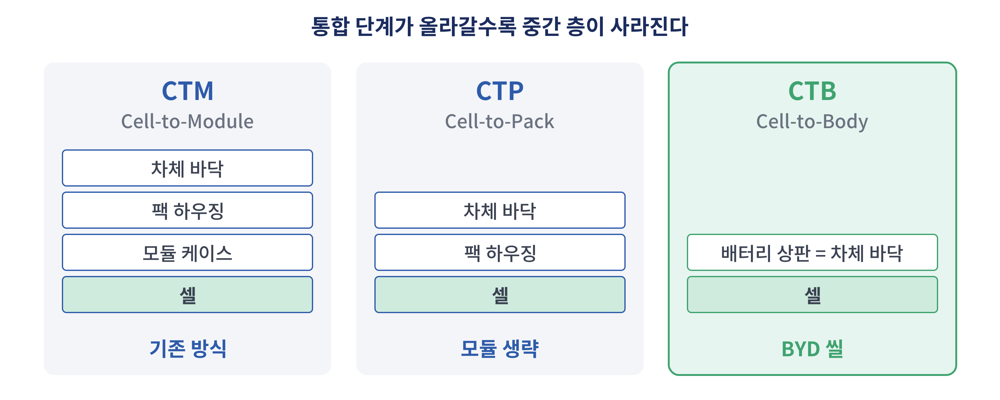

배터리는 **셀(Cell, 전기를 저장하는 최소 단위) → 모듈(Module, 셀 여러 개를 케이스에 묶은 중간 단위) → 팩(Pack, 모듈과 냉각 · BMS를 담은 최종 상자)**의 세 층으로 이루어진다. 모듈을 없애고 셀을 팩에 바로 넣으면 **CTP(Cell-to-Pack)**, 팩 상자까지 없애고 셀을 차체에 붙이면 **CTB**다. BYD는 2022년 출시한 씰에 CTB를 처음 적용했고, 씰의 팩 높이는 110mm다. BYD는 차체 강성이 두 배라고 밝혔다. BYD의 LFP 셀은 길고 얇은 **블레이드 배터리(Blade Battery)**로, 자회사 FinDreams가 만든다.

8-in-1에 들어가는 부품 이름도 정리해 둔다. **인버터**는 배터리 직류를 모터용 교류로 바꾸고, **OBC(On-Board Charger, 차량 탑재 충전기)**는 외부 교류 전기를 배터리용 직류로 바꾸며, **DC-DC 컨버터**는 고전압을 12V 전장용 저전압으로 낮춘다. 8-in-1은 BYD 전기차 전용 플랫폼 **e-Platform 3.0**(2021)의 핵심이다.

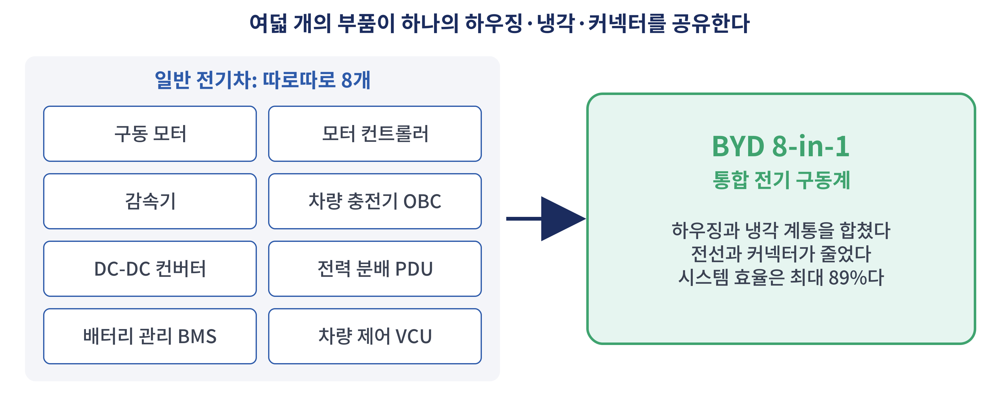

*그림 2-6. 따로따로 있던 구동계 부품 여덟 개가 하우징 · 냉각 · 커넥터를 함께 쓴다. 출처: 공급망 특강 BYD 분해 정리(BYD_EV_Teardown/figures).*

존 아키텍처는 기존 구조와 비교하면 이해가 쉽다. 기존 차는 수십 개의 **ECU(Electronic Control Unit, 특정 기능을 맡은 전자 제어기)**가 차 곳곳에 흩어져 있고, ECU마다 공급사가 달라 아무도 전체를 한 번에 고치지 못한다. 존 아키텍처는 앞 · 뒤 · 실내를 맡는 컴퓨터 몇 대로 정리해 **와이어링 하니스(wiring harness, 차 전체를 잇는 배선 묶음)**가 짧아지고, 제조사가 전체를 통제하므로 OTA로 밤사이 크루즈 컨트롤이나 회생제동 감각을 바꿀 수 있다.

### 4-3. 수직계열화 — 원가와 회복력을 함께 얻다

**수직계열화(vertical integration)**는 원재료부터 부품 · 조립 · 판매까지 가치사슬의 여러 단계를 한 회사가 직접 소유하고 운영하는 전략이다. 이에 맞서는 일본식 모델이 **계열(keiretsu)**, 곧 완성차를 정점으로 협력사가 층층이 묶인 공급망이다.

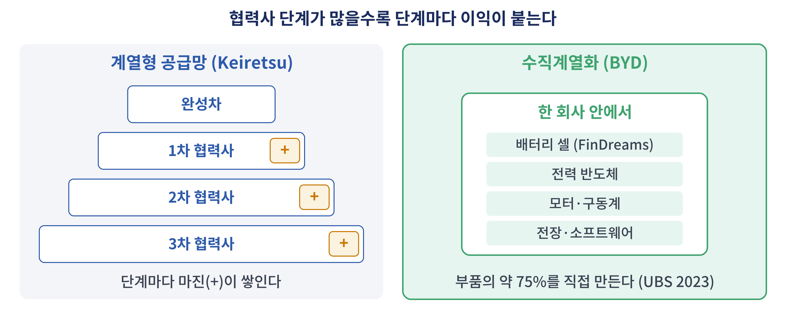

전기차로 바뀌면 움직이는 부품 수가 크게 줄고, 가장 비싼 부품은 엔진에서 배터리로 바뀐다. 그러자 계열형 공급망이 «단계마다 각자 마진을 요구하는 중간 단계의 연쇄»로 보이기 시작했다. BYD 덱의 개념도는 왼쪽(협력사 피라미드)에서 마진이 네 번, 오른쪽(BYD)에서 한 번 붙는 모습으로 이를 보여 준다. 블록 높이는 실제 비율이 아닌 설명용이다.

수직계열화는 원가만이 아니라 **공급망 회복력**도 준다. 여기서 두 낱말이 나온다.

- **JIT(Just-in-Time, 적시 생산)**: 필요한 부품을 필요한 때 필요한 만큼 협력사에서 들여와 재고를 최소로 두는 방식. 도요타 생산방식의 핵심이다.
- **JIC(Just-in-Case, 만일 대비 공급망)**: 공급 차질에 대비해 핵심 부품과 생산 능력을 회사 안에 두거나 여유분을 확보하는 방식이다.

2021년 차량용 반도체가 끊기자 세계 곳곳의 조립 라인이 멈췄다. BYD는 2004년 세운 반도체 계열사가 배터리 관리 · 모터 제어 칩을 만들어 상대적으로 덜 흔들렸다. 다만 덱은 이 효과를 «정성적 서술 · 단일 출처»라고 밝히고 숫자로 단정하지 않는다.

### 4-4. 원가 판정과 약점

원가 격차는 몇 %가 아니라 두 자릿수였다. 업계 영업이익률이 약 8%인 상황에서 그보다 큰 원가 격차는 협력사 단가 협상으로 메울 수 없다. 노트는 이를 «협상의 문제가 아니라 판결»이라고 표현한다.

> **원가 격차 숫자는 출처마다 다르다**
> - 일본 엔지니어 분해 영상: 같은 사양을 일본 · 유럽 업체가 만들면 원가가 **약 30%** 높다. (영상 자동 자막 기준, 별도 검증 안 됨)
> - UBS Evidence Lab(2023, 스위스 투자은행의 분석 조직)의 씰 분해: 부품 약 **75%**를 BYD가 직접 만들고, 원가는 테슬라 모델3(상하이) 대비 **15%**, 유럽 업체 대비 **25%**, VW ID.3(유럽) 대비 **35%** 낮다.
> - BYD 쇼릴 제작 노트는 «30%»를 출처 미확인으로 보고 화면에 넣지 않았다. 용어집 덱은 «영상 속 일본 분석은 약 30%, UBS는 약 25%»라고 둘 다 적는다.

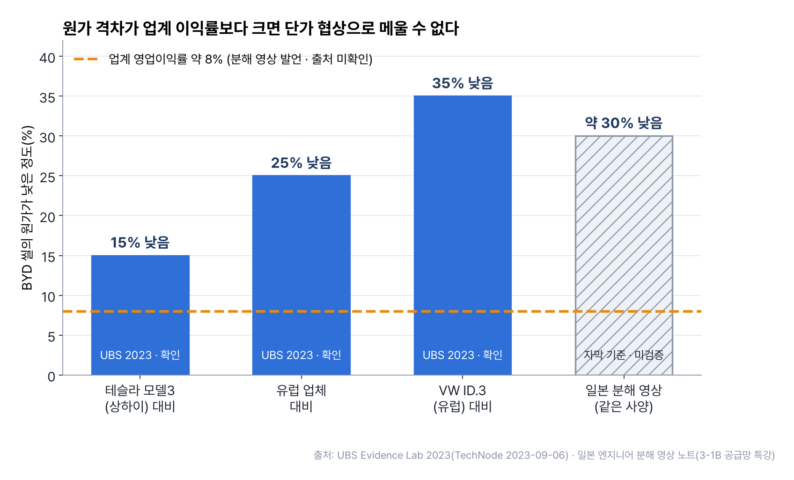

*그림 2-7. UBS 분해(확인)로 15 · 25 · 35%, 일본 분해 영상(자막 기준 · 미검증)으로 약 30%. 어느 쪽이든 «업계 영업이익률 약 8%»(영상 발언, 출처 미확인)보다 크다. 출처: UBS Evidence Lab 2023 · 분해 영상 노트.*

분해 보고서는 약점도 공정하게 적었다. 이 균형이 티어다운 보고서를 믿을 만하게 만든다.

| 약점 | 관찰 | 의미 |
|---|---|---|
| 소재 | 알루미늄 대신 철강을 많이 써서 무겁다 | 전기차에서 무게는 달릴 때마다 내는 세금이다 |
| 실내 | 보이는 곳은 고급, 뜯으면 단순한 플라스틱과 스펀지 | 결함이 아니라 돈 쓸 곳을 고른 전략이다 |
| 품질 일관성 | 용접 편차가 일본 차보다 컸다 | 제조 공정이 아직 성숙 단계가 아니다 |
| 장기 내구성 | 10~15년 뒤 상태를 검증할 자료가 없다 | 업력이 짧아 실사용 데이터가 부족하다 |

### 4-5. 결과와 의미

BYD는 2025년 순수 전기차(BEV, Battery Electric Vehicle) 2,254,714대를 팔아 테슬라(1,636,129대 인도)를 처음 연간 기준으로 앞섰다. 플러그인 하이브리드를 포함한 전체 판매는 460만 대, 해외 판매는 100만 대를 넘었다[^b2].

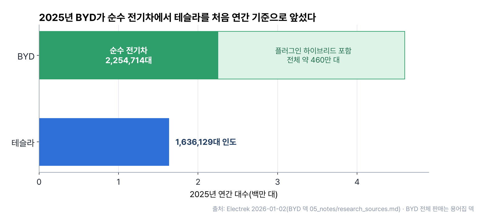

*그림 2-8. BYD 순수 전기차 2,254,714대, 테슬라 1,636,129대 인도. BYD는 플러그인 하이브리드를 포함하면 약 460만 대. 출처: Electrek 2026-01-02 · BYD 용어집 덱.*

용어집 덱의 종합은 세 문장이다.

1. **복제품이 아니라 백지에서 다시 설계한 차다.** 오래된 공장과 장기 협력 계약이 없다는 점이 가장 강한 무기가 됐다.
2. **원가는 부품 단가가 아니라 층의 개수로 정해진다.** CTB · 8-in-1 · 존 아키텍처 · 수직계열화는 모두 중간 층을 없애는 방향이다.
3. **일본은 조용히 분해하고, 합치고, 다시 설계한다.** 경쟁사끼리 손잡고 전고체 배터리(전해질을 고체로 바꾼 차세대 배터리)와 단순한 설계에 승부를 걸었다. 도요타는 2027~28년 첫 전고체 EV 출시를 목표로 한다.

일본은 1997년 세계 첫 양산 하이브리드차, 2010년 대중시장 순수 전기차를 먼저 내놓았지만 당시 충전 인프라 · 소비자 준비 · 배터리 가격을 근거로 하이브리드에 집중했다. 덱은 «당시 데이터로는 실수가 아니었다»고 본다. 진짜 전장은 일본 안이 아니라 동남아 · 남미 · 중동 · 아프리카와 가격에 민감한 일부 유럽, 곧 **제3시장**이다. 이곳은 일본차가 오래 이익을 낸 곳이고, 현대차 · 기아가 정면으로 경쟁하는 곳이기도 하다.

## 5. 세 회사를 겹쳐 읽기

| 질문 | 테슬라 2008 | GM 2009 | BYD 2025 |
|---|---|---|---|
| 위기 또는 전환의 모습 | 파산 사흘 전 | 77년 1위의 파산보호 | 분해해 보니 원가 격차가 두 자릿수 |
| 먼저 봤어야 할 숫자 | 잔고(몇 주 치) | 점유율 추세 · 레거시 비용 · 현금 | 원가 격차 vs 업계 영업이익률 |
| 가른 것 | 관점(«업데이트되는 컴퓨터») · 외부 자금 | 구조를 스스로 못 바꾼 관성 | 중간 층을 없앤 설계와 조직 |
| 우리에게 남는 질문 | 우리는 제품을 무엇으로 보고 있는가 | 우리 회사의 레거시 비용은 무엇인가 | 협력사 단계가 많은 우리 공급망은 어떻게 바뀌어야 하나 |

세 이야기에 공통으로 흐르는 것은 **구조**다. 테슬라는 2~3만 부품의 무게에 짓눌렸다가 배터리 · 소프트웨어로 구조를 바꿨고, GM은 좋은 시절의 약속이 고정비라는 구조로 굳어 버렸으며, BYD는 처음부터 층이 적은 구조로 시작했다. 숫자는 그 구조가 겉으로 드러난 결과다.

## 실습 길잡이

| 순서 | 3-1B 폴더 | 난이도 | 하는 일 | 걸리는 시간 |
|---|---|---|---|---|
| 1 | [Day1 01 테슬라_배터리기술혁신_영상](../보충교재/Day1_시장트렌드/01_테슬라_배터리기술혁신_영상/) | 1단계 · 영상 보기 | 배터리 기술 영상(4:36) 시청 | 5분 |
| 2 | [Day3 01 GM몰락_케이스영상](../보충교재/Day3_경쟁사재무/01_GM몰락_케이스영상/) | 1단계 · 보기만 | 모션그래픽(1:23) → MotionLecture판(5:51) → PDF 14장 | 15분 |
| 3 | [BYD_EV_Teardown](../보충교재/SupplyChain_Special/01_BYD_수직계열화_티어다운/BYD_EV_Teardown/) | 1단계 · 읽기 | 분해 정리 md → 용어집 덱(32장) | 30분 |
| 4 | [BYD_Final](../보충교재/SupplyChain_Special/01_BYD_수직계열화_티어다운/BYD_Final/) | 1단계 · 영상 | 모션그래픽 42초 · 쇼릴 60초, 출처 정리 md | 10분 |

**사람이 할 일**: 영상과 문서를 보고, 아래 토론 질문에 조별로 답한다. 숫자를 인용할 때는 각주의 출처와 기준일을 함께 적는다.

**Claude Code가 할 일**: 이 세 폴더는 보기 · 읽기 자료라 원재료에 정해진 실습 프롬프트가 없다. 문서를 요약하거나 표로 다시 묶고 싶다면 Claude 데스크톱 앱에 PDF · md를 올려 묻는 정도로 충분하다. 숫자를 직접 모으고 비교하는 프롬프트는 [05장 숫자로 경쟁사 읽기](05장_숫자로_경쟁사_읽기.md)의 실습 길잡이에 있다.

원재료에 실린 토론 질문(조별 10분)을 옮긴다.

```text
[테슬라 2008]
Q1 · 2008년의 당신이 다임러 임원이라면, 파산 직전의 테슬라에 투자했겠는가 — 근거는?
Q2 · 테슬라가 판 것은 자동차인가, 이야기인가 — 우리 회사는 무엇을 팔고 있는가?
Q3 · 위기가 온다면 우리 회사가 끝까지 지켜야 할 한 가지는 무엇인가?

[GM 2009]
Q1 · 재무제표의 어느 페이지에서 가장 먼저 신호가 보였을까? 당신이라면 어느 숫자를 봤겠는가?
Q2 · 경영진은 왜 보지 못했을까, 혹은 보고도 움직이지 못했을까?
Q3 · 좋은 시절의 약속이 남긴 «레거시 비용», 우리 회사의 무거운 고정비는 무엇인가?

[BYD]
Q1 · 원가 격차 25~30% 가운데 구조 요인과 보조금·규모 요인은 각각 얼마나 될까?
Q2 · 협력사 단계가 많은 한국 부품 생태계는 어떤 형태로 재편되어야 할까?
Q3 · 품질 일관성과 내구성은 시간이 해결할 약점인가, 오래 지킬 해자인가?
Q4 · 전고체 배터리는 LFP가 쌓은 원가 우위를 넘을 수 있을까?
```

> **공개 전 확인**
> BYD_Final의 `04_images` 사진 7장은 참고 유튜브 영상의 캡처라 사용 허락이 필요하다(BYD_Final README). 사내 발표 자료에 옮길 때는 `BYD_EV_Teardown/figures`의 직접 그린 도해를 쓴다.

## 자동차 현장에 옮기기

| 부서 | 이 장에서 가져갈 질문 | 출발점이 된 장면 |
|---|---|---|
| 구매 · 협력사 관리 | 우리 부품이 원재료에서 완성차까지 몇 단계를 거치며, 단계마다 붙는 마진은 얼마인가 | BYD 마진 개념도 · 계열형 공급망 |
| 재무 · 경영기획 | 이익이 아니라 현금으로 몇 달을 버틸 수 있는가. 호황에 가려진 고정비는 무엇인가 | GM 장면 ②·③ · 테슬라 장면 ② |
| 연구개발 · 설계 | 우리 제품에서 «중간 층»(케이스 · 브래킷 · 별도 하우징)을 없앨 수 있는 곳은 어디인가 | CTB · 8-in-1 |
| 생산 · SCM | 핵심 부품 가운데 JIT로 둘 것과 JIC로 안에 둘 것을 나누는 기준은 무엇인가 | 2021년 반도체 대란 |
| 해외영업 · 전략 | 제3시장에서 가격으로 밀고 들어오는 경쟁사에 맞설 우리의 근거는 무엇인가 | BYD 제3시장 · 일본의 대응 |

## 정리

1. 전환점은 뉴스보다 **현금 · 추세 · 원가 구조**에 먼저 나타난다.
2. 테슬라 2008은 «위기의 본질은 현금», 그 뒤의 배터리 여섯 층위는 «기술이 쌓여 해자가 된다»를 보여 준다.
3. GM 2009는 공시된 재무제표 안의 점유율 추세 · 레거시 비용 · 현금이 10년 앞서 경고했다는 이야기다.
4. BYD 분해는 원가가 부품 단가가 아니라 **층의 개수**로 정해진다는 것을 보여 준다.
5. 케이스의 숫자는 개략치다. 출처와 기준일을 붙여 «방향과 크기»로 읽는다.

## 확인 문제

**1.** 테슬라 케이스에서 «위대한 기술도 급여일 앞에서는 평등하다»는 문장이 말하는 위기의 본질은 무엇인가? 같은 교훈이 GM 케이스의 어느 장면에서 반복되는가?

> **답**
> 위기의 본질은 **현금**이다. 테슬라는 잔고가 몇 주 치뿐이었고, GM은 장면 ③ «현금이 마르다»에서 월 단위로 잔고를 세는 처지가 됐다. GM 영상은 이를 «이익은 의견이고 현금은 사실이다», «기업을 죽이는 것은 적자가 아니라 현금 고갈»이라고 정리한다.

**2.** GM 영상이 정한 «3대 생존 지표» 세 가지를 쓰고, 각 지표가 GM에서 보낸 경고를 한 줄씩 적어라.

> **답**
> - 매출 추이: 미국 점유율이 약 50%에서 수십 년에 걸쳐 20%대로 한 방향으로 내려갔다.
> - 수익성: 레거시 비용이 차 한 대 원가에 수천 달러씩 얹혔고, SUV 호황 이익이 이를 가렸다.
> - 현금: 2005년부터 대규모 적자, 2008년 판매 급감으로 현금이 빠르게 소진됐다.

**3.** CTM · CTP · CTB의 차이를 «무엇이 사라지는가»로 설명하라.

> **답**
> CTM(Cell-to-Module)은 셀 → 모듈 케이스 → 팩 하우징 → 차체 바닥의 기존 방식이다. CTP는 **모듈 케이스**를 없애고 셀을 팩에 바로 넣는다. CTB는 **팩 하우징**까지 없애고 배터리 상판을 차체 바닥으로 쓴다. 층이 줄수록 부품 · 볼트 · 조립 공정이 줄고, 차체를 낮출 수 있다.

**4.** BYD의 원가 격차를 영상은 약 30%, UBS는 유럽 업체 대비 약 25%로 봤다. 숫자가 다른데도 두 출처가 같은 결론(«협상으로 못 메운다»)에 이르는 이유는 무엇인가?

> **답**
> 두 숫자 모두 **업계 영업이익률(약 8%)보다 훨씬 크기** 때문이다. 격차가 몇 %라면 협력사 단가 협상으로 줄일 수 있지만, 이익률보다 큰 격차는 같은 가격에 팔면 팔수록 손해가 된다. 그래서 «협상의 문제가 아니라 판결»이다. 숫자가 출처마다 다르므로 인용할 때는 출처를 함께 적는다.

**5.** JIT와 JIC를 한 줄씩 정의하고, 2021년 반도체 대란에서 BYD가 상대적으로 덜 흔들린 이유를 수직계열화와 연결해 설명하라.

> **답**
> JIT는 재고를 최소로 두고 협력사 네트워크에서 필요한 때 들여오는 효율 중심 방식, JIC는 차질에 대비해 핵심을 안에 두는 회복력 중심 방식이다. BYD는 2004년 세운 반도체 계열사가 배터리 관리 · 모터 제어 칩을 직접 만들어, 협력사에 칩을 맡긴 회사보다 덜 흔들렸다. 다만 원재료는 이 효과를 정성적 서술 · 단일 출처로 밝히므로 숫자로 단정하지 않는다.

## 더 보기

- 다음 장: [03장 데이터를 그림으로](03장_데이터를_그림으로.md) — 스킬을 설치해 숫자를 차트 · 인포그래픽 · 대시보드로 바꾼다.
- 관련 장: [05장 숫자로 경쟁사 읽기](05장_숫자로_경쟁사_읽기.md) — GM 케이스의 세 지표를 해외 5개사 공시로 직접 계산한다.
- 원자료
  - [테슬라 배터리 기술 영상 폴더](../보충교재/Day1_시장트렌드/01_테슬라_배터리기술혁신_영상/)
  - [GM 몰락 케이스 영상 · PDF · 피드백 뷰어](../보충교재/Day3_경쟁사재무/01_GM몰락_케이스영상/)
  - [BYD 분해 정리 md](../보충교재/SupplyChain_Special/01_BYD_수직계열화_티어다운/BYD_EV_Teardown/BYD_Teardown_Japan_Engineers.md)
  - [BYD 용어집 덱 PDF](../보충교재/SupplyChain_Special/01_BYD_수직계열화_티어다운/BYD_EV_Teardown/BYD_EV_Teardown_Glossary.pdf)
  - [BYD 사실 확인 표](../보충교재/SupplyChain_Special/01_BYD_수직계열화_티어다운/BYD_Final/05_notes/research_sources.md)

[^t1]: 3-1 본편 [Day1 훅 덱 «파산 3일 전»](https://github.com/keerhee/kma-auto-genai-3-1/blob/main/Day1_%EC%8B%9C%EC%9E%A5%ED%8A%B8%EB%A0%8C%EB%93%9C/Day1_1_Hook_Case_Tesla2008_deck.pdf)(11장). 수치는 덱이 «공개 보도 기준의 개략치 — 규모감 목적»이라고 밝힌 값이다. 3-1B 폴더에는 이 덱이 없고 배터리 기술 영상만 있어, 링크는 3-1 공개 저장소의 PDF를 가리킨다.
[^t2]: 영상 나레이션은 «테슬라 배터리 핵심 기술 혁신 심층 보고서»(작성 기준일 2026년 3월, 출처: 테슬라 배터리 데이 2020 발표 자료 · 공개 기술 문헌 · 업계 분석)의 요약이다. 표의 수치는 영상과 보고서에 함께 나오는 값만 옮겼다.
[^g1]: 3-1B 폴더의 MotionLecture판(5:51)과 PDF 14장 기준. 수치는 영상이 «공개 보도 · 공시 기준의 개략치»라고 밝힌 값이다.
[^b1]: 분해 정리 md의 원본은 유튜브 영상 자동 생성 자막(약 19분)이다. 영상은 차종을 «BYD의 전기 세단»이라고만 하며, 자막상 아토3 · 씰 · 돌핀이 거론된다. 자막의 수치는 별도로 검증되지 않았다.
[^b2]: 판매 대수는 Electrek 2026-01-02(BYD_Final 사실 확인 표)와 용어집 덱 8 · 27번 슬라이드(회사 공시 기준). 75% · 15/25/35%는 TechNode 2023-09-06의 UBS 분석, 8-in-1은 InsideEVs 2024-10-24(일본 중부경제산업국 세미나)가 출처다.
