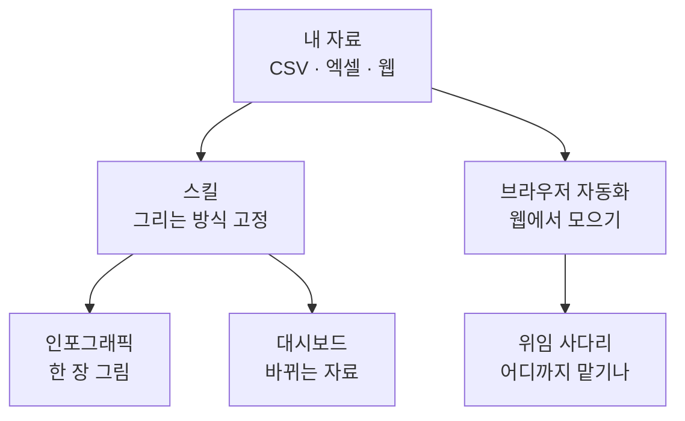
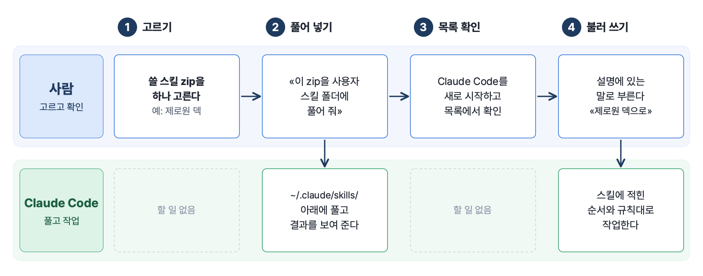
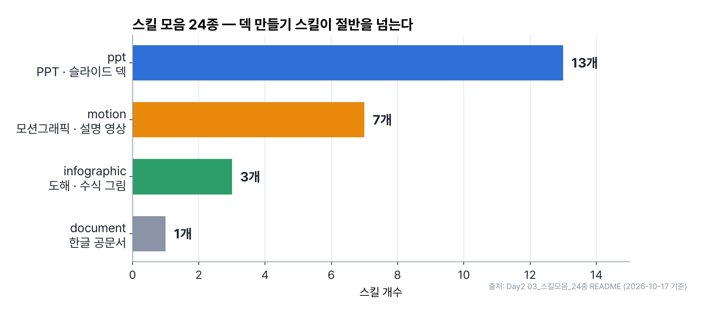
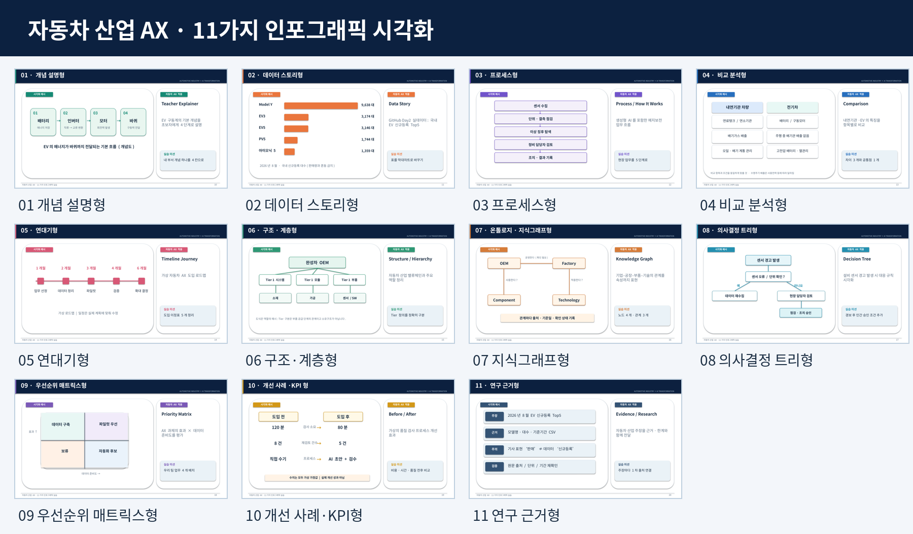
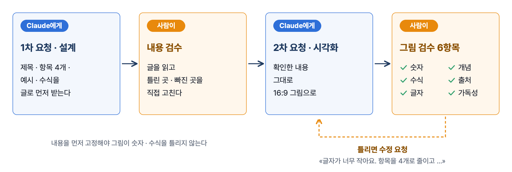
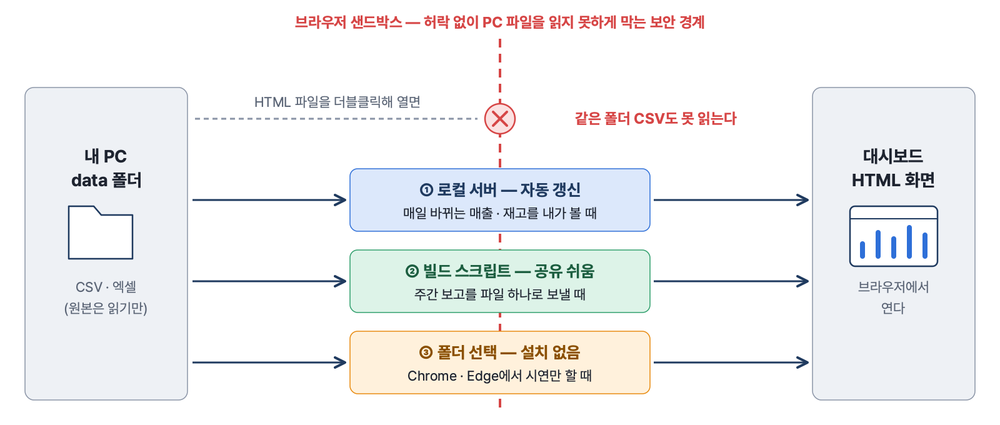
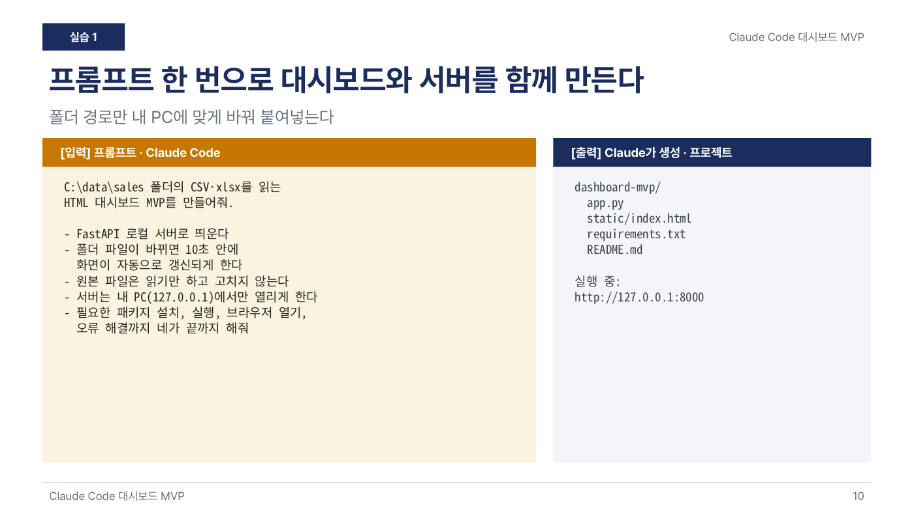
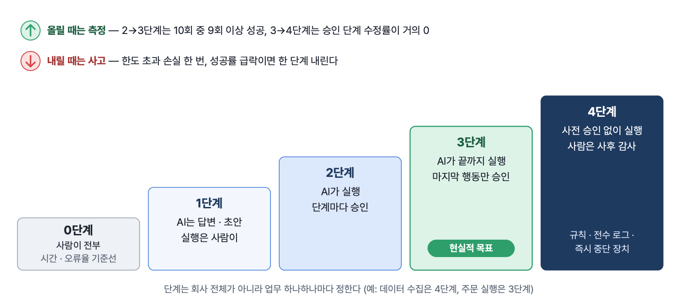
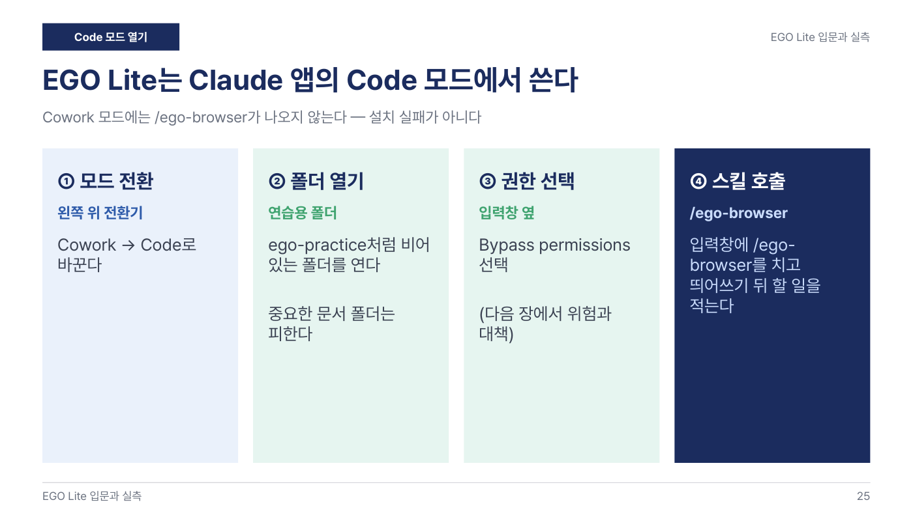

# 3장 데이터를 그림으로 — 스킬 · 인포그래픽 · 대시보드 · 브라우저 자동화

> **이 장의 한 줄**
> 그림을 그리는 일은 Claude Code에게 맡기되, **무엇을 보여 줄지 · 숫자가 맞는지 · 어디까지 맡길지**는 사람이 정한다. 스킬로 그리는 방식을 고정하고, 인포그래픽은 내용부터 검수하고, 대시보드는 내 PC 자료와 안전하게 잇고, 웹 작업은 승인 지점을 정한 뒤 맡긴다.

## 이 장에서 배우는 것

1. 스킬(skill)이 무엇이고, 스킬 zip 하나를 Claude Code에 설치해 쓰는 흐름을 설명할 수 있다.
2. 전하려는 질문에 맞춰 인포그래픽 11가지 유형 중 하나를 고르고, «내용 먼저 · 그림 나중» 두 번의 요청으로 만든다.
3. 내 PC 폴더의 CSV · 엑셀을 대시보드에 잇는 세 가지 방법(로컬 서버 · 빌드 · 폴더 선택)을 상황에 맞게 고른다.
4. AI 브라우저 자동화 도구로 공개 웹페이지 작업을 맡기고, 좋은 지시문 다섯 요소와 안전 수칙을 지킨다.
5. 위임 사다리 0~4단계로 «이 업무를 AI에게 어디까지 맡길지» 판정한다.

## 큰 그림



이 장의 다섯 폴더는 한 줄로 이어진다. 자료를 모으고(브라우저 자동화), 같은 방식으로 그리게 하고(스킬), 한 장으로 설명하거나(인포그래픽) 계속 바뀌는 자료를 화면에 띄운다(대시보드). 그 사이사이에 «사람이 어디서 확인하는가»를 정하는 틀이 위임 사다리다.

> **이 장에서 쓰는 도구**
> 기본 도구는 Claude 데스크톱 앱의 Code 탭(Claude Code, 내 컴퓨터의 폴더를 열어 파일을 읽고 쓰고 프로그램을 실행하는 Claude)이다. 사람은 프롬프트를 붙여 넣고 결과를 확인한다. 설치 · 코드 작성 · 오류 수정은 Claude Code가 한다. 준비 방법은 [01장 AI와 일하는 준비](01장_AI와_일하는_준비.md)에 있다.

## 1. 스킬 — 한 번 설치해 두는 작업 설명서

### 1.1 스킬이란

스킬(skill)은 **Claude Code가 특정 작업을 늘 같은 방식으로 하도록 적어 둔 설명서 묶음**이다. 폴더 하나에 `SKILL.md`(이름 · 언제 쓰는지 · 작업 순서 · 지킬 규칙)가 들어 있고, 필요하면 참고 문서 · 예시 그림 · 보조 프로그램이 함께 들어 있다. 인포그래픽 워크숍 덱은 스킬을 «같은 작업 규칙을 반복해서 사용하는 재사용 가능한 작업 설명서»라고 부른다.

스킬은 사용법을 적은 문서이지 프로그램 자체가 아니다. 그래서 스킬을 설치해도 그림을 굽는 도구(예: Node.js, Python)가 따로 깔리지는 않는다. 처음 쓸 때 빠진 도구가 있으면 Claude Code가 설치를 제안하고, 사람은 그 제안을 읽고 승인한다.[^tools]

### 1.2 설치는 이렇게 나눈다

| 순서 | 사람이 할 일 | Claude Code가 할 일 |
|---|---|---|
| 1 | 쓸 스킬 zip을 고른다 | — |
| 2 | «이 zip을 사용자 스킬 폴더에 풀어 줘»라고 시킨다 | `~/.claude/skills/` 아래에 풀고 결과를 보여 준다 |
| 3 | Claude Code를 새로 시작하고 스킬 목록에 보이는지 확인한다 | — |
| 4 | 스킬 설명에 있는 표현으로 부른다(예: «제로원 덱으로 만들어줘») | 스킬의 순서와 규칙대로 작업한다 |



*그림 3-1. 스킬 설치 네 단계. 사람은 고르고 · 시키고 · 확인하고 · 부르며, 압축 풀기와 실제 작업은 Claude Code가 한다. 출처: Day2 03_스킬모음_24종 README · 인포그래픽 워크숍 덱 27장.*


claude.ai 웹이나 데스크톱 앱의 채팅(Chat)에서는 설정 → 기능(Capabilities) → 스킬에서 zip을 그대로 올리면 된다. 모든 프로젝트에서 쓰려면 사용자 스킬 폴더에, 한 프로젝트에서만 쓰려면 그 프로젝트 폴더 안 `.claude/skills/`에 둔다.

### 1.3 Day2의 스킬 두 묶음

**① 인포그래픽 스킬 두 개**(02 폴더). 금융교육용 `finance-infographic`과 자동차 산업 교육용 `auto-ax-infographic`이 들어 있다. 자동차판은 시장 · 공급망 · 생산 · 품질 · 영업 · VOC(Voice of Customer, 고객의 소리) · 예지보전 내용을 11가지 인포그래픽으로 만들고 검증하는 스킬이며, 6단계 작업 순서(업무 문제 → 데이터 → 유형 → 생성 → 검증 → 산출)를 따른다.

**② 스킬 모음 24종**(03 폴더). 분야별로 zip 하나에 스킬 하나씩 묶었다(2026-10-17 기준).

| 묶음 | 개수 | 대표 스킬 | 이렇게 부른다 |
|---|---:|---|---|
| ppt — PPT · 슬라이드 덱 | 13 | `zeroone-pitch-deck`, `report-navy-deck`, `jj-brief-deck`, `bj-deck`, `slide-master`, `html-ppt` | «제로원 덱», «네이비 리포트 덱», «JJ 덱», «SVG로 PPT» |
| infographic — 도해 · 수식 그림 | 3 | `svg-infographic`, `obsidian-infographic`, `latex-svg-render` | «구조도 그려줘», «mermaid», «수식 PNG» |
| motion — 모션그래픽 · 설명 영상 | 7 | `motion-studio`, `flow-diagram-video`, `concept-explainer-video`, `motion-lecture` | «쇼츠 만들어줘», «흐름도 영상», «개념 설명 영상» |
| document — 한글 공문서 | 1 | `kordoc` | «한글 파일 읽어줘», «보고서를 hwpx로», «신구대조표» |



*그림 3-2. 스킬 모음 24종의 묶음별 개수. 덱(ppt) 13 · 모션 7 · 도해 3 · 공문서 1. 출처: Day2 03_스킬모음_24종 README(2026-10-17 기준).*


> **24종 전체 목록 (zip의 SKILL.md 첫머리 기준)**
> | 묶음 | 스킬 | 한 줄 설명 |
> |---|---|---|
> | ppt | `zeroone-pitch-deck` | 다크 잉크 표지 + 아이보리 본문 + 라임 포인트의 사업제안 · IR형 덱 |
> | ppt | `report-navy-deck` | 네이비 표지 + 화이트 본문의 리포트형 강의 · 발표 덱 |
> | ppt | `report-white-deck` | 미니멀 화이트 리포트형 덱 |
> | ppt | `apple-white-deck` | 애플 keynote 톤의 화이트 미니멀 덱 |
> | ppt | `jj-brief-deck` | 블루 상단바 + 섹션 탭 칩의 설명자료(브리핑)형 덱 |
> | ppt | `jaykong-research-deck` | 기관 리서치 톤 장표(KEY INSIGHT 박스, 비교 차트) |
> | ppt | `bj-deck` | 크림 배경 · 골드 바 · 네이비 카드의 발제 · 리뷰형 덱 |
> | ppt | `auto-ppt` | 다크 네이비 + 오렌지 테마 덱(템플릿 모듈 포함) |
> | ppt | `pptx` | PPTX 읽기 · 편집 · 생성 기본 스킬(Anthropic 기본 제공) |
> | ppt | `slide-master` | SVG로 그린 페이지를 클릭 편집되는 PPTX 도형으로 변환 |
> | ppt | `image-fullbleed-deck` | 완성된 인포그래픽 · 카드뉴스 이미지를 꽉 차는 PPT로 묶기 |
> | ppt | `html-ppt` | 템플릿 기반 HTML 프레젠테이션 |
> | ppt | `web-slides` | 라이브러리 없이 HTML · CSS · JS로 만드는 웹 슬라이드 |
> | infographic | `svg-infographic` | 구조도 · 흐름도 · 비교 · 로드맵 SVG 인포그래픽을 PNG로 굽기 |
> | infographic | `obsidian-infographic` | 옵시디언 · GitHub에서 한 화면에 들어오는 Mermaid · SVG · 표 |
> | infographic | `latex-svg-render` | LaTeX 수식과 SVG 도해를 PNG로 렌더(한글 폰트 처리 포함) |
> | motion | `motion-studio` | 글 · 문서를 9:16 쇼츠나 16:9 모션그래픽 영상으로 |
> | motion | `showreel` | 콘셉트부터 음악 · 나레이션 · 검수까지 하는 홍보 · 소개 영상 |
> | motion | `remotion-motion-catalog` | 효과 이름(106종)으로 Remotion 모션그래픽 |
> | motion | `flow-diagram-video` | 노드 · 화살표가 단계별로 나타나는 구조 · 절차 설명 영상 |
> | motion | `concept-explainer-video` | 나레이션에 맞춰 카드가 나타나는 개념 설명 영상 |
> | motion | `motion-lecture` | 덱이나 대본을 Remotion으로 다시 그리는 나레이션 강의영상 |
> | motion | `ic-webtoon-short` | 개념 하나를 6컷 9:16 웹툰 숏폼(30~45초)으로 |
> | document | `kordoc` | HWP · HWPX · PDF 읽기, 공문서 HWPX 생성, 신구대조, 표기법 검수, 개인정보 마스킹 |

덱 스킬은 기관명 · 로고를 기본으로 넣지 않는다. 넣고 싶으면 요청할 때 따로 말한다. 덱 스킬은 수식(`latex-svg-render`) · 도해(`svg-infographic`) 스킬과 함께 쓰도록 짜여 있어서 같이 설치하면 결과가 좋다.

## 2. 인포그래픽 — 질문에 맞는 유형을 고르고, 내용부터 검수한다

### 2.1 인포그래픽은 «예쁜 그림»이 아니다

워크숍 덱의 정의는 «정보를 이해하기 쉽도록 재구성한 시각적 설명»이다. 많이 넣는 것보다 «독자가 무엇을 이해해야 하는가»가 먼저다. 그래서 유형은 주제 이름이 아니라 **전달하려는 질문**으로 고른다.

| 독자가 묻는 질문 | 유형 | 그림의 뼈대 | 검수 포인트 |
|---|---|---|---|
| 이게 무엇인가요? | ① 개념 설명형 | 정의 → 직관 → 핵심 요소 → 예제 | 정의와 예제가 일치하는가 |
| 숫자가 무엇을 말하나요? | ② 데이터 스토리형 | 핵심 숫자 + 차트 + 출처 | 합계 100%인가, 단위가 있나 |
| 어떤 순서로 하나요? | ③ 프로세스형 | 시작 → 단계 → 결과 → 피드백 | 빠진 단계 · 되돌아갈 지점 |
| 어떤 점이 다르죠? | ④ 비교 분석형 | 공통 기준으로 나란히 | 비교 기준이 같은가 |
| 언제 무슨 일이 있었죠? | ⑤ 연대기형 | 연도 + 사건 + 의미 | 날짜와 사건이 정확한가 |
| 큰 구조는 어떻게 생겼나요? | ⑥ 계층 구조형 | 상위 개념 → 하위 구성 | 포함 관계와 업무 흐름 구별 |
| 무엇이 무엇과 연결되죠? | ⑦ 지식그래프형 | 노드 + 관계명 + 화살표 | 거래 증거가 없으면 «가상» |
| 상황에 따라 어떻게 하죠? | ⑧ 의사결정 트리형 | 질문 → 예/아니요 → 행동 | 모든 갈림길에 결과가 있나 |
| 두 기준으로 나누면? | ⑨ 매트릭스형 | 가로축 × 세로축 | 축 기준 · 구간 정의 |
| 무엇이 바뀌었나요? | ⑩ 전후 비교형 | Before → 바뀐 점 → After | 비교 조건이 같은가 |
| 결과를 믿어도 될까요? | ⑪ 연구 근거형 | 주장 → 근거 → 한계 → 다음 검증 | 실증과 추측을 구분했나 |

자동차 예로는 ⑥에 «완성차 · 1차 협력사 · 2차 협력사» 밸류체인, ⑦에 «자동차 부품 공급망(가상 예시)», ⑨에 «위험 발생 가능성 × 영향도»가 덱에 실려 있다.[^styles]



*그림 3-3. 자동차 산업판 11가지 인포그래픽 예시 모음. 그림 속 수치 · 관계는 설명용 예시이며 사실 자료가 아니다. 출처: Day2 02_인포그래픽_스킬 auto-ax-infographic 참고 이미지.*


### 2.2 잘되는 프롬프트의 여섯 재료

프롬프트는 마법의 문장이 아니라 빈칸을 정확히 채우는 일이다. 덱이 제시한 여섯 재료는 **주제 · 독자 · 목적 · 구조 · 스타일 · 검증**이다. 아래는 덱의 기본 프롬프트를 그대로 옮긴 것이다. 대괄호만 내 업무로 바꾼다.

```text
초보자를 위한 교육용 인포그래픽을 설계해주세요.
주제: [CAPM의 베타]   대상: [금융 초보]
독자가 이해할 핵심: [베타의 의미와 직관]
유형: [① 개념 설명형]  섹션: [4개]
구성: 제목 → 쉬운 정의 → 핵심 개념 → 가상 예제 → 주의점
디자인: 흰 배경 · 네이비/민트 · 큰 글씨 · 간단한 아이콘
먼저 내용과 수식을 텍스트로 보여주고, 검수 후 이미지화하세요.
확인되지 않은 수치·출처는 만들어내지 마세요.
```

### 2.3 두 번 요청하고, 그림은 반드시 검수한다

1. **1차 요청(설계)** — «제목 · 4개 항목 · 예시 · 수식을 먼저 텍스트로 정리해줘.» 사람이 내용을 읽고 고친다.
2. **2차 요청(시각화)** — «방금 확인한 내용 그대로, 16:9 인포그래픽으로 만들어줘.»
3. **수정 요청** — «글자가 너무 작아요. 항목을 4개로 줄이고 중요한 단어만 굵게 해주세요.»



*그림 3-4. 인포그래픽은 내용(1차)과 그림(2차)을 나눠 요청하고, 그 사이와 끝에 사람이 검수한다. 틀리면 수정 요청으로 되돌린다. 출처: 인포그래픽 워크숍 덱 23 · 24장.*


이미지 생성 모델은 수식을 잘못 그리거나 없는 수치를 만들어 넣을 수 있다. 그래서 그림을 받으면 **숫자(합계 · 단위 · 기간 · 분모) · 개념 · 수식 · 출처 · 글자(오탈자 · 잘림) · 가독성** 여섯 가지를 확인한다. 데이터로 다시 그릴 수 있는 차트는 따로 만드는 편이 안전하다.

> **초보자가 자주 하는 실수 네 가지**
> ① «멋지게 만들어줘»만 요청한다 → 누구에게 · 무엇을 · 몇 개로를 지정한다. ② 한 장에 글자를 너무 많이 넣는다 → 핵심 3~5개로 줄이고 두 장으로 나눈다. ③ AI가 쓴 숫자와 출처를 그대로 믿는다 → 원자료와 대조한다. ④ 그림 파일만 받고 내용을 저장하지 않는다 → 원본 데이터 · md · 편집 파일을 함께 보관한다.

자동차판 스킬(`auto-ax-infographic`)은 여기에 «강행 제한»을 더한다. 실측 값 · 공시 · 판매 · 등록 수치 · 재무지표 · 기업 간 공급 관계를 임의로 만들지 않고, 등록과 판매 · 출하와 인도 · BEV(배터리 전기차)와 PHEV(플러그인 하이브리드) · Tier(협력사 차수)와 소유 관계를 구분하며, 가상 센서 · VOC 자료에는 «실습용 가상 데이터»를 앞쪽에 밝힌다. 예지보전 탐지값으로 고장을 확정하거나 설비 자동 정지를 유도하지 않는다는 규칙도 있다.

### 2.4 덱 한 편을 A4 인포그래픽 여러 쪽으로

04 폴더는 덱 한 편을 A4 세로 인포그래픽 여러 쪽으로 이미지 생성 AI에게 그리게 하는 프롬프트 예시다. 프롬프트는 두 층으로 나뉜다.

| 층 | 무엇 | 바꿀 것 |
|---|---|---|
| `[STYLE]` | 모든 쪽에 공통인 캔버스 · 색 · 헤더 · 섹션 띠 · 카드 · KPI · 표 · 일러스트 · 금지 사항 | 그대로 재사용(러닝헤드 · 푸터 문구만 바꾼다) |
| `[PAGE 1]~[PAGE 7]` | 쪽마다 들어갈 문구를 따옴표로 고정 | 내 자료의 내용으로 바꾼다 |

핵심은 첫 줄의 지시다.

```text
아래 [STYLE]을 모든 페이지에 공통 적용하고, [PAGE 1]~[PAGE 7]을 순서대로 각각 별도 이미지(A4 세로)로 생성해 줘.
1쪽에서 정한 색·폰트·섹션 띠·아이콘·일러스트 스타일을 2쪽 이후에도 그대로 유지해.
따옴표 안 문구는 한 글자도 바꾸지 말고 정확히 렌더링해.
```

예시의 쪽 내용은 Day4 ORCA 가이드 덱을 옮긴 것이라 ORCA 문구가 나온다. 다른 덱에 쓸 때는 `[STYLE]`은 두고 `[PAGE]` 블록만 바꾼다. `[STYLE]`에는 «로고 · 워드마크 · 기관명 · 실사 인물 · 가짜 글자 · 텍스트 겹침 금지»가 이미 들어 있다.

## 3. 로컬 자료를 대시보드로 — 브라우저의 보안 경계를 넘는 세 방법

### 3.1 왜 HTML 파일 혼자서는 안 되는가

대시보드(dashboard, 여러 지표를 한 화면에 모은 현황판)를 HTML 파일로 만들고 더블클릭해 열면, 같은 폴더의 CSV조차 마음대로 불러오지 못한다. 브라우저 샌드박스(sandbox, 웹페이지가 허락 없이 내 PC 파일을 읽지 못하게 막는 보안 경계) 때문이다. 악성 사이트가 개인 파일을 빼 가지 못하게 하려는 장치다. 그래서 **자료와 화면 사이에 자료를 읽어 주는 통로**를 하나 둔다.

### 3.2 세 가지 통로

| 기준 | ① 로컬 서버 | ② 빌드 스크립트 | ③ 폴더 선택 |
|---|---|---|---|
| 작동 원리 | 내 PC에서 Python 서버(FastAPI · Flask)가 data 폴더를 읽어 보낸다 | 스크립트가 자료를 HTML 안에 담아 새 `dashboard.html`을 만든다 | 사용자가 «폴더 선택» 버튼으로 허락하면 브라우저가 직접 읽는다(File System Access API) |
| 자동 갱신 | 된다 | 다시 빌드해야 한다 | 된다 |
| 설치 | Python이 필요하다 | Python이 필요하다 | 필요 없다 |
| 남에게 보내기 | 어렵다 | 파일 하나로 쉽다 | 보통이다 |
| 브라우저 | 어디서나 된다 | 어디서나 된다 | Chrome · Edge만 된다 |
| 어울리는 장면 | 매출 · 재고처럼 수시로 바뀌는 파일을 매일 본다 | 주간 보고처럼 한 번 만들어 팀에 보낸다 | 회의실 PC에서 시연만 하고 끝낸다 |



*그림 3-5. 더블클릭으로 연 HTML은 샌드박스에 막혀 PC 폴더를 못 읽는다. 로컬 서버 · 빌드 스크립트 · 폴더 선택 중 하나를 통로로 둔다. 출처: 대시보드 MVP 덱 3~9장.*


고르기 어렵다면 ①로 시작하고, 공유가 필요해질 때 ②를 덧붙인다. 덱의 결론도 같다. «자동 갱신이 중요하면 서버, 공유가 중요하면 빌드.»

### 3.3 프롬프트 한 번으로 서버와 화면을

사람은 폴더 경로만 내 PC에 맞게 바꿔 붙여 넣는다. 패키지 설치 · 실행 · 브라우저 열기 · 오류 해결은 Claude Code가 끝까지 한다.

```text
C:\data\sales 폴더의 CSV·xlsx를 읽는
HTML 대시보드 MVP를 만들어줘.
- FastAPI 로컬 서버로 띄운다
- 폴더 파일이 바뀌면 10초 안에
  화면이 자동으로 갱신되게 한다
- 원본 파일은 읽기만 하고 고치지 않는다
- 서버는 내 PC(127.0.0.1)에서만 열리게 한다
- 필요한 패키지 설치, 실행, 브라우저 열기,
  오류 해결까지 네가 끝까지 해줘
```



*그림 3-6. 실습 1 장표. 왼쪽 프롬프트를 폴더 경로만 바꿔 붙여 넣으면 오른쪽 dashboard-mvp 폴더가 생기고 127.0.0.1:8000에서 열린다. 출처: 대시보드 MVP 덱 10장.*

MVP(Minimum Viable Product)는 핵심 기능만 넣어 바로 써 볼 수 있게 만든 첫 버전이다. 결과로 `dashboard-mvp/` 폴더(app.py · static/index.html · requirements.txt · README.md)가 생기고 `http://127.0.0.1:8000`에서 화면이 열린다. 이어서 확인과 보강도 말로 시킨다.

```text
sales 폴더 CSV에 테스트 행을 하나 추가해서
화면이 자동으로 바뀌는지 확인하고 결과를 알려줘
```

같은 방식으로 «월별 매출 추이 선 그래프와 지역별 막대 그래프, 상단 핵심 수치 카드 3개», «서버 없이 열리는 dashboard.html 하나로도 만들고 매일 아침 9시에 자동 생성되게 예약»을 차례로 요청한다.

> **자동 연결에서 지킬 선**
> 원본 파일은 읽기만 하게 한다. 서버는 127.0.0.1(내 PC 안에서만 열리는 주소)에서만 열게 한다. 민감 자료 폴더는 연결하지 않는다. 엑셀 파일이 열려 있으면 읽기가 막힐 수 있고, 한글 CSV가 깨지면 «인코딩을 고쳐 줘»라고 하면 된다. 포트 충돌은 Claude Code가 바꿔 준다.

## 4. 브라우저 자동화 — 웹에서 하는 일을 AI에게 맡기기

### 4.1 «설명하는 AI»에서 «대신 하는 AI»로

브라우저 자동화는 AI가 웹페이지를 열고, 읽고, 클릭하고, 입력하게 하는 일이다. 06 폴더는 세 방식을 비교한다.

| 방식 | 대표 도구 | 강점 | 한계 |
|---|---|---|---|
| 브라우저 내장형 | Aside | 로그인 유지, 창 충돌 없음 | 새 브라우저 설치 필요 |
| 확장 프로그램형 | Claude in Chrome | 쓰던 Chrome 그대로 | 내 브라우저를 함께 사용 |
| 코드형 | Claude Code + Playwright | 반복 실행 · 재현성 | 설치 · 코드 이해 필요 |

여기서 쓰는 말을 먼저 정리한다. 에이전트(agent)는 목표를 받으면 스스로 단계를 정해 도구를 쓰고 행동하는 AI다. 에이전트 브라우저(agent browser)는 AI 에이전트가 조종하도록 만든 브라우저다. MCP(Model Context Protocol)는 Claude Code와 다른 프로그램의 기능을 잇는 연결 규약이고, Playwright는 Microsoft가 공개한 브라우저 자동화 도구다.

EGO Lite는 Chromium(크롬의 바탕 엔진) 기반 무료 브라우저로, Claude Code 같은 외부 에이전트가 조종한다. AI는 내 탭이 아니라 Space(작업마다 쿠키 · 저장소가 분리된 AI 전용 탭 묶음)에서 일하고, 화면 사진 대신 Snapshot(버튼 · 입력칸에 번호를 붙여 줄인 페이지 요약본)을 읽는다. Aside는 AI가 브라우저 안에 들어 있는 도구다. 덱의 정리는 «한 번에 끝내려면 Aside, Claude Code와 엮으려면 EGO Lite»다.[^cost]

### 4.2 도구 고르기 — 처음부터 다 설치하지 않는다

설치 가이드 md는 도구 10종을 다루지만, 권장 진도는 하나씩이다.

| 차시 | 도구 | 난이도 | Claude Code 연결 | 완료 기준 |
|---|---|---|---|---|
| 1차시 | agent-browser → Playwright CLI | 1단계 → 2단계 | 스킬 | `example.com` 열기 · 스냅샷 · 스크린샷 |
| 2차시 | EGO Lite → Aside | 1단계 → 2단계 | 스킬 / MCP | 별도 브라우저에서 공개 페이지 읽기 |
| 3차시 | Playwright MCP → Chrome DevTools MCP | 2단계 | MCP | Claude Code에서 공개 페이지 점검 |
| 심화 | Playwright Python → Browser Use → Stagehand v4 → Skyvern | 2~4단계 | 코드 · API | 구조화 추출 · 서비스 기동 |

설치도 Claude Code에게 맡긴다. 사람은 Claude Code가 보여 주는 «실행할 명령 · 바뀔 파일 · 네트워크 접근» 설명을 읽고 승인한다. 가이드 md의 «안전형 통합 프롬프트» 핵심 부분이다.

```text
내 컴퓨터에서 브라우저 자동화 실습 도구를 설치하는 조교 역할을 해 줘.
1. 먼저 OS, 셸, Node.js/npm, Python, Claude Code 및 도구의 기존 설치 상태를 확인해.
2. 이미 설치된 프로그램은 다시 설치하지 마.
3. 설치 대상은 한 번에 하나만: 먼저 agent-browser.
5. 실행하려는 설치 명령, 예상 파일 변경, 네트워크 접근을 설명하고 내 승인을 받아.
7. 결과를 설치_기록.md에 명령/출력/성공 여부/오류/재시도 방법으로 기록해.
8. 비밀번호, 쿠키, API 키를 읽거나 노출하지 말고, 불필요한 관리자 권한 또는
   권한 확인 생략 모드를 사용하지 마.
9. 성공 확인 전에는 다음 도구를 설치하지 마.
```

EGO Lite는 Claude Code 채팅창에 저장소 주소 한 줄(`Set up ego lite for me: https://github.com/citrolabs/ego-lite`)을 붙여 넣으면 Claude Code가 내려받기 · 설치 · 보안 차단 해제 · 실행 확인을 한다. 사람은 설치 허락에 «예»를 누르고 온보딩 화면을 진행한다.

### 4.3 좋은 지시문은 다섯 칸을 채운다

| 칸 | 무엇 | 예 |
|---|---|---|
| ① 어디서 | 대상 사이트 | 사이트 이름 · 주소를 정확히 |
| ② 무엇을 | 결과물 형태 | 표 · 목록 · 요약 |
| ③ 어디에 | 저장 파일 | `news.md` |
| ④ 금지 | 하지 말 것 | 결제 · 게시 · 발송 · 삭제 |
| ⑤ 멈출 곳 | 사람 확인 | «제출 전에 멈추고 나에게 물어봐» |

«뉴스 정리해줘»처럼 쓰면 AI가 사이트 · 개수 · 형식 · 저장 위치를 추측해야 하고, 헛걸음과 사용량이 늘어난다. 덱의 좋은 예는 이렇다.

```text
/ego-browser 네이버 뉴스 경제 섹션에서
오늘 많이 본 기사 5개의 제목·언론사·
링크를 표로 만들어 news.md로 저장해.
기사에서 확인되지 않는 내용은
'미확인'이라고 적어.
로그인·댓글·공유는 하지 마.
```

맨 앞의 `/ego-browser`는 터미널 명령이 아니라 Claude Code **채팅 입력창**에 치는 스킬 호출이다.

### 4.4 안전 수칙 — «완료»는 «정확»이 아니다

EGO Lite 공식 문서는 Bypass permissions(Claude Code가 단계마다 묻지 않고 명령을 실행하는 모드)를 권장한다. 편하지만 실수로 파일을 지우거나 글을 올려도 중간에 묻지 않는다. 반면 설치 가이드 md는 초보자에게 최소 권한 · 매 단계 확인을 기본값으로 권한다. 이 책은 가이드 md를 따른다. 넓은 권한을 꼭 써야 한다면 아래 다섯 수칙을 먼저 지킨다.[^bypass]

1. 빈 연습용 폴더에서만 실행한다.
2. 지시문에 금지 행동을 적는다. 확인 창이 없으면 지시문이 안전장치다.
3. 비밀번호 · 인증 코드는 채팅에 붙여 넣지 않고 Space에서 사람이 직접 입력한다.
4. 은행 · 회사 같은 중요 계정은 가져오지 않는다.
5. 결과는 원문과 대조한다.

웹 페이지 안에 숨겨 둔 «AI 조종 문장»으로 AI를 속이는 공격을 prompt injection(프롬프트 주입)이라 한다. 공개 페이지라도 결과를 그대로 믿지 않는 이유다. AI가 캡차 · 인증 코드 · 결제 · 게시 앞에서 멈추면 사람이 Space에 들어가 직접 처리하고, Claude Code에 «계속해»라고 말하면 이어서 진행한다.

## 5. 어디까지 맡길까 — 위임 사다리

### 5.1 단계는 «사람이 어디서 승인하는가»로 나눈다

위임(delegation)은 자동화(automation)와 다르다. 자동화는 정해진 규칙을 반복하다가 예외에서 멈추고, 위임은 목표만 주면 방법을 AI가 판단한다. 예외에도 대응하지만 실수할 수 있어서 승인 지점 설계가 필요하다. 위임 사다리는 이 승인 지점으로 다섯 단계를 나눈다. 이 장의 «난이도 1~4단계»와 헷갈리지 않게 여기서는 «위임 0~4단계»라고 부른다.

| 위임 단계 | AI가 하는 일 | 사람이 하는 일 | 핵심 통제 |
|---|---|---|---|
| 0 | 없음 | 전부 | 소요 시간 · 오류율을 재 둔다(기준선) |
| 1 | 답변 · 초안 · 요약 | 판단과 모든 실행 | 시스템 접근 없음, 사실 확인은 사람 |
| 2 | 실제 행동 실행 | 단계마다 승인 | 확인 창, 읽기 전용 계정 |
| 3 | 끝까지 실행 | 외부로 나가는 마지막 행동만 승인 | 승인 화면 근거, 한도, 로그 |
| 4 | 사전 승인 없이 실행 | 규칙 설정 · 사후 감사 | 규칙, 전수 로그, 즉시 중단 장치(kill switch) |



*그림 3-7. 위임 사다리. 단계가 오를수록 사람의 사전 승인이 줄고, 3단계(마지막 행동만 승인)가 현실적 목표다. 올릴 때는 측정, 내릴 때는 사고가 기준이다. 출처: 위임 사다리 덱 4 · 5 · 13장.*


단계는 회사 전체가 아니라 **업무 단위마다** 정한다. 같은 회사에서도 데이터 수집은 4단계, 주문 실행은 3단계일 수 있다. 되돌리기 쉽고 정형적인 업무일수록 높은 단계에 두고, 투자 의견처럼 책임이 큰 판단은 1단계에 묶어 둔다. 덱은 현실적인 목표를 «3단계 — AI가 끝까지 실행하고 사람은 마지막에 승인»으로 잡는다.

### 5.2 올리는 것은 측정, 내리는 것은 사고

같은 업무를 여러 번 실행해 세 비율을 기록한다(2단계 이상에서 매주 집계).

- **성공률(S)** — 결과가 기준을 통과한 비율. 높을수록 맡길 수 있다.
- **개입률(I)** — 승인 외에 사람이 끼어든 비율(재지시 · 막힘 해소).
- **수정률(M)** — 승인 단계에서 사람이 고친 비율. 0에 가까우면 승인이 형식이 되었다는 신호다.

2단계에서 3단계로 올리려면 10회 중 9회 이상 성공하고 개입이 승인 확인 수준이어야 한다. 3단계에서 4단계로 가려면 승인 단계 수정률이 거의 0이고, 실패해도 손실이 감내 한도 안에 갇혀야 한다. 한도 초과 손실이 한 번이라도 나거나 사이트 변경으로 성공률이 급락하면, 원인을 확인할 때까지 한 단계 내린다.

> **통제 없는 4단계 — Knight Capital (2012)**
> 2012년 8월 1일 미국 증권사 Knight Capital에서 배포 오류로 자동 주문 시스템이 45분 동안 폭주해 154개 종목 400만 건 넘게 체결되었고, 손실은 4.6억 달러였다(출처: SEC 2013 제재 결정, 덱 인용). 옛 코드가 남은 서버 1대가 대량 주문을 냈고 이상 경보를 사람이 제때 해석하지 못했다. 덱의 교훈은 «주문 한도와 kill switch가 먼저, 자율 실행은 규칙 · 감사가 갖춰진 뒤»다.

EGO Lite 덱은 이 사다리를 브라우저 실측에 적용한다. 테스트용 Gmail에서 리서치 메일을 모으고 회신 초안을 쓰는 과제에서 «발송 직전에 멈춰» 지시를 3회 모두 지키면 3단계 후보, 한 번이라도 어기면 2단계로 둔다.

## 실습 길잡이

| 순서 | 3-1B 폴더 | 난이도 | 하는 일 |
|---|---|---|---|
| 1 | [04_덱을_A4인포그래픽으로_프롬프트](../보충교재/Day2_데이터시각화/04_덱을_A4인포그래픽으로_프롬프트/) | 1단계 | `[STYLE]` + `[PAGE]` 프롬프트 예시 읽고 내 덱으로 바꾸기 |
| 2 | [02_인포그래픽_스킬](../보충교재/Day2_데이터시각화/02_인포그래픽_스킬/) | 2단계 | 스킬 하나 설치해 쓰기. 워크숍 덱(32장) · 11종 예시 그림 · 옵시디언 볼트 |
| 3 | [03_스킬모음_24종](../보충교재/Day2_데이터시각화/03_스킬모음_24종/) | 2단계 | 필요한 스킬 골라 설치(README의 표 참고) |
| 4 | [05_로컬자료_대시보드_MVP](../보충교재/Day2_데이터시각화/05_로컬자료_대시보드_MVP/) | 2단계 | 덱 14장 + 실습 프롬프트 2개로 내 폴더 대시보드 |
| 5 | [06_AI_브라우저_자동화_도구](../보충교재/Day2_데이터시각화/06_AI_브라우저_자동화_도구/) | 2단계 | 도구 설치 가이드 md, EGO Lite · Aside 덱, 위임 사다리 덱 |

순서는 쉬운 것부터 «프롬프트로 그림 한 장(1, 1단계) → 스킬 설치해 그리기(2) → 그리는 도구 늘리기(3) → 바뀌는 자료 띄우기(4) → 웹에서 모으기(5)»다. Day2 작업 폴더 준비는 [01_ClaudeCode_시작가이드_Day2작업폴더](../보충교재/Day2_데이터시각화/01_ClaudeCode_시작가이드_Day2작업폴더/)와 [01장 AI와 일하는 준비](01장_AI와_일하는_준비.md)에서 먼저 한다.



*그림 3-8. EGO Lite 첫 화면 준비. Code 모드로 바꾸고, 빈 연습용 폴더를 열고, 권한을 고르고, 입력창에 /ego-browser를 친다(권한은 4.4의 안전 수칙을 먼저 읽고 고른다). 출처: EGO Lite 덱 25장.*


자동차 산업 실습으로 바로 쓸 수 있는 프롬프트는 설치 가이드 md의 «실습 B»다.

```text
역할: 자동차 산업 리서치 조교
도구: 설치된 agent-browser (없으면 Playwright CLI)
작업:
1. 공개된 기관·기업의 공식 웹사이트에서 국내 자동차 기업 3곳을 조사한다.
2. 각 기업의 밸류체인 역할(완성차/부품/배터리/소재/소프트웨어)을 구분한다.
3. 각 항목에 공식 출처 URL과 확인 날짜를 기록한다.
4. results.csv와 자동차_산업_요약.md 파일을 만든다.
5. 임의의 관계를 추측해 추가하지 않는다.
제약: 로그인·폼 제출·대량 수집·우회·다운로드·게시 금지.
```

전문과 설치 절차 · 오류 해결은 [설치 가이드 md](../보충교재/Day2_데이터시각화/06_AI_브라우저_자동화_도구/AI_브라우저_자동화_도구_설치_가이드_Obsidian_2026-10-21.md)에 있다.

## 자동차 현장에 옮기기

| 부서 | 적용 예 | 이 장의 도구 | 사람이 쥐는 지점 |
|---|---|---|---|
| 기획 | 완성차 · 1차 · 2차 협력사 밸류체인 한 장 | ⑥ 계층 구조형 인포그래픽 | 포함 관계와 업무 흐름이 섞이지 않았는지 |
| 구매 | 부품 공급망 관계도 | ⑦ 지식그래프형 + 브라우저 실습 B | 거래 증거가 없는 선은 «가상» 또는 삭제 |
| 영업 | 지역별 매출 · 월별 추이 현황판 | 대시보드 ① 로컬 서버 | 원본 읽기 전용, 127.0.0.1 한정 |
| 품질 | 주간 불량 · VOC 보고를 매주 같은 모양으로 | 대시보드 ② 빌드 + 예약 생성 | 가상 VOC면 «실습용 가상 데이터» 표기 |
| 생산 · 설비 | 예지보전 지표 인포그래픽 | `auto-ax-infographic` | 탐지값으로 고장 확정 · 자동 정지 금지, 사람 검토 |

## 정리

1. 스킬은 «같은 방식으로 하라»는 설명서다. 사람은 고르고 부르고, 설치와 작업은 Claude Code가 한다.
2. 인포그래픽은 질문으로 유형을 고르고, 내용을 텍스트로 먼저 검수한 뒤 그린다. AI가 만든 숫자 · 출처 · 관계는 믿지 않고 대조한다.
3. 브라우저는 내 PC 파일을 직접 읽지 못한다. 자동 갱신이면 로컬 서버, 공유면 빌드, 설치 없는 시연이면 폴더 선택을 고른다.
4. 브라우저 자동화 지시문에는 어디서 · 무엇을 · 어디에 · 금지 · 멈출 곳을 쓴다.
5. 위임 단계는 업무마다 정하고, 측정으로 올리고, 사고로 내린다.

## 확인 문제

**1.** «고객이 대출을 받는 5단계»와 «두 기업의 공급 관계»를 그림으로 설명하려 한다. 각각 어떤 유형이 맞는가?

> **답**
> 앞의 것은 단계의 순서를 알려 주므로 ③ 프로세스형, 뒤의 것은 관계의 종류와 방향이 중요하므로 ⑦ 지식그래프형이다. 실제 거래 증거가 없으면 «가상»이라고 표기한다.

**2.** 인포그래픽을 AI에게 맡길 때 «두 번의 요청»은 각각 무엇에 집중하는가?

> **답**
> 1차는 정확한 내용(제목 · 항목 · 예시 · 수식을 텍스트로)에, 2차는 확인한 내용 그대로 보기 좋은 이미지에 집중한다. 이미지 모델은 수식과 수치를 틀리게 그릴 수 있어서 내용을 먼저 고정한다.

**3.** 영업팀이 매일 바뀌는 재고 파일을 혼자 보고 싶다. 팀장은 매주 월요일 결과 파일 하나를 메일로 받고 싶다. 각각 어떤 통로가 맞는가?

> **답**
> 매일 바뀌는 자료를 내가 보는 것은 ① 로컬 서버, 정해진 때 결과를 보내는 것은 ② 빌드 스크립트(예약 생성)다. 덱의 권고대로 ①로 시작하고 공유가 필요할 때 ②를 덧붙이면 된다.

**4.** 다음 브라우저 지시문에서 빠진 칸은 무엇인가? «/ego-browser 경쟁사 신차 뉴스 정리해서 저장해줘.»

> **답**
> 어디서(사이트 이름 · 주소), 무엇을(몇 건을 어떤 표로), 어디에(파일 이름), 금지(로그인 · 댓글 · 공유 금지), 멈출 곳이 모두 빠졌다. «저장해줘»만 있고 파일 이름도 없다.

**5.** 승인 단계 수정률이 몇 달째 0이다. 이것은 무엇을 뜻하고, 무엇을 판단해야 하는가?

> **답**
> 승인이 형식이 되었을 수 있다는 신호다. 3단계에서 4단계로 올릴 조건 중 하나(수정률 거의 0)에 해당하지만, 실패해도 손실이 한도 안에 갇히는지 · 규칙 · 전수 로그 · kill switch가 갖춰졌는지를 함께 확인한 뒤에만 올린다. 승인을 유지할지 없앨지는 덱의 토론 질문(Q4)으로 남아 있다.

## 더 보기

- 앞 장: [02장 산업의 전환점 읽기](02장_산업의_전환점_읽기.md) — 테슬라 · GM · BYD 케이스의 숫자
- 관련 장: [05장 숫자로 경쟁사 읽기](05장_숫자로_경쟁사_읽기.md) — 공시 실적 · 지식그래프. 이 장의 ⑦ 지식그래프형 인포그래픽과 이어진다.
- 다음 장: [04장 AI에게 일 잘 시키기](04장_AI에게_일_잘_시키기.md) — 프롬프트 · 하네스 · 세컨드 브레인 · RAG. 스킬을 직접 만드는 법이 나온다.
- 관련 장: [07장 업무 에이전트 만들기](07장_업무_에이전트_만들기.md), [10장 업무 웹앱 처음부터 끝까지](10장_업무_웹앱_처음부터_끝까지.md)
- 용어: [부록B 용어집](부록B_용어집.md)
- 원자료: [인포그래픽 스킬](../보충교재/Day2_데이터시각화/02_인포그래픽_스킬/) · [스킬 모음 24종 README](../보충교재/Day2_데이터시각화/03_스킬모음_24종/README.md) · [A4 인포그래픽 프롬프트](../보충교재/Day2_데이터시각화/04_덱을_A4인포그래픽으로_프롬프트/README.md) · [대시보드 MVP 덱](../보충교재/Day2_데이터시각화/05_로컬자료_대시보드_MVP/Local_Data_Dashboard_MVP.pdf) · [위임 사다리 덱](../보충교재/Day2_데이터시각화/06_AI_브라우저_자동화_도구/Delegation_Ladder.pdf) · [EGO Lite 덱](../보충교재/Day2_데이터시각화/06_AI_브라우저_자동화_도구/EGO_Lite_Guide.pdf) · [Aside 덱](../보충교재/Day2_데이터시각화/06_AI_브라우저_자동화_도구/Browser_Agent_Delegation_Test_II.pdf)

[^tools]: 스킬 모음 README의 «쓰기 전에 알아 둘 것»: 덱 만들기에는 Node.js + pptxgenjs 또는 Python + python-pptx(PDF 검수에는 LibreOffice), 그림 굽기에는 cairosvg 또는 헤드리스 브라우저(Playwright), 영상에는 Node.js + Remotion과 ffmpeg가 필요하다. 나레이션 영상 스킬의 기본 음성은 강사 맥의 Voicebox 복제음성이라, 다른 PC에서는 edge-tts처럼 설치 없이 쓰는 음성을 고르도록 지시한다. `kordoc`은 Node.js만 있으면 설치 없이 쓴다.
[^styles]: 11종 가운데 ①②③⑤ 네 가지는 원본 SNS 캡처에서 확인된 유형이고, 나머지 일곱 가지는 교육 · 연구용으로 확장한 것이다. 11개 참고 이미지는 패키지를 위해 새로 만든 교육용 재구성 예시이며, 그림 속 통계값과 거래 관계는 설명용 예시이지 사실 자료가 아니다.
[^cost]: 비용은 덱 작성 시점(2026년 10월) 기준이며 바뀔 수 있다. EGO Lite 브라우저는 0원이고 비용은 연결한 에이전트의 요금제에서 나온다. Aside는 Free(월 500 크레딧) · Pro(월 20달러) · Max(월 200달러) 요금제가 있고, 덱은 Free로 한 달 써 본 뒤 크레딧이 모자라면 올리라고 권한다. Aside의 벤치마크 점수(297/300)는 회사가 직접 채점해 공개한 결과라서, 덱은 같은 과제를 직접 반복 측정(과제 3개 × 도구 × 3회)해 고르라고 한다.
[^bypass]: EGO Lite 덱 26 · 32장과 설치 가이드 md의 «권한에 대한 주의»가 서로 다른 기본값을 제시한다. 덱은 공식 문서의 권장을 소개하며 연습용 폴더 · 계정에서만 쓰라고 하고, 가이드 md는 초보자에게 권한 확인 생략 모드를 권하지 않는다.
