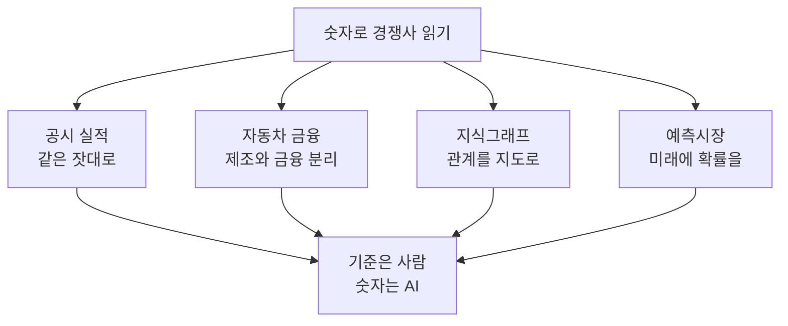
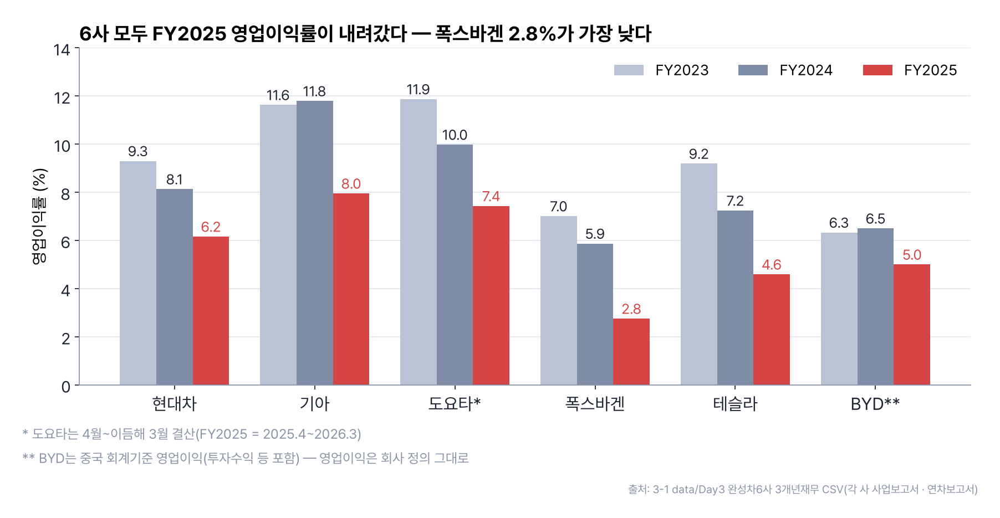
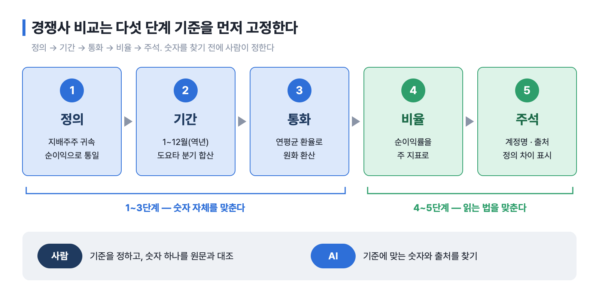
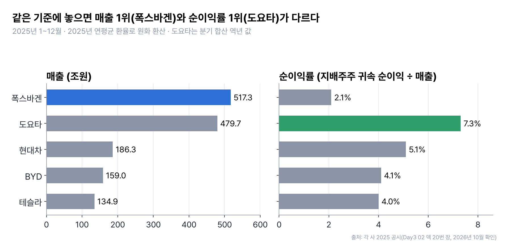
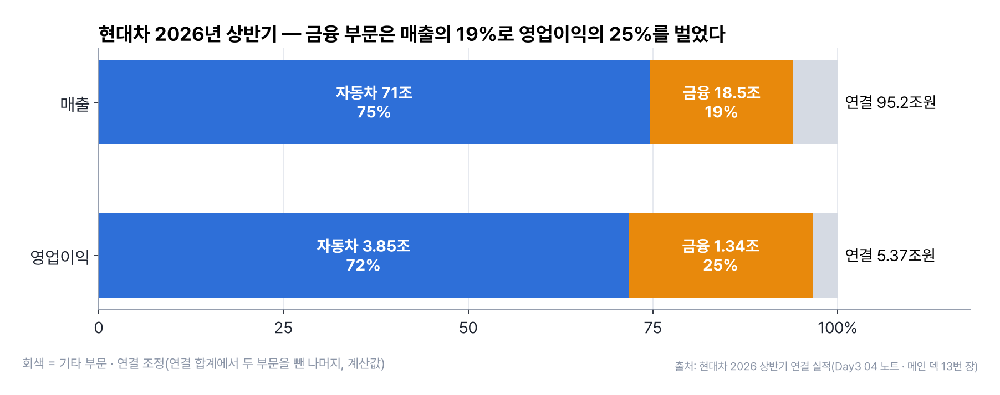
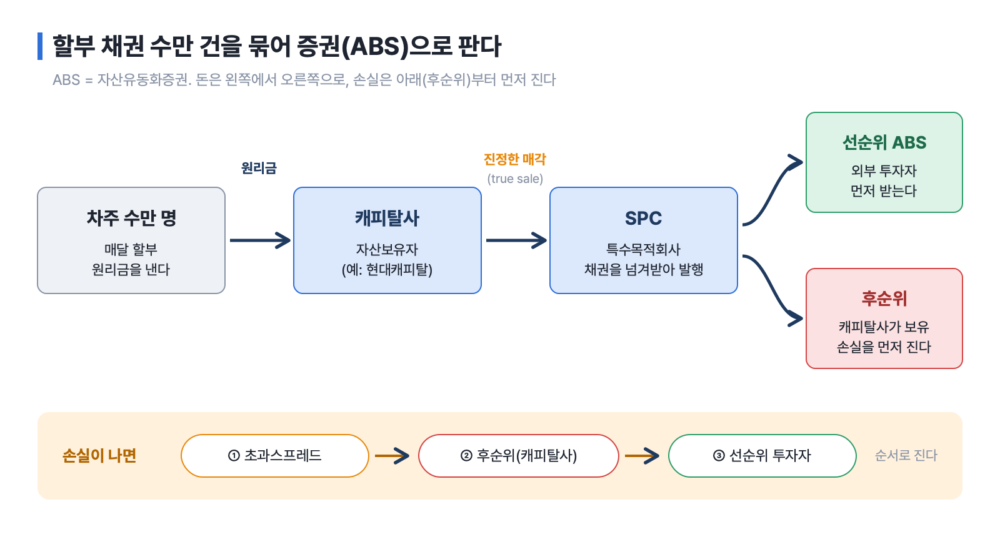
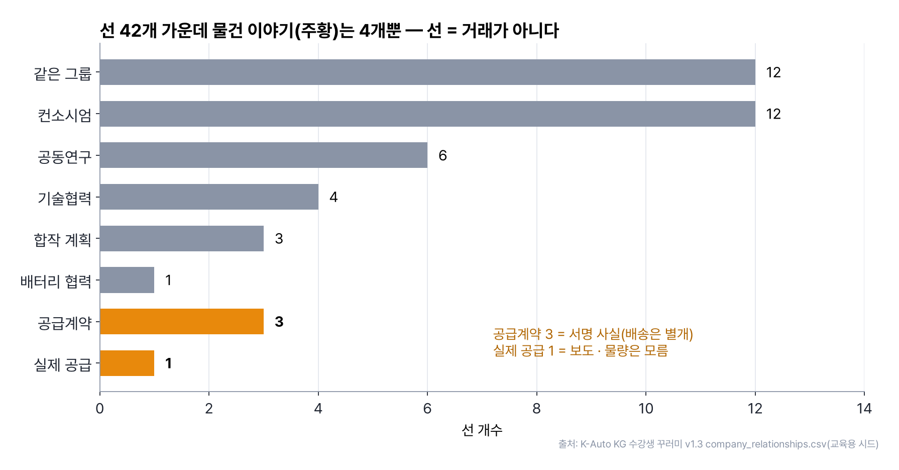
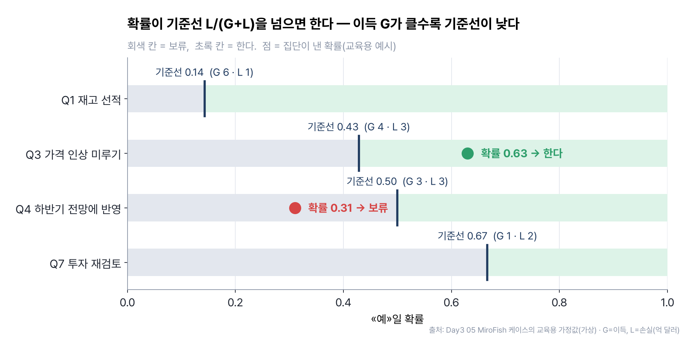
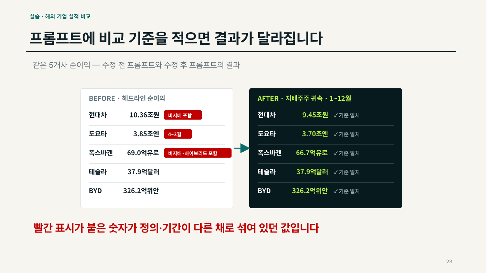

# 5장 숫자로 경쟁사 읽기 — 공시 실적 · 자동차 금융 · 지식그래프 · 예측시장

> **이 장의 한 줄**
> 경쟁사를 숫자로 읽는 일은 **기준을 정하는 사람**과 **숫자를 찾고 계산하는 AI**의 분업이다. 공시 실적을 같은 잣대로 맞추고, 자동차 회사 안의 금융을 떼어 보고, 회사 사이의 관계를 지도로 그리고, 아직 오지 않은 일에 확률을 매기는 네 가지 방법을 익힌다.

## 이 장에서 배우는 것

1. 해외 자동차 5개사 실적을 «정의 → 기간 → 통화 → 비율 → 주석» 다섯 단계로 맞춰 비교할 수 있다.
2. 캡티브 금융 · 할부 · 리스 · ABS · 공급망 금융이 자동차 회사의 이익과 위험에 어떻게 들어가는지 설명할 수 있다.
3. 지식그래프로 회사 사이의 관계를 그리고, «선 = 거래가 아니다»를 근거와 함께 읽을 수 있다.
4. 예·아니오 질문에 확률을 받고, 이득 · 손실로 정한 기준선으로 «한다 · 보류»를 결정할 수 있다.
5. 각 실습에서 사람이 할 일(키 입력 · 승인 · 확인)과 Claude Code가 할 일을 나눌 수 있다.

## 큰 그림



[02장 산업의 전환점 읽기](02장_산업의_전환점_읽기.md)에서 GM의 몰락은 «공시된 재무제표 안에 10년 전부터 적혀 있었다»고 했다. 이 장은 그 재무제표를 직접 읽는 장이다. 3-1B Day3 폴더 02~06의 다섯 자료를 쉬운 것(1단계)부터 어려운 것(4단계) 순서로 다루되, 본문은 «무엇을 읽는가»의 순서로 묶는다.

## 1. 공시 실적을 같은 잣대로 — 해외 자동차 5개사

### 1-1. 출처부터 고친다

실습은 Perplexity(웹 검색형 AI)에 넣은 첫 프롬프트를 고치는 데서 출발한다. 원래 프롬프트는 5개사 모두의 출처를 DART(금융감독원 전자공시시스템)로 지정했다. 그런데 DART는 **한국 공시 전용**이라 해외 4개사가 없다. 출처를 잘못 주면 AI는 뉴스 · 블로그 같은 2차 자료로 빈칸을 채운다.

회사가 상장된 나라의 공시 시스템이 1차 출처다. 다섯 곳 모두 무료로 열람할 수 있다.

| 회사 | 1차 출처 | 결산월 | 회계기준 | 보고 통화 |
|---|---|---|---|---|
| 현대차 | DART 사업보고서 | 12월 | K-IFRS | 원 |
| 도요타 | EDINET(일본 공시) · SEC 20-F | 3월 | IFRS | 엔 |
| 폭스바겐 | 회사 IR 연차보고서 | 12월 | IFRS | 유로 |
| 테슬라 | SEC 10-K | 12월 | US GAAP | 달러 |
| BYD | HKEX(홍콩거래소) 연차보고서 | 12월 | CAS · HKFRS | 위안 |

낯선 약어를 풀어 둔다. **SEC**는 미국 증권거래위원회, **10-K**는 미국 상장사의 연차보고서, **20-F**는 미국에 상장한 외국 회사의 연차보고서다. **IFRS**는 국제회계기준, **K-IFRS**는 그 한국판, **US GAAP**은 미국 회계기준, **CAS**는 중국 회계기준이다. 도요타는 뉴욕증시에도 상장해 20-F를 내지만, 폭스바겐은 SEC 등록이 없어 회사 IR이 기본 출처다.

### 1-2. 이름은 같은데 정의가 다른 숫자

먼저 기본 지식 세 가지다.

- **연결재무제표(consolidated financial statements)**: 모회사와 자회사를 합산한 재무제표. 자회사 이익이 전부 들어간다.
- **비지배지분(non-controlling interest)**: 자회사 지분을 100% 갖지 않을 때, 자회사 이익 가운데 소수주주에게 돌아가는 몫.
- **지배주주 귀속 순이익(net income attributable to parent)**: 연결 순이익에서 비지배지분 몫을 뺀, 모회사 주주의 몫. 주당순이익(EPS)과 주가수익비율(PER)도 이 숫자로 계산한다.

기업 간 비교에는 지배주주 귀속 순이익을 쓴다. 그런데 각 사 보도자료 첫 줄의 «순이익»은 정의가 제각각이다.

| 회사 | 2025년 헤드라인 순이익 | 무엇을 포함하나 |
|---|---|---|
| 현대차 | 10조 3,648억원 | 비지배지분 포함(연결 당기순이익) |
| 도요타 | 3조 8,480억엔 | 지배주주 귀속 · 4~3월 회계연도 |
| 폭스바겐 | 69억유로 | 비지배지분 · 하이브리드 자본 몫 포함(세후이익) |
| 테슬라 | 37.9억달러 | 보통주 주주 귀속 |
| BYD | 326.2억위안 | 지배주주 귀속 |

현대차의 지배주주 귀속 순이익은 9조 4,460억원(2025 사업보고서)으로, 같은 회사도 정의를 바꾸면 순이익이 최대 10% 달라진다. 폭스바겐 세후이익 69억유로 가운데 VW 주주 몫은 66.7억유로이고, 나머지에는 **하이브리드 자본**(만기가 없어 자본으로 분류되는 채권형 증권) 투자자 몫 6.5억유로가 들어 있다.

함정은 두 가지 더 있다. 도요타는 회계연도가 4월에 시작해 최신 연간 실적이 다른 회사보다 3개월 늦게 끝난다. 영업이익은 회사마다 담는 항목이 다르다. 폭스바겐의 Operating result에는 기타영업수익 · 비용이 들어 있고, BYD는 손익계산서에 영업이익 줄이 아예 없다. 그래서 이 실습은 **순이익률**을 주 지표로 쓰고, 영업이익률을 쓸 때는 «회사 정의 그대로»라는 주석을 단다.

회사 정의 그대로의 영업이익률이라도 3년 흐름을 나란히 놓으면 방향은 읽힌다. 아래 그림은 3-1 강의 저장소 `data/Day3`의 실데이터 CSV로 그렸다.



*그림 5-1. 완성차 6사 FY2023~FY2025 영업이익률(회사 정의 그대로). 도요타는 4월~이듬해 3월 결산, BYD는 중국 회계기준 영업이익. 출처: 각 사 사업보고서 · 연차보고서(3-1 data/Day3 완성차6사 3개년재무 CSV).*

### 1-3. 다섯 단계 기준과 결과표

> **비교 기준 다섯 단계**
> **정의 → 기간 → 통화 → 비율 → 주석.** 1~3단계는 숫자 자체를 맞추고, 4~5단계는 숫자를 읽는 법을 맞춘다. 기준을 정하는 것은 사람, 그 기준에 맞는 숫자를 찾는 것은 AI다.



*그림 5-2. 비교 기준 다섯 단계. 앞 세 단계는 숫자를, 뒤 두 단계는 읽는 법을 맞춘다. 출처: Day3 02 덱.*

도요타는 분기 실적을 더하고 빼서 1~12월(역년)로 맞춘다. 역년 2025 = FY2025 연간 − FY2025 9개월 누적 + FY2026 9개월 누적이다. 순이익으로 계산하면 4.765 − 4.100 + 3.030 = 3.695조엔으로, 회계연도 값 3.848조엔보다 약 4% 작다. 손익은 1년 동안 쌓인 흐름이므로 **연평균 환율**로 원화 환산한다. 기말 환율은 재무상태표(자산 · 부채)를 환산할 때 쓴다.

기준을 통일한 2025년 비교표다(2026년 10월 확인 기준)[^a1].

| 회사 | 매출(조원) | 순이익(조원) | 순이익률 |
|---|---|---|---|
| 현대차 | 186.3 | 9.45 | 5.1% |
| 도요타 | 479.7 | 35.13 | 7.3% |
| 폭스바겐 | 517.3 | 10.72 | 2.1% |
| 테슬라 | 134.9 | 5.40 | 4.0% |
| BYD | 159.0 | 6.45 | 4.1% |

같은 기준에 놓으니 **매출 1위는 폭스바겐, 순이익률 1위는 도요타**로 규모 순위와 수익성 순위가 갈린다. 순이익률은 분자와 분모가 같은 통화라 환율의 영향을 받지 않는다.



*그림 5-3. 같은 기준(1~12월 · 지배주주 귀속 · 연평균 환율)에 놓은 2025년 매출과 순이익률. 규모 순위와 수익성 순위가 갈린다. 출처: 각 사 공시(Day3 02 덱 20번 장, 2026년 10월 확인).*

> **표에 쓴 환율과 조정**
> 2025년 연평균 원/달러 1,422.16원, 원/100엔 950.84원, 원/유로 1,607.04원, 원/위안 197.82원. 엔 · 유로 · 위안은 달러를 거치는 재정환율로 계산했다(출처: 서울외환시장 주간 연평균, 미 연준 G.5A, ECB, 미 IRS). 도요타는 분기 합산 역년 값, 폭스바겐은 하이브리드 자본 · 비지배지분 몫을 뺀 값이다.

AI가 만든 비교표는 숫자 하나를 골라 원문 공시와 직접 대조한다. 확인할 것은 세 가지다. **계정명**(attributable 여부, 비지배지분 포함 표시), **기간**(결산월, FY와 역년 표기), **환율**(평균과 기말 구분, 출처 · 기준일). 숫자 하나라도 원문과 다르면 표 전체를 다시 확인한다.

## 2. 자동차 회사는 금융회사이기도 하다

### 2-1. 제조와 금융을 나눠 본다

«자동차는 제조업이면서 금융업이다.» 3일 과정 노트의 첫 문장이다[^f1]. 차 한 대가 팔리려면 소비자 금융(할부 · 리스)이, 만들어지려면 부품사 공급망 금융이 필요하다. 현대차의 2026년 상반기 실적을 보면 그 무게가 보인다.

| 구분 | 매출 | 영업이익 |
|---|---|---|
| 연결 전체 | 95.2조원 | 5.37조원(전년비 −25.8%) |
| 자동차 부문 | 71.0조원 | 3.85조원(전년비 약 −25%) |
| 금융 부문 | 18.5조원 | 1.34조원 |

금융 부문이 영업이익의 약 25%를 벌어 자동차 부문 부진을 완충했다. 두 부문은 사업 모델이 완전히 달라 **반드시 나눠** 본다. 제조 부문은 부채가 적을수록(순현금) 좋지만, 금융 부문은 회사채 · ABS로 돈을 빌려 빌려주는 사업이라 부채비율 수백 %가 정상이다. 연결 부채비율을 그대로 쓰면 현대캐피탈 등의 차입금이 «현대차의 빚»으로 잡혀 기업가치가 크게 왜곡된다.



*그림 5-4. 현대차 2026년 상반기 매출 · 영업이익의 부문별 비중. 회색은 연결 합계에서 두 부문을 뺀 나머지(계산값). 출처: 회사 공시 · 증권사 리포트(Day3 04 노트 · 메인 덱 13번 장).*

### 2-2. 캡티브 금융과 할부 · 리스

**캡티브 금융(captive finance)**은 완성차 그룹에 속한 금융회사다. 현대캐피탈이 현대차 · 기아의 캡티브이고, 해외에는 Toyota Financial Services, GM Financial, Ford Credit이 있다. 존재 이유는 다섯 가지로 정리된다. 금리 보조(subvention, «36개월 무이자»처럼 완성차가 할부 금리를 대신 부담)로 판매를 늘리고, 딜러 재고 매입 자금을 대고, 만기 때 재구매를 유도하고, 리스 반납차를 인증중고차로 팔아 **잔존가치**를 지키고, 차종별 고장률 정보를 가장 잘 안다.

> **사례 — GMAC에서 Ally로 (2008~09)**
> GM의 캡티브였던 GMAC은 자동차 금융을 넘어 서브프라임 주택담보대출까지 확장했다가 금융위기 때 큰 손실을 냈고, 미 정부 구제금융을 받아 Ally Financial로 다시 태어났다. 교훈: **캡티브는 본업(자동차) 근처에 있을 때 강하다.** GM 이야기는 [02장 산업의 전환점 읽기](02장_산업의_전환점_읽기.md)에 있다.

소비자 상품은 할부 · 리스 · 장기렌트로 나뉜다. 핵심 차이는 **잔존가치(RV, Residual Value — 리스 만기 때 예상되는 차량 가치)**를 누가 지느냐다.

| 구분 | 할부금융 | 리스 | 장기렌트 |
|---|---|---|---|
| 소유권 | 고객 | 리스사(만기 인수 선택) | 렌트사 |
| 월 부담 | 높음(원금 전액 상환) | 낮음(RV만큼 원금 미상환) | 중간(보험 · 정비 포함) |
| RV 위험 | 없음 | 리스사(운용리스) 또는 고객 | 렌트사 |

> **손계산 — 5,000만원 차, 36개월, 연 6%**
> 할부로 사면 월 약 152.1만원이다. 36개월 뒤 RV를 50%(2,500만원)로 잡은 리스는 RV의 현재가치(약 2,089만원)를 빼고 나머지만 갚으므로 월 약 88.6만원이다. **리스가 싼 이유는 RV를 리스사가 떠안기 때문**이고, 중고차 값이 예상보다 떨어지면 리스사가 손실을 본다.

정책도 상품을 바꾼다. 미국 IRA(인플레이션 감축법)의 7,500달러 EV 세액공제는 소비자 구매에는 요건이 까다로웠지만 상업용 차량 공제는 느슨해, 캡티브가 공제를 받고 리스료를 낮춰 주는 «리스 우회로»가 널리 쓰였다. 이 공제는 2025년 9월 30일 종료됐다.

### 2-3. ABS — 자동차 대출이 증권이 되는 과정

캐피탈사는 예금이 없으므로 회사채 · CP(기업어음) · ABS로 돈을 조달한다. **ABS(Asset-Backed Securities, 자산유동화증권)**는 수많은 할부 채권을 묶어 그 원리금을 담보로 발행하는 증권이다. 자동차 할부 채권은 소액 · 분산 · 짧은 만기 · 담보(차) 존재라는 특징 덕분에 대표적인 ABS 기초자산이다.



*그림 5-5. 자동차 할부 채권이 ABS가 되는 길. 손실은 초과스프레드 → 후순위(캐피탈사) → 선순위 투자자 순서로 진다. 출처: Day3 04 노트.*

캐피탈사는 채권을 **진정한 매각(true sale, 자산보유자가 파산해도 영향받지 않게 넘기는 양도)**으로 SPC(특수목적회사)에 넘긴다. 손실은 후순위가 먼저 흡수하고, 이자 차이에서 남는 **초과스프레드**가 첫 쿠션이 된다. 그래서 후순위를 쥔 캐피탈사가 1차 손실을 진다. 노트가 남기는 교훈은 2025년 9월 파산한 Tricolor 사례다. AAA 등급 ABS도 기초자산이 실재하지 않으면(이중 담보) 무의미하다. 구조화금융의 위험은 수학보다 **실사 · 서비싱 · 사기**에서 터진다.

### 2-4. 공급망 금융과 기업가치

부품사는 **흑자여도 현금이 마를 수 있다.** 대금 회수까지 긴 기간, 완성차 물량 변동, 해마다 요구되는 납품단가 인하(CR, Cost Reduction) 때문이다. **공급망 금융(SCF, Supply Chain Finance)**은 완성차의 높은 신용도를 하위 협력사로 내려보내 이 간극을 메운다. 한국의 **상생결제**(2015~)는 1차 협력사가 받은 완성차 결제채권을 2 · 3차로 그대로 넘겨 하위사도 완성차 신용으로 일찍 현금화하게 한다. **리버스 팩토링**은 완성차가 승인한 매입채무를 금융기관이 공급사에 할인해 먼저 지급하는 방식이다.

> **사례 — First Brands 파산 (2025.9)**
> 미국 애프터마켓 부품사 First Brands는 공시가 불충분한 장부외 공급망 금융 · 팩토링 규모가 드러나며 차환이 막혀 Chapter 11을 신청했다. 불투명한 SCF는 **숨은 부채**가 된다. 신용분석가는 매입채무 지급 기간이 비정상적으로 길어졌는지, 같은 채권이 이중으로 넘어갔는지, 지배구조가 투명한지를 본다.

기업가치(밸류에이션)를 매길 때도 제조와 금융을 나눈다. 제조 부문은 P/E(주가수익비율) · EV/EBITDA(기업가치 ÷ 상각 전 영업이익)로, 금융 부문은 ROE(자기자본이익률)에 바탕한 P/B(주가순자산비율)로 따로 값을 매긴 뒤 더한다. 이 방법을 **SOTP(Sum-of-the-Parts, 사업부별 합산 가치평가)**라고 한다.

> **손계산 — 가상의 «K모터스» SOTP (가상 회사)**
>
> | 구성 요소 | 가정 | 가치(조원) |
> |---|---|---|
> | 자동차 부문 | 정규화 순이익 8.0조 × P/E 8배 | 64.0 |
> | 금융 부문 | 자기자본 15조 × P/B 1.14배 | 17.1 |
> | 상장 계열사 지분 | 지분 시가 20조, 30% 할인 | 14.0 |
> | 산업부문 순현금 | 장부가 | 10.0 |
> | 신사업 옵션(로봇) | 확률가중 | 6.0 |
> | 지주구조 할인 10% 전 합계 | | 111.1 |
> | 주주가치 | 할인 후 | 100.0 |
>
> 노트에 따르면 실제 증권사 보고서도 같은 회사에 로봇 옵션가치를 얼마로 두느냐에 따라 목표가가 수십 % 달라진다. 그래서 옵션가치는 별도 줄로 분리해 보여 준다.

> **관세는 이익을 얼마나 바꾸나 (2026년 2분기 기준)**
> 한국산 자동차의 대미 관세는 한미 FTA 무관세(2012~2025.3) → 25%(2025.4) → 15%(2025년 11월 1일자 소급)로 바뀌었다. 현대차 · 기아가 2025년에 부담한 관세 비용은 약 7.2조원(현대차 4.1조, 기아 3.1조)이고, 현대차 2025년 영업이익은 19.5% 줄었다. 2026년 2분기에도 15%가 적용돼 현대차 분기 관세 비용은 약 0.9조원이었다. 노트는 대미투자특별법 처리와 미국 대법원 상호관세 판결을 남은 변수로 꼽는다. 관세는 바뀌기 쉬운 숫자이므로 인용할 때 기준일을 꼭 붙인다.

## 3. 관계를 지도로 — 지식그래프

### 3-1. 지식그래프란

**지식그래프(Knowledge Graph)**는 점과 선으로 그린 관계 지도다. 지하철 노선도에서 역 대신 회사, 노선 대신 회사 사이의 관계를 그린다고 생각하면 된다. 점을 **노드(node)**, 선을 **관계(relationship)**라고 부른다. «누가 누구와 이어져 있나»라는 질문은 엑셀 표보다 그래프가 빨리 답한다. 표에서는 두 단계 건너 연결을 찾기 어렵지만, 그래프에서는 선을 따라가면 된다.

3-1B에는 지식그래프 자료가 두 가지 있다. 03은 이미 만든 시스템을 «어떻게 묻는가»를 보여 주는 사례집이고, 06은 자동차 회사 지도를 처음부터 직접 만드는 실습이다.

### 3-2. 사례집 — Financial Insight KG에 묻는 법 (03)

사례집은 «설치는 끝났다»는 가정에서 출발한다. 사람이 하는 일은 **URL을 넣고 «추가해줘»**, 그리고 **자연어로 질문**하기 두 가지뿐이다. 시스템은 자료에서 주장(Claim)을 뽑고 근거(Evidence)를 연결해 그래프에 저장한 뒤, 질문에 답할 때 그 그래프를 뒤진다. 예시는 자동차가 아니라 반도체 · AI 투자 사례지만 묻는 방식은 어느 산업에나 같다.

| 물으면 | 나온다 |
|---|---|
| «NVIDIA 실적 준비해줘» | 1페이지 인사이트 카드 |
| «주장 늘었는데 결과 안 난 기업은?» | 아직 안 본 수혜 후보 |
| «왜 주가가 안 올랐지?» | 결과를 막고 있는 제약 |
| «반도체는 누가 잘 맞혀?» | 주제별 논평가 신뢰도 순위 |
| «금리 1% 내리면?» (V2 기능) | 단계별 영향 시나리오 |
| «오늘 Watchlist 보여줘» (V2 기능) | 매수 · 경계 후보 목록 |

인사이트 카드는 다섯 칸으로 이루어진다. **Driver**(움직이는 원인), **Transmission**(원인이 결과로 번지는 경로), **Constraint**(결과를 막는 제약), **Falsifier**(이 논리가 깨지는 조건), **Next Action**(다음에 확인할 일)이다. 모든 결과에 근거 링크와 Falsifier가 붙고, 시스템은 리서치 보조일 뿐 최종 판단은 사람이 한다. Watchlist 출력에도 «조사 후보 · 매매 지시 아님»이 적혀 있다.

### 3-3. K-Auto KG — 자동차 회사 30곳의 관계 지도 (06)

06 실습은 한국 자동차 회사 30곳과 그 사이 관계 42개를 지도로 만든다[^k1]. 쓰는 도구는 넷이고, 실습 덱은 이를 비서 · 상자 · 창고 · 창문에 빗댄다.

| 도구 | 비유 | 하는 일 |
|---|---|---|
| Claude Code | 비서 | 말로 시키면 설치 · 실행 · 파일 작업을 한다 |
| Docker | 상자 | 프로그램을 내 PC와 분리된 상자(컨테이너) 안에서 돌린다 |
| Neo4j | 창고 | 관계 지도를 저장하는 그래프 데이터베이스 |
| MCP | 창문 | Model Context Protocol. Claude Code가 외부 도구(여기서는 Neo4j)를 직접 호출하게 하는 연결 표준 |

창고에 묻는 말은 **Cypher(사이퍼)**라는 질의 언어로 쓴다. `( )`는 점, `-[ ]->`는 선, `MATCH`는 «찾아라», `RETURN`은 «보여줘»다. 외울 필요는 없고 Claude Code에게 «Cypher를 만들어줘»라고 부탁하면 된다.

이 실습에서 가장 중요한 한 줄은 **«선 = 거래가 아니다»**다. 선 42개의 종류를 세어 보면 물건 이야기는 4개뿐이다.

| 선의 종류 | 개수 | 뜻 |
|---|---|---|
| 같은 그룹 | 12 | 한 가족 회사. 주식 소유 비율을 뜻하지 않는다 |
| 컨소시엄 | 12 | 같은 팀 프로젝트에 참여 |
| 함께 연구 | 10 | 공동연구 6 · 기술협력 4. 판매와 다르다 |
| 합작 계획 | 3 | 합작투자 계획 승인. 지금 운영 중이라는 뜻이 아니다 |
| 공급계약 | 3 | 계약서에 서명. 배송은 별개다 |
| 실제 공급 | 1 | 보낸다는 보도. 양은 모른다 |
| 배터리 협력 | 1 | |



*그림 5-6. K-Auto KG 선 42개를 종류별로 센 결과. 물건 이야기(공급계약 · 실제 공급)는 4개뿐이다. 출처: 수강생 꾸러미 v1.3 company_relationships.csv(공개 자료로 만든 교육용 시드).*

회사 30곳 가운데 사람이 회사 제품 페이지를 열어 출처를 확인한 곳은 11곳, 나머지 19곳은 참고 링크만 있는 «다시 확인 필요» 상태다. 데이터 안에도 «확인함»과 «아직»이 따로 적혀 있다. 선마다 날짜 · 상태 · 출처 URL이 적힌 **근거 카드(관계 주장, RelationAssertion)**가 붙는다. 발표일은 «그날 발표됐다»는 뜻일 뿐, 지금도 계약이 이어지는지는 따로 확인해야 한다.

> **포스코퓨처엠의 선 네 개**
> 그림 지도에서 포스코퓨처엠을 검색하고 «납품 · 공급계약» 필터를 켜면 선 4개가 보인다. 이를 «네 곳에 납품 중»이라고 읽으면 틀린다. 계약이 3개(LG에너지솔루션 · 삼성SDI · SK온), 실제 공급 보도가 1개(SK온, 음극재)다. SK온 계약은 «2027~2029년 공급 예정»으로 발표됐다. 두 다리 건너 연결된 회사(길 10개 · 회사 6곳)가 있다고 해서 영향을 주고받는 것도 아니다. 친구의 친구가 내 일에 영향을 주는 것은 아니다.

## 4. 시장이 없는 질문에 확률을 — AI 예측시장

### 4-1. 예측시장과 MiroFish

**예측시장(prediction market)**은 사람들이 «이 일이 일어날까»에 돈을 걸어, 가격이 곧 확률이 되는 시장이다. Polymarket이 대표적이다. 생각이 다른 사람들이 서로의 의견을 보고 고친 뒤 낸 확률은 한 사람의 판단보다 잘 맞는 경우가 많다. 문제는 **우리 회사만의 질문에는 시장이 없다**는 점이다.

**MiroFish**는 그 시장을 가상 인물로 만들어 내는 도구로, 내 PC에서 돌린다. 시드(seed, 시뮬레이션의 출발 자료가 되는 문서)를 넣으면 가상 인물 수십 명이 SNS에서 논쟁하고, 시뮬레이션이 끝난 뒤 인물마다 «예»일 확률을 물어 집단별로 모은다. 케이스 덱은 한 개발자가 MiroFish 확률로 Polymarket 338건 거래에서 4,266달러 이익을 냈다는 공개 기록과, 가상 비관론자 집단의 확률이 시장 가격보다 정답에 가까웠던 실험을 소개한다[^m1]. 성과가 좋았던 질문은 90일 안팎에 결론이 나는 정책 질문, 천천히 움직이는 통상 · 지정학 질문이었고, 몇 분 만에 결판나는 가상화폐 가격 질문에서는 나빴다.

### 4-2. 현대차 미국 투자 일곱 질문

실습은 결과를 이미 아는 사례로 먼저 연습한다. 2025년 3월 24일 백악관에서 현대차그룹이 4년간 210억 달러(자동차 생산 86억 · 부품 · 물류 · 철강 61억 · 미래 산업 · 에너지 63억)의 대미 투자를 발표했다. 이 발표 다음 날 아침까지의 뉴스만 시드 A로 넣고, 그 뒤를 맞혀 본다. 9월 공장 단속 이후의 질문은 9월 5일까지의 뉴스를 더한 시드 B로 다시 돌린다.

| 번호 | 질문 | 기준일 | 확률을 받으면 정하는 것 |
|---|---|---|---|
| Q1 | 미국이 2025년 4월 안에 수입차 25% 관세를 실제로 발효할까? | 3월 25일 | 미국 재고를 미리 선적해 쌓을지 |
| Q2 | 현대차그룹이 2025년 안에 대미 투자를 210억 달러보다 늘려 발표할까? | 3월 25일 | 협력사 동반 진출 상담 창구를 열지 |
| Q3 | 2025년 말까지 한국산 자동차의 미국 관세가 25%보다 낮아질까? | 3월 25일 | 미국 판매가격 인상을 미룰지 |
| Q4 | 한미 관세 협상이 2025년 9월 말 안에 서명 문서로 마무리될까? | 3월 25일 | 하반기 실적 전망에 관세 15%를 넣을지 |
| Q5 | 현대차의 2025년 연간 영업이익이 전년보다 10% 넘게 줄까? | 3월 25일 | 이익 감소를 미리 알릴지 |
| Q6 | 30일 안에 한미 정부가 비자 문제를 다루는 협의체를 열까? | 9월 5일 | 인력 파견 재개를 30일 안으로 잡을지 |
| Q7 | 현대차그룹이 2025년 안에 대미 투자 축소를 발표할까? | 9월 5일 | 투자 계획 재검토 보고서를 준비할지 |

좋은 질문은 **예 · 아니오로 끝나고, 마감일과 판정 출처가 있어** 누구나 같은 답을 낸다. «예»일 때 할 일까지 적어 두면 확률이 나오는 즉시 결정으로 이어진다.

> **무엇이 실제이고 무엇이 가상인가**
> 질문과 실제 결과는 공개 보도에서 가져왔다. **가상 인물의 확률, 전략기획팀의 확률, 이득 · 손실 금액은 교육용으로 만든 예시**다(실습 자료 zip의 `is_assumed=1`). 실습에서는 조가 직접 받은 값으로 바꾼다. 기준일은 2026년 10월 23일이다.

### 4-3. 확률을 채점하고 결정으로 바꾸기

확률이 얼마나 잘 맞았는지는 **Brier 점수**로 잰다. 매긴 확률과 실제 결과(예는 1, 아니오는 0)의 차이를 제곱해 평균한 값이다. 0에 가까울수록 잘 맞힌 것이고, 모든 질문에 50%라고 부르면 0.25가 나온다. 교육용 예시에서 가상 인물 가운데 투자자 · 애널리스트와 통상 · 정책 전문가를 묶은 **전문가 집단**은 0.086, 사람으로 이루어진 전략기획팀은 0.273이었다. 노동자 · 시민 인물은 걱정을 크게 말하고 전문가 인물은 협상 일정과 숫자를 보기 때문에, 전체 평균과 전문가 집단 평균을 따로 낸다. 전체 평균은 여론의 방향을 보여 주므로 대외 메시지를 쓸 때 쓴다.

확률을 행동으로 바꾸는 것은 **기준선**이다. 행동했는데 «예»가 나왔을 때 얻는 이득을 G, «아니오»가 나왔을 때 잃는 돈을 L이라 하면, 확률이 $p^{*} = L/(G+L)$을 넘을 때 행동한다.

| 결정 | 이득 G | 손실 L | 기준선 | 뜻 |
|---|---|---|---|---|
| Q1 재고 선적 | 6 | 1 | 0.14 | 틀려도 재고가 조금 남을 뿐이라, 확률이 15%만 넘어도 한다 |
| Q7 투자 재검토 | 1 | 2 | 0.67 | 잘못 움직이면 협력사가 흔들리므로, 67%를 넘어야 한다 |

맞혔을 때 이득이 클수록 낮은 확률에서도 행동한다.



*그림 5-7. 질문별 기준선 L/(G+L)과 결정. 점은 확인 문제 5에 나오는 확률. 이득 · 손실 · 확률은 모두 교육용 가정값(가상)이다. 출처: Day3 05 MiroFish 케이스.* 이 계산은 실습 자료의 계산기 `d3p_compute.py`가 일곱 질문 모두 같은 방식으로 해 준다. 사람은 «AI가 63%라니 참고만 하자»가 아니라 «기준선이 0.43이니 63%면 한다»처럼 **숫자 그대로 결정에 넣어** 말하는 연습을 한다.

케이스의 마지막 경영회의 안건은 «분기마다 예측 질문 열 개를 MiroFish로 돌리는 사내 예측 데스크를 만들 것인가»다. 데스크를 만들면 분기 말마다 Brier 점수로 성적표를 공개하고, 잘 맞는 집단에 무게를 더 준다. 성적표가 쌓일수록 확률을 더 크게 믿고 쓸 수 있다.

> **자료 원칙**
> 시드에는 **공개 뉴스와 공시만** 넣는다. 넣은 자료는 외부 LLM(대규모 언어 모델) API와 Zep Cloud(에이전트의 기억을 저장하는 외부 서비스)로 간다. 회사 내부 계획 · 원가 자료 · 개인정보는 넣지 않는다.

## 실습 길잡이

| 순서 | 3-1B 폴더 | 난이도 | 하는 일 |
|---|---|---|---|
| 1 | [02 해외자동차5사_실적비교](../보충교재/Day3_경쟁사재무/02_해외자동차5사_실적비교/) | 1단계 · AI에게 묻기 | 덱 27장을 보고 수정 프롬프트로 비교표를 만든 뒤 숫자 하나를 원문과 대조 |
| 2 | [03 재무지식그래프_활용사례집](../보충교재/Day3_경쟁사재무/03_재무지식그래프_활용사례집/) | 1단계 · 읽기 | 사례 6개의 «입력 → 처리 → 출력» 읽기 |
| 3 | [04 자동차산업과금융_3일과정](../보충교재/Day3_경쟁사재무/04_자동차산업과금융_3일과정/) | 2단계 · 개념(도구 없음) | 메인 덱 III · 워크북 II(손계산 16문항) · 옵시디언 노트 |
| 4 | [05 AI예측시장_현대차미국투자_MiroFish](../보충교재/Day3_경쟁사재무/05_AI예측시장_현대차미국투자_MiroFish/) | 3단계 · 심화 · 설치 · API 키 2개 · 로컬 서버 | 케이스 덱(37장) → 실행 가이드 덱 프롬프트 ①~⑪ → 경영회의 |
| 5 | [06 자동차지식그래프_Neo4j_실습](../보충교재/Day3_경쟁사재무/06_자동차지식그래프_Neo4j_실습/) | 4단계 · 심화 · Docker · Neo4j · MCP | `00_여기서_시작.md` → 초보 덱 STEP 00~21(49장), 심화는 P0~P14(67장) |

1~3번은 이 장 자리에서 바로 한다. 4 · 5번은 심화다 — 설치 · 키 · 서버가 붙으므로 [07장 업무 에이전트 만들기](07장_업무_에이전트_만들기.md) · [08장 에이전트를 팀으로](08장_에이전트를_팀으로.md)까지 읽은 뒤 돌아와도 된다.

**사람이 할 일과 Claude Code가 할 일**

| 실습 | 사람 | Claude Code |
|---|---|---|
| 02 실적 비교 | 비교 기준(정의 · 기간 · 통화)을 정하고, 결과표의 숫자 하나를 원문 공시와 대조한다 | 웹 검색이 되는 AI(Perplexity · Claude)가 기준에 맞는 숫자와 출처를 찾는다 |
| 05 MiroFish | Zep 계정을 만들고, Claude Code가 열어 준 `.env` 파일에 API 키 두 개를 직접 붙여 넣는다. 브라우저 화면에서 시드를 올리고 엔진을 켠다 | 설치 · 서버 실행 · 인물 인터뷰 · 확률 집계 · Brier 채점 · 오류 해결 |
| 06 K-Auto KG | Docker Desktop 설치 승인, `.env`에 Neo4j 비밀번호(8자 이상) 직접 입력, «진행할까요?»에 읽고 답하기, 결과 숫자 눈으로 확인 | 환경 진단 · 데이터 검사 · 적재 · 검증 · Cypher 작성 · MCP 연결 · 보고서 초안 |

> **꼭 지킬 세 가지 (05 · 06 공통)**
> 1. 비밀번호와 API 키는 채팅 · 프롬프트 · 캡처에 쓰지 않고, 메모장이나 Claude Code가 열어 준 `.env` 파일에 직접 쓴다.
> 2. 지우는 명령(삭제 · 초기화)은 승인하지 않는다.
> 3. Claude Code가 «진행할까요?»라고 물으면 읽고 나서 답한다.

대표 프롬프트를 원문 그대로 옮긴다. 첫째는 02의 수정 프롬프트다. Perplexity · Claude 등 웹 검색이 되는 AI에 붙여 넣으며, 다른 업종 비교에도 쓰는 템플릿이 된다.

```text
글로벌 자동차 5개사(현대·도요타·폭스바겐·테슬라·BYD)의 2025년 실적을 비교해줘.
순이익: 지배주주 귀속 순이익으로 통일, 원문 계정명과 출처 페이지를 열로 추가
출처: 현대 DART · 도요타 EDINET/SEC 20-F · 폭스바겐 연차보고서 · 테슬라 10-K · BYD HKEX
기간: 2025년 1~12월 — 도요타는 분기 실적을 합산하고 내역을 표시
통화: 2025년 연평균 환율로 원화 환산, 환율 출처와 원통화 금액 병기
지표: 순이익률·영업이익률 열 추가, 비지배지분 포함 수치는 별도 표시
```

이 프롬프트로 결과가 어떻게 달라지는지는 덱 23번 장이 보여 준다. 빨간 표시가 정의 · 기간이 다른 채로 섞여 있던 값이다.



*그림 5-8. 같은 5개사 순이익 — 수정 전(헤드라인 순이익)과 수정 후(지배주주 귀속 · 1~12월) 결과. 출처: Day3 02 해외 5개사 실적 비교 덱 23번 장.*

둘째는 05의 프롬프트 ⑨다. 우리 회사 질문 열 개를 Claude Code와 함께 적는다.

```text
나는 (회사·부서)에서 (하는 일)을 한다.
다음 분기에 확률을 알면 결정이 빨라질 질문 열 개를
question_cards.md 형식으로 적어 줘.
- 예·아니오로 끝나고 마감일이 석 달 안
- 판정 출처는 공개 보도나 공시
- '예'일 때 할 일과 이득·손실 어림값
그리고 질문마다 시드에 넣을 공개 기사
검색어를 세 개씩 붙여 줘.
```

06은 STEP마다 «① 어디 → ② 입력 → ③ 출력 → ④ 피드백» 네 칸으로 진행한다. 예를 들어 STEP 15의 입력은 «포스코퓨처엠의 공급계약과 실제 공급을 나눠서 보여주는 Cypher를 만들고 결과를 표로 설명해줘»이고, 계약 3줄 · 실제 공급 1줄이 나오면 성공이다. 프롬프트 전문은 각 폴더의 덱에 있다.

> **막혔을 때**
> 05는 프롬프트 ⑩(오류 메시지를 통째로 붙여 넣고 «원인을 찾아 고치고, API 키 값은 절대 화면에 출력하지 마»), 06은 STEP 21(«아무것도 지우지 않고 고치는 방법을 하나씩 알려줘»)을 쓴다. 회사 PC라 Docker 설치가 막히면 06은 Plan B(데이터 검사 + HTML 미리보기까지)로 진행하고, Neo4j · MCP 단계는 «못 함»으로 적는다.

## 자동차 현장에 옮기기

| 부서 | 적용 예 | 이 장의 도구 |
|---|---|---|
| 경영기획 · IR | 경쟁사 실적 비교표를 만들 때 계정명 · 기간 · 환율 열을 함께 두고, 분기마다 같은 프롬프트로 갱신한다 | 1절 다섯 단계 기준 |
| 재무 · 자금 | 우리 회사와 주요 고객사의 «금융 부문 이익 비중»과 매입채무 지급 기간 변화를 따로 본다 | 2절 제조 · 금융 분리 · SCF |
| 구매 · 협력사 관리 | 협력사 관계도를 «같은 그룹 · 공동연구 · 계약 · 실제 공급»으로 나눠 그리고, 선마다 출처와 확인일을 단다 | 3절 지식그래프 |
| 해외영업 · 대외협력 | 관세 · 비자 · 고객사 증설처럼 석 달 안에 판가름 나는 질문에 확률과 기준선을 붙여 분기 첫 주에 올린다 | 4절 예측 데스크 |
| 딜러 · 금융 영업 | 고객 프로필별로 할부 · 리스 · 장기렌트의 총비용과 RV 위험이 누구에게 가는지 설명한다 | 2절 할부 · 리스 비교 |

## 정리

1. 공시 비교는 **출처 → 정의 → 기간 → 통화 → 주석**을 사람이 먼저 고정하고, 숫자는 AI가 찾게 한다.
2. 자동차 회사는 제조와 금융을 **나눠** 읽는다. RV · ABS · SCF는 금융 부문의 위험이 숨는 자리다.
3. 지식그래프의 선은 거래가 아니다. 선마다 종류 · 날짜 · 출처를 확인하고, 모르면 «모름»이라고 쓴다.
4. 예측시장은 확률을 기준선 $L/(G+L)$과 비교해 «한다 · 보류»로 바꾸고, Brier 점수로 성적표를 쌓는다.
5. 키 입력 · 승인 · 숫자 확인은 사람, 설치 · 실행 · 집계 · 오류 해결은 Claude Code가 한다.

## 확인 문제

**1.** 현대차의 2025년 헤드라인 순이익은 10조 3,648억원인데, 5개사 비교표에는 9.45조원으로 들어갔다. 왜 다른 숫자를 썼는가?

> **답**
> 헤드라인 순이익은 비지배지분 몫이 포함된 연결 당기순이익이다. 기업 간 비교와 EPS · PER 계산에는 모회사 주주 몫인 **지배주주 귀속 순이익**(9조 4,460억원, 2025 사업보고서)을 쓰기 때문이다. 도요타 · 테슬라 · BYD의 헤드라인은 이미 주주 귀속 기준이라, 현대차와 폭스바겐만 그대로 두면 다른 정의의 숫자가 한 표에 섞인다.

**2.** 도요타의 FY2025 연간 매출은 48.037조엔, FY2025 9개월 누적은 35.673조엔, FY2026 9개월 누적은 38.087조엔이다. 2025년 1~12월 매출을 계산하고, 이렇게 맞추는 이유를 쓰라.

> **답**
> 48.037 − 35.673 + 38.087 = **50.451조엔**. 도요타의 회계연도는 4월에 시작해 3월에 끝나므로, 12월 결산인 나머지 4개사와 기간을 맞추려면 FY2025의 마지막 분기(2025년 1~3월)만 남기고 2025년 4~12월을 더해야 한다.

**3.** 5,000만원짜리 차를 36개월, 연 6% 조건으로 할부하면 월 약 152.1만원, RV 50% 리스면 월 약 88.6만원이다. 리스의 월 부담이 작은 이유와, 그 대가로 리스사가 지는 위험을 설명하라.

> **답**
> 리스는 만기 때 예상되는 잔존가치(RV 2,500만원, 현재가치 약 2,089만원)를 빼고 나머지만 갚기 때문에 월 부담이 작다. 대신 만기 때 중고차 값이 예상보다 낮으면 그 차이를 리스사(운용리스의 경우)가 떠안는다. 이것이 **RV 위험**이다.

**4.** K-Auto KG 그림 지도에서 포스코퓨처엠의 «납품 · 공급계약» 선이 4개 보인다. 동료가 «포스코퓨처엠이 네 곳에 납품하고 있다»고 보고서에 쓰려 한다. 무엇을 어떻게 고쳐야 하는가?

> **답**
> 4개 가운데 3개는 **공급계약**(LG에너지솔루션 · 삼성SDI · SK온, 서명 사실)이고 1개만 **실제 공급 보도**(SK온, 음극재)다. 계약은 배송과 별개이며, SK온 계약은 2027~2029년 공급 예정으로 발표됐다. 실제 공급 보도도 물량은 알 수 없다. 따라서 «계약 3건, 실제 공급 보도 1건(물량 미확인)»으로 쓰고, 선마다 발표일과 출처 링크를 붙인다.

**5.** 예측 데스크에서 Q3(관세 인하)의 이득은 4, 손실은 3(억 달러, 교육용 가정)이다. 전문가 집단 확률이 0.63일 때 가격 인상을 미뤄야 하는가? Q4(9월 서명)는 이득 3 · 손실 3, 확률 0.31이다. 어떻게 결정하는가?

> **답**
> Q3 기준선 = 3 ÷ (4 + 3) ≈ **0.43**. 확률 0.63이 기준선을 넘으므로 **가격 인상을 미룬다**. Q4 기준선 = 3 ÷ (3 + 3) = **0.50**. 확률 0.31이 기준선 아래이므로 **보류**한다(하반기 전망에 9월 서명을 넣지 않는다). 확률이 조금 달라도 기준선의 같은 쪽에 있으면 결정은 같다.

## 더 보기

- 앞 장: [04장 AI에게 일 잘 시키기](04장_AI에게_일_잘_시키기.md) — 프롬프트 틀 · 하네스 · RAG
- 다음 장: [06장 GitHub로 내 자료 관리](06장_GitHub로_내_자료_관리.md) — 이 장의 비교표와 보고서를 GitHub 저장소에 챕터로 올린다.
- 관련 장: [02장 산업의 전환점 읽기](02장_산업의_전환점_읽기.md) — GM의 몰락이 재무제표의 어느 숫자에 먼저 나타났는가. [03장 데이터를 그림으로](03장_데이터를_그림으로.md) — 비교표를 차트 · 대시보드로 바꾸기.
- 원자료
  - [해외 5개사 실적 비교 덱](../보충교재/Day3_경쟁사재무/02_해외자동차5사_실적비교/Auto5_Earnings_Comparison_zeroone.pdf)
  - [재무 지식그래프 활용 사례집 md](../보충교재/Day3_경쟁사재무/03_재무지식그래프_활용사례집/kg-use-cases.md)
  - [자동차 산업과 금융 3일 과정 노트](../보충교재/Day3_경쟁사재무/04_자동차산업과금융_3일과정/Auto_Industry_and_Finance_3Day_II.md)
  - [MiroFish 케이스 덱 PDF](../보충교재/Day3_경쟁사재무/05_AI예측시장_현대차미국투자_MiroFish/Day3_Case_MiroFish_Hyundai_Prediction_Desk_II.pdf) · [실행 가이드 덱 PDF](../보충교재/Day3_경쟁사재무/05_AI예측시장_현대차미국투자_MiroFish/Day3_MiroFish_ClaudeCode_Lab_Guide_II.pdf)
  - [K-Auto KG 여기서 시작](../보충교재/Day3_경쟁사재무/06_자동차지식그래프_Neo4j_실습/00_여기서_시작.md)

[^a1]: 덱 26번 슬라이드의 출처(2026년 10월 확인 기준): 현대차 2025년 경영실적 발표(2026.1.29) · DART 2025 사업보고서, 도요타 FY2025 · FY2026 결산 및 3분기 누적 실적 발표(global.toyota), 폭스바겐 Annual Report 2025 연결 손익계산서, 테슬라 Form 10-K FY2025(SEC EDGAR), BYD 2025년 연차보고서(HKEXnews · CNINFO).
[^f1]: «자동차 산업과 금융 — 3일 집중과정» 노트 v2.0(2026-10-23). 관세 · 실적 · 연체율 · 멀티플은 2026년 10월 기준으로 확인한 값이며, 출처 목록은 노트의 부록 D에 있다. 할부 · 리스 · SOTP 손계산의 회사와 숫자는 설명용 가정이다.
[^k1]: 수강생 꾸러미 v1.3(2026-10-23) 기준. 기업 30 · 관계 42 · 고유 출처 12. 공개 자료로 만든 교육용 시드이며, 실제 기업 간 거래를 확정하거나 투자 판단의 근거로 쓰지 않는다. 자료를 만든 환경에서는 Docker · Neo4j 실서버와 MCP 실제 호출을 돌려 보지 못했다고 안내서가 밝힌다.
[^m1]: 출처는 abhs.in 2026-04-06(개발자 공개 기록), The Smart Ape 실험(BlockBeats 번역, WEEX 2026-03-18). 호르무즈 해협 질문을 가상 인물 200명으로 49분 돌린 실험의 API 비용은 3~5달러였다. 실습은 기업 내부 결정을 연습하는 것이며, 이 수치를 투자 판단에 쓰라는 뜻이 아니다.
