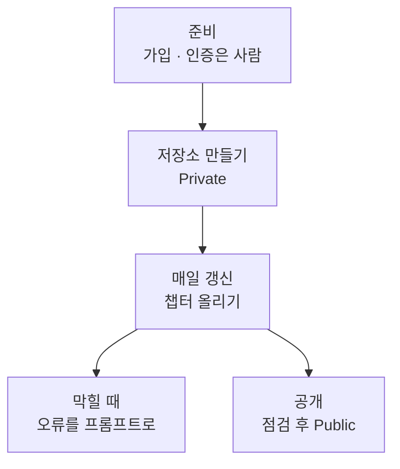
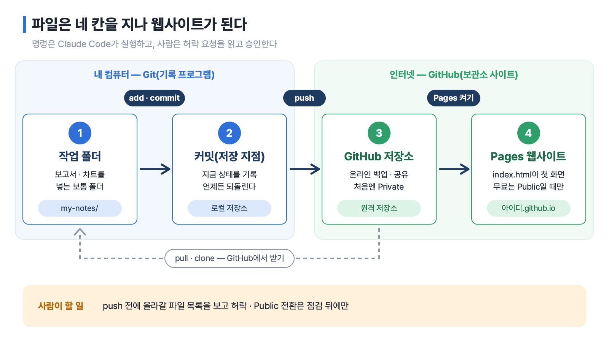
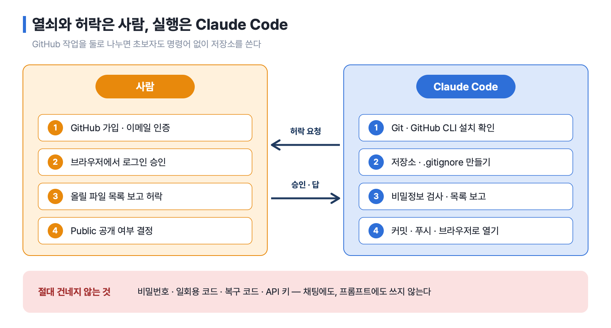
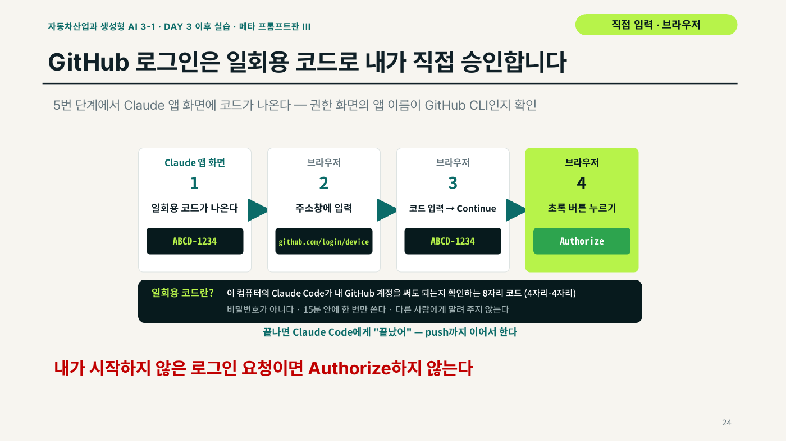
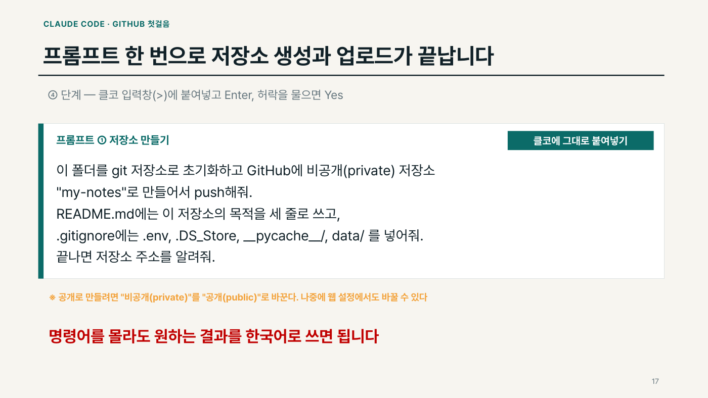
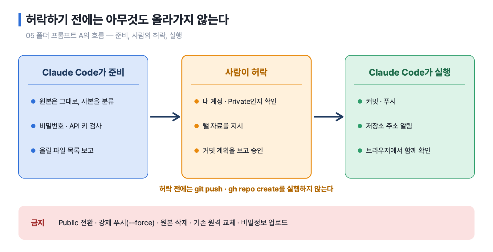
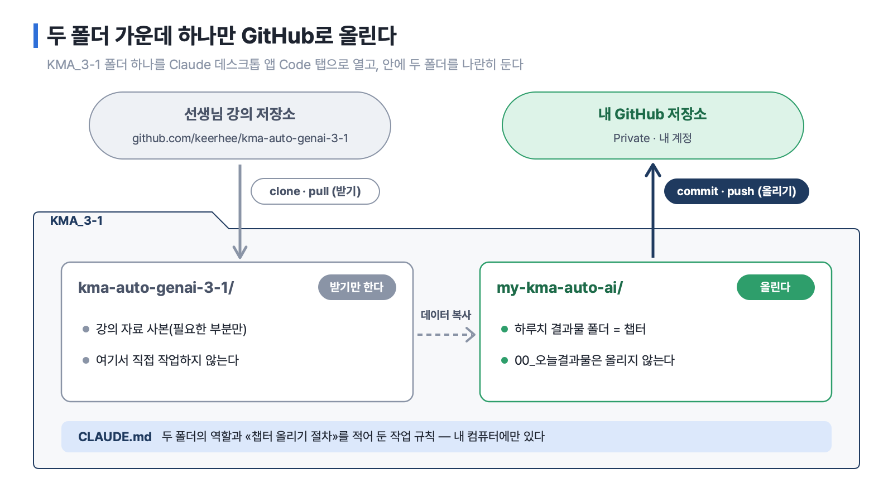
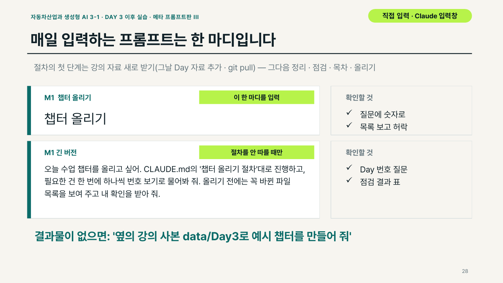

# 6장 GitHub로 내 자료 관리하기

> **이 장의 한 줄**
> GitHub 가입과 로그인 승인은 사람이 하고, 저장소 만들기 · 올리기 · 매일 갱신은 Claude Code에게 한국어로 시킨다. 사람은 올릴 파일 목록을 눈으로 보고 허락한다.

## 이 장에서 배우는 것

1. Git과 GitHub를 구분하고, 저장소 · 커밋 · 푸시 · 풀 같은 말을 쉬운 말로 설명한다.
2. GitHub 가입과 브라우저 인증에서 사람이 할 일과 Claude Code가 할 일을 나눈다.
3. 프롬프트 하나로 비공개 저장소를 만들고, 올리기 전에 파일 목록과 비밀정보를 점검하게 한다.
4. 강의 저장소는 받기만 하고, 내 학습 저장소에 하루 한 챕터씩 올리는 흐름을 익힌다.
5. 오류가 나거나 저장소를 공개할 때 지켜야 할 원칙을 안다.

## 큰 그림



---

## 1. Git과 GitHub — 기록 도구와 인터넷 보관소

이름이 비슷하지만 서로 다른 것이다. 하나는 프로그램이고, 하나는 웹사이트다.

| | Git(깃) | GitHub(깃허브) |
|---|---|---|
| 무엇 | 내 컴퓨터의 버전 기록 프로그램 | 저장소를 보관하는 인터넷 사이트 |
| 하는 일 | 파일 변경 이력을 저장하고 언제든 이전으로 되돌린다. 인터넷 없이 동작한다 | 기록을 온라인에 백업하고, 다른 PC · 동료와 공유하고, 웹페이지를 공개하는 출발점이 된다 |

**저장소**(repository, 줄여서 repo)는 프로젝트 폴더와 그 변경 이력 전체를 말한다. 내 컴퓨터에 있는 것을 로컬 저장소, GitHub에 있는 것을 원격 저장소라고 부른다.

파일이 GitHub에 도착하기까지 쓰는 말은 세 개면 충분하다.

| 말 | 뜻 | 비유 |
|---|---|---|
| add(애드) | 올릴 파일을 고른다 | 상자에 담기 |
| commit(커밋) | 고른 파일의 지금 상태를 기록한다 | 저장 지점 만들기 |
| push(푸시) | 기록을 GitHub로 올린다 | 보관소로 보내기 |

반대 방향도 있다. **pull**(풀)은 GitHub에 있는 최신 내용 중 바뀐 부분만 받는 일이고, **clone**(클론)은 저장소 전체를 처음 한 번 내 컴퓨터로 복사하는 일이다. 정리하면 commit + push는 내 PC → GitHub, pull은 GitHub → 다른 PC다.

한 장으로 그리면 다음과 같다. 1~2칸은 내 컴퓨터 안의 일이고, 3~4칸은 GitHub 위의 일이다. Pages는 5-2절에서 다시 다룬다.



*그림 6-1. 작업 폴더 → 커밋 → GitHub 저장소 → Pages 웹사이트. 받을 때는 반대로 pull · clone. 출처: Day0 03 GitHub 첫걸음 덱 5 · 22 · 30번 장.*

이 장에서 Claude Code(내 컴퓨터 폴더 안에서 파일을 읽고 고치고 명령을 실행하는 Claude, 줄여서 «클코»)는 이 명령들을 **대신 실행한다.** 그리고 실행하기 전에 반드시 허락을 구한다. 무슨 명령인지 모르겠으면 승인하기 전에 «이 명령이 뭘 하는지 설명해줘»라고 묻는다. Claude Code 설치와 작업 폴더 여는 법은 [01장 AI와 일하는 준비](01장_AI와_일하는_준비.md)에서 다룬다.

---

## 2. 준비 — 계정 하나, 도구 둘, 로그인 둘

### 2-1. 준비물

| 준비물 | 무엇 | 누가 |
|---|---|---|
| GitHub 계정 | `github.com` 가입 | 사람 |
| Git | 버전 기록 프로그램 | Claude Code가 확인 · 설치 |
| GitHub CLI(`gh`) | Claude Code가 내 계정에 저장소를 만들고 로그인할 때 쓰는 GitHub 공식 도구. CLI(Command Line Interface)는 글자 명령으로 쓰는 프로그램이다 | Claude Code가 확인 · 설치 |
| Claude Code | Claude 유료 구독(Pro 이상) 계정으로 로그인 | 사람(1장) |

GitHub 계정은 무료로 시작할 수 있다. GitHub CLI가 있어야 Claude Code가 내 계정에 저장소를 만들 수 있다.

### 2-2. GitHub 가입 — 사람이 입력하고, Claude Code는 안내한다

가입은 내 계정을 만드는 일이라 비밀번호 · 인증 코드 입력은 반드시 사람이 한다. 대신 Claude Code가 가입 화면을 열고 화면마다 무엇을 입력할지 안내하게 할 수 있다. 06 폴더의 «GA 가입 도우미» 프롬프트다.

```text
나는 GitHub 계정이 없는 완전 초보야. 너는 GitHub 가입 도우미야.
- 먼저 내 브라우저로 GitHub 가입 페이지(https://github.com/signup)를 열어 줘.
- 그다음 화면마다 무엇을 입력하고 무엇을 눌러야 하는지 한 단계씩 쉬운 말로 알려 줘. 내가 "다음"이라고 하면 다음 단계를 알려 줘.
- 아이디를 정할 때는 회사·포트폴리오에 써도 어색하지 않은 아이디 규칙을 알려 줘.
- 내 비밀번호, 이메일로 온 인증 코드, 복구 코드는 절대 묻지 마. 나도 말하지 않을게.
- 가입이 끝나면 다음에 할 일을 알려 줘.
```

| 화면 | 입력할 것 | 주의 |
|---|---|---|
| 이메일 | 자주 확인하는 이메일 | 회사 메일보다 개인 메일을 권한다(퇴사해도 계정 유지) |
| 비밀번호 | 15자 이상, 또는 8자 이상 + 숫자 + 영문 소문자 | 다른 사이트와 같은 비밀번호 금지 |
| 아이디(username) | 영문 · 숫자 · 하이픈(-) | 하이픈으로 시작 · 끝 불가. 저장소 주소가 `github.com/아이디`가 된다 |
| 퍼즐 · 이메일 인증 코드 | 화면 지시대로, 메일로 온 숫자 코드 | 메일이 안 보이면 스팸함. 이메일 인증을 끝내지 않으면 저장소를 만들 수 없다 |
| 설문 · 요금제 | 건너뛰어도 된다 | 요금제는 Free |

가입 화면의 **Continue with Google**을 누르면 Google 계정으로 바로 가입할 수 있다. 이때도 아이디는 정해야 한다.

> **2단계 인증(2FA) 안내가 나오면**
> 2FA(two-factor authentication, 2단계 인증)는 비밀번호에 휴대폰 인증 앱의 6자리 코드를 하나 더 붙이는 잠금이다. GitHub는 코드를 올리는 사용자에게 이를 요구할 수 있고, 안내가 나오면 정해진 기간(보통 45일) 안에 설정하면 된다. 오늘 바로 하지 않아도 저장소 만들기는 진행할 수 있다. 설정 순서는 Claude Code에게 «무엇인지 쉬운 말로 설명하고, 휴대폰 인증 앱으로 설정하는 순서를 한 단계씩 알려 줘. 코드와 복구 코드는 묻지 마»라고 묻는다. 설정 중 나오는 **복구 코드**는 작업 폴더 밖에 보관한다. 작업 폴더 안에 두면 실수로 GitHub에 올라갈 수 있다.

### 2-3. 도구 설치와 상태 확인은 Claude Code에게

원재료 덱에는 Git · GitHub CLI · Claude Code를 터미널(글자로 명령을 입력하는 창)에 직접 붙여 넣어 설치하는 방법도 실려 있다.[^cli] 이 책은 그 일을 Claude Code에게 맡긴다. 04 폴더의 «프롬프트 A — 최초 설정»이 그 예다.

```text
나는 GitHub 초보자입니다. 현재 컴퓨터에서 GitHub 저장소 생성과 자료 업로드를
Claude Code가 수행하도록 준비해 주세요.

1. 운영체제와 현재 작업 폴더를 확인하세요.
2. git --version, gh --version, gh auth status를 실행해 설치·로그인 상태를 확인하세요.
3. 없는 도구만 공식 경로로 설치하세요. 설치 전 나에게 승인받으세요.
4. gh 인증이 없으면 gh auth login --web을 안내·실행하고,
   내 브라우저에서 직접 로그인 및 권한 승인할 수 있도록 단계별로 설명하세요.
5. 비밀번호·인증 토큰·일회용 코드를 채팅에 요구하거나 출력하지 마세요.
6. gh auth status와 git --version으로 최종 연결을 검증하세요.
7. 성공한 항목/실패한 항목/내가 직접 해야 하는 일을 구분해 한국어로 보고하세요.

기존 Git 설정과 GitHub 저장소를 임의로 변경·삭제하지 마세요.
```

사람이 할 일은 설치 승인, 브라우저의 GitHub 로그인 · 2단계 인증, 앱 연결 승인이다. 운영체제 상태에 따라 일부 단계는 나타나지 않는다. Git은 커밋마다 작성자로 남을 이름과 이메일을 한 번 등록해야 하는데, 이것도 Claude Code가 물어보고 설정한다. 이메일은 GitHub 가입 이메일과 같게 쓰는 편이 좋다.



*그림 6-2. GitHub 작업의 분업. 사람은 계정 · 로그인 승인 · 올릴 목록 허락 · 공개 결정, Claude Code는 설치 확인 · 저장소 만들기 · 검사 · 커밋과 푸시. 출처: Day0 04 · 05 프롬프트.*

### 2-4. 로그인은 두 번, 서로 별개다

| | Claude Code 로그인 | GitHub CLI 브라우저 인증 |
|---|---|---|
| 목적 | Claude Code 자체를 쓰기 위해 | GitHub 저장소 생성 · 푸시를 위해 |
| 화면 | Claude 공식 로그인 | GitHub 공식 사이트(`github.com`) |
| 성공 확인 | Claude Code가 정상 응답 | `gh auth status`에 본인 계정이 보인다 |

Claude에 로그인되어 있어도 GitHub 인증은 따로 필요할 수 있다. 그리고 **브라우저 인증은 내 GitHub 비밀번호를 클코에게 건네주는 절차가 아니다.** 내가 시작한 GitHub CLI 연결 요청을 GitHub 공식 사이트에서 직접 검토하고 허락하는 과정이다.

### 2-5. 브라우저 인증 5단계 — 사람이 직접 하는 단 한 번

1. **인증 시작** — Claude Code가 «GitHub 로그인이 필요해요»라며 멈춘다.
2. **선택지 확인** — 선택 화면이 나오면 개인 계정은 대개 `GitHub.com` → `HTTPS` → `Login with a web browser`다. Claude Code가 하나씩 설명한다.
3. **일회용 코드 확인** — Claude Code 화면에 영문 · 숫자 8자리 코드(예: `ABCD-1234`)가 나온다. 비밀번호가 아니며, 15분 안에 한 번만 쓴다. 남이 입력하면 그 사람 컴퓨터가 내 계정에 연결될 수 있으므로 **강사 · 친구 · 단체 채팅 · 클코 대화창 어디에도 보내지 않는다.**
4. **GitHub에서 승인** — 브라우저에 `github.com/login/device`가 열린다(안 열리면 직접 입력). 주소가 정확히 `github.com`인지 보고 코드를 넣는다. 권한 요청 화면의 앱 이름이 **GitHub CLI**인지 확인하고, 내가 시작한 요청일 때만 **Authorize**를 누른다.
5. **성공 확인** — Claude Code에게 «끝났어»라고 하면 연결된 계정을 확인한다.

3~4단계의 실제 화면 흐름은 06 덱 24번 장과 같다.



*그림 6-3. 일회용 코드 로그인 — Claude 앱에 나온 코드를 `github.com/login/device`에 넣고 Authorize를 누른다. 출처: Day0 06 챕터 올리기 덱 24번 장.*

| 정상 신호 | 즉시 멈출 신호 |
|---|---|
| 내가 방금 인증을 시작했다 | 시작하지 않았는데 알림 · 코드가 왔다 |
| 브라우저 주소가 정확히 `github.com`이다 | 비슷한 철자의 낯선 주소로 연결됐다 |
| 앱이 GitHub CLI이고 요청 권한을 이해했다 | 모르는 앱이나 과도한 권한을 요청한다 |
| 계정 정보는 GitHub 공식 화면에만 입력한다 | 누군가 코드나 비밀번호를 달라고 한다 |

> **인증 완료와 업로드 완료는 다르다**
> 인증이 끝나도 파일은 아직 올라가지 않았다. 또 이 인증은 새 저장소 하나에만 한정되는 권한이 아니다. 특히 `repo` 권한 범위는 기존 비공개 저장소에도 접근할 수 있게 한다. 그래서 원칙적으로 **본인 PC에서만** 인증하고, 공용 PC는 가급적 피한다.[^shared]

---

## 3. 첫 저장소 만들기 — 프롬프트 하나, 승인 한 번

### 3-1. 가장 짧은 형태

03 폴더 덱의 «프롬프트 ① 저장소 만들기»다. 명령어를 몰라도 원하는 결과를 한국어로 쓰면 된다.

```text
이 폴더를 git 저장소로 초기화하고 GitHub에 비공개(private) 저장소
"my-notes"로 만들어서 push해줘.
README.md에는 이 저장소의 목적을 세 줄로 쓰고,
.gitignore에는 .env, .DS_Store, __pycache__/, data/ 를 넣어줘.
끝나면 저장소 주소를 알려줘.
```

덱에서는 이 프롬프트를 다음 화면처럼 보여 준다. 클코 입력창(>)에 그대로 붙여 넣고, 허락을 물으면 읽고 나서 Yes를 누른다.



*그림 6-4. 프롬프트 ① 저장소 만들기 — 명령어를 몰라도 원하는 결과를 한국어로 쓴다. 출처: Day0 03 GitHub 첫걸음 덱 17번 장.*

- **Private**(비공개)는 나와 내가 허락한 사람만 보는 저장소, **Public**(공개)은 누구나 보는 저장소다. 처음에는 Private로 만들고, 나중에 웹 설정에서도 바꿀 수 있다.
- **README.md**는 저장소 첫 화면에 보이는 안내 문서다.
- 저장소 이름에는 영문 · 숫자 · 하이픈만 쓴다.

끝나면 «방금 만든 저장소를 웹 브라우저로 열어줘. 그리고 GitHub에 올라간 파일 목록을 보여줘»라고 시킨다. 웹에 README가 보이면 첫 저장소가 완성된 것이다.

### 3-2. 올리기 전에 목록을 보고 승인하는 형태

실제 업무 자료를 올릴 때는 05 폴더의 «프롬프트 A — 새 저장소 전체 자동화»처럼 **승인 단계를 넣은** 프롬프트를 쓴다. 핵심 부분만 옮긴다(전문은 05 폴더의 prompts).

```text
(5) 원본을 수정/삭제/이동하지 않습니다. 새 작업 폴더를 적절히 만들고 업로드 대상 자료만 복사·분류합니다. 폴더는 lectures/, slides/, images/, data/, prompts/입니다.
(7) 실제 파일 내용을 점검해 API 키, 비밀번호, .env, 인증 파일, 개인정보, 계약·고객 비밀, 기타 민감자료가 없는지 검사합니다. ...
(8) 업로드 예정 파일의 경로·파일 크기·개수와 제외 목록을 출력합니다. 업로드 여부를 명시적으로 승인받기 전에는 git push 및 gh repo create를 실행하지 않습니다.

금지: Public 전환, 강제 푸시(--force), 원본 삭제, 기존 원격 교체, 비밀정보 업로드, 다른 저장소의 임의 변경, 승인 없는 인증 관련 조작.
```

여기서 API 키는 다른 서비스에 접속할 때 쓰는 비밀 열쇠 문자열이고, `.env`는 그런 비밀값을 모아 두는 설정 파일이다. 강제 푸시(force push)는 GitHub에 있는 기록을 내 기록으로 덮어쓰는 명령이라 금지한다. 이 프롬프트를 쓰면 Claude Code가 중간에 다음을 보여 주고 사람의 행동을 기다린다.

| 보고 | 예상 내용 | 사람이 할 일 |
|---|---|---|
| 원본 폴더 | 경로, 파일 수, 총 크기 | 올바른 폴더인지 확인 |
| 인증 | GitHub 사용자명, 상태 | 내 계정인지 확인 |
| 새 저장소 | 이름, Private | 공개 범위 확인 |
| 업로드 파일 | 이름 · 크기 · 폴더 목록 | 뺄 자료를 지시 |
| 커밋 계획 | 커밋 메시지와 바뀐 파일 | 승인 또는 수정 요청 |
| 결과 | GitHub 주소, 원격 커밋 | 브라우저에서 직접 확인 |



*그림 6-5. 프롬프트 A의 흐름 — Claude Code가 준비하고 보고하면, 사람이 허락한 뒤에만 커밋 · 푸시한다. 출처: Day0 05 실습 패키지 프롬프트 A.*

### 3-3. .gitignore — 올리지 않을 것을 미리 적는다

`.gitignore`는 GitHub에 올리지 않을 파일 패턴을 한 줄에 하나씩 적는 파일이다. `*`는 «아무 글자나»라는 뜻이다. 과정 저장소(`keerhee/kma-auto-genai-3-1`)의 실례는 다음과 같다.

| 패턴 | 이유 |
|---|---|
| `.DS_Store` | 맥이 폴더마다 만드는 시스템 파일 |
| `~$` 로 시작하는 파일 | Office 문서를 열면 생기는 임시 파일 |
| `*.pptx` | 원본 덱은 빼고 PDF만 공개 |
| `node_modules/` | 설치 패키지 — 용량이 크다 |
| `__pycache__/` | 파이썬 임시 파일 |

05 폴더의 샘플 `.gitignore`에는 여기에 비밀정보 · 인증 파일 패턴(`.env`, `credentials.json`, `token.json` 등)과 `private/` · `confidential/` 같은 비공개 폴더가 더 들어 있다. 다만 **.gitignore는 보안 검사를 대신하지 못한다.** 비밀정보는 파일 내용까지 점검해야 하고, 이미 커밋된 파일은 나중에 .gitignore에 추가해도 이력에서 지워지지 않는다. 한 번 올라간 비밀번호는 지워도 이력에 남으므로, 그때는 키를 새로 발급받는다.

### 3-4. 허락 요청에 보이는 명령 읽기

명령을 외울 필요는 없다. 허락 요청 화면에 아래 같은 명령이 보이면 정상 단계다.

| 허락 요청에 보이는 명령(예) | 쉬운 뜻 |
|---|---|
| `git --version` · `gh --version` | 도구가 깔려 있는지 확인 |
| `gh auth login --web` | GitHub 로그인 시작 → 2-5의 5단계를 사람이 한다 |
| `git init` · `git add` · `git commit` | 기록 켜기 · 담기 · 첫 저장 지점 |
| `gh repo create … --private --push` | GitHub에 Private 저장소를 만들고 올리기 |
| `gh repo view --web` | 브라우저로 저장소 열기 |

> **바로 허락하지 않는 명령**
> `rm` · `del` · `--force` · `reset --hard`처럼 **지우거나 덮어쓰는** 말이 보이면 거절하고 «이 명령이 왜 필요한지 먼저 설명해 줘»라고 묻는다. 저장소를 만들 때 `--public`이 보여도 거절하고 Private으로 바꿔 달라고 한다.

> **회사 PC에서 도구 설치가 막힐 때 — 웹에서 빈 저장소 만들기**
> 1. `github.com` 로그인 → 오른쪽 위 **+** → **New repository**
> 2. 이름(예: `my-kma-auto-ai`)을 넣고 **Private**을 고른다. **Add a README file은 체크하지 않고**, .gitignore · License는 None으로 둔다(내 폴더의 파일과 충돌을 막는다).
> 3. **Create repository** 뒤 화면 위쪽의 주소(`https://github.com/내아이디/저장소이름.git`)를 복사해 Claude Code에게 «GitHub에 빈 저장소를 직접 만들었어. 주소는 [복사한 주소]야. 이 폴더를 이 저장소에 연결해서 올려 줘»라고 한다.
>
> Git 자체가 설치되지 않으면 회사 PC 관리자 권한이 필요할 수 있으니 강사나 정보화 부서에 알린다.

---

## 4. 매일 쓰기 — 갱신 프롬프트와 챕터 올리기

### 4-1. 매일 쓰는 프롬프트 네 개

저장소 폴더에서 Claude Code를 연 뒤 필요한 줄만 골라 입력한다(03 폴더 덱).

```text
① 변경사항을 알아보기 쉬운 메시지로 커밋하고 push해줘.
② 최근 커밋 5개를 무엇을 바꿨는지 한국어로 요약해줘.
③ 마지막 커밋 이전 상태로 notes.md만 되돌려줘.
④ GitHub에 있는 최신 내용을 가져와줘. (git pull)
```

작업이 끝날 때마다 ①번 한 줄이 백업이다. 다른 PC에서 처음 받을 때는 «내아이디/my-notes 저장소를 이 폴더에 clone해줘»라고 한다.

이미 있는 저장소에 자료를 넣을 때는 **새로 만들지 않는다.** 05 폴더의 «B 기존 저장소 안전 업데이트»는 저장소를 clone한 뒤 자료를 복사해 넣고, 변경 목록과 비밀정보 검사를 보고한 다음 승인을 받게 한다. 여러 사람이 함께 쓰는 저장소라면 main에 바로 올리지 않고 **브랜치**(branch, 본류에서 갈라 낸 작업 줄기)에 올린 뒤 **Pull Request**(PR, 내 변경을 합쳐 달라고 검토를 요청하는 절차)로 검토받는다. 이후의 반복 갱신은 «C 반복 업데이트»로 처리한다. 어느 쪽이든 원격 변경을 먼저 확인하고, 충돌이 있으면 자동으로 덮어쓰지 않으며, 승인한 파일만 올린다.

### 4-2. 메타프롬프트 — 방법은 Claude Code가 짜게 한다

06 폴더의 «챕터 올리기» 실습은 긴 프롬프트를 쓰지 않는다. **메타프롬프트**(meta-prompt)는 «어떻게 할지»를 Claude Code가 짜도록 맡기는 프롬프트다. 무엇을 물어야 하는지, 어떤 순서로 해야 하는지는 Claude Code가 더 잘 안다. 사람은 내 상황에 대한 질문에만 답한다.

| | 일반 프롬프트 | 메타프롬프트 |
|---|---|---|
| 누가 순서를 짜나 | 내가 단계를 다 적는다 | Claude Code가 계획을 짠다 |
| 길이 | 길고 전문 용어가 많다 | 짧다. 목표와 진행 방식만 |
| 모르는 정보 | 내가 미리 알아야 한다 | Claude Code가 물어본다 |

메타프롬프트는 세 부분이면 충분하다.

1. **나는 누구인가** — «나는 Git을 처음 써 보는 완전 초보야»
2. **목표** — «오늘 수업 결과물을 GitHub 저장소에 챕터로 올리고 싶어»
3. **진행 방식** — «한 번에 하나씩 물어봐 줘 · 번호 보기를 줘 · 하기 전에 한 줄로 설명해 줘 · 내가 할 일은 멈추고 알려 줘»

«번호 보기를 줘» 한 줄 덕분에 대부분의 질문에 숫자 하나로 답할 수 있다.

### 4-3. 두 폴더 — 받기만 하는 곳과 올리는 곳

06 실습에서는 상위 폴더 `KMA_3-1` 하나를 데스크톱 앱의 Code 탭으로 열고, 그 안에 두 폴더를 나란히 둔다.

| 폴더 | 무엇 | 방향 | 권한 |
|---|---|---|---|
| `kma-auto-genai-3-1/` | 선생님 강의 저장소의 사본 | GitHub → 내 컴퓨터(clone · pull) | 받기만 한다. 수강생은 올릴 권한이 없다 |
| `my-kma-auto-ai/` | 내 학습 저장소. 하루치 결과물을 담은 폴더 하나가 **챕터**다 | 내 컴퓨터 → 내 GitHub(commit · push) | 내 저장소라 올릴 수 있다 |

강의 저장소 폴더 안에서 직접 작업하지 않는다. 고쳐도 올릴 수 없고, 다음 날 새로 받을 때 충돌이 난다. 강의 저장소 전체는 약 470MB이고 대부분이 동영상과 보충교재다. 그래서 Claude Code에게 **필요한 부분만** 받게 한다(sparse checkout, 저장소 일부만 받는 Git 기능). 기본은 Day3 PDF 4개와 `data/Day3`(1MB 안팎)이다.



*그림 6-6. KMA_3-1 안의 두 폴더. 강의 저장소 사본은 받기만 하고, 내 학습 저장소만 GitHub로 올린다. 출처: Day0 06 챕터 올리기 덱 6 · 10번 장.*

### 4-4. 처음 한 번, 그다음은 한 마디

| 언제 | 붙여 넣을 것 | 사람이 하는 일 |
|---|---|---|
| 처음 한 번 | **MS 시작 도우미** | 받을 범위를 번호로 고르고, 두 폴더를 확인한다 |
| 계정이 없을 때 | **GA 가입 도우미** | 가입 화면에 이메일 · 비밀번호 · 아이디 · 인증 코드 입력 |
| 처음 한 번 | **M0 설정 도우미** | 질문에 답하고, 허락 요청을 읽고, 로그인을 승인하고, Private인지 확인 |
| 매일 수업 후 | 결과물을 `00_오늘결과물`에 끌어 넣고 **«챕터 올리기»** | 번호로 답하고, 파일 목록을 보고 허락하고, 브라우저로 확인 |
| 막힐 때 | **M2** 또는 **M3** | 설명을 읽고 하나씩 따라 한다 |
| Day 6 | **M4 공개 도우미** | 점검 결과를 보고 공개를 허락한다 |

M0의 마지막 블록이 핵심이다. 저장소를 만든 뒤 `KMA_3-1` 폴더의 CLAUDE.md(Claude Code가 폴더를 열 때마다 먼저 읽는 작업 규칙 파일)에 «챕터 올리기 절차»를 Claude Code가 직접 써 두게 한다. 그래서 다음부터는 «챕터 올리기» 한 마디로 충분하다. 그 절차는 다섯 단계다.

1. **새로 받기** — 그날 Day 자료가 없으면 추가로 받고 pull한다(동영상 제외).
2. **정리** — `00_오늘결과물`의 파일을 `Day3_경쟁사재무/` 같은 폴더로 나누고, 쓴 강의 데이터는 강의 사본의 `data/`에서 복사한다. 이 보관함은 GitHub에 올라가지 않는다.
3. **점검** — 사내 자료 · 개인정보 · 비밀 키 · 출처 열 · «가상» 표기를 확인한다.
4. **목차** — README 표에 «챕터 | 핵심 결론 한 줄 | 폴더»를 한 줄 더한다.
5. **올리기 · 확인** — 바뀐 파일 목록을 보여 주고 확인받은 뒤 올리고, 브라우저로 연다.

> **Day 3 예시 챕터 — 완성차 6사 영업이익률(%)**
> 결과물이 없는 수강생은 «강의 저장소의 data/Day3 실데이터로 예시 챕터를 만들어 줘»라고 한다. Claude Code가 `Day3_완성차6사_3개년재무_실데이터.csv`로 만드는 예시다. 영업이익률은 매출에서 영업이익이 차지하는 비율이고, FY는 회계연도(Fiscal Year)다.
>
> | 기업 | FY2023 | FY2024 | FY2025 |
> |---|---:|---:|---:|
> | 현대자동차 | 9.30 | 8.13 | 6.16 |
> | 기아 | 11.63 | 11.79 | 7.95 |
> | 도요타 | 11.87 | 9.98 | 7.43 |
> | 폭스바겐그룹 | 7.01 | 5.87 | 2.75 |
> | 테슬라 | 9.19 | 7.24 | 4.59 |
> | BYD | 6.33 | 6.50 | 5.00 |
>
> README 결론 예는 «6사 모두 FY2025 영업이익률 하락 — VW 2.8% 최저»다. 도요타는 3월 결산이라 다른 회사의 같은 해와 9개월만 겹친다 — 이 CSV의 도요타 FY2025는 2025.4~2026.3(도요타 표기 fiscal 2026)이고, 5장 표의 도요타 FY2025(2024.4~2025.3, 도요타식 표기)보다 1년 뒤다. BYD는 중국 회계기준의 영업이익(营业利润)이다. 출처는 CSV의 출처URL 열(각 사 사업보고서 · 연차보고서). 이 수치의 해석은 [05장 숫자로 경쟁사 읽기](05장_숫자로_경쟁사_읽기.md)에서 다룬다.

---

## 5. 막힐 때와 공개할 때

### 5-1. 오류는 다음 프롬프트다

오류 메시지를 그대로 Claude Code에 붙여 넣고 «원인과 해결 방법 알려줘»라고 해도 된다. 오류 메시지를 읽기 어려우면 06 폴더의 M2 한 줄이면 된다.

```text
지금 무슨 일이 일어났는지 쉬운 말로 설명하고, 내가 지금 할 일 하나만 알려 줘.
```

자주 만나는 오류는 다음과 같다(03 덱 · 05 가이드).

| 메시지 · 증상 | 원인 | Claude Code에게 할 말 |
|---|---|---|
| `command not found` | 설치가 안 됐거나 창을 새로 열지 않음 | 설치와 실행 경로를 확인하고 해결해줘 |
| `not logged in` · `permission denied` | GitHub 로그인이 안 됨 | 안전하게 브라우저 인증을 안내해줘 |
| `Author identity unknown` | Git 이름 · 이메일 미등록 | 커밋 사용자 이름과 이메일을 확인하고 나에게 실제 값을 물어봐 |
| `already exists` | 같은 이름 저장소가 있음 | 기존 저장소와 충돌 없이 연결할 방법을 제안해줘 |
| `rejected (fetch first)` · `non-fast-forward` | 웹에서 먼저 수정됨 | 원격 변경을 받아서 비교하고, 강제 푸시하지 마 |
| `file too large` | 100MB 넘는 파일 | .gitignore에 넣거나 다른 보관 방법을 제안해줘 |

05 폴더의 «D 오류 진단» 프롬프트는 원인을 «인증 / 설치 / 폴더 위치 / 파일 크기 / 저장소 존재 / 브랜치 충돌 / 기타»로 나누게 하고, 복구에 삭제 · 강제 푸시 · 인증 정보 노출이 필요하면 실행하지 말고 멈추게 한다. 하고 싶은 일이 새로 생기면 M3를 쓴다. «내가 하고 싶은 일을 평소 말투로 말할게. 정확한 작업 계획으로 바꿔서 먼저 보여 주고, 내가 '좋아'라고 하면 실행해 줘.»

> **큰 파일 기준**
> 일반 GitHub 저장소에서는 50MiB 이상 파일에 경고가 나오고 100MiB 넘는 파일은 막힌다(MiB는 컴퓨터식 메가바이트, 1MiB = 1,024 × 1,024바이트). 큰 동영상이나 원본 데이터는 Git LFS(큰 파일을 따로 저장하는 GitHub 기능, 사용량 제한과 과금 조건이 있다)나 Google Drive 같은 보관 수단을 검토한다.

### 5-2. 공개는 점검이 먼저다

저장소를 포트폴리오로 쓰려고 Public으로 바꿀 때는 06 폴더의 M4 공개 도우미를 쓴다.

```text
이 저장소를 포트폴리오로 쓰려고 Public으로 공개하고 싶어. 공개해도 안전한지 확인할 점검 계획을 네가 세워서 먼저 보여 줘. 예전 커밋 기록까지 포함해서 하나씩 확인하고, 문제가 없을 때만 공개 전환을 내게 허락받고 실행해 줘.
```

커밋 기록까지 점검하는 이유는 파일을 지워도 예전 커밋에는 남아 있기 때문이다. 한 번 공개된 내용은 누군가 이미 복사했을 수 있다. Private 저장소도 암호 보관소는 아니다.

Public 저장소는 **GitHub Pages**(저장소를 웹사이트로 공개하는 GitHub 기능)를 켜면 웹사이트가 된다. `index.html`이 첫 화면이 되고, `.nojekyll` 파일은 파일을 가공하지 말고 그대로 공개하라는 표시다. 무료 계정은 Public 저장소에서만 Pages를 쓸 수 있다. 웹에서 직접 켤 때는 저장소 Settings → Pages → Branch를 main, /(root)로 두고 Save를 누른다.

> **어떤 경우에도 올리지 않는 것**
> 사내 BOM(부품 목록) · 원가 · 협력사 단가 · 고객 정보 · API 키는 저장소가 Private이든 Public이든 올리지 않는다. 파일 목록을 보기 전에는 올리기를 허락하지 않는다. 모르는 명령이 허락 요청에 나오면 거절하고 M2를 붙여 넣는다.

---

## 실습 길잡이

| 순서 | 3-1B 폴더 | 난이도 | 할 일 |
|---|---|---|---|
| 1 | [03 GitHub 첫걸음 저장소 만들기](../보충교재/Day0_강의소개/03_GitHub첫걸음_저장소만들기/) | 2단계 | 덱 1부(기본 개념)를 읽고, 프롬프트 ①로 연습 저장소 `my-notes`를 만든다 |
| 2 | [06 GitHub 학습저장소 매일 챕터 올리기](../보충교재/Day0_강의소개/06_GitHub_학습저장소_매일챕터올리기/) | 2단계 | 노트 md를 열고 ✍ 표시 상자만 순서대로 붙여 넣는다(MS → GA → M0 → 매일 «챕터 올리기») |
| 3 | [05 GitHub 실습패키지 프롬프트 A~E](../보충교재/Day0_강의소개/05_GitHub_실습패키지_프롬프트AtoE/) | 2~3단계 | 업무 자료를 올리거나 기존 저장소를 갱신할 때. 인증이 처음이면 `02_브라우저_인증_초보자_가이드.md`와 프롬프트 E부터 |
| 4 | [04 GitHub 저장소 생성 · 업로드 자동화](../보충교재/Day0_강의소개/04_GitHub_저장소생성업로드_자동화/) | 2단계 | 03 · 05와 겹치는 흐름 정리본. 인증 보안 설명을 다시 볼 때 |

난이도는 3-1B 목록의 단계(1~4단계)를 따른다. 06의 MS 프롬프트 중 목표 부분을 옮긴다. 전문은 [06 노트](../보충교재/Day0_강의소개/06_GitHub_학습저장소_매일챕터올리기/KMA_Day3_Chapter_Upload_ClaudeCode_III.md) 3.2절에 있다.

```text
나는 Git을 처음 써 보는 완전 초보야. 너는 수업 시작 도우미야.

[목표]
지금 열린 KMA_3-1 폴더 안에 두 폴더를 준비하고 싶어.
1. kma-auto-genai-3-1 — 선생님 강의 저장소 https://github.com/keerhee/kma-auto-genai-3-1 의 사본.
   전체는 너무 크니 필요한 것만 받아 줘. 받을 범위를 번호 보기로 물어봐 줘.
   1) Day3_경쟁사재무 폴더의 PDF와 data/Day3만
   2) Day0~Day6 각 날의 본 강의(Main) PDF와 data 폴더
   동영상(mp4)과 보충교재는 어느 경우든 받지 마.
   나는 이 폴더를 고치지 않고 받기만 할 거야. 나중에 다른 Day 자료도 추가로 받을 수 있게 해 줘.
2. my-kma-auto-ai — 내 수업 결과물을 챕터로 쌓을 빈 폴더. (GitHub 연결은 나중에 할 거야)
```

M0까지 끝나면 다음 네 가지를 눈으로 확인한다. ① 브라우저에서 저장소 이름 옆에 Private이 보인다. ② 저장소 첫 화면에 `README.md`, `.gitignore`가 보이고 `00_오늘결과물`은 보이지 않는다. ③ 내 컴퓨터의 `my-kma-auto-ai`에는 `00_오늘결과물` 폴더가 있다. ④ `KMA_3-1/CLAUDE.md`에 두 폴더의 역할과 «챕터 올리기 절차»가 적혀 있다(이 파일은 내 컴퓨터에만 있다).

그다음 날부터 입력하는 것은 아래 한 마디뿐이다.



*그림 6-7. 매일 입력하는 «챕터 올리기» 한 마디와, 절차를 안 따를 때 쓰는 긴 버전. 질문에는 숫자로 답하고, 목록을 보고 허락한다. 출처: Day0 06 챕터 올리기 덱 28번 장.*

---

## 자동차 현장에 옮기기

원재료의 원칙을 부서 업무에 옮기면 다음과 같다.

- **기획 · 영업기획** — 주간 보고서 폴더를 Private 저장소로 두고, 보고서를 만들 때마다 «변경사항을 커밋하고 push해줘» 한 줄로 백업한다. 지난 판과 무엇이 달라졌는지는 «최근 커밋 5개를 요약해줘»로 확인한다.
- **품질 · 생산** — 여러 사람이 함께 고치는 점검 기준 문서는 main에 바로 올리지 않고 브랜치와 Pull Request로 검토를 거친다(05 프롬프트 B · C).
- **구매 · 원가** — BOM · 원가 · 협력사 단가는 어떤 경우에도 올리지 않는다. `.gitignore`에 `confidential/` 같은 폴더를 적어 두되, 올리기 전 내용 점검과 파일 목록 승인을 빼지 않는다.
- **교육 · 인사** — 사내 교육자료는 과정 저장소처럼 원본 PPT는 빼고 PDF만 올리는 구조로 만들고, 공개해도 되는 자료만 Public으로 바꿔 GitHub Pages로 공유한다.
- **개인 학습 · 포트폴리오** — 06의 방식대로 하루 한 챕터씩 쌓고, 점검 후 공개한 저장소 주소 한 줄을 이력서 · 면담 자료에 붙인다. 계정은 퇴사해도 남도록 개인 메일로 만든다.

## 정리

1. Git은 내 컴퓨터의 기록 프로그램, GitHub는 인터넷 보관소다. add(고르기) → commit(기록) → push(올리기), 반대 방향은 pull · clone이다.
2. 가입 · 비밀번호 · 일회용 코드 · 권한 승인은 사람이, 도구 설치 · 저장소 생성 · 올리기는 Claude Code가 한다. 코드와 비밀번호는 Claude 입력창에 넣지 않는다.
3. 저장소는 Private으로 만들고, 올릴 파일 목록과 비밀정보 점검 결과를 본 뒤에만 허락한다.
4. 강의 저장소는 받기만 하고, 내 학습 저장소에 «챕터 올리기» 한 마디로 매일 쌓는다.
5. 지우거나 덮어쓰는 명령은 거절하고, 공개는 커밋 기록까지 점검한 뒤에 한다.

## 확인 문제

**문제 1.** commit과 push의 차이를 한 문장씩으로 설명하라.

> **답**
> commit은 고른 파일의 지금 상태를 내 컴퓨터의 저장소에 기록하는 일이다. push는 그 기록을 GitHub(원격 저장소)로 올리는 일이다.

**문제 2.** GitHub 인증 중 Claude Code 화면에 `ABCD-1234` 같은 코드가 나왔다. 이 코드를 어디에 입력하고, 어디에 입력하면 안 되는가?

> **답**
> 브라우저의 `github.com/login/device`(주소가 정확히 github.com인지 확인)에만 입력한다. 강사 · 친구 · 단체 채팅 · Claude 입력창에는 보내지 않는다. 이 코드를 남이 입력하면 그 사람 컴퓨터가 내 계정에 연결될 수 있다.

**문제 3.** 저장소를 만드는 허락 요청에 `gh repo create … --public`이 보였다. 어떻게 하는가?

> **답**
> 거절하고 Private으로 바꿔 달라고 한다. 처음에는 비공개로 만들고, 공개는 점검을 거친 뒤 사람이 허락해 바꾼다.

**문제 4.** `.env` 파일을 실수로 커밋해 올렸다. 다음 커밋에서 지우고 `.gitignore`에 넣으면 해결되는가?

> **답**
> 아니다. 한 번 올라간 비밀정보는 지워도 예전 이력에 남고, 이미 커밋된 파일은 나중에 .gitignore에 넣어도 이력에서 지워지지 않는다. 그 안의 키는 새로 발급받는다. 그래서 올리기 **전** 점검이 핵심이다.

**문제 5.** 06 실습에서 강의 저장소 사본(`kma-auto-genai-3-1`) 폴더 안에서 직접 작업하면 안 되는 이유 두 가지는?

> **답**
> ① 수강생은 선생님 저장소에 올릴 권한이 없어 고쳐도 올릴 수 없다. ② 다음 날 새 자료를 받을 때(pull) 충돌이 난다. 작업은 내 학습 저장소 `my-kma-auto-ai`에서 한다.

## 더 보기

- 앞 장: [05장 숫자로 경쟁사 읽기](05장_숫자로_경쟁사_읽기.md) — 저장소에 올릴 비교표 · 보고서
- 다음 장: [07장 업무 에이전트 만들기](07장_업무_에이전트_만들기.md) — 판정 · 메신저 · 메일 · 심사 에이전트
- 관련 장: [01장 AI와 일하는 준비](01장_AI와_일하는_준비.md) — Claude 데스크톱 앱 설치, 작업 폴더 · CLAUDE.md · 스킬
- 챕터로 올릴 Day 3 결과물: [05장 숫자로 경쟁사 읽기](05장_숫자로_경쟁사_읽기.md)
- 저장소를 웹앱 · 사이트로 배포하기: [10장 업무 웹앱 처음부터 끝까지](10장_업무_웹앱_처음부터_끝까지.md)
- 원자료: [03 GitHub 첫걸음 덱](../보충교재/Day0_강의소개/03_GitHub첫걸음_저장소만들기/) · [04 초보자 자동화 가이드](../보충교재/Day0_강의소개/04_GitHub_저장소생성업로드_자동화/Claude_Code_GitHub_초보자_자동화_가이드.md) · [05 실습 패키지 README](../보충교재/Day0_강의소개/05_GitHub_실습패키지_프롬프트AtoE/README_먼저읽기.md) · [05 브라우저 인증 가이드](../보충교재/Day0_강의소개/05_GitHub_실습패키지_프롬프트AtoE/02_브라우저_인증_초보자_가이드.md) · [06 챕터 올리기 노트](../보충교재/Day0_강의소개/06_GitHub_학습저장소_매일챕터올리기/KMA_Day3_Chapter_Upload_ClaudeCode_III.md)

[^cli]: 03 폴더 덱(2부)은 맥 터미널 · 윈도우 PowerShell에 Git · GitHub CLI · Claude Code 설치 명령 세 줄을 붙여 넣고, `gh auth login`과 `git config`로 로그인 · 이름 등록을 한 뒤, `mkdir` · `cd` · `claude` 세 줄로 폴더를 만들어 Claude Code를 실행하는 방식이다. 06 노트(III판)는 같은 일을 데스크톱 앱 Code 탭에서 메타프롬프트로 처리한다. 이 책은 06 방식을 기본으로 삼는다.
[^shared]: 공용 PC에서 실습했다면 Claude Code에게 GitHub CLI 로그아웃을 시키고, 브라우저에서도 GitHub에서 로그아웃한다. 앱 접근 권한은 GitHub 프로필 → Settings → Applications → Authorized OAuth Apps(내 계정 접근을 허락한 외부 앱 목록)에서 확인 · 취소할 수 있다. 토큰을 화면에 출력하는 명령은 화면 공유 중에 쓰지 않는다.
