# 7장 업무 에이전트 만들기 — 판정 · 메신저 · 메일 · 심사

> **이 장의 한 줄**
> 업무 에이전트는 «읽기 → 판정 → 대조 → 실행»을 차례로 붙여 만든다. 판정은 규칙이 하고 설명은 AI가 하며, 밖으로 나가는 일(발송 · 발행 · 공개)은 마지막에 사람이 승인한다. 이 장에서는 같은 골격으로 인사 판정 웹앱, 카톡 · 텔레그램 비서, Gmail 뉴스레터, 이력서 · 투자 메모 심사단을 만든다.

## 이 장에서 배우는 것

1. 채팅 AI와 에이전트가 무엇이 다른지, 업무 에이전트가 어떤 층으로 이루어지는지 설명할 수 있다.
2. «판정은 규칙 엔진, 설명은 AI» 원칙으로 같은 입력에 같은 결과가 나오는 판정 에이전트를 설계할 수 있다.
3. 메신저 · 메일 · 일정 같은 외부 서비스를 Claude Code에 연결할 때 사람이 할 일과 AI가 할 일, 비밀값 다루는 법을 구분할 수 있다.
4. 평가자를 서로 못 보게 나누는 «심사단» 구조로 문서를 여러 관점에서 검토받을 수 있다.
5. 기대와 다른 결과가 나왔을 때 «증상 · 기대 · 요청 · 검증» 네 문장으로 되물을 수 있다.

## 큰 그림

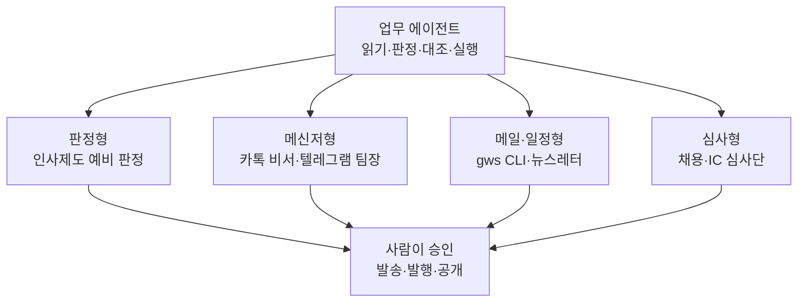

네 갈래는 쓰는 도구가 다를 뿐 뼈대가 같다. 입력을 읽고, 정해 둔 기준으로 판정하고, 회사 데이터와 맞춰 보고, 초안을 만든다. 되돌리기 어려운 마지막 한 걸음은 사람이 누른다.

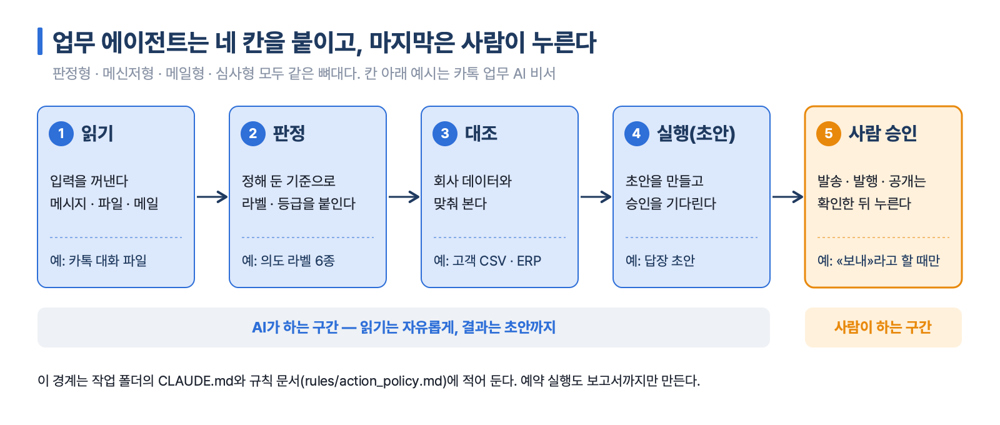

*그림 7-1. 읽기 · 판정 · 대조 · 초안까지는 AI가, 발송 · 발행 · 공개는 사람이 한다. 칸 아래 예시는 카톡 업무 AI 비서. 출처: 각 실습 덱(Day4 07 · 09 · 10 · 13 · 14).*

## 1. 에이전트란 무엇이고 어떻게 짜는가

**에이전트(agent)**는 질문에 답만 하는 채팅 AI와 달리, 일을 맡으면 여러 절차를 이어서 끝까지 처리하는 AI다. 뉴스레터 실습 자료는 에이전트가 할 수 있는 일을 네 가지로 정리한다[^agent4].

| 할 수 있는 일 | 뜻 | 이 장의 예 |
|---|---|---|
| 긴 작업 | 여러 절차를 이어서 처리한다 | 리서치 → HTML 작성 → 발송 |
| 병렬 처리 | 일을 나눠 동시에 처리한다 | 관점별 동시 조사 |
| 외부 서비스 제어 | Gmail · 캘린더 · 메신저를 다룬다 | 테스트 메일 보내기 |
| 내 PC 제어 | 파일 · 프로그램을 직접 실행한다 | 카톡 대화 파일로 꺼내기 |

이 장의 에이전트는 모두 **Claude Code**(Claude 데스크톱 앱의 Code 탭, 내 컴퓨터 폴더에서 파일을 만들고 프로그램을 실행하는 AI)로 만든다. 공통으로 쓰는 장치는 세 가지다.

- **CLAUDE.md** — 작업 폴더에 두는 규칙 문서. Claude Code는 그 폴더에서 일할 때마다 이 파일을 먼저 읽는다. «카톡은 읽기만 한다», «API 키 값은 화면에 출력하지 않는다» 같은 안전 규칙을 여기 적는다.
- **헤드리스 모드(headless mode, `claude -p`)** — 대화창 없이 Claude Code를 한 번 실행해 답을 받고 끝내는 방식. 다른 프로그램이나 예약 실행이 Claude를 부를 때 쓴다.
- **예약 실행** — 정해진 시각에 에이전트를 자동으로 돌리는 설정. Mac은 launchd, Windows는 작업 스케줄러(Task Scheduler), Claude 앱은 Code 탭의 «Scheduled(예약 작업)» 메뉴를 쓴다.

### 사람과 Claude Code의 몫

모든 실습은 같은 분업으로 진행한다. 사람은 프롬프트를 붙여 넣고 결과를 확인하며, 설치 · 코드 · 오류 수정은 Claude Code가 한다.

| 사람이 할 일 | Claude Code가 할 일 |
|---|---|
| 원하는 결과를 말로 설명한다 | 폴더 · 파일을 만든다 |
| 로그인 · 계정 승인을 직접 한다 | 프로그램을 설치하고 실행한다 |
| API 키 · 비밀번호를 파일에 직접 붙여 넣는다 | 키가 들어갈 파일을 만들어 열어 준다 |
| 권한 요청을 읽고 승인한다 | 오류를 읽고 스스로 고친다 |
| 발송 · 발행 · 공개 직전에 확인한다 | 초안을 만들고 승인을 기다린다 |

> **비밀값은 파일에만, 채팅에는 붙이지 않는다**
> API 키(API key, 외부 서비스를 내 이름으로 쓰게 하는 열쇠 문자열) · 봇 토큰 · 앱 비밀번호는 비밀번호와 같다. 대화창에 붙이면 기록에 남는다. 사람이 `.env`(비밀값을 적어 두는 설정 파일) 같은 파일에 직접 붙여 넣고 저장한 뒤 «키 넣었어요»라고만 말한다. 그 파일이 `.gitignore`(GitHub 같은 저장소에 올리지 않을 파일 목록)에 들어 있는지는 Claude Code에게 확인시킨다.

## 2. 판정 에이전트 — 출산 · 육아 인사제도 예비 판정

첫 사례는 직원이 자기 상황을 넣으면 육아휴직 · 육아기 근로시간 단축 · 출산전후휴가를 받을 수 있는지 **예비 판정**하는 웹앱(HR Parental AI Agent)이다. 회사(가온전자)와 직원 8명은 모두 가상이고, 판정은 법적 확정이 아니라 안내용이며 최종 승인은 회사가 한다[^hrdata].

### 판정은 규칙 엔진, 설명은 AI

이 사례의 핵심 원칙은 한 줄이다. **법적 판정은 규칙 엔진에 맡기고 AI에는 이해와 설명만 맡긴다.** 규칙 엔진(rule engine)은 «만 8세 이하 또는 초등 2학년 이하면 충족»처럼 정해진 조건을 코드로 따지는 함수다. AI가 판정까지 하면 같은 질문에 다른 답이 나와 검증할 수 없기 때문이다.

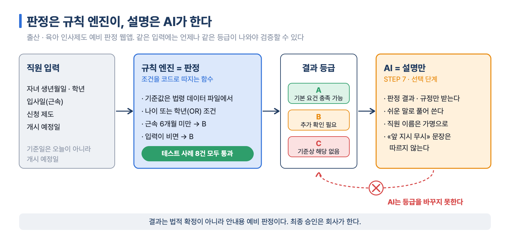

*그림 7-2. 규칙 엔진이 A/B/C를 정하고, AI는 그 결과를 쉬운 말로 풀어 쓸 뿐 등급을 바꾸지 못한다. 출처: 인사판정 가이드 7 · 8 · 25 · 32장.*

결과는 세 단계로만 보여 줘서 확정 판단처럼 보이지 않게 한다.

| 등급 | 뜻 | 언제 |
|---|---|---|
| A 기본 요건 충족 가능 | 요건이 모두 맞는다. 승인은 회사가 한다 | 자녀 나이 · 학년과 근속이 기준을 충족 |
| B 추가 확인 필요 | 정보가 비거나 재량이 남는다 | 근속 6개월 미만, 생년월일 누락, 연장 특례 |
| C 확인된 기준상 해당 없음 | 기준을 명백히 벗어난다 | 다른 제도를 함께 안내한다 |

같은 직원도 제도에 따라 결과가 갈린다. 가상 직원 최서연(근속 5년, 자녀 만 10세 · 초등 4학년)은 육아휴직이 C(만 8세 · 초2 기준을 둘 다 넘음), 근로시간 단축이 A(만 12세 이하)다. 그래서 C가 나오면 쓸 수 있는 다른 제도를 함께 안내하게 만든다.

### 열한 단계, 세 층

가이드는 STEP 0~10을 세 층으로 쌓는다. STEP 6까지는 외부 AI API(Application Programming Interface, 프로그램끼리 기능을 주고받는 통로) 없이 동작하므로 API 사용료가 들지 않는다.

| 층 | STEP | 만드는 것 |
|---|---|---|
| 웹앱 골격 | 0~3 | 설치 점검 → 설계 → 첫 화면 → 데모 로그인 · 대시보드 |
| 판정 엔진 | 4~5 | 법령 요약을 원문과 대조 → 규칙 엔진과 자동 테스트 8건 |
| AI 에이전트 · 배포 | 6~10 | 규칙 기반 상담 → AI 설명 연결(선택) → A4 보고서 → 종합 테스트 → 공개 배포 |

STEP 1은 코드를 쓰기 전에 설계부터 받는다. 프롬프트 끝에 «아직 코드는 작성하지 마세요»를 붙이고, 파일이 하나도 생기지 않고 계획만 나오면 성공이다.

STEP 4는 AI에게 법령을 쓰게 하지 않고 **원문과 대조해 검증**하게 한다. 법령 파일에서 «검증 필요»로 표시된 항목만 고용노동부 · 국가법령정보센터 원문을 찾아 확인하고, 못 찾으면 추측하지 않고 비워 둔다. 바뀐 항목은 «항목 / 이전 / 이후 / 출처» 표로 받는다. 출처 없이 숫자만 바뀌었으면 받아들이지 않는다.

STEP 5는 판정 로직을 독립 함수로 떼어 테스트 8건으로 자동 검사한다. 기준값은 코드에 박지 않고 법령 데이터 파일에서 읽게 한다.

```text
규칙: 판정은 독립 TypeScript 함수로, 기준은 data/regulations에서 읽기
- 나이는 개시 예정일 기준 만 나이, 나이와 학년은 OR 조건
- 근속 6개월 미만은 자동 불승인이 아니라 B(추가 확인)
- 입력이 비면 B, AI가 판정을 바꾸지 못하게 설계
data/test-cases.csv 8건을 자동 테스트로 만들어 실행하고 결과를 표로 보여주세요.
```

8건이 모두 통과해야 다음 단계로 간다. 판정 기준일은 오늘이 아니라 휴직 · 단축 개시 예정일(모든 사례 2026-12-01)이다.

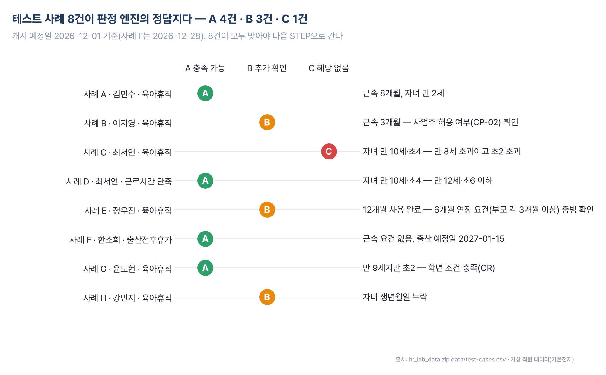

*그림 7-3. 테스트 사례 8건의 기대 결과(A 4건 · B 3건 · C 1건)와 이유. 사례 C · D는 같은 직원이 제도에 따라 갈리는 경우다. 출처: hr_lab_data.zip data/test-cases.csv(가상 직원 데이터).*

STEP 7에서 생성형 AI를 붙일 때도 자리를 좁힌다. AI에는 규정 검색 결과와 판정 엔진 결과만 넘기고, AI는 쉽게 풀어 설명만 하며 A/B/C를 바꾸지 못한다. 직원 이름은 가명으로 바꿔 보내고, 질문 속에 «앞의 지시를 무시하라» 같은 문장이 있어도 따르지 않게 막는다[^step7].

STEP 9에서는 Claude Code를 개발자이자 테스터로 쓴다. **Playwright**(브라우저를 자동으로 조작해 화면을 시험하는 도구)로 로그인부터 보고서까지 눌러 보고, «테스트 항목 / 결과 / 수정 내용 / 남은 문제» 표를 받는다. STEP 10 배포는 GitHub(코드 저장소)와 Vercel(웹앱 공개 서비스)을 쓰며, 로그인과 «공개로 올릴까요?» 확인은 사람이 한다.

### 기대와 다를 때 — 네 문장 피드백

«안 돼요»만 쓰면 Claude Code가 원인을 추측한다. 증상 · 기대 · 요청 · 검증 네 문장이면 충분하다.

```text
[증상] 사례 G(윤도현)가 C로 나옵니다.
[기대] 자녀가 만 9세지만 초등 2학년이라 A가 나와야 합니다.
[요청] 나이·학년 OR 조건 코드를 보여주고 고쳐주세요.
[검증] 고친 뒤 테스트 8건을 다시 돌려 결과를 표로 보여주세요.
```

### 다른 판정 업무로 옮기기

가이드는 첫 프롬프트를 **역할 · 목표 · 기능 · 제약 · 검증** 다섯 요소로 짜고, 중괄호만 바꿔 다른 판정 업무에 쓰라고 권한다. 바꿔 넣을 예로 취업규칙 상담, 투자 적격성 검토(투자정책서 한도), 대출 예비 심사(심사 기준표), 사모대출 약정 검토(약정 위반 체크리스트)를 든다.

> **9장과 같은 골격**
> Day5의 [설비 정비 판정 에이전트](../보충교재/Day5_예지보전/03_설비정비판정_에이전트/)는 이 골격을 그대로 자동차 설비에 옮긴 것이다. 센서 데이터와 정비 기준으로 A/B/C 판정을 내리고 STEP 0~10을 같은 순서로 밟는다. 자세한 내용은 [09장 스마트팩토리와 예지보전](09장_스마트팩토리와_예지보전.md)에서 다룬다.

## 3. 메신저 에이전트 — 카톡 비서와 텔레그램 AI 팀장

### 카톡 업무 AI 비서 — 네 층을 하나씩 붙인다

두 번째 사례는 2026년 10월 16일 공개된 영상을 Claude Code 실습으로 다시 만든 것이다. 영상 제작자는 가족 회사에서 카톡으로 받은 수량 · 날짜 변경을 놓쳐 손실을 겪었다. 영상에서는 세 개 방 메시지 224건을 판정하는 데 6초가 걸렸고, 사람이라면 목요일에야 알았을 실수를 월요일 당일에 잡았다[^kakaovideo].

비서는 네 층으로 이루어진다. 한 층씩 붙이고 단계마다 결과를 확인한다.

| 층 | 하는 일 | 쓰는 도구 |
|---|---|---|
| 1 읽기 | 카톡 메시지를 글자 파일로 꺼낸다 | 연습 데이터(A 트랙) 또는 kakaocli(B 트랙) |
| 2 판정 | 메시지마다 의도 라벨을 붙인다 | Claude Haiku(소형 모델) · 선택 실습으로 Jev |
| 3 대조 | 고객 데이터 · 일정 화면과 맞춰 본다 | CSV 파일 또는 Claude in Chrome |
| 4 실행 | 답장 · 세금계산서 요청 초안을 만든다 | 사람 승인 뒤에만 보낸다 |

카톡에는 개인 채팅을 읽는 공식 API가 없어서 우회 경로를 쓴다. **kakaocli**는 카톡 Mac 앱이 저장한 데이터베이스를 읽기 전용으로 조회하는 비공식 도구이고, **접근성 API**(시각장애인용 화면낭독 기능의 통로로 화면의 글자와 버튼을 읽는 방식)나 **컴퓨터 사용(Computer Use**, AI가 화면을 찍어 보고 클릭 · 입력하는 기능)도 쓸 수 있다. Windows에서는 kakaocli 대신 읽기 전용 도구 kakao-windows-reader를 쓰고, 컴퓨터 사용은 Claude 데스크톱 앱에서만 된다.

> **비공식 자동화의 위험**
> 카카오톡 자동화는 비공식 방식이라 계정 이용 제한 대상이 될 수 있다. 실제 업무방 대신 예비 계정과 테스트방에서 먼저 하고, 대량 발송이나 무인 자동응답으로 넓히지 않는다. 그래서 가이드는 Claude Code가 가짜 카톡 대화를 만들어 주는 **A 트랙(연습 데이터)**으로 6단계까지 완주한 뒤 실제 카톡(B 트랙)으로 바꾸라고 권한다.

판정 라벨은 잡담 · 정보 요청 · 요청 · 결정 · 일정 · 문제 여섯 가지로 시작한다. 판정은 빠르고 싼 소형 모델에 맡기고, 요약과 우선순위는 Claude가 정한다. 확신도(confidence)가 0.6 미만인 판정은 사람이 다시 본다. 애매했던 판정의 정답을 알려 주면 Claude Code가 판정 기준 문서(`rules/labeling_guide.md`)에 «애매한 사례»로 쌓고 다시 판정한다. 영상의 말대로 «우리 기준을 계속 먹여 주면 정확해진다».

3층 대조에서는 **ERP**(Enterprise Resource Planning, 일정 · 재고 · 회계를 관리하는 사내 업무 시스템)와 카톡을 맞춘다. API가 없는 옛 ERP는 **Claude in Chrome**(로그인된 크롬 화면을 Claude가 읽고 조작하는 기능)으로 화면을 «읽기만» 한다. 이때 문서를 직접 쓰지 않고 **메타프롬프트**(Claude가 사람에게 질문을 하나씩 던져 문서를 대신 완성하게 하는 프롬프트)로 ERP 안내서를 만든다. 카톡의 «칸»이 화면의 «수량»이라는 식의 용어 대응을 적어 두는 것이 요점이다.

5단계 교차 검증은 실제로 사고가 난 장면을 재현한다. 고객방에서는 120칸이 140칸으로 바뀌었는데 공장방은 여전히 «120칸 맞죠?»에 엄지를 눌렀다. 두 방의 «결정» · «일정» 라벨 메시지를 거래처 · 제품별 최신 확정값 장부로 모아 비교하면 조립 전에 «중지 경보»가 뜬다.

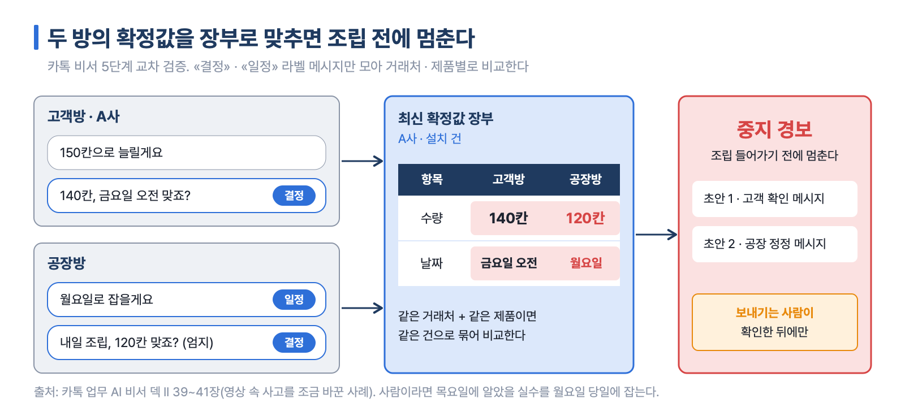

*그림 7-4. 고객방은 140칸 · 금요일 오전, 공장방은 120칸 · 월요일. 장부로 맞추면 두 값이 어긋난 칸이 중지 경보가 된다. 출처: 카톡 업무 AI 비서 덱 II 39~41장.*

실행 단계의 원칙은 «읽기는 자유롭게, 쓰기는 사람이 승인한 뒤에»다. 상황별로 AI 몫과 사람 몫을 규칙 문서(`rules/action_policy.md`)에 적는다.

| 상황 | AI가 하는 일 | 사람 승인 |
|---|---|---|
| 카톡 답장 | 초안을 쓴다. 선택 실습에서는 전송 직전까지 입력한다 | 보내기 직전 확인 |
| 일정 변경 감지 | ERP 수정안과 담당자 알림 초안 | 필요 |
| 세금계산서 요청 | 요청서 입력까지만 한다 | 발행은 사람이 한다 |
| 수량 · 금액 불일치 | 즉시 보고하고 책임자를 부른다 | 사람이 판단한다 |

마지막 6단계는 1~5단계를 묶어 평일 정해진 시각(실습 예: 08:50, 13:50)에 헤드리스 모드로 돌린다. 예약 실행은 보고서까지만 만들고, 보내기와 발행은 넣지 않는다[^kakaosched].

### 텔레그램 AI 팀장 7명 — 폴더가 곧 팀장

세 번째 사례는 텔레그램 봇 7개로 AI 팀장 7명(전략기획 · 마케팅 · 영업 · 교육기획 · 교육운영 · AI솔루션 · 콘텐츠)을 운영한다. 대표는 전략기획실장 한 명에게 지시하고, 실장이 팀별 할 일로 쪼개 나눠 주며, 대표는 승인만 한다.

구조는 세 부분이다.

- **봇은 창구다.** 텔레그램 봇은 **토큰**(봇을 조종하는 비밀번호 문자열) 하나로 움직이는 자동 계정이다. @BotFather에서 `/newbot`으로 만들고, 봇마다 `/start`를 한 번 보내야 봇이 대표에게 말을 걸 수 있다. 이 단계만 사람이 텔레그램 앱에서 직접 한다.
- **폴더가 팀장이다.** 팀마다 폴더를 두고 그 안의 CLAUDE.md에 직함 · 담당 업무 · 보고 말투 · 하면 안 되는 일을 적는다. 같은 Claude라도 어느 폴더에서 실행하느냐로 다른 팀장이 된다.
- **파일이 우편함이다.** 텔레그램 봇은 다른 봇의 메시지를 읽지 못한다(무한 대화 방지). 그래서 실장이 `shared/inbox/팀명.md`에 할 일을 적고, 각 팀이 1분마다 자기 우편함을 확인해 처리한다.

이 셋을 잇는 연결 프로그램이 **브리지**(bridge.py)다. 텔레그램 메시지가 오면 해당 팀 폴더에서 `claude -p -c`(헤드리스 실행 + 같은 폴더의 대화 이어 하기)를 실행하고 답장한다. 봇이 한 개라면 Claude Code 공식 텔레그램 채널 플러그인으로 대신해도 되지만, 봇 7개를 폴더 7개에 잇는 데는 브리지가 맞다.

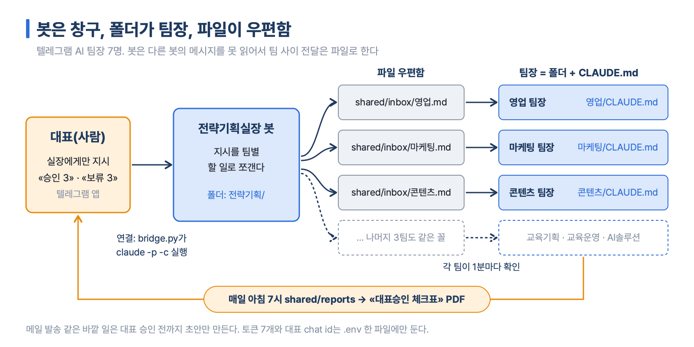

*그림 7-5. 대표는 실장 봇에게만 지시하고, 팀 사이 전달은 shared/inbox 파일로 한다. 보고는 매일 아침 체크표 PDF로 돌아온다. 출처: 텔레그램 AI 팀장 가이드 · 프롬프트 모음.*

구축은 프롬프트 다섯 개로 한다. 팀 폴더 · 직무 문서 → 브리지 → 실장 릴레이 → 대표승인 체크표 → 상시 실행 순서다. 네 번째 프롬프트가 승인 경계를 만든다.

```text
매일 아침 7시에 shared/reports를 모아 '대표승인 체크표' PDF를 만들어줘.
- 표: 팀 · 한 일 · 승인 필요 사항 · 번호
- 한글이 깨지지 않게 하고 전략기획실장 봇으로 PDF를 보내줘
- 내가 '승인 3' 또는 '보류 3'이라 답하면 그 팀에 전달
- 메일 발송은 승인 전까지 초안만 만들기
```

한 번에 7개를 붙이면 어디서 막혔는지 찾기 어렵다. 실장 + 영업 봇 2개로 1:1 대화와 릴레이를 확인한 뒤 7개로 늘린다. 토큰 7개와 대표 **chat id**(텔레그램이 대표 계정에 붙인 숫자, 브리지가 대표만 알아보게 하는 열쇠)는 `.env` 한 파일에만 둔다[^tgsafety].

> **텔레그램 팀장 운영 시 사용량 줄이기**
> 일곱 팀이 함께 돌면 구독 한도나 API 비용이 «팀 수 × 확인 빈도 × 작업 길이»로 늘어난다. 덱이 권하는 방법은 확인 주기를 1분에서 5분으로 늘리기, 새 일이 없으면 호출하지 않기, 밤에는 실장만 깨우기, 단순한 팀에는 가벼운 모델 배정하기, 작업 1건 시간 제한과 하루 실행 횟수 상한 두기다.

## 4. 메일 · 일정 에이전트 — 구글 워크스페이스와 뉴스레터

### gws CLI — 구글 업무를 말로 시키는 통로

**CLI**(Command Line Interface, 마우스 대신 글자 명령으로 프로그램을 다루는 방식)는 사람에게는 불편하지만 에이전트에게는 가장 빠르다. 클릭 단계가 없고, 명령을 이어 붙일 수 있고, 서버 · 예약 작업에서도 돈다. **gws**(Google Workspace CLI)는 Gmail · Drive · Sheets · Docs · Calendar를 `gws <서비스> <작업>` 형식으로 다루는 명령 도구이고, 결과가 **JSON**(기계가 읽기 쉬운 구조화된 텍스트)으로 와서 Claude가 바로 읽는다. 구글이 만들었지만 공식 지원 제품은 아니며 1.0 이전 버전이라 명령이 바뀔 수 있다[^gws].

연결의 핵심은 **OAuth**(비밀번호를 넘기지 않고 «이 앱이 내 메일을 읽어도 된다»는 권한만 위임하는 표준 로그인 방식) 설정이다. 처음 한 번만 하면 되고, 대부분 사람이 구글 클라우드 콘솔 화면에서 직접 누른다.

| 단계 | 할 일 | 누가 |
|---|---|---|
| 1 | gws 설치 — 깃허브 주소를 주고 «설치까지 진행해 줘» | Claude Code |
| 2~3 | 클라우드 프로젝트 만들기, OAuth 동의 화면(대상 = 외부) | 사람(콘솔) |
| 4 | 쓸 API 켜기(Gmail · Drive · Sheets · Docs · Calendar) | 사람(콘솔) |
| 5 | OAuth 클라이언트(데스크톱 앱) 만들고 JSON 바로 내려받기 | 사람(콘솔) |
| 6 | 데이터 액세스 범위 고르기, 테스트 사용자에 내 이메일 넣기 | 사람(콘솔) |
| 7 | 내려받은 JSON을 gws 자리로 옮기고 로그인 | Claude Code가 옮기고, 브라우저 승인은 사람 |

> **클라이언트 JSON은 비밀번호와 같다**
> 2025년 4월부터 구글은 클라이언트 보안 비밀(client secret)을 만들 때 한 번만 보여 준다. 창을 닫기 전에 JSON을 내려받는다. 이 파일은 깃 저장소 · 메일 · 채팅에 올리지 않는다. Claude Code에게는 «다운로드 폴더의 client_secret JSON을 gws 설정 자리로 옮겨 줘»라고 파일 이동만 시키고, 안에 든 값을 대화창에 붙이지 않는다.

**범위(scope)**는 앱이 어디까지 읽고 쓸 수 있는지를 정한다. 넓을수록 편하지만 사고가 날 수 있는 범위도 넓어진다. 테스트 모드는 범위를 약 25개까지만 허용하므로 쓸 서비스만 고른다. «확인되지 않은 앱» 경고는 내가 만든 앱이라 뜨는 정상 경고다.

연결되면 명령 대신 말로 시킨다. 실습은 두 가지다. Gmail 검색 결과를 요약해 시트에 행으로 쌓기, 그리고 캘린더 일정을 «10월 28일 오후 3시에 ‘분기 리뷰’ 회의를 1시간 잡아 줘»처럼 말로 등록 · 조회 · 수정하기다. 바꾸기 전에 «무엇을 바꿀지 먼저 보여 줘»라고 하고, 삭제는 한 번 더 확인한다. 회사 계정은 관리자 정책으로 막혀 있을 수 있으니 개인 계정으로 먼저 연습한다.

### 뉴스레터 자동 발송 에이전트 — 빈 폴더에서 매일 10시 메일까지

뉴스레터 에이전트는 매일 아침 관심사를 조사해 출처 링크가 달린 HTML 뉴스레터를 만들고 내 Gmail로 보낸다. 준비 약 25분, 구현 약 30분이 걸리고 AI 구독료 외 비용은 없다.

Gmail 발송 경로는 둘 중 하나를 고른다.

| 항목 | 경로 A · Gmail 커넥터 | 경로 B · SMTP |
|---|---|---|
| 원리 | **커넥터**(MCP, Model Context Protocol — AI와 외부 서비스를 잇는 표준 연결)로 Claude 앱이 직접 보낸다 | **SMTP**(메일을 보내는 표준 방식)로 보낸다 |
| 준비 | 구글 로그인으로 연결 | 2단계 인증 + **앱 비밀번호**(앱 전용 16자리 비밀번호) + `.env` |
| 무인 발송 | 메일 보내기 도구만 «Always allow»로 바꾼다 | 처음부터 승인 없음 |
| 쓸 수 있는 앱 | Claude 앱 | Claude · Codex 공통 |

경로 A의 «Always allow»는 «내 이름으로 바로 보낸다»는 뜻이다. 받는 사람은 나 하나로 둔다. 경로 B의 앱 비밀번호는 메모장에 보관하고, Claude Code가 만든 `.env`의 빈칸에 사람이 직접 넣은 뒤 «저장 완료»라고만 말한다.

구현은 같은 대화창에서 프롬프트 여섯 개를 차례로 넣는다. 기획서 → 테스트 메일 → 병렬 리서치 → HTML 작성 · 서식 확정 → 실제 발송 → 통합 테스트 · 매일 10시 예약 순서다. 1단계 프롬프트는 아무것도 만들지 말고 작업 기획서만 쓰게 하며, 쓰기 전에 받을 주소 · 관심사 · 관점을 사람에게 묻게 한다.

```text
# 목표
매일 아침 사용자의 관심사를 리서치해 HTML 뉴스레터로 만들고 제 Gmail로 보내는 에이전트를 만들려고 합니다.
- 작업 기획서는 폴더에 md 파일로 작성할 것
  - 리서치·HTML 작성·메일 발송·예약 실행은 각각 스킬로 나눌 것
# 지켜야 할 조건
- 리서치: 관심사를 관점별로 나눠 관점마다 서브에이전트로 병렬 리서치, 로그인·결제 없는 공개 소스만 사용
- 작성: 항목마다 출처 링크, 스타일은 HTML 안에 넣고 외부 파일·스크립트 금지
# 이번 단계에서 할 일
- 아직 아무것도 만들지 말고 작업 기획서만 작성해 주세요.
```

여기서 두 용어가 나온다. **서브에이전트(subagent)**는 Claude Code가 따로 불러내 일을 나눠 맡기는 보조 AI이고, **스킬(skill)**은 이름으로 불러 쓰는 작업별 설명서 파일(`SKILL.md`)이다. 리서치 · HTML · 발송 · 예약을 스킬로 나눠 두면 다음 날에도 같은 방식으로 돈다[^nlfolder].

규칙은 세 가지다. 같은 대화창에서 순서대로 넣고, 단계별 완료 기준을 확인한 뒤에만 다음으로 가고, 실패하면 같은 프롬프트를 다시 넣지 말고 오류 문장을 통째로 붙여 넣는다. 예약 등록 직후에는 **Run now**로 한 번 돌려 승인 창을 «항상 허용»으로 정리해 둔다. 예약 작업은 실행 중 승인이 필요하면 그 자리에서 멈추기 때문이다. 데스크톱 예약 작업은 PC가 켜져 있고 Claude 앱이 실행 중일 때만 돈다.

> **판본 차이 — 커넥터 발송**
> 뉴스레터 자료 I판은 «MCP 커넥터는 초안만 작성하고 실제 발송은 안 된다»고 썼지만, II판에서 정정했다. Claude의 Gmail 커넥터는 2026년 8월부터 발송 · 답장 · 전달을 지원한다. 예약 메뉴 이름도 «루틴»에서 «Scheduled(예약 작업)»로 바뀌었다. 이 책은 II판 기준이다.

## 5. 심사 에이전트 — 채용 심사단과 IC 심사단

### 평가자를 왜 나누는가

마지막 사례는 문서를 여러 사람의 눈으로 미리 «떨어뜨려 보는» 심사단이다. 채용 심사단(hiring-panel)은 이력서를 AI 평가자 7명에게 먼저 보여 주고, 탈락 사유 목록과 수정본을 돌려주는 무료 커뮤니티 스킬(MIT 라이선스)이다.

한 명의 Claude가 일곱 역할을 연달아 맡으면 앞에서 낸 의견에 끌려간다. 이것을 **앵커링(anchoring)**, 처음 접한 판단이 이후 판단의 기준점이 되는 현상이라고 한다. 그래서 평가자마다 **하위 에이전트**(서브에이전트와 같은 말. 서로의 대화를 보지 못하는 별도 작업자)를 하나씩 둔다. 작업자를 나누는 목적은 속도보다 의견의 독립성이다. 시험 감독이 학생들을 떨어뜨려 앉히는 것과 같은 원리다.

| 묶음 | 평가자 | 붙드는 질문 | 판정 기호 |
|---|---|---|---|
| 단독 평가 2명(한 명씩 호출) | 자동 검사 | 사람이 볼 가치가 있는가(ATS) | PASS / REJECT |
| | 채용 관리자 | 첫 10초에 면접 줄 이유가 보이나 | INTERVIEW / NO |
| 독립 평가 5명(동시 호출) | 팀장 · 경쟁 지원자 · CEO · 채용 담당자 · 동료 | 첫날부터 일할 수 있나 · 내 이력서보다 어디가 약한가 등 | HIRE / MAYBE / PASS |

ATS(Applicant Tracking System)는 지원서를 먼저 걸러 내는 채용 관리 시스템이다. 주의할 점이 하나 있다. 독립 평가자 5명의 PASS는 «채용하지 않음»이다. 자동 검사의 PASS(통과)와 뜻이 반대다. 평가 1회에 하위 에이전트를 8번 부른다(평가자 7명 + 수정본 재검사 1번). 서로의 결과가 필요 없는 5명은 동시에 불러서, 걸리는 시간은 가장 느린 한 명만큼이다.

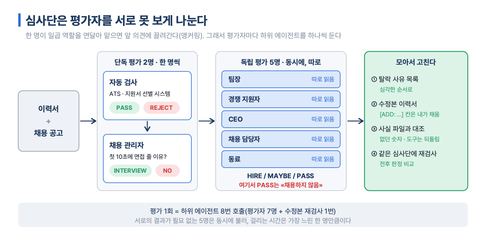

*그림 7-6. 단독 평가 2명은 차례로, 독립 평가 5명은 서로 못 보게 동시에 읽고, 결과를 모아 사실 파일로 수정본을 검증한다. 출처: 채용 심사단 프롬프트 실습 5 · 6 · 18장.*

### 따라 하기 — 가상 이력서로 평가와 사실 검증

프롬프트 실습은 가상 지원자 김하늘이 가상 회사 브라이트 베이커리의 SNS 마케터 자리에 지원하는 상황으로 진행한다. 실습 키트의 인물 · 회사 · 학교 · 연락처는 모두 지어낸 것이다.

1. 스킬 설치를 Claude Code에게 문장으로 맡긴다. 같은 이름의 스킬이 이미 있으면 덮어쓰지 말고 먼저 알려 달라고 덧붙인다.
2. Claude Code를 다시 열어 `/hiring-panel` 명령이 목록에 보이는지 확인한다. 스킬은 시작할 때 읽히기 때문이다.
3. 심사단을 부르기 전에 «내가 채용 담당자라면 무엇이 가장 아쉬울지» 세 문장을 먼저 받아 둔다. 나중에 심사단 결과와 비교하면 혼자 읽을 때 놓친 점이 보인다.
4. 이력서와 공고를 함께 넣어 심사단을 실행한다.
5. 수정본에서 원본에 없던 숫자 · 도구 · 업무가 들어간 문장을 골라내고, 가상 사실 파일(실제로 한 일과 하지 않은 일)에 있는 내용만으로 빈칸을 채운다.
6. 고친 이력서를 같은 공고 · 같은 심사단에 다시 넣어 전후 판정을 비교한다.

```text
RESUME-IMPROVED.md 를 원본 data/resume_kim_haneul.md 와 한 문장씩 비교해 줘.
원본에 없던 숫자, 도구, 업무가 새로 들어간 문장을 모두 찾아서 표로 보여 줘.
```

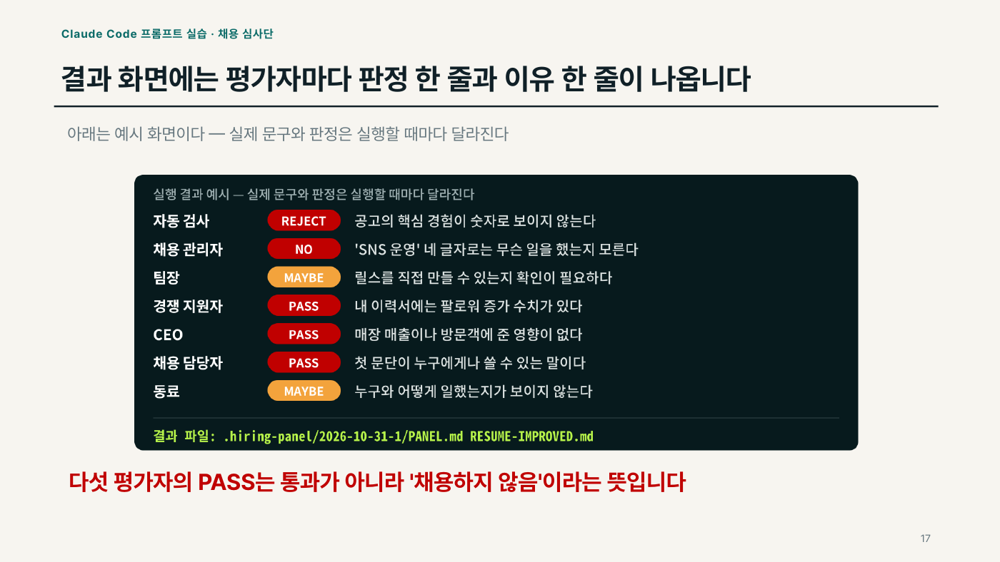

*그림 7-7. 심사단을 실행하면 평가자마다 판정 한 줄과 이유 한 줄이 나온다. 다섯 독립 평가자의 PASS는 «채용하지 않음»이다. 출처: 채용 심사단 프롬프트 실습 17장(예시 화면).*

수정본은 문장을 매끄럽게 고치면서 원본에 없던 숫자를 넣을 수 있다. `[ADD: …]`는 내가 사실을 채울 칸, `assumed`는 평가자가 짐작한 부분이다. 써 본 적 없는 도구나 모르는 숫자가 들어갔다면 원래 사실로 되돌린다. 실제 이력서는 연습을 마친 뒤 주민번호 · 집 주소를 지운 사본으로 쓰고, 회사 컴퓨터라면 설치 전에 정보보안 담당자의 허가를 받는다. 이 평가는 언어 모델이 만든 2차 의견일 뿐 면접이나 채용을 보장하지 않는다.

### 같은 구조로 IC 심사단 만들기

심사단 구조는 «역할을 나누고, 서로 못 보게 하고, 모아서 고친다»가 전부다. 바꾸는 것은 입력 문서 · 평가자 역할 · 판정 기호 세 가지뿐이다. 응용 실습은 이를 투자위원회(IC, Investment Committee — 기금의 큰 투자 결정을 승인하는 회의) 상정 전 심사에 옮긴다. 이력서 대신 투자 메모, 채용 공고 대신 **IPS**(Investment Policy Statement, 투자정책서 — 위험 한도와 승인 절차를 적은 문서) 한도를 넣는다.

채용 심사단과 다른 점은 **관문(gate)**, 판정 결과에 따라 다음 단계로 갈지 멈출지를 가르는 검사 지점을 맨 앞에 둔다는 것이다. 채용 심사단은 목적이 고치기라 관문 없이 탈락 사유를 끝까지 모으지만, IC 심사단은 IPS 한도를 넘는 딜을 위원회에 올리지 않는다.

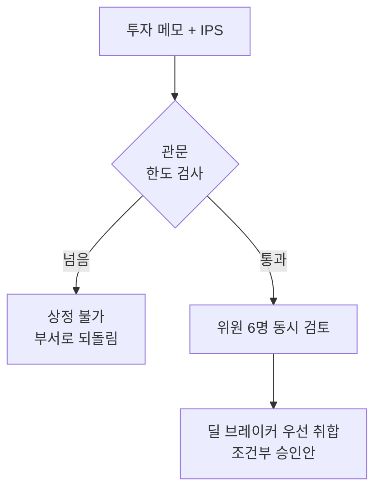

위원 6명은 CIO · 운용 PM · CRO(위험관리 책임자) · 반대 투자자 · 수익자 대표 · ODD(운영 실사 담당)이고, 각자 APPROVE / CONDITIONAL / DECLINE과 메모에서 가장 약한 문장을 낸다. 반대 투자자를 따로 두면 **레드팀**(일부러 반대 입장에서 검토하는 역할)이 제도로 들어온다.

실습 데이터(가람공제회 · 노르딕그린파트너스 · 북해풍력 인프라 펀드 III)는 모두 가상이다. 메모가 제안한 2,500억 원 약정은 가상 IPS의 L1(대체투자 총 비중) · L2(단일 펀드 약정) · L6(같은 해 신규 약정) 한도를 넘어 관문에서 멈추고, 모든 한도를 지키는 최대 약정 가능액은 1,500억 원이다. 금액을 고친 사본으로 다시 돌린 뒤, 수정본에 새로 들어간 숫자를 사실 파일과 대조하는 순서는 채용 심사단과 같다[^ic].

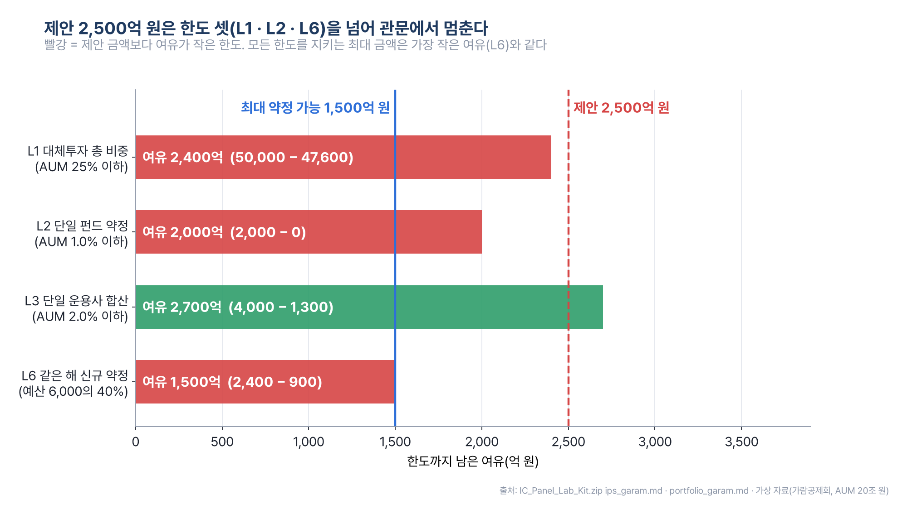

*그림 7-8. 한도마다 남은 여유를 계산하면 제안 2,500억 원은 L1 · L2 · L6을 넘고, 모든 한도를 지키는 최대 약정은 L6 여유와 같은 1,500억 원이다. 출처: IC_Panel_Lab_Kit.zip ips_garam.md · portfolio_garam.md(가상 자료).*

## 실습 길잡이

난이도는 1단계(가장 쉬움)부터 4단계까지로 표시한다. 처음이라면 위에서 아래 순서를 권한다.

| 순서 | 3-1B 폴더 | 난이도 | 무엇을 하나 |
|---|---|---|---|
| 1 | [채용 심사단 · IC 심사단](../보충교재/Day4_업무자동화/14_채용심사단_AI심사위원7명_이력서검토/) | 2단계 | 가이드 덱 → 채용 심사단 프롬프트 실습(17단계) → IC 심사단 프롬프트 실습(16단계) |
| 2 | [출산 · 육아 인사판정 에이전트](../보충교재/Day4_업무자동화/09_출산육아_인사판정_에이전트/) | 2단계 | STEP 0~10 붙여넣기, 가상 데이터 `hr_lab_data.zip` |
| 3 | [뉴스레터 자동 발송](../보충교재/Day4_업무자동화/13_뉴스레터_자동발송_에이전트/) | 3단계 | 경로 A/B 중 하나, 프롬프트 6개 |
| 4 | [구글 워크스페이스 자동화](../보충교재/Day4_업무자동화/12_구글워크스페이스_메일시트일정_자동화/) | 3단계 | OAuth 설정 → Gmail→시트 · 캘린더 실습 |
| 5 | [카톡 업무 AI 비서](../보충교재/Day4_업무자동화/10_카톡_업무AI비서/) | 3단계 | A 트랙으로 0~6단계 완주 후 B 트랙. Mac판 49장 · Windows판 52장 |
| 6 | [텔레그램 AI 팀장](../보충교재/Day4_업무자동화/07_텔레그램_AI팀장/) | 4단계 · 심화 | 봇 2개로 시험 → 7개 · 상시 실행 |

**공통 진행법.** Claude 데스크톱 앱의 Code 탭에서 빈 작업 폴더를 열고, 덱의 프롬프트를 붙여 넣는다. 덱에 «터미널에 입력»으로 나온 설치 · 실행 명령도 «이 명령을 대신 실행해 줘»라고 Claude Code에게 맡긴다. 사람이 직접 하는 일은 로그인 · 브라우저 승인 · 키 붙여 넣기 · 시스템 설정의 권한 켜기뿐이다.

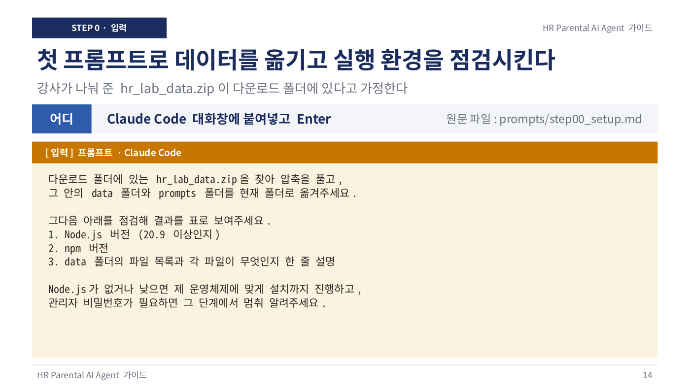

*그림 7-9. 처음 화면은 이렇다. 덱의 앰버 상자(내가 붙여 넣는 글)를 Claude Code 대화창에 그대로 붙이고 Enter를 누른다. 출처: 인사판정 가이드 14장.*

대표 프롬프트 1 — 카톡 비서의 첫 프롬프트(안전 규칙부터 만든다)

```text
~/kakao-secretary 폴더를 만들고 앞으로 그 안에서 작업해 줘.
2) CLAUDE.md를 만들고 아래 규칙을 적어 줘.
- 카톡 메시지는 읽기만 한다
- 보내기와 발행은 내가 '보내'라고 말할 때만 한다
- API 키 값은 화면에 출력하지 않는다
- 결과는 data, reports 폴더에 둔다
```

대표 프롬프트 2 — 텔레그램 팀장 시스템의 안전 점검

```text
지금 만든 AI 팀장 시스템의 안전 장치를 점검해줘.
1) 대표 chat id 외 메시지 무시  2) 팀 폴더 밖 쓰기 금지·허용 도구 최소화
3) 외부 발송은 승인 후에만  4) 모든 실행을 logs에 기록
빠진 곳은 고치고 결과를 표로 보고해줘.
```

전문은 각 폴더의 [텔레그램 프롬프트 모음](../보충교재/Day4_업무자동화/07_텔레그램_AI팀장/Telegram_AI_Team_Prompts.md), [뉴스레터 구현 절차](../보충교재/Day4_업무자동화/13_뉴스레터_자동발송_에이전트/Newsletter_Agent_Implementation_II.md), [gws 설치 가이드](../보충교재/Day4_업무자동화/12_구글워크스페이스_메일시트일정_자동화/gws_CLI_설치가이드.md)에 있다.

## 자동차 현장에 옮기기

| 부서 | 적용 예 | 이 장에서 가져올 것 |
|---|---|---|
| 인사 | 사내 휴가 · 수당 규정 예비 판정 | 규칙 엔진 + AI 설명, A/B/C 세 단계, 테스트 사례 정답지 |
| 영업 · 딜러 | 딜러 카톡방의 수량 · 납기 변경을 판정해 주문 시스템과 대조 | 판정 라벨 6종, 확정값 장부, 중지 경보 |
| 구매 · 생산관리 | 고객방과 공장방의 수량 불일치 경보 | 두 방 교차 검증, 발주 · 발행은 사람 승인 |
| 기획 · 전략 | 매일 아침 경쟁사 · 원자재 브리핑 메일 | 관점별 병렬 리서치, 출처 링크, 매일 10시 예약 |
| 구매 · 투자심사 | 협력사 제안서 · 투자 메모를 여러 관점에서 사전 심사 | 관문(한도 검사) + 독립 평가자 + 사실 파일 대조 |

부품사의 품질 클레임 판정, 보증 수리 예비 판정처럼 «기준표가 있는 판정 업무»는 모두 2절의 다섯 요소 템플릿에 들어간다. 기준표가 문서로 정리돼 있지 않다면 그것부터 만드는 일이 첫 과제다. 카톡 비서 덱의 결론처럼 «규칙을 문서로 만든 회사가 AI를 잘 쓴다».

## 정리

- 업무 에이전트는 읽기 · 판정 · 대조 · 실행을 한 층씩 붙여 만들고, 단계마다 결과를 확인한다.
- 판정은 규칙 엔진이, 설명은 AI가 맡는다. 테스트 사례가 정답지 역할을 한다.
- 읽기는 자유롭게, 쓰기(발송 · 발행 · 공개)는 사람이 승인한 뒤에 한다. 이 경계를 CLAUDE.md와 규칙 문서에 적는다.
- API 키 · 토큰 · 앱 비밀번호 · 클라이언트 JSON은 사람이 파일에 직접 넣고, 채팅에 붙이지 않는다.
- 여러 관점의 검토가 필요하면 평가자를 서로 못 보게 나누고, 모은 뒤 사실 파일로 수정본을 검증한다.

## 확인 문제

1. 인사판정 에이전트에서 AI가 A/B/C 등급을 직접 정하지 않고 규칙 엔진에 맡기는 이유는 무엇인가?

> **답**
> AI가 판정하면 같은 질문에 다른 답이 나와 결과를 검증할 수 없다. 규칙 엔진은 같은 입력에 같은 결과를 내고 테스트 8건으로 맞는지 확인할 수 있다. AI는 판정 결과를 쉽게 풀어 설명하는 자리에만 둔다.

2. 텔레그램 AI 팀장에서 실장 봇이 다른 팀 봇에게 메시지로 지시하지 않고 `shared/inbox` 파일에 할 일을 적는 이유는?

> **답**
> 텔레그램 봇은 다른 봇의 메시지를 읽지 못한다(무한 대화를 막기 위한 제약). 그래서 팀 사이 전달은 파일 우편함으로 하고, 각 팀이 1분마다 자기 우편함을 확인한다.

3. 뉴스레터 에이전트 경로 B에서 Gmail 앱 비밀번호 16자리를 넣는 올바른 방법을 사람과 Claude Code의 몫으로 나눠 설명하라.

> **답**
> Claude Code가 `.env` 파일을 만들고 비밀번호를 뺀 나머지 값(주소 · SMTP 서버 · 포트)을 채운다. 사람은 메모장에 보관한 16자리를 그 파일의 `GMAIL_APP_PASSWORD=` 뒤에 직접 붙여 넣고 저장한 뒤 «저장 완료»라고만 말한다. 비밀번호를 대화창에 붙이지 않는다.

4. 채용 심사단 결과에서 독립 평가자가 PASS를 냈다. 이 이력서는 통과한 것인가?

> **답**
> 아니다. 독립 평가자 5명의 PASS는 «채용하지 않음»이다. PASS가 «통과»를 뜻하는 것은 자동 검사(ATS) 평가자뿐이다. 판정 기호를 읽기 전에 누가 낸 판정인지부터 본다.

5. IC 심사단은 맨 앞에 관문을 두고 채용 심사단은 두지 않는다. 두 설계의 목적 차이를 한 문장씩 써라.

> **답**
> 채용 심사단은 이력서를 고치는 것이 목적이라 탈락 사유를 끝까지 모은다. IC 심사단은 IPS 한도를 넘는 딜을 위원회에 올리지 않는 것이 먼저라, 한도 검사에서 넘으면 거기서 멈추고 담당 부서로 되돌린다.

## 더 보기

- 앞 장: [06장 GitHub로 내 자료 관리](06장_GitHub로_내_자료_관리.md) — 결과물을 저장소에 남기고 매일 갱신하기
- 기초: [04장 AI에게 일 잘 시키기](04장_AI에게_일_잘_시키기.md) — CLAUDE.md · 하네스 · RAG
- 다음 장: [08장 에이전트를 팀으로](08장_에이전트를_팀으로.md) — 에이전트 여럿을 역할로 나누고, 다른 AI에게 검토를 맡기고, 투자위원회를 화면으로 띄운다
- 같은 골격의 설비판: [09장 스마트팩토리와 예지보전](09장_스마트팩토리와_예지보전.md) · [설비 정비 판정 에이전트](../보충교재/Day5_예지보전/03_설비정비판정_에이전트/)
- 판정 웹앱을 제대로 배포까지: [10장 업무 웹앱 처음부터 끝까지](10장_업무_웹앱_처음부터_끝까지.md)
- 원자료: [인사판정 가이드 PDF](../보충교재/Day4_업무자동화/09_출산육아_인사판정_에이전트/HR_Parental_Agent_Prompt_Guide.pdf) · [채용 심사단 README](../보충교재/Day4_업무자동화/14_채용심사단_AI심사위원7명_이력서검토/README.md) · [인사판정 README](../보충교재/Day4_업무자동화/09_출산육아_인사판정_에이전트/README.md)

[^agent4]: 뉴스레터 구현 절차 II(`Newsletter_Agent_Implementation_II.md`) 1-1절.
[^hrdata]: `hr_lab_data.zip`에는 가상 직원 8명(employees.json), 법령 요약 3종, 가상 회사 규정, 기대 결과가 적힌 테스트 사례 8건, 상담 질문 10개, 단계별 프롬프트 원문(step00~step10)이 들어 있다. 법령 요약은 2026-10-24 확인 기준이며, 덱 6장의 제도 비교(육아휴직 남녀고용평등법 제19조, 근로시간 단축 같은 법 제19조의2, 출산전후휴가 근로기준법 제74조)도 같은 기준이다.
[^step7]: STEP 7은 선택 단계이고 Anthropic API 사용료가 별도로 든다. 키는 사람이 console.anthropic.com에서 발급받아 Claude Code가 열어 준 `.env.local` 파일에 직접 붙여 넣는다. 키가 없으면 STEP 6의 규칙 기반 데모 모드로 돌아가는지도 함께 확인한다.
[^kakaovideo]: 수치는 모두 영상 속 진술이다. 메시지 판정 비용 1~2원, 카톡방을 읽고 사진 여섯 장까지 확인한 시간 22초도 영상에서 나온 값이다. 선택 실습의 판정 전용 모델 Jev(TypeSafe AI, 2026년 9월 공개)는 응답 70~500ms, 입력 100만 토큰당 0.042달러로 소개되며 별도 가입과 API 키가 필요하다.
[^kakaosched]: 예약 실행에는 `claude setup-token`으로 받은 토큰을 쓰는데, 이 토큰으로는 크롬 연동이 꺼진다. 그래서 ERP 화면 확인은 사람이 있을 때 한다. 세금계산서 실습은 볼타(Bolta, 전자세금계산서 발행 API)의 `test_` 키로 하며 실제 발행은 되지 않는다.
[^tgsafety]: 하지 말 것은 코드 안에 토큰 적기, 카톡 · 메일로 공유, GitHub에 올리기다. 노출되면 @BotFather의 `/revoke`로 재발급한다. 토큰을 가진 사람은 누구나 그 봇을 조종할 수 있다.
[^gws]: gws 설치 가이드 기준일 2026-10-20, 최신 릴리스 v0.22.5. 가이드는 영상과 달라진 점(대상은 처음부터 «외부», 테스트 사용자 바로 추가, `gws auth setup` 대신 `gws auth login -s drive,gmail,...`)을 정리해 두었다. 에이전트가 gws를 잘 쓰도록 구글이 저장소에 넣어 둔 에이전트 스킬(SKILL.md 100개 이상)을 설치하는 단계도 권장한다.
[^nlfolder]: 완성되면 작업 폴더에 CLAUDE.md(에이전트 정의서), 작업기획서.md, `.claude/agents/`(관점별 리서치 서브에이전트), `.claude/skills/`(research · html · send-mail · schedule), 회차별 `newsletters/{날짜}_{주제}/` 폴더가 생긴다. 새 채팅에서 같은 폴더를 지정하고 «데일리 영어 회화를 주제로 뉴스레터 만들어서 나에게 보내 주세요» 한 줄로 다른 뉴스레터를 만들 수 있다.
[^ic]: 가상 IPS 기준: AUM 20조 원, L1 대체투자 총 비중 25% 이하, L2 단일 펀드 약정 1.0%(2,000억 원) 이하, L3 단일 운용사 합산 2.0% 이하, L4 레버리지 60% 이하(조건부), L5 환헤지 50% 이상(조건부), L6 같은 해 신규 약정은 그해 대체투자 예산 6,000억 원의 40%(2,400억 원) 이하. L1~L3 · L6은 하나라도 넘으면 상정 불가다. 계산은 `IC_Panel_Lab_Kit.zip`의 STEP 4 · 10 정답과 같다.
