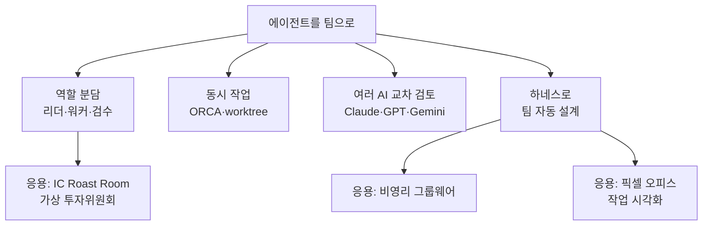
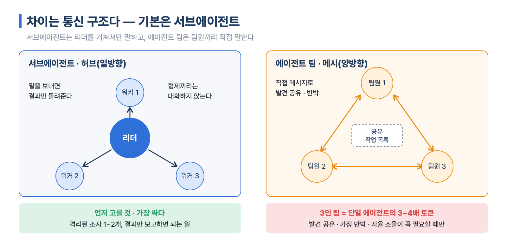
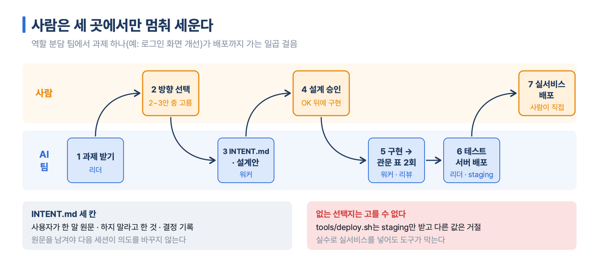
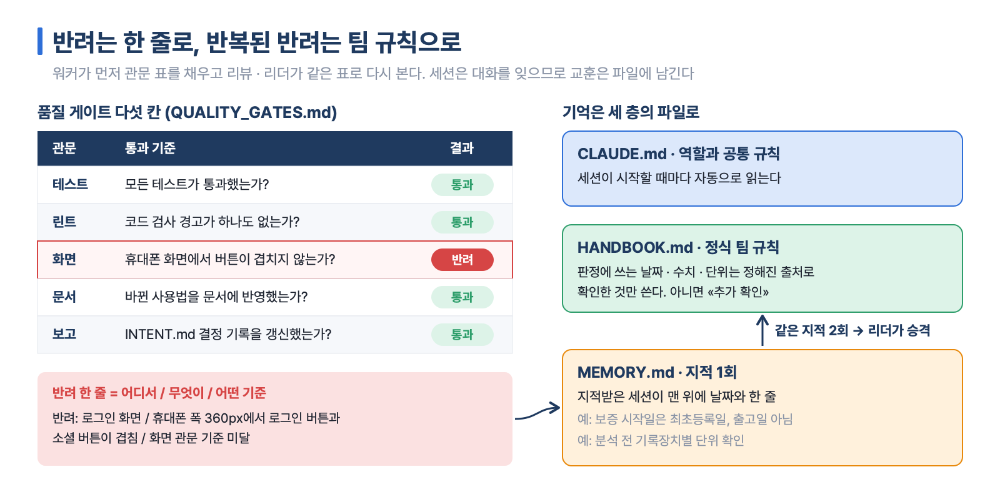
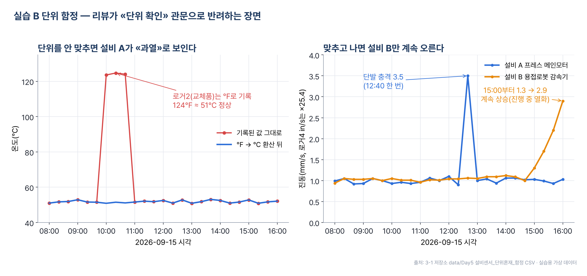
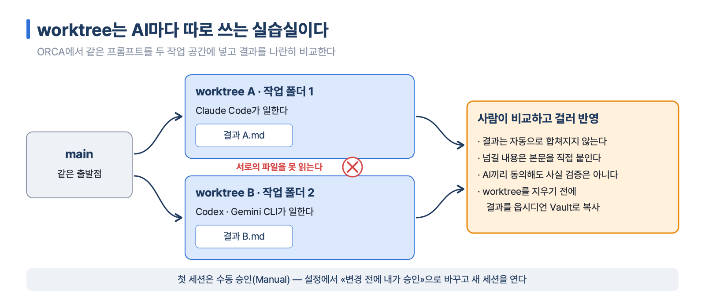
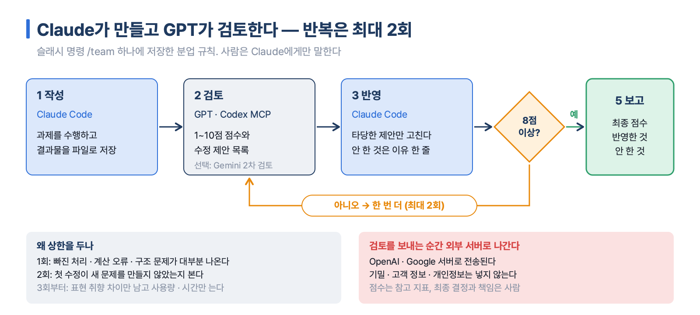
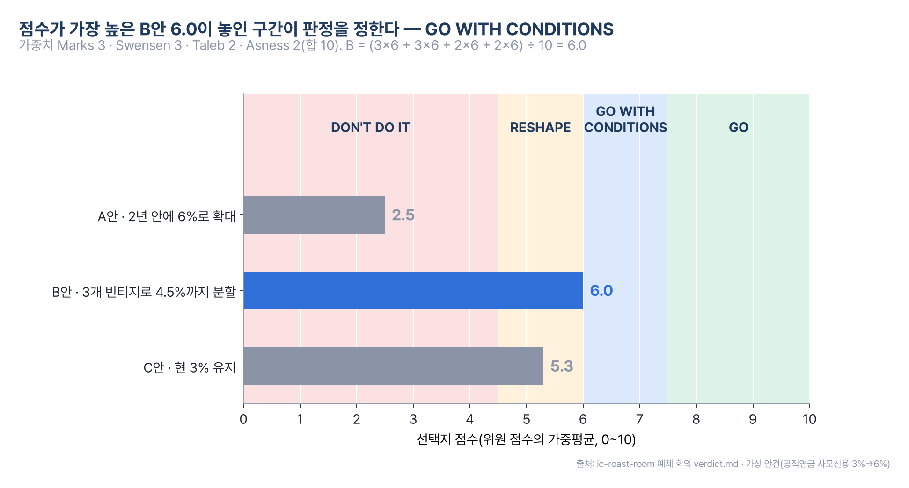
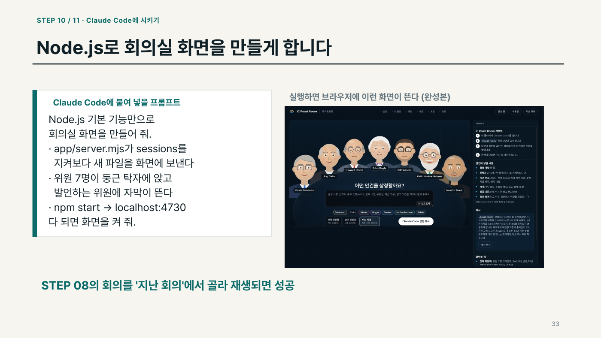
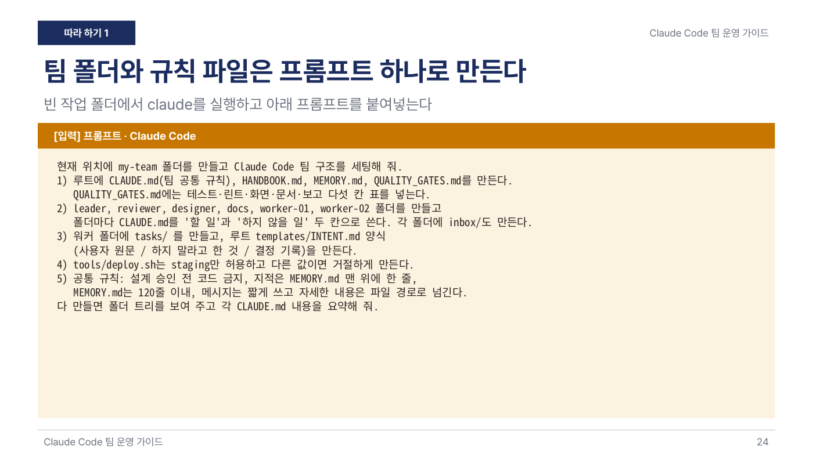

# 8장 에이전트를 팀으로 — 역할 분담 · 여러 AI · 시각화 · 투자위원회

> **이 장의 한 줄**
> AI 한 명에게 모든 일을 맡기면 자기 실수를 못 보고 앞의 판단에 끌려간다. 역할을 나누고(리더 · 워커 · 검수), 작업 공간을 나누고(worktree), 다른 AI에게 검토를 맡기고, 이 구조를 하네스로 자동 설계하면 AI는 «답변기»에서 «일하는 팀»이 된다. 방향 선택 · 설계 승인 · 배포 같은 결정은 끝까지 사람이 한다.

## 이 장에서 배우는 것

1. 서브에이전트와 에이전트 팀의 차이, 그리고 «서브에이전트 먼저» 원칙을 비용과 함께 설명할 수 있다.
2. 역할 폴더 · 의도 문서 · 품질 게이트 · 기억 파일로 Claude Code 세션 여러 개를 팀으로 운영할 수 있다.
3. worktree로 에이전트 여럿을 동시에 돌리고, MCP로 다른 AI(GPT · Gemini)를 검토자로 붙일 수 있다.
4. 하네스와 메타 하네스가 무엇인지, 팀 구조 패턴과 품질 검증 패턴을 고를 수 있다.
5. IC Roast Room으로 가상 위원들이 안건을 토론하고 점수로 판정하는 구조를 읽고 따라 만들 수 있다.

## 큰 그림



네 갈래는 같은 질문에 답한다. 누가 무엇을 하는가(역할), 서로 무엇을 보지 않는가(격리), 누가 검사하는가(검수), 어디서 사람이 멈춰 세우는가(승인). 아래 세 응용은 이 답을 실제 업무에 붙인 예다.

## 1. 왜 팀으로 나누는가

### 한 명이 다 하면 생기는 일

7장의 채용 심사단에서 보았듯, 한 명의 AI가 여러 역할을 연달아 맡으면 앞에서 낸 의견에 끌려간다(앵커링). 만든 사람은 자기 실수를 못 본다는 점은 사람의 코드 리뷰와 같다. 하네스 과정 덱은 이를 주방에 빗댄다. 1인 주방은 단순한 일에 빠르고 싸지만 복잡한 코스에서 병목이 생기고, 역할형 주방은 동시에 일하고 서로 검수하는 대신 사람 수만큼 비용이 는다.

이 장에서 자주 나오는 말을 먼저 정리한다.

| 용어 | 뜻 |
|---|---|
| 세션(session) | Claude Code를 한 번 실행해 이어지는 대화 묶음. 끝나면 대화를 잊고, 다음 세션은 파일만 읽고 시작한다 |
| 컨텍스트(context) | AI가 한 번에 보고 기억하는 작업대. 길어질수록 앞 내용을 정확히 떠올리는 힘이 떨어진다 |
| 토큰(token) | AI가 글을 읽고 쓰는 단위. 사용량과 비용이 토큰으로 계산된다 |
| 서브에이전트(subagent) | 리더가 일을 보내면 별도 컨텍스트에서 실행하고 결과만 돌려주는 워커. 형제끼리는 대화하지 않는다 |
| 에이전트 팀(Agent Team) | 팀원마다 독립 컨텍스트를 갖고, 팀원끼리 직접 메시지를 주고받으며 공유 작업 목록에서 일을 가져가는 방식(2026년 2월 출시) |

### 차이는 통신이고, 기본은 서브에이전트

두 방식의 차이는 통신 구조다. 서브에이전트는 리더를 가운데 둔 허브(일방향)이고, 에이전트 팀은 팀원끼리 직접 잇는 메시(양방향)다. 강력한 만큼 비싸서, 3인 팀은 보통 단일 에이전트의 3~4배 토큰을 쓴다[^cost]. 그래서 원칙은 **서브에이전트 먼저**다.



*그림 8-1. 서브에이전트는 리더를 거치는 허브, 에이전트 팀은 팀원끼리 직접 잇는 메시다. 팀은 토큰을 3~4배 쓰므로 서브에이전트가 기본이다. 출처: 하네스 과정 P3 덱.*

| 상황 | 고를 것 |
|---|---|
| 1~2개의 격리된 조사, 결과만 보고하면 되는 빠른 워커 | 서브에이전트 |
| 노하우를 반복해 쓰고 싶다 | 스킬 |
| 발견 공유 · 가정 반박 · 자율 조율이 필요한 복잡한 작업 | 에이전트 팀 |
| 조율 순서 자체를 반복해 쓰고 싶다 | 워크플로(4절) |

> **비용을 줄이는 네 수칙**
> 하네스 과정 P3 덱이 권하는 방법이다. 복잡한 일은 상위 모델, 단순한 일은 경량 모델로 나누는 모델 티어링, 쉬는 에이전트 즉시 종료, 일을 넘기는 사이에 대화 비우기(`/clear`, 토큰 30~50% 절감), 설정 파일에 모델 상한을 고정해 두기다.

## 2. 역할 분담 팀 — 리더 · 워커 · 검수

### 세 원칙

Claude Code 팀 운영 가이드(56장)는 별도 프로그램 없이 **폴더 · 마크다운 파일 · 세션 간 메시지**만으로 팀을 만든다. 원칙은 셋이다.

1. **세션 하나는 책상 하나다.** 역할마다 폴더를 두고 그 폴더에서 Claude Code를 실행한다. 대화가 섞이지 않고, 폴더만 봐도 누가 무엇을 하는지 보인다.
2. **설계 승인 전에는 코드를 쓰지 않는다.** 과제 의도를 `INTENT.md`에 적고 설계안이 승인된 뒤에만 구현한다.
3. **배운 것은 파일로 남긴다.** 세션은 끝나면 대화를 잊는다. 지적은 `MEMORY.md`에, 반복된 지적은 `HANDBOOK.md` 규칙으로 올린다.

같은 종류의 과제를 여러 세션에 계속 맡기고, 품질 기준을 매번 똑같이 지켜야 할 때 이 구조가 값을 한다. 세션 한두 개로 가끔 질문하는 정도라면 필요 없다.

### 다섯 역할과 «하지 않을 일»

| 역할 폴더 | 하는 일 | 하지 않는 일 |
|---|---|---|
| leader(리더) | 과제를 받고 방향을 묻고 워커에게 배정한다 | 직접 구현하지 않는다 |
| reviewer(리뷰) | 관문 표로 결과를 검수한다 | 코드를 고치지 않는다 |
| designer(디자이너) | 화면 설계안을 그린다 | 기능 코드를 쓰지 않는다 |
| docs(문서) | 문서와 사용 설명을 맞춘다 | 기능을 바꾸지 않는다 |
| worker-01, 02…(워커) | 배정받은 과제를 설계하고 구현한다 | 실서비스에 배포하지 않는다 |

역할 규칙은 각 폴더의 CLAUDE.md에 «할 일»과 «하지 않을 일» 두 칸으로 쓴다. 하지 않을 일을 적어야 남의 일을 덜 건드린다. 모든 역할이 지킬 공통 규칙은 팀 맨 위 폴더의 CLAUDE.md 한 곳에 모은다. CLAUDE.md는 실행 폴더와 그 위 폴더의 것이 함께 읽히기 때문이다.

### 과제 하나가 흐르는 길

사람이 끼어드는 곳은 **방향 선택 · 설계 승인 · 실서비스 배포** 세 곳이다.



*그림 8-2. 일곱 걸음 가운데 사람은 방향 선택 · 설계 승인 · 실서비스 배포 세 곳에서만 끼어든다. 출처: Claude Code 팀 운영 가이드 III 12~17 · 19장.*

`INTENT.md`(과제의 의도를 고정하는 파일)에는 세 칸을 둔다. 사용자가 한 말 원문, 하지 말라고 한 것, 결정 기록이다. 원문을 남겨야 의도가 바뀌지 않고, 결정을 남겨야 다음 세션이 이어받는다.

**품질 게이트(quality gate)**는 결과물이 다음 단계로 넘어가도 되는지 판정하는 검사 항목 표다. 워커가 먼저 채우고 리더나 리뷰가 같은 표로 다시 확인한다. 기본형은 테스트 · 린트(lint, 코드 검사 도구의 경고) · 화면 · 문서 · 보고 다섯 칸이고, 칸마다 «통과 / 반려»만 적는다. 반려는 «어디서 / 무엇이 / 어떤 기준에 걸렸는가» 한 줄로 쓴다.

> **규칙은 어길 수 있지만, 없는 선택지는 고를 수 없다**
> CLAUDE.md에 «실서비스에 배포하지 마라»라고 적는 것만으로는 부족할 때가 있다. 가이드는 배포 도구 `tools/deploy.sh`가 테스트 서버(staging)만 받고 다른 값이 오면 거절하게 만든다. 실수로 실서비스를 넣어도 도구가 막는다. 데이터 삭제 같은 명령도 같은 방식으로 막는다.

### 기억은 세 층의 파일로

| 파일 | 언제 쓰나 | 규칙 |
|---|---|---|
| MEMORY.md | 지적을 1회 받으면 | 지적받은 세션이 맨 위에 날짜와 함께 한 줄로 적는다. 120줄 안으로 유지한다 |
| HANDBOOK.md | 같은 지적이 2회 나오면 | 리더가 정식 규칙으로 올린다 |
| CLAUDE.md | 역할 · 공통 규칙 | 세션이 시작할 때 자동으로 읽는다 |

MEMORY.md를 짧게 유지하는 이유는 모든 세션이 시작할 때마다 읽어서 길어질수록 비용이 들기 때문이다. 세션끼리는 짧은 메시지만 주고받고 자세한 내용은 파일 경로로 넘긴다. 상대 세션이 꺼져 있으면 그 역할 폴더의 `inbox/`에 파일로 남긴다.



*그림 8-3. 관문 표 다섯 칸으로 통과 · 반려를 가르고, 반려 한 줄은 MEMORY.md에, 같은 지적이 두 번 나오면 HANDBOOK.md 규칙으로 올린다. 출처: 팀 운영 가이드 III 16 · 17 · 21 · 41장, my-team 스타터 키트.*

### 자동차 데이터로 팀 돌리기

실무 실습은 3-1 과정의 가상 데이터로 두 과제를 두 워커에게 동시에 맡긴다. 데이터에는 정답과 함정이 심겨 있어서 관문이 실제로 걸러 내는지 확인할 수 있다.

- **실습 A 보증 판정** — 가상 한빛모터스 CS 매뉴얼로 고객 문의 12건의 보증 여부를 판정한다. 리뷰는 «출고일을 보증 시작일로 쓴 판정»(정답은 최초등록일 기준 → 추가 확인)이나 «앱에 표시된 배터리 용량 68%로 판정»(정답은 지정 서비스센터 진단만 인정 → 추가 확인)을 반려한다.
- **실습 B 설비 이상 탐지** — 프레스 모터와 용접로봇 감속기 센서에서 이상 징후를 찾는다. 일부 기록장치가 ℉ · in/s · psi로 적혀 있어서, 단위를 확인하지 않으면 정상 설비가 «과열» · «고압»으로 보인다. 단위를 맞추고 나면 진짜 이상은 설비 B(용접로봇 감속기)의 지속 상승 하나로 남는다[^pdm].



*그림 8-4. 왼쪽: 로거2(교체품)가 ℉로 적은 124는 약 51℃로 정상이다. 오른쪽: 단위를 맞추면 설비 A는 12:40 한 번 튄 단발 충격, 설비 B는 15:00부터 계속 오르는 열화로 갈린다. 출처: 3-1 저장소 data/Day5 설비센서 단위혼재 함정 CSV(가상 데이터).*

두 실습의 반려는 하나의 팀 규칙으로 올라간다. «판정에 쓰는 날짜 · 수치 · 단위는 정해진 출처로 확인한 것만 쓴다. 확인되지 않으면 판정하지 않고 추가 확인으로 둔다.» 같은 실수가 두 과제에서 반복되면 팀 규칙이 된다는 것이 이 구조의 요점이다. 로봇 특강 실습은 여기에 «앞 과제가 관문을 통과해야 다음 과제가 시작되는» 순차 인계를 더한다(휴머노이드 도입 진단 → 90일 파일럿 계획)[^robot].

## 3. 동시에, 그리고 다른 AI와 함께

### ORCA — 에이전트마다 따로 쓰는 실습실

ORCA는 Claude Code · Codex · Gemini CLI 같은 에이전트 여럿을 한 화면에서 실행하는 무료 오픈소스 데스크톱 앱(작업대)이다. ORCA 자체는 무료이고 비용은 연결한 AI 구독이 정한다. 세션을 늘려도 같은 계정의 구독 한도는 늘지 않는다[^orca].

핵심 개념은 **worktree**다. 먼저 바탕이 되는 Git 용어를 정리한다.

| 용어 | 뜻 |
|---|---|
| Git · 저장소(Repository) | 파일의 변경 이력을 기록하는 도구와, 그 도구로 관리하는 프로젝트 폴더 |
| 커밋(Commit) · 브랜치(Branch) | 저장 기록 한 번 · 갈라져 나간 별도 변경 이력 |
| worktree | 브랜치마다 따로 만든 작업 폴더. AI마다 따로 쓰는 실습실이다 |
| Diff | 변경 전후의 차이 |

같은 출발점(main)에서 두 작업 공간이 각자 파일을 만들기 때문에 두 AI가 서로의 파일을 건드리지 않는다. 대신 서로 다른 worktree의 결과는 자동으로 합쳐지지 않고, 두 번째 AI가 첫 번째 AI의 파일을 못 읽는다. 입문 단계에서는 본문을 직접 붙여 넘긴다.



*그림 8-5. 같은 출발점(main)에서 작업 폴더를 둘 만들면 두 AI가 서로의 파일을 건드리지 않는다. 결과는 자동으로 합쳐지지 않으므로 사람이 비교해 반영한다. 출처: ORCA 가이드.*

실습은 셋이다. AI가 실제로 Markdown 파일을 만드는지 확인하고, 같은 프롬프트를 두 작업 공간에 넣어 결과를 나란히 비교하고, 한쪽의 검토 의견을 사람이 걸러 반영한다. 첫 세션은 **수동 승인(Manual)**으로 연다. 공식 문서는 터미널 에이전트에 승인 생략 옵션이 기본 포함될 수 있다고 설명하므로, 설정에서 «변경 전에 내가 승인»으로 바꾸고 새 세션을 연다. worktree를 지우면 그 안의 파일도 사라질 수 있으니 결과는 옵시디언 보관함(Vault)에 먼저 복사한다.

> **여러 창을 연다고 자동 검토가 생기지는 않는다**
> ORCA 공식 첫 실습도 각 작업 공간에 같은 프롬프트를 직접 넣어 비교한다. AI끼리 동의한다고 사실이 검증된 것도 아니다. 수동으로 한 번 성공시킨 뒤 자동화로 넘어간다.

### Claude가 만들고 GPT가 검토하는 팀

다음 단계는 다른 회사의 AI를 검토자로 붙이는 것이다. 연결 규격은 **MCP**(Model Context Protocol, AI에게 외부 프로그램을 도구로 꽂는 개방형 표준. Anthropic이 2024년 공개)다. AI용 USB 포트에 비유할 수 있다.

| 역할 | 누가 | 연결 방식 |
|---|---|---|
| 작성자(Builder) | Claude Code | 본체. 사람은 Claude에게만 말한다 |
| 1차 검토자(Reviewer) | GPT(Codex CLI) | Codex가 내장한 MCP 서버를 Claude Code에 등록 |
| 2차 검토자(선택) | Gemini(Gemini CLI) | `gemini -p "질문"`(대화창 없이 답 하나만 받는 실행)을 Claude가 호출 |

설치와 등록은 프롬프트 한 장으로 Claude Code에게 맡긴다. 공식 문서를 먼저 확인하게 하고, 사람이 움직이는 곳은 브라우저에서 ChatGPT · Google 계정으로 로그인하는 단계 하나다. 로그인이 끝나면 «완료»라고만 입력한다. API 키 방식은 호출마다 과금되므로 이 실습은 계정 로그인 방식을 쓴다.

분업 규칙은 **슬래시 명령** `/team`(`.claude/commands/` 폴더의 md 파일로 저장한 나만의 명령) 하나로 저장한다. 설정 파일을 직접 쓰지 않고 원하는 동작을 문장으로 설명해 Claude가 쓰게 한다(메타프롬프트).

```text
.claude/commands/team.md 파일로 /team 슬래시 명령을 만들어줘. 동작 규칙은 이렇게 해줘.
1. 작성: 네(Claude)가 $ARGUMENTS 과제를 수행하고 결과물을 파일로 저장한다.
2. 검토: codex 도구로 GPT에게 과제 원문, 결과물, 평가 기준(정확성, 빠진 부분, 개선점)을
보내고, 1~10점 점수와 수정 제안 목록을 받는다.
3. 반영: 타당한 제안만 반영해 수정한다. 반영하지 않은 제안은 이유를 한 줄로 남긴다.
4. 반복: 점수가 8점 미만이면 2~3단계를 한 번 더 한다. 최대 2회까지만 한다.
5. 보고: 최종 점수, 반영한 것, 반영하지 않은 것을 표로 보여준다.
```

반복 횟수에 상한을 두는 것이 설계의 핵심이다. 첫 검토에서 빠진 처리 · 계산 오류 · 구조 문제가 대부분 나오고, 두 번째 검토는 첫 수정이 새 문제를 만들지 않았는지 본다. 세 번째부터는 표현 취향 차이만 남고 사용량과 시간만 는다.



*그림 8-6. Claude가 작성하고 GPT가 점수와 제안을 내면 타당한 것만 반영한다. 8점 미만이면 한 번 더, 최대 2회. 출처: Claude · GPT · Gemini 교차 검토 실습 III.*

자동차 적용 예제는 2절과 같은 함정 데이터를 쓴다. 보증 판정에서는 렌터카(영업용) 한도 단축과 최초등록일 미확인을, 딜러 견적 메일 20건에서는 권한 밖 특가 약속과 리콜 문의 혼입을, 설비 센서에서는 단위가 섞인 여섯 값을 검토자가 잡는지 본다. 설비 센서 예제는 프롬프트에 단위 문제를 일부러 알려 주지 않는다. 작성자와 검토자 중 누가 먼저 찾는지 보고, 둘 다 놓치면 마지막 확인은 사람이 한다. 파일럿 공정 선정은 GPT와 Gemini가 교차 검토하는데, 두 검토자의 의견이 갈리는 곳이 바로 사람이 판단할 곳이다[^cross].

> **검토를 보내는 순간 내용은 외부 서버로 나간다**
> 회사 기밀 · 고객 정보 · 개인정보는 검토 요청에 넣지 않는다. OpenAI와 Google 서버로도 전송된다. 이 규칙을 CLAUDE.md의 «외부 AI 호출 규칙»에 적어 두면 Claude가 스스로 지킨다. 검토자의 점수는 참고 지표이고, 최종 결정과 책임은 사람이 진다.

심화 실습의 Reason Network(오픈소스 메시징 엔진)는 Claude Code와 Codex를 지휘자-도구가 아니라 대등한 동료로 묶는다. 터미널마다 세션이 따로 떠 있고 `send_message`로 일을 주고받는다. 병렬 개발이나 장시간 자율 작업에 맞지만, 작성 후 검토 같은 단순 분업은 MCP 방식으로 충분하다.

## 4. 하네스로 팀을 설계하기

### 하네스와 메타 하네스

**하네스(harness)**는 AI가 일하는 운영 구조 전체, 즉 누가 무엇을 언제 하는지 정한 에이전트 문서 · 스킬 · 진행 규칙의 묶음이다. 말에 채우는 마구에서 온 말이다. 하네스 과정(P0~P9)의 첫 메시지는 «모델은 충분히 똑똑하다. 성과를 가르는 것은 모델 주위의 운영 구조다»이다. 엔지니어링의 무게중심이 프롬프트 → 컨텍스트 → 하네스로 옮겨 왔다는 것이다.

Claude Code에서 운영을 짜는 재료는 다음과 같다.

| 재료 | 위치 | 한 줄 정의 |
|---|---|---|
| CLAUDE.md | 프로젝트 맨 위 | 매 세션 읽히는 프로젝트 규칙 |
| Skills | `.claude/skills/` | 재사용하는 작업 설명서(SKILL.md) |
| Subagents | `.claude/agents/` | 격리된 컨텍스트의 워커 |
| Hooks(훅) | 설정 파일 | 작업 흐름의 특정 시점에 자동 실행되는 스크립트. 막아야 할 동작을 확실히 막는다 |
| Plugins | 마켓플레이스 | 위 부품을 묶어 설치 · 공유하는 꾸러미 |
| MCP | 외부 서버 | 외부 시스템 · 데이터 연결 |

원칙은 «스킬부터 시작하고, 강제가 필요하면 훅, 격리 · 병렬이면 서브에이전트»다.

**메타 하네스**는 «하네스를 만드는 하네스»다. 공개 오픈소스 revfactory/harness 플러그인에 «하네스 구성해줘» 한 문장을 주면 도메인을 분석해 에이전트 팀과 스킬 파일을 자동으로 만든다. 팀 구조는 여섯 패턴 가운데 일에 맞는 것을 고른다.

| 패턴 | 구조 | 맞는 일 |
|---|---|---|
| Pipeline | 앞 단계 결과가 다음 단계 입력 | 단계가 분명한 변환 작업 |
| Fan-out/Fan-in | 여러 갈래로 동시에 나눴다가 모은다 | 여러 갈래 동시 조사 · 취합 |
| Expert Pool | 필요할 때 전문가를 골라 부른다 | 다양한 전문성이 필요한 문제 |
| Producer-Reviewer | 작성자가 만들고 검수자가 검사 | 품질 검증이 중요한 산출물 |
| Supervisor | 감독자가 일을 나누고 확인 | 동적으로 작업 배분 |
| Hierarchical Delegation | 위에서 아래로 단계별 위임 | 큰 작업을 하위 작업으로 분해 |

외울 필요는 없다. 메타 하네스가 고르고, 사람이 검토해 바꾼다. 저자 측정(표본 15개)으로는 구조화된 하네스가 평균 60% 개선을 보였고 어려운 과제일수록 폭이 컸지만, 제3자 재현은 진행 중이므로 자기 업무에서 직접 검증하라고 덱은 덧붙인다.

### 누구도 자기 숙제를 자기가 채점하지 않는다

P5 Dynamic Workflow 파트는 Claude가 오케스트레이션 스크립트(여러 에이전트를 언제 어떻게 돌릴지 적은 프로그램)를 직접 쓰고, 결과가 사람에게 닿기 전에 스스로 검증하는 방식을 다룬다. 실행 전에 계획을 보여 주고 허락을 구하며, 병렬 에이전트가 많아 사용량이 높다고 경고한다. 여기서 정리한 품질 패턴은 이 장 전체의 공통 언어다.

| 패턴 | 방식 | 이 장의 예 |
|---|---|---|
| Adversarial Verify | 한 에이전트가 다른 에이전트의 주장을 반박 | 리뷰 세션의 반려, IC 위원 반대 발언 |
| Diverse Lenses | 같은 문제를 여러 관점으로 동시 검토 | 채용 심사단, IC 위원 7명 |
| Judge Panel | 여러 심판이 평가 · 투표 | IC Roast Room 라운드 3 표결 |
| Loop-until-dry | 더 나올 게 없을 때까지 반복 | `/team`의 반복(단, 상한 2회) |

검증은 별도 에이전트가, 가능하면 별도 컨텍스트에서 한다. P7 파트는 그 위에서 사람의 자리를 정리한다. AI가 실행을 맡을수록 사람은 **목표 설정 · 품질 기준 · 맥락 판단 · 책임과 윤리** 네 가지를 더 깊이 쥔다. 얕은 문제 정의로는 좋은 하네스도 엉뚱한 결과를 잘 만들어 낼 뿐이다.

> **처음이라면 «실습 7선»부터**
> P0~P9 덱 앞에 복붙 실습북([harness-practice-navy](../보충교재/Day6_최종프로젝트/04_하네스엔지니어링_심화_P0toP9/harness-practice-navy.pdf))이 있다. 공개 하네스 모음 revfactory/harness-100에서 리서치 하네스를 설치해 일반 챗과 비교하는 실습 1부터, 보고서 · 콘텐츠 재활용 · 나만의 하네스 설계 · 개인 브랜딩 · 유튜브 · 웹툰 순으로 난이도를 올린다. 자동차 응용 덱(예지보전 · 품질 8D · 일일 생산 보고, 합성 데이터)도 같은 폴더에 있다.

### 응용 1 — 비영리 법인 그룹웨어를 멀티에이전트로

한 비영리 법인의 비개발자가 Claude Code로 한 달 동안 올인원 그룹웨어(전자결재 · 회계 · 인사 · 사업 관리)를 만든 사례가 있다. 공개 SNS 게시물(2026년 10월)과 화면 캡처로 재구성했으며, 덱은 화면으로 확인된 사실과 구현 방식의 추정을 구분해 표시한다. 가치는 기능 수보다 «품의서가 승인되면 집행 예약이, 지출결의서가 승인되면 전표가 자동으로 생기는» 결재-회계 연결에서 나온다. 법정 장부의 정본은 기존 회계 프로그램에 두고, 그룹웨어는 그 프로그램이 읽는 CSV만 낸다.

구현 실습편은 이 사례를 revfactory/harness로 따라 만든다. «하네스 구성해줘»에 팀 조건을 붙이면 기획(planner) · 백엔드 · 프런트엔드 · 회계 검수(accounting-reviewer) · QA 에이전트가 작성-검수 구조로 생긴다. 에이전트 파일은 한국어로 고칠 수 있는 업무 분장표다. «확인할 것»이 검수 기준이고 «하지 않을 것»이 가드레일(넘지 말아야 할 선)이다.

```text
하네스 구성해줘.
만들 것: 사단법인용 올인원 그룹웨어 웹앱
근거 자료: requirements.md를 먼저 읽어라.
팀 구성 조건
- 기획 에이전트가 설계 문서를 쓴다
- 백엔드·프런트엔드 에이전트가 구현한다
- 회계 검수 에이전트가 전표와 CSV를 따로 검사한다
- QA 에이전트가 브라우저로 E2E 테스트를 한다
- 작성–검수(producer–reviewer) 구조로 묶어라
단계가 끝날 때마다 나에게 확인받고 넘어가라.
```

마지막 줄이 **HITL**(Human-in-the-Loop, 개발 단계마다 사람이 확인하고 넘기는 방식)이다. 품의서의 업무 결재와는 별개다. 회계 단계에서는 회계 검수 에이전트가 가짜 문서 30건으로 «승인 문서 1건에 전표 1건인가 · 차변과 대변 합계가 같은가 · CSV가 장부 형식과 같은가»를 검사하고, 통과하지 못하면 백엔드에 돌려보낸다. 통장 거래 분류는 AI가 하되 반영은 사람이 미리보기 화면에서 확정한다[^gw].

### 응용 2 — 픽셀 오피스로 에이전트 작업 보기

에이전트가 여럿이 되면 «지금 누가 무엇을 하는지»가 안 보인다. 픽셀 오피스는 하네스가 만든 에이전트들의 상태(idle · running · waiting · completed · error)를 사무실 캐릭터로 보여 주는 화면이다. 화면 속 캐릭터는 진짜 에이전트가 아니라 상태를 캐릭터로 바꿔 그린 것이고, 하네스는 그대로 두고 옆에 어댑터만 붙인다.

초보자 원칙은 세 단계로 쪼개기다. 가짜 데이터 상태판 → 하네스 에이전트 목록 연결 → 사무실 꾸미기 순서로, 각 단계가 따로 돌아간다. 상태를 흐르게 하는 방법은 두 가지인데, Claude가 단계마다 상태 파일을 직접 고치는 방법은 빠뜨리기 쉽다. 실사용에는 **훅**을 쓴다. 서브에이전트가 시작할 때(SubagentStart) · 끝날 때(SubagentStop) · 도구를 쓴 뒤(PostToolUse) 상태를 자동으로 화면 서버에 보내게 하고, 훅이 실패해도 Claude 작업을 막지 않게 한다[^pixel].

## 5. 투자위원회를 화면으로 — IC Roast Room

### 무엇을 하는 도구인가

IC Roast Room은 연기금 · 공제회 · 보험사 같은 기관투자가의 투자위원회 안건을 **가상 위원 7명**이 토론하고, 점수가 붙은 판정과 PDF 보고서를 돌려주는 Claude Code 스킬과 회의실 화면이다. 공개 프로젝트 roast-room(MIT 라이선스, 원작은 창업자 자문단)을 기관투자가용으로 개작했다.

> **위원은 실존 투자자를 본뜬 가상 위원이다**
> 위원 7명은 실존 투자자의 공개 저작(책 · 서한 · 논문 · 증언 · 인터뷰)을 출처 번호와 함께 요약해 만든 시뮬레이션이다. 실제 인물이 아니며 그들의 견해를 대변하지 않고, 이 프로젝트와 관련이 없다. 저작권과 정확성을 위해 따옴표 직접 인용을 넣지 않았고, 캐릭터도 실제 얼굴을 닮게 그리지 않았다. 결과는 투자 권유가 아니다.

| 위원(가상) | 담당 영역 | 붙드는 질문 |
|---|---|---|
| Swensen | 정책 포트폴리오 · 대체투자 | 정책 포트폴리오에 들어갈 자산인가, 운용사 선별 역량이 있는가? |
| Dalio | 매크로 국면 · 리스크 균형 | 성장 · 물가 국면별로 어떻게 움직이며 정말 분산이 되는가? |
| Marks | 사이클 · 신용 · 위험의 가격 | 사이클의 어디에 있고, 감수하는 위험만큼 보상받는가? |
| Bogle | 비용 · 수수료 · 실행 | 보수 · 거래비용이 총수익에서 얼마를 가져가는가? |
| Asness | 증거 · 팩터 프리미엄 | 프리미엄이 비용과 쏠림을 넘어 실재한다는 증거가 있는가? |
| Ambachtsheer | 거버넌스 · 수탁자 책임 | 부진한 구간을 거버넌스가 버틸 수 있는가? |
| Taleb | 꼬리위험 · 유동성 | 극단적 국면에서 강제 매도 없이 살아남는가? |

먼저 투자위원회 용어를 짚는다. **AUM**(Assets Under Management, 운용자산 총액), **SAA**(Strategic Asset Allocation, 자산군별 장기 목표 비중), **IPS**(투자정책서, 위험 한도 · 승인 절차 문서), **사모신용**(은행 대신 펀드가 기업에 직접 빌려주는 대출 자산)이다.

### 회의는 어떻게 돌아가는가

의장(Chair, Claude Code 본체)은 편을 들지 않는다. 묻고, 부르고, 기록하고, 계산한다. 위원은 각각 서브에이전트이고 회의 때 자기 **brain**(그 인물의 저작을 출처 번호와 함께 요약한 파일 8개)만 읽는다. 그럴듯한 말을 지어내지 못하게 하는 장치다.

1. 의장이 안건에서 빠진 정보를 한 번에 최대 4개 묻는다.
2. 라운드 1(첫 발언) — 위원 7명을 동시에 부르고, 의장이 위원들이 갈라서는 근본 이유인 **쟁점(crux)**을 1~3개 정리한다.
3. 라운드 2(토론) — 다른 위원의 주장을 반박한다.
4. 라운드 3(표결) — 의장의 의결안에 찬성(Endorse) · 수정(Amend) · 반대(Dissent)로 표결한다.

위원은 정해진 양식의 **발언 카드**로만 답한다. 선택지별 점수(0~10), 확신도, 회복 불가능한 손실 위험(RUIN RISK) 등을 담는다. 카드의 필드 이름과 판정 이름이 영어인 것은 화면이 그 글자를 읽어 색과 위치를 정하기 때문이다.

선택지 점수는 위원 점수의 가중평균이다. $w_i$는 안건마다 의장이 정하는 위원 가중치(1~3), $s_{ij}$는 위원 $i$가 선택지 $j$에 매긴 점수다.

$$S_j = \frac{\sum_i w_i s_{ij}}{\sum_i w_i}$$

점수가 가장 높은 선택지가 추천안이 되고, 추천안 점수가 놓인 구간이 판정을 정한다.

| 추천안 점수 | 판정 | 뜻 |
|---|---|---|
| 7.5 ~ 10 | GO | 그대로 추진한다 |
| 6.0 ~ 7.4 | GO WITH CONDITIONS | 조건을 붙여 추진한다 |
| 4.5 ~ 5.9 | RESHAPE | 안을 고쳐서 다시 올린다 |
| 4.5 미만 | DON'T DO IT | 하지 않는다(«현 정책 유지»가 1등일 때도) |
| 선행 조건 미충족 | WAIT | 조건이 갖춰질 날짜까지 기다린다 |

안전장치가 하나 있다. 한 위원이라도 RUIN RISK를 likely로 매기면 점수가 높아도 판정은 RESHAPE를 넘지 못한다. 의장은 숫자를 위원 카드에서만 가져오고 지어내지 않는다.

완성본에 든 예제 회의(가상 안건: 운용자산 200조 원 공적연금의 사모신용 비중 3% → 6% 확대)는 간이 위원회(위원 4명 · 2라운드)로 열렸다. 선택지 점수는 A(2년 내 6%) 2.5 · B(3개 빈티지로 4.5%까지 분할) 6.0 · C(현 3% 유지) 5.3이었고, B안이 6.0~7.4 구간에 들어 GO WITH CONDITIONS가 나왔다. B안 계산은 (3×6 + 3×6 + 2×6 + 2×6) ÷ 10 = 6.0이다. 판정을 읽을 때는 점수만 옮기지 말고 쟁점과 소수의견(누가 왜 반대했는지)까지 IC에 보고한다.



*그림 8-7. 선택지 점수 A 2.5 · B 6.0 · C 5.3. 가장 높은 B안이 6.0~7.4 구간에 들어 GO WITH CONDITIONS가 나왔다. 출처: ic-roast-room 예제 회의 verdict.md(가상 안건).*

### 열한 번의 프롬프트로 짓기

구현 가이드는 STEP 01~11을 다섯 묶음으로 나눈다. 처음이라면 STEP 00에서 완성본으로 회의를 한 번 보고 시작한다.

| 묶음 | STEP | 만드는 것 |
|---|---|---|
| 준비 | 01~02 | Node.js(웹 화면 실행기) 설치 확인, 프로젝트 규칙 CLAUDE.md |
| 위원회 | 03~07 | 위원 명단 · brain · 위원 서브에이전트 설명서 · 발언 카드와 채점 규칙 · 의장 진행 스킬 `/roast-room` |
| 첫 회의 | 08 | 간이 위원회로 안건 하나 돌리기 |
| 회의실 화면 | 09~11 | 화면용 파일 규약 · 회의실 화면(localhost:4730) · 캐릭터 · PDF · 인용 검사 |
| 활용 | — | 좋은 안건 쓰기 · 막혔을 때 · 지켜야 할 선 |

STEP 04의 brain 만들기가 가장 큰 일이다. 위원 한 명(Taleb)으로 먼저 결과를 확인한 뒤 «나머지 6명도 같은 규격으로, 서브에이전트로 동시에 만들어 줘»라고 넓힌다. 위원 한 명에 10~20분이 걸리며 대부분 웹 검색과 출처 확인 시간이다. STEP 05의 위원 설명서는 «자기 brain 폴더만 읽고, 쓸 수 있는 도구는 읽기 · 검색뿐»으로 권한을 좁힌다. STEP 07까지가 위원회 본체이고, 화면 없이도 회의가 돌아간다. 화면은 의장이 쓰는 기록 파일을 지켜보다가 새 파일이 생기면 그 장면을 재생할 뿐이다.



*그림 8-8. STEP 10 프롬프트를 붙여 넣으면 localhost:4730에 회의실 화면이 뜬다(완성본). 출처: IC Roast Room 구현 가이드 33장.*

좋은 안건에는 결정 사항 한 줄, 선택지 2~3개(«현 정책 유지» 포함), 기관 숫자, 제약(IPS 한도 · 유동성 예산), 성공 기준, 팀의 의견과 이유가 들어간다. 팀의 의견을 숨기지 않아야 위원회가 그 의견을 시험한다.

> **사용량과 API 모드**
> 구독 플랜만으로 동작하며 API 키가 필요 없다. 간이 위원회(`--quick`)는 서브에이전트 호출 8번 안팎, 전체 위원회는 21번이라 처음에는 간이 위원회로 돌린다. 화면에서 직접 회의를 여는 API 모드는 Anthropic API 계정에 과금되며 회의당 약 25회 호출이 든다. 이 모드는 쓰기 전에 강사와 상의한다.

## 실습 길잡이

난이도는 1단계(가장 쉬움)부터 4단계까지로 표시한다.

| 순서 | 3-1B 폴더 | 난이도 | 무엇을 하나 |
|---|---|---|---|
| 1 | [하네스 엔지니어링 P0~P9](../보충교재/Day6_최종프로젝트/04_하네스엔지니어링_심화_P0toP9/) | 2~3단계 | 실습 7선 → P0~P9 덱 · 옵시디언 노트 → 자동차 응용 덱 |
| 2 | [ORCA 동시 작업](../보충교재/Day4_업무자동화/11_ORCA_에이전트여럿_동시작업/) | 3단계 | worktree 두 개로 같은 프롬프트 비교 · 검토 반영 |
| 3 | [Claude · GPT · Gemini 교차 검토](../보충교재/Day6_최종프로젝트/09_Claude_GPT_Gemini_교차검토팀/) | 3단계 | Codex MCP 등록 → `/team` → 자동차 예제 ①~④ |
| 4 | [IC Roast Room](../보충교재/Day6_최종프로젝트/02_IC_Roast_Room_투자위원회/) | 3단계 | 완성본 회의 보기 → STEP 01~11, 전체 패키지 `IC_Roast_Room.zip` |
| 5 | [비영리 그룹웨어](../보충교재/Day6_최종프로젝트/12_비영리법인_그룹웨어_멀티에이전트/) | 3단계 | 개요 덱 22장 → 실습편 III 30장 |
| 6 | [픽셀 오피스](../보충교재/Day6_최종프로젝트/05_픽셀오피스_에이전트작업_시각화/) | 3단계 | 하네스(1번) 다음에. 가짜 상태판 → 하네스 연결 → 훅 |
| 7 | [역할 분담 팀](../보충교재/Day4_업무자동화/08_ClaudeCode_역할분담팀_리더워커검수/) | 4단계 · 심화 | 가이드 56장 + 스타터 키트 `my-team-starter-kit_III.zip`, 실습 A·B → 로봇 실습 |

**공통 진행법.** Claude 데스크톱 앱의 Code 탭에서 작업 폴더를 연다. 덱에 «터미널에 입력»으로 나온 설치 명령(Git · Codex CLI · harness 플러그인 등)과 여러 개의 터미널 탭을 여는 일도 Claude Code에게 «대신 설치해 줘», «이 역할 폴더에서 세션을 열어 줘»라고 맡긴다. 사람은 계정 로그인 · 권한 승인 · 방향 선택 · 설계 승인 · 배포 확인만 한다.

대표 프롬프트 1 — 역할 분담 팀 폴더를 한 번에 만든다

```text
현재 위치에 my-team 폴더를 만들고 Claude Code 팀 구조를 세팅해 줘.
1) 루트에 CLAUDE.md(팀 공통 규칙), HANDBOOK.md, MEMORY.md, QUALITY_GATES.md를 만든다.
QUALITY_GATES.md에는 테스트·린트·화면·문서·보고 다섯 칸 표를 넣는다.
2) leader, reviewer, designer, docs, worker-01, worker-02 폴더를 만들고
폴더마다 CLAUDE.md를 '할 일'과 '하지 않을 일' 두 칸으로 쓴다. 각 폴더에 inbox/도 만든다.
4) tools/deploy.sh는 staging만 허용하고 다른 값이면 거절하게 만든다.
다 만들면 폴더 트리를 보여 주고 각 CLAUDE.md 내용을 요약해 줘.
```



*그림 8-9. 빈 작업 폴더에서 Claude Code를 열고 앰버 상자의 프롬프트를 붙여 넣는다. 덱 원문에는 워커 tasks/ · INTENT.md 양식 · 공통 규칙 줄도 들어 있다. 출처: Claude Code 팀 운영 가이드 III 24장.*

대표 프롬프트 2 — 리더에게 첫 과제를 줄 때(바로 시작하지 않게)

```text
과제: 로그인 화면을 개선해 줘.
바로 시작하지 말고 방향을 2~3가지 선택지로 먼저 보여 줘.
내가 고르면 비어 있는 워커에게 inbox 메시지로 배정해 줘.
```

전문은 [IC Roast Room 프롬프트 md](../보충교재/Day6_최종프로젝트/02_IC_Roast_Room_투자위원회/IC_Roast_Room_구현가이드/IC_Roast_Room_프롬프트.md), [픽셀 오피스 매뉴얼](../보충교재/Day6_최종프로젝트/05_픽셀오피스_에이전트작업_시각화/pixel-office-manual.md), 스타터 키트 안의 `practice/` 프롬프트 파일에 있다.

## 자동차 현장에 옮기기

| 부서 | 적용 예 | 이 장에서 가져올 것 |
|---|---|---|
| 품질 | 보증 클레임 판정 결과를 다른 AI가 재검토 | `/team` 작성-검토, 정답 열을 가린 채 채점 |
| 생산 · 보전 | 설비 센서 이상 보고서에 단위 확인 관문 | 품질 게이트 5칸, 반려 한 줄, MEMORY → HANDBOOK 승격 |
| 기획 · 투자 | 신규 공장 · 지분 투자 안건을 가상 위원회로 사전 점검 | 선택지에 «현 상태 유지» 포함, 가중 점수, 소수의견 보고 |
| 경영지원 | 결재 승인 → 전표 생성처럼 업무 흐름을 잇는 사내 시스템 | 하네스 작성-검수 팀, 개발 단계마다 HITL |
| IT · 혁신 | 여러 에이전트가 동시에 일하는 모습을 관제 화면으로 | 훅으로 상태 자동 전송, 픽셀 오피스 |

로봇 특강 실습의 교훈도 함께 옮길 만하다. «가장 힘든 작업을 1순위로 두지 않는다», «공개 사례 수치는 출처 그대로, 요구조건과 달성 성과는 구분한다» 같은 반려가 쌓여 팀 규칙이 된다. 이 규칙 파일이 바뀐 담당자에게 넘기는 인수인계 문서가 된다는 점은 그룹웨어 사례의 결론과도 같다.

## 정리

- 팀으로 나누는 목적은 속도보다 의견의 독립성과 검수다. 기본은 서브에이전트이고, 서로 의견을 주고받아야 할 때만 에이전트 팀으로 올린다.
- 역할은 폴더로, 의도는 INTENT.md로, 합격 기준은 품질 게이트 표로, 교훈은 MEMORY → HANDBOOK으로 파일에 남긴다.
- 되돌리기 어려운 동작은 규칙 문서가 아니라 도구 쪽에서 막는다.
- 다른 AI 검토는 반복 상한을 두고, 외부로 보낼 자료의 범위와 최종 판단은 사람이 정한다.
- 하네스는 AI가 일하는 운영 구조이고, 사람은 목표 · 기준 · 맥락 · 책임을 쥔다.

## 확인 문제

1. 3인 에이전트 팀은 단일 에이전트보다 토큰을 3~4배 쓴다. 그런데도 «에이전트 팀으로 올려야 할» 작업은 어떤 작업인가?

> **답**
> 팀원끼리 발견을 공유하거나 서로의 가정을 반박하고 자율적으로 조율해야 하는 복잡한 작업이다. 결과만 보고하면 되는 빠른 일은 서브에이전트로 충분하다(서브에이전트 먼저).

2. 역할 분담 팀에서 사람이 개입하는 세 곳을 쓰고, 실서비스 배포를 세션에 맡기지 않게 하는 장치를 설명하라.

> **답**
> 방향 선택, 설계 승인, 실서비스 배포다. 배포 도구 `tools/deploy.sh`가 테스트 서버(staging)만 받고 다른 값이면 거절하도록 만들어, 규칙을 어기더라도 도구가 막게 한다.

3. ORCA에서 두 worktree에 같은 프롬프트를 넣었더니 두 번째 AI가 첫 번째 AI가 만든 파일을 못 읽는다. 고장인가?

> **답**
> 고장이 아니다. worktree는 AI마다 따로 쓰는 작업 폴더라서 결과가 자동으로 합쳐지지 않는다. 입문 단계에서는 첫 번째 결과의 본문을 직접 붙여 넘긴다.

4. `/team` 명령에 «점수 8점 미만이면 한 번 더, 최대 2회»라는 상한을 두는 이유는?

> **답**
> 첫 검토에서 중요한 오류가 대부분 나오고 두 번째 검토는 수정이 새 문제를 만들지 않았는지 확인한다. 세 번째부터는 표현 취향 차이만 남아 사용량과 시간만 늘기 때문이다.

5. IC Roast Room 예제에서 B안 점수가 6.0이었다. 판정은 무엇이며, 한 위원이 B안에 RUIN RISK를 likely로 매겼다면 판정은 어떻게 되는가?

> **답**
> 6.0은 6.0~7.4 구간이라 GO WITH CONDITIONS다. 한 위원이라도 RUIN RISK를 likely로 매기면 점수와 상관없이 판정은 RESHAPE를 넘지 못한다. 예제에서는 Taleb 위원이 possible을 유지해 상한이 걸리지 않았고, 그가 제시한 완화 조건을 승인 조건에 넣었다.

## 더 보기

- 앞 장: [07장 업무 에이전트 만들기](07장_업무_에이전트_만들기.md) — 심사단의 평가자 분리, 판정 에이전트의 골격
- 하네스 기초(CLAUDE.md · 작업 규칙): [04장 AI에게 일 잘 시키기](04장_AI에게_일_잘_시키기.md)
- 같은 함정 데이터의 원래 실습: [09장 스마트팩토리와 예지보전](09장_스마트팩토리와_예지보전.md) · [12장 로봇과 스마트팩토리 특강](12장_로봇과_스마트팩토리_특강.md)
- 팀으로 만든 웹앱을 배포까지: [10장 업무 웹앱 처음부터 끝까지](10장_업무_웹앱_처음부터_끝까지.md)
- 원자료: [IC Roast Room README](../보충교재/Day6_최종프로젝트/02_IC_Roast_Room_투자위원회/README.md) · [완성본 ic-roast-room](../보충교재/Day6_최종프로젝트/02_IC_Roast_Room_투자위원회/IC_Roast_Room.zip) · [하네스 패키지 README](../보충교재/Day6_최종프로젝트/04_하네스엔지니어링_심화_P0toP9/README.md) · [그룹웨어 README](../보충교재/Day6_최종프로젝트/12_비영리법인_그룹웨어_멀티에이전트/README.md) · [하네스 옵시디언 노트](../보충교재/Day6_최종프로젝트/04_하네스엔지니어링_심화_P0toP9/02_notes_obsidian_md/)

[^cost]: 하네스 과정 P3 덱. 팀원마다 독립 컨텍스트(최대 100만 토큰)를 쓰기 때문이다. 다만 10개 이상 대규모 병렬에서는 결과가 한 컨텍스트로 몰리지 않아 팀이 오히려 3~5배 저렴할 수 있다고 덱은 설명한다. 소규모(2~4)는 서브에이전트가 가장 효율적이다.
[^pdm]: 실습 B 반려 예: 로거2(교체품)는 온도를 ℉로 기록해 124℃처럼 보인 값이 약 51℃로 정상, 로거4는 행마다 단위가 섞여 있다(진동은 in/s와 mm/s, 압력은 bar와 psi). in/s · psi로 적힌 행을 환산하면 각각 약 1.1 mm/s · 116.5 bar로 정상이다. 그래서 단위 열이 없을 때는 값의 크기로 단위를 가려야 한다. 통과한 보고서는 설비 B의 온도가 13:00 이후 55℃ → 65℃, 진동이 15:00부터 1.3 → 2.9 mm/s로 계속 오른 것을 «진행 중인 열화», 설비 A의 12:40 진동 3.5 mm/s를 «단발 충격»으로 나눈다. 예지보전 파일럿 공정 추천(프레스, 연간정지손실 ÷ 초기투자 2.59배)은 가정값이다.
[^robot]: 로봇 실습 데이터는 3-1 과정 저장소의 Robot_Special 폴더(작업 후보 5개 평가 매트릭스 템플릿, 휴머노이드 · 물류로봇 현장 파일럿 사례 10건)다. 반려 예로 «CSV에 KPI가 확인 불가인 사례에 정확도 98%를 인용», «BMW의 요구조건인 사이클 84초를 달성 성과로 기술»이 나온다. 자세한 내용은 12장에서 다룬다.
[^orca]: ORCA 덱은 2026-10-22 공식 문서 기준이며 Claude Pro 월 US$20(세금 별도)을 시작 구성으로 든다. 메뉴 · 설치 방법 · 요금은 바뀔 수 있다. 연습용 저장소는 GitHub 가입이나 업로드 없이 내 PC 안에만 만든다.
[^cross]: 파일럿 공정 선정 예제의 연간 정지손실은 «시간당 손실 × 연간 고장 건수 × 평균 정지 시간»이며 모두 가정값이다. 조립은 시간당 손실(2,500만 원)이 가장 커서 1위처럼 보이지만 고장이 적어 연간 손실은 가장 작다. 프레스는 패널 재고가 있어 실제 손실이 표보다 작을 수 있다. 모범답안은 프레스 1순위이고, 근거와 한계를 함께 적었는지가 채점 기준이다.
[^gw]: 개요 덱의 사실 정보: 개발 기간 1개월(진행 중), Claude Max 구독으로 개발, MS 비영리 프로그램 지원 Azure 서버. 실습편 III는 STEP 0~12의 열세 단계(준비 · 팀 설계 · 구현 · 검증 · 배포 · 회고)이고, 단계가 끝날 때마다 «지금 상태를 기록 저장해 줘»(git 커밋)를 입력한다. 테스트 녹화에 자막을 붙여 사용법 영상을 만드는 교육 영상 에이전트를 추가하는 피드백 예도 있다.
[^pixel]: 매뉴얼의 화면은 React(웹 화면 부품 도구) 프런트와 FastAPI(파이썬 웹 서버 도구) 백엔드로 이루어진다. 예시 에이전트는 Planner · Researcher · Python Coder · Backtester · Reviewer · Slide Builder 등이다.
