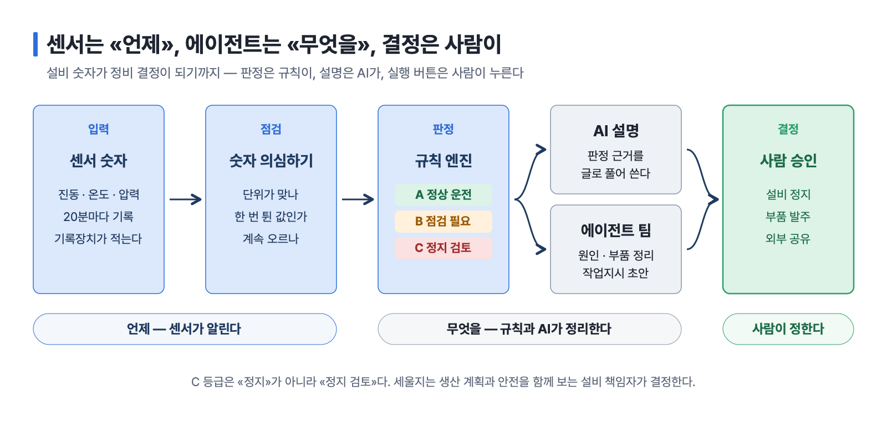
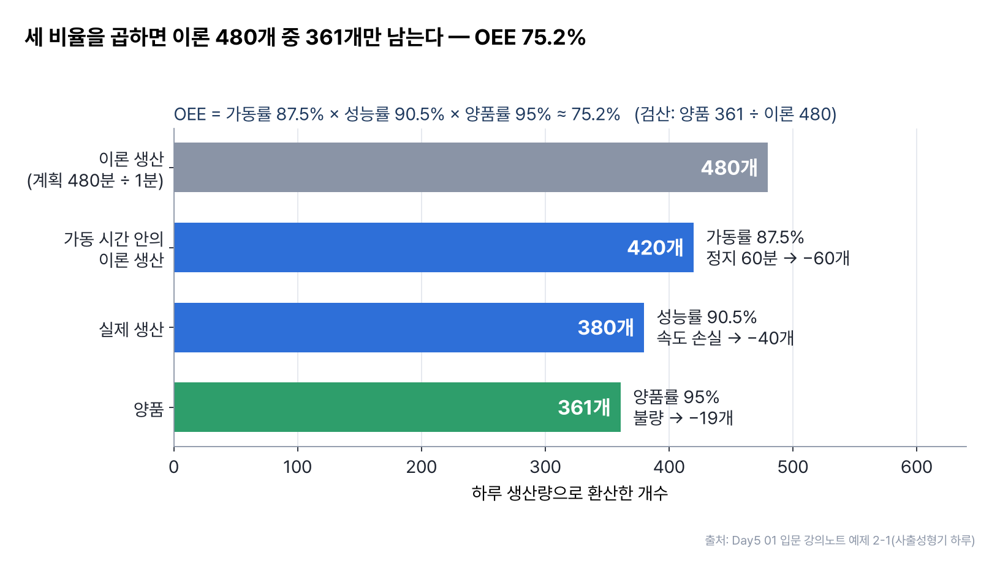
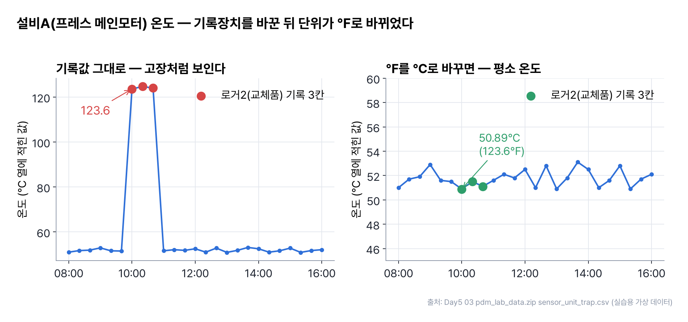
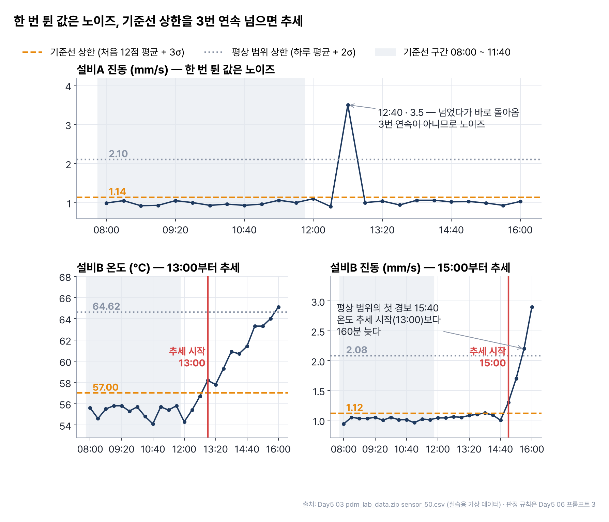
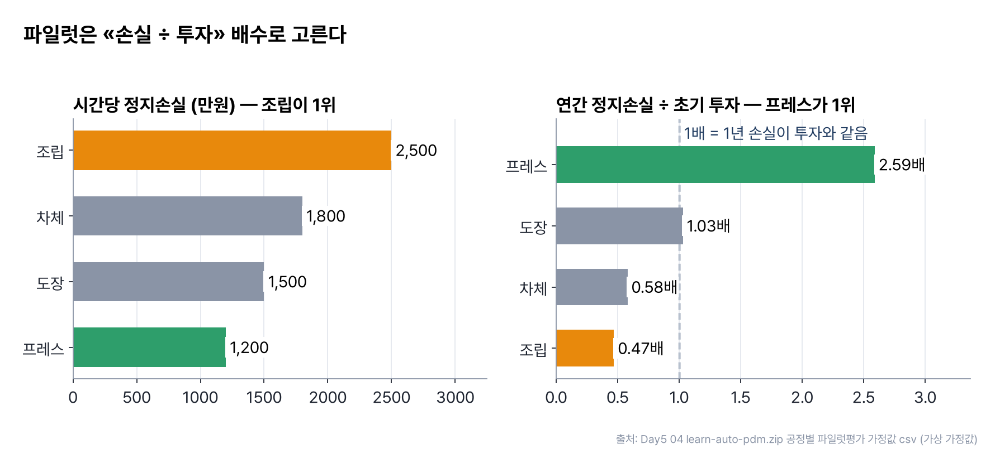
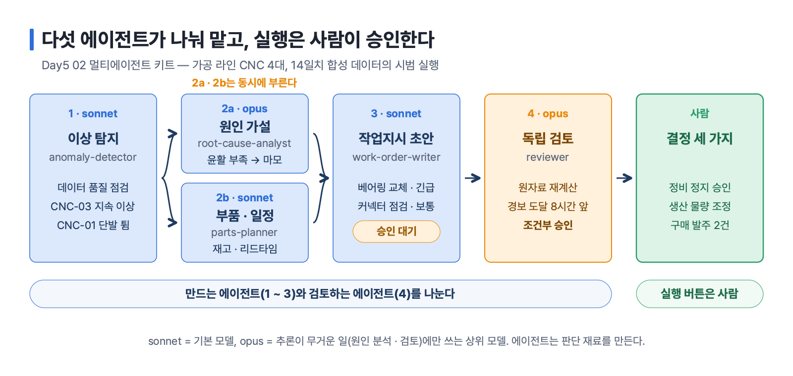
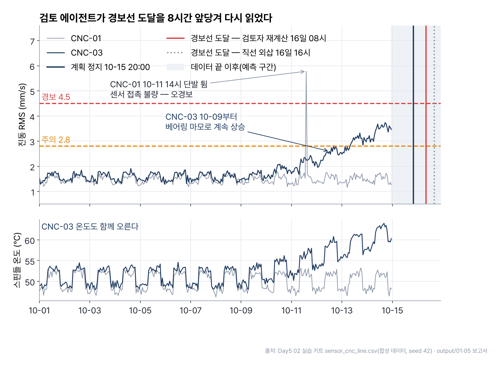
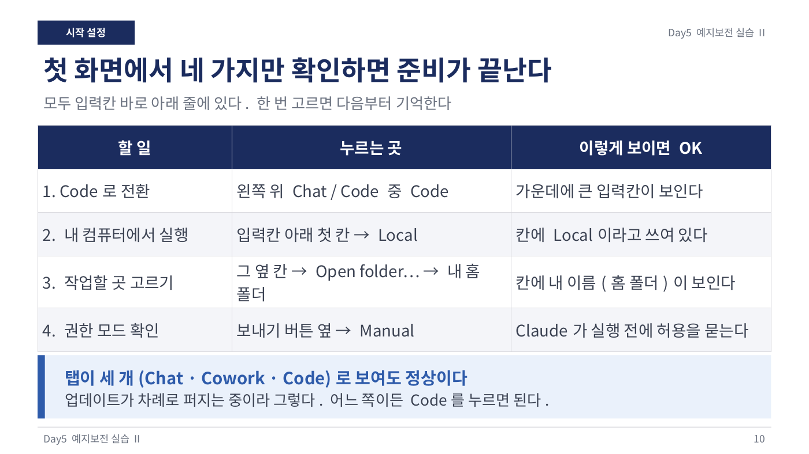

# 9장 스마트팩토리와 예지보전

> **이 장의 한 줄**
> 스마트팩토리는 로봇이 많은 공장이 아니라 **데이터로 판단하는 공장**이다. 이 장에서는 설비 센서 숫자를 의심하고(단위 · 튐 · 추세), 정지 여부는 규칙이 판정하고 AI는 설명만 하게 만들며, 정비 업무 하나를 여러 AI에게 나눠 맡기되 실행 버튼은 사람이 누르는 방법을 배운다.

## 이 장에서 배우는 것

1. 스마트팩토리와 OEE(Overall Equipment Effectiveness, 설비종합효율)를 설명하고 손으로 계산할 수 있다.
2. 사후보전에서 예지보전(PdM, Predictive Maintenance, 고장 조짐을 미리 읽어 정비 시점을 정하는 방식)까지 정비 전략의 차이를 말할 수 있다.
3. 센서 데이터에서 단위 혼재 · 단발 튐 · 지속 추세를 구별하는 규칙을 Claude Code에게 시킬 수 있다.
4. «판정은 규칙 엔진, 설명은 AI»라는 원칙으로 설비 정비 판정 웹앱을 만드는 흐름을 안다.
5. 탐지 · 원인 · 부품 · 작업지시 · 검토를 여러 에이전트에게 나누고, 정지 · 발주 같은 실행은 사람의 승인으로 남길 수 있다.

## 큰 그림



*그림 9-1. 센서 숫자를 의심하고(단위 · 튐 · 추세), 규칙 엔진이 A · B · C로 판정하고, AI와 에이전트 팀이 설명과 작업지시 초안을 만들며, 정지 · 발주 · 공유는 사람이 승인한다. 출처: Day5 01~06 실습 흐름 정리.*

센서는 «언제»를 알려 주고, 에이전트는 «무엇을» 정리하고, 결정은 사람이 한다. 3-1B Day5 덱의 마지막 장이 이 순서를 한 줄로 요약한다 — «SENSORS TELL WHEN. AGENTS TELL WHAT. PEOPLE DECIDE.»

## 1. 스마트팩토리 — 데이터로 판단하는 공장

### 1.1 자동화와 스마트화의 차이

입문 강의노트는 자동차 운전에 빗대어 설명한다. 옛날 공장은 계기판 없는 자동차라 엔진 소리를 듣고 감으로 판단한다. 자동화 공장은 크루즈 컨트롤이 있는 자동차라 정해진 속도는 기계가 지키지만 상황 판단은 여전히 사람이 한다. 스마트팩토리는 내비게이션 · 차선 유지 · 고장 경고가 달린 자동차처럼 **스스로 측정하고(센서) 판단하고(AI) 알려 주거나 조정한다**.

| 구분 | 자동화 | 스마트화 |
|---|---|---|
| 하는 일 | 정해진 동작을 반복 | 상황을 보고 판단 · 조정 |
| 예시 | 컨베이어가 일정 속도로 움직임 | 불량이 늘면 속도를 스스로 낮춤 |
| 핵심 자원 | 기계 | 데이터와 알고리즘 |
| 약점 | 변화에 약함 | 데이터가 없으면 쓸모가 없음 |

이 순환 고리(현실 측정 → 가상에서 분석 → 현실 조정)를 CPS(Cyber-Physical System, 사이버 물리 시스템)라고 부른다.[^cps]

### 1.2 공장의 성적표 OEE

스마트팩토리 과제가 가장 흔히 실패하는 이유는 «AI 도입» 자체가 목표가 되는 것이다. 무엇을 얼마나 좋게 할지 숫자로 먼저 정해야 한다. 가장 널리 쓰는 숫자가 OEE다. 설비가 이론상 낼 수 있는 성과 가운데 실제로 얼마를 냈는지를 세 비율의 곱으로 나타낸다.

$$
\text{OEE} = \text{가동률} \times \text{성능률} \times \text{양품률}
$$

> **예제 — 사출성형기 한 대의 하루 (입문 강의노트 예제 2-1)**
> 계획 480분 중 고장 · 금형 교체로 60분 정지, 이론 사이클타임 1개당 1분, 생산 380개, 그중 양품 361개.
> - 가동률 = 420 ÷ 480 = 87.5%
> - 성능률 = 380 ÷ 420 ≈ 90.5%
> - 양품률 = 361 ÷ 380 = 95%
> - OEE ≈ 75.2% (검산: 양품 361개 ÷ 이론 480개 ≈ 75.2%)



*그림 9-2. 사출성형기 하루를 개수로 환산하면 정지 · 속도 · 불량 손실이 차례로 깎여 이론 480개 중 양품 361개가 남는다(OEE ≈ 75.2%). 출처: Day5 01 입문 강의노트 예제 2-1.*

세 비율이 각각 90%여도 OEE는 72.9%다. 곱셈이라 작은 손실이 쌓인다. 강의노트는 85%를 세계적 수준, 60% 안팎을 보통 수준으로 소개한다. OEE를 깎는 원인은 6대 로스(Six Big Losses)로 나눠 찾는데, 그중 첫째인 **설비 고장**을 줄이는 기술이 이 장의 주제인 예지보전이다.

| OEE 요소 | 로스 | 예시 |
|---|---|---|
| 가동률 | 설비 고장 · 준비와 교체 | 모터가 타서 2시간 정지, 금형 교체 40분 |
| 성능률 | 잦은 짧은 정지 · 속도 저하 | 부품 걸림으로 1~2분씩 멈춤 |
| 양품률 | 공정 불량 · 초기 불량 | 찍힘 · 치수 불량, 가동 직후 불량 |

### 1.3 공장 데이터의 길

공장 데이터는 센서 → PLC(Programmable Logic Controller, 설비를 제어하는 산업용 컴퓨터) → SCADA · HMI(설비 감시 화면) → MES(Manufacturing Execution System, 작업지시 · 실적 · 추적을 맡는 생산관리 시스템) → ERP(전사 자원관리)로 올라간다. 이 다섯 층을 ISA-95라고 부른다. 현장 설비 쪽 기술을 OT(Operational Technology), 사무 쪽을 IT라고 하는데, 둘이 따로 놀아 데이터가 층 사이에 갇히는 일이 많다. 그래서 입문 과정 실습은 «한 라인의 데이터가 어느 층에 있고, 어디서 끊기는가»를 그려 보는 것으로 시작한다.

## 2. 예지보전의 기본 — 언제 고칠 것인가

### 2.1 정비 전략 다섯 가지

| 전략 | 자동차에 빗대면 | 장점 | 단점 |
|---|---|---|---|
| 사후보전 BM(Breakdown Maintenance) | 길에서 서면 견인 | 평소 비용 없음 | 갑작스러운 정지, 큰 피해 |
| 예방보전 PM(Preventive Maintenance) | 1만 km마다 무조건 오일 교환 | 계획 가능 | 멀쩡한 부품도 교체 |
| 상태기반보전 CBM(Condition-Based Maintenance) | 오일 상태를 보고 교환 | 낭비 감소 | 측정 장비 필요 |
| 예지보전 PdM | «약 2주 뒤 문제될 확률이 높다» 경고 | 가장 경제적인 시점에 교체 | 데이터 · 모델 필요 |
| 처방보전 RxM(Prescriptive Maintenance) | «다음 주 화요일, 이 부품 교체» 추천 | 행동까지 제시 | 가장 복잡 |

결함이 처음 생기는 시점(P, Potential Failure)과 기계가 실제로 멈추는 시점(F, Functional Failure) 사이를 P-F 간격이라 하고, 이 사이가 «고칠 수 있는 골든타임»이다. 사람의 오감(소음 · 열)은 이 곡선의 끝부분에서야 이상을 느끼고, 센서와 AI는 앞부분(미세 진동 변화)에서 잡는다.

### 2.2 지금 바꿀까, 기다릴까

AI의 역할은 «고장 난다 / 안 난다»를 맞히는 것이 아니라 **고장 확률을 숫자로 내놓는 것**이다. 그 숫자와 비용을 비교하는 일은 경영 판단이다. 입문 강의노트 예제 5-1은 지금 계획 교체하면 200만 원, 기다리다 고장 나면 2,000만 원, 다음 1주 고장 확률 15%인 경우를 다룬다. 기다릴 때 기대 비용은 0.15 × 2,000만 = 300만 원으로 지금 교체가 낫다. 교체 기준 확률은 다음과 같다.

$$
p^{*} = \frac{\text{계획 교체 비용}}{\text{고장 비용}} = \frac{200}{2000} = 10\%
$$

고장 확률이 10%를 넘으면 교체하고, 넘지 않으면 기다린다.

### 2.3 진동을 숫자로 읽기

회전하는 기계는 고장 전에 떨림이 달라진다. 진동을 요약하는 대표 숫자가 RMS(Root Mean Square, 실효값 — 일정 시간 동안 떨림의 평균 세기)다. 순간 최댓값이 아니라 대표값이라는 점이 중요하다. 첨도(kurtosis)는 «탁» 하고 튀는 충격이 얼마나 있는지를 보며 결함 초기에 민감하고, RMS는 결함이 진행될수록 커진다.[^vib]

Day5 실습들은 진동 속도 RMS(mm/s)를 국제 표준 구간으로 나눠 판정한다.

| ISO 20816-3 구간 | 진동 RMS (mm/s) | 뜻 | 설비 정비 판정 에이전트의 등급 |
|---|---|---|---|
| A | 1.4 이하 | 새로 설치한 설비 수준 | A |
| B | 1.4 ~ 2.8 | 오래 돌려도 괜찮은 수준 | A |
| C | 2.8 ~ 4.5 | 오래 돌리기엔 부적합, 계획 정비 | B |
| D | 4.5 초과 | 손상 우려, 바로 조치 | C |

> **실습마다 기준표가 조금씩 다르다**
> ISO 구간은 그룹 2(15~300kW) · 강성 기초 기준이다. 스핀들 6대 실습(05)은 이 값을 참고해 만든 **사내 기준**(2.8 주의 · 4.5 경고 · 7.1 위험)을 쓰고, 멀티에이전트 실습(02) 덱은 «ISO 20816-3(옛 10816-3) 준용 주의 2.8 · 경보 4.5»라고 적는다. 05 실습의 조사 프롬프트 출력 예시처럼 ISO 20816-3이 10816-3을 대체한 현행 기준이다. 실습할 때는 그 폴더의 기준표를 그대로 쓴다.

### 2.4 잔여 수명 RUL

RUL(Remaining Useful Life, 잔여 유효 수명)은 «이 부품이 앞으로 얼마나 더 버틸까»다. 가장 단순한 방법은 추세를 위험 기준까지 늘여 보는 선형 외삽이다. 스핀들 실습의 MC-03은 7일 동안 진동이 2.1에서 5.2 mm/s로 올라 하루 약 0.44씩 상승했고, 이대로면 약 4일 뒤 7.1(위험)에 닿는다. 다만 마모는 막판에 빨라지므로 선형 추정은 낙관적일 수 있다. 이 점은 5절의 검토 에이전트가 실제로 잡아낸다.[^weibull]

## 3. 숫자를 의심하는 법 — 단위 · 튐 · 추세

예지보전에서 가장 비싼 실수는 멀쩡한 설비를 세우거나, 서서히 나빠지는 설비를 놓치는 것이다. Day5 따라 하기(06)와 자율학습 강의(04)는 같은 가상 데이터로 숫자를 의심하는 순서를 세 단계로 연습한다. 데이터는 설비A(프레스 모터) · 설비B(용접로봇 감속기)의 08:00~16:00 20분 간격 진동 · 온도 · 압력 50건, 단위가 섞인 같은 기록 50건, 공정 4곳의 파일럿 가정값, 도입 사례 6건이다. 센서 · 공정 값은 실습용 가상 데이터이고 도입 사례만 실제 기사에서 모았다.

### 3.1 단위부터 본다

기록장치(로거)를 바꾸면 단위 설정이 달라지는 일이 현장에서 흔하다. 갑자기 튄 값이 고장인지 단위인지는 «기록장치» 열이 알려 준다. 실습에서는 바꾼 칸이 6개(℉ 3 · in/s 2 · psi 1)이고, 123.6℉는 50.89℃로 평소 온도와 같다. 숫자만 보고 세웠다면 멀쩡한 설비를 세웠을 것이다.



*그림 9-3. 설비A 온도 열에 로거2(교체품)가 ℉로 적은 3칸이 섞였다. ℃로 바꾸면 50.89℃ 등 평소 온도와 같다. 출처: Day5 03 pdm_lab_data.zip의 sensor_unit_trap.csv(실습용 가상 데이터).*

### 3.2 평상 범위와 이상 후보

평상 범위는 설비 × 센서마다 따로 «평균 ± 2 × 표준편차»로 잡는다. σ(시그마, 표준편차)는 값이 평소 평균에서 얼마나 흩어지는지를 나타낸다. 실습 결과 이상 후보는 설비A 1점(12:40 진동 3.5), 설비B 3점이다.

### 3.3 튐은 노이즈, 연속은 신호

평균 ± 2σ에는 함정이 있다. 오르기 시작한 값까지 섞어 평균을 내므로 범위가 넓어져 늦게 울린다. 그래서 정상 구간(처음 12점, 08:00~11:40)으로 기준선을 따로 잡고 다음 규칙을 쓴다.

| 단계 | 규칙 |
|---|---|
| 상한 | 기준선 평균 + 3σ (한 점 튐에 덜 흔들리게) |
| 추세 | 상한을 3번 연속 넘으면 추세 — 첫 점이 정비 권고 시점 |
| 노이즈 | 넘었지만 연속 3번이 안 되면 노이즈 (설비A 진동 3.5) |

결과는 설비B 온도 13:00, 진동 15:00에 추세가 시작되고, 평상 범위가 처음 잡은 시각(15:40)보다 **160분 빠르다**. 다음 주 정비를 한 대만 잡는다면 설비B다.



*그림 9-4. 처음 12점으로 잡은 기준선 상한(주황 점선)을 3번 연속 넘으면 추세다. 설비A 12:40의 3.5는 한 번만 넘어 노이즈, 설비B는 온도 13:00 · 진동 15:00에 추세가 시작돼 평상 범위의 첫 경보(15:40)보다 160분 빠르다. 출처: Day5 03 pdm_lab_data.zip의 sensor_50.csv(실습용 가상 데이터), 규칙은 Day5 06 프롬프트 3.*

### 3.4 어디부터 할까 — 파일럿 고르기

공장장의 질문은 «예지보전, 우리도 해야 하나? 한다면 어디부터?»다. 파일럿(먼저 적용해 볼 공정 하나)은 «연간 정지손실 ÷ 초기 투자» 배수로 고른다. 아래는 가상 가정값이다(단위 만원).

| 공정 | 시간당 손실 | 연 고장 × 정지(h) | 연간 정지손실 | 초기 투자 | 배수 |
|---|---|---|---|---|---|
| 프레스 | 1,200 | 18 × 3.0 | 64,800 | 25,000 | 2.59배 |
| 도장 | 1,500 | 6 × 4.0 | 36,000 | 35,000 | 1.03배 |
| 차체 | 1,800 | 24 × 0.8 | 34,560 | 60,000 | 0.58배 |
| 조립 | 2,500 | 5 × 1.5 | 18,750 | 40,000 | 0.47배 |

시간당 손실로만 고르면 조립이 1위지만 배수로는 꼴찌다. 1순위 프레스는 고장 손실의 25%만 줄인다고 **가정(추정)**하면 연 16,200만원 절감, 회수 1.5년이다. 연간 정지손실 전체가 절감액은 아니라는 점, 감축률은 추정이라는 점을 보고서에 밝힌다.



*그림 9-5. 시간당 손실로는 조립이 1위지만, 연간 정지손실 ÷ 초기 투자 배수로는 프레스(2.59배)가 1위, 조립(0.47배)이 꼴찌다. 출처: Day5 04 learn-auto-pdm.zip의 공정별 파일럿평가 가정값 csv(가상 가정값).*

## 4. 규칙이 판정하고 AI가 설명한다 — 설비 정비 판정 에이전트

Day5 03의 PdM Action Agent(설비 정비 조치 판정 웹앱)는 [07장 업무 에이전트 만들기](07장_업무_에이전트_만들기.md)에서 다루는 Day4 09 출산 · 육아 인사판정 에이전트와 **같은 골격**이다. 규칙 판정 + 근거 검색 + AI 설명이라는 뼈대는 그대로 두고, 판정 근거만 인사제도에서 정비 기준으로 바꿨다. 가이드 덱 46장이 STEP 0~10을 «어디 · 입력 · 출력 · 피드백» 네 칸으로 안내한다.

### 4.1 왜 AI가 판정하지 않는가

AI가 정지 여부까지 판정하면 같은 측정값에 다른 답이 나와 근거를 남길 수 없다. 그래서 정지 여부는 규칙 엔진(정해진 기준을 순서대로 적용하는 프로그램)이 정하고, 질문 이해와 설명만 AI가 맡는다. 판정은 다섯 근거를 정해진 순서로 겹쳐 본다.

| 근거 | 무엇을 보나 | 등급에 주는 영향 |
|---|---|---|
| 법정 안전검사 | 프레스 · 산업용 로봇의 다음 검사일 | 지났으면 무조건 C |
| 제조사 매뉴얼 | 설비별 온도 · 진동 경보와 정지 값 | 정지 값 초과 C, 경보 초과 B |
| ISO 20816-3 진동 구간 | 제조사 기준이 없는 회전기계 | 구간 D는 C, 구간 C는 B |
| 평상 범위(평균 ± 2σ) | 같은 설비의 하루 분포 | 기준 이내여도 벗어나면 B |
| 사내 정비 규정 | 윤활 · 오일 교환 주기, 데이터 상태 | 주기 초과 · 데이터 이상은 B |

모든 기준 초과는 최근 3회 중 2회 이상일 때만 반영한다(가상 사내 규정 CP-02). 등급은 A 정상 운전, B 점검 필요(48시간 안에 계획 정비 또는 데이터 확인), C 즉시 정지 **검토**다. C는 «정지»가 아니다. 생산 계획과 안전을 함께 보는 설비 책임자가 결정하고, 잠금 · 표지(LOTO, Lock-Out Tag-Out, 정비 중 설비가 다시 켜지지 않게 잠그고 표시하는 절차)를 준비한다.

### 4.2 정답지 여덟 건

데이터는 한빛모터스(가상) 제1공장의 설비 7대다. 제조사 한계값은 가상이고 안전검사 대상 · 주기만 실제 법령(산업안전보건법)이다. 테스트 사례 8건이 판정 엔진의 정답지 역할을 한다.

| 사례 | 설비 | 기대 | 이유 |
|---|---|---|---|
| A | 설비A | A | 단발 3.5 — 관찰 메모만 |
| B | 설비B | B | 평상 범위 연속 초과, 경보 2.5 초과 |
| C | 냉각수 펌프 | C | ISO 구간 D 연속 |
| D | 프레스 2호기 | C | 안전검사 유효기간 만료 |
| E | 설비A(단위 혼재판) | B | 로거 교체 뒤 ℉ 기록 — 데이터 확인 |
| F | 용접로봇 2호기 | B | 오일 교환 주기 초과(6,450h / 6,000h) |
| G | 금형 냉각 펌프 | B | 24시간 측정값 없음 |
| H | 용접로봇 3호기 | C | 온도 정지 기준 80℃ 연속 초과 |

사례 D가 이 실습의 교훈을 보여 준다. 진동 1.2는 ISO 구간 A, 온도 55℃는 경보 아래, 윤활도 주기 안이다. 그런데 프레스는 안전검사 대상(설치 후 3년 이내, 이후 2년마다)이고 2026-08-20에 유효기간이 끝났다. 센서가 모두 정상이어도 법정 검사가 끝났으면 쓸 수 없다.

### 4.3 사람과 Claude Code의 일

| 사람이 할 일 | Claude Code가 할 일 |
|---|---|
| Claude Code 설치 · 로그인 승인(1장 참고) | 저장소에서 `pdm_lab_data.zip`을 내려받아 풀기, Node.js 점검 · 설치 |
| 관리자 비밀번호 입력(설치 중 묻는 경우) | 설계 → Next.js 프로젝트 생성 → 화면 · 판정 엔진 · 테스트 8건 |
| 선택 단계(STEP 7)에서 API 키를 `.env.local` 파일에 직접 붙여넣기 | 키 파일 열어 주기, AI 설명 연결 |
| 화면 확인, 테스트 결과 확인, 배포 전 승인 | Playwright(브라우저 자동 조작 도구)로 종합 테스트, GitHub Pages 배포 |

STEP 6까지는 외부 AI API(프로그램끼리 기능을 주고받는 통로) 없이 동작해 비용이 들지 않는다. 첫 설계 프롬프트는 역할 · 목표 · 기능 · 제약 · 검증의 다섯 요소를 담는다.

```text
당신은 풀스택 개발자입니다. 저는 코딩을 모르는 자동차 부품사 직원입니다.
"PdM Action Agent" — 설비 정비 조치 판정 웹앱을 만듭니다.
…
원칙: DB·외부 AI API는 처음엔 쓰지 않습니다.
정지 여부 판정은 규칙 엔진이, 질문 이해·설명은 AI가 맡습니다.
프로젝트 폴더 구조와 단계별 개발계획을 한국어로 설명해주세요.
아직 코드는 작성하지 마세요.
```

결과가 기대와 다르면 «안 돼요» 대신 증상 · 기대 · 요청 · 검증의 네 문장으로 되묻는다.

```text
[증상] 사례 E(설비A, sensor_unit_trap.csv)가 C로 나옵니다.
[기대] 로거 교체 뒤 ℉로 기록된 값이라 B(데이터 확인)가 나와야 합니다.
[요청] 기록장치 변경과 단위 확인 규칙 코드를 보여주고 고쳐주세요.
[검증] 고친 뒤 테스트 8건을 다시 돌려 결과를 표로 보여주세요.
```

같은 골격에 판정 근거만 바꾸면 CS 보증 판정(보증 약관), 수입검사 합격 판정(검사 규격서), 구매 CR 수용 판정(원자재 연동 규칙), 글로벌 리콜 매칭(결함 모드 코드)도 만들 수 있다.

## 5. 정비 업무를 AI 팀에게 나눠 맡기기

### 5.1 프롬프트 → 레시피 → 팀 (스핀들 6대 실습)

05 실습은 한빛모터스(가상) 엔진 블록 가공 라인의 CNC 머시닝센터 MC-01~MC-06을 다룬다. MC-03은 7일 동안 진동이 서서히 오르고, MC-05는 딱 한 번 튄다. 실습은 네 부분으로 쌓인다.

| 부분 | 어디서 | 하는 일 |
|---|---|---|
| PART 1 프롬프트 패턴 | Claude 채팅창 | 목표 · 맥락 · 형식 · 기준 4요소, 조사 · 요약 · 작성 · 검토 네 패턴 |
| PART 2 반복 업무 | Claude Code | 주간 설비 리포트를 한 번 시키고, 피드백으로 고친 규칙까지 레시피(Skill)로 저장 |
| PART 3 AI 팀 | Claude Code | 센서 분석 · 고장 진단 · 정비 계획 · 검토 네 역할과 매니저 |
| PART 4 안전과 설계 | Claude Code | 되돌릴 수 없는 일은 실행 전 승인, 검증 게이트, 업무 설계서 |

PART 2의 장면이 흔한 실수를 보여 준다. 첫 리포트는 MC-05의 단발 8.0을 «위험»으로 판정했다. 사람이 «3회 연속 기준을 넘을 때만 경고 이상, 단발 초과는 센서 점검»이라고 바로잡고, 그 규칙까지 넣어 `weekly-pdm-report` 레시피로 저장하게 한다. 다음 주에는 «이번 주 설비 리포트 만들어줘» 한 줄로 같은 방법이 돈다. 스킬(Skill, Claude Code가 필요할 때 꺼내 쓰는 작업 설명서 파일)은 [01장 AI와 일하는 준비](01장_AI와_일하는_준비.md)에서 처음 소개한다.

PART 4의 승인 규칙 프롬프트는 어느 업무에도 옮겨 쓸 수 있다.

```text
이 프로젝트에서 되돌릴 수 없는 일은
실행하기 전에 반드시 나에게 묻게 해줘.
- 작업 요청 메일이나 메신저 발송
- data 폴더 원본 CSV의 수정과 삭제
- 설비 정지를 지시하는 문서의 외부 공유
그리고 실행한 일은 logs/actions.log에
시각과 함께 기록해줘.
```

### 5.2 다섯 에이전트의 정비 파이프라인 (멀티에이전트 키트)

02 키트는 같은 생각을 더 크게 키운다. 가공 라인 CNC 4대의 14일치 합성 데이터(1,344행 = 4대 × 336시간, seed 42로 다시 만들 수 있음)에 두 사건을 심었다. CNC-03은 10-09부터 스핀들 베어링 마모가 진행되는 진짜 이상이고, CNC-01은 10-11 14시 진동 한 점이 튀는 오경보(센서 접촉 불량)다.

멀티에이전트(한 업무를 역할별 독립 AI 작업자로 나누는 방식)를 쓰는 목적은 속도보다 **검증**이다. 만든 에이전트와 검토하는 에이전트가 다르다. Claude Code에서는 `CLAUDE.md`(그 폴더에서 Claude Code가 먼저 읽는 작업 규칙 파일)가 오케스트레이터(지휘자)가 되고, `.claude/agents/` 아래 파일 하나가 서브에이전트(맡은 일만 하는 보조 AI) 하나다.

| 단계 | 에이전트 | 역할 | 모델 |
|---|---|---|---|
| 1 | anomaly-detector | 데이터 품질 점검, 이상탐지 | sonnet |
| 2a | root-cause-analyst | 매뉴얼 · 정비이력 대조, 원인 가설 순위 | opus |
| 2b | parts-planner | 부품 재고 · 리드타임, 정비 시간대 | sonnet |
| 3 | work-order-writer | 작업지시서 초안(승인 대기) | sonnet |
| 4 | reviewer | 원자료 재계산, 독립 검토 | opus |

2a와 2b는 서로 기다리지 않으므로 동시에 부른다. 추론이 무거운 원인 분석과 검토에만 상위 모델을 배정한다. 설계 원칙은 네 가지다 — ① 서브에이전트는 이 대화를 보지 못하므로 입력 · 출력 파일 경로를 적어 넘긴다 ② 의존이 없으면 병렬 ③ 만든 에이전트는 자기 결과를 검토하지 않는다 ④ 작업지시는 «승인 대기»로만 만든다.



*그림 9-6. 이상 탐지 → 원인 가설과 부품 · 일정(동시) → 작업지시 초안(승인 대기) → 독립 검토 → 사람의 결정 세 가지. 만드는 에이전트와 검토하는 에이전트가 다르다. 출처: Day5 02 실습 키트 CLAUDE.md · output/ 시범 실행 결과.*

시범 실행 결과에서 원인 분석가는 세 가설을 지지 근거와 반대 근거로 나란히 놓았다(H1 윤활 부족 → 마모: 높음 · H2 공구 불균형: 낮음 · H3 센서 이상: 배제). 반대 근거 칸을 비우지 않는 것이 사람이 반박하기 쉽게 만드는 장치다.

> **검토 에이전트가 8시간을 찾아냈다**
> 01 보고서는 최근 72시간을 **직선**으로 외삽해 경보선(4.5 mm/s) 도달을 16일 16시로 예측했다. 검토자는 상승이 가속하는 것을 보고 2차항과 주간 부하를 넣어 다시 맞췄고, 도달 시각은 16일 08시로 8시간 이르다(주간 부하가 밤에도 이어지면 01시). 계획한 10-15 20:00 정지가 경보선 직전이라, 판정은 «조건부 승인 — 10-15 주간 감속 운전 조건 추가»였다. 2.4절에서 말한 «선형 추정은 낙관적일 수 있다»가 실제로 일어난 장면이다.



*그림 9-7. CNC-03은 10-09부터 진동과 스핀들 온도가 함께 오르고, CNC-01은 10-11 14시에 한 점만 튄다. 직선 외삽은 경보선(4.5 mm/s) 도달을 16일 16시로, 검토자의 재계산은 16일 08시로 본다 — 계획 정지(10-15 20:00)가 경보선 직전이다. 출처: Day5 02 실습 키트 sensor_cnc_line.csv(합성 데이터, seed 42), output/01 · 05 보고서.*

산출물은 승인 대기 작업지시 두 건(CNC-03 베어링 교체 · 긴급, CNC-01 커넥터 점검 · 보통)과 **사람이 내릴 결정 세 가지**(정비 정지 승인 · 생산 물량 조정 · 구매 발주 2건)다. 에이전트는 판단 재료를 만들고 실행 버튼은 사람이 누른다. 여러 AI를 팀으로 운영하는 일반 원리는 [08장 에이전트를 팀으로](08장_에이전트를_팀으로.md)에서 더 다룬다.

## 실습 길잡이

난이도는 3-1B 목록 기준으로 1단계(가장 쉬움)부터 4단계까지 숫자로 적는다.

| 순서 | 폴더 | 난이도 | 하는 일 |
|---|---|---|---|
| 1 | [05 스핀들 6대 프롬프트 실습](../보충교재/Day5_예지보전/05_스핀들6대_진동온도_프롬프트실습/) | 1단계 | 채팅 4패턴 → 레시피 → AI 팀 → 승인 규칙 (25장) |
| 2 | [06 센서 점검부터 대시보드 공개까지](../보충교재/Day5_예지보전/06_센서점검부터_대시보드공개까지_따라하기/) | 1단계 | 프롬프트 8개로 단위 점검 → 추세 → 파일럿 → 대시보드 공개 (38장 + 프롬프트 md) |
| 3 | [01 스마트팩토리 입문과정](../보충교재/Day5_예지보전/01_스마트팩토리_입문과정/) | 2단계 | 커리큘럼 · 강의노트(예지보전 I · II, AI 품질) · 본편 42장 · 워크북 2종 |
| 4 | [03 설비 정비 판정 에이전트](../보충교재/Day5_예지보전/03_설비정비판정_에이전트/) | 2단계 | STEP 0~10으로 A/B/C 판정 웹앱 (46장 + 데이터 zip + 완성 MVP) |
| 5 | [04 예지보전 자율학습 강의](../보충교재/Day5_예지보전/04_예지보전_자율학습강의/) | 2단계 | 스킬 설치 후 /learn-auto-pdm으로 06과 같은 내용 복습 (42장) |
| 6 | [02 스마트팩토리 멀티에이전트](../보충교재/Day5_예지보전/02_스마트팩토리_멀티에이전트/) | 3단계 | 서브에이전트 5개 파이프라인 시범 (25장 + 실습 키트) |

> **04와 06은 같은 수업의 두 판이다**
> 04는 강의를 만드는 스킬 course-forge로 Day5 본 강의 6단계를 옮긴 **자율학습 강의**다. 스킬을 설치하고 `/learn-auto-pdm`을 부르면 Claude가 블록마다 설명 → 실습 → 퀴즈로 이끈다. 06은 «설치 단계가 어렵다»는 의견을 받아 스킬 없이 프롬프트 8개만 남긴 판이고, 확인 숫자(6칸 · 160분 · 2.59배 등)는 같다. course-forge로 내 강의를 만드는 법은 [11장 나만의 AI 업무시스템](11장_나만의_AI_업무시스템.md)에서 다룬다. 03은 STEP 0에서 공개 저장소의 zip을 내려받으므로 폴더 이름을 바꾸지 않는다(경로 고정).



*그림 9-8. 06 실습의 시작 설정 장. Code로 전환 → Local → 내 홈 폴더 → 권한 모드 Manual, 네 가지만 확인하면 준비가 끝난다. 출처: Day5 06 PdM_Lab_Manual_II 10쪽.*

**06 실습에서 사람과 Claude Code의 일**

| 사람이 할 일 | Claude Code가 할 일 |
|---|---|
| Claude 앱에서 Code로 전환, Local · 내 홈 폴더 · 권한 모드 Manual 고르기 | 작업 폴더 만들기, 데이터 4개 내려받기, Python · pandas 설치 |
| 허용 카드의 명령 한 줄을 읽고 허용 | 계산 · 차트 · 대시보드 `index.html` 만들기 |
| GitHub 일회용 코드를 브라우저(github.com)에만 입력 | 올라갈 파일 점검, 저장소 생성, GitHub Pages 켜기 |
| 출력 숫자를 슬라이드 정답과 대조, 공유 메시지 보내기 | 4단 보고서 · README 작성, 공유 메시지 초안(보내지 않음) |

대표 프롬프트 — 06의 프롬프트 3(노이즈 vs 추세). 전문은 [PdM_Prompts_II.md](../보충교재/Day5_예지보전/06_센서점검부터_대시보드공개까지_따라하기/PdM_Prompts_II.md)에 있다.

```text
같은 '설비센서_50건' csv로 이상 후보가 노이즈인지 추세인지 판정해 줘.
1. 설비별·센서별로 처음 12점(08:00~11:40)을 기준선으로 삼아 기준선 상한 = 평균 + 3 × 표준편차 를 구해 줘.
2. 상한을 3번 연속 넘으면 '추세', 넘었지만 3번 연속이 아니면 '노이즈'로 판정하고, 추세의 첫 시각을 '추세 시작'으로 outputs/trend_judgement.csv 에 저장해 줘.
3. 설비B 온도·진동 차트에 기준선 상한과 평상 범위 상한을 함께 그려 보여 줘.
4. 가장 이른 추세 시작이 평상 범위로 처음 잡힌 시각보다 몇 분 빠른지 알려 줘.
```

이렇게 나오면 성공 — 설비B 온도 13:00 · 진동 15:00 추세 시작, 설비A는 노이즈, 160분 빠름. 막히면 «결과가 가이드와 다른데 판정 규칙부터 대조해서 원인을 찾아 줘»라고 입력한다.

대표 프롬프트 — 02 키트의 파이프라인 실행. 압축을 푼 폴더를 Claude Code로 연 뒤 붙여 넣는다.

```text
CLAUDE.md의 예지보전 파이프라인을 처음부터 실행해줘.
2a·2b는 병렬로 부르고, 단계마다 output/에 결과를 남긴 뒤
마지막에 run_log.md와 다섯 줄 요약을 줘.
```

## 자동차 현장에 옮기기

- **생산 · 설비보전**: 라인별 OEE를 먼저 계산해 6대 로스 중 설비 고장 비중을 확인하고, 05 실습처럼 주간 설비 리포트를 레시피로 만들어 매주 한 줄로 돌린다.
- **생산관리**: 05 PART 3의 «맞춤» 예처럼 정비 계획 담당이 생산 일정과 예비 부품 재고를 보고 생산 손실이 가장 적은 정지 시점을 고르게 한다.
- **품질 · 수입검사**: 03의 판정 골격에서 근거만 검사 규격서로 바꿔 수입검사 합격 판정 에이전트를 만든다. 판정은 규칙, 설명은 AI.
- **구매**: 02의 parts-planner처럼 재고 · 리드타임을 보고 발주 요청 초안까지 만들게 하되, 실제 발주는 승인 뒤에만 한다.
- **기획 · 경영지원**: 파일럿 공정을 «연간 정지손실 ÷ 초기 투자»로 고르고, 감축률 같은 가정은 «(추정)»으로 밝혀 투자 보고를 쓴다.

> **실제 공장 데이터는 공개 폴더에 넣지 않는다**
> Day5 실습은 모두 가상 데이터다. GitHub Pages 배포판에는 가상 데이터만 올리고, 회사 설비 데이터는 실습 폴더에 넣지 않는다. 02 덱은 실제 과정에서 «회사 정비이력 일부를 익명화해 쓰면 설득력이 커진다»고 권하지만, 그때도 MES · CMMS(설비보전 관리 시스템) 접근 권한과 데이터 품질이 먼저다.

## 정리

1. 스마트팩토리의 기준은 로봇 수가 아니라 데이터로 판단하는가이고, 무엇을 개선할지는 OEE 같은 숫자로 먼저 정한다.
2. 예지보전은 고장 확률과 비용을 비교해 가장 경제적인 시점에 고치는 일이며, 판단은 사람의 몫이다.
3. 숫자를 믿기 전에 단위 · 단발 튐 · 측정 누락을 먼저 의심하고, 정상 구간 기준선 + 3회 연속 규칙으로 추세를 잡는다.
4. 정지 판정은 규칙 엔진, 설명은 AI. 테스트 사례 8건 같은 정답지로 검증한다.
5. 에이전트 팀은 반복 업무를 넘겨받고 검토자를 따로 두며, 정지 · 발주 · 공유는 사람이 승인한다.

## 확인 문제

1. 가동률 · 성능률 · 양품률이 모두 90%인 설비의 OEE는 얼마이고, 이 결과가 주는 교훈은 무엇인가?

> **답**
> 0.9 × 0.9 × 0.9 = 72.9%. 곱셈이라 세 요소의 작은 손실이 쌓여 크게 줄어든다. 그래서 어느 로스에서 새는지 먼저 찾는다.

2. 계획 교체 비용이 200만 원, 고장 비용이 2,000만 원일 때 AI가 «다음 주 고장 확률 8%»라고 했다. 지금 교체해야 하는가?

> **답**
> 교체 기준 확률은 200 ÷ 2,000 = 10%다. 8%는 기준보다 낮으므로 기다린다(기대 비용 160만 원 < 200만 원). 확률을 내는 것은 AI, 비교와 결정은 사람이다.

3. 설비 정비 판정 에이전트에서 프레스 2호기는 진동 · 온도 · 윤활이 모두 정상인데 C(즉시 정지 검토)가 나왔다. 왜인가? 그리고 C가 나오면 설비를 바로 세우는가?

> **답**
> 법정 안전검사 유효기간(2026-08-20)이 지났기 때문이다. 안전검사 만료는 다른 근거와 상관없이 C다. C는 «정지»가 아니라 «정지 검토»로, 설비를 세울지는 설비 책임자가 결정한다.

4. 평상 범위(평균 ± 2σ)보다 «정상 구간 기준선 + 3σ, 3회 연속» 규칙이 추세를 더 빨리 잡는 이유는?

> **답**
> 평균 ± 2σ는 오르기 시작한 값까지 섞어 계산하므로 범위가 넓어져 늦게 울린다. 정상 구간만으로 기준선을 잡으면 오르기 시작한 순간을 잡고, 3회 연속 조건이 단발 튐(노이즈)을 걸러 낸다. 실습에서는 160분 빨랐다.

5. 멀티에이전트 시범에서 reviewer를 work-order-writer와 따로 둔 덕분에 무엇을 찾았는가?

> **답**
> 01 보고서의 직선 외삽(16일 16시)이 가속하는 마모를 반영하지 못해, 2차 추세로 다시 맞추면 경보선 도달이 16일 08시로 8시간 이르다는 점이다. 그래서 작업지시에 주간 감속 운전 조건이 붙었다(조건부 승인).

## 더 보기

- 앞 장: [08장 에이전트를 팀으로](08장_에이전트를_팀으로.md) — 역할 분담과 여러 AI 운영의 일반 원리
- 같은 골격: [07장 업무 에이전트 만들기](07장_업무_에이전트_만들기.md) — Day4 09 출산 · 육아 인사판정 에이전트
- 다음 장: [10장 업무 웹앱 처음부터 끝까지](10장_업무_웹앱_처음부터_끝까지.md) — 판정 웹앱을 요구사항부터 배포까지 키우는 법
- course-forge와 자율학습 강의: [11장 나만의 AI 업무시스템](11장_나만의_AI_업무시스템.md)
- 로봇과 공장 자동화: [12장 로봇과 스마트팩토리 특강](12장_로봇과_스마트팩토리_특강.md)
- 원자료: [Day5 예지보전 폴더](../보충교재/Day5_예지보전/) · [입문 강의노트(비전공생용)](../보충교재/Day5_예지보전/01_스마트팩토리_입문과정/02_Lecture_Notes/SmartFactory_Lecture_Notes_NonMajor.md) · [멀티에이전트 실습 키트 README](../보충교재/Day5_예지보전/02_스마트팩토리_멀티에이전트/02_lab_kit/smart-factory-multiagent-demo.zip) · [설비 정비 판정 에이전트 README](../보충교재/Day5_예지보전/03_설비정비판정_에이전트/README.md)

[^cps]: 입문 강의노트 1교시. Industry 4.0이라는 말은 2011년 독일 하노버 산업박람회에서 처음 쓰였고, 세계경제포럼(WEF)은 2018년부터 모범 공장을 등대공장(Lighthouse Factory)으로 선정한다고 소개한다.
[^vib]: 입문 강의노트 6교시. 정상 베어링의 첨도는 약 3이고, 흠집이 생기면 커진다. FFT(Fast Fourier Transform, 고속 푸리에 변환)로 진동을 주파수별로 나누면 바깥 링 · 안쪽 링 · 볼 중 어디가 망가졌는지 짐작할 수 있다. 02 시범의 원인 분석가도 «RMS만으로는 결함 주파수를 알 수 없다 — 분해 전 엔벨로프 분석으로 확정»이라고 적는다.
[^weibull]: 같은 종류 부품의 평균 수명은 Weibull 신뢰도로, 지금 이 설비의 수명은 센서 데이터를 보는 AI 모형(LightGBM, LSTM 등)으로 예측하며 실무에서는 둘을 함께 쓴다(입문 강의노트 6.5절). 강의노트 예제 6-2는 특성 수명 1,000시간 · 형상 모수 2인 베어링의 500시간 생존 확률을 약 78%, 1,000시간 생존 확률을 약 37%로 계산한다.
