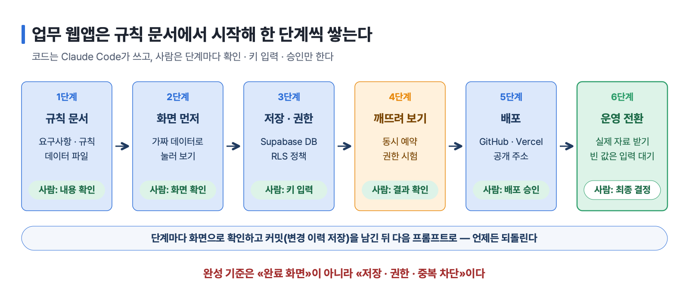
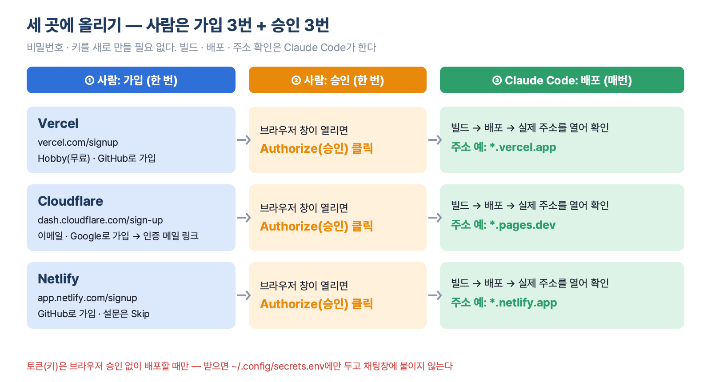
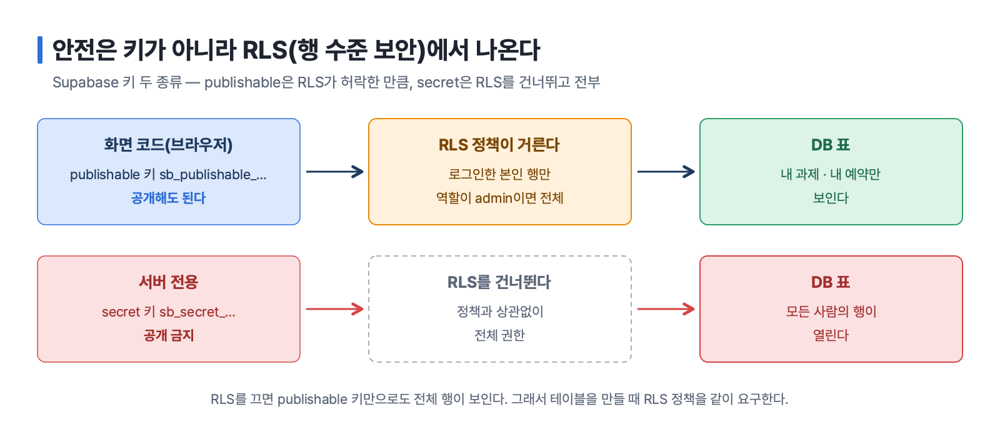
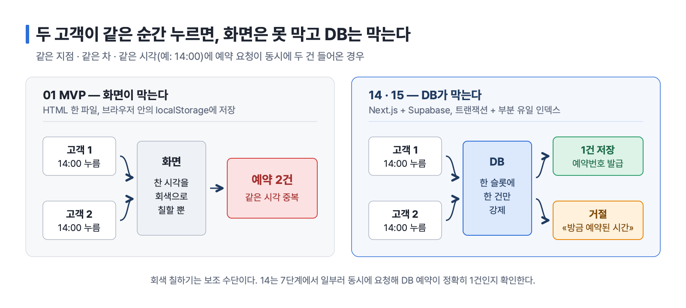
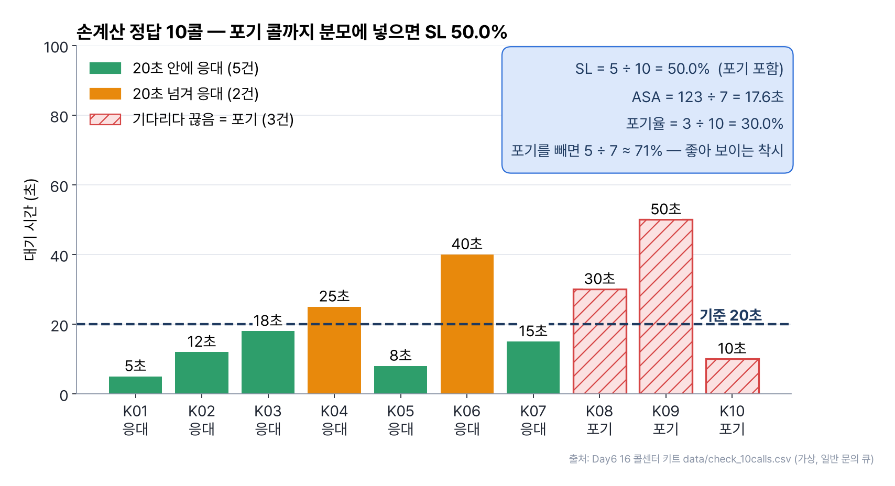
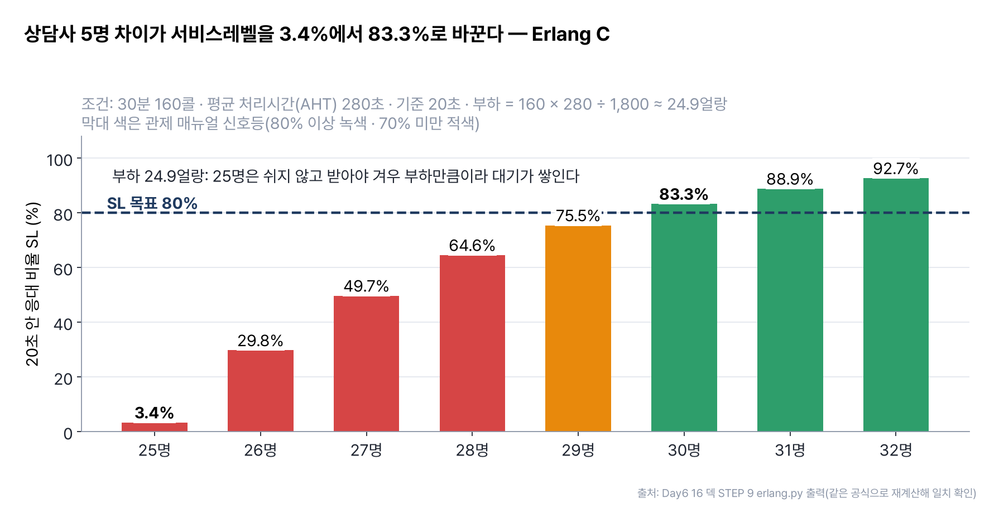
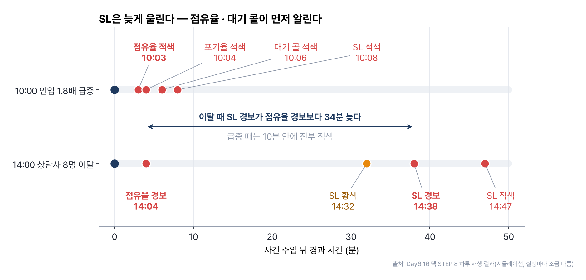
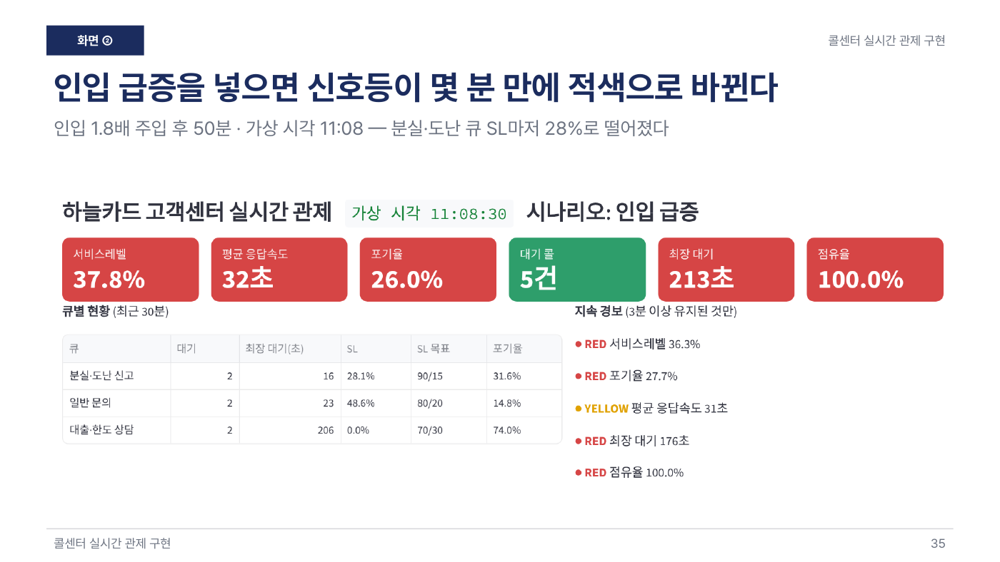
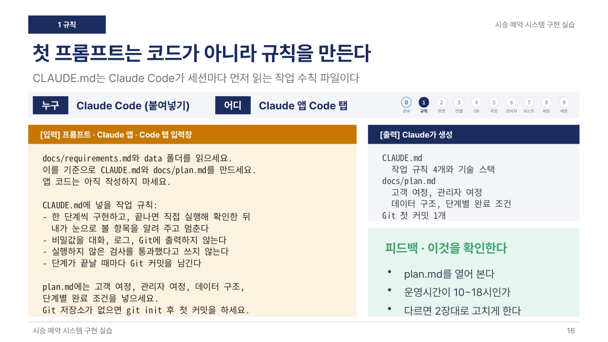

# 10장 업무 웹앱 처음부터 끝까지 — 요구사항에서 배포까지

> **이 장의 한 줄**
> 업무 웹앱은 코드가 아니라 **규칙 문서**에서 시작한다. 요구사항과 데이터를 문서로 넘기고, 화면 → 저장 · 권한 → 테스트 → 배포 순서로 한 단계씩 Claude Code에게 시키며, 사람은 로그인 · 키 입력 · 화면 확인 · 승인만 한다. 완성 기준은 «완료 화면»이 아니라 «저장 · 권한 · 중복 차단»이다.

## 이 장에서 배우는 것

1. 바이브 코딩(Vibe Coding, 코드를 직접 쓰지 않고 요구 사항을 말로 전달해 프로그램을 완성하는 방식)의 한 바퀴 — 기획 · 구현 · 수정 · 배포 — 를 설명할 수 있다.
2. 규칙 문서와 데이터 파일을 먼저 만들어 프롬프트를 짧게 만드는 이유를 안다.
3. 화면만 있는 MVP와 DB · 로그인 · 권한이 있는 업무 시스템의 차이를 시승 실습 세 개로 비교할 수 있다.
4. 배포 플랫폼(GitHub Pages · Vercel · Cloudflare)과 Supabase의 역할, 비밀 키 다루는 법을 안다.
5. 내 PC에서 도는 업무 시스템(AI 상담원 콘솔 · 콜센터 관제)을 손계산 테스트와 시나리오로 검증하는 법을 안다.

## 큰 그림



*그림 10-1. 규칙 문서 → 화면 → 저장 · 권한 → 깨뜨려 보기 → 배포 → 운영 전환. 코드는 Claude Code가 쓰고, 사람은 단계마다 확인 · 키 입력 · 승인만 한다. 출처: Day4 06 · Day6 01 · 07 · 14 · 15 실습 흐름 정리.*

한 번에 다 시키지 않는다. 단계마다 결과를 눈으로 확인하고, 커밋(변경 이력 저장)을 남긴 뒤 다음 프롬프트를 넣는다.

## 1. 바이브 코딩의 한 바퀴

Day4 06은 병원 원무과의 «서류 발급 현황» 앱(가상 환자 데이터)으로 다섯 단계를 한 바퀴 돈다. 자동차 회사가 아닌 예제지만, 업무 앱을 만드는 순서는 그대로 옮겨 쓴다.

| 단계 | 하는 일 | Claude Code 기능 |
|---|---|---|
| 기획 | AI가 나를 인터뷰하게 해 기획서를 얻는다 | Plan 모드, `PLAN.md` |
| 구현 | 기획서 한 장을 근거로 앱을 만든다 | 프로젝트 폴더, `CLAUDE.md`, 모델 선택 |
| 테스트 · 수정 | 직접 눌러 보고 고칠 곳을 콕 집어 요청 | 스크린샷, Chrome 연동, git 되돌리기 |
| 배포 | URL로 공유 | GitHub · Vercel |
| 확장 | 로그인과 권한 | 관리자 · 일반 사용자, Supabase |

### 1.1 기획 — 소크라테스식 역인터뷰

무엇을 만들지 모르면 AI에게 무엇을 물어야 할지도 모른다. 그래서 거꾸로 AI가 나에게 묻게 한다. Plan 모드(Claude Code가 파일을 고치지 않고 질문과 계획만 하는 상태, Shift+Tab으로 켠다)에서 이렇게 시작한다.

```text
너는 소크라테스다. 원무과에서 쓸 웹페이지가 필요한데 무엇을 만들지는 아직 모른다.
나를 인터뷰해서 방향을 정해라. 질문은 최대 10개, 하나씩, 가능하면 객관식으로 하고 주관식 답도 허용하라.
정보가 충분해질 때까지 집요하게 물어라. 코딩은 하지 마라.
```

«원무과» 대신 우리 팀 이름을 넣으면 같은 방식으로 다른 앱을 기획한다. 본래는 30~50개를 묻지만 실습에서는 10개로 제한한다. 인터뷰가 끝나면 «기획서로 저장해 달라»고 해 `PLAN.md` 파일로 남긴다. 파일로 남기 때문에 대화가 길어져도 요구 사항이 흐려지지 않는다.

### 1.2 구현과 수정

구현 요청은 한 줄이면 된다 — «PLAN.md 기획서대로 개발해줘. 처음에는 브라우저에서 바로 열리는 간단한 웹앱으로 만들고, 테스트용 환자 데이터를 7건 정도 넣어줘.» 같은 기획서로도 사람마다 화면 배치와 색이 다르게 나온다. AI는 코드도 확률적으로 생성하므로 이것은 오류가 아니라 정상이고, 기준은 «내 업무에 맞는가»다.

수정을 요청할 때는 **위치와 원하는 동작**을 함께 말한다(«환자 이름을 클릭하면 처음 등록한 서류 정보를 수정하는 화면이 나오게 해줘»와 해당 부분 캡처). 수정 전마다 «커밋해 둬» 한마디가 보험이다. 언제든 되돌릴 수 있다.

### 1.3 배포와 확장의 원칙

배포하면 내 컴퓨터가 꺼져도 앱은 서버에서 돈다. 그런데 URL을 안다는 것은 누구나 들어올 수 있다는 뜻이다. 공개 클라우드는 실습 · 시연용으로 가상 데이터만 넣고, 환자 정보 같은 개인정보가 들어가는 앱은 공개 URL로 배포하지 않는다(원내 서버, IT팀과 설치). 로그인을 붙일 때는 세 가지 안전장치를 함께 요청한다 — 첫 로그인 시 비밀번호 변경 강제, 비밀번호는 해시(되돌릴 수 없게 바꾼 값)로 저장, 직원 간 데이터 공유는 Supabase 연동.

## 2. 규칙 문서가 프롬프트를 짧게 만든다 — Stitch 시승 예약 MVP

Day6 01은 모바일 시승 예약 웹앱을 HTML **한 파일**(`testdrive_mvp.html`)로 만든다. MVP(Minimum Viable Product, 꼭 필요한 기능만 넣어 먼저 돌려 보는 첫 버전)다. 회사명 · 차종명 · 주소는 모두 실습용으로 지어낸 것이다.

### 2.1 겉모습은 Stitch, 속은 Claude Code

Google Stitch는 글이나 스크린샷을 주면 앱 화면을 디자인해 HTML로 내보내 주는 Google Labs 도구다. MCP(Model Context Protocol, AI가 외부 서비스를 도구처럼 쓰게 하는 연결 표준)로 Claude Code에 연결해 두면, 그다음부터는 프롬프트로 Stitch에 화면을 만들게 한다. Stitch가 그린 세 화면에 Claude Code가 데이터와 규칙을 넣어 한 파일로 완성한다.

Stitch 연결의 핵심은 API 키(Stitch가 나를 알아보는 출입증) 다루기다. 연결 가이드는 키가 오가는 단계만 사람이 하고, 나머지는 Claude Code에게 맡긴다.

| 사람이 할 일 | Claude Code가 할 일 |
|---|---|
| Stitch 설정 화면에서 API 키 발급(창을 닫으면 다시 볼 수 없음) | 키 자리를 `YOUR_KEY`로 비운 등록 명령 한 줄 알려 주기(실행은 하지 않음) |
| 메모장에서 `YOUR_KEY` 한 곳만 내 키로 바꿔 등록 | 연결 뒤 프롬프트로 Stitch 화면 생성 · 수정 |
| 앱 재시작 후 연결 허용, 키를 적어 둔 메모 지우기 | 연결 상태 확인 결과 해석 |

키를 대화창에 붙이지 않는 이유는 대화 기록에 남지 않게 하려는 것이다. 연결이 어렵다면 키트 `prompts.md`의 «1단계 대안»으로 Stitch 없이 Claude Code가 같은 요청서로 화면 세 장을 직접 그리게 해도 이후 단계는 똑같다.

### 2.2 문서의 장만 가리키는 프롬프트

키트에는 데이터 세 개(차종 4대 · 지점 · 기존 예약 4건)와 문서 두 개(디자인 요청서 · 예약 규칙)가 들어 있다. 규칙 문서에 «시승은 60분, 시작 시각 7개, 12:00 점심 제외, 내일부터 14일, 일요일 휴무, 같은 지점 · 같은 차 · 같은 시각 중복 불가, 예약번호는 `TD-날짜-네 자리`»가 적혀 있으니 프롬프트는 짧아진다.

```text
docs/booking_rules.md의 2장, 3장, 4장대로 2번 화면을 동작하게 해줘.
1번에서 고른 차가 있는 지점만 보여 주고, 날짜는 내일부터 14일까지 고르게 하되
일요일은 막아줘. 시간은 일곱 개 버튼으로 보여 주고,
data/bookings_sample.json에 이미 있는 예약 시각은 흐리게 해서 못 누르게 해줘.
```

예약은 localStorage(브라우저 안의 작은 저장 공간 — 서버 없이도 새로고침 뒤에 기록이 남는다)에 저장한다. 6단계에서 규칙마다 테스트 시나리오를 만들어 Claude Code가 브라우저를 직접 눌러 보게 하고, 7단계에서 키트의 완성본(`reference/testdrive_mvp_reference.html`)과 같은 순서로 눌러 **디자인이 아니라 동작 차이만** 찾게 한다.

> **MVP 다음에 필요한 것 (01 덱 확장 과제)**
> 지점 직원이 오늘 예약을 시간순으로 보는 관리 화면, 예약번호로 찾아 취소하는 기능, 허락받은 실제 사진으로 교체, localStorage 대신 Supabase 같은 데이터베이스에 저장. 이 네 가지가 4절의 14 · 15 실습에서 실제로 구현된다.

## 3. 배포와 회원 — GitHub · 배포 플랫폼 · Supabase

Day6 07은 백지에서 저장소를 만들고(Part 1~2), 배포하고(Part 3~4), Supabase로 로그인 · 과제 제출이 되는 회원제 사이트까지(Part 5~6) 6개 파트 10시간으로 진행한다. 저장소 · 커밋 · 푸시 같은 GitHub 기초는 [06장 GitHub로 내 자료 관리](06장_GitHub로_내_자료_관리.md)에서 다루므로, 여기서는 배포와 회원 관리만 짚는다.

### 3.1 올리기와 배포는 다르다

푸시(push)는 내 컴퓨터의 변경을 GitHub 저장소에 올리는 일이고, 배포(deploy)는 그 내용을 누구나 열 수 있는 웹 주소로 내보내는 일이다. 정적 사이트(서버 계산 없이 HTML 파일만 보여 주는 사이트)는 어디든 올릴 수 있지만, 무엇을 배포하는지에 따라 플랫폼이 정해진다. 아래는 07 덱이 각 사 공식 문서로 2026년 10월에 확인한 비교다.

| 항목 | GitHub Pages | Vercel Hobby | Cloudflare |
|---|---|---|---|
| 상업적 사용 | 불가(온라인 비즈니스 금지) | 불가(개인 · 비상업) | 허용 |
| 트래픽 | 월 100GB(권장) | 월 100GB | 정적 요청 무제한 |
| 비공개 저장소 | 유료 플랜만 | 가능 | 가능 |
| 한도 초과 시 | 안내 · 속도 제한 | 기능 정지(30일 대기) | 정적은 계속 서비스 |
| 서버 기능 | 없음 | 있음(함수 · Next.js) | 있음(Workers) |

덱의 결론은 «공개 자료는 Pages, 로그인 · 업무용은 Cloudflare, 웹앱은 Vercel»이다. 무료 정적 사이트 하나가 DDoS 공격(대량 접속을 퍼부어 서비스를 마비시키는 공격)으로 약 190TB 트래픽을 맞아 10만 4,500달러 청구서를 받은 사례(Netlify, 2024년 2월)가 한도 초과 시 동작을 알아야 하는 이유다.[^cases]

### 3.2 세 곳에 올리는 최소 절차 — 가입 3번, 승인 3번

Day6 17 안내 md는 Vercel · Cloudflare · Netlify에 사이트를 올릴 때 사람이 할 일을 **가입 3번과 승인 버튼 3번**으로 줄인다. 비밀번호를 새로 만들 필요가 없다 — Vercel과 Netlify는 «GitHub로 가입», Cloudflare는 이메일이나 Google로 가입한다. 키(토큰, 프로그램이 내 계정으로 일할 때 쓰는 출입증)도 받아 올 필요가 없다. Claude Code가 각 서비스의 CLI(command-line interface, 명령으로 다루는 프로그램)로 로그인을 시작하면 브라우저 창이 열리고, 사람은 **Authorize(승인)** 만 누른다. 로그인 정보는 그 컴퓨터에 저장된다. 세 곳 모두 무료 요금제는 결제 카드를 요구하지 않는다.



*그림 10-2. 사람은 서비스마다 가입 한 번, 승인 한 번. 빌드 · 배포 · 주소 확인은 Claude Code가 매번 한다. 출처: Day6 17 안내 md.*

- **사람이 할 일**: 세 사이트 가입(Vercel은 Hobby 무료 요금제, Cloudflare는 받은 메일함의 인증 링크를 꼭 누른다 — 인증하지 않으면 배포가 막힐 수 있다), 브라우저 창의 승인 클릭, 마지막에 실제 주소를 열어 화면 확인
- **Claude Code가 할 일**: 로그인 연결, 빌드, 배포, 배포된 주소를 열어 화면이 뜨는지 확인. CLI는 따로 설치하지 않고 `npx`(필요할 때 내려받아 바로 실행하는 Node.js 도구)로 실행한다

```text
세 곳 가입했어, 로그인 연결해줘.
```

```text
이 사이트를 Vercel에 배포해줘. 프로젝트 이름은 kma-demo.
빌드하고 배포한 뒤, 실제 주소를 열어 화면이 뜨는지 확인까지 해줘.
```

세 곳 모두에 올리려면 «Vercel · Cloudflare · Netlify 셋 다»라고 바꾼다. 알아 둘 점은 넷이다.

- **Vercel Hobby는 비상업용이다.** 강의 데모는 괜찮고, 유료 고객용이면 Pro나 Cloudflare를 쓴다(3.1절 표).
- 정적 사이트는 세 곳 모두 배포 명령 한 줄이다. 서버 코드가 있으면 Cloudflare는 Workers 설정 파일이 더 필요한데, 이것도 Claude Code가 쓴다.
- **git push만 하면 자동 배포**되게 하려면 대시보드에서 GitHub 저장소를 Import하는 클릭이 한 번 더 필요하다. 직접 산 도메인을 붙일 때만 DNS(도메인 이름을 서버 주소로 바꿔 주는 장부) 입력이 필요하다.
- 토큰은 승인 버튼을 누를 사람이 없을 때(다른 컴퓨터 · 예약 작업)만 필요하다. 받으면 작업 폴더 밖 설정 파일(`~/.config/secrets.env`)에만 두고, 비밀번호와 같으니 **채팅창에 붙여 넣지 않는다.**

### 3.3 백엔드는 Supabase에 맡긴다

화면(프런트엔드, 사용자가 보고 누르는 부분)은 배포 플랫폼에 두고, 뒤편(백엔드 — 누가 로그인했는지 확인하고 데이터를 저장 · 조회하는 부분)은 Supabase에 맡긴다. Supabase는 로그인(Auth) · 데이터베이스(Postgres, 표 형태로 데이터를 저장하는 DB) · 파일 저장(Storage, 파일을 담는 최상위 폴더를 버킷이라 부른다)을 서비스로 빌려주는 도구다.

보안의 핵심은 RLS(Row Level Security, 행 수준 보안 — «이 행은 누가 읽고 쓸 수 있는가»를 표마다 정책으로 적어 두는 규칙)다. RLS를 켜고 정책을 걸면 로그인한 본인 행만 보이고 관리자만 전체를 본다. RLS를 끄면 공개 키만으로 전체 행이 보인다.

| 키 | 넣는 곳 | 권한 |
|---|---|---|
| publishable (`sb_publishable_…`) | 화면 코드(공개 가능) | RLS가 허용한 만큼 |
| secret (`sb_secret_…`) | 서버 전용(공개 금지) | RLS 무시, 전체 권한 |

publishable 키가 안전한 이유는 키가 아니라 RLS에 있다. 기존 anon · service_role 키는 2026년 말 폐기 예정이다. 그래서 테이블을 만들 때는 RLS를 **같이** 요구한다.



*그림 10-3. publishable 키는 화면 코드에 넣어도 RLS가 허락한 행(본인 행, admin은 전체)만 보이고, secret 키는 서버 전용으로 RLS를 건너뛰어 모든 행을 연다. 출처: Day6 07 Part 5 · 6 덱.*

```text
profiles(이름·역할),
submissions(과제명·파일·제출일)
테이블을 만들고,
본인 데이터만 읽고 쓸 수 있게
RLS 정책을 걸어줘.
역할이 admin이면 전체를
볼 수 있게 해줘.
```

> **정책이 «있다»가 아니라 «막는다»를 확인한다**
> RLS 누락 하나로 170개 프로젝트 · 303개 엔드포인트(데이터를 주고받는 접속 주소)의 데이터가 로그인 없이 조회된 사례가 있다(Lovable, 공개 취약점 번호 CVE-2025-48757). 07 Part 6은 완성 후 네 가지를 직접 시험하게 한다 — 저장소에서 `sb_secret` · `service_role` 검색, 계정 둘로 교차 로그인해 서로의 과제가 안 보이는지, 로그아웃 상태에서 조회가 비는지, 수강생 계정으로 자기 role을 admin으로 바꾸려 하면 거부되는지.

Part 6 템플릿(`supabase-course-template-II`)의 일곱 단계는 세 장소를 오간다. 사람이 Supabase 대시보드에서 프로젝트를 만들고 `schema.sql`을 실행하고(MCP를 연결했다면 Claude Code에게 시켜도 된다), `config.js`에 주소와 publishable 키 두 줄을 넣는다. Claude Code가 로컬 웹서버로 띄우고, 커밋 · 저장소 생성 · 푸시를 한다. 배포 후 그 주소를 Supabase의 Site URL · Redirect URLs에 등록해야 회원가입이 완성된다. 관리자 지정은 화면이 아니라 대시보드에서만 한다 — 화면에서 role을 바꿀 수 있다면 누구나 스스로 관리자가 되기 때문이다.

## 4. 요구사항 명세에서 견적 발행까지 — 시승 실습 세 개 비교

Day6에는 시승 예약 실습이 세 개 있다. 같은 업무를 다른 깊이로 만든다.

| 비교 | 01 Stitch 시승 예약 MVP | 14 시승 예약 시스템(요구사항 명세부터) | 15 시승 · 견적 신청 시스템 |
|---|---|---|---|
| 난이도 | 2단계 | 3단계 | 3단계 |
| 출발 문서 | 디자인 요청서 · 예약 규칙 md | `requirements.md` 1~10장 · 테스트 시나리오 14개 | 업무 규칙 · 견적 정책 · 동의서 md · 견적서 샘플 |
| 차종 | 가상 4종(온유 · 바람 · 솔 · 누리) | 폴스타 3 · 4 · 5 | 재규어 · 랜드로버 6종(가상 가격) |
| 결과물 | HTML 한 파일 | Next.js + Supabase | Next.js + Supabase |
| 저장 | localStorage | DB 테이블 8개 | DB(차량 · 전시장 · 신청 · 기록 네 묶음) |
| 중복 예약 방지 | 찬 시각을 화면에서 흐리게 | DB가 막음(트랜잭션 + 부분 유일 인덱스) | DB가 막음(한 트랜잭션 + DB 제약) |
| 고객 확인 | 없음 | 없음(휴대폰 인증은 범위 밖) | 이메일 인증 후 접수, 본인 신청만 조회 |
| 직원 화면 | 없음(확장 과제) | `/admin` 확정 · 취소 · 방문 완료 | 시승 처리 + 견적 초안 → 검토 → 발행(버전 관리) |
| 검증 | 규칙별 시나리오 표, 완성본 비교 | 14개 자동 테스트 → `test-report.md` | 권한 · 동시성 · 오류 자동 테스트 + 사람 확인 9가지 |
| 배포 | 없음(파일로 열기) | GitHub 비공개 저장소 + Vercel 미리보기 | GitHub + Vercel 교육용 테스트 배포 |
| 단계 | 0~7단계 | 0~9단계 | STEP 0~11(프롬프트 12개) |

01이 «화면이 규칙대로 움직이는가»를 본다면, 14와 15는 «완료 화면이 떠도 실제로 저장 · 권한 · 중복 차단이 되는가»를 본다. 15는 여기에 견적 계산이라는 돈 계산 업무를 더한다.

### 4.1 14 — 중복 예약은 화면이 아니라 DB가 막는다

14의 세 원칙은 ① 코드는 Claude Code가 쓰고 사람은 붙여넣기 · 계정 승인 · 화면 확인만 ② 기준 문서가 프롬프트를 짧게 ③ 중복 예약은 화면이 아니라 DB가 막는다이다. 운영시간 10:00~18:00, 1시간 슬롯 하루 8개, 예약 기간 내일부터 30일, 시승차 1대당 한 슬롯에 1건 같은 값은 모두 교육용 가정이다.

화면에서 찬 시각을 회색으로 칠하는 것은 보조 수단일 뿐이다. 두 고객이 같은 순간에 누르면 둘 다 통과할 수 있다. 그래서 트랜잭션(여러 작업을 한 덩어리로 처리해 전부 되거나 전부 안 되게 하는 방식)과 부분 유일 인덱스(partial unique index, «접수 · 확정 상태인 예약은 한 슬롯에 하나만»을 DB가 강제하는 장치)로 막고, 7단계에서 일부러 깨뜨려 본다. 같은 요청을 두 번 보내도 예약이 늘지 않게 하는 idempotency key(요청마다 붙이는 중복 방지 번호), 짧은 시간에 너무 많은 요청을 거절하는 rate limit(요청 횟수 제한)도 요구사항에 들어 있다.



*그림 10-4. 두 고객이 같은 슬롯을 동시에 누를 때, 화면에서 찬 시각을 칠하는 01 MVP는 둘 다 저장할 수 있고, 트랜잭션과 부분 유일 인덱스를 쓰는 14 · 15는 1건만 저장하고 나머지를 거절한다. 출처: Day6 01 · 14 덱과 14 requirements.md.*

| 테스트 예(14개 중) | 기대 결과 |
|---|---|
| 서로 다른 두 고객이 같은 슬롯을 동시에 요청 | DB 예약이 정확히 1건, 나머지는 «방금 예약된 시간» |
| 같은 idempotency key, 같은 내용 재전송 | 예약이 늘지 않고 같은 예약번호 반환 |
| 공개 publishable key로 예약 · 관리자 표 조회 | 0행 또는 권한 오류 |
| DB 연결 실패 상황 | 성공 화면이 나오지 않음 |
| 360px 모바일에서 입력 · 오류 · 완료 화면 | 가로 스크롤 없이 사용 가능 |

첫 프롬프트는 코드가 아니라 규칙을 만든다. `CLAUDE.md`에 «한 단계씩 구현하고 직접 실행해 확인한 뒤 멈춘다 · 비밀값을 대화 · 로그 · Git에 출력하지 않는다 · 실행하지 않은 검사를 통과했다고 쓰지 않는다 · 단계마다 커밋»을 넣는다. 그리고 테스트 결과는 통과 · 실패 · **미실행**으로 기록하게 한다. 미실행을 통과로 적지 않는 것이 이 실습의 정직성 규칙이다.

### 4.2 15 — 견적 합계는 서버의 가격표로만 계산한다

15는 고객이 시승 · 견적 · 둘 다 중 하나를 골라 신청하고(차량 선택 → 유형 → 일정 또는 견적 조건 → 연락처 · 동의 → 이메일 인증 후 접수), 담당자가 처리해 견적을 발행하는 시스템이다. 가격 · 전시장 · 직원 · 고객은 모두 가상이고 공식 제휴 서비스가 아니다. 시승 상태와 견적 상태는 따로 움직인다.

견적 정책 문서의 핵심은 «브라우저가 보낸 총액은 믿지 않는다»다. 합계는 서버가 키트 가격표로만 계산한다.

$$
\text{견적 합계} = \text{기본가} + \text{트림} + \text{색상} + \text{옵션} - \text{승인 할인}
$$

할인 승인 한도(가상)는 영업 1%, 매니저 3%, 그 이상은 관리자 승인이다. 취득세 · 공채 · 등록비 · 탁송료는 계산하지 않고 «별도 확인»으로 표시한다. 견적서 샘플의 Defender 110은 137,500,000원에 할인 1%(1,375,000원)를 빼 합계 136,125,000원이 나와야 한다. 발행된 버전은 고칠 수 없고 수정은 새 버전(v2, v3…)으로 만들며, 고객에게는 발행된 버전만 보인다. 할부 시뮬레이터는 선택 과제로, 금리 · 기간 · 선수금 가정을 모두 드러내고 «금융사 승인 견적 아님»을 붙인 참고용으로만 만든다.

15 덱이 정리한 사람과 Claude Code의 몫은 다음과 같다.

| 사람이 직접 한다 | Claude Code가 한다 |
|---|---|
| Claude 데스크톱 앱 · Supabase · GitHub · Vercel 로그인 | 개발환경 점검 · 패키지 설치 |
| 비밀키를 `.env.local`에 직접 붙여넣기 | 요구사항 문서 · 화면 · DB · API 작성 |
| 권한 요청을 읽고 허용 | 오류 재현과 수정 |
| 브라우저로 화면 확인 → 피드백 | 테스트 · 빌드 · 배포 준비와 보고 |

> **14와 15는 Supabase 연결 방식이 다르다**
> 14는 Supabase 가입과 CLI 로그인 승인만 사람이 하고, 프로젝트 생성과 키 기록은 Claude Code가 «값을 대화에 출력하지 않고» `.env.local`에 직접 쓴다. 15는 사람이 대시보드에서 프로젝트를 만들고, Claude Code가 만든 빈 `.env.local`에 키를 직접 붙여 넣는다. 어느 쪽이든 원칙은 같다 — 키는 대화창에 붙이지 않는다.

### 4.3 진행 상태를 근거와 함께 보고받기

여러 날에 걸친 실습은 «어디까지 됐나»를 정확히 아는 것이 중요하다. 15의 마무리 프롬프트는 어떤 업무 앱에도 쓸 수 있다.

```text
현재 결과를 아래 네 칸으로 나눠 보고해줘.
화면만 됨
DB 저장 됨
권한 검증 됨
배포 검증 됨
각 판정의 실제 실행 근거와 남은 일을 적고,
내가 브라우저에서 확인할 주소와
클릭 순서를 5개 이내로 안내해줘.
```

운영 전환에는 실제 담당자의 자료(사용 권한 있는 이미지, 검증된 가격표와 기준일, 동의 문안 · 보유기간 등)가 먼저 필요하다. 15 덱은 받지 못한 값을 상상해서 채우지 말고 «입력 대기»로 표시하게 한다. 교육용 MVP의 동의 필드 설계는 법적 적합성 확인을 대신하지 않는다.

## 5. 내 PC에서 도는 업무 시스템 — AI 상담원 콘솔과 콜센터 관제

### 5.1 AICC 콘솔 — 매뉴얼이 상담원의 지식이다

AICC(AI Contact Center, AI가 전화를 받고 사람은 넘겨받은 건만 처리하는 고객센터)를 내 PC에서 돌리는 콘솔이다. 브라우저 화면(`index.html`) · 내 PC 서버(`server.py`) · Claude Code · 맥 목소리 네 부품이 모두 PC 안에서 돌고, AI 답은 내 Claude 구독 계정이 만든다. API 키가 필요 없다. 업무 셋(레스토랑 예약 · 상품 교환 · 추심 안내)과 손님 · 매뉴얼은 모두 가상이다.

| 용어 | 뜻 |
|---|---|
| 매뉴얼 | 상담원이 아는 전부. 여기에 없는 것은 답하지 않고 직원에게 넘긴다 |
| 통화 세션 | 통화 하나 동안 Claude Code를 켜 둔 채 손님 말만 이어 보내는 방식 |
| 음성 인식 STT · 음성 합성 TTS | STT(Speech-to-Text)는 말 → 글자(Chrome), TTS(Text-to-Speech)는 글자 → 말(맥 say) |
| 후처리 | 통화가 끝난 뒤 요약 · 매뉴얼 위반 · 더 나은 응답을 AI가 붙이는 일 |

열한 단계는 화면과 매뉴얼(STEP 01~03) → 서버와 상담원(04~06) → 말과 목소리(07~08) → 기록과 개선(09~11)의 네 묶음이다. 사람은 준비물(Claude Code 로그인 · 파이썬 · Chrome · 이어폰)과 확인만 한다. 상담원의 답은 정해진 형식 하나(할 말 · 상태 · 근거 조항 번호 · 처리 기록)로만 받고, 매뉴얼에 없는 질문을 일부러 던져 직원연결로 넘어가는지 꼭 본다.

이 덱의 가치는 «실제로 겪은 일»을 적어 둔 데 있다. 2026-10-28 시험에서 기본 음성 인식이 손님이 숨을 고르는 첫 쉼에서 끝나 «다음 주 화요일 점심 12시는 가능»까지만 상담원에게 갔다. 쉬어도 계속 듣고 1.6초 조용하면 보내게 고쳐 해결했다. 맥에서 브라우저 음성이 무음으로 실패하는 문제는 서버에서 맥 say(목소리 Yuna)로 소리 파일을 만들어 해결했다. 맥 say를 쓰므로 목소리 단계는 맥 기준이다.

### 5.2 콜센터 실시간 관제 — 정의 · 검증 · 근거

16은 가상의 «하늘카드 고객센터»(큐 3개 · 상담사 30명 가명)를 대상으로 관제 대시보드를 만든다. 실제 전화 시스템(CTI, 전화와 컴퓨터를 잇는 시스템) 대신 가상 콜 시뮬레이터가 DB에 쓰고 대시보드가 DB를 읽는다. 외부 서버와 API 키가 필요 없다.

먼저 용어를 잡는다. KPI(Key Performance Indicator, 핵심 성과 지표) 가운데 SL(Service Level, 서비스레벨)은 «기준시간 안에 연결된 콜의 비율»로, 80/20은 «콜의 80%를 20초 안에 받는다»는 목표다. ASA(평균 응답속도)는 평균 몇 초 기다렸나, AHT(Average Handle Time)는 평균 처리시간, 점유율은 응대할 수 있는 사람 중 몇 %가 일하는 중인가다. 이런 인력 운영 전체를 WFM(Workforce Management, 예측 · 인원 산정 · 근무표 · 관제를 아우르는 체계)이라 부른다.

정의 한 줄이 숫자를 바꾼다. SL의 분모에는 **포기 콜을 넣는다**. 응대 80콜 중 64콜이 20초 안이고 포기가 20콜이면, 포기를 빼면 64 ÷ 80 = 80%로 녹색이지만 넣으면 64 ÷ 100 = 64%로 적색이다. 포기를 빼면 고객이 오래 기다리다 끊을수록 SL이 좋아 보인다.

그래서 KPI 엔진은 **손계산 정답**을 먼저 정한다. 키트의 10콜(일반 문의, 기준 20초)은 응대 7건(대기 5 · 12 · 18 · 25 · 8 · 40 · 15초)과 포기 3건이다. 20초 안 응대 5건이니 SL 50.0%, ASA 17.6초, 포기율 30.0%다. 이 숫자를 테스트로 고정하고 «실패하면 코드를 고치고 정답은 바꾸지 마»라고 시킨다.



*그림 10-5. 응대 7건 중 20초 안 5건, 포기 3건. 포기 콜까지 분모에 넣으면 SL 50.0%, ASA 17.6초, 포기율 30.0%이고, 포기를 빼면 71%로 좋아 보인다. 출처: Day6 16 콜센터 키트 data/check_10calls.csv(가상).*

경보는 녹 · 황 · 적 신호등과 **3분 지속 조건**을 함께 건다(SL은 80% 이상 녹색, 70% 미만 적색 등 관제 매뉴얼 3장). 인원 산정은 Erlang C(대기가 생기는 콜센터에서 필요 인원을 구하는 표준 대기행렬 공식)로 한다. 부하(얼랑) = 인입 수 × AHT ÷ 구간 길이이고, 30분 160콜 · AHT 280초면 160 × 280 ÷ 1,800 ≈ 24.9얼랑, 즉 쉬지 않고 받아도 24.9명이 필요하다. 이때 상담사 25명이면 SL 3.4%, 30명이면 83.3%로, 몇 명 차이가 SL을 수십 %p 바꾼다.



*그림 10-6. 30분 160콜 · AHT 280초 · 기준 20초(부하 24.9얼랑)에서 25명은 SL 3.4%, 30명은 83.3%다. 목표 80%를 넘는 최소 인원은 30명. 출처: Day6 16 덱 STEP 9 erlang.py 출력(같은 공식으로 다시 계산해 일치 확인).*

| 시나리오(STEP 8 하루 재생, 시뮬레이션) | 무엇이 먼저 울렸나 |
|---|---|
| 10:00 인입 1.8배 급증 | 점유율 적색 10:03 → SL 적색 10:08, 10분 안에 전부 적색 |
| 14:00 상담사 8명 이탈 | 점유율 경보 14:04, SL 경보 14:38 — SL이 34분 늦다 |



*그림 10-7. 인입 급증 때는 10분 안에 전부 적색이 되고, 상담사 이탈 때는 점유율 경보(14:04)가 SL 경보(14:38)보다 34분 먼저 울린다. 출처: Day6 16 덱 STEP 8 하루 재생(시뮬레이션, 실행마다 조금 다름).*

SL은 최근 30분 결과의 평균(후행 지표)이라 늦고, 점유율 · 대기 콜은 지금 값(선행 지표)이라 먼저 움직인다. 마지막으로 AI 관제 요약은 매뉴얼 4장 전문을 붙여 보내고, 조치마다 **근거 절차 번호**를 달게 하며, 매뉴얼에 없는 조치는 쓰지 않게 한다.

> **확장판 — «얼마나»에서 «왜»로**
> 확장판 STEP 12~18은 통화 텍스트로 인입 원인을 본다. 가상 대본을 두 목소리 녹취로 만들고(TTS), 받아쓴 뒤 CER(Character Error Rate, 글자 단위 오류율 — 한국어는 조사 하나에 어절 전체가 틀리는 WER 대신 이것을 쓴다)을 재고, 카드번호 · 전화번호 · 생년월일을 가린다(마스킹). 주제 분류기는 규칙을 만든 대본(seed)에서 100%, 처음 보는 대본(test)에서 88.9%였다 — 보고할 실력은 88.9%다. 앱 장애 재생에서 원인 경보(14:12)는 SL 경보(14:29)보다 17분 먼저 울렸다. 인력을 늘리기 전에 IT 확인과 공지로 인입 자체를 줄일 시간을 번다.

## 실습 길잡이

난이도는 3-1B 목록 기준 1단계(가장 쉬움)~4단계로 적는다.

| 순서 | 폴더 | 난이도 | 하는 일 |
|---|---|---|---|
| 1 | [Day6 01 Stitch 시승 예약 MVP](../보충교재/Day6_최종프로젝트/01_Stitch_시승예약_MVP/) | 2단계 | Stitch 연결 16장 → 실습 27장 + 키트(완성본 예시 포함) |
| 2 | [Day6 17 웹배포 Vercel · Cloudflare · Netlify](../보충교재/Day6_최종프로젝트/17_웹배포_Vercel_Cloudflare_Netlify/) | 1단계 | 가입 3번 + 승인 3번 → 1의 MVP를 한 곳 이상에 배포해 주소 확인 |
| 3 | [Day4 06 바이브코딩 업무웹앱](../보충교재/Day4_업무자동화/06_바이브코딩_업무웹앱만들기/) | 3단계 | 역인터뷰 → PLAN.md → 구현 → 수정 → 배포 (덱 25장 + 교안) |
| 4 | [Day6 07 GitHub 배포 · Supabase 회원관리](../보충교재/Day6_최종프로젝트/07_GitHub배포_Supabase_회원관리DB/) | 3단계 | Part 1~4 — 저장소 · 배포 |
| 5 | [Day6 14 시승 예약 시스템](../보충교재/Day6_최종프로젝트/14_시승예약시스템_요구사항명세부터/) | 3단계 | 요구사항 명세 → 0~9단계, 테스트 14개 (덱 44장 + 키트 II) |
| 6 | [Day6 15 시승 · 견적 신청 시스템](../보충교재/Day6_최종프로젝트/15_시승견적신청시스템_재규어랜드로버/) | 3단계 | STEP 0~11, 견적 발행 · 버전 관리 (덱 46장 + 키트) |
| 7 | [Day6 10 AICC 콘솔 내 PC판](../보충교재/Day6_최종프로젝트/10_AI상담원콘솔_AICC_내PC판/) | 3단계 | STEP 01~11, 마이크 · 맥 목소리 (덱 25장 + 완성 실행판 II zip) |
| 8 | [Day6 16 콜센터 실시간 관제](../보충교재/Day6_최종프로젝트/16_콜센터_실시간관제/) | 3단계 | 일반판 STEP 0~11(43장) · 확장판 STEP 12~18(27장) |
| 9 | [Day6 07 GitHub 배포 · Supabase 회원관리](../보충교재/Day6_최종프로젝트/07_GitHub배포_Supabase_회원관리DB/) | 4단계 · 심화 | Part 5~6 — Supabase 회원제 과제 제출 사이트 |

순서는 쉬운 것부터다. 1(2단계)로 화면 설계부터 MVP까지 한 바퀴를 돌고, 2(1단계 — 가입과 승인만)로 그 MVP를 웹 주소로 올려 본다. 3으로 «역인터뷰 → PLAN.md» 규칙 문서를 익히고, 4로 저장소와 배포를 이해한다. 그다음 5 · 6 중 하나로 업무 시스템을 완성한다(Supabase 연결은 Claude Code가 안내한다). 7 · 8은 내 PC 안에서 도는 시스템이라 배포 없이도 끝까지 갈 수 있다. 9는 회원 · 권한(RLS)을 처음부터 짓는 4단계 심화다.

> **콜센터 레퍼런스 zip은 «막혔을 때 맞춰 보는 완성본»이다**
> 16의 `일반판/CallCenter_Monitoring_Reference.zip`(STEP 0~11)과 `확장판/CallCenter_Monitoring_Reference_extension.zip`(STEP 0~18)에는 시뮬레이터 · KPI · 경보 · Erlang C · AI 요약 · 대시보드와 10콜 손계산 테스트가 다 들어 있다. **먼저 스스로 만든 뒤 연다.** 막혔을 때 Claude Code에게 레퍼런스를 따로 풀어 내 결과와 비교하게 하면 된다. 01 키트 7단계 프롬프트(«완성본과 내 파일을 같은 순서로 눌러 보고, 규칙을 다르게 처리하는 곳이 있으면 알려줘. 디자인 차이는 괜찮으니 동작 차이만 봐줘»)를 같은 방식으로 쓴다. Day6 10의 `aicc_console_local_II.zip`도 말 끊김 · 무음을 고친 완성 실행판이다.



*그림 10-8. 인입 1.8배를 넣고 50분 뒤(가상 시각 11:08)의 대시보드. 신호등 타일 · 큐별 현황 · 3분 이상 유지된 지속 경보가 한 화면에 보인다. 출처: Day6 16 일반판 덱 35쪽.*

**모든 실습 공통 — 사람과 Claude Code의 일**

| 사람이 할 일 | Claude Code가 할 일 |
|---|---|
| 데스크톱 앱 Code 탭에서 작업 폴더 열기, 키트 zip을 폴더에 두기 | zip 풀기, Node.js · 파이썬 · git 점검과 설치 |
| GitHub · Supabase · Vercel · Stitch 로그인과 브라우저 승인 | 로그인이 필요하면 사람이 할 일을 한 줄로 안내 |
| API 키 · 비밀번호를 설정 파일에 직접 붙여넣기(대화창 금지) | 빈 설정 파일 만들기, 값을 출력하지 않고 연결 확인 |
| 허용 카드 읽고 허용, 화면 확인, 배포 전 승인 | 코드 작성 · 실행 · 테스트 · 오류 수정 · 커밋 · 배포 준비 |



*그림 10-9. 실습 덱의 한 장은 «누구 · 어디 · 입력 · 출력 · 피드백»으로 짜여 있다. 왼쪽 입력창의 프롬프트를 Claude 앱 Code 탭에 붙여 넣고, 오른쪽 출력과 피드백 항목을 눈으로 확인한 뒤 다음 단계로 간다. 출처: Day6 14 덱 16쪽.*

대표 프롬프트 — 막혔을 때(15 덱). 키와 고객정보는 지우고 붙인다.

```text
아래 오류가 났다. (키·고객정보는 지움)
[오류 전문 붙여넣기]
재현하고 최소 변경으로 고친 뒤
검증을 다시 실행해줘.
DB 삭제·초기화로 우회하지 마.
```

대표 프롬프트 — 다음 날 이어 할 때(14 키트). 새 세션에서 기존 구현을 보존하며 이어 간다.

```text
CLAUDE.md, docs/plan.md, docs/test-report.md와
Git 상태를 읽고 끝난 단계와 남은 단계를
구분해 요약하세요. 기존 구현을 보존하면서
다음 미완료 단계부터 이어 가세요.
```

## 자동차 현장에 옮기기

- **딜러 · 영업**: 14 · 15의 흐름 그대로 전시장 시승 예약과 견적 신청을 한 양식으로 받는다. 효과는 예약 1건당 직원 처리 시간, 누락 · 중복 건수, 접수에서 확정까지 걸린 시간, 견적 작성 시간으로 잰다(14 · 15 덱의 효과 측정 표).
- **영업관리 · 가격**: 견적 합계는 서버 가격표로만 계산하고, 할인은 역할별 한도로 승인하며, 발행본은 버전으로 남기는 15의 규칙을 사내 견적 도구에 옮긴다.
- **고객센터 · 금융 계열**: 16의 신호등 · 3분 지속 경보 · Erlang C 인원 산정으로 관제 화면을 만들고, 확장판처럼 통화 주제 쏠림으로 장애를 먼저 알아챈다. 녹취는 마스킹한 뒤에만 화면에 띄운다.
- **애프터서비스 · 콜백**: 10의 AICC 콘솔 틀에 정비 예약 안내 매뉴얼만 바꿔 넣으면 다른 업무의 AI 상담원이 된다. 매뉴얼에 없는 질문은 직원에게 넘긴다.
- **사내 교육 · 인사**: 07 Part 6 템플릿으로 사내 과정의 과제 제출 사이트를 만들고, 회원 데이터는 최소한만 받아 과정이 끝나면 지운다.

> **공개 주소에는 가상 데이터만**
> 모든 실습은 가상 데이터다. 실제 고객 이름 · 전화번호 · 차량 정보가 들어가는 순간 공개 URL 배포는 멈추고, 사내 서버 · 보안 담당과 상의한다. GitHub Pages와 Vercel Hobby는 상업적 사용이 허용되지 않는다.

## 정리

1. 업무 웹앱은 기획 → 구현 → 수정 → 배포의 대화 반복이고, 기획의 질이 결과를 정한다.
2. 규칙 · 데이터를 문서로 넘기면 프롬프트는 «N장대로» 한 줄로 짧아진다.
3. 완성 기준은 완료 화면이 아니라 저장 · 권한 · 중복 차단이며, 중복은 DB가, 권한은 RLS와 서버가 막는다.
4. 키는 대화창이 아니라 설정 파일에 사람이 넣고, 정책은 «막는지»를 직접 시험한다.
5. 숫자는 손계산 정답으로 고정하고, 테스트는 통과 · 실패 · 미실행으로 정직하게 기록한다.

## 확인 문제

1. Day4 06의 기획 단계에서 «내가 AI에게 묻기» 대신 «AI가 나에게 묻기»를 쓰는 이유는 무엇인가?

> **답**
> 무엇을 만들지 모르면 무엇을 물어야 할지도 모르기 때문이다. AI가 객관식으로 하나씩 물으며 좁히면 필요한 기능이 드러나고, 결과를 `PLAN.md`로 남겨 구현의 근거로 쓴다.

2. 01 MVP와 14 시스템은 둘 다 «이미 찬 시각은 고를 수 없다». 둘의 차이는 무엇이고 왜 중요한가?

> **답**
> 01은 화면에서 찬 시각을 흐리게 표시할 뿐이고, 14는 DB의 트랜잭션과 부분 유일 인덱스로 막는다. 두 고객이 동시에 누르면 화면 처리만으로는 둘 다 통과할 수 있다. 14는 테스트 1번에서 이를 일부러 깨뜨려 DB 예약이 정확히 1건인지 확인한다.

3. Supabase publishable 키가 화면 코드에 공개돼도 괜찮은 이유와, secret 키를 절대 공개하면 안 되는 이유는?

> **답**
> publishable 키는 RLS가 허용한 만큼만 접근하므로, 안전성은 키가 아니라 RLS에서 나온다. secret 키는 RLS를 무시하는 전체 권한이라 노출되면 모든 데이터가 열린다. RLS가 없으면 공개 키가 곧 열쇠다.

4. 콜센터 10콜(응대 7건 중 20초 안 5건, 포기 3건)의 SL은 얼마인가? 포기 콜을 분모에서 빼면 어떻게 달라지고, 왜 빼면 안 되는가?

> **답**
> 포기를 넣으면 5 ÷ 10 = 50.0%. 빼면 5 ÷ 7 ≈ 71%로 좋아 보인다. 포기를 빼면 고객이 오래 기다리다 끊을수록 SL이 좋아 보이는 착시가 생기므로 매뉴얼은 포기 콜을 분모에 넣는다.

5. 15의 견적 시스템에서 Defender 110의 기본 합계가 137,500,000원이고 영업 담당이 1% 할인을 적용했다. 고객에게 보일 합계와, 합계에 넣지 않는 항목은?

> **답**
> 137,500,000 − 1,375,000 = 136,125,000원. 취득세 · 공채 · 등록비 · 탁송료는 계산하지 않고 «별도 확인»으로 표시한다. 합계는 브라우저가 보낸 값이 아니라 서버 가격표로 계산하고, 발행 전에는 고객에게 보이지 않는다.

## 더 보기

- GitHub 기초: [06장 GitHub로 내 자료 관리](06장_GitHub로_내_자료_관리.md)
- 판정 에이전트와 메신저 · 메일 자동화: [07장 업무 에이전트 만들기](07장_업무_에이전트_만들기.md)
- 판정 웹앱의 현장 예(정비 판정 에이전트): [09장 스마트팩토리와 예지보전](09장_스마트팩토리와_예지보전.md)
- 앱 포트폴리오와 내 업무 시스템: [11장 나만의 AI 업무시스템](11장_나만의_AI_업무시스템.md)
- 원자료: [Day6 07 실라부스](../보충교재/Day6_최종프로젝트/07_GitHub배포_Supabase_회원관리DB/Syllabus_GitHub_Deploy_Supabase.md) · [Day6 17 웹 배포 안내](../보충교재/Day6_최종프로젝트/17_웹배포_Vercel_Cloudflare_Netlify/웹배포_Vercel_Cloudflare_Netlify.md) · [Day6 14 요구사항 명세](../보충교재/Day6_최종프로젝트/14_시승예약시스템_요구사항명세부터/AJU_TestDrive_LabKit_II.zip) · [Day6 14 단계별 프롬프트](../보충교재/Day6_최종프로젝트/14_시승예약시스템_요구사항명세부터/AJU_TestDrive_LabKit_II.zip) · [Day6 01 README](../보충교재/Day6_최종프로젝트/01_Stitch_시승예약_MVP/README.md) · [콜센터 일반판 README](../보충교재/Day6_최종프로젝트/16_콜센터_실시간관제/일반판/README.md) · [콜센터 확장판 README](../보충교재/Day6_최종프로젝트/16_콜센터_실시간관제/확장판/README.md)

[^cases]: 07 실라부스 Part 2 · 4 · 5의 사례. 공개 저장소에 올라간 비밀 키로 약 29.6만 건 이메일이 노출된 Toyota T-Connect(2017~2022), 2025년 공개 GitHub 신규 노출 비밀값 약 2,900만 건(GitGuardian 2026 보고서)도 함께 소개한다. 무료 플랜 한도는 바뀌므로 최신 값은 각 사 문서에서 확인한다.
