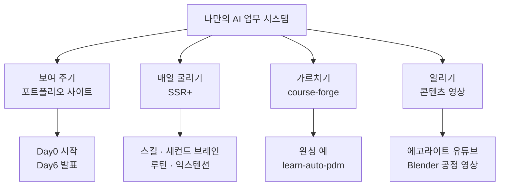
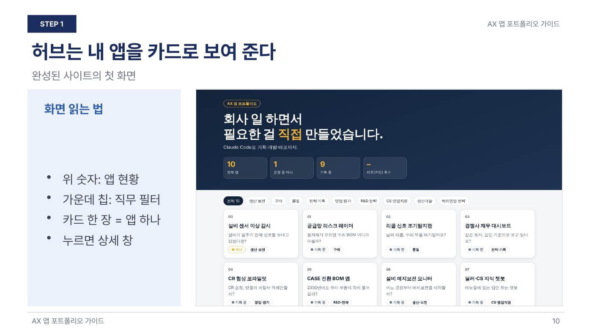
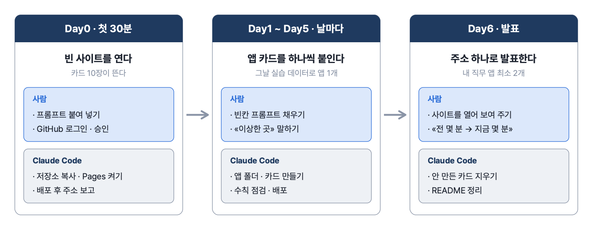
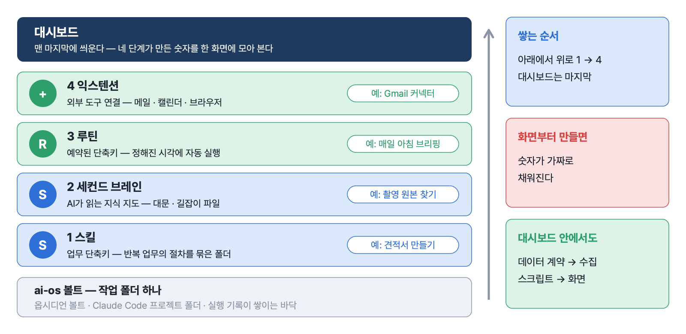
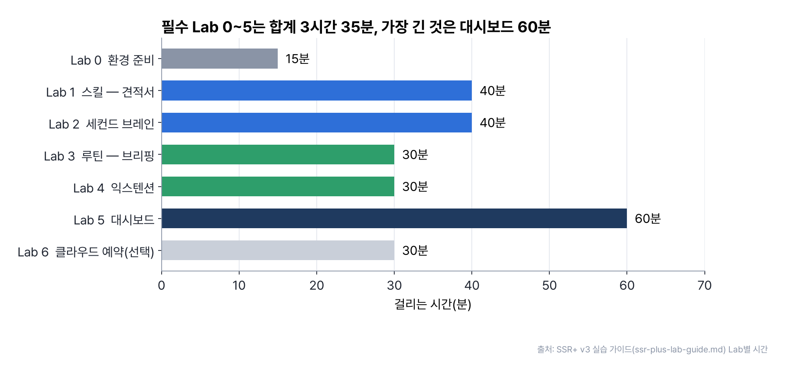
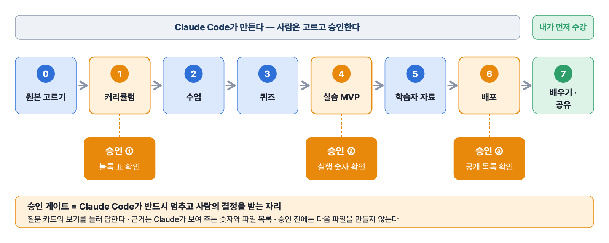
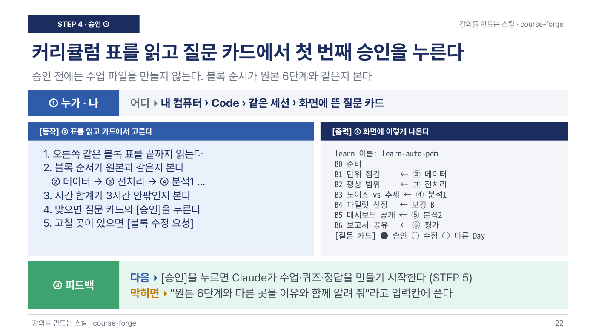
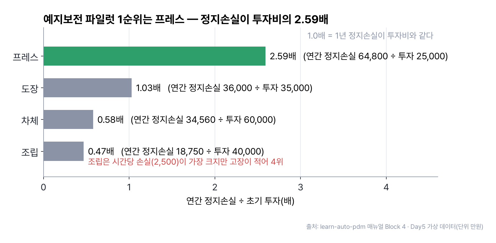
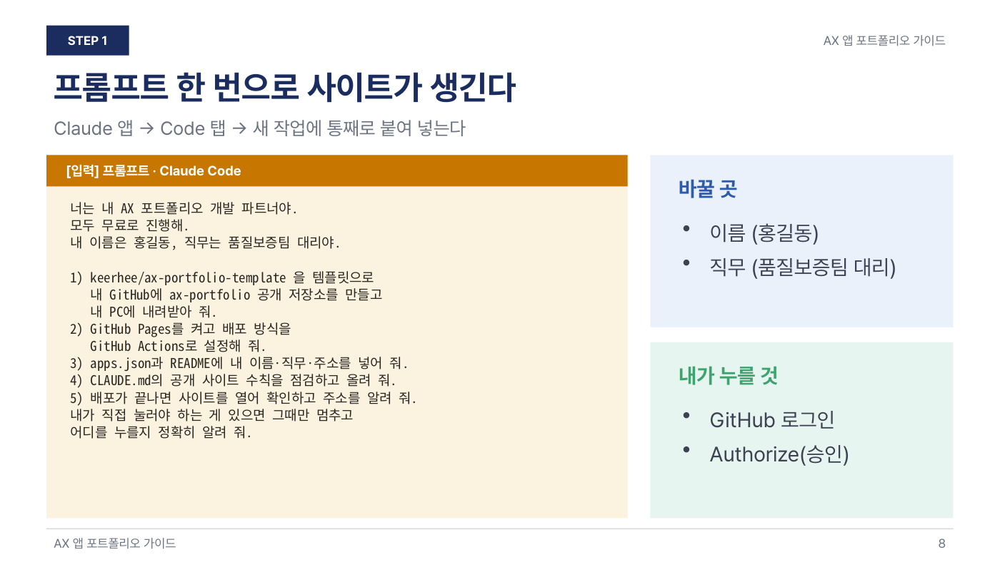

# 11장 나만의 AI 업무 시스템 — 포트폴리오 · SSR+ · 강의 만들기 · 콘텐츠

> **이 장의 한 줄**
> 과정 동안 만든 앱을 **사이트 하나에 카드로 모아 발표**하고, 매일 쓰는 일을 **스킬 · 세컨드 브레인 · 루틴 · 익스텐션(SSR+)** 으로 묶고, 배운 내용을 **강의 스킬(course-forge)** 과 **영상(에고라이트 · Blender)** 으로 남에게 나눈다. 네 가지 모두 사람은 프롬프트를 붙여 넣고 확인하며, 만드는 일은 Claude Code가 한다.

## 이 장에서 배우는 것

1. 과정 첫날(Day0)에 포트폴리오 사이트를 열고, 날마다 앱 카드를 하나씩 채워 마지막 날(Day6)에 주소 하나로 발표하는 흐름을 안다.
2. 공개 사이트(GitHub Pages)와 로그인 사이트(Cloudflare)의 차이, 그리고 공개 사이트 수칙 다섯 가지를 설명할 수 있다.
3. SSR+의 네 단계(스킬 → 세컨드 브레인 → 루틴 → 익스텐션)가 무엇이고, 대시보드는 왜 맨 마지막에 만드는지 말할 수 있다.
4. course-forge로 원본 강의를 내 자율학습 강의로 바꾸는 여덟 단계와 승인 세 번을 안다.
5. 브라우저 일은 에고라이트에, 3D 공정 영상은 Blender에 맡길 때 사람이 끝까지 쥐는 일이 무엇인지 구분한다.

## 큰 그림



네 갈래는 따로 배워도 되지만 서로 이어진다. 포트폴리오 사이트에 올린 앱은 SSR+ 대시보드의 재료가 되고, 내가 정리한 업무 기준은 course-forge로 동료 교육 강의가 되며, 그 결과를 영상으로 만들어 알린다.

## 1. 업무 앱 포트폴리오 사이트 — Day0에 열고 Day6에 발표한다

### 1.1 무엇을 만드나

과정 6일 동안 만든 업무 앱(센서 점검, 리콜 분석, 대시보드 등)을 **사이트 하나에 카드로 모아 주소 하나로 보여 주는 최종 프로젝트**다. 결과물은 `https://내아이디.github.io/ax-portfolio/` 같은 주소 하나이고, 그 주소에 들어가면 내 앱이 카드로 모여 있다. 사이트 오른쪽 아래에는 AI 안내원 «기어리»(노란 로봇)가 있어 방문자의 질문에 답한다.



*그림 11-1. 완성된 사이트의 첫 화면(허브). 위 숫자는 앱 현황, 가운데 칩은 직무 필터, 카드 한 장이 앱 하나다. 출처: 1판 매뉴얼 10장.*


여기서 AX(AI Transformation)는 AI로 일하는 방식을 바꾼다는 뜻이다. 처음 보는 말은 다섯 개면 충분하다.[^gh]

| 말 | 뜻 | 비유 |
|---|---|---|
| GitHub | 파일을 인터넷에 보관하는 서비스 | 온라인 USB |
| 저장소(repository) | GitHub 안의 프로젝트 폴더 하나. 여기서는 `ax-portfolio` | 프로젝트 폴더 |
| 커밋 · 푸시(commit · push) | 바뀐 파일을 기록하고 GitHub에 올리는 것 | 저장 후 업로드 |
| 배포(deploy) | 파일을 누구나 여는 웹사이트로 만드는 것 | 게시판에 공지 붙이기 |
| GitHub Pages | GitHub가 무료로 해 주는 배포 서비스 | 무료 게시판 |

### 1.2 6일 흐름 — 첫날 열고, 날마다 한 장씩, 마지막 날 발표

이 프로젝트는 Day6에 몰아서 하는 일이 아니다. **Day0 첫 시간(30분)에 빈 사이트를 열고**, Day1~Day5에는 그날 배운 내용으로 내 직무 앱을 하나씩 카드로 붙이며, Day6에 정리해서 사이트 주소를 열어 발표한다.

| 날 | 하는 일 | 사람이 할 일 |
|---|---|---|
| Day0 | 템플릿을 내 GitHub로 복사해 사이트 주소를 만든다. 카드 10장(00번 예시 + 기획 중 9장)이 뜬다 | 프롬프트 붙여 넣기 · GitHub 로그인 · Authorize(승인) 누르기 |
| Day1~Day5 | 그날 실습 데이터로 내 직무 앱을 하나 만들어 카드에 붙이고 배포한다 | 빈칸 프롬프트 채우기 · 화면 보고 «이상한 곳» 말하기 |
| Day6 | 다 만든 앱은 «운영 중», 안 만든 카드는 지우고 README를 정리한 뒤 발표한다 | 사이트를 열어 직접 보여 주기 |



*그림 11-2. 첫날 열고, 날마다 한 장씩 붙이고, 마지막 날 주소 하나로 발표한다. 날마다 사람과 Claude Code가 나눠 맡는 일. 출처: 1판 매뉴얼 · 1판 README.*


기준은 «내 직무 앱 최소 2개 배포»이고, 앱마다 «전에는 몇 분 → 지금 몇 분»을 한 줄로 적는다.[^check] 템플릿에 들어 있는 카드 10장은 이 과정의 날짜별 주제와 맞춰 둔 것이다.

| # | 앱 | 직무 | 처음 상태 |
|---|---|---|---|
| 00 | 설비 센서 이상 감시 | 생산·보전 | 예시(가상 데이터) |
| 01 | 공급망 리스크 레이더 | 구매 | 기획 중 |
| 02 | 리콜 신호 조기탐지판 | 품질 | 기획 중 |
| 03 | 경쟁사 재무 대시보드 | 전략·기획 | 기획 중 |
| 04 | CR 협상 코파일럿 | 영업·원가 | 기획 중 |
| 05 | CASE 전환 BOM 맵 | R&D·전략 | 기획 중 |
| 06 | 설비 예지보전 모니터 | 생산·보전 | 기획 중 |
| 07 | 딜러·CS 지식 챗봇 | CS·영업지원 | 기획 중 |
| 08 | EV 스마트팩토리 3D 트윈 | 생산기술 | 기획 중 |
| 09 | 세계 자동차 산업 3D 지도 | 해외영업·전략 | 기획 중 |

00번 예시 앱은 설비 2대 × 25시점의 진동 · 온도 · 압력(가상 데이터)에서 설비별 평균과 표준편차(σ, 값이 평균에서 흩어진 정도)를 구해 «평균 ± 2σ»를 벗어난 시점을 표시한다. 새 앱은 이 폴더를 복사해 시작한다. BOM(Bill of Materials, 부품 구성표), OEM(완성차 회사), CR(Cost Reduction, 단가 인하 요청), CASE(커넥티드 · 자율주행 · 공유 · 전동화) 같은 업계 말은 화면에 실무 표기 그대로 쓴다.

### 1.3 사이트 안의 구조 — 내가 볼 곳은 두 군데

저장소 하나가 곧 포트폴리오 전체다. 그 안에서 사람이 볼 곳은 카드에 뜨는 이름 · 소개를 담은 `apps.json`과 실제 앱이 들어가는 `apps/`(앱 하나 = 폴더 하나) 두 군데이고, 허브 화면 · 기어리 · 공통 디자인 · 자동 배포 설정은 Claude Code가 관리한다. 사내 파일은 `private/`에 두면 GitHub에 올라가지 않는다.

`CLAUDE.md`는 Claude Code가 이 폴더에서 일할 때마다 읽는 작업 규칙 파일이다. 여기에 «새 앱 추가 절차» 일곱 단계와 «공개 사이트 수칙»이 적혀 있어서, 사람은 «CLAUDE.md의 절차대로 해 줘»라고만 말하면 된다. GitHub Actions(GitHub가 저장소에 올라온 파일을 받아 자동으로 점검 · 배포하는 기능)가 푸시 1~2분 뒤 사이트에 반영한다.

### 1.4 공개 사이트 수칙 — 무료인 대신 주소만 알면 누구나 본다

무료 계정의 GitHub Pages는 공개 저장소에서만 동작한다. 그래서 `CLAUDE.md`에 다섯 가지 수칙을 두고, Claude Code가 푸시 전에 매번 점검해 «수칙 1~5 통과»처럼 보고하게 했다.

| 수칙 | 하지 말 것 | 대신 할 것 |
|---|---|---|
| 1 | 회사 이름 · 고객사 실명 · 실제 BOM · 단가 · 클레임 원문 | 가상 데이터, `OEM_01`처럼 코드 표기 |
| 2 | 데이터 출처를 숨기기 | 화면과 `apps.json`에 «가상» 또는 «실데이터(출처 · 기준일)» 표시 |
| 3 | API 키 · 토큰 · 비밀번호를 파일에 넣기 | 기어리 설정 창에만 입력(방문자 브라우저에만 저장) |
| 4 | 사내 파일 커밋 | `private/` 폴더에만 두기(올라가지 않게 등록됨) |
| 5 | 로그인 · 결제 · 개인정보 수집 화면 | 만들지 않는다 |

API 키(API key)는 외부 AI 서비스를 내 이름으로 쓰게 해 주는 비밀 문자열이다. 배포 워크플로도 키처럼 보이는 문자열이나 `private/` 폴더가 있으면 배포를 멈춘다. 회사 데이터로 꼭 확인해 보고 싶으면 «내 PC에서만» 여는 프롬프트를 쓴다(1.6 참고).

### 1.5 기어리 — 세 가지 방식, 모두 추가 비용 없음

| 방식 | 어떻게 | 비용 |
|---|---|---|
| ① 바로 묻기 | «이상 시점 보여줘»처럼 짧게 쓰거나 🎤 버튼으로 말하면 화면을 직접 움직인다 | 무료 |
| ② Claude에게 묻기 | 기어리가 모르는 질문 → 버튼 → 열린 Claude 창에 붙여 넣기 | Claude Pro 구독 안 |
| ③ Gemini 키 | 설정에 Google Gemini 무료 등급 키를 넣으면 기어리가 직접 답한다 | 선택 |

음성은 Chrome과 Edge에서 되고, 말소리는 브라우저 회사의 서버에서 글자로 바뀐다. 그래서 회사 기밀은 말로도 글로도 묻지 않는다. Gemini 키를 쓴다면 키에 «주소 제한(HTTP 리퍼러, 이 주소에서 온 요청만 받게 하는 설정)»을 걸어 내 사이트에서만 동작하게 한다.[^gemini]

### 1.6 1판과 2판 — 누가 보는 사이트인가

| 항목 | 1판 GitHub Pages(공개) | 2판 Cloudflare(로그인) |
|---|---|---|
| 난이도 | 2단계 | 3단계 |
| 저장소 | 공개 | 비공개 |
| 주소 | `내아이디.github.io/ax-portfolio` | `ax-portfolio-내아이디.pages.dev` |
| 누가 보나 | 주소를 아는 누구나 | 명단에 넣은 이메일만(메일로 온 6자리 코드로 로그인) |
| 새로 만들 계정 | 없음 | Cloudflare(무료) |
| 비용 | 0원 | 0원(내 도메인만 선택 · 유료) |

**Cloudflare Pages**는 Cloudflare 회사의 무료 배포 서비스로, 비공개 저장소도 배포해 준다. **Cloudflare Access**는 사이트 앞에 «로그인 문»을 세워 허락한 이메일만 들어오게 하는 기능이고, Cloudflare의 **Zero Trust**(접속할 때마다 신원을 확인하는 보안 방식) 메뉴 안에 있다. 무료 플랜은 50명까지다.

앱 만드는 법은 1판과 같다. 바뀌는 것은 «어디에 올리고 누가 보느냐»뿐이다. 템플릿 zip은 두 판이 같은 파일이고, `CLAUDE.md` 맨 위 «배포 방식» 한 줄(`github-pages` 또는 `cloudflare`)로 고른다. 2판에서는 사람이 Cloudflare 화면에서 직접 하는 일이 늘어난다.

- **사람이 할 일**: Cloudflare 가입 · 메일 인증, Pages에서 GitHub 저장소 연결과 설정 네 칸 입력, Zero Trust에서 Free 플랜 고르기, 허락할 이메일 명단 넣기, 시크릿 창에서 로그인 확인
- **Claude Code가 할 일**: 비공개 저장소 만들기, 2판용 설정으로 바꾸기, 수칙 점검 · 커밋 · 푸시, 배포 목록으로 성공 여부 확인(로그인 문 때문에 주소를 직접 열 수 없다)

> **순서 하나**
> Cloudflare 첫 배포가 끝난 직후에는 주소를 아는 누구나 열 수 있다. 이메일 로그인(STEP 3)을 마치기 전에는 주소를 남에게 보내지 않는다.

### 1.7 발표 — 평가표에 맞춰 준비할 말

| 평가 항목 | 보는 것 | 준비할 말 |
|---|---|---|
| 도메인 적합성 40 | 내 업무 문제를 푸는가 | «이 일 때문에 매주 몇 시간이 들었다» |
| 검증 절차 30 | 결과를 믿을 수 있는가 | «정답과 비교해 몇 % 맞았다», «가상 데이터 표시» |
| 차별성 30 | 엑셀로는 안 되는가 | «주소만 주면 팀 전체가 본다», «기어리가 설명한다» |

웹앱을 처음부터 짓는 자세한 과정(요구사항 → 화면 → 배포)은 [10장 업무 웹앱 처음부터 끝까지](10장_업무_웹앱_처음부터_끝까지.md)에, GitHub 기초는 [06장 GitHub로 내 자료 관리](06장_GitHub로_내_자료_관리.md)에 있다.

## 2. SSR+ — 매일 쓰는 나만의 AI 업무 시스템

### 2.1 대시보드는 결과이고, 바닥은 네 단계다

SSR+는 유튜브 영상 «상위 1%의 클로드 세팅: 내 업무를 한눈에 보는 AI 대시보드»(챗대리)를 노트북 한 대 기준으로 다시 짠 강의다. 덱의 첫 문장이 핵심이다. «AI 성능이 아니라 일하는 환경이 생산성을 정한다.» 이름은 네 단계의 머리글자다.

| 단계 | 한 줄 뜻 | 예 |
|---|---|---|
| S **스킬(skill)** | 업무 단축키. 반복 업무의 절차와 참고 자료를 묶은 폴더로, 맥락이 맞으면 저절로 발동한다 | 견적서 만들기 |
| S **세컨드 브레인(second brain)** | AI가 읽는 지식 지도. 대문 파일과 길잡이 파일로 AI가 자료를 스스로 찾게 한다 | 촬영 원본 찾기 |
| R **루틴(routine)** | 예약된 단축키. 정해진 시간에 스킬이나 프롬프트를 자동으로 실행한다 | 매일 아침 브리핑 |
| + **익스텐션(extension)** | 외부 도구 연결. 메일 · 캘린더 · 브라우저 · 공공데이터를 AI가 다루게 한다 | Gmail 커넥터 |

> **출발점**
> 같은 작업을 **두 번 이상** 시켰다면 스킬로 만든다. 스킬이 «단축키»라면 루틴은 «오전 9시에 그 단축키를 눌러라»이다.

화면부터 만들면 숫자가 가짜로 채워진다. 그래서 순서는 스킬 → 세컨드 브레인 → 루틴 → 익스텐션으로 바닥을 깔고, 대시보드는 맨 마지막에 씌운다. 대시보드 안에서도 순서는 **데이터 계약(화면이 읽을 데이터의 칸과 형식을 먼저 정한 약속) → 수집 스크립트 → 화면**이다.



*그림 11-3. 작업 폴더(ai-os 볼트) 위에 스킬 → 세컨드 브레인 → 루틴 → 익스텐션 순서로 쌓고, 대시보드는 맨 마지막에 씌운다. 출처: SSR+ 강의 덱 III 5장 · 설계 가이드.*


### 2.2 작업 폴더 하나 — ai-os 볼트

**볼트(vault)** 는 메모 앱 옵시디언에서 쓰는 말로, 노트와 자료를 담는 폴더 하나를 가리킨다. 이 강의에서는 그 폴더에 **ai-os**(AI 업무 시스템)라는 이름을 붙였다. 이 폴더 하나가 세 역할을 한다.

| 역할 | 쓰임 |
|---|---|
| 옵시디언 볼트 | 사람이 노트를 읽고 링크를 따라가는 곳 |
| Claude Code 프로젝트 폴더 | Code 탭에서 이 폴더를 열면 대문 파일과 스킬을 읽고 일한다 |
| 자동화의 바닥 | 루틴 결과 · 대시보드 데이터 · 실행 기록이 모두 쌓인다 |

옵시디언이 없어도 시스템은 폴더와 Claude Code만으로 돈다. 세컨드 브레인의 재료는 두 가지다.

- **AGENTS.md** — 볼트의 대문. «나는 누구인가 / 항상 지킬 규칙 / 업무 영역별 길잡이 / 하지 말 것»을 200줄 이하로 적는다. `CLAUDE.md`에는 «@AGENTS.md» 한 줄만 두어 세션마다 읽히게 한다.
- **길잡이 파일(`_index/`)** — 영역별 안내 페이지. 어디에도 연결되지 않은 파일(고아 파일)은 `orphans.md`에 이유와 함께 모은다.

세컨드 브레인과 프롬프트 설계의 기초는 [04장 AI에게 일 잘 시키기](04장_AI에게_일_잘_시키기.md)에서 더 자세히 다룬다.

### 2.3 단계마다 초급 → 중급 → 고급

| 단계 | 초급 | 중급 | 고급 |
|---|---|---|---|
| 스킬 | 스킬 크리에이터에게 말해서 만든다 | 스킬 폴더에 참고 자료(양식 규칙 · 단가표)를 넣는다 | 스킬을 고치는 장치를 둔다 |
| 세컨드 브레인 | AGENTS.md에 지침을 적는다 | 주제별 길잡이 파일을 만든다 | 나만의 탐색기를 만든다 |
| 루틴 | 로컬 예약 작업 | 클라우드 예약 작업을 더한다 | 두 번째 컴퓨터가 생기면 Hermes를 둔다 |
| 익스텐션 | 기본 커넥터를 클릭해 연결한다 | MCP → CLI → API 순으로 찾는다 | 없으면 직접 만든다 |

표의 말을 풀면 이렇다.

- **로컬 예약 작업**: Claude 데스크톱 앱이 내 노트북에서 정해진 시각에 돌리는 작업. 노트북이 잠들어 있으면 그 시각을 건너뛰고, 깨어나면 가장 최근에 놓친 한 번만 실행한다(7일 이내).
- **클라우드 예약 작업**: Anthropic 클라우드에서 도는 작업(Pro 이상). 노트북이 꺼져 있어도 돌지만 노트북 파일을 못 읽으므로, 볼트를 비공개 GitHub 저장소에 올려 두고 매번 새로 받아 쓴다.
- **커넥터(connector)**: claude.ai 설정에서 클릭으로 연결하는 외부 서비스 연결(Gmail · Google Calendar 등).
- **MCP**(Model Context Protocol, AI가 외부 도구를 부르는 표준 연결 방식) · **CLI**(Command Line Interface, 명령어로 쓰는 프로그램) · **API**(Application Programming Interface, 프로그램끼리 데이터를 주고받는 창구) — 연결 수단을 찾는 순서다.
- **Hermes · Syncthing**: 원 영상의 화자가 상시 켜 둔 두 번째 컴퓨터에서 쓴 에이전트 프로그램과 파일 동기화 프로그램. 노트북 한 대로 일하면 둘 다 필요 없다.[^hermes]

### 2.4 가상 회사 «모아랩»으로 Lab 0~6을 따라 한다

실습 키트에는 가상 1인 AI 교육 · 콘텐츠 회사 **모아랩**의 작업 폴더가 들어 있다. 회사 · 사람 · 메일 주소 · 숫자는 모두 지어낸 것이다. 회의록 · 단가표 · 지난 견적서 · 이름이 엉망인 메모 · 가상 메일 25건 · 일정 18건 · 유튜브와 뉴스레터 60일 데이터가 있어서 API 키 없이 끝까지 따라 할 수 있다.

| Lab | 내용 | 완료 기준 | 시간 |
|---|---|---|---|
| 0 | 환경 준비 — 키트 풀기, 도구 설치, 저장소 만들기 | 가상 데이터 마지막 날짜가 오늘 | 15분 |
| 1 | 스킬 — 가람물류(가상) 킥오프 회의록으로 견적서 스킬 | 합계 3,000,000원(부가세 별도) | 40분 |
| 2 | 세컨드 브레인 — AGENTS.md, 길잡이, 고아 파일 | «ep42 A캠 최종 원본»을 바로 찾는다 | 40분 |
| 3 | 루틴 — 모닝 브리핑, 주간 정리 | 놓친 날이 «[놓친 브리핑]»으로 표시된다 | 30분 |
| 4 | 익스텐션 — 가상 데이터 규칙, 커넥터 찾기 스킬 | 후보 비교표와 사람이 할 단계가 나온다 | 30분 |
| 5 | 대시보드 — 데이터 계약, 수집, 화면 | 화면 점검 세 가지 통과 | 60분 |
| 6 | (선택) 클라우드 예약 작업 — 비공개 저장소, 주간 리뷰 | cloud 실행이 루틴 칸에 보인다 | 30분 |



*그림 11-4. Lab 0~5는 합계 215분(3시간 35분), 선택인 Lab 6까지 하면 245분이다. 대시보드(Lab 5)가 가장 길다. 출처: SSR+ v3 실습 가이드.*


Lab 1의 시작 프롬프트는 «말로 스킬 만들기»의 좋은 본보기다. 회의록에 없는 값은 추측하지 말고 묻게 한 점을 눈여겨본다.

```text
skill-creator로 견적서 스킬을 만들어라. 이름은 quote-md, 위치는 .claude/skills/.
회의록이나 메일을 주면 02_OPERATIONS/의 사업자 정보와 단가표로
견적서를 md로 만들어 02_OPERATIONS/quotes/에 저장하는 스킬이다.
단가표 아래 규칙(재계약 할인, 커리큘럼 설계 조건, 출장비 조건)을 지키게 하고,
회의록에 없는 값은 추측하지 말고 나에게 묻게 해라.
description은 '언제 쓰는지'가 한 문장으로 드러나게 써라.
```

대시보드 화면 점검은 세 가지다. ① 숫자가 살아 있는가(브리핑을 돌린 뒤 수집 시각이 바뀐다) ② 스킬 버튼이 도는가(견적서가 실제로 생긴다) ③ 다른 곳에서 돈 루틴도 보이는가(클라우드 실행 기록이 보인다).

### 2.5 사람이 할 일은 다섯 가지뿐

사람이 직접 하는 일은 ① Claude Pro 이상 구독과 로그인 ② Claude 데스크톱 앱 설치(로컬 예약 작업은 데스크톱 앱에서만 된다) ③ 실습 키트 zip 내려받기 ④ (Lab 4, 선택) claude.ai 설정에서 Gmail · Google Calendar 커넥터 연결 — 구글 허용 버튼 ⑤ (Lab 6, 선택) GitHub 로그인 승인, 이 다섯 가지다.

나머지 — 도구 설치, 압축 풀기, 저장소 만들기, 스킬 · AGENTS.md · 수집 스크립트 · 대시보드 작성, 예약 작업 만들기, 오류 고치기 — 는 Claude Code가 한다. 실습이 끝나면 «실습 뒤 내 업무로 옮기기» 프롬프트 세 개로 모아랩 자료를 빼고 내 볼트를 만들고, 가상 데이터를 실제 커넥터로 바꾸고(이때 API 키는 사람이 발급해 `.env` 파일에만 넣는다), 예약 작업을 새 볼트로 옮긴다.[^ssrver]

## 3. course-forge — 내가 배운 것을 강의로 만드는 스킬

### 3.1 수업을 듣는 사람에서 만드는 사람으로

course-forge는 **강의를 만드는 스킬**이다. 강의 저장소의 Day 주제 하나를 고르면 Claude Code가 원본 덱과 데이터를 읽어 `/learn-<주제>`로 부르는 **강의 스킬**을 만든다. 만든 사람이 먼저 그 강의로 배우고, 결과 대시보드를 공개하고, 동료가 설치 한 줄로 같은 수업을 듣게 한다.

| 구분 | 내용 |
|---|---|
| 목표 — AI Native | 교육 내용도 AI에게 맡겨 만들고, 나는 기준을 정하고 확인한다 |
| 방법 — Skills as Curriculum | 만든 스킬이 강사가 되어 설명 → 실습 → 멈춤 → 확인 · 퀴즈를 진행한다 |
| 형식 — 자율학습 | 강사 없이 내 속도로. 퀴즈와 수치 검증으로 스스로 점검한다 |

**스킬**은 Claude Code가 읽는 지시서 폴더이고, 그 안의 `SKILL.md` 한 장에 이름과 진행 규칙이 적혀 있다. 입력칸에 `/이름`을 치면 Claude는 그 지시서대로 일한다. **Skills as Curriculum**(스킬을 교육과정으로)은 이 스킬이 강사 역할을 맡아, 내가 «완료»를 입력해야 다음 퀴즈가 나오게 하는 수업 방식이다. Skills as Curriculum 형식은 AI Native Camp의 camp-1 · camp-2에서 왔다.

### 3.2 여덟 단계와 승인 세 번

| 단계 | 하는 일 | 사람이 할 일 |
|---|---|---|
| 0 원본 고르기 | Day 폴더의 덱 · 데이터 · 정답 메모를 읽어 요약 | Day 고르기 |
| 1 커리큘럼 | 원본 6단계 흐름을 블록 표로 | 승인 ① |
| 2 수업 | 블록마다 설명 · 붙여 넣을 프롬프트 · 확인할 것 | — |
| 3 퀴즈 | 원본 실습과제 · 함정으로 판단형 퀴즈 | — |
| 4 실습 MVP | 정답을 실제로 실행해 수치 확정 · 결과 대시보드 | 승인 ② |
| 5 학습자 자료 | 데스크톱 앱 기준 GUIDE | — |
| 6 배포 | GitHub 저장소 + Pages 주소 | 승인 ③ |
| 7 배우기 · 공유 | 내가 먼저 수강 → 고치기 → 공유 메시지 → 개정 | 수강하고 공유하기 |



*그림 11-5. 단계 0~6은 Claude Code가 만들고, 사람은 커리큘럼(①) · 실습 결과(②) · 공개 직전(③) 세 곳에서만 승인한다. 출처: course-forge 따라 하기판 IV.*


**승인 게이트**는 Claude Code가 반드시 멈추고 사람의 결정을 받는 자리다. 승인은 질문 카드의 보기를 눌러 답한다. 커리큘럼, 실습 결과, 공개 직전 세 곳에서만 사람이 판단하고, 근거는 Claude가 보여 주는 숫자와 파일 목록이다. 공개(승인 ③)는 사람이 승인해야만 진행되며, 회사 내부 자료는 공개 저장소에 넣지 않는다. MVP(Minimum Viable Product)는 핵심 기능만 갖춘 첫 완성본이다.



*그림 11-6. 승인 ①은 이렇게 보인다. 블록 표를 읽고 순서가 원본 6단계와 같은지 본 뒤 질문 카드의 [승인]을 누른다. 출처: course-forge 따라 하기판 IV 22장.*


수치와 공개 안전은 검수 스크립트 네 개가 지킨다. 블록 형식 점검(`lint_blocks.py`), 정답을 임시 폴더에서 다시 돌려 기대값과 비교하고 그 수치가 본문에 실제로 있는지 보는 수치 검증(`verify_numbers.py`), 대시보드 데스크톱 · 모바일 화면 점검(`render_check.py`), 토큰 · 키 · 주민번호 · 휴대폰 번호와 대용량 파일을 찾는 공개 점검(`publish_check.py`)이다.

### 3.3 완성 예 — Day5 예지보전으로 만든 learn-auto-pdm

`/course-forge Day5 예지보전`으로 실제로 만든 강의가 **learn-auto-pdm**이다(PdM은 Predictive Maintenance, 예지보전). 3-1B에는 따라 하기 매뉴얼 덱(42장) · 강의 저장소 zip · 완성 대시보드 미리보기가 들어 있다. 블록은 일곱 개, 약 3시간 20분이다.

| Block | 주제 | 끝나면 생기는 것 |
|---|---|---|
| 0 | 준비 — 작업 폴더 · Day5 데이터 4종 | 환경 점검 기록 · CLAUDE.md |
| 1 | 단위 점검 — 기록장치 열이 단서 | 단위 6칸 변환 기록 |
| 2 | 평상 범위 — 설비별 평균 ± 2σ | 이상 후보표(설비A 1점 · 설비B 3점) |
| 3 | 노이즈 vs 추세 — 정비 권고 시점 | 판정표(설비B 온도 13:00 · 진동 15:00 추세) |
| 4 | 파일럿 선정 — 정지손실 ÷ 투자 | 공정 순위(프레스 2.59배) · 순효과 추정 |
| 5 | 대시보드 공개 — GitHub Pages | 사이트 주소 |
| 6 | 보고서와 공유 | 4단 보고서 · README · 공유 메시지 |

이 강의의 정답 숫자는 원본 모범답안과 모두 일치했다. 단위가 다른 칸 6칸(℉ 3 · in/s 2 · psi 1), 설비A 이상 후보 1점(12:40, 노이즈), 설비B 이상 후보 3점(추세), 파일럿 우선순위 프레스 2.59 · 도장 1.03 · 차체 0.58 · 조립 0.47배다. 원본과 다르게 정한 곳은 하나로, 원본이 말로 정의한 «추세의 시작점»을 «기준선(처음 12점) 평균 + 3σ를 3번 연속 넘으면 추세»라는 규칙으로 바꿨고, 그 이유를 대조표에 남겼다.[^pdm] 센서 · 공정 값은 실습용 가상 데이터이고, 도입 사례 6건만 기사 · 보도자료 URL이 붙은 실데이터(기준일 2026-10-07)다. 예지보전 자체의 내용은 [09장 스마트팩토리와 예지보전](09장_스마트팩토리와_예지보전.md)에 있다.



*그림 11-7. Block 4의 파일럿 순위. 연간 정지손실 ÷ 초기 투자로 매기면 프레스가 2.59배로 1순위이고, 시간당 손실이 가장 큰 조립은 4위(0.47배)다. 출처: learn-auto-pdm 매뉴얼 Block 4, Day5 가상 데이터(단위 만원).*


### 3.4 내 강의를 점검하는 다섯 기준(100점)

| 기준 | 배점 | 확인하는 법 |
|---|---|---|
| 원본에 충실한가 | 25 | 블록 순서가 원본 6단계와 같고, 원본에 없는 내용을 지어내지 않았다 |
| 숫자를 검증했나 | 25 | 정답 재실행이 일치하고 원본 모범답안과 대조표가 있다 |
| 퀴즈가 판단형인가 | 20 | 케이스 수치를 주고 판단을 묻고, 오답 이유까지 해설한다 |
| 배포하고 공유했나 | 20 | 대시보드 주소와 설치 한 줄이 있고 동료 한 명이 수강했다 |
| 개정했나 | 10 | 내 수강과 동료 의견을 반영한 개정 이력이 있다 |

같은 틀(원본 → 승인 → 검증 → 스킬)은 강의가 아닌 **업무 팀**을 만드는 데도 쓴다. 로봇 SI 제안 팀을 넓히는 si-forge가 그 예이며 [12장 로봇과 스마트팩토리 특강](12장_로봇과_스마트팩토리_특강.md)에서 다룬다.

## 4. 콘텐츠 만들기 — 유튜브 운영과 공정 영상

### 4.1 에고라이트로 유튜브 운영 자동화

**에고라이트(EGO Lite)** 는 AI 에이전트용 무료 브라우저다(Mac · Windows). Claude Code에 붙여 쓰면 AI가 브라우저를 직접 움직여, 이미 쓰고 있는 구독(ChatGPT · 유튜브 스튜디오 · Gmail 등) 안에서 일한다. 서비스마다 API를 연결하고 비용을 낼 필요가 없고, AI는 전용 **작업 공간**에서 일하므로 내 화면과 탭은 그대로다. 역할은 감독과 촬영기사로 보면 쉽다. Claude Code가 감독(순서를 정해 보냄), 에고라이트가 촬영기사(페이지를 열고 클릭하고 찍음), 다시 Claude Code가 편집자(프레임을 mp4로 합침)다. 브라우저 자동화의 기초는 [03장 데이터를 그림으로](03장_데이터를_그림으로.md)에 있다.

시연 주제는 10분짜리 영상 «휴머노이드 로봇, 자동차 공장에 들어가다»이고, 영상 한 편이 여섯 단계를 거쳐 올라간다.

| 단계 | AI가 하는 일 | 사람이 하는 일 |
|---|---|---|
| 1 벤치마킹 | 인기 영상의 제목 · 썸네일을 표로 정리 | 방향과 레퍼런스 고르기 |
| 2 녹화 · 편집 | 시연 장면을 찍어 본편과 합쳐 final.mp4 | 완성본 확인 |
| 3 썸네일 | ChatGPT 웹에서 이미지를 만들어 저장 | 글자가 깨졌는지 보기 |
| 4 업로드 | 영상과 정보를 넣고 예약 버튼 앞에서 멈춤 | 예약 버튼 누르기 |
| 5 홍보 | Threads(메타의 짧은 글 SNS)에 글과 링크를 넣고 멈춤 | 게시 버튼 누르기 |
| 6 메일 | 협업 메일을 표로 묶고 답장 초안 | 읽어 보고 발송 |

> **되돌릴 수 없는 버튼은 항상 사람이 누른다**
> AI가 로그인된 브라우저로 일하고 Claude Code 권한도 넓게 열기 때문이다. 업로드 예약 · 게시 · 메일 발송은 직접 누르고, 결제와 보안 확인에서는 에고라이트가 멈추고 넘긴다. 브라우저 **프로필**(로그인 정보를 따로 가진 브라우저 계정)도 나눈다. 처음 가는 사이트를 많이 도는 조사용 프로필에는 문제가 생겨도 괜찮은 계정만 두고, 로그인된 주력 계정은 3~6단계에만 쓴다.

녹화 기능은 공식 문서로 확인되지 않았다는 점을 덱이 분명히 적는다. 그래서 본 녹화 전에 5초 테스트를 시켜 사용한 도구 · 생성 파일 · 프레임별 시각 · 클릭 기록이 실제로 남는지 먼저 확인하고, 되는 기능만 쓴다. 자동차 주제 녹화 예시로 자동차리콜센터 리콜 조회, 무공해차 통합누리집 충전소 찾기, Hugging Face LeRobot 로봇 팔 데이터, KIPRIS 자율주행 라이다 특허 검색 네 장면의 완성 프롬프트가 들어 있다.[^ego]

### 4.2 Blender로 EV 조립 공정 영상 만들기

**Blender**는 무료 3D 프로그램이다. 이 실습은 전기차 스케이트보드 플랫폼(배터리 · 구동 유닛 · 서스펜션 · 바퀴를 한 판에 모은 하부 구조)과 크로스오버 차체의 조립 공정을 3D 모션그래픽으로 만든다. 핵심 메시지는 «키프레임을 손으로 찍지 않는다»다. **키프레임**은 특정 순간의 위치를 기록한 점이고, 부품마다 출발점과 도착점 두 개만 정하면 Blender가 그 사이를 **보간**(사이 값을 채움)한다. 이 규칙을 파이썬 코드로 쓰는 일은 Claude Code가 한다.

먼저 볼 것은 맨 위의 `Car_Factory_Isometric.html`과 공정 흐름 영상이다. 부품 투입 → 차체 조립 → 도장 → 최종 조립 → 검사 · 출하 다섯 공정을 한 화면에서 따라간다. 그다음 가이드 II(44장)를 보며 3D 모델로 실습한다.

| 결과물 | 내용 |
|---|---|
| 스케이트보드 7단계 30초 | 홀로그램 → 프레임 → 배터리 → 배선 → e-Axle → 서스펜션 → 휠 → 검사 |
| 전체 공정 9단계 53.5초 | 차체를 더해 차체 용접(BIW) · 도장 · 마리지 · 의장 · EOL 검사까지 |

공정 용어는 영상 속 장면과 함께 익힌다. **BIW**(Body in White)는 프레스 패널을 용접한 도장 전 강판 차체, **마리지**(Marriage)는 차체와 하부 플랫폼을 결합하는 공정, **의장**(Trim & Final)은 유리 · 램프 · 내장 부품을 다는 공정, **EOL**(End-of-Line) 검사는 라인 끝에서 전장품과 구동계를 확인하는 최종 검사다. 3D 모델은 **GLB**(3D 모델을 한 파일에 담는 표준 형식) 파일로, 스케이트보드 모델은 부품(메시) 408개, 크로스오버 모델은 1,015개다. 부품 이름이 곧 공정 순서의 단서다.

| 사람의 몫 | Claude Code의 몫 |
|---|---|
| 보여 줄 공정과 순서를 정한다 | Blender와 FFmpeg(영상 · 소리 변환 도구) 설치와 점검 |
| 미리보기에서 어색한 장면을 짚는다 | 모델 분석과 장면 스크립트 작성 |
| 렌더 시간과 화질의 균형을 승인한다 | 렌더 실행, 속도 측정, 설정 조정 |
| 완성 영상을 보고 최종 판정한다 | 자막 · 소리 합성, MP4 인코딩, 오류 진단과 수정 |

가장 비싼 단계는 **렌더링**(장면을 이미지로 계산하는 일)이다. GPU(그래픽 처리 장치)가 없는 PC에서 Cycles 엔진으로 30초 영상 720프레임을 굽는 데 전체 약 3시간이 걸렸다. 그래서 저해상도 미리보기 12장으로 먼저 문제를 찾고(색이 바램 · 차 뒤쪽 잘림 · 스캐너가 벽처럼 보임), 관찰한 그대로 문장으로 적어 넘기면 Claude Code가 원인을 찾아 고친다. 자막과 흐름 바는 렌더 위에 따로 합성해서, 문구를 바꿀 때 3시간짜리 렌더 대신 합성 6분만 다시 돌린다. 소리 크기는 -16 LUFS(사람이 느끼는 음량 단위)로 맞춘다.[^blender]

## 실습 길잡이

| 순서 | 3-1B 폴더 | 난이도 | 먼저 볼 것 |
|---|---|---|---|
| 1 | [11 EV조립 모션그래픽 Blender실습](../보충교재/Day6_최종프로젝트/11_EV조립_모션그래픽_Blender실습/) | 2단계 | `Car_Factory_Isometric.html` → 가이드 II 44장 |
| 2 | [03 업무앱 포트폴리오사이트](../보충교재/Day6_최종프로젝트/03_업무앱_포트폴리오사이트/) | 2단계(1판) → 3단계(2판) | 1판 매뉴얼 33장 · 템플릿 zip 안 `START_HERE.md` |
| 3 | [Day5 04 예지보전 자율학습강의](../보충교재/Day5_예지보전/04_예지보전_자율학습강의/) | 2단계 | course-forge 완성 예 — 먼저 수강해 본다 |
| 4 | [06 커리큘럼만드는스킬](../보충교재/Day6_최종프로젝트/06_커리큘럼만드는스킬/) | 3단계 | [최종패키지 README](../보충교재/Day6_최종프로젝트/06_커리큘럼만드는스킬/최종패키지/README.md) · [프롬프트 모음](../보충교재/Day6_최종프로젝트/06_커리큘럼만드는스킬/최종패키지/1_Day5_Course_Forge/Course_Forge_Prompts.md) |
| 5 | [08 에고라이트 유튜브운영 자동화](../보충교재/Day6_최종프로젝트/08_에고라이트_유튜브운영_자동화/) | 3단계 | 가이드 덱 25장 · 실습 콘솔 HTML(프롬프트 10개) |
| 6 | [13 SSR 나만의 AI 업무시스템](../보충교재/Day6_최종프로젝트/13_SSR_나만의AI업무시스템/v3/) | 3단계 | [설계 가이드](../보충교재/Day6_최종프로젝트/13_SSR_나만의AI업무시스템/v3/guides/claude-ai-os-ssr-plus-III.md) → [실습 가이드](../보충교재/Day6_최종프로젝트/13_SSR_나만의AI업무시스템/v3/SSR_Plus_수강생배포.zip) |

표는 쉬운 것부터 놓았다. 1(2단계)로 내 결과물을 영상 한 편으로 만들어 보고, 2 → 3 → 4 순서로 «보여 주기 → 배우기 → 가르치기»를 한 바퀴 돈다. 5는 콘텐츠 운영이 필요한 사람만 고르고, 6 SSR+는 앞의 것을 모두 묶는 마지막 과제다. 과정(3-1)에서는 포트폴리오(2번)를 Day0에 시작한다.

**대표 프롬프트 1 — Day0 포트폴리오 사이트 만들기**(이름과 직무 두 곳만 바꾼다. 괄호 안 명령은 Claude Code가 실행한다)

```text
너는 내 AX 포트폴리오 개발 파트너야. 모두 무료로 진행해.
1) keerhee/ax-portfolio-template 을 템플릿으로 내 GitHub에 ax-portfolio 라는 "공개" 저장소를 만들고 내 PC에 내려받아 줘.
   (gh repo create ax-portfolio --public --template keerhee/ax-portfolio-template --clone)
2) GitHub Pages를 켜고 배포 방식을 GitHub Actions로 설정해 줘.
3) apps.json의 owner와 role을 내 이름과 직무로 바꾸고, README의 사이트 주소와 배포 배지를 실제 값으로 바꿔 줘.
4) CLAUDE.md의 공개 사이트 수칙을 점검한 뒤 커밋하고 push해 줘.
5) Actions 배포가 끝나면 사이트 주소를 열어 허브와 예시 앱(00)이 뜨는지 확인하고, 주소와 함께 3줄로 보고해 줘.
내가 직접 눌러야 하는 것(GitHub 로그인·권한 승인)이 있으면 그때만 멈추고 정확히 어디를 누를지 알려 줘.
```



*그림 11-8. Claude 앱 → Code 탭 → 새 작업에 프롬프트를 통째로 붙여 넣는다. 바꿀 곳은 이름 · 직무 두 곳, 직접 누를 것은 GitHub 로그인과 Authorize(승인)뿐이다. 출처: 1판 매뉴얼 8장.*


**대표 프롬프트 2 — course-forge로 강의 만들기 시작**(스킬 설치는 그 앞 STEP에서 Claude Code가 한다)

```text
/course-forge Day5 예지보전

강의 시간은 3시간으로 해 줘.
원본은 keerhee/kma-auto-genai-3-1 의
Day5_예지보전 폴더와 data/Day5 를 쓰고,
원본에 없는 내용은 넣지 마.
```

막히면 직접 고치지 말고 오류 문장을 그대로 붙여 넣은 뒤 «고쳐 줘»라고 쓴다. 대화가 끊겼다면 course-forge는 진행 상태를 `forge/status.md`에 적어 두므로 새 세션에서 «forge/status.md 를 읽고 이어서 진행해 줘»라고 하면 된다.

## 자동차 현장에 옮기기

아래는 원재료의 사례를 부서 업무에 맞춰 옮겨 본 적용 예다.

| 부서 | 무엇을 | 출발점 |
|---|---|---|
| 품질 | 매주 VOC(Voice of Customer, 고객 불만) · 클레임을 읽고 이상 신호를 찾는 일을 3시간에서 20분으로 — 불만 유형별 건수, 급증 유형 경보, 원문 보기 세 기능의 앱을 포트폴리오 02번 카드로 | 1판 매뉴얼 14장의 작성 예시 |
| 생산 · 보전 | 설비 센서 이상 감시 앱을 사내 데이터로 확인하되 `private/`에서만 열고, 공개판은 가상 데이터로 둔다 | 00번 예시 앱 · 1.4 수칙 |
| 영업 · 원가 | 견적서 작성을 SSR+ 스킬로 만들고(회의록에 없는 값은 묻게), 매일 아침 답장이 필요한 메일과 마감 임박 업무를 브리핑 루틴으로 받는다 | SSR+ Lab 1 · Lab 3 |
| 교육 · 인사 | 사내 실습 과정을 course-forge로 자율학습 강의로 바꾸되, 실제 설비 데이터가 들어가면 회사 승인을 받고 비공개 저장소를 쓴다 | course-forge 공개 범위 장 |
| 생산기술 · 홍보 | 부품이 이름별로 나뉜 3D 모델로 우리 라인의 공정 순서를 영상으로 만들고, 사내 채널 업로드 버튼은 사람이 누른다 | Blender 가이드 II · 에고라이트 안전 수칙 |

## 정리

1. 포트폴리오 사이트는 Day0에 열고, Day1~Day5에 직무 앱을 카드로 하나씩 붙여, Day6에 주소 하나로 발표하는 최종 프로젝트다.
2. 공개(GitHub Pages)든 로그인(Cloudflare Access)이든 공개 사이트 수칙 다섯 가지는 같다. 회사 실데이터 · 실명 · 키는 올리지 않는다.
3. SSR+는 스킬 → 세컨드 브레인 → 루틴 → 익스텐션으로 바닥을 깔고 대시보드를 맨 마지막에 씌운다. 노트북 한 대면 로컬 예약 작업으로 충분하다.
4. course-forge는 원본 → 승인 세 번 → 정답 재실행 검증 → 강의 스킬의 틀로, 배운 것을 동료가 설치 한 줄로 듣는 강의로 만든다.
5. 에고라이트와 Blender 모두 AI가 만들고, 사람은 방향 결정 · 미리보기 판정 · 되돌릴 수 없는 버튼을 쥔다.

## 확인 문제

1. 포트폴리오 사이트 프로젝트를 Day6에 처음 시작하면 어떤 점이 아쉬운가? 이 프로젝트의 날짜별 흐름으로 설명하라.

> **답**
> 이 프로젝트는 Day0에 빈 사이트(카드 10장)를 열고 Day1~Day5에 그날 배운 내용으로 직무 앱을 하나씩 붙이는 구조다. Day6에는 정리와 발표만 한다. Day6에 시작하면 날마다 쌓을 앱 카드가 없어 «직무 앱 최소 2개 배포» 기준을 맞추기 어렵다.

2. 품질팀 대리가 «우리 팀만 보게» 하고 싶다. 1판과 2판 중 무엇을 고르고, 사람이 직접 해야 하는 일은 무엇인가?

> **답**
> 2판(비공개 저장소 + Cloudflare Pages + Cloudflare Access 이메일 코드 로그인)을 고른다. 사람이 할 일은 Cloudflare 가입 · 메일 인증, Pages에서 저장소 연결과 설정 입력, Zero Trust Free 플랜 선택, 허락할 이메일 명단 입력, 시크릿 창 로그인 확인이다. 로그인 문을 켜기 전에는 주소를 보내지 않는다. 로그인 사이트여도 공개 사이트 수칙 다섯 가지는 그대로다.

3. SSR+에서 대시보드 화면을 먼저 만들면 생기는 문제는? 올바른 순서를 두 층으로 답하라.

> **답**
> 화면부터 만들면 숫자가 가짜로 채워진다. 전체 순서는 스킬 → 세컨드 브레인 → 루틴 → 익스텐션 → 대시보드이고, 대시보드 안에서는 데이터 계약 → 수집 스크립트 → 화면이다.

4. course-forge의 승인 세 번은 각각 어디이며, 사람은 무엇을 근거로 판단하는가?

> **답**
> 승인 ①은 커리큘럼(1단계), 승인 ②는 정답을 실제로 실행한 실습 결과(4단계), 승인 ③은 공개 직전(6단계)이다. 근거는 Claude가 보여 주는 숫자(원본 모범답안과의 대조표)와 올라갈 파일 목록이다. learn-auto-pdm은 이 대조에서 원본 숫자와 모두 일치했다.

5. 에고라이트로 유튜브 업로드를 자동화할 때 AI에게 맡기지 않는 일 두 가지와 그 이유는?

> **답**
> 업로드 예약 · 게시 · 메일 발송 버튼은 사람이 누른다(되돌릴 수 없고, AI가 로그인된 브라우저와 넓은 권한으로 일하기 때문). 결제와 보안 확인에서는 에고라이트가 멈추고 사람에게 넘긴다. 썸네일의 한글 글자가 깨지지 않았는지도 사람이 눈으로 확인한다.

## 더 보기

- 앞 장 · 관련 장: [06장 GitHub로 내 자료 관리](06장_GitHub로_내_자료_관리.md) · [03장 데이터를 그림으로](03장_데이터를_그림으로.md) · [04장 AI에게 일 잘 시키기](04장_AI에게_일_잘_시키기.md) · [09장 스마트팩토리와 예지보전](09장_스마트팩토리와_예지보전.md) · [10장 업무 웹앱 처음부터 끝까지](10장_업무_웹앱_처음부터_끝까지.md) · [12장 로봇과 스마트팩토리 특강](12장_로봇과_스마트팩토리_특강.md) · [부록B 용어집](부록B_용어집.md)
- 포트폴리오: [폴더 안내](../보충교재/Day6_최종프로젝트/03_업무앱_포트폴리오사이트/README.md) · [1판 README](../보충교재/Day6_최종프로젝트/03_업무앱_포트폴리오사이트/1판_GitHubPages_공개사이트/README.md) · [1판 초보자 가이드](../보충교재/Day6_최종프로젝트/03_업무앱_포트폴리오사이트/1판_GitHubPages_공개사이트/Student_Beginner_Guide.md) · [2판 README](../보충교재/Day6_최종프로젝트/03_업무앱_포트폴리오사이트/2판_Cloudflare_로그인사이트/README.md) · [기어리 요약 덱](../보충교재/Day6_최종프로젝트/03_업무앱_포트폴리오사이트/1판_GitHubPages_공개사이트/기어리가이드/index.html)
- SSR+: v3 README · [강의 덱 44장](../보충교재/Day6_최종프로젝트/13_SSR_나만의AI업무시스템/v3/deck/SSR_Plus_AI_System_Deck_III.pdf) · [이전 2판](../보충교재/Day6_최종프로젝트/13_SSR_나만의AI업무시스템/v2/)
- course-forge: [스킬 저장소 zip](../보충교재/Day6_최종프로젝트/06_커리큘럼만드는스킬/course-forge.zip) · [최종패키지](../보충교재/Day6_최종프로젝트/06_커리큘럼만드는스킬/최종패키지/) · [완성 예 learn-auto-pdm 매뉴얼](../보충교재/Day5_예지보전/04_예지보전_자율학습강의/PdM_Lab_Manual.pdf)
- 콘텐츠: [에고라이트 README](../보충교재/Day6_최종프로젝트/08_에고라이트_유튜브운영_자동화/README.md) · [에고라이트 실습 콘솔](../보충교재/Day6_최종프로젝트/08_에고라이트_유튜브운영_자동화/Ego_Lite_Console.html) · [Blender 실습 README](../보충교재/Day6_최종프로젝트/11_EV조립_모션그래픽_Blender실습/README.md)

[^gh]: 같은 표가 1판 매뉴얼 3장과 초보자 가이드 1절에 있다. GitHub 계정 만들기와 저장소 기초는 Day0 보충교재 03에서 다룬다.

[^check]: 1판 매뉴얼 32장의 점검표는 여섯 가지다. 사이트 주소가 열린다 · 예시 앱(00번)과 기어리가 동작한다 · 내 직무 앱이 2개 이상 «운영 중»이다 · 모든 앱에 가상 · 공개 데이터 표시가 있다 · README에 앱 표와 «전 → 후» 시간이 있다 · API 키 · 회사 실데이터가 저장소에 없다.

[^gemini]: Gemini 키는 aistudio.google.com에서 결제 정보 없이 받을 수 있고, 결제를 연결하지 않은 키에는 요금이 청구되지 않는다(한도에 닿으면 멈춘다). Google AI Pro 구독은 API 키 사용량을 대신 내 주지 않는다. 결제를 연결했다면 월 지출 상한을 먼저 건다. 상한에 닿아도 차단까지 약 10분 지연이 있어 그 사이 초과분은 본인 부담이다(1판 매뉴얼 26~29장, 혜택 조건은 바뀔 수 있다).

[^hermes]: Hermes가 필요해지는 때는 세 가지다. 항상 켜 둘 두 번째 컴퓨터가 생겼을 때, 메신저로 밖에서 일을 시키고 싶을 때, Claude 외의 모델로 루틴을 돌리고 싶을 때다. 원 영상 자막의 «싱크싱»은 Syncthing, «MCP, 클릭, API»는 «MCP, CLI, API»의 오기다(설계 가이드 III 2.3절).

[^ssrver]: v3(최종 3판)는 노트북 한 대 구성이다. v2(이전 2판, 덱 33장)는 상시 PC · Hermes · Syncthing 구성이었고, 실행 기록 이름도 `mac/windows`에서 `laptop/cloud`로 바뀌었다. 클라우드 예약 작업은 기본적으로 `claude/`로 시작하는 브랜치에 푸시하므로 프롬프트에 «main 브랜치에 푸시»를 명시한다.

[^pdm]: 대조표는 강의 저장소의 `forge/qa/source_check.md`에 남는다. 블록 3의 정답(설비B 온도 13:00 · 진동 15:00 추세)은 이 규칙을 적용한 결과다.

[^ego]: 덱의 실측 예시: 벤치마킹은 영상 29개를 훑어 12개를 표로 정리하는 데 40초, 녹화는 18초 동안 507장(초당 약 28장), 협업 메일은 15통을 같은 건끼리 묶어 7건으로 정리했다. 모두 영상 제작자의 실행 결과다. 프레임을 단순히 이으면 길이가 바뀌므로(507장을 30fps로 이으면 18초가 16.9초) 실제 캡처 시각 기준으로 합치게 시킨다.

[^blender]: 가이드 II의 실측값(1280×720 한 프레임, GPU 없음): Eevee는 EGL 오류로 실패, Eevee + 가상 디스플레이 61초, Cycles 8샘플 19초, Cycles 5샘플 13초. 고정 비용 약 4초 + 샘플당 약 1.8초로 나뉜다. 본 렌더링은 이미 만든 프레임을 건너뛰게 설정해 멈춰도 이어지게 하고, 백그라운드 작업이 2시간에서 끊기므로 긴 렌더는 25% 여유를 두고 구간으로 나눠 건다.
