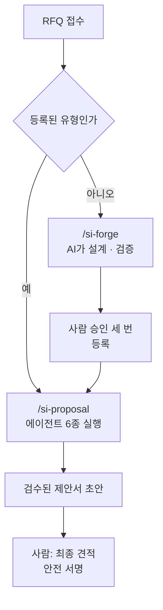
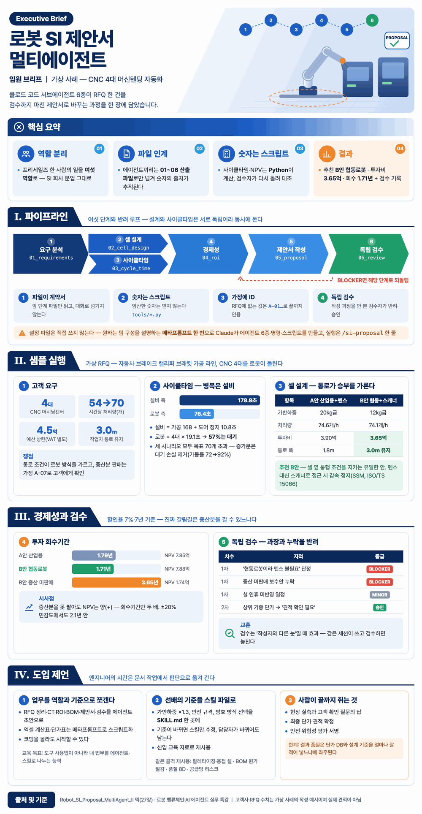
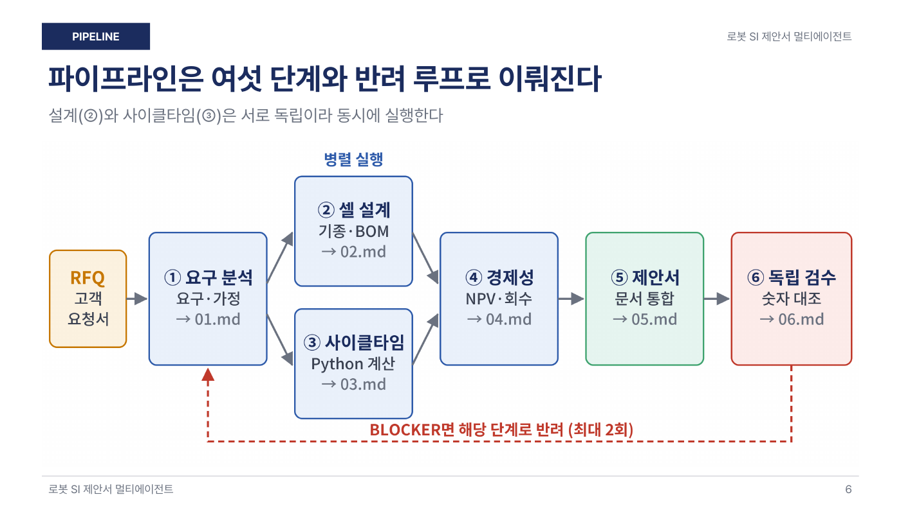
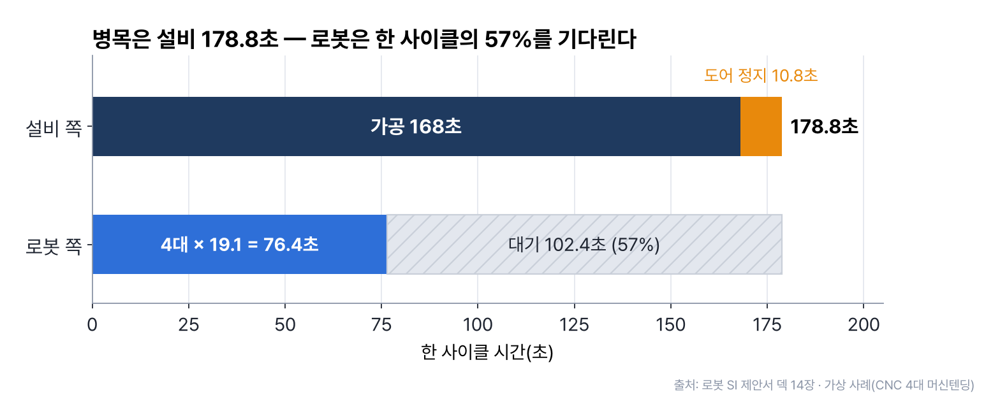
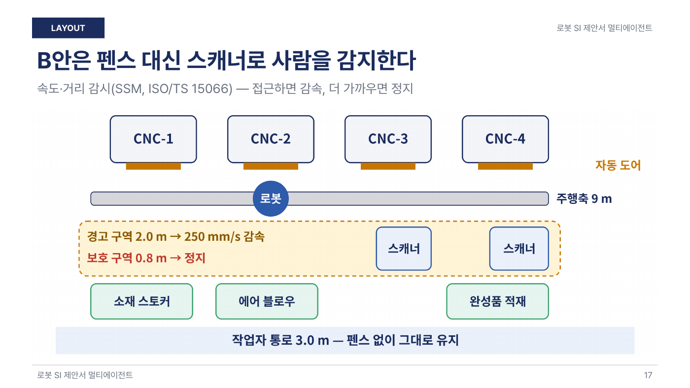
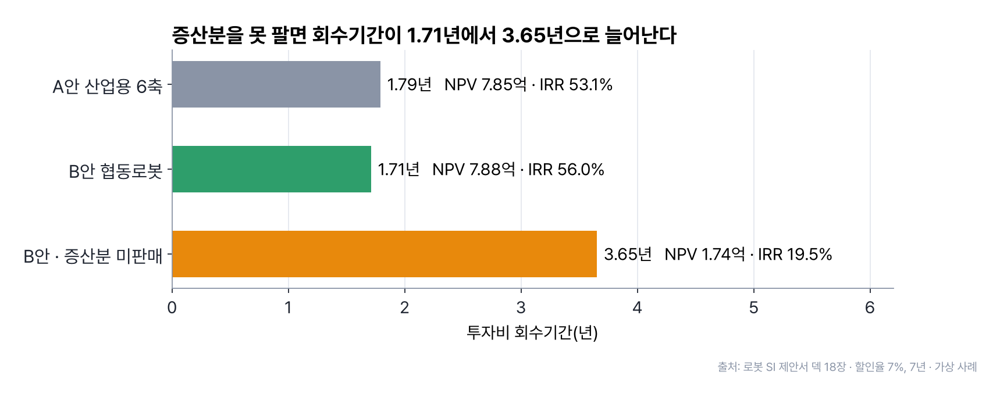
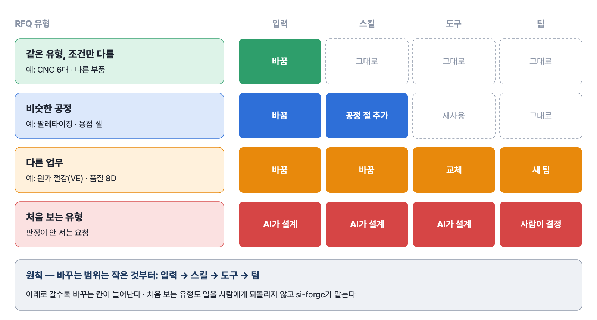
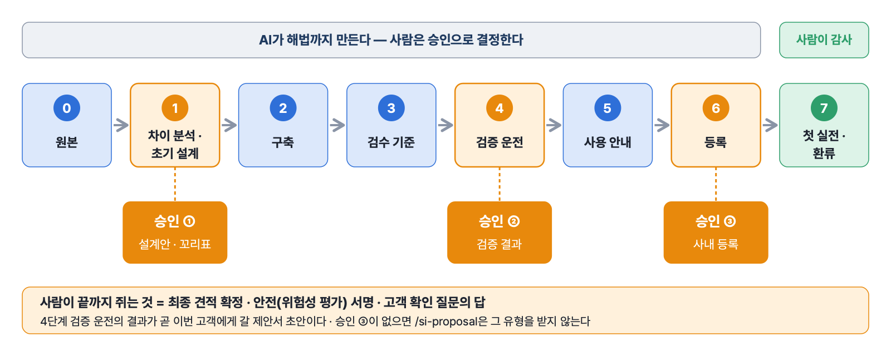
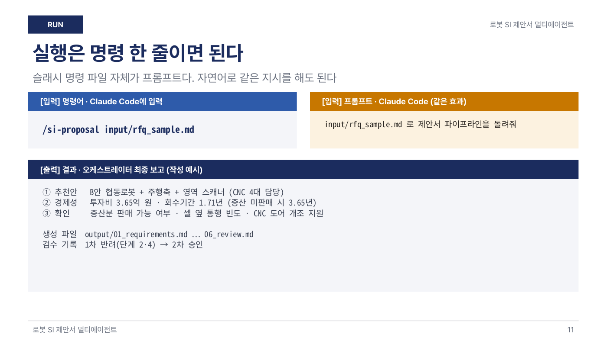

# 12장 로봇과 스마트팩토리 특강 — SI 제안과 새 유형 대응

> **이 장의 한 줄**
> 로봇 셀 SI 회사의 제안 업무를 **에이전트 6종**으로 나눠 RFQ에서 검수된 제안서까지 만들고, 처음 보는 유형의 RFQ가 와도 **si-forge**로 AI가 해법까지 설계 · 검증하게 한다. 사람은 승인 세 번과 최종 견적 · 안전 서명, 즉 **결정과 감사**만 맡는다.

## 이 장에서 배우는 것

1. SI와 RFQ가 무엇이고, 로봇 셀 제안서가 답해야 할 네 가지 질문이 무엇인지 안다.
2. 한 사람의 프리세일즈 업무를 에이전트 여섯 역할로 나누는 방법과, 결과를 믿을 수 있게 만드는 원칙 네 가지를 설명할 수 있다.
3. 가상 사례(CNC 4대 머신텐딩)의 숫자를 읽고, 추천안이 어떻게 정해졌는지 따라갈 수 있다.
4. 처음 보는 유형의 RFQ를 si-forge로 넓히는 여덟 단계와 승인 세 번, 출처 꼬리표 다섯 가지를 안다.
5. si-forge가 course-forge와 같은 틀(원본 → 승인 → 검증 → 스킬)이라는 점을 설명할 수 있다.

## 큰 그림



같은 유형의 RFQ는 등록된 제안 팀(`/si-proposal`)이 바로 처리한다. 처음 보는 유형이면 si-forge가 팀을 넓혀 새 유형으로 등록하고, 그다음부터는 같은 유형을 자동으로 처리한다. 이번 RFQ의 제안서 초안은 si-forge의 검증 운전에서 함께 나오므로 고객을 기다리게 하지 않는다.



*그림 12-1. 이 장 1~3절을 한 장에 담은 임원 브리프. 파이프라인 · 샘플 실행 · 경제성과 검수 · 도입 제언 순서로 읽는다. 고객사 · 수치는 가상 사례다. 출처: 3-1B Robot_Special/01 Robot_SI_Proposal_Brief.png.*


---

## 1. 로봇 SI와 제안 업무

### 1.1 SI는 로봇 제조사와 공장 사이에 있다

**SI**(System Integration, 시스템 통합)는 로봇 본체를 사서 공장에 맞는 작업 셀(로봇 · 주변장치 · 안전장치를 묶은 작업 단위)로 설계 · 제작 · 설치 · 티칭(로봇에게 동작을 가르치는 일)까지 해 주는 일이다. 로봇 밸류체인에서 위치는 이렇다.

| 층 | 하는 일 | 예 |
|---|---|---|
| 부품 | 로봇 안에 들어가는 핵심 부품 | 감속기 · 서보모터 · 센서 · 그리퍼(로봇 손) |
| 로봇 제조 | 로봇 본체 생산 | 산업용 로봇 · 협동로봇(사람 곁에서 일하도록 만든 로봇) |
| **SI** | 셀 설계 · 제작 · 설치 · 티칭 | 이 장의 주인공 |
| 수요 기업 | 로봇을 들여 쓰는 공장 | 자동차 · 전자 · 물류 공장 |

SI 회사의 일은 고객의 **RFQ**(Request for Quotation, 견적 요청서)를 받는 데서 시작한다. RFQ를 읽고 셀을 설계해 견적과 제안서를 보내는 일을 **프리세일즈**(수주 전 기술 영업)라고 한다. 제안서는 네 가지 질문에 답해야 한다.

| 질문 | 쓰는 지표 |
|---|---|
| 목표 생산량을 맞추는가 | CT(Cycle Time, 제품 하나를 처리하는 데 걸리는 시간) · 처리량 |
| 얼마를 쓰고 언제 회수하는가 | ROI(Return on Investment, 투자 대비 효과) · 회수기간 |
| 공장에서 안전하게 돌아가는가 | 안전 규격 · 위험성 평가 |
| 언제 양산에 들어가는가 | 일정 |

### 1.2 왜 에이전트 팀인가

특강 덱의 첫 메시지는 «업무를 역할로 쪼개면 에이전트 팀이 된다»다. 요구 분석 · 설계 · 계산 · 재무 · 작성 · 검수는 실제 SI 회사의 분업 구조와 같다. 지금은 한 사람의 프리세일즈 엔지니어가 이 여섯 가지를 혼자 하고, 바쁘면 검수를 생략한다. 이 일을 Claude Code의 **서브에이전트**(역할별로 분리된 작업 세션)에게 나눠 맡긴다.

| 구분 | 메인 세션(오케스트레이터) | 서브에이전트 |
|---|---|---|
| 하는 일 | 일을 나누고 순서를 정하고 검수 | 자기 단계 하나만 수행 |
| 정의 위치 | `CLAUDE.md` | `.claude/agents/이름.md` 파일 하나가 에이전트 하나 |
| 맥락 | 전체 흐름 | 자기 입력 파일만 읽음 |
| 도구 권한 | 전체 | md 파일 머리말에서 제한 |

**오케스트레이터**는 지휘자처럼 여러 에이전트에게 일을 나눠 주는 메인 세션이다. 나누는 이유는 두 가지다. 맥락이 짧아져 실수가 줄고, 단계별로 모델과 권한을 다르게 줄 수 있다. 여러 에이전트를 팀으로 굴리는 일반 원리는 [08장 에이전트를 팀으로](08장_에이전트를_팀으로.md)에 있다.

---

## 2. 에이전트 6종으로 제안서 만들기

### 2.1 여섯 역할과 산출 파일

| 에이전트 | 하는 일 | 출력 파일 | 도구 |
|---|---|---|---|
| requirements-analyst | RFQ → 요구 · 가정 표 | 01_requirements | 읽기 · 쓰기 |
| cell-designer | 기종 · 레이아웃 · BOM · 안전 | 02_cell_design | + 웹 검색 |
| cycle-time-engineer | 동작 분해 → CT 계산 | 03_cycle_time | + 명령 실행 |
| roi-analyst | NPV · IRR · 민감도 | 04_roi | + 명령 실행 |
| proposal-writer | 01~04를 묶은 제안서 | 05_proposal | 읽기 · 쓰기 |
| reviewer | 숫자 대조 · 누락 점검 | 06_review | + 명령 실행 |

설계(②)와 사이클타임(③)은 서로 독립이라 동시에 돌린다. 설계 · 작성은 opus, 계산 · 정리는 sonnet처럼 에이전트마다 모델을 다르게 정할 수 있다. BOM(Bill of Materials)은 셀에 들어가는 부품 · 장비 목록이다.



*그림 12-2. RFQ → 요구 분석 → 셀 설계 · 사이클타임(동시 실행) → 경제성 → 제안서 → 독립 검수. 검수에서 BLOCKER가 나오면 해당 단계로 되돌린다(최대 2회). 출처: 로봇 SI 제안서 확장판 덱 6장.*


### 2.2 결과를 믿게 만드는 원칙 네 가지

| 원칙 | 무엇을 | 예 |
|---|---|---|
| 파일이 계약서 | 앞 단계 파일만 읽는다. 대화로 넘기지 않는다 | 01 → 02 → … → 06 |
| 숫자는 스크립트 | 암산한 숫자는 받지 않는다. 파이썬 스크립트로 계산한다 | `cycle_time.py` · `roi.py` |
| 가정에 ID | RFQ에 없는 값은 ID를 붙여 끝까지 인용한다 | A-07 증산 판매 50% |
| 독립 검수 | 작성 과정을 안 본 검수자가 반려 · 승인한다 | BLOCKER → 재작업 |

01~06 산출 파일이 계약서 역할을 해서, 제안서의 어느 숫자가 어디서 왔는지 추적된다. 검수에서 **BLOCKER**(고객에게 나가면 안전 · 계약 · 신뢰에 문제가 되는 결함)가 나오면 그 단계로 되돌린다. **MINOR**는 고치면 좋은 사소한 결함이다.

### 2.3 설정 파일은 직접 쓰지 않는다 — 메타프롬프트

에이전트 파일 여섯 개와 계산 스크립트를 사람이 쓰지 않는다. 원하는 팀 구성을 문장으로 설명하면 Claude Code가 폴더와 파일 일체를 만든다. 이렇게 «무엇을 만들지 설명하는 프롬프트»를 **메타프롬프트**라고 한다.

```text
로봇 셀 SI 제안서를 만드는 멀티에이전트
프로젝트를 이 폴더에 만들어줘.
- 에이전트 6종을 .claude/agents/ 에:
  요구분석, 셀설계, 사이클타임, 경제성,
  제안서 작성, 독립 검수
- 각 단계는 output/ 파일로만 넘긴다
- 사이클타임·NPV는 tools/ 의 Python
  스크립트로 계산한다
- RFQ에 없는 값은 가정 ID(A-01…)로 관리
- 검수에서 BLOCKER면 그 단계로 되돌린다
- /si-proposal 슬래시 명령도 만들어줘
```

결과로 `CLAUDE.md`(오케스트레이터) · 에이전트 md 6개 · `/si-proposal` 명령 파일 · `tools/cycle_time.py` · `roi.py`가 생긴다. **슬래시 명령**은 입력칸에 `/이름`을 치면 미리 적어 둔 지시가 실행되는 단축 명령이다. 실행은 `/si-proposal input/rfq_sample.md` 한 줄이고, 자연어로 «input/rfq_sample.md 로 제안서 파이프라인을 돌려줘»라고 해도 같다.

- **사람이 할 일**: 생성된 파일을 읽고 고칠 점을 다시 지시하기, 샘플 RFQ로 한 번 돌려 보기, 결과 판단
- **Claude Code가 할 일**: 폴더 · 에이전트 · 스크립트 생성, 파이프라인 실행, 반려 시 재작업

---

## 3. 가상 사례 — CNC 4대 머신텐딩

### 3.1 고객의 요청

덱의 사례는 **가상 고객사**의 자동차 브레이크 캘리퍼 브래킷 가공 라인이다. 사람 손 대신 로봇으로 CNC(컴퓨터 수치 제어 공작기계) 4대를 돌리려 한다. 공작기계에 소재를 넣고 빼는 일을 로봇이 맡는 것을 **머신텐딩**(machine tending)이라고 한다.

| 조건 | 값(가상) |
|---|---|
| 설비 | CNC 머시닝센터 4대, 가공 168초/개 |
| 시간당 처리량 | 현재 54개 → 목표 70개 |
| 예산 상한 | 4.5억 원(VAT 별도) |
| 작업자 통로 | 3.0 m, 셀 옆 통행 유지 |

요구 분석 에이전트가 짚은 쟁점은 두 가지다. 통로를 막지 않아야 한다는 조건(RFQ §4)이 로봇 방식 선택을 가른다. 증산분을 팔 수 있는지는 RFQ에 없으므로 가정 A-07로 두고 고객 확인 질문에 올렸다.

### 3.2 병목은 로봇이 아니라 설비다

**병목**은 전체 속도를 정하는 가장 느린 단계다. 처리량은 설비와 로봇 중 느린 쪽이 정한다.

| 쪽 | 한 사이클 시간 | 해석 |
|---|---|---|
| 설비 | 가공 168초 + 도어가 열려 멈춘 시간 10.8초 = 178.8초 | 병목 |
| 로봇 | CNC 4대 × 19.1초 = 76.4초 | 57% 놀고 있다 |

그래서 로봇 속도는 처리량에 거의 영향이 없다. 세 시나리오 모두 목표 70개를 넘고, 증가분은 대기 손실 제거(가동률 72% → 92%)에서 나온다. 작업자 접근으로 로봇이 계속 감속해도 시간당 72.4개다.



*그림 12-3. 설비 쪽 178.8초(가공 168 + 도어 정지 10.8)가 로봇 쪽 76.4초보다 길어 병목은 설비다. 로봇은 한 사이클에서 102.4초(57%)를 기다린다. 출처: 로봇 SI 제안서 덱 14장, 가상 사례.*


### 3.3 두 안의 성능은 같고, 통로 조건이 승부를 가른다

셀 설계 에이전트가 두 대안을 냈다. **가반하중**(로봇이 들 수 있는 최대 무게)은 «(부품 3.2 kg + 그리퍼 4.0 kg) × 1.3 = 9.4 kg 이상»으로 잡았다.

| 항목 | A안 산업용 6축 + 펜스 | B안 협동로봇 + 스캐너 |
|---|---|---|
| 가반하중 | 20 kg급 ≥ 9.4 kg | 12 kg급 ≥ 9.4 kg(여유 작음) |
| 처리량 | 74.6개/h | 74.1개/h |
| 투자비 | 3.90억 | 3.65억 |
| 통로 폭 | 1.8 m | 3.0 m 유지 |

추천은 B안이다. RFQ §4 «셀 옆 통행» 조건을 지키는 유일한 안이기 때문이다. B안은 펜스 대신 영역 스캐너로 사람을 감지하는 **SSM**(Speed and Separation Monitoring, 속도 · 거리 감시) 방식을 쓴다. 사람이 다가오면 감속하고, 더 가까우면 정지한다. 근거 표준은 협동로봇 안전 기술 사양인 ISO/TS 15066이다.



*그림 12-4. B안 배치. 로봇이 주행축 9 m를 따라 CNC 4대를 돌고, 경고 구역 2.0 m에서 감속 · 보호 구역 0.8 m에서 정지하며, 작업자 통로 3.0 m는 펜스 없이 그대로 남는다. 출처: 로봇 SI 제안서 확장판 덱 17장.*


### 3.4 경제성 — 진짜 갈림길은 증산분 판매 여부

재무 에이전트는 할인율 7%, 7년으로 계산했다. 처음 보는 지표는 이렇다.

- **NPV**(Net Present Value, 순현재가치): 앞으로 생길 효과를 할인율로 지금 가치로 바꿔 투자비를 뺀 값. 양(+)이면 남는 투자다.
- **IRR**(Internal Rate of Return, 내부수익률): NPV를 0으로 만드는 할인율. 높을수록 좋다.
- **회수기간**: 투자비를 연 순효과로 되찾는 데 걸리는 기간.
- **CAPEX**(Capital Expenditure): 설비 투자비.

| 대안 | 투자비 | 연 순효과 | NPV | IRR | 회수 |
|---|---|---|---|---|---|
| A안 산업용 | 3.90억 | 2.18억 | 7.85억 | 53.1% | 1.79년 |
| B안 협동로봇 | 3.65억 | 2.14억 | 7.88억 | 56.0% | 1.71년 |
| B안 증산 미판매 | 3.65억 | 1.00억 | 1.74억 | 19.5% | 3.65년 |

**민감도 분석**(입력값을 흔들어 결과가 얼마나 바뀌는지 보는 분석)에서 주요 값을 ±20% 흔들어도 회수기간은 2.1년 안이었고, CAPEX가 가장 크게 흔들었다. 진짜 갈림길은 ±20%가 아니라 증산분을 팔 수 있느냐(1.71년 ↔ 3.65년)다. 증산분을 못 팔아도 NPV는 양(+)이고 회수기간만 두 배로 늘어난다. 그래서 이 값은 가정 A-07로 끝까지 따라다니며 고객 확인 질문에 오른다.



*그림 12-5. A안 1.79년 · B안 1.71년은 거의 같고, 증산분을 못 팔면 B안 회수기간이 3.65년으로 두 배가 된다(NPV는 여전히 양수). 할인율 7%, 7년. 출처: 로봇 SI 제안서 덱 18장, 가상 사례.*


### 3.5 독립 검수가 잡은 것

reviewer는 작성 과정을 보지 않고 RFQ · 산출물 · 스크립트만 대조한다. 덱의 검수 루프 작성 예시는 이렇다.

| 차수 | 지적 | 등급 | 조치 |
|---|---|---|---|
| 1차 | «협동로봇이라 펜스 불필요» 단정 | BLOCKER | ② 재실행 — 위험성 평가 문구 · 예비비 |
| 1차 | 증산 미판매 보수안 누락 | BLOCKER | ④ 재실행 — 보수 시나리오 추가 |
| 1차 | 설 연휴 미반영 일정 | MINOR | ⑤ 반영 |
| 2차 | 상위 기종 단가 추정치 단정 | MINOR | ⑤ «견적 확인 필요»로 수정 → 승인 |

최종 보고는 «B안 협동로봇 + 주행축 + 영역 스캐너, 투자비 3.65억 원 · 회수기간 1.71년(증산 미판매 시 3.65년), 1차 반려(단계 2 · 4) → 2차 승인»이다. 교훈은 하나다. 검수 에이전트는 «작성자와 다른 눈»일 때 효과가 난다. 같은 세션이 쓰고 검수하면 놓친다.[^ra]

### 3.6 선배의 기준이 스킬 파일이 된다

여러 에이전트가 함께 펼쳐 보는 업무 기준서를 **스킬**로 둔다. 서브에이전트가 «누가»라면 스킬은 «무엇을 기준으로»다. 덱의 예시 `si-design-standards` 스킬에는 «가반하중 = (부품 + 그리퍼) × 1.3 이상, 여유 1.3~1.5배면 ‹여유 작음› 표시», «사람 접근 시 ISO/TS 15066 적용 여부를 위험성 평가로 결정», «금지 표현: 협동로봇이라 펜스 불필요», «통로 확보가 요구되면 스캐너 + SSM» 같은 줄이 들어 있다. 말로 전하던 기준이 파일 한 곳에 모이면 기준 변경은 스킬만 고치면 되고, 담당자가 바뀌어도 기준은 남고, 신입 교육 자료로도 다시 쓴다.

---

## 4. 처음 보는 유형의 RFQ — si-forge

### 4.1 유형부터 판정한다

같은 골격(분석 → 설계 · 계산 → 재무 → 작성 → 검수)은 그대로 두고, RFQ 유형에 따라 바꾸는 범위만 달라진다.

| RFQ 유형 | 예 | 바꿀 부분 |
|---|---|---|
| 같은 유형, 조건만 다름 | CNC 6대 · 다른 부품 | 없음 — 그대로 실행 |
| 비슷한 공정 | 팔레타이징 · 용접 셀 | 스킬 공정 절 추가 · 도구 재사용 |
| 다른 업무 | 원가 절감(VE) · 품질 8D | 설계 · 도구 교체 → 새 팀 구성 |
| 처음 보는 유형 | 판정이 안 서는 요청 | AI가 설계 → 사람이 결정 |

**팔레타이징**은 박스를 팔레트 위에 규칙대로 쌓는 공정이다. **VE**(Value Engineering, 가치공학)는 기능은 유지하며 원가를 줄이는 활동이고, **8D**(8 Disciplines)는 품질 문제를 여덟 단계로 근본원인까지 풀어 보고하는 방식이다. 원칙은 «바꾸는 범위는 작은 것부터», 즉 입력 → 스킬 → 도구 → 팀 순서로 넓힌다.



*그림 12-6. 같은 유형이면 입력만, 비슷한 공정이면 스킬까지, 다른 업무면 도구와 팀까지 바꾼다. 처음 보는 유형은 AI가 설계하고 사람이 결정한다. 출처: 로봇 SI 제안서 확장판 덱 23장.*


### 4.2 AI가 해법까지, 사람은 결정과 감사

**si-forge**는 제안 팀이 처음 보는 유형의 RFQ(예: 팔레타이징 셀 · 용접 셀 · 원가 절감 VE)를 받았을 때 쓰는 스킬이다. 새 유형이 와도 일을 사람에게 되돌리지 않는다. 핵심 원칙은 한 문장이다.

> **AI가 해법까지 만들고, 사람은 결정과 감사만 한다.**

AI가 공학 원리와 검색으로 설계 기준 · 계산 도구를 처음부터 세운다. 회사의 과거 제안서나 단가표는 **전제 조건이 아니라 보정 수단**이다. 있으면 대조해 회사 기준으로 덮어쓰고, 없어도 진행한다. 사람이 «직접 써 주세요»라는 일을 받지 않으며, 막히면 AI가 대안 2~3개와 근거를 만들어 고르게 한다. 기본 사용자는 개발자가 아니라 프리세일즈 · 설계 엔지니어이고, 사용자에게 터미널 명령을 치게 하지 않는다.

| 사람이 할 일(결정과 감사) | AI가 할 일(해법) |
|---|---|
| 승인 게이트 세 번에서 판단하기 | 새 RFQ 분석, 필요한 지식 목록 |
| 최종 견적 확정 · 안전(위험성 평가) 서명 | 공학 원리 · 검색으로 초기 설계안 |
| 고객 확인 질문의 답 받아 오기 | 스킬 절 · 계산 도구 · 검수 기준 구축 |
| 첫 실전 2~3건 감사하기(다시 쓰지 않는다) | 독립 재계산 · 범위 점검 · 이번 제안서 초안 |
| 사내 자료가 있으면 건네기 | 기밀 점검 · 등록 · 개정 이력 |

### 4.3 출처 꼬리표 — 지어내지 않되, 처음부터 설계한다

AI가 처음부터 설계하면 «이 숫자를 믿어도 되나»가 문제다. si-forge는 모든 기준 · 수치에 **출처 꼬리표**를 붙이고, 꼬리표 없는 줄은 쓰지 않는다.

| 꼬리표 | 뜻 | 예 |
|---|---|---|
| `[원리]` | 일반 공학 원리(AI 전문성으로 바로 쓴다) | 병목 · 가반하중 · NPV · 레이아웃 원칙 |
| `[표준]` | 표준 요약(원문 확인 필요) | 안전 규격 |
| `[제조사]` | 제조사 사양 URL | 협동로봇 팔레타이저 정격 사례 |
| `[사내]` | 회사 데이터 | 실제 매입 단가 · 마진 정책 · 과거 클레임 |
| `[가정 A-xx]` | 확인 전 값 | 사내 데이터가 비어 있는 칸 |

구체 수치(정격 · 단가 · 조항 번호)는 기억으로 단정하지 않고 검색으로 출처를 붙이거나 가정으로 둔다. 책임이 걸린 최종 견적 · 위험성 평가 서명 · 계약 조건은 «사람 결정»으로 따로 표시한다. 실전을 거치며 `[원리]` · `[가정]` 꼬리표가 `[사내]`로 바뀌어 간다. SKILL.md의 표현을 빌리면 «AI는 박사급 설계자로 시작하고, 회사 데이터는 그 설계자를 우리 회사 사람으로 만든다.»

### 4.4 여덟 단계와 승인 세 번

| 단계 | 하는 일 | 사람 |
|---|---|---|
| 0 원본 | 새 RFQ를 읽고 필요한 지식을 원리 · 검색 · 사내 · 사람으로 나눈다 | (있으면) 사내 자료 건네기 |
| 1 차이 분석 · 초기 설계 | 골격 단계마다 그대로/수정/신규 판정 + AI 설계안 + 꼬리표 | **승인 ①** |
| 2 구축 | 스킬 공정 절 · 계산 도구 · (필요 시) 에이전트, 회귀 점검 | — |
| 3 검수 기준 | 이 유형의 BLOCKER · MINOR 판정 규칙 | — |
| 4 검증 운전 | 이번 RFQ 실행 · 독립 재계산 · 범위 점검 · (있으면) 과거 대조 | **승인 ②** |
| 5 사용 안내 | 등록 유형 목록 항목 · 고객 확인 질문 목록 | — |
| 6 등록 | 기밀 점검 후 사내 비공개 저장소에 v1 등록 | **승인 ③** |
| 7 첫 실전 · 환류 | 첫 2~3건 감사, 반복 수정을 기준으로, 꼬리표를 `[사내]`로 | 감사하기 |



*그림 12-7. AI가 단계 0~6에서 해법을 만들고, 사람은 차이 분석(①) · 검증 결과(②) · 등록(③)에서 승인하고 첫 실전을 감사한다. 그림 11-5의 course-forge와 같은 틀이다. 출처: si-forge SKILL.md.*


몇 가지 말을 풀어 둔다.

- **회귀 점검**: 새 유형을 붙인 뒤 기존 샘플 RFQ를 다시 돌려 기존 유형의 결과(추천안 · 투자비 · 회수기간)가 바뀌지 않았는지 보는 일이다. 다르면 고친 곳을 되돌린다.
- **검증 운전**: 넓힌 팀으로 이번 RFQ를 실제로 돌려 숫자를 확인하는 단계다. 이 결과가 곧 이번 고객에게 갈 제안서 초안이다.
- **등록 유형 목록(`types.md`)**: `/si-proposal`이 받는 유형의 표다. 승인 ③이 없으면 `/si-proposal`은 그 유형을 받지 않는다. 사용자가 답하지 않아도 등록하지 않고 멈춘다.
- **환류**: 실전에서 고친 내용을 기준으로 되돌려 반영하는 일이다. 연속 2건이 수정 없이 나가면 검토 수준을 낮출지 사용자가 정한다.

승인 질문에는 근거를 붙인다. SKILL.md의 예는 이렇다. «과거 RFQ 2건 모두 투자비가 실제 제안서와 ±3% 안(3.12억 vs 3.05억). 이대로 등록할까요?»

### 4.5 검증 네 겹 — 과거 이력이 없어도 확인한다

| 겹 | 하는 일 | 데이터 필요 |
|---|---|---|
| 1 도구 손계산 | 손계산 사례 한 건으로 새 계산 도구를 돌려 같은지 본다 | 없음 |
| 2 독립 재계산 | 검수자가 핵심 수치를 다른 방법으로 다시 계산한다(사이클타임: 동작 분해 ↔ 제조사 공개 사례, 회수기간: 스크립트 ↔ 투자비 ÷ 연 순효과) | 없음 |
| 3 물리 · 상식 범위 점검 | 가동률 100% 초과, 가반하중 여유 1.0 미만, 음수 회수기간, 도달 거리 밖 배치를 잡는다 | 없음 |
| 4 과거 대조 | 과거 RFQ 1~3건을 돌려 실제 제안서와 비교하고, 어긋나면 원인을 적는다(판단은 사람) | 있으면 |

결과는 **정답지**(golden, 기준값 파일)와 대조 스크립트로 확인하고, 등록 직전에는 기밀 점검 스크립트로 비밀값 · 개인정보가 0건인지, 고객사명 · 단가가 어디에 노출되는지 보고한다.[^script]

### 4.6 course-forge와 같은 틀

si-forge는 Day6의 course-forge(강의를 만드는 스킬)와 **같은 틀 — 원본 → 승인 → 검증 → 스킬** — 로, 강의 대신 업무 팀을 넓힌다. course-forge는 [11장 나만의 AI 업무시스템](11장_나만의_AI_업무시스템.md)에서 다룬다.

| 단계 | course-forge (강의 만들기) | si-forge (업무 팀 만들기) | 승인 |
|---|---|---|---|
| 0 원본 | 덱 · 데이터 · 정답 메모 | 공학 원리 · 검색 + 사내 데이터(있으면) | — |
| 1 커리큘럼 | 블록 표 | 차이 분석 · AI 초기 설계안 | ① |
| 2 · 3 수업 · 퀴즈 | 블록 · 판단형 퀴즈 | 에이전트 · 스킬 · 반려 기준 | — |
| 4 실습 MVP | 정답 재실행 · 수치 대조 | 독립 재계산 · 범위 점검 | ② |
| 6 · 7 배포 · 공유 | 공개 저장소 · 동료 수강 | 사내 비공개 등록 · 첫 실전 | ③ |

두 스킬은 산출물로도 이어진다. 등록된 유형의 스킬 절과 검증 대조표를 course-forge의 원본으로 넘기면 신입 교육 강의(`learn-si-<유형>`)가 된다. 검증 운전 RFQ가 실습이 되고, 대조표 숫자가 정답이 되고, 검수 반려 사례가 판단형 퀴즈가 된다. 사내 기준 · 견적이 담기므로 이 강의는 회사 승인 아래 비공개 저장소에 둔다.

> **초안이다**
> si-forge는 «원본과 섞지 않은 확장판» 초안이다. 검수 스크립트 두 개는 문법 점검과 견본 입력으로만 시험했고, 실제 과거 제안서로는 아직 돌려 보지 않았다. 또 이 스킬은 SI 제안 팀 프로젝트(에이전트 6종 · 계산 도구 · 샘플 RFQ) 폴더 안에서 돌므로, 2.3절의 메타프롬프트로 그 팀을 먼저 만들어야 한다.

---

## 실습 길잡이

| 순서 | 3-1B 폴더 | 난이도 | 할 일 |
|---|---|---|---|
| 1 | [01 로봇SI 멀티에이전트 제안서](../보충교재/Robot_Special/01_로봇SI_멀티에이전트_제안서/) | 2단계 | 임원 브리프 한 장 → 모션 강의 영상 → 제안서 덱 2판(27장) 읽기 |
| 2 | 같은 폴더의 [확장판 덱](../보충교재/Robot_Special/01_로봇SI_멀티에이전트_제안서/Robot_SI_Proposal_MultiAgent_확장판.pdf) | 2단계 | 23장(유형 판정) · 24장(course-forge 연결)까지 29장 |
| 3 | 2.3절 메타프롬프트로 내 SI 제안 팀 만들기 → 샘플 RFQ로 한 번 실행 | 2단계 | 생성 파일을 읽고 고칠 점을 말로 지시 |
| 4 | [02 si-forge 새유형 RFQ 대응스킬](../보충교재/Robot_Special/02_si-forge_새유형RFQ_대응스킬/si-forge.zip) | 3단계 | [README](../보충교재/Robot_Special/02_si-forge_새유형RFQ_대응스킬/si-forge.zip) → [SKILL.md](../보충교재/Robot_Special/02_si-forge_새유형RFQ_대응스킬/si-forge.zip) 읽기 |

si-forge 폴더 설치와 실행은 Claude Code에게 맡긴다. si-forge는 시작할 때 새 RFQ 파일 위치를 묻고, 등록 유형 목록과 대조해 정말 새 유형인지 먼저 판정한다. 등록 유형이면 «/si-proposal 로 바로 돌리면 됩니다»라고 알리고 멈춘다. 끊겨도 진행 상태 파일(`forge/<유형>/status.md`)을 읽고 이어 간다.

**대표 프롬프트 — 제안 팀 실행**(슬래시 명령과 같은 효과)

```text
input/rfq_sample.md 로 제안서 파이프라인을 돌려줘
```



*그림 12-8. 슬래시 명령 한 줄이나 같은 뜻의 문장 한 줄로 실행하면, 오케스트레이터가 추천안 · 경제성 · 확인 항목과 검수 기록을 보고한다(작성 예시). 출처: 로봇 SI 제안서 확장판 덱 11장.*


## 자동차 현장에 옮기기

특강 덱이 제시한 확장 방향을 부서별로 정리했다. 에이전트 골격은 그대로 두고 입력과 계산 도구만 바꾼다.

| 부서 | 업무 | 바꿀 부분 | 계산 도구 |
|---|---|---|---|
| 생산기술 | 팔레타이징 · 용접 셀 제안 | 동작 분해 예시 | `cycle_time.py` 재사용 |
| 구매 · 원가 | BOM 원가 절감(VE) | 설계 → 대체 소싱 탐색 | 원가 모델 |
| 품질 | 품질 8D 리포트 | 설계 → 근본원인 분석 | 불량 통계 |
| 구매 · 전략 | 공급망 리스크 | RFQ → 뉴스 · 공급사 DB | 노출도 점수 |
| 프리세일즈 | RFQ 정리 · CT · ROI · 제안서 · 검수 | 엑셀 계산표 · 단가표를 메타프롬프트로 스크립트와 스킬로 | 단가 DB |

어느 업무든 사람이 계속 쥐는 것은 같다. 고객 확인 질문의 답, 최종 단가 견적, 안전 위험성 평가 서명, 현장 실측과 고객 관계다. 덱이 밝힌 한계도 함께 기억한다. 결과 품질은 단가 DB와 설계 기준을 얼마나 잘 적어 넣느냐에 좌우된다. 스마트팩토리 설비 쪽 이야기는 [09장 스마트팩토리와 예지보전](09장_스마트팩토리와_예지보전.md)에 있다.

## 정리

1. SI는 로봇 본체를 공장에 맞는 셀로 통합하는 일이고, 제안서는 생산량 · 투자 회수 · 안전 · 일정 네 질문에 답한다.
2. 제안 업무를 에이전트 6종으로 나누고, 파일로만 넘기고, 숫자는 스크립트로 내고, 가정에 ID를 붙이고, 작성자와 다른 눈이 검수한다.
3. 가상 CNC 4대 사례에서 병목은 설비였고, 통로 조건이 B안 협동로봇을 골랐으며, 진짜 갈림길은 증산분 판매 여부(1.71년 ↔ 3.65년)였다.
4. 처음 보는 유형은 si-forge가 AI 설계 → 독립 검증 → 사내 데이터 보정 → 승인 세 번으로 등록하고, 모든 기준에 출처 꼬리표를 단다.
5. si-forge는 course-forge와 같은 틀이며, 등록된 유형은 다시 course-forge로 신입 교육 강의가 된다.

## 확인 문제

1. 가상 사례에서 로봇을 더 빠른 기종으로 바꾸면 처리량이 크게 늘까? 숫자로 답하라.

> **답**
> 늘지 않는다. 설비 쪽 한 사이클이 178.8초(가공 168 + 도어 정지 10.8)이고 로봇 쪽은 76.4초(4대 × 19.1)라 병목은 설비다. 로봇은 57% 놀고 있으므로 로봇 속도는 처리량에 거의 영향이 없다. 처리량 증가는 대기 손실 제거(가동률 72% → 92%)에서 나온다.

2. A안의 가반하중 여유가 더 큰데도 B안을 추천한 이유는?

> **답**
> 두 안의 처리량(74.6 대 74.1개/h)은 거의 같고, RFQ §4의 «셀 옆 통행 유지» 조건을 지키는 안은 통로 3.0 m를 유지하는 B안뿐이다. B안은 펜스 대신 스캐너와 SSM(속도 · 거리 감시)으로 사람을 감지한다. 투자비도 B안이 3.65억으로 낮다.

3. 1차 검수에서 «협동로봇이라 펜스 불필요»라는 문장이 BLOCKER로 반려된 이유와 조치는?

> **답**
> 협동로봇이라도 사람 접근 시 안전 규격 적용 여부는 위험성 평가로 결정해야 하는데, 이를 거치지 않고 단정했기 때문이다. 고객에게 나가면 안전 문제가 된다. 셀 설계 단계(②)를 다시 돌려 위험성 평가 문구와 예비비를 넣었다. 이 문장은 스킬의 «금지 표현»으로 올라갔다.

4. si-forge에서 회사의 과거 제안서가 하나도 없으면 어떻게 진행하는가?

> **답**
> 멈추지 않는다. 과거 이력은 전제가 아니라 보정 수단이다. AI가 공학 원리 `[원리]`와 검색 `[표준]` `[제조사]`로 설계하고, 비어 있는 회사 값은 `[가정 A-xx]`로 두어 고객 확인 질문 · 공급사 견적 요청으로 돌린다. 검증은 도구 손계산 · 독립 재계산 · 물리 범위 점검 세 겹으로 하며, 과거 대조는 자료가 있을 때만 더한다.

5. si-forge와 course-forge의 공통 틀은 무엇이고, «배포» 단계에서 가장 크게 다른 점은?

> **답**
> 공통 틀은 원본 → 승인 → 검증 → 스킬이고, 승인도 둘 다 세 번이다. course-forge는 완성된 강의를 공개 저장소와 GitHub Pages로 배포해 동료가 수강하게 하지만, si-forge는 사내 기준 · 단가가 담기므로 기밀 점검 뒤 사내 비공개 저장소에 등록하고 공개 저장소에는 올리지 않는다.

## 더 보기

- 관련 장: [08장 에이전트를 팀으로](08장_에이전트를_팀으로.md) · [09장 스마트팩토리와 예지보전](09장_스마트팩토리와_예지보전.md) · [11장 나만의 AI 업무시스템](11장_나만의_AI_업무시스템.md) · [부록B 용어집](부록B_용어집.md)
- 원자료: [로봇SI 제안서 폴더](../보충교재/Robot_Special/01_로봇SI_멀티에이전트_제안서/) · [제안서 덱 2판](../보충교재/Robot_Special/01_로봇SI_멀티에이전트_제안서/Robot_SI_Proposal_MultiAgent_II.pdf) · [확장판 덱](../보충교재/Robot_Special/01_로봇SI_멀티에이전트_제안서/Robot_SI_Proposal_MultiAgent_확장판.pdf) · [임원 브리프](../보충교재/Robot_Special/01_로봇SI_멀티에이전트_제안서/Robot_SI_Proposal_Brief.png) · [모션 강의 영상](../보충교재/Robot_Special/01_로봇SI_멀티에이전트_제안서/Robot_SI_Proposal_MotionLecture.mp4)
- si-forge: [README](../보충교재/Robot_Special/02_si-forge_새유형RFQ_대응스킬/si-forge.zip) · [SKILL.md](../보충교재/Robot_Special/02_si-forge_새유형RFQ_대응스킬/si-forge.zip) · [1단계 차이 분석 지시서](../보충교재/Robot_Special/02_si-forge_새유형RFQ_대응스킬/si-forge.zip) · [4단계 검증 운전 지시서](../보충교재/Robot_Special/02_si-forge_새유형RFQ_대응스킬/si-forge.zip)
- 같은 틀의 강의 버전: [course-forge 확장판 덱(51장 «응용: 업무 팀 만들기»)](../보충교재/Day6_최종프로젝트/06_커리큘럼만드는스킬/최종패키지/1_Day5_Course_Forge/Course_Forge_Lecture_IV_확장판.pdf)

[^ra]: 덱의 ROI 식에서 L은 절감 인원, w는 1인 인건비, ΔN은 증산 판매량, m은 개당 공헌이익, M은 유지보수비다. 최종 보고의 확인 항목은 세 가지다. 증산분 판매 가능 여부 · 셀 옆 통행 빈도 · CNC 도어 개조 지원.

[^script]: `golden_compare.py`는 핵심 수치가 기준값과 허용 오차 안인지, 필수 항목(위험성 평가 · 보수 시나리오 · 고객 확인 질문 등)이 빠지지 않았는지 본다. `confidential_check.py`는 등록 직전에 돈다. 받은 사내 자료는 데이터로만 다루고 안의 매크로 · 스크립트를 실행하지 않으며, 고객사 이름 · 실제 단가가 담긴 자료는 접근을 좁힌 제작 기록 폴더에만 둔다.
