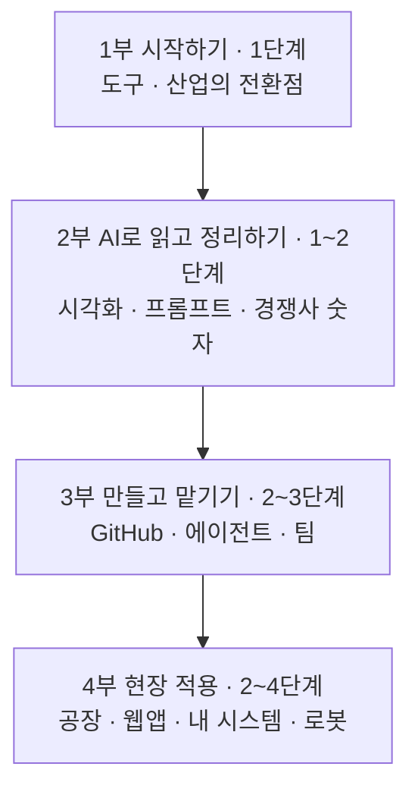

# 자동차 산업과 생성형 AI — Claude Code로 일하는 법

> **이 책**
> 3-1 과정의 보조자료(3-1B)를 처음 보는 자동차 업계 실무자가 혼자 읽고 따라 할 수 있게 엮은 교과서다. 코드를 몰라도 된다. 사람은 프롬프트를 붙여 넣고 결과를 확인하며, 설치 · 코드 · 오류 수정은 Claude Code가 한다. 장마다 끝에 3-1B 실습 폴더로 바로 넘어가는 «실습 길잡이»가 있다.

## 읽는 순서

처음이면 1장부터 차례로 읽는다. 장 순서는 실습 난이도 순서다 — 1부는 읽고 보는 1단계, 2부는 채팅 · 스킬 설치 수준의 1~2단계, 3부는 계정 연결 · 자동 실행이 붙는 2~3단계, 4부는 앞 장을 모두 묶는 2~4단계다. 특정 업무가 급하면 아래 «업무별 바로가기»에서 고른다.

## 목차

| 부 | 장 | 난이도 | 다루는 3-1B 자료 |
|---|---|---|---|
| 1부 시작하기 | [1장 AI와 일하는 준비 — Claude · Claude Code · 스킬](01장_AI와_일하는_준비.md) | 1단계 | Day0 01·02 · Day2 01 · Day4 01 |
| | [2장 자동차 산업의 전환점 읽기 — 테슬라 2008 · GM 2009 · BYD](02장_산업의_전환점_읽기.md) | 1단계 | Day1 01 · Day3 01 · 공급망 특강 |
| 2부 AI로 읽고 정리하기 | [3장 데이터를 그림으로 — 스킬 · 인포그래픽 · 대시보드 · 브라우저 자동화](03장_데이터를_그림으로.md) | 1~2단계 | Day2 02~06 |
| | [4장 AI에게 일 잘 시키기 — 프롬프트 · 하네스 · 세컨드 브레인 · RAG](04장_AI에게_일_잘_시키기.md) | 1~2단계(RAG 3단계) | Day4 02~05 |
| | [5장 숫자로 경쟁사 읽기 — 공시 실적 · 자동차 금융 · 지식그래프 · 예측시장](05장_숫자로_경쟁사_읽기.md) | 1~2단계(심화 3~4단계) | Day3 02~06 |
| 3부 만들고 맡기기 | [6장 GitHub로 내 자료 관리하기](06장_GitHub로_내_자료_관리.md) | 2~3단계 | Day0 03~06 |
| | [7장 업무 에이전트 만들기 — 판정 · 메신저 · 메일 · 심사](07장_업무_에이전트_만들기.md) | 2~3단계(텔레그램 4단계) | Day4 07·09·10·12·13·14 |
| | [8장 에이전트를 팀으로 — 역할 분담 · 여러 AI · 시각화 · 투자위원회](08장_에이전트를_팀으로.md) | 2~3단계(역할 분담 팀 4단계) | Day4 08·11 · Day6 02·04·05·09·12 |
| 4부 현장 적용 | [9장 스마트팩토리와 예지보전](09장_스마트팩토리와_예지보전.md) | 1~3단계 | Day5 01~06 |
| | [10장 업무 웹앱 처음부터 끝까지 — 요구사항에서 배포까지](10장_업무_웹앱_처음부터_끝까지.md) | 2~4단계 | Day4 06 · Day6 01·07·10·14·15·16·17 |
| | [11장 나만의 AI 업무 시스템 — 포트폴리오 · SSR+ · 강의 만들기 · 콘텐츠](11장_나만의_AI_업무시스템.md) | 2~3단계 | Day6 03·06·08·11·13 |
| | [12장 로봇과 스마트팩토리 특강 — SI 제안과 새 유형 대응](12장_로봇과_스마트팩토리_특강.md) | 2~3단계 | 로봇 특강 |
| 부록 | [부록 A 이 책 다음 — 16주 자율학습 캠프](부록A_16주_자율학습_캠프.md) | — | 16주 캠프 |
| | [부록 B 용어집](부록B_용어집.md) | — | 12개 장에서 모음 |
| | [부록 C 3-1B 자료 찾아보기 — 폴더 → 장](부록C_자료_찾아보기.md) | — | 3-1B 전체 59개 폴더 |

## 업무별 바로가기

| 이런 일을 하고 싶다면 | 볼 장 |
|---|---|
| AI에게 보고서 · 요약 · 검토를 제대로 시키고 싶다 | [4장](04장_AI에게_일_잘_시키기.md) |
| 경쟁사 실적과 재무를 비교하고 싶다 | [5장](05장_숫자로_경쟁사_읽기.md) |
| 매주 반복되는 메일 · 보고 · 판정을 자동화하고 싶다 | [7장](07장_업무_에이전트_만들기.md) |
| 설비 센서로 고장을 미리 읽고 싶다 | [9장](09장_스마트팩토리와_예지보전.md) |
| 우리 팀이 쓸 작은 웹앱을 만들어 배포하고 싶다 | [10장](10장_업무_웹앱_처음부터_끝까지.md) |
| 여러 AI에게 일을 나눠 맡기고 서로 검토하게 하고 싶다 | [8장](08장_에이전트를_팀으로.md) |
| 내가 만든 앱을 모아 발표하고, 나만의 업무 시스템을 꾸리고 싶다 | [11장](11장_나만의_AI_업무시스템.md) |

## 이 책의 약속

- **원자료에 있는 내용만 쓴다.** 숫자에는 출처와 기준일을 달고, 가상 데이터는 가상이라고 밝힌다.
- **처음 나오는 말은 그 자리에서 푼다.** 같은 말을 [부록 B](부록B_용어집.md)에도 모았다.
- **사람이 할 일과 Claude Code가 할 일을 나눠 쓴다.** 사람은 로그인 · 키 입력 · 화면 확인 · 승인만 한다.
- 난이도는 1~4단계다. 1단계는 보고 읽기 · 채팅, 2단계는 스킬 설치 · 프롬프트 붙여 넣기, 3단계는 계정 연결 · API 키 · 로컬 서버, 4단계는 Docker · 상시 실행 · 여러 에이전트 동시 운영이다. 괄호 안의 높은 단계는 그 장의 심화 실습이라 나중에 돌아와 해도 된다.

기획과 글쓰기 규칙은 [교과서 기획](00_교과서_기획.md)에 있다.
