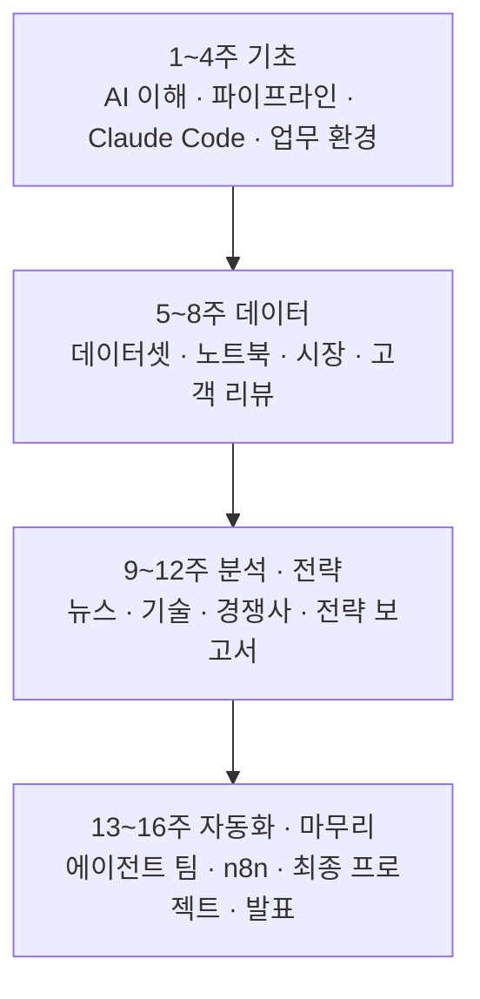

# 부록 A — 이 책 다음: 16주 자율학습 캠프

> **이 부록의 한 줄**
> 이 책은 6일 과정(3-1)을 한 권으로 엮은 것이다. 같은 주제를 16주 동안 혼자 천천히 익히고 싶다면 3-1B의 [자동차AI_자율학습16주캠프](../보충교재/자동차AI_자율학습16주캠프/automotive-ai-camp.zip) 폴더 하나로 이어 갈 수 있다. 이 캠프에서는 교재 대신 Claude 스킬이 수업을 진행한다.

## 1. 무엇이 다른가 — 스킬이 수업을 한다

캠프의 교재는 슬라이드가 아니라 주차마다 하나씩 있는 **스킬(Skill, Claude에게 주는 업무 설명서 파일 `SKILL.md`)**이다. 수강생이 Claude Code에서 그 주의 스킬을 부르면, Claude가 이론 설명 → 실습 안내 → 산출물 만들기를 차례로 진행한다. 이 방식을 캠프에서는 «Skills as Curriculum(스킬이 곧 교육과정)»이라고 부른다.

이 책의 9장에서 본 자율학습 강의 `learn-auto-pdm`, 11장의 강의를 만드는 스킬 `course-forge`와 같은 생각이다. 16주 캠프는 그 방식을 과정 전체로 넓힌 기획판이다.

| 항목 | 내용 |
|---|---|
| 과목명 | 생성형 AI를 활용한 자동차 산업 업무 생산성 향상 |
| 분량 | 3시간 × 16주 = 48시간 (이론 40% · 실습 60%) |
| 대상 | 기획 · 전략 · 영업 · 품질 · 관리 등 비개발 직군 |
| 도구 | Claude Code, Google Workspace, NotebookLM, Google Opal, n8n |

## 2. 16주의 흐름



| 주 | 스킬 | 주제 | 이 책에서 이어지는 장 |
|---|---|---|---|
| 1 | `week01-onboarding` | 생성형 AI와 자동차 산업 이해 | [1장](01장_AI와_일하는_준비.md) · [2장](02장_산업의_전환점_읽기.md) |
| 2 | `week02-pipeline` | AI 업무 생산성 파이프라인 설계 | [4장](04장_AI에게_일_잘_시키기.md) |
| 3 | `week03-claude-code` | Claude Code 기본과 자동차 산업 적용 | [1장](01장_AI와_일하는_준비.md) |
| 4 | `week04-workspace` | Google Workspace 기반 업무 환경 | [7장](07장_업무_에이전트_만들기.md) |
| 5 | `week05-dataset` | 자동차 산업 데이터셋 구축 | [3장](03장_데이터를_그림으로.md) |
| 6 | `week06-notebook` | 데이터 분석 노트북 생성 | [3장](03장_데이터를_그림으로.md) |
| 7 | `week07-market` | 자동차 시장 데이터 분석 | [5장](05장_숫자로_경쟁사_읽기.md) |
| 8 | `week08-voc` | 고객 리뷰(VOC) 분석 자동화 | [4장](04장_AI에게_일_잘_시키기.md) |
| 9 | `week09-notebooklm` | 뉴스 분석 + NotebookLM 지식베이스 | [4장](04장_AI에게_일_잘_시키기.md) |
| 10 | `week10-tech` | 자동차 기술 트렌드 분석 | [2장](02장_산업의_전환점_읽기.md) |
| 11 | `week11-competitor` | 경쟁사 분석 자동화 | [5장](05장_숫자로_경쟁사_읽기.md) |
| 12 | `week12-strategy` | 전략 보고서 + AI 콘텐츠 제작 | [11장](11장_나만의_AI_업무시스템.md) |
| 13 | `week13-agent` | Automotive AI Agent Team 구축 | [8장](08장_에이전트를_팀으로.md) |
| 14 | `week14-n8n` | n8n 업무 자동화 워크플로 | [7장](07장_업무_에이전트_만들기.md) |
| 15 | `week15-project` | 최종 프로젝트 개발 | [10장](10장_업무_웹앱_처음부터_끝까지.md) |
| 16 | `week16-graduation` | 최종 발표와 과정 마무리 | [11장](11장_나만의_AI_업무시스템.md) |

VOC(Voice of Customer)는 고객 리뷰 · 불만 같은 고객의 목소리, n8n은 정해진 시각에 정해진 일을 이어서 하게 만드는 자동화 도구, NotebookLM은 올린 자료만 근거로 답하고 요약하는 Google 도구다.

## 3. 시작하는 법

캠프 폴더의 [START_HERE.md](../보충교재/자동차AI_자율학습16주캠프/automotive-ai-camp.zip)에 준비물 · 설치 · 주차 연결 · 용어가 정리돼 있다. 요점만 옮긴다.

**사람이 할 일**

1. Claude 구독(Pro 이상)으로 데스크톱 앱에 로그인한다.
2. Code 탭 → 새 세션 → 작업 폴더로 캠프 폴더를 고른다.
3. 그 주의 스킬을 부른다. 예: `/week05-dataset` 또는 «5주차 수업을 시작해 줘».

**Claude Code가 할 일** — 스킬을 읽고 그 주의 이론 설명, 실습 안내, 산출물 생성, 마지막 체크리스트 확인.

```text
이 폴더의 START_HERE.md와 README.md를 읽고, .claude/skills에 있는 주차 스킬 16개를 표로 보여 줘.
그다음 1주차 수업을 시작해 줘.
```

> **비용이 드는 곳**
> 대부분 무료 도구지만 14주차 n8n 워크플로가 뉴스를 요약할 때 Claude API 키를 쓴다. API는 **쓴 만큼 과금**된다. 키는 n8n 화면에만 넣고 파일 · 채팅에 붙이지 않는다. 12주차 Google Veo 3.1 영상은 요금제에 따라 사용 횟수가 달라 선택 실습이다.

## 4. 주차가 서로 이어지는 방식

앞 주차에서 만든 파일을 뒤에서 다시 쓴다. 한 주를 건너뛰어도 막히지 않도록 캠프 폴더 `data/`에 **가상 샘플 데이터**를 넣어 두었다(실제 판매 · 재무 · 리뷰가 아니다).

| 만드는 주 | 산출물 | 다시 쓰는 주 | 없을 때 |
|---|---|---|---|
| 5 | `D1_EV_Sales.csv` (EV 판매 50행) | 6 · 7 | `data/D1_EV_Sales.csv` |
| 5 | `D4_Customer_Reviews.csv` (리뷰 30행) | 8 | `data/D4_Customer_Reviews.csv` |
| 9 | NotebookLM 지식베이스 (뉴스 10개) | 10 | 9주차 실습 1을 먼저 한다 |
| 11 | `D2_Competitor_Benchmark` (3사 비교표) | 11 | `data/D2_Competitor_Benchmark.csv` |
| 7~11 | 시장 · VOC · 뉴스 · 기술 · 경쟁사 보고서 | 12 | 있는 보고서만으로 통합한다 |

## 정리

- 16주 캠프는 이 책과 같은 주제를 48시간으로 늘린 자율학습 과정이다.
- 교재가 곧 스킬이다 — 그 주의 스킬을 부르면 Claude가 수업을 진행한다.
- 시작은 캠프 폴더의 `START_HERE.md`, 막히면 `data/` 샘플로 이어 간다.

## 더 보기

- 캠프 폴더: [자동차AI_자율학습16주캠프](../보충교재/자동차AI_자율학습16주캠프/automotive-ai-camp.zip) · [README](../보충교재/자동차AI_자율학습16주캠프/README.md) · [START_HERE](../보충교재/자동차AI_자율학습16주캠프/automotive-ai-camp.zip) · [샘플 데이터 안내](../보충교재/자동차AI_자율학습16주캠프/automotive-ai-camp.zip)
- 스킬이 수업을 하는 다른 예: [09장 스마트팩토리와 예지보전](09장_스마트팩토리와_예지보전.md)의 learn-auto-pdm · [11장 나만의 AI 업무시스템](11장_나만의_AI_업무시스템.md)의 course-forge
