# Finance & Education Infographic Master Guide

**11가지 인포그래픽 유형 · 프롬프트 라이브러리 · 금융·AI·교육 실습 · Claude Code 스킬**

> **출처와 확장 범위** 2026-10-19에 공유된 Dauda Oseni의 SNS 스크린샷에서 명시적으로 확인된 포스터/프롬프트는 **#1 개념 설명형(Teacher Explainer), #2 데이터 스토리형(Data Story), #3 프로세스형(Process/How-It-Works), #5 연대기형(Timeline Journey)**의 네 가지다. 아래의 **#4, #6–#11은 원저자의 실제 포스터를 복원한 것이 아니라 본 문서가 설계한 독자적 확장안**이다. 원문의 영문 문구는 이해하기 쉽도록 의역·재구성했으며, 화면 밖의 문장을 실제 원문인 것처럼 재현하지 않았다. 원본 캡처는 사용자가 제공했으며, 아래의 11개 스타일 참고 이미지는 이번 자료를 위해 **새로 제작한 교육용 예시**로서 원저자의 포스터를 복제한 것이 아니다.

## 0. 빠른 시작

1. **대상과 목적**: 누구에게 무엇을 설명하며, 읽은 사람이 어떤 결론·행동을 취해야 하는가?
2. **검증된 콘텐츠**: 제목, 핵심 주장, 수치·단위·기간, 수식, 출처를 먼저 확정한다.
3. **유형 선택**: 정의 → #1, 통계 → #2, 절차 → #3, 대비 → #4, 역사 → #5, 조직 → #6, 관계 → #7, 분기 → #8, 교차분석 → #9, 전후 변화 → #10, 논문근거 → #11.
4. **프롬프트 작성**: 해당 유형 템플릿의 `[...]`를 실제 내용으로 치환한다.
5. **구현 매체 결정**: 개념 이미지 PNG/SVG, 편집 가능한 Google Slides/PPT, 수치 차트 Python/Plotly, 관계 그래프 Neo4j/Graphviz로 분리한다.
6. **검증**: 숫자 합계, 라벨, 출처, 수식, 글꼴, 한글 오탈자, 접근성을 검사한다.

### 유형 한눈에 보기

| 번호 | 유형 | 주목적 | 추천 금융·AI 주제 | 출처 구분 |
|---|---|---|---|---|
| 1 | Teacher Explainer | 개념을 쉽게 설명 | CAPM, SDF, VaR, GARCH | 스크린샷 확인 |
| 2 | Data Story | 통계와 수치 전달 | 자산배분, 위험기여도, 업종비중 | 스크린샷 확인 |
| 3 | Process / How-It-Works | 단계·작업 흐름 | Box–Jenkins, 백테스트, RAG 파이프라인 | 스크린샷 확인 |
| 4 | Comparison / Trade-off | 대안·차이 비교 | MDI·MDA·SFI, 액티브·패시브 | **독자 확장** |
| 5 | Timeline Journey | 역사·로드맵 | 금융이론 진화, Private Credit 역사 | 스크린샷 확인 |
| 6 | Hierarchy / Architecture | 층위·모듈 구조 | TPA, NeoQuant 시스템 아키텍처 | **독자 확장** |
| 7 | Knowledge Graph / Ontology | 엔터티와 관계 | 한국 자동차 산업지도, 금융 온톨로지 | **독자 확장** |
| 8 | Decision Tree / Logic | 조건부 판단 | 리스크 대응, 포트폴리오 규칙 | **독자 확장** |
| 9 | Matrix / Heatmap | 2차원 비교·우선순위 | 섹터 리스크, 팩터 노출도 | **독자 확장** |
| 10 | Before–After / Case Study | 변화와 효과 비교 | 메타레이블링, 운영 자동화 사례 | **독자 확장** |
| 11 | Research Evidence / Uncertainty | 근거·한계·확신도 | 학술논문 요약, 백테스트 검증, BaR | **독자 확장** |

## 시각화 스타일 한눈에 보기 — 11종 이미지 갤러리

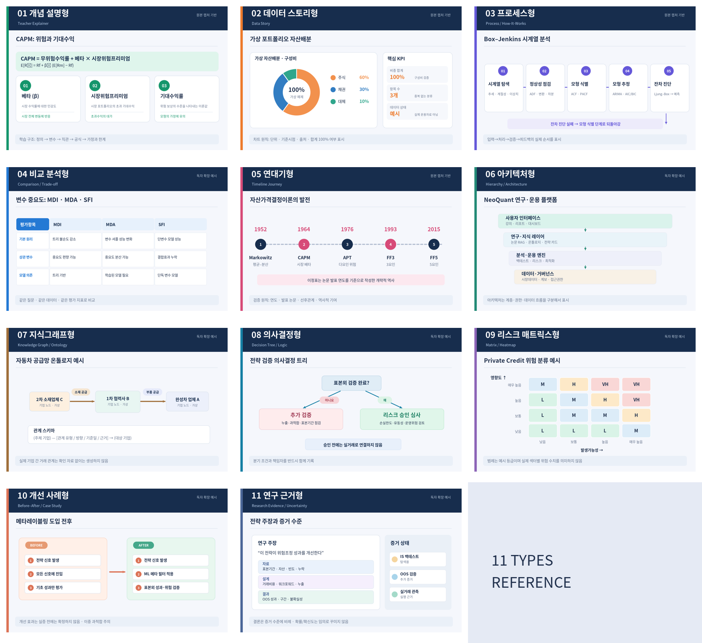

> **참고 이미지 주의**: 아래 이미지는 디자인 구조를 이해하기 위한 독자 제작 예시이며, 표시된 배분비중·위험 구분·기업 A/B/C 등은 실제 사실이나 투자 조언이 아니다. #1·#2·#3·#5는 제공 스크린샷에서 확인된 디자인 **유형**을 재구성했고 나머지는 독자적으로 확장했다. SVG 원본도 함께 제공한다.

## 1. 원본에서 확인된 디자인 원칙

- **#1**: 흰 배경, 부드러운 파스텔 색, 플랫 벡터, 아이콘, 상단 짧은 정의, 10~15단어 수준의 짧은 설명. 학습용의 높은 가독성.
- **#2**: 차트 유형(파이·막대·도넛·큰 숫자)을 목적에 맞게 활용; 절제된 기업형 디자인, 출처 표시, 과도한 장식 배제.
- **#3**: 번호와 아이콘 및 한 문장 설명을 포함하는 수직 프로세스, 화살표/원형 연결선, 현대적 아이소메트릭 스타일.
- **#5**: 시작·종료 연도, 핵심 이정표, 점선 수평 연대기, 연도+아이콘+짧은 설명, 세리프 연도/산세리프 본문.

> 원본 포스터의 일부 미세한 글씨는 모바일 캡처에서 판독에 제약이 있으므로, 다음 템플릿은 식별 가능한 내용을 바탕으로 **재구성**한 실행용 한국어 버전이다.

## 2. 공통 제작 계약 — 모든 11개 프롬프트에 적용

아래 블록을 개별 템플릿 앞이나 뒤에 추가한다.

```text
당신은 금융·교육 분야의 정확성을 최우선으로 하는 인포그래픽 에디터이자 데이터 시각화 디자이너다.
[목적] 독자가 30초 안에 핵심을 파악하고, 3분 안에 내용을 설명할 수 있어야 한다.
[독자] {초보자 | 학부생 | MBA | 투자 실무자 | 연구자}
[언어] 한국어 기본; 첫 등장 전문용어만 영문 병기. 한국어 맞춤법·줄바꿈 검수.
[출력] 먼저 콘텐츠 청사진(제목/핵심 주장/항목/숫자/출처)을 텍스트로 제시하고,
       이후 적합한 그래픽을 만든다. 이미지 제작을 요청받지 않았다면 이미지 생성은 하지 않는다.
[사실] 제공된 데이터만 사용. 미제공 수치·관계·연도·문헌을 임의 생성하지 않는다.
[검증] 정의·인과성·단위·표본기간·축·합계·분모·불확실성·출처를 확인한다.
[차트] 원형/도넛은 합계가 100%인 배타적 구성비에만 사용. 비교는 공통 기준축을 사용.
[수식] 수식의 기호, 조건, 차원, 부호를 유지. 복잡한 수식은 별도 렌더링한 뒤 삽입.
[관계] 기업·자본관계와 인과관계는 검증된 근거 및 기준일이 있을 때만 단정한다.
[디자인] 목적보다 장식을 우선하지 않는다. 적은 색(주 2~3개), 충분한 여백,
         높은 대비, 색각이상 대응, 폰트 16pt 이상(강의 슬라이드 권장 20pt 이상).
[규격] 기본 강의 16:9 / SNS 4:5 / 문서 A4 세로 / 웹 반응형 중 하나 지정.
[인계] 완성 이미지뿐 아니라 원본 데이터와 편집 가능한 구조(PPT/Slides/SVG 등)를 유지.
[끝] 최종 검수표와 검증되지 않은 항목을 명시한다.
```

## 3. 유형별 마스터 프롬프트 11선

### 01. Teacher Explainer — 개념 설명형 [스크린샷 확인]

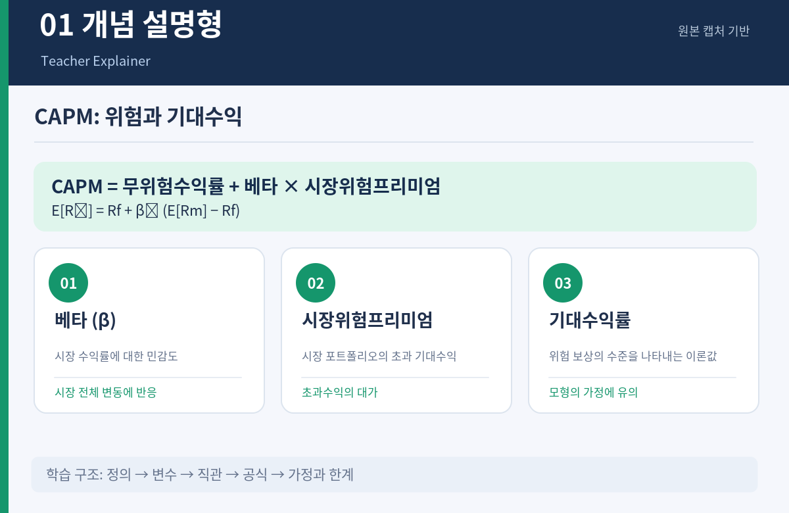

*스타일 예시 · 독자 제작 · 편집 가능한 SVG: `assets/style-01-explainer.svg`*

**목적** 핵심 개념을 정의 → 직관 → 구성요소 → 짧은 예제로 설명한다. **추천 구성** 3~6개 카드. **주의** 상호의존적 개념을 단순 나열하지 않는다.

```text
[역할] 초보자 친화적인 교육용 인포그래픽 디자이너.
[주제] [TOPIC]   [제목] [TITLE]   [독자] [AUDIENCE]
[섹션 수] [NUMBER: 3~6]   [색상] [COLORS]
구성: (1) 맨 위 한 문장 정의, (2) 개념의 필요성/직관,
(3) 번호·아이콘·짧은 제목을 가진 핵심 카드,
(4) 짧은 수치/생활 예제 1개, (5) 맨 아래 핵심 메시지.
각 카드 설명은 10~15개 단어에 준하는 간결한 한국어 문장으로 작성.
스타일: 흰 배경, 연한 파스텔, 플랫 벡터, 명확한 시각적 위계.
대상 독자의 수준에 맞는 정확한 용어를 사용하고, 확인되지 않은 수치를 넣지 말 것.
```

**실습 예시** CAPM: 정의 → 베타(시장 민감도) → 기대초과수익의 선형관계 → 예시 → 가정·한계. 핵심 수식 `E[R_i] = R_f + β_i(E[R_M]-R_f)`는 텍스트/수식 객체로 별도 제작.

### 02. Data Story — 수치·통계형 [스크린샷 확인]

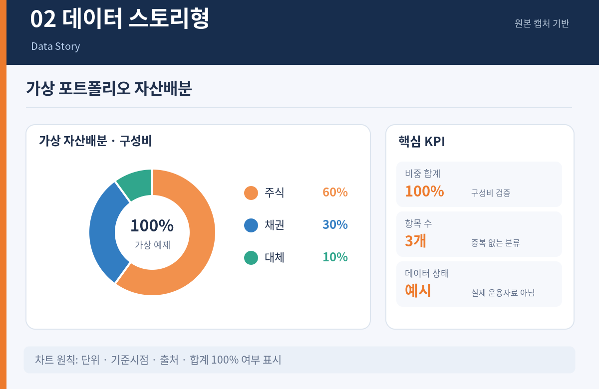

*스타일 예시 · 독자 제작 · 편집 가능한 SVG: `assets/style-02-data-story.svg`*

**목적** 3~5개 주요 데이터 지점의 *의미*를 보여준다. **추천 구성** 핵심 KPI + 비교 차트 + 해석 + 출처. **주의** 상관관계를 인과로 표현하거나 비율 분모를 누락하지 않는다.

```text
[역할] 전문적인 투자·연구 보고서 데이터 에디터.
[주제] [SUBJECT]   [제목] [TITLE]   [독자] [AUDIENCE]
[원자료] [DATA 1 ... DATA 5]   [기간/단위] [PERIOD/UNIT]
[출처] [SOURCE]   [브랜드 색상] [BRAND COLORS]
메인 KPI 1개와 보조 수치 2~4개를 우선순위대로 배치.
구성비는 도넛/원형, 범주별 비교는 막대, 추이는 선형 차트로 표현하라.
도표 아래에 한 문장 해석, 데이터 단위, 기준일, 출처를 표시.
근거가 없거나 제공되지 않은 수치는 '미제공'으로 표시하고 추정하지 말 것.
흰 여백이 넓고 얇은 아이콘을 사용하는 Corporate Minimal 스타일.
```

**실습 예시** 가상의 자산배분 60% 주식·30% 채권·10% 대체투자. *가상 데이터*임을 표시하고 100% 합산을 점검한다. 단일 시점 구성비라면 도넛이 가능하지만 기간별 성과 비교는 공통 축의 선/막대 차트를 사용한다.

### 03. Process / How-It-Works — 작업 절차형 [스크린샷 확인]

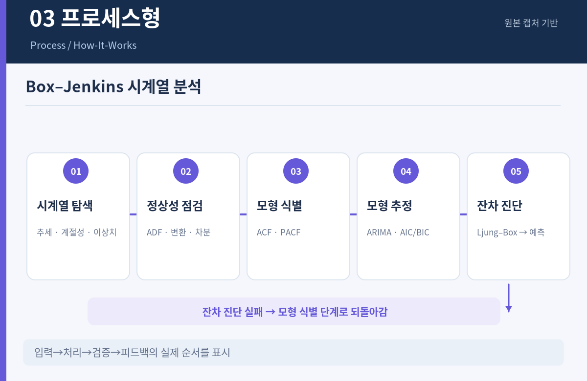

*스타일 예시 · 독자 제작 · 편집 가능한 SVG: `assets/style-03-process.svg`*

**목적** 순서, 전제조건, 결과, 반복 루프를 보여준다. **추천 구성** 4~7단계. **주의** 검정 실패나 조건 분기를 직선 화살표 하나로 생략하지 않는다.

```text
[역할] 기술 튜토리얼용 프로세스 인포그래픽 디자이너.
[프로세스] [PROCESS NAME]   [단계] [NUMBER]
[단계 정의] [STEP LIST]   [색상] [COLOR 1], [COLOR 2]
상단 제목 아래 번호 + 아이콘 + 짧은 단계명 + 한 문장 설명을 수직 배치.
화살표로 선후관계를 표현하고 재검토/실패 루프가 있으면 되돌림 화살표 추가.
현대적인 테크 스타일, 아이소메트릭 또는 플랫 아이콘,
두 색 그라데이션과 정돈된 간격. 단계별 입력과 출력을 명확히 표시.
단계를 새로 만들어내지 말고 주어진 절차에서만 시각화하라.
```

**실습 예시** Box–Jenkins: 시계열 탐색 → 정상성 확인(ADF 포함) → ACF/PACF 기반 식별 → 추정·AIC/BIC 비교 → Ljung–Box 잔차 진단 → 예측. 진단 실패 시 식별 단계로 피드백.

### 04. Comparison / Trade-off — 대안 비교형 [독자 확장]

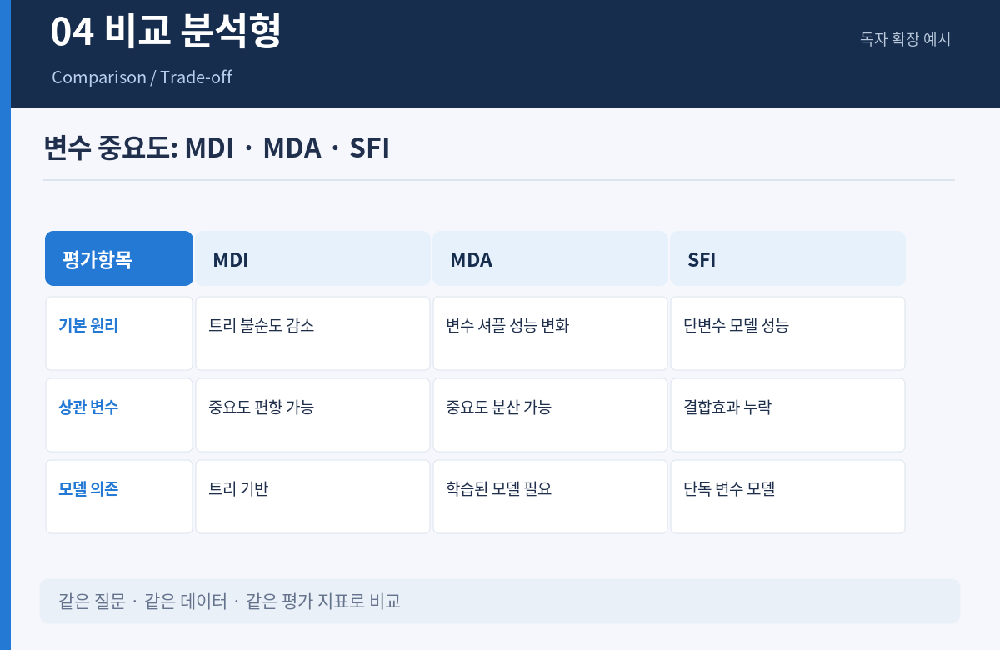

*스타일 예시 · 독자 제작 · 편집 가능한 SVG: `assets/style-04-comparison.svg`*

**목적** 선택지의 차이점과 조건부 권고를 한눈에 제공한다. **추천 구성** 2~4개 대안 × 4~6개 평가축. **주의** 서로 다른 단위를 같은 색 척도에 섞지 않는다.

```text
[주제] [COMPARISON TOPIC]   [대안] [OPTIONS: 2~4]
[평가축] [DIMENSIONS: 4~6]   [독자] [AUDIENCE]
좌측에 비교 기준, 우측에 각 대안의 값·장점·약점·적용 조건을 정렬한
간결한 비교 인포그래픽을 제작하라. 확인된 사실과 판단을 구분한다.
최하단에는 '어떤 조건이면 어느 대안인가'를 적되 근거 없이는 우열을 정하지 않는다.
동일 의미의 항목은 동일 단위와 기간을 사용하라. 화이트/네이비/민트 팔레트.
```

**실습 예시** MDI·MDA·SFI: 계산 대상, 변수 상관성 처리, 모델 의존성, 계산량, 장점, 한계를 비교한다. MDI는 분할 선택 편향, MDA는 상관 변수 간 중요도 분산, SFI는 다른 변수와의 결합효과·상관관계 반영이 제한됨을 표시.

### 05. Timeline Journey — 역사·로드맵형 [스크린샷 확인]

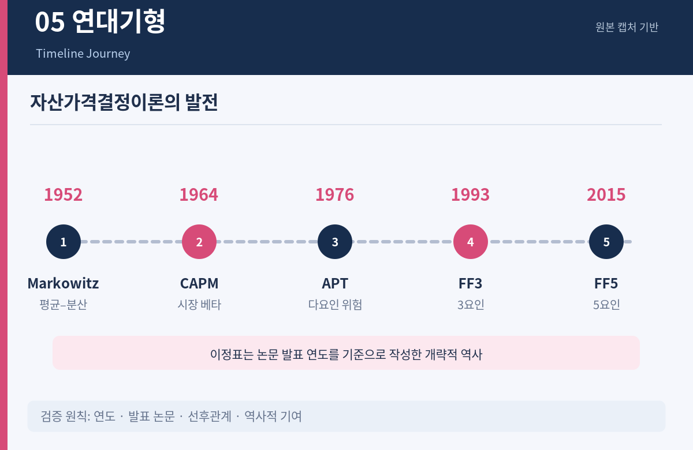

*스타일 예시 · 독자 제작 · 편집 가능한 SVG: `assets/style-05-timeline.svg`*

**목적** 시간에 따른 발전과 이정표를 설명한다. **추천 구성** 5~8개 연도/사건. **주의** 날짜·순서와 역사적 의미를 혼동하지 않는다.

```text
[주제] [EVENT/TOPIC]   [시작] [START YEAR]   [종료] [END YEAR]
[이정표 수] [NUMBER]   [검증된 이정표] [MILESTONE LIST]
점선 수평 타임라인 위에 각 이정표의 연도, 작은 일러스트 아이콘,
12~20단어 수준의 설명을 배치하라. 연도는 세리프, 본문은 산세리프.
빈티지 미니멀과 현대적 편집 디자인을 결합하되 균형 잡힌 여백을 유지.
컬러 [COLORS], 자료 출처 [SOURCE]. 모르는 날짜는 추정하지 말 것.
```

**실습 예시** Markowitz(1952) → Sharpe의 CAPM 논문(1964) → Ross의 APT(1976) → Fama–French 3요인(1993) → 5요인(2015). 역사에 대한 원전 출처를 별도로 점검한다.

### 06. Hierarchy / Architecture — 계층·시스템 구조형 [독자 확장]

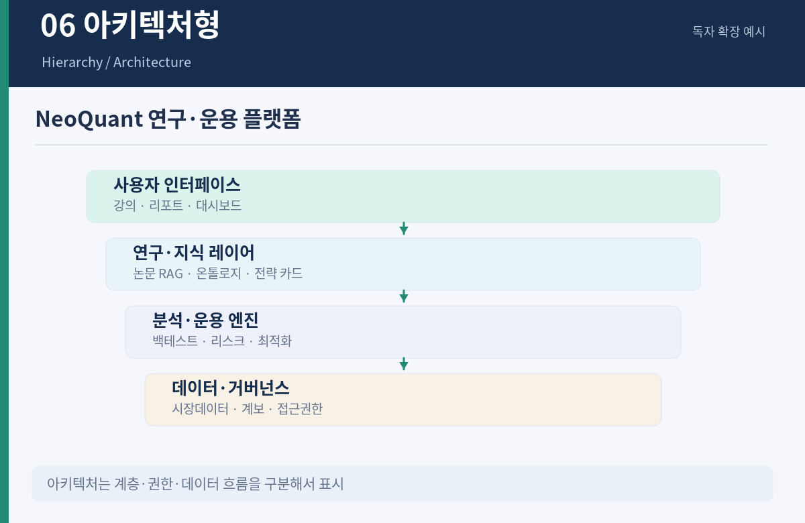

*스타일 예시 · 독자 제작 · 편집 가능한 SVG: `assets/style-06-architecture.svg`*

**목적** 전체-부분 관계, 책임범위, 시스템 계층을 설명한다. **추천 구성** 3~5개 레이어. **주의** '포함한다'와 '데이터를 주고받는다'는 다른 엣지이다.

```text
[시스템] [SYSTEM NAME]  [목표 사용자] [AUDIENCE]
[계층] [LAYERS]   [모듈 목록] [COMPONENTS]  [데이터 흐름] [FLOWS]
상위 목표 → 핵심 기능 → 엔진·서비스 → 데이터/인프라 순서의 레이어드 아키텍처.
상자에는 짧은 기능명을 쓰고 실선(데이터 흐름), 점선(관리/의존)을 구분.
색상은 레이어별로 통일. 외부 시스템 경계와 민감정보 경계를 나타내라.
알려지지 않은 연결은 표시하지 말고 '검토 필요'로 따로 분리한다.
```

**실습 예시** NeoQuant: 논문 검색·지식베이스 → 전략 카드 → 백테스트·위험엔진 → 검증·거버넌스 → 보고서·대시보드. 데이터 계보와 인간 승인 지점을 표시.

### 07. Knowledge Graph / Ontology — 관계·지식그래프형 [독자 확장]

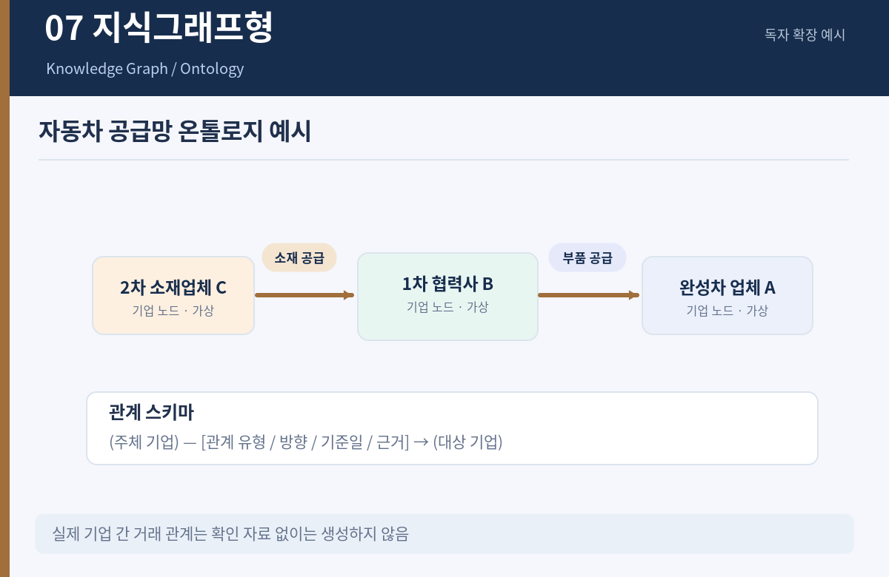

*스타일 예시 · 독자 제작 · 편집 가능한 SVG: `assets/style-07-ontology.svg`*

**목적** 엔터티 간 유형화된 관계, 방향, 출처, 시점을 표현한다. **추천 구성** 4~6개 노드 유형, 3~7개 관계 유형. **주의** 거래·공급·소유 관계를 같은 화살표로 취급하지 않는다.

```text
[도메인] [DOMAIN]   [질문] [COMPETENCY QUESTION]
[노드 유형] [ENTITY TYPES]   [관계 유형] [RELATION TYPES]
[확인된 삼중항] [SUBJECT - RELATION - OBJECT LIST]
중심 그래프를 배치하고 노드 색=유형, 엣지 라벨=관계명, 화살표=방향을 표시.
사실 관계에 출처, 관찰/유효 시점, 신뢰도를 기록하는 범례를 포함한다.
산업 밸류체인 '단계'와 기업 간 실제 '거래/지분' 관계를 구별한다.
실제 관계 증거가 없으면 예시/가설/미확인으로 표기하라.
```

**실습 예시** 한국 자동차 산업지도: `기업`–`영위한다`→`밸류체인 단계`, `기업`–`제조한다`→`부품 유형`, `기업`–`공급한다`→`기업`(개별 거래 근거가 있는 경우만). 추가 속성: 증거 URL, 출처 일자, 관찰일, 관계 상태.

### 08. Decision Tree / Logic — 의사결정형 [독자 확장]

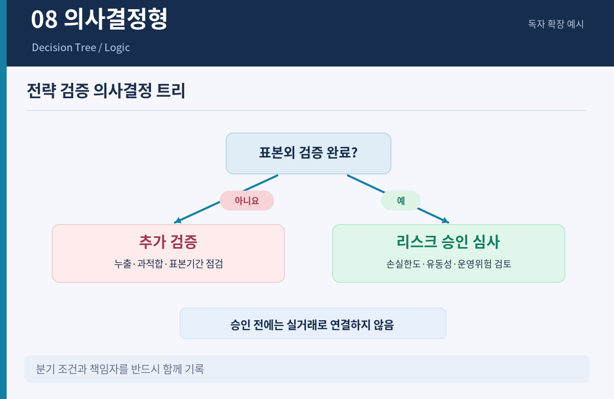

*스타일 예시 · 독자 제작 · 편집 가능한 SVG: `assets/style-08-decision-tree.svg`*

**목적** 명시적 조건과 이에 따른 행동을 보여준다. **추천 구성** 3~5개 결정 노드. **주의** 의사결정 트리를 인과적 효과가 검증된 정책으로 오해하지 않도록 한다.

```text
[결정 문제] [DECISION]  [입력] [INPUT SIGNALS]
[조건과 임계값] [RULES]  [행동] [ACTIONS]
시작 노드 → 질문(마름모) → 예/아니요 분기 → 실행/보류/검토 노드 순서.
모든 분기의 조건·단위·평가주기를 적고 기본/예외 경로를 명시한다.
판단의 불확실성과 인간 승인 조건을 하단 주석으로 추가하라.
결정값이 입력되지 않은 항목은 '추가 정보 필요'로 표시한다.
```

**실습 예시** 직접대출 리스크 모니터링: 재무약정 위반 여부 → 유동성 악화 여부 → 담보/회수시나리오 검토 → 투자위원회 상정. 수치 임계값은 내부 정책에 맞추고 임의 생성하지 않는다.

### 09. Matrix / Heatmap — 매트릭스·히트맵형 [독자 확장]

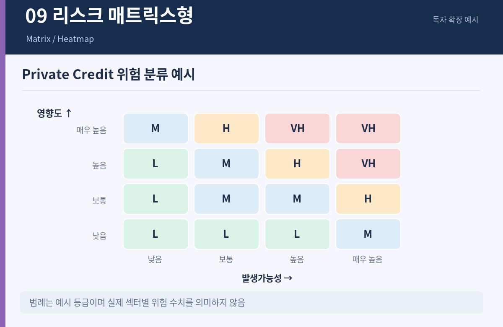

*스타일 예시 · 독자 제작 · 편집 가능한 SVG: `assets/style-09-matrix.svg`*

**목적** 2개 이상의 차원을 교차하여 집중 영역을 찾는다. **추천 구성** 3×3 또는 4×4 표. **주의** 범주형 위험 등급을 정량적 확률처럼 해석하지 않는다.

```text
[주제] [MATRIX TOPIC]   [행 차원] [ROW DIMENSION]
[열 차원] [COLUMN DIMENSION]   [셀 데이터] [CELL VALUES]
좌상단에 정의 및 척도·기간, 중앙에 읽기 쉬운 그리드/히트맵 배치.
색의 진하기가 무엇을 의미하는지 수치 범례와 색각이상 대응 기호를 포함.
중요 셀 2~3개만 강조하고 근거·불확실성을 각주에 기록.
척도 간 단위를 통일하지 못하면 정성 매트릭스로 명확히 분리하라.
```

**실습 예시** Private Credit: 행=섹터(산업재/상업서비스/소매 등), 열=위험요인(금리/경기/차환/유동성). 각 셀은 측정 정의가 있는 지표 또는 '전문가 정성 평가'로 분리한다.

### 10. Before–After / Case Study — 전후 비교·사례형 [독자 확장]

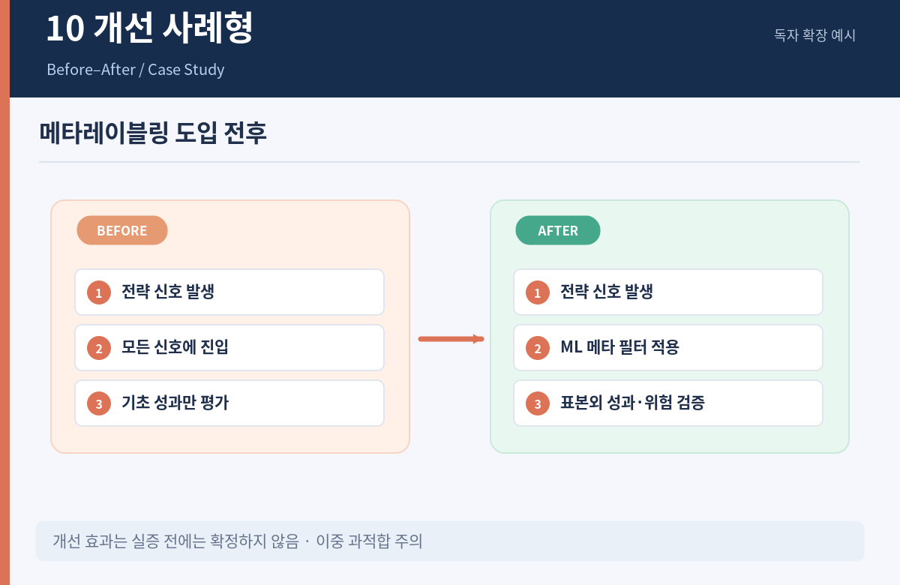

*스타일 예시 · 독자 제작 · 편집 가능한 SVG: `assets/style-10-before-after.svg`*

**목적** 변화 전후의 차이와 결과를 설명한다. **추천 구성** 문제 → 개입 → 전후 지표 → 교훈. **주의** 데이터가 다른 기간·시장·표본이면 효과를 단정하지 않는다.

```text
[사례] [CASE]  [기존 상태] [BEFORE]  [변화/개입] [INTERVENTION]
[이후 상태] [AFTER]   [비교 지표] [METRICS]  [동일 조건] [COMPARABILITY]
좌우 두 패널에 변화 전/후를 동일 축·단위·기간으로 배치.
가운데에 무엇이 바뀌었는지 한 문장, 아래에 수치 비교와 한계 명시.
성과 개선의 인과적 입증 여부를 별도로 표시하라.
일러스트는 보조로만 사용하고 결과를 과장하는 장식을 금지한다.
```

**실습 예시** 메타레이블링: 베이스 전략과 ML 필터 적용 전략의 precision을 비교. 공개된 영상 예시 수치 약 49% 대 53%는 맥락과 평가 구간을 동반해야 하며, 거래비용·표본오차·다중검정 문제를 반드시 표시한다.

### 11. Research Evidence / Uncertainty — 연구근거·불확실성형 [독자 확장]

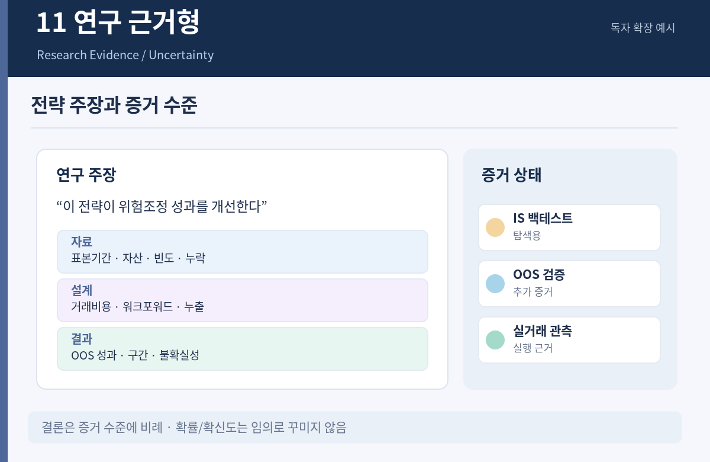

*스타일 예시 · 독자 제작 · 편집 가능한 SVG: `assets/style-11-research-evidence.svg`*

**목적** 논문의 주장, 식별전략, 결과, 신뢰도, 재현 가능성을 함께 보여준다. **추천 구성** 연구질문 → 방법 → 핵심 결과 → 한계 → 검증 상태. **주의** 백테스트 성과를 실거래 성과처럼 표현하지 않는다.

```text
[연구질문] [RESEARCH QUESTION]  [논문/저자/연도] [SOURCE]
[데이터] [SAMPLE/PERIOD]  [설계/식별전략] [METHOD]
[주요 추정치/신뢰구간] [RESULTS]  [검증/한계] [LIMITATIONS]
상단 연구질문, 중단 자료·방법·주요 결과, 하단 신뢰도·가정·반례·재현성.
색상으로 '확인된 사실 / 추정 / 가정 / 미검증'을 명확히 구분한다.
통계적 유의성, 경제적 크기, 거래비용 및 외표본 성능은 별도로 표시.
출처 링크/DOI, 검토일, 불확실성을 각주에 포함하고 성과를 과장하지 말 것.
```

**실습 예시** 금융 팩터 백테스트 근거 카드: 팩터 정의, 샘플 범위, Fama–MacBeth/Newey–West 추론, 거래비용 전후 결과, OOS·다중검정·데이터 스누핑 점검, 결론의 확신도.

## 4. 프로젝트별 활용 패키지

### 4.1 NeoQuant — 논문→전략→백테스트→보고서

| 단계 | 추천 유형 | 권장 입력 | 핵심 검증 |
|---|---|---|---|
| 논문 읽기 | #11 연구근거형 | 질문, 표본, 모형, 결과, 한계 | DOI/인용·OOS 구분 |
| 개념 교육 | #1 개념형 | 정의, 수식, 예제 | 수식 정확성 |
| 전략 비교 | #4 비교형 | 후보 전략, 비용, 성과지표 | 평가기간 일치 |
| 자동 파이프라인 | #3 프로세스형 | 단계, 상태, 실패 경로 | 데이터 누출 방지 |
| 시스템 설계 | #6 아키텍처형 | 모듈, 경계, 권한 | 계보·비밀관리 |
| 성과 보고 | #2 데이터형 | NAV, 낙폭, 변동성 | 단위·벤치마크 |
| 모형 검증 | #11 근거형 | OOS, 스트레스, BaR | 과최적화·불확실성 |

### 4.2 한국 자동차 산업지도 — 온톨로지와 그래프

- **#6**은 OEM·모듈·소재·반도체·물류·판매 등 *분류 체계*를 설명하는 데 활용한다.
- **#7**은 기업 간 *검증된 관계*를 표현한다. `BELONGS_TO_STAGE`와 `SUPPLIES_TO`는 서로 다르다.
- **#9**는 밸류체인 × 기술군의 빈칸·집중도를 파악하는 데 활용한다.
- **시스템 권장 구조**: Neo4j에 `Company`, `Product`, `Technology`, `ValueChainStage`, `Evidence` 노드를 저장하고, 관계에 유효기간 및 근거 ID를 붙인다. 인포그래픽은 그래프 데이터에서 파생한 *뷰*이므로, 실제 관계의 근거 없이는 엣지를 만들지 않는다.

### 4.3 Private Credit / TPA

- #1: Direct Lending, LME, HELOC, CLTV의 정의.
- #2: 섹터별 잔액·비중, 담보 유형, 현금흐름 프로파일.
- #4: Direct Lending vs BSL vs RMBS 구조와 유동성·리스크 비교.
- #8: 신용위험·약정 위반 발생 시 예외 처리 경로.
- #9: 자산군 × 금리·차환·경기 위험 매트릭스.
- #11: 회수율 가정, 빈티지·표본 선택 편향, 검증 상태.

### 4.4 강의 슬라이드 세트 예시 — 'GARCH(1,1)을 배우는 6장'

| 슬라이드 | 유형 | 핵심 내용 |
|---|---|---|
| 1 | #1 | 변동성 군집과 조건부 분산의 직관 |
| 2 | #1 | `h_t = ω + α ε²_(t−1) + β h_(t−1)`의 항별 의미 |
| 3 | #5 | ARCH에서 GARCH로 발전한 배경 |
| 4 | #3 | 데이터 → 추정 → 진단 → 예측 절차 |
| 5 | #2 | 실제 적합 결과와 잔차 진단 차트 |
| 6 | #11 | 안정성 조건·모형 한계·OOS 검증 |

## 5. 개선된 메타 프롬프트 — 한 문장으로 유형 자동 선택

```text
주제: [TOPIC]
청중: [AUDIENCE]
용도: [강의 16:9 / 투자보고서 A4 / SNS 4:5 / 웹]
핵심자료: [TEXT / DATA / CITATIONS]

1) 목적을 분석해 11가지 중 가장 적합한 1개 유형을 제안하고 이유를 2문장으로 설명.
2) 필요 시 보조 유형 1개를 추가하되 메시지 중복은 피함.
3) 사실표(주장·수치·단위·기간·출처·검증상태)를 작성.
4) 그래픽에 실제로 들어갈 문안을 작성하고 모호한 부분은 질문/플레이스홀더로 남김.
5) 메인 그래픽의 레이아웃 사양(화면비·글자크기·색상·시각화 구성)을 설계.
6) 지정 매체에 필요한 제작 프롬프트/데이터 차트 코드/편집 가능한 원본 구조를 준비.
7) 한글·수식·데이터·출처·접근성 검수표 제공.
금지: 허위 숫자·허위 기업관계·허위 인용, 그래프 왜곡, 이미지에 수식 임의 변형.
```

## 6. 작업과 배포의 표준

### 6.1 산출물 3단 분리

1. **콘텐츠 정본(Content source)**: Markdown + JSON/CSV. 원문·수치·출처·검증상태 유지.
2. **디자인 소스(Editable visual)**: Slides/PPT/HTML/SVG. 사용자 편집 가능.
3. **최종 발표물(Rendered)**: PNG/PDF. 배포용이며 수치 근거의 정본이 아니다.

### 6.2 출처 및 정확성 검수 체크리스트

- [ ] 모든 날짜·저자·논문·기업관계에 검증 가능한 출처가 있는가?
- [ ] 원본 확인 4종과 독자 확장 7종을 구별했는가?
- [ ] 수치의 분모·단위·통화·시점·표본기간을 표시했는가?
- [ ] 원형 차트는 항목들이 배타적이고 합계가 100%인가?
- [ ] 차트 축이 비교 목적을 왜곡하지 않는가?
- [ ] 수식 기호·계수·첨자·조건이 올바른가?
- [ ] 그래프 엣지 유형·방향·유효기간·증거가 확인되었는가?
- [ ] 인과·상관·정성적 판단을 구분했는가?
- [ ] 검증되지 않은 결과와 허구 예제를 표시했는가?
- [ ] 16:9 슬라이드에서 본문 글자 크기가 충분한가(권장 20pt 이상)?
- [ ] 한국어 문장부호·줄바꿈·영문 약어·색 대비를 검수했는가?

### 6.3 강의용과 보고서용 디자인 가이드

| 항목 | 강의용 (16:9) | 보고서용 (A4) | SNS (4:5) |
|---|---|---|---|
| 정보 밀도 | 슬라이드당 1개 주장, 3~5개 요소 | 근거·주석·표 허용 | 강한 핵심 메시지 중심 |
| 글자 | 제목 28~36pt, 본문 20~24pt 권장 | 본문 10~11pt, 차트 라벨 판독 가능 | 휴대전화 가독성 우선 |
| 그래프 | 큰 축·직접 레이블 | 단위·표본·출처 필수 | 데이터 단순화, 왜곡 금지 |
| 전달 | 직관 → 식 → 예제 | 요약 → 근거 → 한계 | 문제 → 통찰 → 핵심 결론 |

## 7. Claude Code 스킬: 사용 및 설치

스킬명: `finance-infographic` (폴더 `finance-infographic/`, 파일 `SKILL.md`). 이 문서에 동봉된 ZIP의 스킬 폴더를 그대로 복사한다.

### macOS / Linux

```bash
# 사용자 전체 프로젝트에서 사용
mkdir -p ~/.claude/skills
cp -R finance-infographic ~/.claude/skills/
# 또는 특정 프로젝트에서만 사용
mkdir -p .claude/skills
cp -R finance-infographic .claude/skills/
```

### Windows PowerShell

```powershell
# 사용자 전역
New-Item -ItemType Directory -Force "$HOME\.claude\skills" | Out-Null
Copy-Item -Recurse -Force ".\finance-infographic" "$HOME\.claude\skills\"
# 프로젝트 전용이라면 대상 경로를 ".\.claude\skills\"로 바꾸기
```

Claude Code에서 `/finance-infographic` 호출이 해당 버전/환경에서 지원되면 사용하거나, 자연어로 **“finance-infographic 스킬을 사용해 GARCH 강의용 16:9 개념+프로세스 인포그래픽을 설계해줘”**라고 요청한다. 스킬 인식 여부와 도구 권한은 로컬 환경에서 확인해야 한다.

표준 라이브러리만 사용하는 CLI도 동봉하였다.

```bash
python finance-infographic/scripts/build_prompt.py --list
python finance-infographic/scripts/build_prompt.py --type 7 --topic "한국 자동차 산업지도" --audience "금융 리서처" --format md
python finance-infographic/scripts/build_prompt.py --type auto --topic "포트폴리오 자산비중 데이터 비교" --audience "MBA" --format text
python finance-infographic/scripts/build_prompt.py --type 11 --input finance-infographic/examples/research_case.json --output prompt.md
python -m unittest discover -s finance-infographic/scripts -p 'test_*.py'
```

> **중요**: 스킬은 프롬프트 설계, 콘텐츠 검수 계획, 레이아웃 사양 작성을 지원한다. 별도 이미지 생성 도구·Slides API·Neo4j 연동은 각 환경에 설치된 도구/권한이 있어야 실제 렌더링과 데이터 읽기가 가능하다. 자율적으로 실측 데이터에 접근하거나 출처를 검증한 것처럼 말하지 않는다.

## 8. 예제 사용자 요청 4개

1. **기초강의**: “CAPM을 학부 2학년에게 설명할 #1 인포그래픽. SML 그래프는 축과 수식을 별도로 정확하게 렌더링해줘.”
2. **운용보고서**: “주식 60%, 채권 30%, 대체 10%의 가상 TPA 포트폴리오를 #2 16:9로. 실제 기관 데이터인 것처럼 표현하지 마.”
3. **산업 온톨로지**: “한국 자동차 산업 밸류체인의 분류 지도(#6)와 증거 기반 기업 관계망(#7)을 분리해 만들어줘. 미확인 거래관계는 넣지 마.”
4. **연구 검증**: “메타레이블링 워크포워드 분석을 #10과 #11로 비교하고 누출, 비용, purge, 표본 크기 문제를 표시해줘.”

## 9. 최종 요약

**설명(#1) → 측정(#2) → 실행(#3) → 비교(#4) → 진화(#5) → 구조(#6) → 관계(#7) → 판단(#8) → 교차분석(#9) → 사례(#10) → 근거평가(#11)**로 역할을 분리한다. 특히 금융·AI 자료는 예쁜 이미지보다 **검증 가능한 콘텐츠 정본, 정확한 수식·데이터, 출처와 불확실성, 편집 가능한 결과물**이 우선이다.

**문서 버전** 1.0 · 2026-10-19 · 스크린샷 확인 범위 4종 + 독자 확장 7종. 
