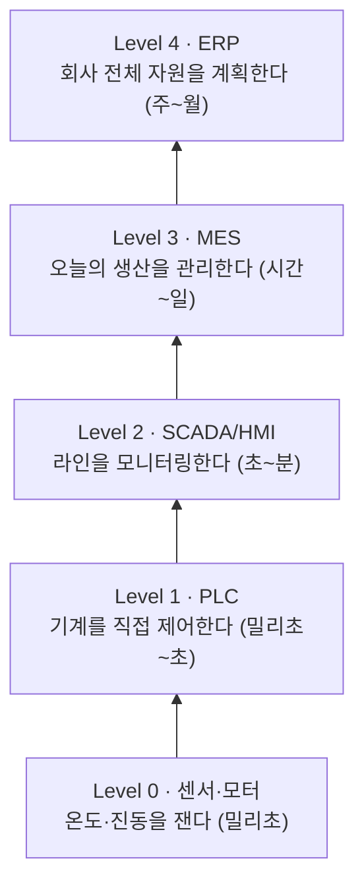
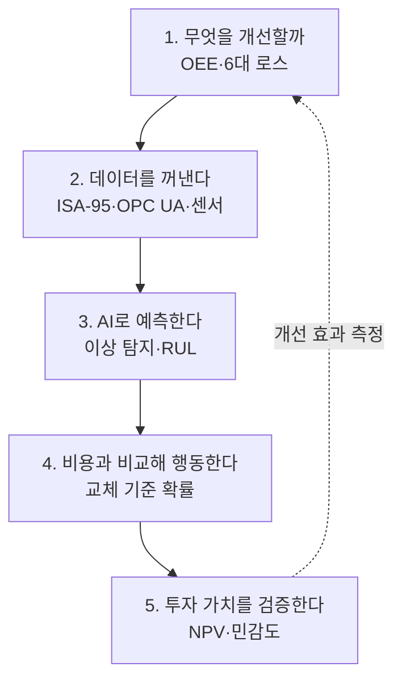

# 스마트 팩토리 강의노트 (비전공생용)
**데이터가 흐르는 공장 — 개념에서 예지보전 AI까지**

> [!abstract] 이 강의노트를 다 읽으면
> 1. 스마트 팩토리가 "로봇이 많은 공장"이 아니라 **"데이터로 판단하는 공장"** 이라는 뜻을 설명할 수 있다.
> 2. 공장의 성적표인 **OEE**를 손으로 계산할 수 있다.
> 3. 공장 데이터가 센서에서 경영 시스템까지 **어떻게 흘러가는지** 그림으로 그릴 수 있다.
> 4. **예지보전**(고장 나기 전에 미리 고치기)이 어떻게 작동하는지, AI가 어디에 쓰이는지 설명할 수 있다.
> 5. 스마트 팩토리 투자가 **돈이 되는지** 간단히 따져 볼 수 있다.

**사전 지식**: 필요 없음. 고등학교 수준의 분수·지수 계산이면 충분하다.

---

## 목차
- [[#1교시. 스마트 팩토리란 무엇인가]]
- [[#2교시. 공장의 성적표 — OEE]]
- [[#3교시. 공장 데이터는 어디서 와서 어디로 가는가]]
- [[#4교시. 공장에서 AI는 무엇을 하는가]]
- [[#5교시. 예지보전의 기본 — 언제 고칠 것인가]]
- [[#6교시. 고장의 신호를 읽는 법 — 이상 탐지와 수명 예측]]
- [[#7교시. 실습 — 센서 데이터에서 정비 보고서까지]]
- [[#8교시. 돈이 되는가 — ROI와 실행 로드맵]]
- [[#부록. 용어 사전]]

---

## 1교시. 스마트 팩토리란 무엇인가

### 1.1 비유로 시작하기 — 자동차 운전
- **옛날 공장** = 계기판 없는 자동차. 엔진 소리가 이상하면 운전자가 "감"으로 판단한다.
- **자동화 공장(Automation)** = 크루즈 컨트롤이 있는 자동차. 정해진 속도는 기계가 유지하지만, 상황 판단은 여전히 사람이 한다.
- **스마트 팩토리(Smart Factory)** = 내비게이션·차선 유지·고장 경고가 있는 자동차. 차가 스스로 **상황을 측정하고(센서), 판단하고(AI), 알려 주거나 조정한다**.

> [!important] 핵심 정의
> **스마트 팩토리**는 설비·제품·사람에서 나오는 데이터를 실시간으로 모으고 분석해, 생산 의사결정을 더 빠르고 정확하게 만드는 공장이다.
> 로봇이 몇 대인지가 아니라, **데이터로 판단하는가**가 기준이다.

### 1.2 자동화와 스마트화는 무엇이 다른가

| 구분 | 자동화(Automation) | 스마트화(Smartization) |
|---|---|---|
| 하는 일 | 정해진 동작을 반복 | 상황을 보고 판단·조정 |
| 예시 | 컨베이어가 일정 속도로 움직임 | 불량이 늘면 속도를 스스로 낮춤 |
| 핵심 자원 | 기계 | 데이터 + 알고리즘 |
| 약점 | 변화에 약함 | 데이터가 없으면 무용지물 |

### 1.3 CPS — 현실과 가상을 잇는 고리
스마트 팩토리의 뼈대는 **CPS(Cyber-Physical System, 사이버 물리 시스템)** 다.


현실을 측정 → 가상에서 분석 → 다시 현실을 조정하는 **순환 고리**가 돌면 스마트 팩토리다.

### 1.4 산업혁명의 흐름

| 단계 | 시기 | 핵심 동력 | 한 줄 요약 |
|---|---|---|---|
| 1차 | 18세기 말 | 증기기관 | 사람 손 → 기계 |
| 2차 | 19세기 말 | 전기·컨베이어 | 대량생산(포드 T형) |
| 3차 | 1970년대~ | 컴퓨터·PLC | 자동화 |
| 4차 (Industry 4.0) | 2011년~ | IoT·AI·빅데이터 | 연결과 지능화 |
| Industry 5.0 | 2020년대~ | 사람 중심·지속가능성 | 사람과 AI의 협업 |

> [!note] 왜 독일에서 시작됐나
> "Industry 4.0"은 2011년 독일 하노버 산업박람회에서 처음 쓰인 말이다. 인건비가 비싼 독일이 제조 경쟁력을 지키려고 **기계를 똑똑하게 만드는 전략**을 국가 차원에서 내세운 것이다.

### 1.5 공장마다 철학이 다르다 — 세 가지 모델

| 모델 | 대표 | 철학 | 강점 |
|---|---|---|---|
| 프로세스 중심 | Toyota (TPS) | 낭비를 없애는 일하는 방식이 먼저 | 현장 개선 문화 |
| AI·자동화 중심 | Tesla 기가팩토리 | 공장 자체를 제품처럼 설계 | 속도·규모 |
| 데이터 중심 | Palantir Foundry | 흩어진 데이터를 한 판에 연결 | 의사결정 통합 |

> [!example] 생각해 볼 점
> Tesla는 2018년 Model 3 생산 초기에 자동화를 지나치게 밀어붙였다가 생산 차질을 겪었고, 일론 머스크는 스스로 "과도한 자동화는 실수였다"고 인정했다. **기술보다 프로세스가 먼저 정리돼야 한다**는 교훈이다.

### 1.6 등대공장(Lighthouse Factory)
세계경제포럼(WEF)은 2018년부터 4차 산업혁명 기술을 모범적으로 적용한 공장을 **등대공장**으로 선정한다. 어두운 바다에서 배들을 이끄는 등대처럼 다른 공장의 길잡이가 된다는 뜻이다. 국내에서도 포스코, LS일렉트릭, LG전자 등의 공장이 선정됐다.

> [!check] 1교시 정리
> - 스마트 팩토리 = **측정 → 분석 → 조정**의 순환 고리(CPS)가 도는 공장
> - 자동화는 "반복", 스마트화는 "판단"
> - 기술보다 **무엇을 개선할지(KPI)** 가 먼저다 → 2교시

---

## 2교시. 공장의 성적표 — OEE

### 2.1 왜 성적표부터 보나
스마트 팩토리 프로젝트가 가장 흔하게 실패하는 이유는 **"AI를 도입하는 것" 자체가 목표가 되는 것**이다. 무엇을 얼마나 좋게 만들지 숫자로 정해야 투자가 맞았는지 판단할 수 있다. 공장에서 가장 널리 쓰는 성적표가 **OEE**다.

### 2.2 OEE의 정의
**OEE(Overall Equipment Effectiveness, 설비종합효율)** 는 "설비가 이론적으로 낼 수 있는 성과 중 실제로 얼마나 냈는가"를 나타낸다. 세 가지 비율을 곱한다.

$$
\text{OEE} = \underbrace{\text{Availability}}_{\text{가동률}} \times \underbrace{\text{Performance}}_{\text{성능률}} \times \underbrace{\text{Quality}}_{\text{양품률}}
$$

| 요소 | 질문 | 계산 |
|---|---|---|
| 가동률 (Availability) | 기계가 **돌았는가**? | 실제 가동시간 ÷ 계획 시간 |
| 성능률 (Performance) | 돌 때 **제 속도**를 냈는가? | (이론 사이클타임 × 생산량) ÷ 실제 가동시간 |
| 양품률 (Quality) | 만든 것이 **멀쩡한가**? | 양품 수 ÷ 생산량 |

> [!tip] 비유 — 아르바이트생의 하루
> 8시간 근무 중 1시간 지각(가동률↓), 출근해서도 느릿느릿(성능률↓), 만든 커피 일부를 다시 만들어야 함(양품률↓). 세 가지가 모두 깎여야 "그날의 실제 성과"가 된다.

### 2.3 손계산 예제

> [!example] 예제 2-1. 사출성형기 한 대의 하루
> - 계획 가동시간: 480분 (8시간)
> - 고장·금형 교체로 멈춘 시간: 60분
> - 이론 사이클타임: 1개당 1분
> - 실제 생산량: 380개
> - 그중 양품: 361개
>
> **① 가동률**
> 실제 가동시간 = 480 − 60 = 420분
> $$\text{Availability} = \frac{420}{480} = 0.875 \;(87.5\%)$$
>
> **② 성능률**
> 420분 동안 이론상 420개를 만들 수 있었는데 380개를 만들었다.
> $$\text{Performance} = \frac{1 \times 380}{420} \approx 0.905 \;(90.5\%)$$
>
> **③ 양품률**
> $$\text{Quality} = \frac{361}{380} = 0.95 \;(95\%)$$
>
> **④ OEE**
> $$\text{OEE} = 0.875 \times 0.905 \times 0.95 \approx 0.752 \;(75.2\%)$$
>
> **검산**: 8시간(480분) 동안 이론상 480개를 만들 수 있었고 실제 양품은 361개다.
> $$\frac{361}{480} \approx 0.752 \quad ✓$$

> [!note] OEE의 눈높이
> 일반적으로 **85%** 를 세계적 수준(World Class)으로, **60% 안팎**을 보통 수준으로 본다. 예제 설비(75%)는 개선 여지가 있다.

### 2.4 6대 로스(Six Big Losses) — 어디서 새는가

| OEE 요소 | 로스 | 예시 |
|---|---|---|
| 가동률 | ① 설비 고장 | 모터가 타서 2시간 정지 |
| | ② 준비·교체 | 금형 교체에 40분 |
| 성능률 | ③ 잦은 짧은 정지 | 부품 걸림으로 1~2분씩 자주 멈춤 |
| | ④ 속도 저하 | 불량이 겁나서 일부러 천천히 |
| 양품률 | ⑤ 공정 불량 | 찍힘·치수 불량 |
| | ⑥ 초기 불량 | 가동 직후 온도가 안정될 때까지 나오는 불량 |

> [!important] 연결 고리
> ① **설비 고장**을 줄이는 기술이 바로 오늘 후반부의 주제인 **예지보전**이다.

### 2.5 그 밖의 핵심 지표

| 지표 | 뜻 | 좋은 방향 |
|---|---|---|
| MTBF (Mean Time Between Failures) | 고장과 고장 사이 평균 시간 | 길수록 좋음 |
| MTTR (Mean Time To Repair) | 고장 후 복구까지 평균 시간 | 짧을수록 좋음 |
| PPM (Parts Per Million) | 100만 개당 불량 수 | 작을수록 좋음 |
| 리드타임 (Lead Time) | 주문부터 납품까지 걸리는 시간 | 짧을수록 좋음 |

> [!check] 2교시 정리
> - OEE = 가동률 × 성능률 × 양품률
> - 세 비율이 각각 90%여도 OEE는 72.9%밖에 안 된다 → **곱셈이라 작은 손실이 쌓인다**
> - 6대 로스 중 어디서 새는지 먼저 찾는다

---

## 3교시. 공장 데이터는 어디서 와서 어디로 가는가

### 3.1 OT와 IT — 두 개의 다른 세계

| 구분 | OT (Operational Technology, 운영 기술) | IT (Information Technology) |
|---|---|---|
| 다루는 것 | 기계·설비·공정 제어 | 문서·재무·고객 정보 |
| 최우선 가치 | **멈추지 않는 것**(가용성) | 정보 보호(기밀성) |
| 교체 주기 | 15~30년 | 3~5년 |
| 담당 | 설비·생산 엔지니어 | 전산팀 |

> [!warning] 공장 데이터가 갇히는 이유
> 20년 된 기계는 인터넷 연결을 전제로 만들어지지 않았다. 회사마다 통신 방식도 제각각이다. 그래서 공장 데이터는 **기계 안에 갇혀 있는 경우가 많다.** 스마트 팩토리의 첫 관문은 AI가 아니라 **데이터를 꺼내는 일**이다.

### 3.2 ISA-95 — 공장 데이터의 5층 건물
국제 표준 **ISA-95**는 공장의 정보 시스템을 층으로 나눈다. 아래층일수록 빠르고 작은 데이터, 위층일수록 느리고 큰 판단이다.



| 층 | 시스템 | 쉬운 설명 |
|---|---|---|
| 0 | 센서·액추에이터 | 공장의 **신경 말단** |
| 1 | PLC (Programmable Logic Controller) | 기계의 **반사신경**. "온도가 200℃ 넘으면 히터 꺼" |
| 2 | SCADA / HMI | 라인 **관제실 화면** |
| 3 | MES (Manufacturing Execution System) | 공장의 **일일 업무 일지**. 무엇을 몇 개 만들었나, 어느 LOT인가 |
| 4 | ERP (Enterprise Resource Planning) | 회사의 **가계부·인사부**. 주문·재고·원가 |

### 3.3 층을 잇는 언어 — 통신 표준
- **OPC UA**: 제조사가 다른 기계끼리 대화하게 해 주는 **공장의 공용어**. 데이터의 의미(이 숫자가 온도인지 압력인지)까지 함께 전달한다.
- **MQTT**: 작고 가벼운 메시지를 보내는 **공장의 메신저**. "구독" 방식이라 필요한 쪽만 받아 본다.

> [!tip] 최신 흐름 — Unified Namespace(UNS)
> 층층이 데이터를 전달하는 대신, 모든 데이터를 **하나의 게시판**에 올리고 필요한 시스템이 가져다 쓰는 방식. 층을 건너뛰는 연결이 쉬워진다.

### 3.4 센서 — 공장의 오감

| 센서 | 사람의 감각 | 무엇을 알아내나 |
|---|---|---|
| 진동 센서 | 손으로 만져 떨림 느끼기 | 베어링 마모, 축 틀어짐 |
| 온도 센서 | 손등으로 열 느끼기 | 과열, 마찰 증가 |
| 전류 센서 | 모터가 힘겨워하는 소리 | 부하 증가, 막힘 |
| 음향 센서 | 귀 | 이상한 소음 |
| 카메라(비전) | 눈 | 외관 불량 |

### 3.5 엣지 vs 클라우드 — 어디서 계산할까
- **엣지(Edge)**: 기계 바로 옆의 작은 컴퓨터에서 계산. **빠르고**, 데이터가 밖으로 안 나간다.
- **클라우드(Cloud)**: 멀리 있는 대형 서버에서 계산. **크게 모아** 분석하기 좋다.

> [!example] 판단 기준
> - 0.1초 안에 기계를 멈춰야 한다 → **엣지**
> - 공장 10곳의 1년치 고장 패턴을 비교한다 → **클라우드**

### 3.6 케이스 — Siemens 암베르크(Amberg) 공장
지멘스의 독일 암베르크 전자공장은 제품과 설비가 서로 정보를 주고받으며 생산 과정 대부분이 자동으로 관리된다. 많은 제품 종류를 만들면서도 매우 낮은 불량률을 유지해 **수직 통합(센서부터 ERP까지 데이터 연결)의 대표 사례**로 꼽힌다.

> [!check] 3교시 정리
> - 공장 데이터는 **5층(ISA-95)** 을 따라 흐른다
> - 첫 관문은 AI가 아니라 **데이터 꺼내기**(OT/IT 연결)
> - OPC UA = 공용어, MQTT = 메신저

---

## 4교시. 공장에서 AI는 무엇을 하는가

### 4.1 AI 응용 지도

| 문제 | AI가 하는 일 | 쓰는 데이터 | 개선되는 OEE 요소 |
|---|---|---|---|
| 설비 고장 | **예지보전** — 고장을 미리 예측 | 진동·온도·전류 | 가동률 |
| 외관 불량 | **비전 검사** — 사진으로 불량 판별 | 카메라 이미지 | 양품률 |
| 품질 측정 지연 | **가상 계측(Virtual Metrology)** — 공정 조건으로 품질 추정 | 공정 변수 | 양품률 |
| 생산 순서 | **스케줄링 최적화** — 가장 빠른 작업 순서 계산 | 주문·설비 정보 | 성능률·리드타임 |
| 매뉴얼·노하우 | **현장 코파일럿(RAG)** — 매뉴얼을 찾아 답변 | 문서·정비 이력 | MTTR |

### 4.2 비전 검사 — AI의 눈
사람 검사원은 하루 종일 같은 집중력을 유지하기 어렵다. 카메라 + 딥러닝은 **피로 없이 전수 검사**를 할 수 있다.

> [!note] 두 종류의 실수
> - **과검출**: 멀쩡한 제품을 불량으로 판정 → 버리는 비용
> - **미검출**: 불량을 멀쩡하다고 통과 → 고객 클레임 비용
> 어느 쪽 실수가 더 비싼지에 따라 AI의 기준선을 다르게 잡는다.

### 4.3 RAG 기반 현장 코파일럿
**RAG(Retrieval-Augmented Generation, 검색 증강 생성)** 는 생성형 AI가 답하기 전에 **회사 문서에서 관련 내용을 먼저 찾아보고** 답하게 하는 방식이다.

> [!example] 현장 장면
> 신입 정비사: "3번 프레스에 E-042 알람이 떴어요."
> 코파일럿: "매뉴얼 p.87에 따르면 유압 저하 알람입니다. 지난 1년간 같은 알람 4건 중 3건은 필터 막힘이 원인이었습니다. 먼저 필터를 점검하세요."
> → 숙련공의 노하우가 퇴직과 함께 사라지는 문제를 줄인다.

### 4.4 디지털 트윈 — 공장의 쌍둥이
**디지털 트윈(Digital Twin)** 은 현실 공장을 컴퓨터 안에 똑같이 복제해 실시간으로 동기화한 것이다.

| 단계 | 현실 → 가상 | 가상 → 현실 |
|---|---|---|
| 디지털 모델 | 수동 | 수동 |
| 디지털 섀도 | **자동** | 수동 |
| 디지털 트윈 | **자동** | **자동** |

BMW는 NVIDIA Omniverse로 새 공장을 **짓기 전에 가상으로 먼저 운영**해 보며 배치 문제를 미리 찾는다.

> [!check] 4교시 정리
> - AI 응용은 결국 **OEE의 어느 요소를 개선하는가**로 정리된다
> - 오늘은 그중 효과가 가장 직접적인 **예지보전**을 깊이 다룬다 → 5교시

---

## 5교시. 예지보전의 기본 — 언제 고칠 것인가

### 5.1 정비 전략의 진화 — 자동차 관리에 비유

| 전략 | 자동차 비유 | 장점 | 단점 |
|---|---|---|---|
| 사후보전 (Breakdown Maintenance, BM) | 고장 나서 길에 서면 견인 | 평소 비용 0 | 갑작스러운 정지, 큰 피해 |
| 예방보전 (Preventive Maintenance, PM) | 1만 km마다 무조건 오일 교환 | 계획 가능 | 멀쩡한 부품도 교체(낭비) |
| 상태기반보전 (Condition-Based Maintenance, CBM) | 오일 상태를 보고 교환 | 낭비 감소 | 측정 장비 필요 |
| **예지보전 (Predictive Maintenance, PdM)** | "엔진이 약 2주 뒤 문제될 확률 높음" 경고 | 최적 시점에 교체 | 데이터·모델 필요 |
| 처방보전 (Prescriptive Maintenance, RxM) | "다음 주 화요일 정비소, 이 부품 교체" 추천 | 행동까지 제시 | 가장 복잡 |

> [!important] 예지보전의 정의
> 설비 상태 데이터를 분석해 **고장 시점을 미리 예측**하고, 고장 직전의 **가장 경제적인 시점에 정비**하는 방법.

### 5.2 P-F 곡선 — 일찍 알수록 싸다

```mermaid
xychart-beta
    title "P-F 곡선 (설비 상태 vs 시간)"
    x-axis ["가동 시작", "", "", "P(잠재 결함)", "", "", "", "F(기능 고장)"]
    y-axis "설비 상태" 0 --> 100
    line [100, 100, 99, 97, 90, 75, 50, 10]
```

- **P (Potential Failure, 잠재 고장)**: 결함이 처음 생기는 시점. 아직 기계는 멀쩡히 돈다.
- **F (Functional Failure, 기능 고장)**: 기계가 실제로 멈추는 시점.
- **P-F 간격**: 이 사이가 "고칠 수 있는 골든타임"이다.

| 신호 | P 이후 대략적인 순서 |
|---|---|
| 초음파·미세 진동 변화 | 가장 먼저 (센서+AI로만 감지) |
| 윤활유 오염 | ↓ |
| 소음 증가 | ↓ (사람 귀로 감지) |
| 열 발생 | ↓ (손으로 감지) |
| 연기·정지 | 마지막 (이미 늦음) |

> [!tip] 핵심 직관
> 사람의 오감은 P-F 곡선의 **끝부분**에서야 이상을 느낀다. 센서와 AI는 **앞부분**에서 잡아낸다. 일찍 잡을수록 계획 정비가 가능해지고 비용이 작아진다.

### 5.3 언제 교체해야 이득인가 — 기대 비용 비교

> [!example] 예제 5-1. 지금 바꿀까, 기다릴까
> - 지금 계획 교체하면: **200만 원** (부품 + 계획 정지 2시간)
> - 기다리다 고장 나면: **2,000만 원** (부품 + 비계획 정지 1일 + 불량품)
> - AI 모델 예측: 다음 1주 안에 고장 날 확률 **15%**
>
> 기다릴 때의 기대 비용 = 0.15 × 2,000만 = **300만 원**
> 300만 원 > 200만 원 → **지금 교체하는 것이 이득**
>
> **교체 기준 확률**은
> $$p^* = \frac{\text{계획 교체 비용}}{\text{고장 비용}} = \frac{200}{2{,}000} = 10\%$$
> 고장 확률이 10%를 넘으면 교체, 넘지 않으면 기다린다.

> [!important] 여기서 배울 점
> AI의 역할은 "고장 난다/안 난다"를 맞히는 것이 아니라 **고장 확률을 숫자로 내놓는 것**이다. 그 숫자와 비용을 비교하는 것은 경영 판단이다.

### 5.4 케이스

> [!example] GE 항공엔진
> GE는 항공기 엔진에 수많은 센서를 달아 비행 중 데이터를 모으고, 이상 징후가 보이면 다음 착륙 공항에 부품과 정비사를 미리 준비시킨다. 엔진 고장으로 인한 비행 지연과 결항을 줄이는 것이 핵심 가치다.

> [!warning] 실패 사례 — "파일럿 연옥(Pilot Purgatory)"
> 많은 기업이 설비 한 대로 예지보전 PoC(개념 검증)를 해서 "성공"하지만, 공장 전체로 확산하지 못한다. 흔한 이유:
> - 설비마다 데이터 형식이 달라 모델을 다시 만들어야 함
> - 경고가 와도 **누가 어떻게 행동할지** 정비 업무 절차가 정해지지 않음
> - 오경보가 잦아 현장이 경고를 무시하게 됨

> [!check] 5교시 정리
> - 예지보전 = 고장 직전의 **가장 싼 시점**에 고치기
> - P-F 간격이 골든타임, AI는 그 앞부분을 본다
> - 교체 판단 = **고장 확률 × 고장 비용** vs **계획 교체 비용**

---

## 6교시. 고장의 신호를 읽는 법 — 이상 탐지와 수명 예측

### 6.1 진동 — 기계의 심전도
회전하는 기계(모터·펌프·팬)는 고장 전에 **떨림이 달라진다.** 의사가 심전도로 심장 상태를 보듯, 엔지니어는 진동으로 기계 상태를 본다.

### 6.2 진동을 숫자로 요약하는 두 지표

**① RMS (Root Mean Square, 실효값)** — 떨림의 **평균적인 세기**

$$
\text{RMS} = \sqrt{\frac{1}{n}\sum_{i=1}^{n} x_i^2}
$$

> [!example] 예제 6-1. RMS 손계산
> 진동 측정값: $1,\ -1,\ 2,\ -2$
> 1) 제곱: $1,\ 1,\ 4,\ 4$
> 2) 평균: $(1+1+4+4)/4 = 2.5$
> 3) 제곱근: $\sqrt{2.5} \approx 1.58$
> → RMS = **1.58**. 이 값이 몇 주에 걸쳐 커지면 마모가 진행 중이라는 신호다.
> (그냥 평균을 내면 $+$와 $-$가 상쇄돼 0이 된다. 그래서 제곱해서 평균을 낸다.)

**② 첨도 (Kurtosis)** — **갑자기 튀는 충격**이 얼마나 있는가
- 정상 베어링: 진동이 고르게 퍼짐 → 첨도 약 3
- 베어링에 흠집: 굴러갈 때마다 "탁" 하고 튐 → 첨도 커짐

> [!tip] 두 지표의 역할 분담
> - 첨도는 결함 **초기**에 민감하다 (작은 흠집의 충격)
> - RMS는 결함이 **진행**될수록 커진다 (전체 떨림 증가)

### 6.3 주파수로 보기 — FFT
**FFT(Fast Fourier Transform, 고속 푸리에 변환)** 는 섞인 진동을 **어떤 높이의 소리들이 섞였는지**로 분해한다. 오케스트라 소리에서 바이올린·첼로 소리를 따로 들어내는 것과 비슷하다. 베어링의 바깥 링·안쪽 링·볼에 흠집이 생기면 **각각 정해진 주파수**에서 진동이 커지므로, 어디가 망가졌는지까지 짐작할 수 있다.

### 6.4 이상 탐지 — "평소와 다르다"를 찾기
고장 데이터는 드물다(공장은 대부분 정상으로 돈다). 그래서 **정상만 학습하고, 정상과 다르면 경고**하는 방식을 많이 쓴다.

| 방법 | 아이디어 | 비유 |
|---|---|---|
| 관리도 (SPC Control Chart) | 평균 ± 3 표준편차를 벗어나면 경고 | 체온 37.5℃ 넘으면 열 |
| Isolation Forest | 쉽게 따로 떼어지는 점이 이상치 | 군중 속에서 혼자 튀는 사람 |
| Autoencoder | 정상 패턴을 외워서 다시 그려 보고, 잘 안 그려지면 이상 | 늘 보던 얼굴이 아니면 어색함 |

### 6.5 잔여 수명 예측 — RUL
**RUL(Remaining Useful Life, 잔여 유효 수명)** 은 "이 부품이 앞으로 얼마나 더 버틸까"다.

**Weibull 신뢰도** — 시간 $t$까지 고장 나지 않고 살아 있을 확률:

$$
R(t) = \exp\!\left[-\left(\frac{t}{\eta}\right)^{\beta}\right]
$$

- $\eta$ (에타, 척도 모수): 부품의 **특성 수명**. $t=\eta$일 때 약 63%가 고장 난다.
- $\beta$ (베타, 형상 모수): **고장 나는 모양**
  - $\beta < 1$: 초기 불량형 (처음에 많이 고장)
  - $\beta = 1$: 우발 고장형 (언제나 비슷하게)
  - $\beta > 1$: **마모형** (오래 쓸수록 잘 고장) ← 베어링·기어

> [!example] 예제 6-2. Weibull 손계산
> 베어링: $\eta = 1{,}000$시간, $\beta = 2$
>
> **500시간 사용 후 생존 확률**
> $$R(500) = \exp\!\left[-\left(\frac{500}{1000}\right)^2\right] = e^{-0.25} \approx 0.78$$
> → 약 **78%** 는 아직 멀쩡하다.
>
> **1,000시간 사용 후 생존 확률**
> $$R(1000) = \exp\!\left[-1^2\right] = e^{-1} \approx 0.37$$
> → 약 **37%** 만 남는다. 500시간이 더 지나는 동안 생존 확률이 크게 떨어진다. 마모형($\beta>1$)이기 때문이다.

> [!note] 통계 모형 vs AI 모형
> Weibull은 "같은 종류 부품의 평균적인 수명"을 알려 준다. AI(LightGBM, LSTM 등)는 **지금 이 설비의 센서 데이터**를 보고 개별 수명을 예측한다. 실무에서는 둘을 함께 쓴다.

> [!check] 6교시 정리
> - 진동은 기계의 심전도: **RMS**(세기), **첨도**(충격), **FFT**(위치)
> - 고장 데이터가 드물어 **정상을 학습하는 이상 탐지**를 많이 쓴다
> - RUL은 "얼마나 더 버티나". Weibull의 $\beta>1$이면 마모형

---

## 7교시. 실습 — 센서 데이터에서 정비 보고서까지

> [!info] 실습 방식
> 코드는 **미리 작성된 Colab 노트북**으로 제공한다. 수강생은 셀을 실행하고 **결과를 해석하는 데 집중**한다. 데이터는 노트북이 직접 내려받는다.

### 실습 1. 진동 이상 탐지 (35분)
- **데이터**: 베어링 진동 데이터(CWRU 또는 IMS Bearing)
- **흐름**
  1. 정상 베어링과 결함 베어링의 진동 파형을 그래프로 비교
  2. 1초 구간마다 RMS·첨도 계산
  3. 정상 구간의 평균 ± 3 표준편차로 경고선 설정
  4. 경고선을 처음 넘은 시점 확인
- **해석 질문**
  - 첨도와 RMS 중 어느 쪽이 먼저 경고선을 넘었는가? 왜 그런가?
  - 경고선을 ±2 표준편차로 낮추면 무엇이 좋아지고 무엇이 나빠지는가?

### 실습 2. 엔진 잔여 수명(RUL) 예측 (35분)
- **데이터**: NASA C-MAPSS 터보팬 엔진 데이터 — 엔진 100대가 처음부터 고장 날 때까지의 센서 기록
- **흐름**
  1. 엔진 한 대의 센서값이 고장에 가까워질수록 어떻게 변하는지 그래프로 확인
  2. 노트북의 LightGBM 모델로 테스트 엔진의 RUL 예측
  3. 예측 RUL이 짧은 순서로 **정비 우선순위표** 작성
- **해석 질문**
  - RUL이 실제보다 **길게** 예측되는 오류와 **짧게** 예측되는 오류 중 어느 쪽이 더 위험한가?
  - 5교시의 교체 기준 확률($p^*$)과 어떻게 연결할 수 있는가?

### 실습 3. Claude로 예지보전 보고서 작성 (20분)
실습 1·2의 그래프와 우선순위표를 Claude에 넣고 아래 프롬프트를 쓴다.

```
너는 제조 설비 정비 팀장이다.
첨부한 진동 분석 결과와 엔진 RUL 예측표를 바탕으로
공장장에게 올릴 1쪽짜리 예지보전 분석 보고서를 작성해줘.

구성:
1. 현황 요약 (3줄)
2. 고위험 설비 목록과 근거
3. 권고 정비 일정 (이번 주 / 다음 주 / 모니터링)
4. 기대 효과 (비계획 정지 회피, 비용)
5. 불확실성과 한계

조건: 숫자는 첨부 자료에 있는 것만 쓰고, 추정한 값은 "추정"이라고 표시.
```

> [!warning] AI 보고서 검증 체크리스트
> - 보고서의 숫자가 원본 표와 일치하는가?
> - "추정"과 "측정"이 구분되어 있는가?
> - 권고 일정이 실제 정비 인력·부품 재고로 가능한가?

---

## 8교시. 돈이 되는가 — ROI와 실행 로드맵

### 8.1 예지보전의 가치는 어디서 나오나
1. **비계획 정지 감소** → 생산 손실 회피 (가장 큼)
2. **정비비 절감** → 멀쩡한 부품 교체 감소, 긴급 수리 프리미엄 감소
3. **품질 비용 감소** → 고장 직전 상태에서 나오는 불량 감소

### 8.2 NPV — 미래의 돈을 오늘 가치로
**NPV(Net Present Value, 순현재가치)** 는 앞으로 생길 이익을 오늘의 가치로 바꿔 더한 뒤 투자비를 뺀 값이다. 0보다 크면 투자할 만하다.

$$
\text{NPV} = -I_0 + \sum_{t=1}^{T}\frac{\text{CF}_t}{(1+r)^t}
$$

- $I_0$: 처음 투자비
- $\text{CF}_t$: $t$년째 순이익(현금흐름)
- $r$: 할인율 (돈의 시간 가치. 오늘의 100만 원이 1년 뒤 100만 원보다 가치 있다)

> [!example] 예제 8-1. 예지보전 투자 손계산
> - 초기 투자: 센서·플랫폼·구축 **3억 원**
> - 연간 효과: 정지 감소 1.2억 + 정비비 절감 0.4억 + 품질 0.2억 = **1.8억 원**
> - 연간 운영비: **0.3억 원** → 연간 순효과 **1.5억 원**
> - 기간 3년, 할인율 8%
>
> | 연도 | 순효과 | 할인 계수 $1/1.08^t$ | 현재가치 |
> |---|---|---|---|
> | 1 | 1.5억 | 0.926 | 1.389억 |
> | 2 | 1.5억 | 0.857 | 1.286억 |
> | 3 | 1.5억 | 0.794 | 1.191억 |
> | 합계 | | | **3.866억** |
>
> $$\text{NPV} = -3 + 3.866 \approx +0.87\text{억 원}$$
>
> NPV가 0보다 크므로 **투자할 만하다.** 할인 없이 단순 계산한 **회수 기간**은 3억 ÷ 1.5억 = **2년**.

> [!tip] 민감도 분석 — "만약에"를 따져 보기
> 정지 감소 효과가 예상의 절반(0.6억)이라면? 연간 순효과는 0.9억, 현재가치 합은 $0.9 \times 2.577 \approx 2.32$억 → NPV ≈ **−0.68억**. 투자 판단이 뒤집힌다. **가장 큰 효과 항목의 가정을 가장 꼼꼼히 검증**해야 한다.

### 8.3 OT 보안 — 공장이 해킹되면
공장이 인터넷에 연결되면 **랜섬웨어로 생산이 멈출 위험**도 생긴다. 실제로 여러 제조 기업이 사이버 공격으로 공장 가동을 중단한 사례가 있다.

> [!warning] 최소 체크리스트 (IEC 62443 기반)
> - 공장 네트워크(OT)와 사무 네트워크(IT)를 **분리**했는가?
> - 원격 접속 경로를 **목록으로 관리**하는가?
> - 오래된 PC·PLC의 **비밀번호 기본값**을 바꿨는가?
> - 공격받았을 때 **수동으로 공장을 돌리는 절차**가 있는가?

### 8.4 실행 로드맵 — 4단계


| 단계 | 질문 | 예시 |
|---|---|---|
| 가시화 | 무슨 일이 일어났나? | 설비별 가동 현황 대시보드 |
| 분석 | 왜 일어났나? | 정지 원인 분석, 로스 트리 |
| 예측 | 무슨 일이 일어날까? | 예지보전, 품질 예측 |
| 자율화 | 어떻게 대응할까? | 자동 공정 조정, 자동 정비 지시 |

> [!important] 순서를 건너뛰지 않는다
> 1단계(데이터 가시화) 없이 3단계(AI 예측)로 바로 가면 실패한다. 그리고 4단계에서도 중요한 결정에는 **사람이 최종 확인(Human-in-the-loop)** 하도록 설계한다.

### 8.5 마무리 실습 (25분)
오늘 다룬 예지보전 과제를 **ROI 한 장**으로 정리한다.
1. 대상 설비와 문제(어떤 고장이 얼마나 자주, 얼마의 손실)
2. 필요한 데이터와 센서
3. 기대 효과 3가지와 금액
4. 투자비·운영비 → NPV, 회수 기간
5. Claude에게 "효과가 절반일 때, 투자비가 1.5배일 때"의 민감도 분석 요청

---

## 오늘의 큰 그림



> [!quote] 한 문장 요약
> 스마트 팩토리는 기계를 사는 일이 아니라, **측정하고 → 예측하고 → 판단하는 고리**를 공장에 심는 일이다.

---

## 확인 문제

1. A 설비의 가동률 95%, 성능률 80%, 양품률 99%다. B 설비는 세 값이 모두 90%다. 어느 설비의 OEE가 높은가? A 설비를 개선한다면 어디부터 손대야 하는가?
2. 어떤 설비의 계획 교체 비용은 500만 원, 고장 시 비용은 2,500만 원이다. AI가 이번 달 고장 확률을 15%로 예측했다. 지금 교체해야 하는가?
3. 예지보전 모델의 경고가 하루 20번씩 울리는데 실제 고장은 거의 없다. 현장에서 어떤 문제가 생기고, 무엇을 조정해야 하는가?
4. 베어링 진동의 첨도는 크게 올랐지만 RMS는 아직 정상이다. 결함은 어떤 단계일 가능성이 큰가?
5. 예제 8-1에서 투자비가 4억 원이라면 NPV는 얼마이고, 투자 판단은 어떻게 바뀌는가?

> [!success]- 정답과 해설
> 1. A = 0.95 × 0.80 × 0.99 ≈ 75.2%, B = 0.9³ ≈ 72.9% → **A가 높다**. A는 성능률(80%)이 가장 낮으므로 짧은 정지·속도 저하부터 본다.
> 2. $p^* = 500/2{,}500 = 20\%$. 예측 확률 15% < 20% → **아직은 기다리며 모니터링**. (기다릴 때 기대 비용 375만 원 < 교체 500만 원)
> 3. 오경보가 잦으면 현장이 경고를 **무시**하게 되어 진짜 고장도 놓친다. 경고 기준을 높이거나, 경고를 단계화(주의/경고/긴급)하고, 오경보 사례를 모델 개선에 반영한다.
> 4. 첨도는 초기 충격에 민감하고 RMS는 진행된 마모에서 커진다 → **결함 초기 단계**일 가능성이 크다. P-F 곡선의 앞부분, 계획 정비를 준비할 골든타임이다.
> 5. NPV = −4 + 3.866 ≈ **−0.13억 원** → 0보다 작으므로 이 조건만으로는 투자하기 어렵다. 효과를 키우거나(적용 설비 확대) 비용을 낮추는 방안이 필요하다.

---

## 부록. 용어 사전

| 용어 | 영어 | 쉬운 뜻 |
|---|---|---|
| 스마트 팩토리 | Smart Factory | 데이터로 판단하는 공장 |
| 사이버 물리 시스템 | CPS, Cyber-Physical System | 현실과 가상을 잇는 측정–분석–조정 고리 |
| 설비종합효율 | OEE, Overall Equipment Effectiveness | 가동률 × 성능률 × 양품률 |
| 운영 기술 | OT, Operational Technology | 기계·설비를 제어하는 기술 |
| PLC | Programmable Logic Controller | 기계를 직접 제어하는 산업용 컴퓨터 |
| MES | Manufacturing Execution System | 생산 실행 관리 시스템 |
| ERP | Enterprise Resource Planning | 전사 자원 관리 시스템 |
| OPC UA | Open Platform Communications Unified Architecture | 기계 간 공용 통신 표준 |
| MQTT | Message Queuing Telemetry Transport | 가벼운 메시지 전송 표준 |
| 엣지 컴퓨팅 | Edge Computing | 기계 옆에서 바로 계산 |
| 예지보전 | PdM, Predictive Maintenance | 고장을 예측해 미리 정비 |
| 잔여 유효 수명 | RUL, Remaining Useful Life | 앞으로 버틸 수 있는 시간 |
| 실효값 | RMS, Root Mean Square | 진동의 평균적인 세기 |
| 첨도 | Kurtosis | 갑자기 튀는 값이 얼마나 많은가 |
| 고속 푸리에 변환 | FFT, Fast Fourier Transform | 신호를 주파수별로 분해 |
| 디지털 트윈 | Digital Twin | 현실과 실시간 동기화된 가상 복제본 |
| 검색 증강 생성 | RAG, Retrieval-Augmented Generation | 문서를 찾아보고 답하는 생성형 AI |
| 순현재가치 | NPV, Net Present Value | 미래 이익을 오늘 가치로 환산한 순이익 |
| 평균 고장 간격 | MTBF, Mean Time Between Failures | 고장과 고장 사이 평균 시간 |
| 평균 수리 시간 | MTTR, Mean Time To Repair | 고장 후 복구까지 평균 시간 |
