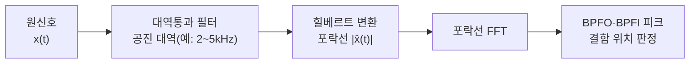

# Week 5. 예지보전 I — 정비 전략과 이상 탐지

> [!abstract] 이번 주의 질문
> **"설비가 멈추기 전에, 멈출 것이라는 신호를 어떻게 숫자로 잡아내는가?"**
> 정비 전략의 경제학(언제 고치는 것이 가장 싼가)에서 출발해, 진동 신호에서 결함 징후를 뽑는 신호처리(Feature Engineering), 그리고 정상만으로 학습하는 이상 탐지(Anomaly Detection) 모델까지 이어 간다.

| 구성 | 시간 | 내용 |
|---|---|---|
| 기본 지식 | 30분 | 정비 전략 5단계 · 고장 모드 · P-F 곡선 |
| 이론 | 60분 | 정비 의사결정의 경제학 · 진동 신호처리 · 이상 탐지 모형 |
| 케이스 | 45분 | Rolls-Royce TotalCare · Siemens Senseye · POSCO 스마트 고로 · 가상 케이스(프레스 라인) |
| 실습 | 45분 | CWRU 베어링 데이터 — 특징 추출 → 이상 점수 → 임계값 |

**학습 목표**
1. BM·PM·CBM·PdM·RxM의 차이를 **비용 구조**로 설명할 수 있다.
2. 교체 기준 확률 $p^{*}$와 P-F 간격의 의미를 정비 계획에 연결할 수 있다.
3. 진동 신호에서 시간영역 특징(RMS·첨도·Crest Factor)과 주파수영역 특징(FFT·포락선 스펙트럼·베어링 결함 주파수)을 뽑을 수 있다.
4. SPC·Isolation Forest·Autoencoder의 원리와 한계를 비교하고, 임계값을 **오경보 비용**과 함께 정할 수 있다.

---

## 1. 기본 지식

### 1.1 정비 전략 5단계

| 전략 | 영문 | 정비 시점을 정하는 기준 | 장점 | 한계 |
|---|---|---|---|---|
| 사후보전 | Breakdown Maintenance (BM) / Run-to-Failure | 고장 발생 | 평소 정비비 0 | 비계획 정지·2차 피해·안전 사고 |
| 예방보전 | Preventive Maintenance (PM) / Time-Based Maintenance (TBM) | 달력 시간·가동 시간 | 계획 가능, 단순 | 멀쩡한 부품 교체(과잉 정비), 우발 고장은 못 막음 |
| 상태기반보전 | Condition-Based Maintenance (CBM) | 측정한 상태가 기준을 넘을 때 | 과잉 정비 감소 | 기준값을 사람이 정함, 남은 시간은 모름 |
| 예지보전 | Predictive Maintenance (PdM) | 예측한 고장 시점·확률 | 최적 시점 정비, 부품·인력 사전 준비 | 데이터·모델·운영 절차 필요 |
| 처방보전 | Prescriptive Maintenance (RxM) | 예측 + 최적 조치 추천 | 무엇을·언제·누가까지 제시 | 정비 계획·재고·생산 계획과 통합 필요 |

> [!important] 핵심 구분
> - **CBM**은 "지금 상태가 나쁜가"를 본다 — 현재(now)의 판단.
> - **PdM**은 "언제 나빠질 것인가"를 본다 — 미래(when)의 판단.
> - **RxM**은 "그래서 무엇을 할 것인가"까지 답한다 — 행동(what)의 판단.
> 실무에서 "예지보전 도입"이라고 부르는 프로젝트의 상당수는 실제로는 CBM(임계값 경보) 단계다. 단계를 정확히 부르는 것이 기대 효과를 과장하지 않는 출발점이다.

### 1.2 모든 설비가 예지보전 대상은 아니다 — 고장 모드와 RCM

**RCM(Reliability-Centered Maintenance, 신뢰성 중심 정비)**은 설비별로 고장 모드와 그 영향을 따져 정비 전략을 다르게 배정하는 방법론이다. 출발점은 **FMEA(Failure Mode and Effects Analysis, 고장 모드 영향 분석)**다.

| 설비·부품 특성 | 적합한 전략 | 예 |
|---|---|---|
| 고장 영향이 작고 교체가 싸다 | BM | 조명, 소형 팬 |
| 수명이 일정하고 마모형이다 | PM(TBM) | 필터, 벨트, 윤활유 |
| 열화가 측정 가능하고 진행이 느리다 | CBM·PdM | 베어링, 기어박스, 펌프, 모터 |
| 고장 영향이 치명적이고 대체 설비가 없다 | PdM·RxM + 예비품 | 압연기 주전동기, 프레스 메인 기어, 압축기 |

> [!tip] 우선순위 정하는 법 — 위험 우선순위 수(RPN)
> FMEA에서는 고장 모드마다 심각도(Severity)·발생도(Occurrence)·검출도(Detection)를 1~10점으로 매겨 곱한다.
> $$\text{RPN}=S\times O\times D$$
> 예지보전은 이 중 **검출도 D를 낮추는(잘 잡아내는) 투자**다. RPN이 높고 D가 큰(검출이 어려운) 고장 모드가 예지보전의 1순위 후보다.

### 1.3 P-F 곡선 — 예지보전이 존재하는 이유

```mermaid
xychart-beta
    title "P-F 곡선 (설비 상태 vs 시간)"
    x-axis ["설치", "", "", "P", "", "", "", "F"]
    y-axis "설비 상태" 0 --> 100
    line [100, 100, 99, 97, 90, 75, 50, 10]
```

- **P(Potential Failure, 잠재 고장)**: 결함이 처음 측정 가능해지는 시점
- **F(Functional Failure, 기능 고장)**: 설비가 요구 기능을 못 하게 되는 시점
- **P-F 간격**: 계획 정비가 가능한 창(window)

| 검출 수단 | P-F 곡선상 위치 | 비고 |
|---|---|---|
| 초음파·고주파 진동(포락선) | 가장 이름 | 베어링 미세 결함 |
| 진동 RMS·스펙트럼 | 이름 | 불평형·정렬 불량·마모 |
| 윤활유 분석(마모 입자) | 중간 | 기어·엔진 |
| 열화상 | 늦음 | 마찰·전기 접촉 불량 |
| 청각·촉각(순회 점검) | 매우 늦음 | 사람의 오감 |

> [!note] 측정 주기와 P-F 간격
> 측정 주기가 P-F 간격보다 길면 결함을 놓친다. 관행적으로 **측정 주기를 P-F 간격의 절반 이하**로 잡는다. P-F 간격이 2주인 베어링을 월 1회 순회 점검하면 예지보전이 아니라 운에 맡기는 셈이다. 온라인 센서(상시 측정)의 경제성은 결국 이 부등식에서 나온다.

---

## 2. 이론 ① — 정비 의사결정의 경제학

### 2.1 교체 기준 확률

다음 정비 기회까지 고장 날 확률을 $p$, 지금 계획 교체하는 비용을 $C_P$, 기다리다 고장 날 때의 비용(부품 + 비계획 정지 손실 + 2차 피해 + 긴급 수리 프리미엄)을 $C_F$라 하자.

$$E[\text{기다림}]=p\,C_F,\qquad E[\text{지금 교체}]=C_P$$

$$\text{지금 교체}\iff p\,C_F>C_P\iff p>p^{*}=\frac{C_P}{C_F}$$

> [!example] 수치 예
> $C_P=200$만 원, $C_F=2{,}000$만 원이면 $p^{*}=10\%$. 모델이 1주 내 고장 확률을 15%로 내면 교체, 7%로 내면 대기한다.

**실무적 함의**
1. **모델의 출력은 '고장/정상' 분류가 아니라 확률이어야 한다.** 분류기의 0.5 임계값은 $C_F=2C_P$일 때만 맞는 값이다.
2. $C_F/C_P$ 비율이 클수록 $p^{*}$가 낮아져 **보수적으로(일찍) 교체**한다. 대체 설비가 없는 병목 설비일수록 $C_F$가 크다.
3. 확률이 잘 보정(calibration)되어 있지 않으면 이 규칙이 무너진다 — 모델이 "15%"라고 할 때 실제로 100번 중 15번 고장 나야 한다.

### 2.2 오경보와 미검출의 비용 — 임계값의 경제학

이상 탐지 모델은 점수 $s_t$가 임계값 $\tau$를 넘으면 경보를 낸다. 임계값을 낮추면 일찍 잡지만 오경보가 늘어난다.

| | 실제 결함 있음 | 실제 정상 |
|---|---|---|
| 경보 | 정탐 (True Positive) | **오경보 (False Positive)** — 불필요한 점검·정지 비용 $C_{FP}$ |
| 무경보 | **미검출 (False Negative)** — 고장 비용 $C_F$ | 정상 (True Negative) |

$$\tau^{*}=\arg\min_{\tau}\;\Big[C_{FP}\cdot\#\text{FP}(\tau)+C_F\cdot\#\text{FN}(\tau)\Big]$$

> [!warning] 경보 피로 (Alarm Fatigue)
> 오경보 비용은 점검 인건비로 끝나지 않는다. 오경보가 반복되면 현장이 경보 자체를 무시하게 되고, 그 순간 **미검출 확률이 사실상 1**이 된다. 숫자로 잡히지 않는 이 비용 때문에 실무에서는 경보를 **주의(Watch)·경고(Warning)·긴급(Alarm)**으로 단계화하고, 단계마다 다른 대응 절차(관찰 강화 → 점검 → 정지)를 붙인다.

### 2.3 경제성 지표

| 지표 | 정의 | 예지보전에서의 의미 |
|---|---|---|
| MTBF | 평균 고장 간격 | 늘어나야 한다 |
| MTTR | 평균 수리 시간 | 사전 준비로 줄어든다 |
| 가용도 | $A=\dfrac{\text{MTBF}}{\text{MTBF}+\text{MTTR}}$ | OEE의 가동률과 직결 |
| PM 준수율 | 계획 정비 이행 비율 | 경보 → 작업지시 전환 실적 |
| 계획 정비 비율 | 전체 정비 중 계획 정비 비중 | 성숙한 공장은 80% 이상을 목표로 하는 경우가 많다 |

$$A=\frac{\text{MTBF}}{\text{MTBF}+\text{MTTR}}$$

> [!example] 가용도 계산
> MTBF 400시간, MTTR 8시간이면 $A=400/408\approx98.0\%$. 예지보전으로 MTTR을 4시간(부품·인력 사전 준비)으로 줄이면 $A=400/404\approx99.0\%$. MTBF를 늘리지 않아도 **수리 준비만으로 가용도 1%p**가 오른다 — 연속 공정에서는 큰 금액이다.

---

## 3. 이론 ② — 진동 신호처리

### 3.1 왜 진동인가

회전 설비(모터·펌프·팬·압축기·기어박스)의 결함 대부분은 **주기적인 힘의 변화**를 만든다. 불평형(Unbalance)은 회전 주파수 $1\times$에서, 정렬 불량(Misalignment)은 $2\times$에서, 베어링 결함은 고유한 결함 주파수에서 진동을 키운다. 그래서 진동은 회전 설비의 **"심전도"**다.

| 결함 | 스펙트럼의 대표 특징 |
|---|---|
| 불평형 (Unbalance) | $1\times$ 회전 주파수 피크, 반경 방향 |
| 정렬 불량 (Misalignment) | $2\times$ 피크, 축 방향 진동 증가 |
| 기계적 풀림 (Looseness) | $1\times,2\times,3\times\cdots$ 다수 고조파 |
| 베어링 결함 | BPFO·BPFI·BSF·FTF 및 측대역(sideband) |
| 기어 결함 | 기어 맞물림 주파수(GMF)와 측대역 |

### 3.2 샘플링 기초

- **나이퀴스트(Nyquist) 조건**: 관찰하려는 최고 주파수의 2배 이상으로 샘플링해야 한다. 베어링 결함의 공진 대역이 수 kHz이므로 진동 센서는 보통 **10~50kHz**로 샘플링한다.
- **주파수 분해능**: $\Delta f=f_s/N$. 샘플링 주파수 12kHz로 1초(12,000개)를 모으면 1Hz 단위로 구분된다.

$$\Delta f=\frac{f_s}{N}$$

### 3.3 시간영역 특징 (Time-Domain Features)

길이 $n$의 진동 구간 $x_1,\dots,x_n$에 대해:

$$\text{RMS}=\sqrt{\frac{1}{n}\sum_{i=1}^{n}x_i^{2}}$$

$$\text{Kurtosis}=\frac{\frac{1}{n}\sum_{i}(x_i-\bar{x})^{4}}{\left(\frac{1}{n}\sum_{i}(x_i-\bar{x})^{2}\right)^{2}}$$

$$\text{Crest Factor}=\frac{\max_i|x_i|}{\text{RMS}}$$

| 특징 | 무엇을 보나 | 결함 진행과의 관계 |
|---|---|---|
| RMS | 진동 에너지(세기) | 결함이 **진행**될수록 꾸준히 증가 |
| 첨도 (Kurtosis) | 분포의 꼬리 — 충격성 | 결함 **초기**에 급상승, 결함이 넓어지면 오히려 하락 |
| Crest Factor | 순간 최대치 대비 평균 | 초기 충격에 민감 |
| Peak-to-Peak | 최대 진폭 | 큰 충격·풀림 |

> [!tip] 첨도가 '올랐다가 내려오는' 이유
> 가우시안 잡음의 첨도는 3이다. 베어링 레이스에 작은 흠집이 생기면 굴림 요소가 지날 때마다 짧은 충격이 생겨 분포의 꼬리가 두꺼워진다(첨도↑). 결함이 넓게 퍼지면 충격이 연속적인 진동이 되어 분포가 다시 둥글어지고 첨도가 떨어지는 대신 RMS가 크게 오른다. 그래서 **첨도 단독 경보는 진행된 결함을 놓칠 수 있다** — 두 지표를 함께 본다.

> [!note] 진동 심각도 기준 — ISO 20816
> 산업 현장에서는 진동 속도 RMS(mm/s)를 기계 등급별 구역(Zone A 신규 수준 ~ Zone D 손상 우려)으로 판정하는 ISO 10816/20816 계열 기준을 널리 쓴다. 이 기준은 **절대 수준의 CBM 경보**에 해당하고, 예지보전 모델은 그보다 앞서 **추세 변화**를 잡는 것이 목표다.

### 3.4 주파수영역 — FFT와 베어링 결함 주파수

**FFT(Fast Fourier Transform)**는 시간 신호를 주파수 성분으로 분해한다. 베어링 결함은 기하 구조로 정해지는 고유 주파수에서 나타난다. 회전 주파수 $f_r$(Hz), 굴림 요소 수 $n$, 굴림 요소 지름 $d$, 피치 지름 $D$, 접촉각 $\phi$일 때:

$$\text{BPFO}=\frac{n}{2}f_r\left(1-\frac{d}{D}\cos\phi\right)$$

$$\text{BPFI}=\frac{n}{2}f_r\left(1+\frac{d}{D}\cos\phi\right)$$

$$\text{BSF}=\frac{D}{2d}f_r\left[1-\left(\frac{d}{D}\cos\phi\right)^{2}\right]$$

$$\text{FTF}=\frac{f_r}{2}\left(1-\frac{d}{D}\cos\phi\right)$$

| 기호 | 이름 | 결함 위치 |
|---|---|---|
| BPFO | Ball Pass Frequency Outer race | 외륜 |
| BPFI | Ball Pass Frequency Inner race | 내륜 |
| BSF | Ball Spin Frequency | 굴림 요소 |
| FTF | Fundamental Train Frequency | 케이지(리테이너) |

> [!example] 손계산 — 외륜 결함 주파수
> 회전 속도 1,800rpm($f_r=30$Hz), 굴림 요소 9개, $d/D=0.2$, 접촉각 0°.
> $$\text{BPFO}=\frac{9}{2}\times30\times(1-0.2)=4.5\times30\times0.8=108\text{ Hz}$$
> $$\text{BPFI}=4.5\times30\times1.2=162\text{ Hz}$$
> 스펙트럼에서 108Hz와 그 배수(216, 324Hz…)에 피크가 서면 외륜 결함을 의심한다. 내륜 결함은 회전에 따라 하중 영역을 드나들므로 162Hz 주변에 $\pm f_r$(±30Hz) **측대역**이 붙는다.

### 3.5 포락선 분석 (Envelope Analysis)

초기 베어링 결함의 충격은 에너지가 작아 원신호 스펙트럼에서는 회전 성분·잡음에 묻힌다. 대신 충격이 **베어링·하우징의 고유 공진 대역(수 kHz)을 두드리므로**, 그 대역을 필터링한 뒤 진폭의 포락선(envelope)을 구해 스펙트럼을 보면 결함 주파수가 선명하게 드러난다.



$$\text{env}(t)=\left|x_{bp}(t)+j\,\mathcal{H}\{x_{bp}\}(t)\right|$$

> [!important] 실무 요약
> 시간영역 특징(RMS·첨도)은 **"이상이 있는가"**를, 포락선 스펙트럼은 **"어디가 이상한가"**를 답한다. 정비 작업지시에는 후자가 필요하다 — "3번 펌프 이상"이 아니라 "3번 펌프 구동단 베어링 외륜 결함 의심"이어야 부품과 인력을 준비할 수 있다.

---

## 4. 이론 ③ — 이상 탐지 모형

### 4.1 왜 '정상만 학습'하는가

공장 데이터는 극단적으로 불균형하다. 고장 사례는 설비당 수년에 몇 건이고, 그마저 고장 모드가 제각각이다. 그래서 지도학습 분류기 대신 **정상 운전 데이터로 '정상의 모양'을 학습하고, 거기서 벗어난 정도를 이상 점수로 쓰는** 비지도·준지도 접근이 기본이 된다.

### 4.2 통계적 공정관리 — Shewhart 관리도와 EWMA

$$\text{경보}\iff|x_t-\mu_0|>L\,\sigma_0\quad(L=3)$$

정상 구간의 평균 $\mu_0$, 표준편차 $\sigma_0$로 관리 한계를 정한다. 정규분포에서 $L=3$이면 정상 상태에서 경보가 날 확률(제1종 오류)이 약 0.27%다.

작은 추세 변화에는 **EWMA(Exponentially Weighted Moving Average)** 관리도가 더 민감하다.

$$z_t=\lambda x_t+(1-\lambda)z_{t-1},\qquad 0<\lambda\le1$$

$$\text{UCL}=\mu_0+L\sigma_0\sqrt{\frac{\lambda}{2-\lambda}}$$

> [!tip] 언제 무엇을 쓰나
> - 큰 충격·급변 → Shewhart ($L=3$)
> - 느린 열화 추세 → EWMA ($\lambda=0.1\sim0.3$)
> - 여러 센서를 동시에 → Hotelling $T^2$ (다변량)

### 4.3 다변량 — Hotelling $T^{2}$와 마할라노비스 거리

센서가 여러 개면 개별 관리도로는 **상관 구조의 깨짐**을 못 잡는다. 예를 들어 "부하가 오르면 온도도 오르는" 정상 관계가 깨진 상태는 각 센서가 정상 범위여도 이상이다.

$$T^{2}_t=(\mathbf{x}_t-\boldsymbol{\mu})^{\top}\boldsymbol{\Sigma}^{-1}(\mathbf{x}_t-\boldsymbol{\mu})$$

### 4.4 Isolation Forest

무작위로 변수와 분할점을 골라 데이터를 계속 자르면, **이상치는 몇 번 만에 혼자 떨어진다**. 고립될 때까지 걸린 평균 분할 횟수(경로 길이) $h(x)$가 짧을수록 이상이다.

$$s(x)=2^{-\frac{E[h(x)]}{c(n)}},\qquad c(n)=2H(n-1)-\frac{2(n-1)}{n}$$

- $s\to1$: 이상, $s\ll0.5$: 정상
- 장점: 분포 가정 없음, 고차원·대용량에 빠름
- 한계: 시계열 순서를 직접 보지 못함 → 창(window) 단위 특징을 만들어 넣는다

### 4.5 Autoencoder — 재구성 오차

정상 데이터만으로 "압축했다가 복원하는" 신경망을 학습한다. 정상 패턴은 잘 복원되고, 처음 보는 패턴은 복원이 엉망이 된다.

$$\hat{\mathbf{x}}=g_{\phi}\big(f_{\theta}(\mathbf{x})\big),\qquad s(\mathbf{x})=\lVert\mathbf{x}-\hat{\mathbf{x}}\rVert_2^{2}$$


### 4.6 모형 비교

| 모형 | 원리 | 해석성 | 데이터 요구 | 강점 | 약점 |
|---|---|---|---|---|---|
| Shewhart·EWMA | 평균·분산 이탈 | 매우 높음 | 적음 | 현장 설명이 쉬움 | 단변량, 운전 조건 변화에 취약 |
| Hotelling $T^2$ / PCA | 공분산 구조 이탈 | 높음 | 중간 | 센서 간 관계 이상 | 비선형 관계 약함 |
| Isolation Forest | 고립 용이성 | 중간 | 중간 | 빠름, 가정 적음 | 시계열 맥락 없음 |
| Autoencoder (LSTM-AE 포함) | 재구성 오차 | 낮음 | 많음 | 비선형·시계열 패턴 | 운전 조건 변화를 이상으로 착각 |

> [!warning] 가장 흔한 실패 — 운전 조건 변화(Operating Regime Shift)
> 생산 품목·속도·부하가 바뀌면 진동·온도의 '정상' 수준 자체가 바뀐다. 이를 모델이 이상으로 판정하면 오경보가 폭증한다. 해법은 ① 운전 조건별로 정상 기준을 따로 학습(regime-wise baseline)하거나 ② 부하·속도를 입력에 넣어 **조건부 정상**을 학습하거나 ③ 속도로 정규화한 차수 분석(order analysis)을 쓰는 것이다. PoC에서는 잘 되다가 양산 라인에서 실패하는 이유의 대부분이 여기에 있다.

---

## 5. 케이스 스터디

### 케이스 1. Rolls-Royce TotalCare — 정비가 '상품'이 되다

- **배경**: 항공 엔진 제조사인 Rolls-Royce는 엔진을 판 뒤 정비로 돈을 버는 전통 모델 대신, 엔진 **가동 시간당 요금**을 받고 정비 책임을 함께 지는 계약(TotalCare, 흔히 "Power by the Hour"로 불림)을 확대했다.
- **예지보전과의 연결**: 제조사가 정비 비용을 떠안으면, 엔진 상태 모니터링(Engine Health Monitoring)으로 고장을 미리 잡는 것이 곧 **제조사의 이익**이 된다. 비행 중 엔진 데이터를 지상으로 보내 분석하고, 이상 징후가 보이면 정비 일정·부품을 선제적으로 배치한다.
- **토론 질문**
  1. 이 계약에서 $C_F$(고장 비용)는 누가 부담하는가? 그것이 예지보전 투자 의사결정을 어떻게 바꾸는가?
  2. 국내 공작기계·로봇 제조사가 비슷한 성과 기반 계약을 제안하려면 어떤 데이터 권리 조항이 필요한가?

> [!quote] 시사점
> 예지보전의 가치는 **정비 비용을 누가 부담하는 구조인가**에 따라 달라진다. 비용과 데이터가 같은 손에 있을 때 투자가 가장 빨리 회수된다.

### 케이스 2. Siemens × Senseye — 예지보전의 '확산' 문제

- **배경**: Siemens는 2022년 영국의 예지보전 소프트웨어 기업 Senseye를 인수해 자사 산업 소프트웨어 포트폴리오에 편입했다.
- **핵심 쟁점**: 수백~수천 대의 이질적인 설비마다 모델을 손으로 만들 수는 없다. 인수의 배경에는 **설비별 맞춤 모델이 아니라, 다수 자산에 자동으로 정상 기준을 학습시키는 확장성**에 대한 수요가 있다.
- **토론 질문**
  1. 설비 1대에 정밀한 모델 vs 설비 1,000대에 단순한 모델 — 공장 전체 가용도를 더 올리는 쪽은 어디인가?
  2. 자동화된 모델이 놓치는 고장 모드는 무엇이고, 사람(설비 전문가)은 어디에 남아야 하는가?

### 케이스 3. POSCO 포항제철소 — 연속 공정의 AI

- **배경**: POSCO 포항제철소는 2019년 WEF 등대공장(Lighthouse)으로 선정되었으며, 고로(용광로) 조업에 AI를 적용한 사례로 알려져 있다.
- **연속 공정의 특성**: 철강·석유화학 같은 연속 공정은 한 설비의 정지가 공정 전체를 세우고, 재가동 비용이 크다. 즉 $C_F$가 극단적으로 크고, $p^{*}$가 매우 낮다.
- **토론 질문**
  1. $C_F$가 매우 큰 공정에서 오경보를 줄이는 것과 미검출을 줄이는 것 중 무엇이 우선인가?
  2. 고로처럼 "직접 들여다볼 수 없는" 설비에서 센서 데이터는 무엇을 대신하는가?

### 케이스 4. (가상) A사 프레스 라인 — PoC는 성공, 확산은 실패

> [!example] 가상 케이스 — 교육용으로 구성한 상황
> 자동차 부품사 A사는 1,000톤 프레스 1대의 메인 기어박스에 진동 센서를 달아 Autoencoder 기반 이상 탐지를 6개월 운영했다. 그 기간 실제 결함 2건을 평균 9일 전에 잡아 "PoC 성공"을 보고했다. 그러나 같은 모델을 프레스 12대로 넓히자 첫 달 오경보가 하루 평균 14건 발생했고, 3개월 뒤 현장은 경보 화면을 끄고 순회 점검으로 돌아갔다.
>
> **원인 분석 (교재용 정답 예시)**
> 1. **운전 조건**: PoC 설비는 단일 금형만 썼지만, 확산 설비는 금형 교체가 하루 3~4회였다 — 금형마다 정상 진동 수준이 달랐다.
> 2. **센서 설치 편차**: 부착 위치·방식(마그네틱 vs 스터드)이 설비마다 달라 같은 기준을 쓸 수 없었다.
> 3. **업무 절차 부재**: 경보가 오면 누가 확인하고, 언제 정지 결정을 내리는지 정해져 있지 않았다.
> 4. **KPI 부재**: "몇 건 잡았는가"만 보고, 오경보율·경보→작업지시 전환율을 보지 않았다.
>
> **토론 질문**: 확산 계획을 다시 짠다면 첫 3개월에 무엇을 바꾸겠는가?

---

## 6. 실습 — CWRU 베어링 데이터로 이상 탐지

> [!info] 데이터
> **CWRU Bearing Data Center**(Case Western Reserve University) — 모터 구동단·팬단 베어링에 인위적 결함(내륜·외륜·볼, 결함 지름 0.007·0.014·0.021인치)을 넣고 부하별로 진동을 측정한 공개 데이터. 12kHz·48kHz 샘플링 `.mat` 파일로 제공된다. 실습 노트북이 직접 내려받는다.

### 6.1 실습 흐름


### 6.2 코드 골격

```python
import numpy as np
from scipy.io import loadmat
from scipy.signal import butter, filtfilt, hilbert
from scipy.stats import kurtosis
from sklearn.ensemble import IsolationForest

FS = 12_000          # 샘플링 주파수 (Hz)
WIN = FS             # 1초 창
FR = 1797 / 60       # 회전 주파수 (Hz) — 0마력 부하 조건

def windows(x, win=WIN, step=WIN // 2):
    return np.stack([x[i:i + win] for i in range(0, len(x) - win, step)])

def env_spectrum(w, lo=2000, hi=5000):
    b, a = butter(4, [lo / (FS / 2), hi / (FS / 2)], btype="band")
    env = np.abs(hilbert(filtfilt(b, a, w)))
    spec = np.abs(np.fft.rfft(env - env.mean()))
    freq = np.fft.rfftfreq(len(env), 1 / FS)
    return freq, spec

def band_energy(freq, spec, f0, bw=3):
    return spec[(freq > f0 - bw) & (freq < f0 + bw)].sum()

def features(w, bpfo, bpfi):
    rms = np.sqrt(np.mean(w ** 2))
    f, s = env_spectrum(w)
    return [rms, kurtosis(w, fisher=False), np.max(np.abs(w)) / rms,
            band_energy(f, s, bpfo), band_energy(f, s, bpfi)]

# 6205-2RS 구동단 베어링 결함 주파수(회전 주파수 배수, CWRU 제공값)
BPFO, BPFI = 3.5848 * FR, 5.4152 * FR

# normal, inner, outer = loadmat(...)[...] 로 각 신호를 1차원 배열로 읽는다
Xn = np.array([features(w, BPFO, BPFI) for w in windows(normal)])
Xf = np.array([features(w, BPFO, BPFI) for w in windows(np.r_[inner, outer])])

n_tr = int(len(Xn) * 0.7)
mu, sd = Xn[:n_tr].mean(0), Xn[:n_tr].std(0)
z = lambda X: (X - mu) / sd                       # 정상 기준 표준화

iso = IsolationForest(n_estimators=300, random_state=0).fit(z(Xn[:n_tr]))
score = lambda X: -iso.score_samples(z(X))        # 클수록 이상
tau = np.quantile(score(Xn[:n_tr]), 0.99)         # 정상 99백분위수

print("오경보율:", np.mean(score(Xn[n_tr:]) > tau))
print("탐지율  :", np.mean(score(Xf) > tau))
```

### 6.3 해석 과제

1. 특징을 RMS 하나만 쓸 때와 5개를 모두 쓸 때 탐지율·오경보율을 비교하라. 어느 결함 유형에서 차이가 가장 큰가?
2. 임계값을 정상 95·99·99.9 백분위수로 바꿔 오경보율과 탐지율의 변화를 표로 정리하라. $C_{FP}=30$만 원, $C_F=2{,}000$만 원이라면 어느 임계값을 고르겠는가?
3. 부하 조건(0~3마력)이 다른 정상 데이터로 테스트하면 오경보율은 어떻게 변하는가? 이것이 §4.6의 경고와 어떻게 연결되는가?
4. 포락선 스펙트럼에서 외륜 결함 신호의 BPFO 피크를 직접 그려 확인하라.

> [!tip] Claude Code로 진행할 때의 프롬프트 예
> ```
> CWRU 12k 구동단 데이터에서 정상(97.mat), 내륜 0.007(105.mat), 외륜 0.007(130.mat)을 내려받아
> 1) 1초 창(50% 겹침)마다 RMS·첨도·Crest Factor·BPFO/BPFI 포락선 에너지를 계산해 features.csv로 저장
> 2) 정상 70%로 Isolation Forest를 학습하고, 임계값 95/99/99.9 백분위수별 탐지율·오경보율 표 출력
> 3) 외륜 신호의 포락선 스펙트럼을 그려 BPFO와 배수에 세로선을 표시해 env_outer.png로 저장
> 난수 시드는 0으로 고정하고 코드는 w05_anomaly.py로 남겨줘.
> ```

---

## 7. 정리

> [!check] 이번 주 핵심
> 1. 정비 전략은 **비용 구조**로 고른다 — RCM·FMEA로 설비마다 다르게 배정한다.
> 2. 교체 판단은 $p>p^{*}=C_P/C_F$. 모델은 **보정된 확률**을 내야 한다.
> 3. 시간영역 특징은 "이상 여부", 포락선 스펙트럼은 "결함 위치"를 답한다.
> 4. 이상 탐지는 정상만 학습한다. 가장 큰 적은 **운전 조건 변화**와 **경보 피로**다.
> 5. 다음 주는 "언제"를 묻는다 — 잔여수명(RUL) 예측과 정비 일정 최적화.

## 8. 확인 문제

1. 대체 설비가 없는 압연기 주전동기와, 예비품이 창고에 있는 냉각 팬이 있다. 같은 이상 탐지 모델이 두 설비에 "고장 확률 8%"를 냈을 때 대응이 달라야 하는 이유를 $p^{*}$로 설명하라.
2. 어떤 베어링의 첨도가 3주 전 급상승했다가 지금은 원래 수준으로 돌아왔고, RMS는 꾸준히 오르고 있다. 정비 담당자가 "첨도가 정상화됐으니 괜찮다"고 판단했다. 이 판단의 문제점은?
3. 진동 센서 측정 주기를 1주에서 1일로 바꾸는 비용이 설비당 연 150만 원이다. 이 투자가 정당화되려면 P-F 간격과 고장 비용에 대해 무엇을 확인해야 하는가?
4. 품목 전환이 잦은 라인에 단일 Autoencoder를 적용했더니 품목 전환 직후마다 경보가 난다. 원인과 개선 방안 두 가지를 제시하라.

> [!success]- 해설
> 1. 주전동기는 $C_F$(라인 전체 정지 + 장납기 부품)가 매우 커서 $p^{*}$가 낮다 — 8%라도 즉시 정비 준비가 맞을 수 있다. 냉각 팬은 $C_F$가 작아 $p^{*}$가 높으므로 대기·관찰이 합리적이다. 같은 확률, 다른 행동이 정답이다.
> 2. 결함이 초기 충격 단계를 지나 넓게 퍼지면 첨도는 내려오고 RMS가 오른다. 첨도 하락은 회복이 아니라 **결함 진행** 신호일 수 있다. RMS 추세와 포락선 스펙트럼의 결함 주파수 피크를 함께 확인해야 한다.
> 3. 측정 주기가 P-F 간격의 절반 이하인지(현재 1주가 이미 충분한지), 그리고 주기를 줄여 회피되는 기대 고장 비용(고장 확률 × $C_F$의 감소분)이 연 150만 원을 넘는지 확인해야 한다.
> 4. 품목(운전 조건)별로 정상 진동 수준이 달라 모델이 조건 변화를 이상으로 본다. ① 품목·부하·속도를 입력 변수로 넣어 조건부 정상을 학습하거나 ② 품목별 기준 모델을 따로 두고, 전환 직후 안정화 구간은 경보에서 제외(마스킹)한다.

## 참고 자료
- Jardine, A. K. S., Lin, D., & Banjevic, D. (2006). A review on machinery diagnostics and prognostics implementing condition-based maintenance. *Mechanical Systems and Signal Processing*, 20(7).
- Randall, R. B., & Antoni, J. (2011). Rolling element bearing diagnostics — A tutorial. *Mechanical Systems and Signal Processing*, 25(2).
- Liu, F. T., Ting, K. M., & Zhou, Z.-H. (2008). Isolation Forest. *ICDM*.
- Moubray, J. *Reliability-Centered Maintenance* (2nd ed.).
- Case Western Reserve University Bearing Data Center.
- [Siemens UK — Siemens acquires Senseye](https://news.siemens.co.uk/news/siemens-acquires-senseye-predictive-maintenance-and-asset-intelligence-for-industrial-companies)
