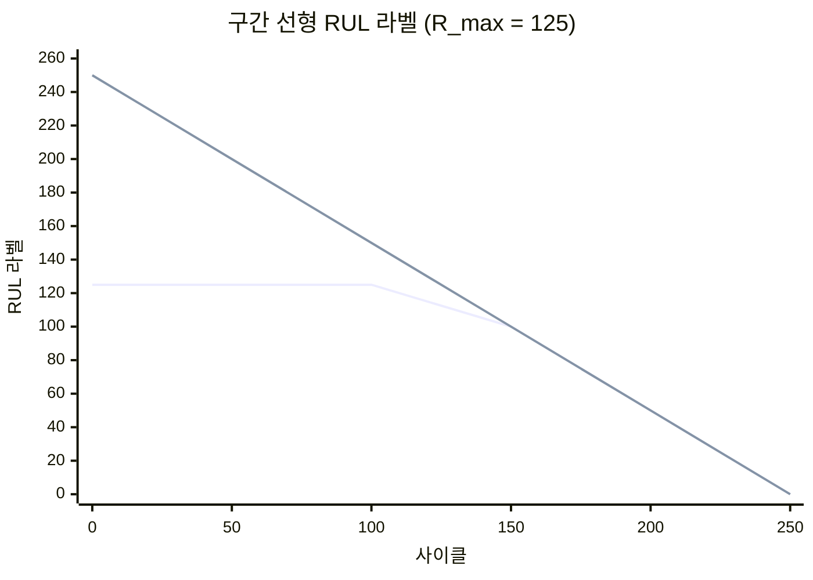
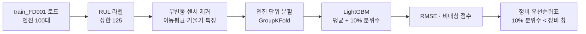

# Week 6. 예지보전 II — 잔여수명(RUL) 예측과 정비 의사결정

> [!abstract] 이번 주의 질문
> 지난주는 **"지금 이상한가"**를 물었다. 이번 주는 **"언제 고장 나는가, 그래서 언제 정비할 것인가"**를 묻는다.
> 신뢰성 공학의 수명 분포(Weibull)로 '같은 부품의 평균적인 수명'을, 센서 데이터 기반 머신러닝으로 '지금 이 설비의 남은 수명'을 추정하고, 그 예측을 **정비 시점·정비 일정**으로 바꾸는 방법까지 다룬다.

| 구성 | 시간 | 내용 |
|---|---|---|
| 기본 지식 | 30분 | 진단과 예측 · RUL의 정의 · 중도절단 · 건강 지수 |
| 이론 | 60분 | 신뢰성 함수와 Weibull · 조건부 고장 확률 · 연령 교체 정책 · 데이터 기반 RUL 모형 · 구간 예측 |
| 케이스 | 45분 | NASA PHM08 챌린지 · 항공 엔진 정비 계획 · 가상 케이스(압축기 12대 일정) |
| 실습 | 45분 | NASA C-MAPSS FD001 — RUL 예측 → 비대칭 점수 → 정비 우선순위표 |

**학습 목표**
1. 진단(Diagnostics)과 예측(Prognostics)을 구분하고, RUL을 확률 분포로 이해한다.
2. Weibull 신뢰도·고장률·조건부 고장 확률을 계산하고, 지난주의 교체 기준 확률 $p^{*}$와 연결한다.
3. 연령 교체 정책의 비용률을 세워 최적 교체 주기를 구한다.
4. C-MAPSS 데이터로 RUL 모형을 만들고, **비대칭 비용**을 반영해 평가·운영한다.

---

## 1. 기본 지식

### 1.1 진단과 예측

| 구분 | 진단 (Diagnostics) | 예측 (Prognostics) |
|---|---|---|
| 질문 | 지금 무엇이 잘못되었나? | 언제 기능을 잃는가? |
| 출력 | 이상 여부·결함 유형·위치 | 잔여수명(RUL)·고장 확률의 시간 경로 |
| 정비 전략 | CBM | PdM·RxM |
| 지난주·이번 주 | Week 5 | **Week 6** |

**PHM(Prognostics and Health Management)**은 감지 → 진단 → 예측 → 의사결정을 하나의 체계로 묶는 분야 이름이다.

### 1.2 RUL의 정의

시점 $t$까지 고장 없이 운전한 설비의 고장 시점을 $T$라 할 때,

$$\text{RUL}(t)=T-t\quad\text{given}\quad T>t$$

RUL은 **하나의 숫자가 아니라 확률 분포**다. "남은 수명 40사이클"은 "40사이클 근처에 분포의 중심이 있다"는 뜻일 뿐이고, 정비 의사결정에는 분포의 **아래쪽 꼬리**(일찍 고장 날 가능성)가 더 중요하다.

### 1.3 중도절단 (Censoring)

고장 데이터를 모을 때, 상당수 설비는 **고장 나기 전에 예방 교체**되거나 관찰 기간이 끝난다. 이 설비들의 진짜 수명은 "최소 이만큼"으로만 알려진다 — 이것이 **우측 중도절단(Right Censoring)**이다.

> [!warning] 중도절단을 버리면 수명을 과소평가한다
> 고장 난 설비만 모아 평균 수명을 내면, 오래 버티다 예방 교체된 설비가 빠지므로 수명이 짧게 추정된다. 생존분석(Kaplan–Meier, Weibull 최우추정)은 중도절단 관측치를 "적어도 그때까지는 살아 있었다"는 정보로 함께 쓴다. **잘 정비하는 공장일수록 고장 데이터가 적고 중도절단이 많다** — 그래서 공장 데이터만으로 수명 분포를 추정하기 어렵다.

### 1.4 건강 지수 (Health Index, HI)

여러 센서 신호를 하나의 열화 척도로 합친 값이다. 신품 1, 고장 0으로 정규화하는 경우가 많다.


---

## 2. 이론 ① — 신뢰성 함수와 Weibull 분포

### 2.1 네 가지 함수

| 함수 | 정의 | 뜻 |
|---|---|---|
| 신뢰도 $R(t)$ | $P(T>t)$ | 시간 $t$까지 살아 있을 확률 |
| 불신뢰도 $F(t)$ | $1-R(t)$ | 시간 $t$까지 고장 날 확률 |
| 확률밀도 $f(t)$ | $dF/dt$ | 시간 $t$ 부근에서 고장 날 밀도 |
| 고장률 $h(t)$ | $f(t)/R(t)$ | 지금까지 살아 있는 설비가 **바로 다음 순간** 고장 날 비율 |

$$h(t)=\frac{f(t)}{R(t)},\qquad \text{MTTF}=\int_{0}^{\infty}R(t)\,dt$$

### 2.2 Weibull 분포

$$R(t)=\exp\!\left[-\left(\frac{t}{\eta}\right)^{\beta}\right],\qquad h(t)=\frac{\beta}{\eta}\left(\frac{t}{\eta}\right)^{\beta-1}$$

$$\text{MTTF}=\eta\,\Gamma\!\left(1+\frac{1}{\beta}\right)$$

| 형상 모수 $\beta$ | 고장률 $h(t)$ | 고장 유형 | 맞는 정비 전략 |
|---|---|---|---|
| $\beta<1$ | 시간이 갈수록 감소 | 초기 고장(Infant Mortality) — 조립·설치 불량 | 번인(Burn-in)·설치 품질 관리. **예방 교체는 오히려 해롭다** |
| $\beta=1$ | 일정 (지수분포) | 우발 고장(Random) | 시간 기반 교체 무의미. 상태 감시 |
| $\beta>1$ | 시간이 갈수록 증가 | 마모 고장(Wear-out) — 베어링·기어·피로 | 예방 교체·예지보전 |

> [!important] 왜 $\beta$가 정비 전략을 정하는가
> $\beta\le1$이면 오래된 부품이 새 부품보다 더 위험하지 않다. 그런데도 주기 교체를 하면 멀쩡한 부품을 새 부품의 초기 고장 위험과 바꾸는 셈이다. 항공 정비 분야의 고전적 연구들이 "많은 부품의 고장 패턴이 마모형이 아니다"라는 결론을 내린 뒤, 정비 철학이 시간 기반에서 RCM·상태 기반으로 옮겨 간 배경이 여기에 있다.

> [!example] 손계산 — 베어링 $\eta=1{,}000$h, $\beta=2$
> $$R(500)=e^{-0.25}\approx0.78,\qquad R(1000)=e^{-1}\approx0.37$$
> $$\text{MTTF}=1000\times\Gamma(1.5)=1000\times0.886\approx886\text{ h}$$
> 특성 수명 $\eta$에서는 언제나 약 63.2%($1-e^{-1}$)가 고장 나 있다. 평균 수명(886h)은 $\eta$보다 짧다.

### 2.3 Weibull 모수 추정 — Weibull 확률지

$\ln[-\ln R(t)]=\beta\ln t-\beta\ln\eta$ 이므로, 고장 시간을 $x=\ln t$, $y=\ln[-\ln(1-\hat F)]$로 찍으면 **기울기가 $\beta$인 직선**이 된다.

$$\ln\!\big[-\ln R(t)\big]=\beta\ln t-\beta\ln\eta$$

$\hat F$는 순위 기반 근사(Bernard 근사) $\hat F_i\approx(i-0.3)/(n+0.4)$를 쓴다. 중도절단이 있으면 최우추정(MLE)으로 추정한다.

### 2.4 조건부 고장 확률 — 지난주 $p^{*}$와의 연결

이미 $t$시간을 버틴 설비가 다음 $\Delta$시간 안에 고장 날 확률은

$$p(t,\Delta)=1-\frac{R(t+\Delta)}{R(t)}$$

> [!example] 손계산 — 800시간 사용한 베어링이 다음 100시간 안에 고장 날 확률
> $$p=1-\frac{R(900)}{R(800)}=1-e^{-(0.81-0.64)}=1-e^{-0.17}\approx0.156$$
> 지난주 예제($C_P=200$만, $C_F=2{,}000$만 → $p^{*}=10\%$)라면 15.6% > 10%이므로 **이번 정비 창에서 교체**한다.
> 같은 계산을 매 정비 창마다 반복하는 것이 **수명 분포 기반 정비 의사결정**이다.

---

## 3. 이론 ② — 연령 교체 정책 (Age Replacement Policy)

센서 없이 수명 분포만 알 때, 부품을 사용 시간 $T$에서 예방 교체하거나(비용 $C_P$) 그 전에 고장 나면 사후 교체(비용 $C_F$)한다. **장기 평균 비용률**(시간당 비용)은 갱신 보상 정리(Renewal Reward Theorem)로

$$C(T)=\frac{C_P\,R(T)+C_F\,\big[1-R(T)\big]}{\int_{0}^{T}R(t)\,dt}$$

분자는 한 주기의 기대 비용, 분모는 한 주기의 기대 길이다. $C(T)$를 최소화하는 $T^{*}$가 최적 예방 교체 주기다.

> [!example] 수치 예 — $\eta=1{,}000$h, $\beta=2$, $C_P=200$만, $C_F=2{,}000$만
>
> | 교체 주기 $T$ | 비용률 (만 원/h) |
> |---|---|
> | 300h | 1.22 |
> | **약 337h** | **1.21 (최소)** |
> | 500h | 1.30 |
> | 800h | 1.60 |
> | 교체 안 함 (고장 시 교체) | $C_F/\text{MTTF}=2000/886\approx2.26$ |
>
> 예방 교체만으로 비용률이 고장 후 교체의 약 54% 수준으로 내려간다. 단, $T^{*}=337$h은 **평균 수명(886h)의 38%** 시점이다 — 대부분의 부품을 수명이 한참 남은 상태에서 버린다는 뜻이다.

> [!important] 예지보전의 가치가 나오는 곳
> 연령 교체는 "같은 종류 부품의 평균"으로 주기를 정하므로, 오래 버틸 개체와 일찍 죽을 개체를 구분하지 못한다. **센서 기반 RUL 예측은 개체별로 교체 시점을 다르게 잡아**, 일찍 죽을 개체는 앞당기고 오래 버틸 개체는 뒤로 미룬다. 그 결과 비용률을 연령 교체($1.21$)보다 더 낮출 수 있다 — 예지보전의 경제적 가치는 정확히 **연령 교체 대비 개선분**으로 측정해야 한다. "고장 후 교체 대비 개선분"으로 보고하면 효과가 과장된다.

---

## 4. 이론 ③ — 데이터 기반 RUL 예측

### 4.1 접근법 지도

| 접근 | 아이디어 | 필요한 것 | 예 |
|---|---|---|---|
| 물리 기반 (Physics-based) | 균열 성장·마모 법칙 | 재료·하중 모형 | Paris 법칙(피로 균열) |
| 통계적 열화 모형 | 건강 지수를 확률 과정으로 | 열화 궤적 데이터 | 지수 열화 모형, Wiener 과정 |
| 머신러닝 회귀 | 특징 → RUL 직접 회귀 | run-to-failure 데이터 | LightGBM, Random Forest |
| 딥러닝 시계열 | 센서 시퀀스 → RUL | 대량 run-to-failure 데이터 | LSTM, 1D-CNN, Transformer |
| 하이브리드 | 물리 제약 + 데이터 | 둘 다 | Physics-Informed NN |

### 4.2 통계적 열화 모형 — 지수 열화와 Wiener 과정

$$\text{HI}(t)=\theta\,e^{\gamma t}+\varepsilon_t$$

$$X(t)=X_0+\mu t+\sigma B(t)$$

Wiener 과정 $X(t)$(드리프트 $\mu$, 확산 $\sigma$, 표준 브라운 운동 $B$)가 고장 임계값 $D$에 처음 닿는 시간은 **역가우스(Inverse Gaussian) 분포**를 따른다. 그래서 RUL의 분포가 닫힌 형태로 나온다.

$$\text{RUL}\sim\text{IG}\!\left(\frac{D-X(t)}{\mu},\;\frac{\big(D-X(t)\big)^{2}}{\sigma^{2}}\right)$$

> [!tip] 실무에서의 의미
> 열화 속도 $\mu$가 같아도 변동 $\sigma$가 크면 RUL 분포의 아래쪽 꼬리가 두꺼워진다. **"평균 RUL 40일"인 두 설비 중 변동이 큰 쪽을 먼저 정비**하는 것이 합리적이다.

### 4.3 NASA C-MAPSS 데이터

C-MAPSS(Commercial Modular Aero-Propulsion System Simulation)는 NASA가 터보팬 엔진 열화를 시뮬레이션해 공개한 데이터로, RUL 연구의 표준 벤치마크다.

| 하위 데이터 | 운전 조건 | 고장 모드 | 학습 엔진 수 |
|---|---|---|---|
| FD001 | 1개 | 1개 (HPC 열화) | 100 |
| FD002 | 6개 | 1개 | 260 |
| FD003 | 1개 | 2개 (HPC·Fan) | 100 |
| FD004 | 6개 | 2개 | 249 |

- 각 행 = 엔진 1대의 1사이클: 엔진 번호, 사이클, 운전 설정 3개, 센서 21개
- **학습 데이터**: 처음부터 고장까지(run-to-failure)
- **테스트 데이터**: 고장 전 임의 시점에서 잘림 → 그 시점의 RUL을 맞히는 문제

### 4.4 RUL 라벨링 — 구간 선형 상한 (Piecewise-Linear Cap)

엔진 초기에는 열화가 관측되지 않으므로, "남은 300사이클"과 "남은 250사이클"을 센서로 구분할 수 없다. 그래서 라벨에 상한을 둔다.

$$\text{RUL}_{\text{target}}(t)=\min\big(T_{\text{fail}}-t,\;R_{\max}\big),\qquad R_{\max}\approx125$$



> [!note] 상한의 효과
> 모델이 "열화 시작 전에는 모두 125"라고 배우므로 초기 구간의 무의미한 오차가 줄고, 실제로 중요한 **고장 임박 구간의 정확도**에 학습이 집중된다. 상한값은 데이터에서 열화가 보이기 시작하는 지점을 보고 정한다.

### 4.5 평가 — RMSE와 비대칭 점수

예측 오차 $d_i=\widehat{\text{RUL}}_i-\text{RUL}_i$. **늦게 예측하는 것(실제보다 길게 보는 것, $d>0$)이 더 위험하다** — 정비 전에 고장 난다.

$$\text{RMSE}=\sqrt{\frac{1}{N}\sum_{i}d_i^{2}}$$

$$S=\sum_{i}\begin{cases}e^{-d_i/13}-1, & d_i<0\\ e^{d_i/10}-1, & d_i\ge0\end{cases}$$

| 오차 | 점수 $S$ 기여 |
|---|---|
| 10사이클 일찍 ($d=-10$) | $e^{10/13}-1\approx1.16$ |
| 10사이클 늦게 ($d=+10$) | $e^{1}-1\approx1.72$ |
| 30사이클 늦게 ($d=+30$) | $e^{3}-1\approx19.1$ |

> [!important] 평가지표 = 비용 구조
> 이 점수 함수는 2008년 PHM 학회 데이터 챌린지에서 쓰인 것으로, **늦은 예측에 지수적으로 더 큰 벌점**을 준다. 실무에서는 이 상수(13·10)를 그대로 쓰기보다, 자기 공장의 $C_P$·$C_F$로 **비용 가중 손실**을 직접 설계하는 편이 낫다.

### 4.6 점 예측에서 구간 예측으로

정비 의사결정에는 "평균 RUL"보다 "**90% 확률로 최소 몇 사이클은 버티는가**"가 필요하다.

**분위수 회귀 (Quantile Regression)** — 손실 함수를 바꿔 분위수를 직접 예측한다.

$$L_q(y,\hat y)=\max\big(q(y-\hat y),\;(q-1)(y-\hat y)\big)$$

$q=0.1$로 학습하면 "실제 RUL이 이보다 짧을 확률 10%"인 보수적 하한을 얻는다.

**정합 예측 (Conformal Prediction)** — 검증 데이터의 잔차 분포로 예측 구간을 보정해, 모형과 무관하게 **목표 포함률(예: 90%)을 보장**하는 구간을 만든다.

> [!tip] 정비 규칙으로 바꾸기
> "RUL 10% 분위수가 다음 정비 창(예: 14일)보다 짧으면 이번 창에 정비한다." — 이 규칙은 지난주 $p^{*}$ 규칙과 같은 구조다. 분위수 $q$가 곧 허용하는 고장 확률이므로, $q\approx p^{*}=C_P/C_F$로 잡는 것이 비용 측면에서 일관된다.

---

## 5. 이론 ④ — RUL에서 정비 일정으로

RUL 예측이 끝이 아니다. 정비 인력·예비품·생산 계획이라는 **제약**이 있다.


| 실무 고려 | 내용 |
|---|---|
| 기회 정비 (Opportunistic Maintenance) | 다른 설비 정지·계획 휴무에 맞춰 묶어서 정비 — 정지 비용을 한 번만 낸다 |
| 예비품 리드타임 | RUL 10% 분위수 < 부품 조달 기간이면 **지금 발주** |
| 정비 인력 용량 | 같은 창에 정비가 몰리면 기대 비용 감소분이 큰 순서로 배정 |
| CMMS·EAM 연동 | 예측 → 작업지시 자동 생성. 연동이 없으면 예측은 보고서로 끝난다 |

> [!warning] "예측은 맞았는데 고장 났다"
> 가장 흔한 운영 실패다. 모델은 2주 전에 경고했지만 부품 발주가 3주 걸려 정비를 못 했다. **RUL 예측의 정확도보다 예측 → 발주 → 작업지시까지의 리드타임 관리**가 성과를 좌우하는 경우가 많다.

---

## 6. 케이스 스터디

### 케이스 1. NASA PHM08 데이터 챌린지 — 평가지표가 문제를 정의한다

- **배경**: 2008년 PHM 학회는 C-MAPSS 계열 데이터를 공개하고 RUL 예측 경진대회를 열었다. 순위는 RMSE가 아니라 §4.5의 **비대칭 점수**로 매겼다.
- **쟁점**: RMSE 기준으로 최고인 모델과 비대칭 점수 기준으로 최고인 모델은 다를 수 있다. 후자는 체계적으로 RUL을 **약간 짧게** 예측하도록 치우친다.
- **토론 질문**
  1. 우리 공장의 정비 KPI가 "평균 예측 오차"라면 현장은 어떤 모델을 고르게 되는가?
  2. 일부러 짧게 예측하는 편향은 어느 정도까지 정당한가? 그 한계를 정하는 비용은 무엇인가?

### 케이스 2. 항공 엔진 정비 계획 — 한 번의 입고에 모든 것을 묶는다

- **배경**: 항공사의 엔진 정비 입고(Shop Visit)는 수 주가 걸리고 비용이 크다. 그래서 엔진 상태 모니터링 데이터로 열화 추세를 보며 **입고 시점을 기단 운항 계획·예비 엔진 수와 함께** 정한다.
- **핵심**: 개별 엔진의 최적 시점이 아니라, 예비 엔진이 바닥나지 않도록 **기단 전체의 입고 일정을 분산**하는 것이 목표다.
- **토론 질문**
  1. 공장의 핵심 설비 10대가 같은 시기에 RUL 하한에 도달하면 무엇을 먼저 고려해야 하는가?
  2. 예비 설비·예비 부품을 늘리는 것과 예측 정확도를 높이는 것 중 어느 투자가 먼저인가?

### 케이스 3. (가상) B사 공기압축기 12대 — RUL은 같고 행동은 다르다

> [!example] 가상 케이스 — 교육용으로 구성한 상황
> 다음 정비 창은 7일 뒤, 정비 인력은 창당 3대까지 처리할 수 있다. 모델이 낸 RUL 예측(일)과 설비 특성은 다음과 같다.
>
> | 설비 | 평균 RUL | RUL 10% 분위수 | 대체 설비 | 고장 비용 $C_F$ |
> |---|---|---|---|---|
> | C-01 | 20 | 6 | 없음 | 3,000만 |
> | C-04 | 12 | 9 | 있음 | 400만 |
> | C-07 | 20 | 15 | 없음 | 3,000만 |
> | C-09 | 9 | 5 | 있음 | 400만 |
> | C-11 | 30 | 4 | 없음 | 3,000만 |
>
> **교재용 해설 예시**
> - 평균 RUL만 보면 C-09(9일) → C-04(12일) 순으로 정비하게 된다.
> - 그러나 **10% 분위수가 정비 창(7일)보다 짧은** 설비는 C-01(6일)·C-09(5일)·C-11(4일)이다. 이번 창의 정비 3대는 이 세 대다.
> - 특히 C-11은 평균 RUL이 30일로 가장 길어 보이지만 변동이 커서(10% 분위수 4일) 가장 위험하다. 대체 설비가 없고 $C_F$도 크다.
> - C-04는 평균은 짧지만 하한이 9일로 정비 창 이후이고, 대체 설비가 있어 다음 창으로 미룰 수 있다.
>
> **토론 질문**: 정비 인력이 창당 2대뿐이라면 C-01·C-09·C-11 중 무엇을 미루겠는가? 근거를 기대 비용으로 설명하라.

---

## 7. 실습 — C-MAPSS FD001로 RUL 예측과 정비 우선순위

### 7.1 실습 흐름



### 7.2 코드 골격

```python
import numpy as np, pandas as pd
import lightgbm as lgb
from sklearn.model_selection import GroupKFold

cols = ["unit", "cycle", "op1", "op2", "op3"] + [f"s{i}" for i in range(1, 22)]
tr = pd.read_csv("train_FD001.txt", sep=r"\s+", header=None, names=cols)

# 1) RUL 라벨 — 구간 선형 상한
R_MAX = 125
tr["RUL"] = tr.groupby("unit")["cycle"].transform("max") - tr["cycle"]
tr["y"] = tr["RUL"].clip(upper=R_MAX)

# 2) 특징 — FD001에서 거의 변하지 않는 센서는 제거
sensors = [c for c in tr.columns if c.startswith("s") and tr[c].std() > 1e-3]
g = tr.groupby("unit")
for s in sensors:
    tr[f"{s}_ma10"] = g[s].transform(lambda x: x.rolling(10, min_periods=1).mean())
    tr[f"{s}_sl10"] = g[s].transform(lambda x: x.diff(10).fillna(0) / 10)
feats = sensors + [f"{s}_ma10" for s in sensors] + [f"{s}_sl10" for s in sensors] + ["cycle"]

# 3) 엔진 단위 교차검증 — 같은 엔진이 학습·검증에 동시에 들어가면 누수
def score(d):                       # PHM08 비대칭 점수, d = 예측 - 실제
    return np.sum(np.where(d < 0, np.exp(-d / 13) - 1, np.exp(d / 10) - 1))

pred_m, pred_q = np.zeros(len(tr)), np.zeros(len(tr))
for tr_i, va_i in GroupKFold(5).split(tr, groups=tr["unit"]):
    X, y = tr.iloc[tr_i][feats], tr.iloc[tr_i]["y"]
    m = lgb.LGBMRegressor(n_estimators=600, learning_rate=0.03, num_leaves=31, verbose=-1).fit(X, y)
    q = lgb.LGBMRegressor(objective="quantile", alpha=0.1, n_estimators=600,
                          learning_rate=0.03, num_leaves=31, verbose=-1).fit(X, y)
    pred_m[va_i] = m.predict(tr.iloc[va_i][feats])
    pred_q[va_i] = q.predict(tr.iloc[va_i][feats])

near = tr["RUL"] <= R_MAX            # 고장 임박 구간에서 평가
d = pred_m[near] - tr.loc[near, "y"]
print(f"RMSE {np.sqrt(np.mean(d**2)):.1f} · 비대칭 점수 {score(d.values):.0f}")
print("10% 분위수 포함률:", np.mean(tr.loc[near, "RUL"] >= pred_q[near]))  # 약 0.9 기대

# 4) 정비 우선순위표 — 테스트 엔진의 마지막 사이클 기준
WINDOW = 15                          # 다음 정비 창까지 사이클
# te_last: test_FD001에서 엔진별 마지막 행에 같은 특징을 만든 DataFrame
# te_last["RUL_mean"], te_last["RUL_q10"] = m.predict(...), q.predict(...)
# plan = te_last.assign(action=np.where(te_last["RUL_q10"] < WINDOW, "이번 창 정비", "모니터링"))
# plan.sort_values("RUL_q10").to_csv("maintenance_plan.csv", index=False)
```

### 7.3 해석 과제

1. 상한 $R_{\max}$를 없애면(실제 RUL 그대로) RMSE·비대칭 점수는 어떻게 변하는가? 어느 구간의 오차가 커지는가?
2. 같은 엔진이 학습·검증에 섞이도록 일반 `KFold`로 바꾸면 성능이 어떻게 "좋아지는가"? 이것이 왜 **데이터 누수(Leakage)**인가?
3. 10% 분위수 모델의 실제 포함률이 0.9에 가까운가? 멀다면 정합 예측으로 어떻게 보정하겠는가?
4. 정비 창을 15사이클, 정비 용량을 창당 10대로 두고 우선순위표를 만들어라. 평균 RUL 순과 10% 분위수 순의 정비 대상이 몇 대나 달라지는가?

> [!tip] Claude Code로 진행할 때의 프롬프트 예
> ```
> NASA C-MAPSS FD001(train/test/RUL 파일)을 data/에 내려받아
> 1) RUL 라벨에 상한 125를 두고, 표준편차가 거의 0인 센서는 제거해줘
> 2) 센서별 10사이클 이동평균·기울기 특징을 만들고 GroupKFold(엔진 단위)로
>    LightGBM 평균 모델과 10% 분위수 모델을 학습해 RMSE·PHM08 점수·포함률 출력
> 3) 테스트 엔진 100대의 마지막 시점에서 RUL 평균·10% 분위수를 예측하고,
>    10% 분위수 < 15사이클이면 '이번 창 정비'로 표시해 maintenance_plan.csv 저장
> 4) 엔진 3대의 실제 RUL과 예측 평균·분위수 궤적을 rul_paths.png로 그려줘
> 코드는 w06_rul.py로 남기고 난수 시드는 0으로 고정해줘.
> ```

---

## 8. 정리

> [!check] 이번 주 핵심
> 1. RUL은 숫자가 아니라 **분포**다. 정비 의사결정은 분포의 **아래쪽 꼬리**로 한다.
> 2. Weibull $\beta$가 정비 전략을 정한다 — $\beta\le1$이면 주기 교체는 무의미하거나 해롭다.
> 3. 조건부 고장 확률 $1-R(t+\Delta)/R(t)$가 지난주 $p^{*}$ 규칙과 수명 분포를 잇는다.
> 4. 예지보전의 가치는 **연령 교체 대비 개선분**으로 잰다.
> 5. 평가지표는 비용 구조여야 한다 — 늦은 예측에 더 큰 벌점.
> 6. 예측의 성과는 **발주·작업지시 리드타임**까지 관리할 때 나온다.
> 7. 다음 주는 설비가 아니라 **제품**을 본다 — AI 품질관리.

## 9. 확인 문제

1. 어떤 센서 모듈의 고장 데이터로 Weibull을 적합했더니 $\beta=0.7$이 나왔다. 정비팀은 "2년마다 일괄 교체"를 제안한다. 이 제안을 평가하라.
2. 설비 X(평균 RUL 25일, 10% 분위수 20일)와 설비 Y(평균 RUL 40일, 10% 분위수 8일) 중 다음 정비 창(10일 뒤)에 무엇을 정비해야 하는가? 이유는?
3. 어느 RUL 모델이 RMSE는 가장 낮지만 PHM08 점수는 가장 나쁘다. 오차의 어떤 특성 때문인가? 현장에 이 모델을 그대로 배포해도 되는가?
4. 경영진 보고서에 "예지보전으로 정비 비용이 고장 후 교체 대비 60% 절감"이라고 적혀 있다. 이 수치에서 빠진 비교 기준은 무엇이고, 그것을 넣으면 효과가 어떻게 달라질 수 있는가?

> [!success]- 해설
> 1. $\beta<1$은 초기 고장형이다. 고장률이 시간에 따라 줄어드므로 오래 쓴 모듈이 새 모듈보다 위험하지 않다. 일괄 교체는 비용만 들고, 새 모듈의 초기 고장 위험을 다시 떠안는다. 설치·검수 품질(번인, 초기 점검 강화)에 투자하는 편이 낫다.
> 2. Y. 평균 RUL은 길지만 10% 분위수(8일)가 정비 창(10일)보다 짧다 — 다음 창 전에 고장 날 확률이 10%를 넘는다는 뜻이다. X는 하한(20일)도 창 이후다.
> 3. 오차가 **늦은 쪽($d>0$)으로 치우쳐** 있다. 평균 제곱 오차는 대칭이라 이를 벌하지 않지만, 비대칭 점수는 늦은 예측에 지수적 벌점을 준다. 늦은 예측은 정비 전 고장으로 이어지므로, 분위수 하한을 쓰거나 비용 가중 손실로 다시 학습한 뒤 배포해야 한다.
> 4. **연령 교체(최적 주기 예방 교체) 대비 개선분**이 빠졌다. §3 예에서 고장 후 교체 2.26 → 연령 교체 1.21만으로 이미 약 46% 절감된다. 예지보전 고유의 효과는 연령 교체 대비 추가 절감분이므로 보고 수치보다 훨씬 작을 수 있다.

## 참고 자료
- Saxena, A., Goebel, K., Simon, D., & Eklund, N. (2008). Damage propagation modeling for aircraft engine run-to-failure simulation. *Int. Conf. on Prognostics and Health Management (PHM08)*.
- Lei, Y. et al. (2018). Machinery health prognostics: A systematic review from data acquisition to RUL prediction. *Mechanical Systems and Signal Processing*, 104.
- Si, X.-S., Wang, W., Hu, C.-H., & Zhou, D.-H. (2011). Remaining useful life estimation — A review on the statistical data driven approaches. *European Journal of Operational Research*, 213(1).
- Barlow, R. E., & Proschan, F. *Mathematical Theory of Reliability* (연령 교체 정책).
- Nowlan, F. S., & Heap, H. F. (1978). *Reliability-Centered Maintenance*. United Airlines / U.S. DoD.
- NASA Prognostics Center of Excellence Data Set Repository — Turbofan Engine Degradation Simulation (C-MAPSS).
