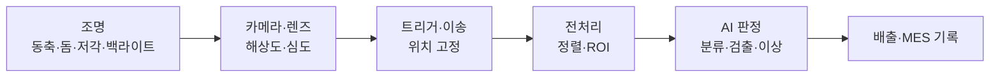
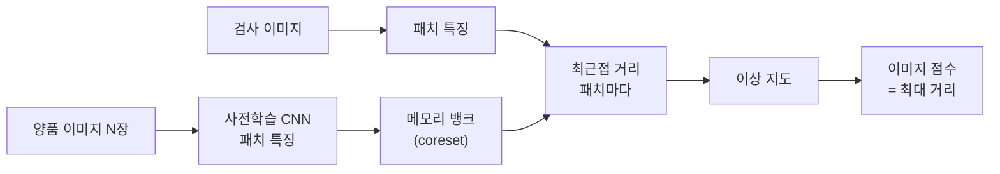
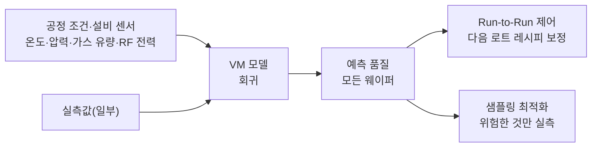
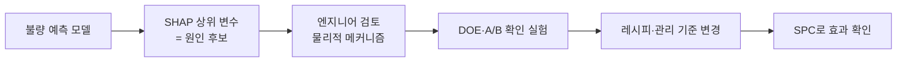
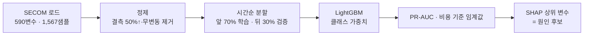

# Week 7. AI 품질관리 — 비전 검사와 공정 품질 예측

> [!abstract] 이번 주의 질문
> 예지보전이 **설비**의 이상을 봤다면, 품질관리는 **제품**의 이상을 본다.
> 두 갈래로 나눈다. ① 만들어진 제품의 **겉을 보고** 불량을 가려내는 머신비전 검사, ② 공정 조건(온도·압력·시간)을 보고 **만들기 전에·측정하기 전에** 품질을 예측하는 가상 계측(Virtual Metrology). 그리고 어떤 공정 변수가 불량을 만드는지 찾는 근본 원인 분석(RCA)까지 이어 간다.

| 구성 | 시간 | 내용 |
|---|---|---|
| 기본 지식 | 30분 | 품질 비용 · 검사 오류 두 종류 · 공정능력 Cp·Cpk |
| 이론 | 60분 | 판정 임계값의 경제학 · 머신비전(분류·검출·이상 탐지) · 가상 계측 · SHAP 기반 원인 분석 |
| 케이스 | 45분 | BMW AIQX · Landing AI(데이터 중심 AI) · MVTec AD 벤치마크 · 가상 케이스(배터리 셀 외관) |
| 실습 | 45분 | UCI SECOM 반도체 공정 데이터 — 불량 예측 → 비용 기준 임계값 → SHAP 원인 분석 |

**학습 목표**
1. 품질 비용(COQ)과 검사 오류(과검출·미검출)의 비용으로 **판정 임계값**을 정할 수 있다.
2. 불량 데이터가 적은 현장에서 지도학습 분류와 비지도 이상 탐지(PatchCore 등)를 골라 쓸 수 있다.
3. 가상 계측의 구조와 고차원·불균형·결측 데이터의 처리 원칙을 설명할 수 있다.
4. SHAP으로 불량 기여 변수를 찾되, **상관을 원인으로 오판하지 않는** 검증 절차를 설계할 수 있다.

---

## 1. 기본 지식

### 1.1 품질 비용 (Cost of Quality, COQ)

| 구분 | 영문 | 예 | AI가 바꾸는 것 |
|---|---|---|---|
| 예방 비용 | Prevention | 공정 설계, 교육, 설비 관리 | 가상 계측·원인 분석으로 **불량 자체를 줄임** |
| 평가 비용 | Appraisal | 검사 인력, 측정 장비, 시험 | 비전 검사로 **검사 단가 하락·전수 검사** |
| 내부 실패 비용 | Internal Failure | 폐기, 재작업, 재검사 | 과검출 감소 |
| 외부 실패 비용 | External Failure | 클레임, 리콜, 보증 수리, 평판 | 미검출 감소 — **가장 비싸다** |

> [!important] 1:10:100 규칙
> 품질 분야에서 흔히 쓰는 경험칙으로, 결함을 **예방 단계에서 잡는 비용을 1이라 하면 공정 내 검출은 10, 고객에게 간 뒤에는 100**이 든다는 뜻이다. 정확한 배수는 산업마다 다르지만, 비전 검사(공정 끝)보다 가상 계측·원인 분석(공정 중·공정 전)이 더 큰 가치를 낼 수 있다는 방향성을 보여 준다.

### 1.2 검사 오류 두 종류

| | 실제 불량 | 실제 양품 |
|---|---|---|
| 불량 판정 | 정검출 | **과검출 (False Reject, Overkill)** — 생산자 위험 $\alpha$ |
| 양품 판정 | **미검출 (Escape, Underkill)** — 소비자 위험 $\beta$ | 정상 통과 |

$$\text{Recall}=\frac{TP}{TP+FN},\qquad \text{Precision}=\frac{TP}{TP+FP},\qquad \text{FPR}=\frac{FP}{FP+TN}$$

- **Recall(재현율, 검출률)** — 불량 중 몇 %를 잡았나. 품질 현장에서는 **미검출률 $=1-\text{Recall}$**을 더 자주 쓴다.
- **FPR(과검출률)** — 양품 중 몇 %를 불량으로 잘못 걸렀나.
- 불량률이 0.5%인 공정에서 "정확도 99.5%" 모델은 **모두 양품이라고만 해도** 나온다. 정확도(Accuracy)는 품질 판정 지표로 쓰지 않는다.

### 1.3 샘플링 검사 vs 전수 검사

| | 샘플링 검사 (AQL) | 전수 검사 |
|---|---|---|
| 방식 | 로트에서 일부를 뽑아 합격 판정 | 모든 제품 검사 |
| 전제 | 검사가 비싸거나 파괴적 | 검사 단가가 낮음 |
| 한계 | 로트 안의 개별 불량을 못 거름 | 사람이 하면 피로로 검출률 하락 |
| AI의 역할 | — | **비전 검사가 전수 검사의 단가를 낮춘다** |

### 1.4 공정능력 — Cp와 Cpk

규격 상한 USL, 하한 LSL, 공정 평균 $\mu$, 표준편차 $\sigma$일 때

$$C_p=\frac{\text{USL}-\text{LSL}}{6\sigma},\qquad C_{pk}=\frac{\min(\text{USL}-\mu,\;\mu-\text{LSL})}{3\sigma}$$

- $C_p$: 규격 폭 대비 공정 산포 — "잠재 능력"
- $C_{pk}$: 평균이 치우친 정도까지 반영 — "실제 능력"
- 관행적 기준: $C_{pk}\ge1.33$이면 양호, 1.0 미만이면 불량이 상당히 나온다.

> [!example] 손계산 — 축 지름 규격 $10.0\pm0.3$mm
> $\mu=10.05$, $\sigma=0.08$이면
> $$C_p=\frac{10.3-9.7}{6\times0.08}=\frac{0.6}{0.48}=1.25,\qquad C_{pk}=\frac{\min(0.25,\;0.35)}{0.24}\approx1.04$$
> 상한 쪽 $z=0.25/0.08=3.125$ → 약 889 PPM, 하한 쪽 $z=4.375$ → 약 6 PPM. 합계 **약 895 PPM**.
> 산포는 같아도 **평균을 10.00으로 되돌리기만 하면** $C_{pk}=1.25$, 불량이 약 180 PPM으로 줄어든다. 공정 품질 예측(§4)이 노리는 지점이 이것이다 — 검사로 거르기 전에 **평균과 산포를 조정**한다.

---

## 2. 이론 ① — 판정 임계값의 경제학

### 2.1 비용 기준 임계값

모델이 불량 확률 $\hat p$를 낼 때, 불량으로 판정하는 임계값 $\tau$는 정확도가 아니라 **비용**으로 정한다.

$$\text{불량 판정}\iff \hat p\,C_{\text{escape}}>(1-\hat p)\,C_{\text{reject}}\iff \hat p>\tau^{*}=\frac{C_{\text{reject}}}{C_{\text{reject}}+C_{\text{escape}}}$$

- $C_{\text{escape}}$: 미검출 1건의 비용(클레임·리콜·신뢰 손실)
- $C_{\text{reject}}$: 과검출 1건의 비용(재검사 또는 폐기)

> [!example] 수치 예
> 과검출 1건은 재검사 5천 원, 미검출 1건은 고객 클레임 50만 원이면
> $$\tau^{*}=\frac{0.5}{0.5+50}\approx0.0099$$
> 불량 확률이 **1%만 넘어도** 불량 쪽으로 보내 재검사한다. 기본값 0.5를 쓰면 미검출이 폭증한다.

### 2.2 사람 검사 vs AI 검사 — 연간 비용 비교

> [!example] 하루 10만 개, 불량률 0.5%(불량 500개, 양품 99,500개)
>
> | | 사람 검사 | AI 검사 |
> |---|---|---|
> | 검출률 (Recall) | 85% | 95% |
> | 과검출률 (FPR) | 2% | 1% |
> | 미검출 수 | 75 | 25 |
> | 과검출 수 | 1,990 | 995 |
> | 미검출 비용 (× 50만 원) | 3,750만 | 1,250만 |
> | 과검출 비용 (× 5천 원) | 995만 | 498만 |
> | **하루 실패 비용** | **4,745만** | **1,748만** |
>
> ※ 교육용 가정 수치. 차이의 대부분이 **미검출 감소**에서 나온다 — 과검출만 보고 AI 성능을 판단하면 가치를 놓친다.

### 2.3 불균형 데이터의 평가 지표

| 지표 | 쓸 때 |
|---|---|
| PR-AUC (Average Precision) | 불량이 드물 때 ROC-AUC보다 정직하다 |
| 고정 FPR에서의 Recall | "과검출 1% 이내에서 몇 %를 잡는가" — 현장 합의가 쉽다 |
| 비용 가중 손실 | 위 §2.1의 비용을 직접 최소화 |
| 미검출 PPM | 고객 계약(품질 협정)의 언어 |

---

## 3. 이론 ② — 머신비전 검사

### 3.1 검사 시스템의 구성 — 모델보다 광학이 먼저다



> [!warning] 가장 흔한 착각
> "모델이 불량을 못 잡는다"의 상당수는 **결함이 영상에 찍히지 않은** 문제다. 긁힘은 저각 조명에서, 표면 얼룩은 돔 조명에서, 관통 결함은 백라이트에서 잘 보인다. 광학 설계를 바꾸면 단순한 모델로도 풀리는 경우가 많고, 반대로 결함이 안 찍히면 어떤 모델도 못 잡는다.

### 3.2 문제 유형에 따른 모델 선택

| 문제 유형 | 출력 | 대표 모델 | 필요한 라벨 |
|---|---|---|---|
| 분류 (Classification) | 양품/불량, 불량 유형 | CNN(ResNet·EfficientNet), ViT | 이미지별 클래스 |
| 객체 검출 (Detection) | 결함 위치 상자 | YOLO 계열, Faster R-CNN | 결함마다 상자 |
| 분할 (Segmentation) | 결함 픽셀 영역 | U-Net, Mask R-CNN | 픽셀 마스크 — 가장 비쌈 |
| 이상 탐지 (Anomaly Detection) | 이상 점수 + 이상 지도 | PatchCore, PaDiM, 오토인코더 | **양품 이미지만** |

### 3.3 불량 이미지가 없을 때 — 비지도 이상 탐지

신규 라인·고수율 공정은 불량 이미지가 수십 장도 안 된다. 그래서 **양품만으로 학습**하는 이상 탐지가 실무 표준이 되었다.

**PatchCore의 원리** (Roth et al., 2022)
1. ImageNet으로 사전학습된 CNN으로 양품 이미지의 **패치별 특징 벡터**를 뽑는다.
2. 그 벡터들을 대표하는 일부를 골라 **메모리 뱅크** $\mathcal{M}$에 저장한다(coreset 선택).
3. 검사할 이미지의 각 패치가 메모리 뱅크의 가장 가까운 양품 패치와 얼마나 먼지 잰다.

$$s(\mathbf{x})=\max_{\mathbf{p}\in\mathcal{P}(\mathbf{x})}\;\min_{\mathbf{m}\in\mathcal{M}}\;\lVert\mathbf{p}-\mathbf{m}\rVert_2$$

- 패치마다의 거리를 이미지 위에 펼치면 **이상 지도(Anomaly Map)** — 결함 위치가 표시된다.
- 이미지 전체 점수는 가장 이상한 패치의 거리다.



| 장점 | 한계 |
|---|---|
| 양품 수십~수백 장으로 시작 | 양품의 **정상 변동**(색·위치 편차)도 이상으로 볼 수 있다 |
| 결함 유형을 미리 정의할 필요 없음 | 결함 유형 분류는 못 함 — 불량 유형별 대책엔 분류기가 추가로 필요 |
| 이상 지도로 판정 근거를 보여 줌 | 메모리·추론 시간 — 고속 라인에서는 coreset 크기 조정 필요 |

> [!tip] 실무 단계 설계
> **1단계**(양품만 있음) 이상 탐지로 "이상/정상"만 거르고, 사람이 이상 판정분을 검토하며 불량 이미지를 모은다 → **2단계**(불량 수백 장 확보) 유형 분류기·검출기를 추가해 "어떤 불량인가"까지 판정한다. 처음부터 분류기를 만들려고 불량 이미지를 기다리면 프로젝트가 1년씩 밀린다.

### 3.4 데이터 중심 AI — 라벨 일관성이 성능을 정한다

같은 긁힘을 검사원 A는 불량, B는 양품으로 판정한다면 모델은 그 경계를 배울 수 없다. 품질 현장의 라벨은 **측정 시스템**이므로, 측정 시스템 분석(MSA, Gage R&R)의 관점을 라벨에 적용한다.

| 점검 항목 | 방법 |
|---|---|
| 검사원 간 일치도 | 같은 이미지 묶음을 여러 명이 판정 → 일치율·Cohen's $\kappa$ |
| 한계 견본 (Limit Sample) | "여기까지는 양품, 여기부터 불량"인 경계 이미지를 문서화 |
| 애매한 구간 분리 | 라벨에 "판정 보류" 클래스를 두고 별도 관리 |
| 골든 샘플 | 매일 같은 견본으로 카메라·모델 상태 점검 |

$$\kappa=\frac{p_o-p_e}{1-p_e}$$

$p_o$는 실제 일치율, $p_e$는 우연히 일치할 확률이다. 검사원 간 $\kappa$가 낮으면 **모델보다 판정 기준을 먼저 고친다**.

---

## 4. 이론 ③ — 가상 계측과 공정 품질 예측

### 4.1 가상 계측 (Virtual Metrology, VM)

반도체·디스플레이처럼 측정이 느리거나 비싼 공정에서는 웨이퍼 일부만 계측한다. **VM은 설비 센서·공정 조건으로 계측값(두께·선폭·저항 등)을 예측**해 모든 제품의 품질을 추정한다.



$$\hat y_i=f(\mathbf{x}_i),\qquad \mathbf{x}_i=\text{공정 변수 벡터},\;\hat y_i=\text{예측 계측값}$$

| VM의 가치 | 설명 |
|---|---|
| 전수 품질 추정 | 계측 안 한 제품의 품질도 안다 |
| 빠른 피드백 | 계측 대기 없이 다음 로트 레시피를 보정(Run-to-Run 제어) |
| 계측 샘플링 최적화 | VM 불확실성이 큰 제품만 실측 |

### 4.2 공정 데이터의 세 가지 난제

| 난제 | 현상 | 처리 원칙 |
|---|---|---|
| 고차원 | 센서 수백~수천 개, 샘플은 그보다 적음 | 무변동·고결측 변수 제거, 정규화 모델(L1), 트리 앙상블 |
| 불균형 | 불량이 수 % 이하 | 클래스 가중치, 비용 기준 임계값, PR-AUC 평가 |
| 결측 | 센서 고장·측정 누락 | 결측 비율 기준 제거 + 결측 지표 변수, **결측 자체가 신호일 수 있음** |
| 시간 드리프트 | 설비 세정·부품 교체 후 분포 이동 | 시간순 분할로 검증, 주기적 재학습, 드리프트 모니터링 |

> [!warning] 시간순으로 검증하라
> 공정 데이터를 무작위로 섞어 학습·검증을 나누면, 같은 로트·같은 설비 상태의 데이터가 양쪽에 들어가 성능이 부풀려진다. 현장에서 모델은 **과거로 학습해 미래를 예측**하므로, 검증도 시간순으로 나눈다.

### 4.3 근본 원인 분석 — SHAP

모델이 불량을 잘 예측해도, 품질 엔지니어에게 필요한 것은 **"어떤 공정 변수를 조정해야 하는가"**다. SHAP(SHapley Additive exPlanations)은 예측값을 변수별 기여로 나눈다.

$$\hat f(\mathbf{x})=\phi_0+\sum_{j=1}^{M}\phi_j,\qquad \phi_j=\sum_{S\subseteq F\setminus\{j\}}\frac{|S|!\,(M-|S|-1)!}{M!}\Big[f_{S\cup\{j\}}(\mathbf{x})-f_S(\mathbf{x})\Big]$$

- $\phi_0$: 평균 예측(기준선), $\phi_j$: 변수 $j$의 기여
- 협력 게임 이론의 샤플리 값을 그대로 가져와, **기여의 합이 예측값과 정확히 일치**한다.

> [!important] SHAP이 말해 주는 것과 말해 주지 않는 것
> - 말해 주는 것: "이 **모델**이 불량 판정에 이 변수를 얼마나 썼는가"
> - 말해 주지 않는 것: "이 변수를 바꾸면 불량이 줄어드는가" — **인과는 아니다**
>
> 예를 들어 "챔버 세정 후 경과 시간"이 높은 SHAP 값을 가져도, 진짜 원인은 그와 함께 움직이는 다른 변수일 수 있다. 그래서 SHAP 상위 변수는 **원인 후보 목록**으로 쓰고, 실험계획법(DOE)이나 공정 엔지니어의 물리적 메커니즘 검토로 **확인**한다.



---

## 5. 이론 ④ — AI 검사의 운영

### 5.1 사람-AI 협업 구조

AI 점수를 세 구간으로 나눠, **확실한 것은 자동, 애매한 것만 사람**이 본다.

| 구간 | 처리 | 효과 |
|---|---|---|
| 점수 낮음 (확실한 양품) | 자동 통과 | 검사 물량의 대부분을 덜어 낸다 |
| 중간 (애매) | 사람 재검 | 사람의 집중력을 어려운 판정에 쓴다 |
| 점수 높음 (확실한 불량) | 자동 배출 | 즉시 격리 |

> [!tip] 재검 결과가 다음 학습 데이터다
> 사람이 재검한 애매한 이미지는 모델이 가장 배워야 할 데이터다. 재검 결과를 라벨로 축적해 주기적으로 재학습하는 순환(능동 학습, Active Learning)을 운영 절차에 넣는다.

### 5.2 드리프트와 재검증

| 변화 | 예 | 감시 방법 |
|---|---|---|
| 입력 드리프트 | 조명 노후, 렌즈 오염, 소재 공급사 변경 | 골든 샘플 점수 추이, 이미지 밝기·분포 통계 |
| 개념 드리프트 | 고객 규격 변경, 신규 불량 유형 | 재검 결과와 AI 판정의 불일치율 |
| 공정 변경 | 설비 교체, 레시피 변경 | 변경관리(4M 변경) 절차에 **모델 재검증**을 포함 |

> [!warning] 4M 변경과 AI
> 제조업의 변경관리는 사람(Man)·설비(Machine)·재료(Material)·방법(Method)의 변경을 관리한다. AI 검사를 도입하면 **모델 버전·학습 데이터·임계값 변경**도 같은 무게의 변경관리 대상이 되어야 한다. 고객 품질 협정(예: 자동차 부품의 PPAP)에 검사 방법 변경이 승인 대상으로 들어가는 경우도 있다.

---

## 6. 케이스 스터디

### 케이스 1. BMW AIQX — 라인에 붙은 AI 검사

- **배경**: BMW Group은 생산 공정의 품질 검사에 카메라·센서 데이터와 AI 판정을 결합한 AIQX(Artificial Intelligence Quality Next) 플랫폼을 도입했고, 딩골핑 등 여러 공장에서 활용하고 있다고 밝혔다.
- **핵심**: 검사를 공정 끝의 별도 검사대가 아니라 **라인 곳곳에서 실시간으로**, 결과를 작업자에게 바로 피드백하는 구조다.
- **토론 질문**
  1. 검사 지점을 공정 끝에서 공정 중간으로 옮기면 품질 비용(§1.1)의 어느 항목이 줄어드는가?
  2. 작업자에게 판정을 바로 보여 주는 것의 장단점은?

### 케이스 2. Landing AI — "모델이 아니라 데이터를 고쳐라"

- **배경**: Andrew Ng이 설립한 Landing AI는 제조 비전 검사를 중심으로 **데이터 중심 AI(Data-Centric AI)**를 주창했다. 모델 구조를 바꾸는 대신 라벨 일관성·데이터 품질을 체계적으로 개선하는 것이 소량 데이터 환경에서 더 효과적이라는 주장이다.
- **연결**: §3.4의 검사원 간 일치도·한계 견본 관리가 바로 이 접근이다.
- **토론 질문**
  1. 불량 이미지 300장, 검사원 간 일치율 80%인 상황에서 모델 개선과 라벨 정비 중 무엇을 먼저 하겠는가?
  2. 한계 견본을 문서화하는 일은 누구의 책임이어야 하는가 — 품질팀, 생산팀, AI팀?

### 케이스 3. MVTec AD — 벤치마크와 현장 사이

- **배경**: MVTec AD는 MVTec Software가 공개한 산업 이상 탐지 벤치마크로, 나사·카펫·병·트랜지스터 등 15개 범주의 양품 학습 이미지와 다양한 결함 테스트 이미지를 담고 있다. PatchCore 같은 방법이 이 벤치마크에서 매우 높은 점수를 기록했다.
- **쟁점**: 벤치마크 점수가 높다고 현장에서 바로 통하지는 않는다. 현장에는 위치 편차, 조명 변화, 양품의 정상 변동, 처음 보는 결함이 있다.
- **토론 질문**
  1. 벤치마크와 우리 라인의 차이를 세 가지 꼽고, PoC 설계에서 각각을 어떻게 시험하겠는가?
  2. "벤치마크 99%"라는 공급사 제안서를 받았을 때 무엇을 추가로 요구하겠는가?

### 케이스 4. (가상) C사 배터리 셀 외관 검사 — 과검출이 만든 병목

> [!example] 가상 케이스 — 교육용으로 구성한 상황
> 이차전지 셀 제조사 C사는 파우치 셀 외관 검사(찍힘·주름·이물)에 딥러닝 분류기를 도입했다. 검출률은 사람보다 높았지만 과검출률이 4%에 달해 재검 라인에 하루 8,000셀이 쌓였고, 재검 인력이 부족해 출하가 지연되었다.
>
> **원인 분석 (교재용 정답 예시)**
> 1. **임계값**: 공급사가 기본 임계값 0.5로 납품했다. 비용 기준(§2.1)으로 다시 잡지 않았다.
> 2. **라벨**: 주름의 양불 경계가 검사원마다 달랐다($\kappa\approx0.5$). 모델이 애매한 주름을 모두 불량으로 학습했다.
> 3. **구간 설계 부재**: 확실한 양품까지 모두 재검으로 보내, 사람-AI 협업 3구간(§5.1)이 없었다.
>
> **개선안 예시**: 한계 견본으로 주름 기준 재정의 → 재라벨링 → 점수 3구간 운영(하위 구간 자동 통과) → 재검 결과로 월 1회 재학습. 목표는 "검출률 유지, 재검 물량 1/3 이하".
>
> **토론 질문**: 개선 후에도 고객사가 "AI 판정 셀은 별도 표기하라"고 요구한다면 어떻게 대응하겠는가?

---

## 7. 실습 — SECOM 반도체 공정 데이터로 불량 예측과 원인 분석

> [!info] 데이터
> **UCI SECOM** — 반도체 제조 공정의 센서·측정 변수 590개와 최종 합격/불합격 라벨을 담은 공개 데이터. 1,567개 샘플 중 불합격은 104개(약 6.6%)이고, 결측이 많다. 타임스탬프가 함께 제공된다. 실습 노트북이 직접 내려받는다.

### 7.1 실습 흐름



### 7.2 코드 골격

```python
import numpy as np, pandas as pd
import lightgbm as lgb, shap
from sklearn.metrics import average_precision_score, confusion_matrix

X = pd.read_csv("secom.data", sep=r"\s+", header=None)
X.columns = [f"v{i}" for i in range(X.shape[1])]
lab = pd.read_csv("secom_labels.data", sep=r"\s+", header=None, names=["y", "ts"])
y = (lab["y"] == 1).astype(int)                       # 1 = 불합격(불량)
order = pd.to_datetime(lab["ts"], dayfirst=True).argsort()
X, y = X.iloc[order].reset_index(drop=True), y.iloc[order].reset_index(drop=True)

# 1) 정제 — 결측 50% 초과·무변동 변수 제거 (결측 자체는 LightGBM이 처리)
keep = X.columns[(X.isna().mean() <= 0.5) & (X.std() > 1e-8)]
X = X[keep]
print("남은 변수:", len(keep))

# 2) 시간순 분할 — 과거로 학습해 미래를 예측
cut = int(len(X) * 0.7)
Xtr, Xva, ytr, yva = X[:cut], X[cut:], y[:cut], y[cut:]

# 3) 불균형 처리 — 클래스 가중치
pos_w = (ytr == 0).sum() / (ytr == 1).sum()
m = lgb.LGBMClassifier(n_estimators=400, learning_rate=0.03, num_leaves=15,
                       min_child_samples=20, subsample=0.8, subsample_freq=1,
                       colsample_bytree=0.5, scale_pos_weight=pos_w,
                       random_state=0, verbose=-1).fit(Xtr, ytr)
p = m.predict_proba(Xva)[:, 1]
print(f"PR-AUC {average_precision_score(yva, p):.3f} (무작위 기준선 {yva.mean():.3f})")

# 4) 비용 기준 임계값 — 과검출 1건 5만 원, 미검출 1건 200만 원 (교육용 가정)
C_REJ, C_ESC = 5, 200
def cost(t):
    tn, fp, fn, tp = confusion_matrix(yva, p > t, labels=[0, 1]).ravel()
    return fp * C_REJ + fn * C_ESC, tp, fp, fn
grid = np.linspace(0.01, 0.9, 90)
t_best = min(grid, key=lambda t: cost(t)[0])
print("비용 최소 임계값:", round(t_best, 2), "· 이론값:", round(C_REJ / (C_REJ + C_ESC), 3))
print("비용·TP·FP·FN @최적:", cost(t_best), "/ @0.5:", cost(0.5))

# 5) SHAP — 원인 후보 상위 10개
ex = shap.TreeExplainer(m)
sv = ex.shap_values(Xva)
sv = sv[1] if isinstance(sv, list) else sv
top = pd.Series(np.abs(sv).mean(0), index=Xva.columns).sort_values(ascending=False).head(10)
print(top)
# shap.summary_plot(sv, Xva, max_display=10)  → shap_top10.png 로 저장
```

### 7.3 해석 과제

1. 무작위 분할(`train_test_split(shuffle=True)`)과 시간순 분할의 PR-AUC를 비교하라. 차이가 크다면 무엇을 의미하는가?
2. 임계값 0.5와 비용 최소 임계값에서 미검출 수가 각각 몇 개인가? 이론값 $\tau^{*}=C_{\text{reject}}/(C_{\text{reject}}+C_{\text{escape}})$와 데이터로 찾은 최적값이 다르다면 이유는? (힌트: 모델 확률의 보정 상태)
3. SHAP 상위 변수 중 하나를 골라, 양품·불량 그룹의 분포를 그려 보라. 이 변수가 **원인**인지 확인하려면 공정 엔지니어에게 무엇을 물어야 하는가?
4. 결측 여부를 0/1 변수로 추가하면 성능이 바뀌는가? 바뀐다면 "결측"은 공정에서 무엇을 뜻할 수 있는가?

> [!tip] Claude Code로 진행할 때의 프롬프트 예
> ```
> UCI SECOM 데이터(secom.data, secom_labels.data)를 data/에 내려받아
> 1) 결측 50% 초과·표준편차 0 변수를 제거하고 남은 변수 수를 출력해줘
> 2) 타임스탬프 순으로 정렬해 앞 70%로 학습, 뒤 30%로 검증하는 LightGBM 분류기를
>    클래스 가중치로 학습하고 PR-AUC와 무작위 기준선을 함께 출력
> 3) 과검출 5만 원·미검출 200만 원 기준으로 비용이 최소인 임계값을 찾고,
>    임계값 0.5와 비교한 혼동행렬·비용 표를 만들어줘
> 4) SHAP 상위 10개 변수를 shap_top10.png로 저장하고, 1위 변수의 양품·불량 분포를
>    var_top1.png로 그려줘
> 코드는 w07_secom.py로 남기고 난수 시드는 0으로 고정해줘.
> ```

---

## 8. 정리

> [!check] 이번 주 핵심
> 1. 품질 비용의 무게는 **외부 실패**에 있다 — AI 검사의 가치는 대부분 미검출 감소에서 나온다.
> 2. 판정 임계값은 정확도가 아니라 **$\tau^{*}=C_{\text{reject}}/(C_{\text{reject}}+C_{\text{escape}})$**로 정한다.
> 3. 비전 검사는 **광학 → 라벨 → 모델** 순서로 점검한다. 불량 이미지가 없으면 PatchCore 같은 이상 탐지로 시작한다.
> 4. 라벨은 측정 시스템이다 — 검사원 간 일치도와 한계 견본을 관리한다.
> 5. 가상 계측은 검사를 **공정 안으로** 끌어온다. 검증은 시간순으로 한다.
> 6. SHAP은 **원인 후보**를 준다. 원인 확인은 DOE와 엔지니어의 몫이다.
> 7. AI 모델·임계값 변경도 **4M 변경관리** 대상이다.
> 8. 다음 주는 생산 계획·스케줄링 최적화 — 성능률과 리드타임을 다룬다.

## 9. 확인 문제

1. 공급사가 "정확도 99.4%"인 비전 검사 모델을 제안했다. 이 공정의 불량률은 0.6%다. 이 숫자만으로 도입을 판단할 수 없는 이유와, 대신 요구할 지표 두 가지를 제시하라.
2. 의료기기 부품(미검출 1건 비용 2,000만 원, 과검출 1건 비용 1만 원)과 일반 소비재 부품(미검출 2만 원, 과검출 1만 원)이 있다. 두 공정의 비용 기준 임계값을 각각 구하고, 운영 방식이 어떻게 달라야 하는지 설명하라.
3. 신규 라인에 양품 이미지 2,000장과 불량 이미지 15장이 있다. 첫 3개월의 검사 AI 설계안을 제시하라.
4. SECOM 모델에서 "v59"가 SHAP 1위로 나왔다. 품질팀이 v59의 관리 기준을 바로 좁히자고 한다. 이 결정 전에 필요한 절차는?
5. 축 지름 공정이 $C_p=1.25$, $C_{pk}=1.04$다. 검사 AI를 도입하는 것과 공정 평균을 조정하는 것 중 무엇을 먼저 하겠는가? 근거는?

> [!success]- 해설
> 1. 모두 양품이라고 판정해도 정확도가 99.4%다. 정확도는 불량을 하나도 못 잡는 모델과 구분이 안 된다. **미검출률(1−Recall)**과 **과검출률(FPR)**, 또는 고정 과검출률에서의 검출률·PR-AUC를 우리 라인 데이터로 요구한다.
> 2. 의료기기: $\tau^{*}=1/(1+2000)\approx0.0005$ — 불량 확률이 아주 조금만 있어도 격리하고, 과검출 증가를 감수하며 재검·폐기 체계를 크게 둔다. 소비재: $\tau^{*}=1/(1+2)\approx0.33$ — 과검출을 억제하고 자동 통과 비중을 높인다. 같은 모델이라도 임계값과 운영 구조가 달라야 한다.
> 3. 불량 15장으로는 분류기를 못 만든다. 양품 2,000장으로 **PatchCore 등 이상 탐지**를 먼저 운영하고, 이상 판정분을 사람이 재검하며 불량 이미지와 유형 라벨을 모은다. 동시에 한계 견본·검사원 간 일치도를 정비한다. 불량이 수백 장 쌓이면 유형 분류기를 추가한다.
> 4. SHAP은 모델이 쓴 정도일 뿐 인과가 아니다. v59와 함께 움직이는 변수(설비·시간·로트) 확인 → 공정 엔지니어의 물리적 메커니즘 검토 → DOE 또는 제한된 범위의 확인 실험 → 효과가 확인되면 관리 기준 변경 → SPC로 사후 확인 순서가 필요하다.
> 5. 공정 평균 조정이 먼저다. 산포는 그대로 두고 평균만 중앙으로 옮겨도 $C_{pk}$가 1.04 → 1.25, 불량이 약 895 → 180 PPM으로 줄어든다. 검사는 만들어진 불량을 거를 뿐이고, 평균 조정은 불량 자체를 줄인다(1:10:100 규칙). 그 뒤 남은 불량을 검사 AI로 거른다.

## 참고 자료
- Roth, K. et al. (2022). Towards Total Recall in Industrial Anomaly Detection (PatchCore). *CVPR*.
- Bergmann, P. et al. (2019). MVTec AD — A Comprehensive Real-World Dataset for Unsupervised Anomaly Detection. *CVPR*.
- Lundberg, S. M., & Lee, S.-I. (2017). A Unified Approach to Interpreting Model Predictions (SHAP). *NeurIPS*.
- Montgomery, D. C. *Introduction to Statistical Quality Control*.
- UCI Machine Learning Repository — SECOM Data Set.
- [BMW Group — AIQX](https://www.bmwgroup.com/en/news/general/2023/aiqx.html)
- [BMW Group Plant Dingolfing — Digitalisation](https://bmwgroup-werke.com/dingolfing/en/digitalisierung.html)
