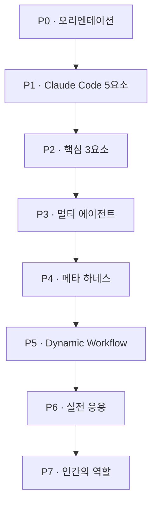
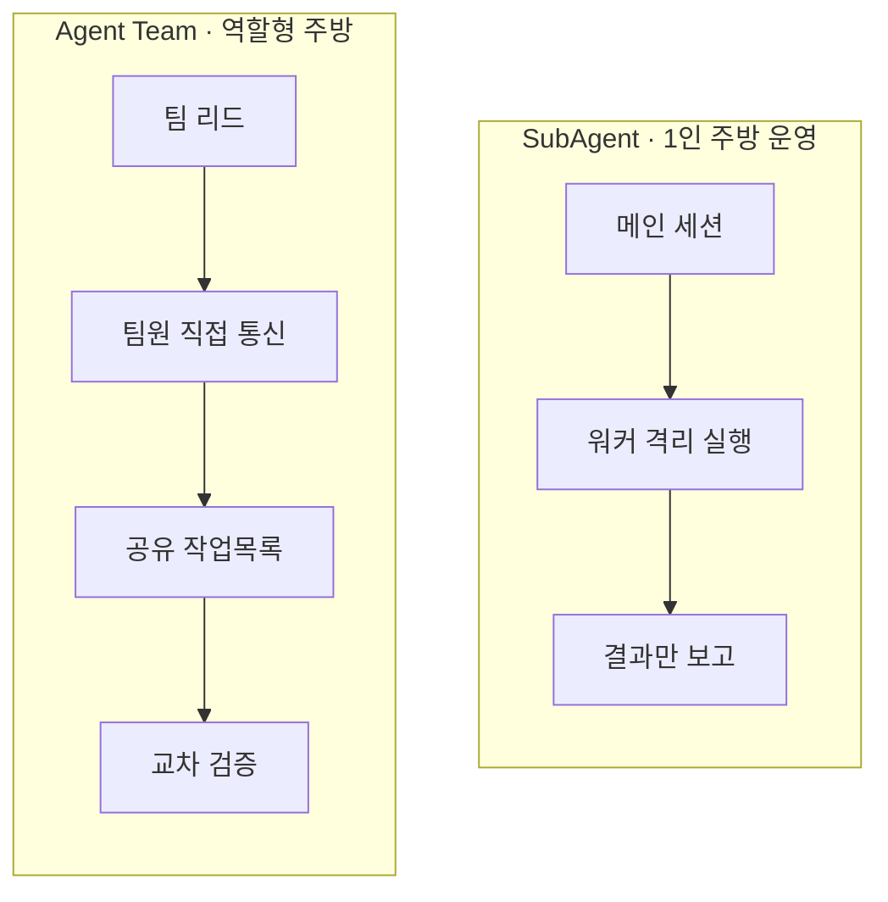
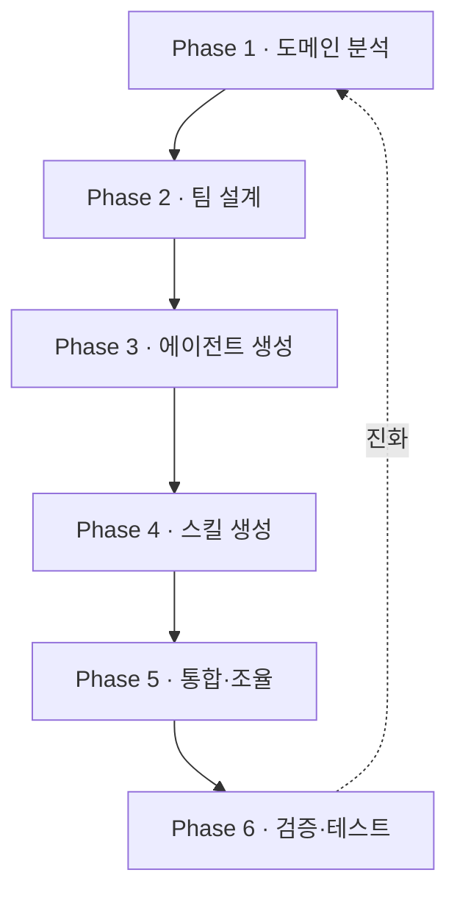
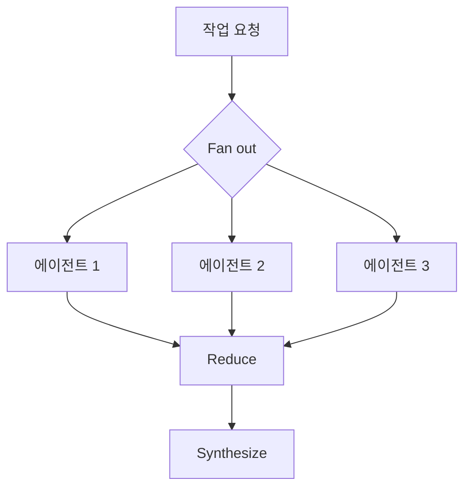

# 하네스 엔지니어링 2026
## 답변형 AI에서 작업 실행형 AI로 — 운영 구조를 설계하는 법

> **요약.** 모델은 충분히 똑똑해졌다. 이제 성과를 가르는 것은 모델 자체가 아니라 **모델 주위의 운영 구조(하네스)** 다. 본 과정은 Claude Code의 5대 프리미티브(CLAUDE.md · Skills · Subagents · Hooks · Plugins)와 2026년 2월 출시된 **Agent Teams**, 그리고 메타 하네스 스킬 `revfactory/harness`를 축으로, "AI를 답변기에서 일하는 팀으로 바꾸는" 설계 역량을 다룬다. 통제 실험에서 구조화된 하네스는 평균 품질 +60%(49.5 → 79.3), 15/15 승, 출력 분산 −32%를 보고했다.

---

## 1. 이 과정이 답하는 질문

- 모델이 아니라 **무엇**을 바꿔야 AI가 더 오래, 더 안정적으로 일하는가?
- 단일 에이전트와 멀티 에이전트는 **언제** 각각 쓰는가?
- "하네스 구성해줘" 한 문장으로 도메인 전문가 팀을 자동 생성하는 원리는?
- 개발이 아닌 **콘텐츠·문서·리서치** 작업에도 하네스가 통하는가?
- AI가 실행을 맡을 때, 인간의 역할은 어디로 이동하는가?

---

## 2. 2026년, 무엇이 새로워졌나

엔지니어링의 초점은 한 번이 아니라 두 번 이동했다. 한 번의 질문을 잘 짜는 **프롬프트 엔지니어링**에서, 모델에게 줄 정보를 설계하는 **컨텍스트 엔지니어링**으로, 다시 AI가 일하는 운영 전체를 설계하는 **하네스 엔지니어링**으로 옮겨 왔다.

<svg width="100%" style="max-width:680px" viewBox="0 0 680 215" xmlns="http://www.w3.org/2000/svg" role="img" aria-label="엔지니어링 초점의 진화: 프롬프트에서 컨텍스트, 하네스로">
  <text x="340" y="26" text-anchor="middle" font-size="14" font-weight="bold" fill="#1B2C5E">엔지니어링 초점의 이동</text>
  <rect x="18" y="55" width="170" height="100" rx="12" fill="#E3F2FD" stroke="#0D47A1" stroke-width="2"/>
  <text x="103" y="88" text-anchor="middle" font-size="14" font-weight="bold" fill="#0D47A1">프롬프트</text>
  <text x="103" y="112" text-anchor="middle" font-size="11" fill="#1A237E">한 번의 질문을</text>
  <text x="103" y="128" text-anchor="middle" font-size="11" fill="#1A237E">잘 짜는 기술</text>
  <rect x="240" y="55" width="170" height="100" rx="12" fill="#FFF3E0" stroke="#E65100" stroke-width="2"/>
  <text x="325" y="88" text-anchor="middle" font-size="14" font-weight="bold" fill="#E65100">컨텍스트</text>
  <text x="325" y="112" text-anchor="middle" font-size="11" fill="#8a4b00">모델에 줄 정보를</text>
  <text x="325" y="128" text-anchor="middle" font-size="11" fill="#8a4b00">설계하는 기술</text>
  <rect x="460" y="55" width="170" height="100" rx="12" fill="#E8F5E9" stroke="#2F7A4A" stroke-width="2.5"/>
  <text x="545" y="88" text-anchor="middle" font-size="14" font-weight="bold" fill="#2F7A4A">하네스</text>
  <text x="545" y="112" text-anchor="middle" font-size="11" fill="#1b5e20">AI가 일하는 운영</text>
  <text x="545" y="128" text-anchor="middle" font-size="11" fill="#1b5e20">전체를 설계</text>
  <path d="M188 105 L238 105" stroke="#90A4AE" stroke-width="2.5" marker-end="url(#ar)"/>
  <path d="M410 105 L458 105" stroke="#90A4AE" stroke-width="2.5" marker-end="url(#ar)"/>
  <defs><marker id="ar" markerWidth="10" markerHeight="10" refX="7" refY="3" orient="auto"><path d="M0,0 L7,3 L0,6 Z" fill="#90A4AE"/></marker></defs>
  <text x="340" y="190" text-anchor="middle" font-size="11.5" fill="#455A64">2025–2026: Gartner는 컨텍스트 엔지니어링을 프롬프트 엔지니어링의 후속으로 규정했고, 하네스는 그 위 운영 계층이다</text>
</svg>

2026년의 구체적 변화는 다음과 같다.

| 영역 | 2025 이전 | 2026 현재 |
|---|---|---|
| 협업 단위 | 단일 세션, 서브에이전트 | **Agent Teams** (2026.02, Opus 4.6와 함께 출시) |
| 통신 | 부모-자식 보고만 가능 | 팀원 간 **직접 메시지** + 공유 작업목록 |
| 명령 체계 | 슬래시 커맨드 / 스킬 분리 | **Skills로 통합** (모든 스킬이 슬래시 인터페이스) |
| 배포 | 수동 파일 복사 | **Plugins** 마켓플레이스 원클릭 설치 |
| 하네스 생성 | 손으로 구성 | 메타 스킬 `revfactory/harness`가 자동 생성 |
| 실행 환경 | CLI 중심 | CLI · VS Code · JetBrains · 데스크톱 · 웹 · iOS |

---

## 3. 학습 목표

과정을 마치면 다음을 할 수 있다.

- Claude Code 5대 프리미티브를 구분하고, 작업에 맞는 프리미티브를 선택한다.
- 에이전트 · 스킬 · 오케스트레이터를 직접 정의하고 한 팀으로 묶는다.
- SubAgent와 Agent Team을 상황에 맞게 선택하고 토큰 비용을 가늠한다.
- `revfactory/harness`로 도메인 하네스를 자동 생성하고 진화시킨다.
- Dynamic Workflow 패턴(Fan out → Reduce → Synthesize)으로 품질 검증 루프를 짠다.
- 리서치 · 문서 · 콘텐츠 등 비개발 작업에 하네스를 적용한다.

---

## 4. 커리큘럼 한눈에 보기

본 과정은 8개 파트로 구성된다. 60분 스팀팩은 P0–P5의 압축 버전, 심화 트랙은 전체 + 실습으로 진행한다.



| 파트 | 주제 | 핵심 질문 | 분량(심화) |
|---|---|---|---|
| **P0** | 오리엔테이션 | 왜 하네스인가 | 30분 |
| **P1** | Claude Code 5요소 | 무엇으로 운영을 짜는가 | 60분 |
| **P2** | 핵심 3요소 | 에이전트·스킬·오케스트레이터란 | 60분 |
| **P3** | 멀티 에이전트 | 1인 주방 vs 역할형 주방 | 90분 |
| **P4** | 메타 하네스 | 하네스를 자동 생성하기 | 90분 |
| **P5** | Dynamic Workflow | 품질 검증 루프 설계 | 90분 |
| **P6** | 실전 응용 | 리서치·문서·콘텐츠 적용 | 120분 |
| **P7** | 인간의 역할 | 실행에서 문제 정의로 | 30분 |

---

## 5. 파트별 상세

### P0 — 오리엔테이션: 왜 하네스 엔지니어링인가

답변형 AI에서 작업 실행형 AI로 넘어오면서 개발 체감 속도는 3개월 → 1개월 → 1–2주 → MVP 2시간으로 압축됐다. 그러나 AI는 여전히 "보조"에 머무는 경우가 많다. 운전대를 누가 쥐느냐가 핵심이다. 본 파트는 과정 전체의 문제의식을 세운다.

- 답변형 AI vs 작업 실행형 AI
- 운전대를 내가 쥐는 것에서, AI 팀에 맡기는 것으로
- 하네스의 학술적 정의: 모델 바깥의 **제어(control) · 행위성(agency) · 런타임(runtime)** 계층

### P1 — Claude Code 5요소

Claude Code의 진짜 경쟁력은 모델 품질이 아니라 모델을 둘러싼 **오케스트레이션 표면**이다. 다섯 프리미티브와 MCP가 그 표면을 이룬다.

<svg width="100%" style="max-width:680px" viewBox="0 0 680 320" xmlns="http://www.w3.org/2000/svg" role="img" aria-label="하네스를 구성하는 5대 프리미티브와 모델 코어 스택">
  <text x="340" y="24" text-anchor="middle" font-size="14" font-weight="bold" fill="#1B2C5E">하네스 = 모델을 둘러싼 운영 계층</text>
  <rect x="120" y="38" width="440" height="40" rx="8" fill="#9B59B6" stroke="#6A3782" stroke-width="2"/>
  <text x="150" y="63" font-size="12.5" font-weight="bold" fill="#fff">Plugins</text>
  <text x="345" y="63" font-size="11" fill="#f3e5f5">배포·공유 · 마켓플레이스 원클릭 설치</text>
  <rect x="120" y="84" width="440" height="40" rx="8" fill="#E74C3C" stroke="#A93226" stroke-width="2"/>
  <text x="150" y="109" font-size="12.5" font-weight="bold" fill="#fff">Hooks</text>
  <text x="345" y="109" font-size="11" fill="#fdecea">수명주기 이벤트의 결정적 제어점</text>
  <rect x="120" y="130" width="440" height="40" rx="8" fill="#E65100" stroke="#a13d00" stroke-width="2"/>
  <text x="150" y="155" font-size="12.5" font-weight="bold" fill="#fff">Subagents</text>
  <text x="345" y="155" font-size="11" fill="#fff3e0">격리된 컨텍스트 워커 · .claude/agents/</text>
  <rect x="120" y="176" width="440" height="40" rx="8" fill="#F5A623" stroke="#B07517" stroke-width="2"/>
  <text x="150" y="201" font-size="12.5" font-weight="bold" fill="#3e2c00">Skills</text>
  <text x="345" y="201" font-size="11" fill="#5a4300">재사용 전문 능력 · SKILL.md · .claude/skills/</text>
  <rect x="120" y="222" width="440" height="40" rx="8" fill="#4A90E2" stroke="#2C5F8D" stroke-width="2"/>
  <text x="150" y="247" font-size="12.5" font-weight="bold" fill="#fff">CLAUDE.md</text>
  <text x="345" y="247" font-size="11" fill="#e3f2fd">프로젝트 메모리·규칙 · 매 세션 로드</text>
  <rect x="120" y="268" width="440" height="42" rx="8" fill="#1B2C5E" stroke="#0d1530" stroke-width="2"/>
  <text x="340" y="294" text-anchor="middle" font-size="13" font-weight="bold" fill="#fff">Model (Claude) — 핵심 추론 엔진</text>
  <text x="44" y="180" font-size="10.5" fill="#607D8B" transform="rotate(-90 44 180)">MCP · 외부 시스템 연결</text>
</svg>

- 다섯 프리미티브를 각각 언제 쓰는가 (잘못 고르면 CLAUDE.md 비대화, 불필요한 서브에이전트 오버헤드)
- 2026 통합: 슬래시 커맨드 → Skills 흡수, 모든 스킬이 `/스킬명` 인터페이스를 가진다
- 첫 실행 · 터미널 기본기 · `claude` 세션 열고 닫기

### P2 — 핵심 3요소: 에이전트 · 스킬 · 오케스트레이터

하네스 엔지니어링의 최소 단위는 세 가지다. 에이전트는 역할을 가진 일꾼, 스킬은 일꾼이 안정적으로 일하게 만드는 도구 상자, 오케스트레이터는 흐름을 관리하는 PM이다.

<svg width="100%" style="max-width:680px" viewBox="0 0 680 280" xmlns="http://www.w3.org/2000/svg" role="img" aria-label="하네스 핵심 3요소: 오케스트레이터, 에이전트, 스킬의 관계">
  <line x1="340" y1="120" x2="340" y2="62" stroke="#90A4AE" stroke-width="2"/>
  <line x1="320" y1="148" x2="175" y2="195" stroke="#90A4AE" stroke-width="2"/>
  <line x1="360" y1="148" x2="505" y2="195" stroke="#90A4AE" stroke-width="2"/>
  <circle cx="340" cy="130" r="44" fill="#1B2C5E" stroke="#E65100" stroke-width="3"/>
  <text x="340" y="126" text-anchor="middle" font-size="13" font-weight="bold" fill="#fff">하네스</text>
  <text x="340" y="144" text-anchor="middle" font-size="10" fill="#FFB74D">운영 구조</text>
  <rect x="245" y="20" width="190" height="44" rx="10" fill="#FFF3E0" stroke="#E65100" stroke-width="2"/>
  <text x="340" y="40" text-anchor="middle" font-size="12.5" font-weight="bold" fill="#E65100">오케스트레이터</text>
  <text x="340" y="56" text-anchor="middle" font-size="10.5" fill="#8a4b00">흐름을 관리하는 PM</text>
  <rect x="60" y="195" width="200" height="62" rx="10" fill="#E3F2FD" stroke="#0D47A1" stroke-width="2"/>
  <text x="160" y="218" text-anchor="middle" font-size="12.5" font-weight="bold" fill="#0D47A1">에이전트</text>
  <text x="160" y="236" text-anchor="middle" font-size="10.5" fill="#1A237E">역할을 가진 일꾼</text>
  <text x="160" y="250" text-anchor="middle" font-size="10" fill="#37474F">.claude/agents/</text>
  <rect x="420" y="195" width="200" height="62" rx="10" fill="#E8F5E9" stroke="#2F7A4A" stroke-width="2"/>
  <text x="520" y="218" text-anchor="middle" font-size="12.5" font-weight="bold" fill="#2F7A4A">스킬</text>
  <text x="520" y="236" text-anchor="middle" font-size="10.5" fill="#1b5e20">일꾼의 도구 상자</text>
  <text x="520" y="250" text-anchor="middle" font-size="10" fill="#37474F">.claude/skills/</text>
</svg>

- 에이전트 정의 작성법 (역할·도구 권한·컨텍스트 격리)
- 왜 스킬이 필요한가: 스킬 없는 팀원은 모두 제너럴리스트, 스킬이 있으면 스페셜리스트가 된다
- 오케스트레이터의 역할: 계획 → 배정 → 검증 → 통합
- **주방 비유**로 직관 잡기

| 요소 | 주방 비유 | 하는 일 |
|---|---|---|
| 에이전트 | 요리사 | 한 역할을 책임지고 수행 |
| 스킬 | 레시피·조리도구 | 그 역할을 안정적으로 재현 |
| 오케스트레이터 | 헤드셰프 | 주문 분배·중간 검수·최종 플레이팅 |

### P3 — 멀티 에이전트: SubAgent vs Agent Team

단일 에이전트는 1인 주방, 멀티 에이전트는 역할형 주방이다. 2026년 2월 출시된 Agent Team은 팀원이 서로 직접 통신하고 공유 작업목록에서 과제를 가져간다는 점에서 서브에이전트와 결정적으로 다르다.



- 활성화: `settings.json`에 `CLAUDE_CODE_EXPERIMENTAL_AGENT_TEAMS=1` 명시
- 선택 기준: 빠른 워커는 SubAgent, 협업·교차검증 구조는 Agent Team
- 왜 토큰 사용량이 늘어나는가 — 누적 대화·공유 정보의 비용
- 컨텍스트 관리 = 재료 보관: 필요한 정보만 작업대에 올리고, 오래된 정보는 정리한다 (context rot 대응: 메모리·컴팩션·도구 결과 비우기)

### P4 — 메타 하네스: `revfactory/harness`

"하네스 구성해줘" 한 문장이면 메타 스킬이 도메인을 분석해 에이전트 팀과 스킬을 자동 생성한다. 하네스는 고정물이 아니라 매 실행 후 피드백을 반영해 진화하는 시스템이다.



설치와 사용:

```bash
# 마켓플레이스 추가 후 플러그인 설치
/plugin marketplace add revfactory/harness
/plugin install harness@harness-marketplace
```

생성물은 `.claude/agents/`(전문 에이전트 4–5명)와 `.claude/skills/`(오케스트레이터 스킬 + 도메인 스킬), 그리고 `CLAUDE.md`(하네스 포인터)다.

- 6가지 팀 아키텍처 패턴 중 자동 선택
- `harness-100`: 10개 도메인 100개 프로덕션급 하네스 컬렉션 (EN+KR 200패키지)
- 효과 검증 — `claude-code-harness` 통제 실험

<svg width="100%" style="max-width:680px" viewBox="0 0 680 250" xmlns="http://www.w3.org/2000/svg" role="img" aria-label="하네스 통제 실험 결과: 과제 난이도가 높을수록 개선 효과 증대">
  <text x="340" y="22" text-anchor="middle" font-size="14" font-weight="bold" fill="#1B2C5E">난이도별 품질 개선 효과 (점)</text>
  <line x1="70" y1="200" x2="630" y2="200" stroke="#90A4AE" stroke-width="1.5"/>
  <rect x="120" y="105" width="90" height="95" rx="4" fill="#4A90E2" stroke="#2C5F8D" stroke-width="1.5"/>
  <text x="165" y="98" text-anchor="middle" font-size="14" font-weight="bold" fill="#2C5F8D">+23.8</text>
  <text x="165" y="218" text-anchor="middle" font-size="11.5" fill="#37474F">Basic</text>
  <rect x="295" y="78" width="90" height="122" rx="4" fill="#F5A623" stroke="#B07517" stroke-width="1.5"/>
  <text x="340" y="71" text-anchor="middle" font-size="14" font-weight="bold" fill="#B07517">+29.6</text>
  <text x="340" y="218" text-anchor="middle" font-size="11.5" fill="#37474F">Advanced</text>
  <rect x="470" y="55" width="90" height="145" rx="4" fill="#2F7A4A" stroke="#1b5e20" stroke-width="1.5"/>
  <text x="515" y="48" text-anchor="middle" font-size="14" font-weight="bold" fill="#1b5e20">+36.2</text>
  <text x="515" y="218" text-anchor="middle" font-size="11.5" fill="#37474F">Expert</text>
  <text x="340" y="242" text-anchor="middle" font-size="11.5" fill="#455A64">종합: 평균 품질 +60% (49.5 → 79.3) · 15/15 승 · 출력 분산 −32% (n=15, 저자 A/B)</text>
</svg>

### P5 — Dynamic Workflow: 품질 검증 루프

병렬로 펼치고(Fan out), 모으고(Reduce), 종합하는(Synthesize) 흐름이 대표 패턴이다. 핵심은 **반복 가능한 품질 패턴**으로 신뢰를 만드는 것이다.



- 프리미티브: `agent()` · `parallel()` · `pipeline()` · `workflow()`
- 품질 패턴: Adversarial Verify(반박 검증) · Diverse Lenses(다관점) · Judge Panel(심판단) · Loop-until-dry(수렴 반복)
- 실행 경로: `/workflow` · `/effort ultracode` · `/deep-research`
- 적합 사례: Codebase Audit · Large Migration · Deep Research · Release Checklist
- 피해야 할 안티패턴: 단순 작업의 과복잡화, 검증 없는 대규모 실행

### P6 — 실전 응용: 개발을 넘어

하네스는 코드뿐 아니라 문서·리서치·콘텐츠 제작에서도 작동한다. 운영자 워크플로우와 사용자 워크플로우가 만나 품질 플라이휠을 만든다.

- 리서치 → 웹사이트: 조사·UI·배포를 한 세션 안에서
- 디자인 시스템 + Skills: 일관된 톤·컴포넌트 재사용
- 문서 플러그인: HWP · PDF · PPTX 자동 변환
- 콘텐츠 하네스 (웹툰 예시): 기획·작화·대사·검수 에이전트 + 중간 산출물 검증
- 캐릭터/품질 일관성의 핵심 = **SSOT** (character_sheet.json 등 단일 진실 원천)

> 좋은 하네스는 중간 산출물이 보이게 만들어, 수정도 빠르고 품질도 추적된다.

### P7 — 인간의 역할: 실행에서 문제 정의로

AI가 실행을 맡을수록, 인간의 일은 "직접 실행"에서 "문제 정의"로 이동한다.

| 인간이 집중할 4가지 | 의미 |
|---|---|
| 목표 설정 | 무엇을 왜 만드는가 |
| 품질 기준 | 무엇이 좋은 결과인가 |
| 맥락 판단 | 상황·제약·우선순위 |
| 책임과 윤리 | 결과에 대한 최종 책임 |

미래 역량: 질문력 · 시스템 사고 · 도메인 전문성 · 협업 리더십. AI는 실행하고, 인간은 방향을 만든다.

---

## 6. 산출물과 평가

- **실습 산출물**: 본인 도메인 하네스 1개 (`revfactory/harness`로 생성 + 수동 보완)
- **미니 프로젝트**: 리서치 → 산출물 자동화 파이프라인 (P5 패턴 1개 이상 포함)
- **최종 발표**: 하네스 설계 의도 · 에이전트 역할 분담 · 품질 검증 루프 설명

평가 기준: 프리미티브 선택의 적절성, 역할 설계의 명료성, 검증 패턴 포함 여부.

---

## 7. 참고문헌

학술·공식 출처:

- Anthropic (2025). *Effective context engineering for AI agents.* Anthropic Engineering. https://www.anthropic.com/engineering/effective-context-engineering-for-ai-agents
- Anthropic Cookbook (2026.03). *Context engineering: memory, compaction, and tool clearing.* https://platform.claude.com/cookbook
- Anthropic (2026.02). *Claude Code Agent Teams* (Opus 4.6 동시 출시).
- Lopopolo, R. (2026). *Harness engineering: leveraging Codex in an agent-first world.* OpenAI Engineering note.
- *Agent Harness Engineering: A Survey* (CMU, Yale, JHU 외, 2026).
- *Harness Engineering for Language Agents: The Harness Layer as Control, Agency, and Runtime* (Preprints.org, 2026).

도구·레포지토리:

- `revfactory/harness` — 메타 하네스 스킬. https://github.com/revfactory/harness
- `revfactory/harness-100` — 100개 프로덕션 하네스. https://github.com/revfactory/harness-100
- `revfactory/claude-code-harness` — 통제 실험 (평균 +60%, 15/15 승, 분산 −32%).

원천 강의자료:

- 황민호. 「하네스 엔지니어링 60분 스팀팩」.
- 황민호. 「Claude Code Harness 심화」.
- 추천 도서: 「하네스 엔지니어링 with 클로드 코드」 (황민호).

---

## 다음 단계

본 커리큘럼 승인 후, 각 파트(P0–P7)의 개별 강의노트를 같은 옵시디언 표준(수식·인포그래픽 포함)으로 순차 제작한다.
