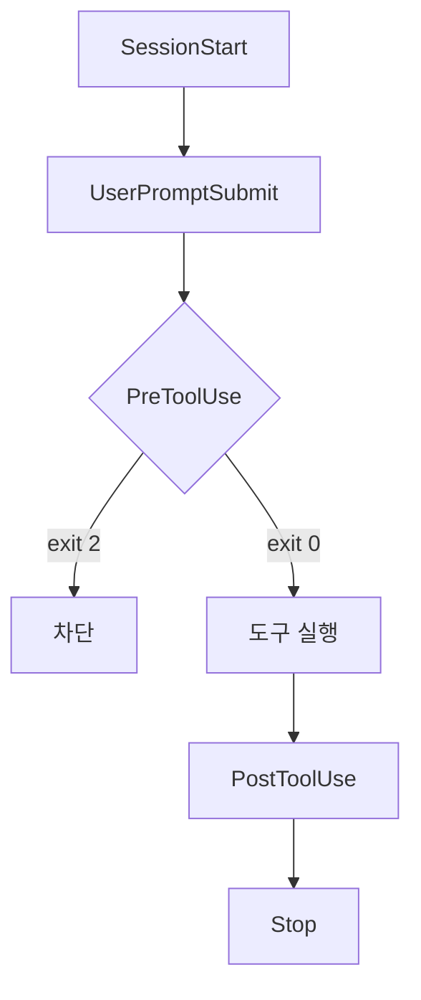
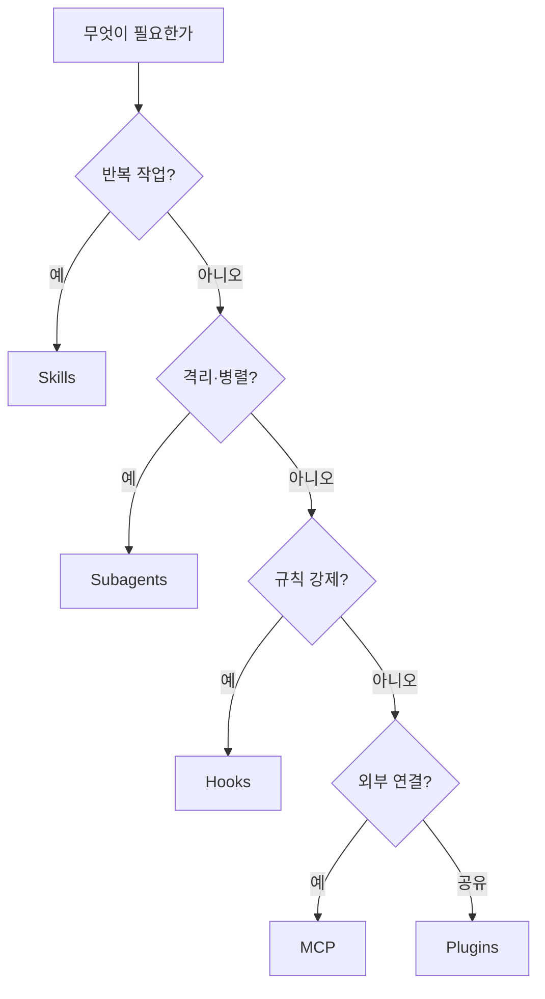

# P1 · Claude Code 5요소
## 운영을 짜는 재료

> **요약.** Claude Code의 경쟁력은 모델 품질이 아니라 모델을 둘러싼 **오케스트레이션 표면** 이다. 그 표면은 다섯 프리미티브 — CLAUDE.md · Skills · Subagents · Hooks · Plugins — 와 외부 연결(MCP)로 이루어진다. 다섯을 구분하고, 작업에 맞게 고르는 것이 하네스 설계의 출발점이다. 잘못 고르면 CLAUDE.md가 절차 문서로 비대해지거나, 스킬로 충분한 일을 서브에이전트로 돌려 불필요한 비용이 든다.

---

## 1. 모델이 아니라 운영 표면

P0에서 본 하네스 계층(제어·행위성·런타임)을 Claude Code에서는 구체적인 다섯 가지 부품으로 짠다. 아래가 그 전체 지도다.

| 프리미티브 | 위치 | 한 줄 정의 | 비유 |
|---|---|---|---|
| **CLAUDE.md** | 프로젝트 루트 | 매 세션 로드되는 프로젝트 메모리·규칙 | 가게 운영 매뉴얼 |
| **Skills** | `.claude/skills/` | 재사용 가능한 전문 능력 (SKILL.md) | 레시피·조리도구 |
| **Subagents** | `.claude/agents/` | 격리된 컨텍스트의 워커 | 따로 보낸 심부름꾼 |
| **Hooks** | 설정 파일 | 수명주기 이벤트의 결정적 제어점 | 자동 점검 게이트 |
| **Plugins** | 마켓플레이스 | 위 부품을 묶어 배포·공유 | 워크플로우 앱스토어 |
| (MCP) | 외부 서버 | 외부 시스템·데이터 연결 | 외부 거래처 회선 |

처음 세 개(CLAUDE.md · Skills · Subagents)는 **AI가 무엇을 알고 무엇을 하는가** 를 정한다. Hooks는 **사람이 정한 규칙을 강제** 하고, Plugins는 **그 모든 것을 팀에 배포** 한다. MCP는 **바깥 세계와 연결** 한다.

---

## 2. CLAUDE.md — 프로젝트 메모리

CLAUDE.md는 새 세션이 시작될 때마다 자동으로 읽히는 파일이다. 프로젝트 개요, 코딩 규칙, 자주 쓰는 명령, 하네스 포인터를 적어 둔다. 사람이 매번 같은 설명을 반복하지 않게 해 주는 가장 기본적인 메모리다.

함정은 **비대화** 다. 모든 절차를 여기에 적으면 파일이 절차 문서처럼 부풀고, 매 세션의 컨텍스트를 잡아먹는다. 원칙은 간단하다. 항상 필요한 규칙만 CLAUDE.md에 두고, 특정 작업에만 필요한 절차는 Skills로 분리한다.

---

## 3. Skills — 재사용 전문 능력

Skills는 반복하지만 매번 조금씩 다른 작업을 패키지로 만든 것이다. PR 리뷰, 릴리스 노트, 케이스 분석처럼 "한 가지 일을 잘하는 전문가를 고용하는" 개념이다. 각 스킬은 `SKILL.md` 파일로 정의하고, 자동으로 `/스킬명` 슬래시 인터페이스를 갖는다.

2026년에는 예전의 슬래시 커맨드(`.claude/commands/`)가 Skills 체계로 흡수됐다. 기존 커맨드도 동작하지만, 권장 방식은 `.claude/skills/`다.

다섯 중 가장 만들기 쉽고 즉시 효과가 크므로, 하네스 설계는 보통 스킬부터 시작한다.

---

## 4. Subagents — 격리된 워커

서브에이전트는 **별도의 컨텍스트 창** 에서 도는 일꾼이다. 메인 대화의 맥락에 영향받지 않고(깨끗한 입력), 작업을 독립적으로 처리한 뒤 **요약만 보고** 한다(깨끗한 출력). 그래서 노이즈가 많거나 큰 작업을 메인 세션을 더럽히지 않고 처리할 수 있다.

작업이 조건에 맞으면 Claude가 알아서 위임한다. 예를 들어 PR을 언급하면 PR 탐색 서브에이전트가 자동으로 스폰된다. 병렬 처리나 컨텍스트 격리가 중요할 때 쓴다. 정의 위치는 `.claude/agents/`다.

---

## 5. Hooks — 결정적 제어점

훅은 수명주기의 특정 시점에 발화하는 스크립트로, **LLM을 거치지 않고 결정적으로** 동작한다. Git 훅을 AI 코딩에 적용한 것과 같다. 2026년 5월 기준 27개의 이벤트가 있고, 핸들러는 command(셸) · HTTP · prompt · agent 네 종류다. 그중 command 훅이 대부분의 쓰임을 차지한다.

가장 많이 쓰는 이벤트는 세 가지다. **SessionStart** 는 세션 시작에 컨텍스트를 주입한다. **PreToolUse** 는 도구 실행 직전에 발화해, 위험한 명령이나 프로덕션 파일 수정을 차단하는 보안 게이트다. **PostToolUse** 는 도구 실행 뒤에 발화해 린트·로그·알림을 돌린다(이미 일어난 일을 되돌리진 못하고 관찰·반응만).

핵심 주의점 하나. 차단은 반드시 **exit code 2** 로 한다. exit 0은 통과, exit 1은 비차단 오류로 취급되어 위험한 동작이 그대로 진행된다. 훅은 CLAUDE.md의 규칙을 문서에서 **강제 게이트** 로 바꾸는 도구다.

---

## 6. Plugins — 배포와 공유

플러그인은 스킬·훅·서브에이전트·도구를 하나로 묶은 **배포 컨테이너** 다. 팀원마다 같은 설정을 손으로 깔 필요 없이, 원클릭으로 설치한다. 배포 경로는 GitHub 레포, npm 패키지, 팀 내부 레지스트리 같은 마켓플레이스다.

플러그인 스킬은 자동으로 네임스페이스가 붙어(`/security:scan`) 로컬 스킬과 이름이 충돌하지 않는다. 정리하면, Skills·Hooks는 나와 내 프로젝트를 위한 것이고, Plugins는 **공유** 를 위한 것이다. 같은 부품을, 옮겨 다닐 수 있게 포장한 것이다.

P4에서 다룰 메타 하네스 `revfactory/harness`도 이 방식으로 설치한다.

---

## 7. 무엇을 언제 쓰는가

다섯을 외우는 것보다 중요한 것은 **선택** 이다. 잘못 고르면 같은 모델로도 결과가 나빠진다. 다음 판단 흐름을 기본기로 삼는다.

원칙을 한 문단으로 요약하면 이렇다. **스킬부터 시작** 한다 — 가장 쉽고 즉시 가치가 있다. 사람이 정한 규칙을 반드시 지키게 하려면 **훅** 을 더한다. 병렬 작업이나 컨텍스트 격리가 필요하면 **서브에이전트** 를 쓴다. 외부 시스템과 이어야 하면 **MCP**, 이 모든 것을 팀에 나누려면 **플러그인** 으로 묶는다. CLAUDE.md는 이 부품들이 매 세션 제대로 로드되도록 길을 안내하는 최소한의 포인터로 유지한다.

---

## 8. 토론 질문

### Q1 — 스킬과 서브에이전트의 경계

본인 업무에서 "반복하지만 매번 조금 다른 작업"을 하나 꼽아 보자. 이것을 스킬로 만들 때와 서브에이전트로 돌릴 때, 컨텍스트와 비용은 각각 어떻게 달라지겠는가?

### Q2 — 규칙을 게이트로

지금 CLAUDE.md(또는 머릿속)에 있는 규칙 중, 사람이 매번 신경 써야 지켜지는 것은 무엇인가? 그중 하나를 PreToolUse 훅으로 강제한다면 어떤 동작을 차단하겠는가?

---

## 다음 단계

다섯 재료를 알았으니, 이제 이 재료로 **일하는 단위** 를 만든다. **P2 — 핵심 3요소** 에서 에이전트 · 스킬 · 오케스트레이터를 한 팀으로 묶는 법을 다룬다.
