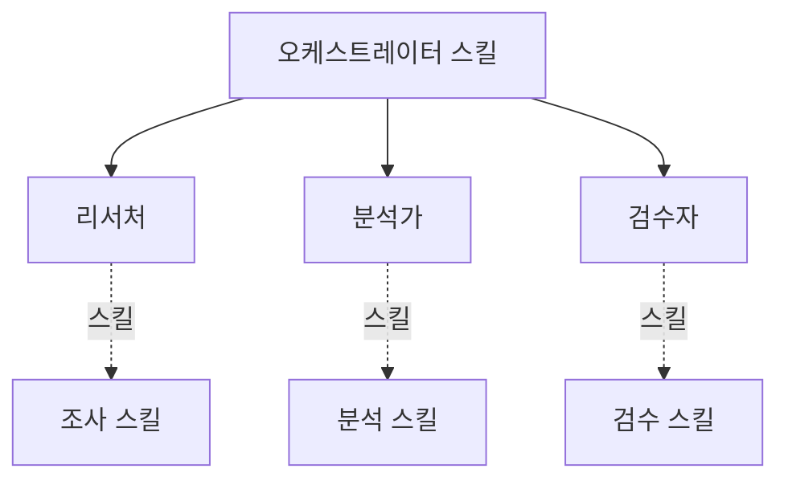

# P2 · 핵심 3요소
## 에이전트 · 스킬 · 오케스트레이터

> **요약.** P1의 다섯 재료로 이제 일하는 단위를 만든다. 하네스의 최소 구성은 세 가지다. **에이전트** 는 역할을 가진 일꾼, **스킬** 은 그 일꾼이 안정적으로 일하게 만드는 도구 상자, **오케스트레이터** 는 흐름을 관리하는 PM이다. 셋의 관계를 잡으면 어떤 도메인이든 같은 방식으로 하네스를 짤 수 있다.

---

## 1. 일하는 최소 단위

좋은 결과는 똑똑한 한 명이 아니라, 역할이 나뉜 팀에서 나온다. 세 요소는 각자 다른 일을 한다. 에이전트는 **누가** 일하는지, 스킬은 **어떻게** 일하는지, 오케스트레이터는 **언제 무엇을** 시킬지를 정한다.

주방에 빗대면 직관이 잡힌다.

| 요소 | 주방 비유 | 하는 일 | 정의 위치 |
|---|---|---|---|
| 에이전트 | 요리사 | 한 역할을 책임지고 수행 | `.claude/agents/` |
| 스킬 | 레시피·조리도구 | 그 역할을 안정적으로 재현 | `.claude/skills/` |
| 오케스트레이터 | 헤드셰프 | 주문 분배·중간 검수·플레이팅 | 오케스트레이터 스킬 |

---

## 2. 에이전트 — 역할을 가진 일꾼

에이전트는 하나의 역할에 특화된 일꾼이다. P1에서 본 서브에이전트가 그 실행 형태이고, 에이전트 정의는 그 일꾼의 신원·권한·태도를 적어 둔 파일이다. 정의에는 보통 세 가지가 들어간다. **역할(누구인가)**, **도구 권한(무엇을 쓸 수 있는가)**, **행동 규칙(어떻게 일하는가)** 이다.

```markdown
---
name: researcher
description: 주제를 조사하고 핵심 근거를 정리한다. 리서치 요청 시 사용.
tools: [web_search, web_fetch, read]
---

너는 리서치 전문가다. 다음을 지킨다.
- 1차 출처를 우선하고, 결과마다 출처를 함께 기록한다.
- 산출물은 핵심 주장 + 근거 + 출처 형식으로 요약한다.
```

좋은 에이전트 정의의 기준은 **경계의 명확성** 이다. 한 에이전트는 한 가지를 잘하게 만든다. 데이터 분석가에게 전화 응대까지 시키지 않는 것과 같다. 역할이 좁을수록 컨텍스트가 깨끗하게 유지되고, 결과의 분산이 줄어든다.

---

## 3. 스킬 — 일꾼의 도구 상자

스킬이 없으면 모든 에이전트는 제너럴리스트다. 매번 처음부터 방식을 추론하므로 결과가 들쭉날쭉해진다. 스킬이 있으면 같은 에이전트가 스페셜리스트가 된다. 검증된 절차를 매번 같은 방식으로 재현하기 때문이다.

스킬은 `SKILL.md`로 정의한다. 무엇을 하는 스킬인지(설명), 언제 발동하는지(트리거), 어떤 절차로 수행하는지(본문)를 담는다.

```markdown
---
name: case-writer
description: 케이스 스터디 초안을 작성한다. "케이스 작성" 요청 시 트리거.
---

# 케이스 작성 절차
1. 입력 자료에서 핵심 쟁점 세 개를 뽑는다.
2. 배경 → 쟁점 → 토론 질문 순으로 구성한다.
3. 한국어 학술 문체로 작성하고 과장 표현을 피한다.
```

정리하면, 에이전트는 "누가"이고 스킬은 "어떻게"다. 스킬은 에이전트가 안정적으로 일하게 만드는 도구 상자이며, 좋은 스킬은 한 번 만들어 여러 에이전트가 재사용한다.

---

## 4. 오케스트레이터 — 흐름을 관리하는 PM

오케스트레이터는 헤드셰프이자 PM이다. 직접 요리하지 않고, 누가 무엇을 언제 할지를 정하고 중간 결과를 검수해 최종 산출물로 통합한다. 보통 오케스트레이터 스킬 하나가 전체 흐름의 진입점이 된다.

오케스트레이터의 일은 네 단계로 돈다.

<svg width="100%" style="max-width:680px" viewBox="0 0 680 205" xmlns="http://www.w3.org/2000/svg" role="img" aria-label="오케스트레이터의 네 단계: 계획, 배정, 검증, 통합과 피드백 순환">
  <text x="340" y="24" text-anchor="middle" font-size="14" font-weight="bold" fill="#1B2C5E">오케스트레이터의 운영 루프</text>
  <rect x="20" y="48" width="130" height="78" rx="10" fill="#E3F2FD" stroke="#0D47A1" stroke-width="2"/>
  <text x="85" y="80" text-anchor="middle" font-size="13" font-weight="bold" fill="#0D47A1">계획</text>
  <text x="85" y="102" text-anchor="middle" font-size="10.5" fill="#1A237E">무엇을 어떤</text>
  <text x="85" y="117" text-anchor="middle" font-size="10.5" fill="#1A237E">순서로</text>
  <rect x="180" y="48" width="130" height="78" rx="10" fill="#FFF3E0" stroke="#E65100" stroke-width="2"/>
  <text x="245" y="80" text-anchor="middle" font-size="13" font-weight="bold" fill="#E65100">배정</text>
  <text x="245" y="102" text-anchor="middle" font-size="10.5" fill="#8a4b00">에이전트에</text>
  <text x="245" y="117" text-anchor="middle" font-size="10.5" fill="#8a4b00">작업 분배</text>
  <rect x="340" y="48" width="130" height="78" rx="10" fill="#FFF8E1" stroke="#B07517" stroke-width="2"/>
  <text x="405" y="80" text-anchor="middle" font-size="13" font-weight="bold" fill="#B07517">검증</text>
  <text x="405" y="102" text-anchor="middle" font-size="10.5" fill="#6d4c00">중간 산출물</text>
  <text x="405" y="117" text-anchor="middle" font-size="10.5" fill="#6d4c00">점검</text>
  <rect x="500" y="48" width="130" height="78" rx="10" fill="#E8F5E9" stroke="#2F7A4A" stroke-width="2.5"/>
  <text x="565" y="80" text-anchor="middle" font-size="13" font-weight="bold" fill="#2F7A4A">통합</text>
  <text x="565" y="102" text-anchor="middle" font-size="10.5" fill="#1b5e20">최종 결과</text>
  <text x="565" y="117" text-anchor="middle" font-size="10.5" fill="#1b5e20">종합</text>
  <path d="M150 87 L178 87" stroke="#90A4AE" stroke-width="2.5" marker-end="url(#a2)"/>
  <path d="M310 87 L338 87" stroke="#90A4AE" stroke-width="2.5" marker-end="url(#a2)"/>
  <path d="M470 87 L498 87" stroke="#90A4AE" stroke-width="2.5" marker-end="url(#a2)"/>
  <defs><marker id="a2" markerWidth="10" markerHeight="10" refX="7" refY="3" orient="auto"><path d="M0,0 L7,3 L0,6 Z" fill="#90A4AE"/></marker></defs>
  <path d="M565 126 C 565 165, 85 165, 85 126" fill="none" stroke="#90A4AE" stroke-width="2" stroke-dasharray="5,4" marker-end="url(#a2)"/>
  <text x="325" y="183" text-anchor="middle" font-size="11" fill="#607D8B">검증에서 문제가 보이면 계획으로 되돌린다 (피드백)</text>
</svg>

여기서 검증 단계가 품질을 만든다. 중간중간 산출물을 확인하지 않으면, 마지막에 가서야 어긋남을 발견한다. 좋은 오케스트레이터는 재료 확인 → 중간 조리 검증 → 최종 검수처럼 단계마다 점검점을 둔다.

---

## 5. 셋을 한 하네스로 묶기

세 요소를 한 도메인에 묶으면 하나의 하네스가 된다. 오케스트레이터가 진입점이 되어 에이전트들을 차례로 부르고, 각 에이전트는 자기 스킬로 일한다.



이 구조가 모든 도메인 하네스의 공통 골격이다. 도메인만 바꾸면(웹툰 제작이든, 보고서 작성이든) 같은 패턴으로 팀을 다시 짤 수 있다. 역할 설계가 명료할수록 팀은 빨라지고 결과는 안정된다. P4의 메타 하네스는 바로 이 골격을 "하네스 구성해줘" 한 문장으로 자동 생성한다.

---

## 6. 토론 질문

### Q1 — 역할 분해

본인 업무 한 가지를 골라, 그것을 끝내는 데 필요한 역할을 3~4개로 나눠 보자. 각 역할에 어떤 도구 권한과 행동 규칙을 줄 것인가? 한 역할이 너무 넓지는 않은가?

### Q2 — 검증점 설계

그 작업에서 "마지막에 가서야 어긋남을 발견했던" 경험이 있는가? 오케스트레이터의 어느 단계에 검증점을 넣었다면 일찍 잡을 수 있었겠는가?

---

## 다음 단계

지금까지는 한 흐름 안의 협업이었다. **P3 — 멀티 에이전트** 에서 단일 에이전트(1인 주방)와 Agent Team(역할형 주방)을 비교하고, 팀원끼리 직접 통신하는 구조와 그 비용을 다룬다.
