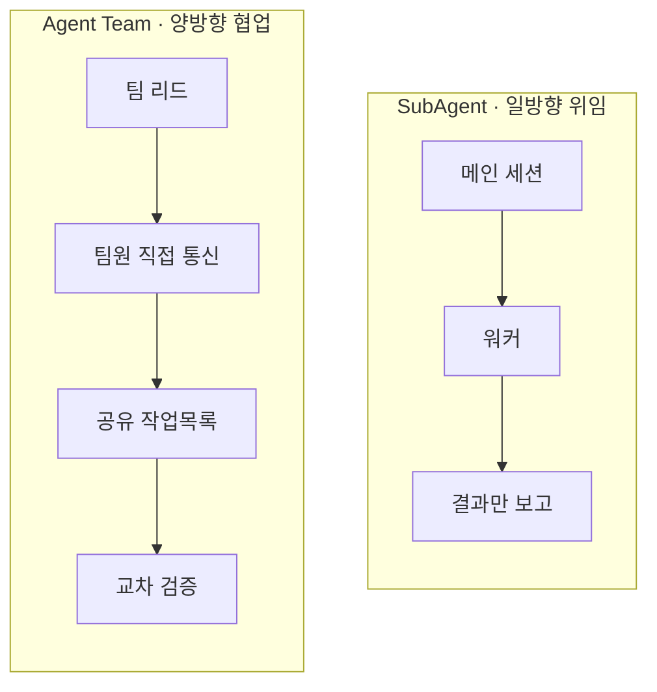

# P3 · 멀티 에이전트
## SubAgent vs Agent Team

> **요약.** 단일 에이전트는 1인 주방, 멀티 에이전트는 역할형 주방이다. 2026년 2월 출시된 **Agent Team** 의 핵심은 통신이다. 서브에이전트는 결과를 메인에 보고만 하지만, 팀원은 서로 직접 메시지를 주고받고 공유 작업목록에서 과제를 가져간다. 강력한 만큼 비용도 크다. 팀원마다 독립된 컨텍스트(최대 100만 토큰)를 가지므로, 3인 팀은 보통 단일 세션의 3~4배 토큰을 쓴다. 그래서 "서브에이전트 먼저, 협업이 필요할 때 팀"이 기본기다.

---

## 1. 1인 주방 vs 역할형 주방

한 명의 요리사가 주문·조리·검수를 모두 하는 1인 주방은 단순한 일에 빠르고 효율적이다. 주문이 몰리고 코스가 복잡해지면, 역할을 나눈 주방이 빨라진다. 다만 사람이 늘면 인건비가 늘듯, 에이전트가 늘면 토큰 비용이 는다. 멀티 에이전트의 모든 판단은 이 균형 위에 있다.

---

## 2. SubAgent — 한 세션 안의 위임

P1에서 봤듯 서브에이전트는 별도의 컨텍스트 창에서 도는 일꾼이다. 메인 세션이 40개 파일을 읽고 마이그레이션 스크립트를 쓰는 와중에 "이게 인증 파이프라인을 건드리는지 확인해줘"를 같은 대화에 부으면 컨텍스트가 폭증한다. 이 곁가지를 자식 인스턴스에 위임하면, 메인 세션은 본 작업에 집중한 채 **요약만** 돌려받는다.

서브에이전트는 **일방향 위임** 이다. 리드가 과제를 보내고, 서브에이전트가 실행하고, 결과가 리드로 돌아온다. 형제 에이전트 사이에는 공유 상태도, 직접 통신도 없다. 빠르고 반복적인 작업에 적합하다.

---

## 3. Agent Team — 세션 간 협업

Agent Team은 여러 Claude **세션** 이 한 프로젝트에서 함께 일하게 한다. 한 세션이 팀 리드가 되어 일을 조율하고, 팀원들은 각자 독립된 컨텍스트 창에서 일하며 서로 직접 통신한다. 팀에는 세 가지가 더해진다. 팀원 간 **peer-to-peer 메시지**, 의존성을 추적하는 **공유 작업목록**, 동시 쓰기를 막는 **파일 잠금** 이다.

팀원은 스폰될 때 메인 세션과 동일한 프로젝트 컨텍스트(CLAUDE.md, MCP, `.claude/skills/`)를 로드한다. 다만 서로의 컨텍스트나 메모리에 직접 접근하지는 못한다. 이 격리는 의도된 것으로, 한 에이전트의 잘못된 중간 결론이 다른 에이전트로 번지지 않게 한다.

---

## 4. 둘의 결정적 차이: 통신



<svg width="100%" style="max-width:680px" viewBox="0 0 680 290" xmlns="http://www.w3.org/2000/svg" role="img" aria-label="서브에이전트의 일방향 허브 구조와 에이전트 팀의 양방향 메시 구조 비교">
  <rect x="15" y="30" width="305" height="248" rx="12" fill="#F5F7FA" stroke="#90A4AE" stroke-width="1.5"/>
  <text x="167" y="52" text-anchor="middle" font-size="13" font-weight="bold" fill="#455A64">SubAgent · 일방향</text>
  <rect x="112" y="64" width="110" height="34" rx="8" fill="#1B2C5E"/>
  <text x="167" y="86" text-anchor="middle" font-size="11.5" font-weight="bold" fill="#fff">메인 세션</text>
  <line x1="140" y1="98" x2="72" y2="128" stroke="#607D8B" stroke-width="2" marker-end="url(#a3)"/>
  <line x1="167" y1="98" x2="167" y2="128" stroke="#607D8B" stroke-width="2" marker-end="url(#a3)"/>
  <line x1="194" y1="98" x2="262" y2="128" stroke="#607D8B" stroke-width="2" marker-end="url(#a3)"/>
  <circle cx="65" cy="150" r="20" fill="#E3F2FD" stroke="#0D47A1" stroke-width="2"/>
  <text x="65" y="155" text-anchor="middle" font-size="11" fill="#0D47A1">W1</text>
  <circle cx="167" cy="150" r="20" fill="#E3F2FD" stroke="#0D47A1" stroke-width="2"/>
  <text x="167" y="155" text-anchor="middle" font-size="11" fill="#0D47A1">W2</text>
  <circle cx="269" cy="150" r="20" fill="#E3F2FD" stroke="#0D47A1" stroke-width="2"/>
  <text x="269" y="155" text-anchor="middle" font-size="11" fill="#0D47A1">W3</text>
  <text x="167" y="218" text-anchor="middle" font-size="11" fill="#455A64">결과만 메인에 보고</text>
  <text x="167" y="240" text-anchor="middle" font-size="11" fill="#90A4AE">팀원끼리 통신 없음</text>
  <rect x="335" y="30" width="300" height="248" rx="12" fill="#F1F8E9" stroke="#AED581" stroke-width="1.5"/>
  <text x="485" y="52" text-anchor="middle" font-size="13" font-weight="bold" fill="#2F7A4A">Agent Team · 양방향</text>
  <rect x="430" y="64" width="110" height="34" rx="8" fill="#2F7A4A"/>
  <text x="485" y="86" text-anchor="middle" font-size="11.5" font-weight="bold" fill="#fff">팀 리드</text>
  <line x1="460" y1="98" x2="392" y2="128" stroke="#7CB342" stroke-width="2"/>
  <line x1="485" y1="98" x2="485" y2="128" stroke="#7CB342" stroke-width="2"/>
  <line x1="510" y1="98" x2="578" y2="128" stroke="#7CB342" stroke-width="2"/>
  <circle cx="385" cy="150" r="20" fill="#E8F5E9" stroke="#2F7A4A" stroke-width="2"/>
  <text x="385" y="155" text-anchor="middle" font-size="11" fill="#2F7A4A">T1</text>
  <circle cx="485" cy="150" r="20" fill="#E8F5E9" stroke="#2F7A4A" stroke-width="2"/>
  <text x="485" y="155" text-anchor="middle" font-size="11" fill="#2F7A4A">T2</text>
  <circle cx="585" cy="150" r="20" fill="#E8F5E9" stroke="#2F7A4A" stroke-width="2"/>
  <text x="585" y="155" text-anchor="middle" font-size="11" fill="#2F7A4A">T3</text>
  <line x1="405" y1="150" x2="465" y2="150" stroke="#E65100" stroke-width="2"/>
  <line x1="505" y1="150" x2="565" y2="150" stroke="#E65100" stroke-width="2"/>
  <path d="M380 132 C 420 105, 550 105, 590 132" fill="none" stroke="#E65100" stroke-width="2"/>
  <rect x="360" y="192" width="250" height="30" rx="6" fill="#FFF3E0" stroke="#E65100" stroke-width="1.5"/>
  <text x="485" y="212" text-anchor="middle" font-size="11.5" font-weight="bold" fill="#E65100">공유 작업목록</text>
  <text x="485" y="246" text-anchor="middle" font-size="11" fill="#558B2F">팀원 직접 통신 · 과제 선점 · 교차 검증</text>
  <defs><marker id="a3" markerWidth="9" markerHeight="9" refX="6" refY="3" orient="auto"><path d="M0,0 L6,3 L0,6 Z" fill="#607D8B"/></marker></defs>
</svg>

서브에이전트는 모든 결과가 리드로 모이는 허브 구조이고, 에이전트 팀은 팀원이 서로 이어진 메시 구조다. 이 차이가 비용과 적합성을 모두 가른다.

---

## 5. settings.json로 활성화

Agent Team은 실험 기능이다. Claude Code v2.1.32 이상에서, 환경 변수 또는 `settings.json`에 기능을 명시해야 켜진다.

```json
{
  "env": {
    "CLAUDE_CODE_EXPERIMENTAL_AGENT_TEAMS": "1"
  }
}
```

켠 뒤에는 한 문장으로 팀을 구성한다.

```text
결제 모듈을 리팩터링할 에이전트 팀을 구성하라.
팀원 셋을 스폰한다 — API 계층, DB 마이그레이션, 테스트 커버리지.
공유 작업목록으로 서로 조율하게 하라.
```

그러면 Claude는 팀 리드를 만들고, 독립적인 팀원 셋을 스폰해 공유 작업목록과 직접 메시지로 조율한다. 핵심은 `settings.json`에 실험 기능을 명시하는 것이다.

---

## 6. 토큰 비용의 경제학

비용은 고정값이 아니라 팀원 수와 각자의 작업량에 비례한다. 팀원마다 풀 Claude 인스턴스이므로, 4인 팀은 같은 프로젝트 컨텍스트를 4번 초기화하는 비용을 선불로 치르고, 에이전트 간 메시지마다 과금되는 왕복이 더해진다.

그런데 규모가 커지면 역설이 생긴다. 서브에이전트는 모든 결과가 한 오케스트레이터 컨텍스트로 몰려 누적되기 때문에, 대규모 병렬 작업에서는 오히려 팀이 더 쌀 수 있다.

| 파이프라인 규모 | 권장 | 비용 특성 |
|---|---|---|
| 소규모 (2~4) | SubAgent | 비용 차이 미미, 가장 효율적 |
| 중규모 (5~10) | 작업에 따라 | 서브에이전트 오케스트레이터가 30~50k 토큰까지 누적 |
| 대규모 (10+ 병렬) | Agent Team | 결과가 한 곳에 몰리지 않아 팀이 3~5배 저렴할 수 있음 |

비용을 줄이는 실전 수칙:

- **모델 티어링** — 복잡 추론은 상위 모델, 중간 작업은 중급, 단순 작업은 경량 모델에 배정
- **유휴 종료** — 작업이 끝난 에이전트는 즉시 종료(`/stop`). 놀고 있는 세션도 토큰을 먹는다
- **디스패치 사이 정리** — `/clear`로 누적된 대화를 비우면 메시지당 토큰을 30~50% 줄인다
- **YAML에 모델 상한 고정** — 서브에이전트 설정을 레포에 커밋해, 모두가 최고가 모델로 기본 설정하는 것을 막는다

비용이 아깝지 않은가는 작업에 달렸다. 리뷰·테스트·문서까지 필요한 기능 출하라면, 스킬을 갖춘 팀이 하루 일을 한 시간으로 압축한다. 토큰 비용은 실재하지만 시간 절감이 더 크다.

---

## 7. 컨텍스트 관리 = 재료 보관

멀티 에이전트가 늘수록 컨텍스트 관리가 비용과 품질을 동시에 좌우한다. 좋은 주방이 재료를 정리하듯, 필요한 정보만 작업대에 올리고 오래된 것은 치운다.

기억해야 할 현상이 둘 있다. 첫째, **컨텍스트 부패(context rot)** — 토큰이 길어질수록 모델의 회수 정확도가 떨어진다. 둘째, **자동 컴팩션(autocompact)** — 약 187K 토큰에서 발동해 부푼 컨텍스트를 요약하는데, 통제되지 않으면 그 자체가 큰 비용이 된다.

대응의 핵심은 컨텍스트 엔지니어링이다. 한정된 어텐션 예산 안에서 "원하는 결과의 가능성을 높이는 가장 작은 고신호 토큰 집합"만 남긴다. 구체적으로는 메모리(영속 저장·회수), 컴팩션(요약 압축), 도구 결과 비우기를 조합한다.

---

## 8. 무엇을 언제 쓰는가

기본기는 "서브에이전트 먼저"다. 빠르고 집중된 워커가 결과만 보고하면 될 때는 서브에이전트를 쓴다. 팀원이 서로 발견을 공유하고, 가정을 반박하고, 스스로 조율해야 할 때 — 즉 여러 독립 작업 흐름이 얽힌 복잡한 작업일 때 — 팀으로 올린다. 복잡한 프로젝트는 보통 계층적으로 접근한다. 먼저 역할과 경계를 정하는 계획 단계, 그다음 실행을 위한 병렬 팀이다.

---

## 9. 토론 질문

### Q1 — 허브와 메시

본인 작업 중 "여러 사람이 서로 결과를 봐야 빨라지는" 일과 "각자 따로 해도 되는" 일을 하나씩 꼽아 보자. 각각 메시 구조(팀)와 허브 구조(서브에이전트) 중 어디에 맞는가?

### Q2 — 비용의 손익분기

대규모 병렬 작업에서 팀이 오히려 더 쌀 수 있는 이유를 한 문장으로 설명해 보자. 본인의 가장 비싼 워크플로우에 이 원리를 적용한다면 무엇을 바꾸겠는가?

---

## 다음 단계

지금까지는 하네스를 손으로 짰다. **P4 — 메타 하네스** 에서 `revfactory/harness`로 "하네스 구성해줘" 한 문장이 도메인 팀과 스킬을 자동 생성하는 원리와, 매 실행 후 진화하는 메커니즘을 다룬다.
