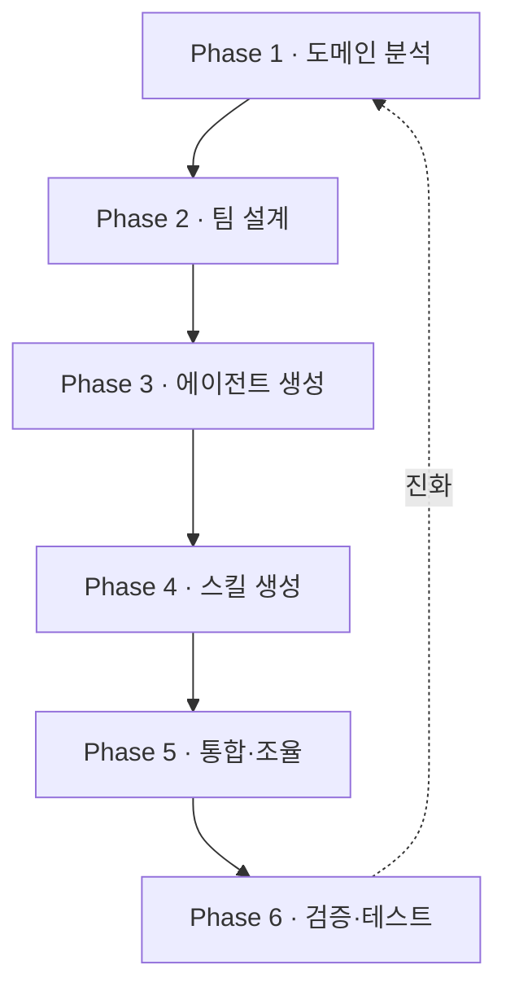

# P4 · 메타 하네스
## revfactory/harness

> **요약.** P2~P3에서 하네스를 손으로 짰다. 멀티 에이전트 골격은 처음부터 쓰기 번거롭고 틀리기 쉽다. 메타 하네스 `revfactory/harness`는 "하네스 구성해줘" 한 문장으로 도메인을 분석해 에이전트 팀과 스킬을 자동 생성한다. 6단계 워크플로우로 동작하며, 6가지 검증된 팀 패턴 중 하나를 골라 `.claude/agents/`와 `.claude/skills/`를 만든다. 통제 실험에서 평균 품질 +60%(49.5 → 79.3)를 보고했고, 과제가 어려울수록 효과가 컸다.

---

## 1. 손으로 짜던 것을 한 문장으로

깊이 있는 리서치 파이프라인이나 풀스택 사이트를 만들려면, 역할을 나눈 에이전트와 그들이 쓸 스킬, 그리고 조율 흐름을 모두 직접 써야 한다. 이 멀티 에이전트 비계(scaffolding)는 손이 많이 가고, 경계를 잘못 잡으면 결과가 무너진다. 메타 하네스는 이 비계 작성 자체를 자동화한다.

핵심은 한 문장이다. 한국어로 "하네스 구성해줘", 영어로 "build a harness for this project". 그러면 플러그인이 도메인 설명을 에이전트 팀과 스킬로 변환한다.

---

## 2. 메타 하네스란

`revfactory/harness`는 일반 하네스가 아니라, **다른 하네스를 만드는 하네스** 다. Claude Code 생태계에서 L3 메타 팩토리 계층, 그중에서도 팀 아키텍처를 생성하는 **Team-Architecture Factory** 에 위치한다. 자기가 한 팀이 되는 대신, 도메인에 맞는 팀 구조·메시지 프로토콜·리뷰 게이트를 생성한다.

비교 지점이 하나 있다. 장시간 실행과 상태 복구가 필요한 오케스트레이션은 LangGraph의 영역이다. 메타 하네스는 그것을 대체하지 않는다. LangGraph는 세션을 넘는 영속 상태와 복구를 다루고, 메타 하네스는 Claude Code 안에서 빠른 팀 아키텍처 설계를 다룬다. 서로 다른 계층이다.

---

## 3. 설치와 첫 사용

Agent Team 기능을 켠 뒤, 마켓플레이스로 플러그인을 설치한다.

```bash
# 1) Agent Team 활성화
export CLAUDE_CODE_EXPERIMENTAL_AGENT_TEAMS=1

# 2) 마켓플레이스 추가 후 설치
/plugin marketplace add revfactory/harness
/plugin install harness@harness

# (또는 수동 설치: 스킬 디렉토리를 전역으로 복사)
cp -r skills/harness ~/.claude/skills/harness
```

설치 후에는 도메인만 바꿔 호출한다.

```text
딥 리서치 파이프라인을 위한 하네스를 구성해줘.
```

새 에이전트와 스킬을 다시 읽게 하려면 세션을 한 번 닫았다(`/exit`) 여는 편이 안전하다.

---

## 4. 6단계 진화 메커니즘

메타 하네스는 다음 여섯 단계로 하네스를 만든다. 마지막에서 다시 처음으로 돌아오는 순환 구조라, 한 번 만들고 끝이 아니라 계속 진화한다.



각 단계가 하는 일은 이렇다.

- **Phase 1 · 도메인 분석** — 무엇을 하는 도메인인지, 어떤 역할이 필요한지 파악한다.
- **Phase 2 · 팀 설계** — 6가지 패턴 중 하나를 고르고, Agent Team과 서브에이전트 중 무엇을 쓸지 정한다.
- **Phase 3 · 에이전트 생성** — `.claude/agents/`에 전문 에이전트 정의(.md)를 쓴다.
- **Phase 4 · 스킬 생성** — `.claude/skills/`에 스킬을 쓰되, 필요한 컨텍스트만 그때그때 로드하는 점진적 공개(Progressive Disclosure)를 적용한다.
- **Phase 5 · 통합·조율** — 에이전트 간 데이터 전달(메시지·작업·파일 기반)과 오류 처리를 엮는다.
- **Phase 6 · 검증·테스트** — 트리거 검증, 드라이런, 스킬 있음 vs 없음 A/B 비교로 품질을 입증한다.

---

## 5. 6가지 팀 아키텍처 패턴

Phase 2에서 고르는 여섯 패턴은 멀티 에이전트의 검증된 골격이다.

| 패턴 | 구조 | 적합한 작업 |
|---|---|---|
| Pipeline | 순차 단계 | 단계가 명확한 변환 작업 |
| Fan-out/Fan-in | 병렬 분기 후 취합 | 여러 갈래를 동시에 조사·취합 |
| Expert Pool | 전문가 풀 | 다양한 전문성이 필요한 문제 |
| Producer-Reviewer | 생산자–검수자 | 품질 검증이 중요한 산출물 |
| Supervisor | 감독자 조율 | 동적으로 작업을 배분 |
| Hierarchical Delegation | 계층적 위임 | 큰 작업을 하위 작업으로 분해 |

패턴을 외울 필요는 없다. 메타 하네스가 도메인을 보고 고르되, 사람이 그 선택을 검토하고 바꿀 수 있다는 점만 기억하면 된다.

---

## 6. 진화하는 시스템

메타 하네스의 전제는 "하네스는 고정물이 아니라 진화하는 시스템"이라는 것이다. 스킬이 트리거되면 가장 먼저 기존 하네스 현황을 읽는다(프로젝트의 `agents/`, `skills/`, `CLAUDE.md`). 그 상태에 따라 세 가지로 갈린다.

- **신규 구축** — 에이전트·스킬 디렉토리가 없으면 Phase 1부터 전체 실행
- **기존 확장** — 새 에이전트·스킬 추가 요청이면 필요한 Phase만 선택 실행
- **운영·유지보수** — 감사·수정·동기화 요청이면 현황 점검 중심

매 실행 후에는 피드백을 반영해 에이전트·스킬·`CLAUDE.md`를 갱신한다. `CLAUDE.md`에는 새 세션에서 오케스트레이터가 트리거되도록 최소한의 포인터(트리거 규칙 + 변경 이력)만 남긴다.

---

## 7. 효과: claude-code-harness 실험

동반 레포 `revfactory/claude-code-harness`는 15개 소프트웨어 엔지니어링 과제로 스킬 있음 vs 없음을 A/B 비교했다. 평균 품질이 49.5에서 79.3으로 올랐고(+60%), 15전 15승, 출력 분산은 32% 줄었다. 특히 과제가 어려울수록 구조의 효과가 컸다.

<svg width="100%" style="max-width:680px" viewBox="0 0 680 250" xmlns="http://www.w3.org/2000/svg" role="img" aria-label="하네스 통제 실험 결과: 과제 난이도가 높을수록 개선 효과 증대">
  <text x="340" y="22" text-anchor="middle" font-size="14" font-weight="bold" fill="#1B2C5E">난이도별 품질 개선 효과 (점)</text>
  <line x1="70" y1="200" x2="630" y2="200" stroke="#90A4AE" stroke-width="1.5"/>
  <rect x="120" y="105" width="90" height="95" rx="4" fill="#4A90E2" stroke="#2C5F8D" stroke-width="1.5"/>
  <text x="165" y="98" text-anchor="middle" font-size="14" font-weight="bold" fill="#2C5F8D">+23.8</text>
  <text x="165" y="218" text-anchor="middle" font-size="11.5" fill="#37474F">Basic</text>
  <rect x="295" y="78" width="90" height="122" rx="4" fill="#F5A623" stroke="#B07517" stroke-width="1.5"/>
  <text x="340" y="71" text-anchor="middle" font-size="14" font-weight="bold" fill="#B07517">+29.6</text>
  <text x="340" y="218" text-anchor="middle" font-size="11.5" fill="#37474F">Advanced</text>
  <rect x="470" y="55" width="90" height="145" rx="4" fill="#2F7A4A" stroke="#1b5e20" stroke-width="1.5"/>
  <text x="515" y="48" text-anchor="middle" font-size="14" font-weight="bold" fill="#1b5e20">+36.2</text>
  <text x="515" y="218" text-anchor="middle" font-size="11.5" fill="#37474F">Expert</text>
  <text x="340" y="242" text-anchor="middle" font-size="11.5" fill="#455A64">종합: 평균 +60% (49.5 → 79.3) · 15/15 승 · 출력 분산 −32% (n=15, 저자 A/B)</text>
</svg>

다만 해석에 주의가 필요하다. 이 결과는 저자 자체 측정(n=15)이며, 제3자 재현 실험은 아직 공개되지 않았다. 효과의 방향(어려운 과제일수록 구조가 도움)은 신뢰할 만하지만, 절대 수치는 본인 도메인에서 직접 검증하는 편이 안전하다.

---

## 8. harness-100: 100개 프로덕션 하네스

`revfactory/harness-100`은 10개 도메인에 걸친 100개의 프로덕션급 하네스 컬렉션이다(영어·한국어 200패키지). 콘텐츠 제작, 소프트웨어 개발, 데이터/AI, 비즈니스 전략, 교육, 법률, 헬스케어 등을 포함한다. 각 하네스는 전문 에이전트 4~5명 + 오케스트레이터 스킬 + 도메인 스킬로 동일한 구조를 따른다.

```text
{NN}-{harness-name}/
└── .claude/
    ├── CLAUDE.md       # 프로젝트 개요
    ├── agents/         # 전문 에이전트 정의
    └── skills/         # 오케스트레이터 + 도메인 스킬
```

직접 만들기 전에, 가까운 도메인의 기성 하네스를 복사해 출발점으로 삼는 것이 빠르다.

---

## 9. 토론 질문

### Q1 — 패턴 매칭

본인 도메인의 대표 작업을 하나 골라, 6가지 패턴 중 어디에 맞을지 추정해 보자. 그렇게 고른 이유는 무엇이며, Producer-Reviewer를 추가한다면 어디에 검수 게이트를 두겠는가?

### Q2 — 진화의 트리거

처음 만든 하네스가 한 번에 완벽하지 않다면, 어떤 신호를 보고 "확장" 또는 "유지보수" 모드로 다시 돌릴 것인가? 무엇을 `CLAUDE.md` 포인터에 남기겠는가?

---

## 다음 단계

메타 하네스가 만든 팀을 어떻게 실행할지가 다음 주제다. **P5 — Dynamic Workflow** 에서 Fan out → Reduce → Synthesize 패턴과 품질 검증 루프(반박 검증·다관점·심판단·수렴 반복)를 다룬다.
