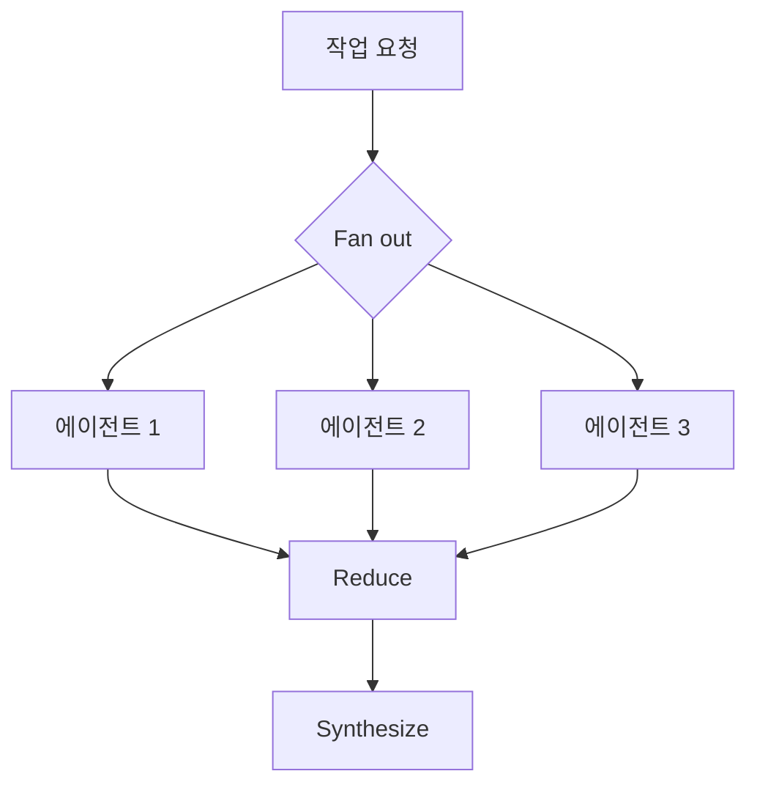
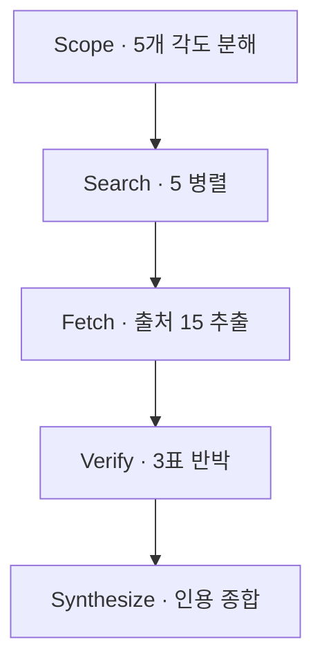

# P5 · Dynamic Workflow
## 품질 검증 루프

> **요약.** 2026년 5월 28일, Claude Code에 Dynamic Workflow가 도입됐다. Claude가 작업에 맞춰 자신의 멀티 에이전트 하네스를 **즉석에서** 쓰고 조율한다. 평문 요청을 받아 오케스트레이션 스크립트를 직접 작성하고, 수십~수백 개의 서브에이전트를 병렬로 돌린 뒤, 결과가 사람에게 닿기 전에 스스로 검증한다. 조율 자체는 스크립트라 모델 토큰을 쓰지 않는다. 핵심 발상은 "오케스트레이션이 개발자의 결정에서 모델의 결정으로 옮겨 왔다"는 것이다.

---

## 1. 왜 Dynamic Workflow인가

P2~P4에서는 하네스를 사람이 설계했다. Dynamic Workflow는 그 설계를 모델에게 넘긴다. 새 프리미티브는 거의 없다. 병렬 서브에이전트도, 반박 검증도 이미 있던 패턴이다. 새로운 것은 **사람이 조립할 양을 줄였다** 는 점이다. 세 가지 조건이 겹칠 때 특히 빛난다.

- **Breadth(폭)** — 확인할 갈래가 많을 때 (여러 출처·모듈·콜사이트)
- **Verification(검증)** — 결과를 믿기 전에 반박·교차검증이 필요할 때
- **Scale(규모)** — 단계마다 깨끗한 컨텍스트로 분리해 대량 병렬화할 때

---

## 2. 핵심 발상: Claude가 하네스를 즉석에서 쓴다

Dynamic Workflow는 에이전트들을 조율하는 **스크립트** 다. Claude가 작업을 보고 JavaScript 오케스트레이션 프로그램을 직접 쓰고, 런타임이 그 스크립트대로 서브에이전트의 실행 순서와 중간 결과를 관리한다. 사람은 JavaScript를 손으로 쓰지 않는다.

이렇게 계획을 코드로 굳히면, 단순히 에이전트 수를 늘리는 것을 넘어 **반복 가능한 패턴** 을 적용할 수 있다. 실행 전에 Claude가 계획한 워크플로를 보여 주고 허락을 구하며, 병렬 에이전트가 많아 토큰 사용량이 높다고 경고한다.

---

## 3. 프리미티브

빌딩 블록은 단 하나, **에이전트** 다. 에이전트는 모델 사양과 에이전트 타입을 가진다. 이 에이전트들로 두 종류의 프로그램을 짠다.

| 프리미티브 | 역할 |
|---|---|
| `agent()` | 하나의 에이전트 — 한 작업을 수행 |
| `parallel()` | 여러 에이전트를 동시에 실행 (펼침) |
| `pipeline()` | 여러 에이전트를 순서대로 실행 (사슬) |
| `workflow()` | 위를 묶어 하나의 재사용 가능한 하네스로 |

`parallel()`로 넓게 펼치고, `pipeline()`으로 단계를 잇고, 중간 가공은 평범한 JavaScript로 한다.

---

## 4. 대표 패턴: Fan out → Reduce → Synthesize

가장 흔한 골격은 넓게 펼치고(Fan out), 모으고(Reduce), 종합하는(Synthesize) 흐름이다.

한 번의 단순한 fan-out이라면 서브에이전트로 충분하다. 워크플로가 필요해지는 진짜 이유는 **한 단계의 출력이 다음 단계를 결정** 할 때다. 펼친 결과를 비교해 실패한 에이전트만 재시작하고, 성공한 실행을 저장해 명령으로 재사용하는 흐름이 그것이다.

---

## 5. 품질을 높이는 패턴

Dynamic Workflow의 가치는 속도보다 **신뢰** 에 있다. 다음 패턴들이 반복 가능한 품질을 만든다.

| 패턴 | 방식 | 효과 |
|---|---|---|
| Adversarial Verify | 한 에이전트가 다른 에이전트의 주장을 반박 | 환각·근거 없는 주장 제거 |
| Diverse Lenses | 같은 문제를 여러 관점으로 동시 검토 | 사각지대 축소 |
| Judge Panel | 여러 심판이 결과를 평가·투표 | 편향된 단일 판정 방지 |
| Loop-until-dry | 더 나올 게 없을 때까지 반복 | 누락 최소화 |

핵심은 **누구도 자기 숙제를 자기가 채점하지 않는다** 는 원칙이다. 검증은 별도 에이전트가, 가능하면 별도 컨텍스트 창에서 수행한다.

---

## 6. 세 가지 실행 경로

같은 기능을 켜는 길이 세 가지다. 바로 쓰는 번들, 자동 판단, 직접 설계다.

<svg width="100%" style="max-width:680px" viewBox="0 0 680 200" xmlns="http://www.w3.org/2000/svg" role="img" aria-label="Dynamic Workflow의 세 가지 실행 경로: deep-research, ultracode, workflow">
  <text x="340" y="24" text-anchor="middle" font-size="14" font-weight="bold" fill="#1B2C5E">세 가지 실행 경로</text>
  <rect x="35" y="48" width="175" height="125" rx="12" fill="#E3F2FD" stroke="#0D47A1" stroke-width="2"/>
  <text x="122" y="78" text-anchor="middle" font-size="12.5" font-weight="bold" fill="#0D47A1">/deep-research</text>
  <text x="122" y="104" text-anchor="middle" font-size="11" fill="#1A237E">번들 워크플로우</text>
  <text x="122" y="128" text-anchor="middle" font-size="10.5" fill="#37474F">바로 실행해</text>
  <text x="122" y="144" text-anchor="middle" font-size="10.5" fill="#37474F">동작을 본다</text>
  <rect x="247" y="48" width="175" height="125" rx="12" fill="#FFF3E0" stroke="#E65100" stroke-width="2"/>
  <text x="334" y="78" text-anchor="middle" font-size="12" font-weight="bold" fill="#E65100">/effort ultracode</text>
  <text x="334" y="104" text-anchor="middle" font-size="11" fill="#8a4b00">자동 판단</text>
  <text x="334" y="128" text-anchor="middle" font-size="10.5" fill="#5a4300">Claude가 필요</text>
  <text x="334" y="144" text-anchor="middle" font-size="10.5" fill="#5a4300">여부를 결정</text>
  <rect x="459" y="48" width="175" height="125" rx="12" fill="#E8F5E9" stroke="#2F7A4A" stroke-width="2.5"/>
  <text x="546" y="78" text-anchor="middle" font-size="12.5" font-weight="bold" fill="#2F7A4A">/workflow</text>
  <text x="546" y="104" text-anchor="middle" font-size="11" fill="#1b5e20">커스텀 설계</text>
  <text x="546" y="128" text-anchor="middle" font-size="10.5" fill="#37474F">반복 가능한</text>
  <text x="546" y="144" text-anchor="middle" font-size="10.5" fill="#37474F">조율을 직접</text>
</svg>

`ultracode`는 항상 켜 두는 스위치다. 이 모드에서 Claude는 요청마다 워크플로가 필요한지 스스로 판단하고, 필요하면 파악–변경–검증(understand–change–verify) 루프를 자동으로 돌린다. 한 클러스터가 구조를 파악하고, 둘째가 변경을 실행하고, 셋째가 결과를 검증한다.

---

## 7. 실전 예시: /deep-research 해부

번들 워크플로우 `/deep-research`는 단일 검색과 다르다. 단일 에이전트는 반쯤 읽은 출처를 한 컨텍스트에 쌓고 자기 주장을 검증하지 않는다. `/deep-research`는 검색을 분해해 폭을 넓히고, 중간 출처를 대화에서 분리하며, 단일 에이전트라면 절대 자기에게 돌리지 않을 검증 단계를 돌린다.

각 단계는 `/workflows`에 이름 붙은 그룹으로 보이고(Scope 1/1, Search 0/5 …), 에이전트 수·토큰 합계·소요 시간이 함께 표시된다. 검증 단계는 주장마다 3표 반박 투표를 거쳐, 살아남은 주장만 인용과 함께 종합한다. 이 반박 단계가 "확신에 찬 요약이 절반의 인용을 지어내는 것"과 진짜 리서치를 가른다.

---

## 8. 언제 워크플로를 쓰나

도구 선택의 기준을 정리하면 이렇다.

| 도구 | 언제 |
|---|---|
| Subagent | 1~2개의 격리된 조사, 한 번의 병렬 판단 |
| Skill | 노하우를 재사용하고 싶을 때 |
| Agent Team | 역할 분담을 미리 알고, 고정된 팀이 필요할 때 |
| Workflow | 조율 자체가 반복 가능해야 할 때 (펼침·비교·재시작·저장·재사용) |

적합한 활용 사례는 딥 리서치, 딥 검증(주장 추출 → 개별 확인 → 검증자 검증), 정렬·랭킹(토너먼트·페어와이즈), 대규모 마이그레이션(콜사이트마다 워크트리에서 수정 → 반박 리뷰 → 병합)이다.

피해야 할 안티패턴도 분명하다.

- **단순 작업의 과복잡화** — 한 번의 fan-out이면 될 일에 워크플로를 얹지 않는다
- **검증 없는 대규모 병렬** — 반박·검증 단계를 생략하면 분산만 커진다
- **1000행을 한 프롬프트에** — 정렬·랭킹은 토너먼트나 버킷 분할로 나눠 병렬 처리한다

팁 하나. 자원 집약적 명령을 피하라고 에이전트에 지시하면, 머신 자원을 소진하지 않고 병렬도를 최대화할 수 있다.

---

## 9. 토론 질문

### Q1 — fan-out과 워크플로의 경계

본인 작업 중 "한 번 펼쳐 모으면 끝나는 일"과 "한 단계 결과가 다음 단계를 바꾸는 일"을 하나씩 꼽아 보자. 후자에 어떤 검증 패턴을 끼워 넣겠는가?

### Q2 — 자기 채점 금지

최근 AI 결과물이 그럴듯했지만 틀렸던 사례를 떠올려 보자. Adversarial Verify나 Judge Panel을 어느 지점에 넣었다면 그 오류를 잡을 수 있었겠는가?

---

## 다음 단계

여기까지가 하네스를 만들고 실행하는 기술이다. **P6 — 실전 응용** 에서 리서치 → 웹사이트, 디자인 시스템, 문서 플러그인(HWP·PDF·PPTX), 콘텐츠 제작 하네스(SSOT)로 개발 바깥의 적용을 다룬다.
