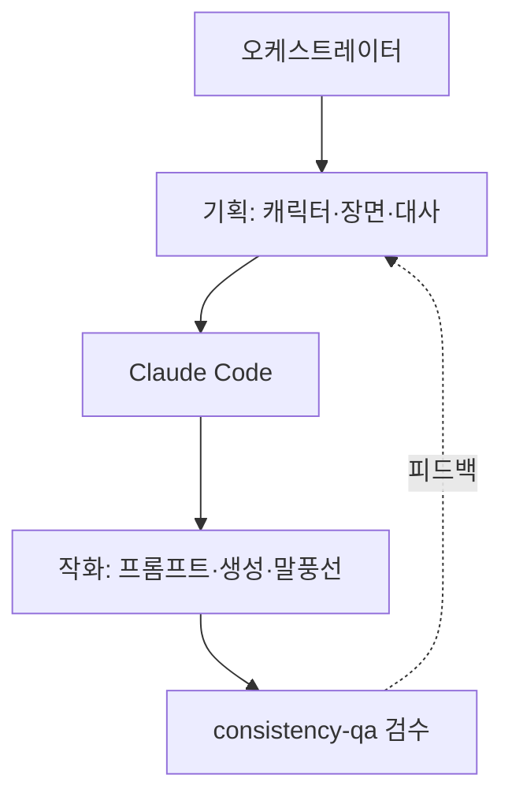

# P6 · 실전 응용
## 개발을 넘어

> **요약.** 하네스는 코드만을 위한 것이 아니다. 많은 작업이 코딩 작업을 닮았기 때문에, 같은 골격(에이전트·스킬·오케스트레이터)이 리서치·문서·콘텐츠 제작에서도 작동한다. 핵심은 두 가지다. 첫째, 중간 산출물을 **눈에 보이게** 만들면 수정이 빨라지고 품질이 추적된다. 둘째, 모든 에이전트가 같은 진실 원천(SSOT)을 참조하면 일관성이 유지된다. 본 파트는 이 원리를 구체적 도메인에 적용한다.

---

## 1. 왜 비개발에도 통하는가

기본 Claude Code 하네스는 코딩을 위해 만들어졌지만, 다른 작업에도 두루 쓸모가 있다. 많은 작업이 코딩 작업과 닮았기 때문이다. 단계를 나누고, 중간 산출물을 만들고, 검증하고, 합치는 구조는 코드든 보고서든 웹툰이든 동일하다.

여기에 운영의 선순환이 더해진다. 운영자가 하네스를 다듬고, 사용자가 결과를 쓰며 피드백을 남기면, 그 피드백이 다시 하네스를 개선한다. 좋은 하네스일수록 이 품질 플라이휠이 빠르게 돈다.

---

## 2. 리서치 → 웹사이트

한 세션 안에서 조사부터 배포까지 이어 갈 수 있다. P5의 fan-out 리서치로 주제를 넓게 조사하고, 그 결과를 입력으로 UI를 만들고, 배포까지 잇는다. 각 단계가 독립된 에이전트라, 조사가 부실하면 거기만 다시 돌리면 된다.

흐름은 단순하다. 리서치 에이전트가 근거와 출처를 모으고 → 디자인·구현 에이전트가 페이지를 만들고 → 검수 에이전트가 링크·일관성을 확인한다. P2에서 본 오케스트레이터의 계획–배정–검증–통합 루프가 그대로 적용된다.

---

## 3. 디자인 시스템 + Skills

일관된 결과의 비결은 **재사용** 이다. 색·타이포·컴포넌트 규칙을 디자인 시스템으로 정의해 스킬로 만들면, 어느 에이전트가 화면을 만들어도 같은 톤이 나온다. 매번 스타일을 추론하지 않으니 결과의 분산이 줄고, 디자인 토큰만 바꾸면 전체가 일관되게 갱신된다.

이것이 P2에서 말한 "스킬은 도구 상자"의 실제 모습이다. 디자인 시스템 스킬 하나를 기획·구현·검수 에이전트가 공유한다.

---

## 4. 문서 플러그인: HWP · PDF · PPTX

문서 작업은 한국 실무에서 특히 비중이 크다. 형식별 스킬·플러그인을 갖추면, 자료 변환이 자동화된다.

| 플러그인 | 다루는 일 | 활용 |
|---|---|---|
| HWP/HWPX | 공문·기안문·강의계획서 작성 | 한국 공공·교육 문서 |
| PDF | 추출·병합·양식 채우기·OCR | 보고서·논문 처리 |
| PPTX | 슬라이드 생성·편집·정규화 | 강의·발표 자료 |

문서 플러그인은 단독으로도 쓰지만, 하네스 안에서 더 강하다. 예를 들어 리서치 에이전트의 산출물을 PPTX 에이전트가 받아 발표 자료로 굽고, 검수 에이전트가 형식·수식 렌더링을 확인하는 식이다.

---

## 5. 콘텐츠 제작 하네스: 웹툰 예시

개발이 아닌 창작에도 같은 골격이 적용된다. 웹툰 제작 하네스는 기획팀과 작화팀, 그리고 검수자로 나뉜다.

기획팀(캐릭터 디자이너·장면 감독·대사 작가·서사 닥터)이 설정을 잡고, 작화팀(프롬프트 엔지니어·이미지 생성·말풍선·컷 조립)이 화면을 만들고, 일관성 검수자가 캐릭터·톤·연속성을 확인한다. 오케스트레이터가 이들을 순차 실행하며 중간 산출물을 검수해 다음 단계로 넘긴다.

---

## 6. 일관성의 핵심: SSOT

여러 에이전트가 협업하면 가장 먼저 무너지는 것이 일관성이다. 캐릭터의 머리색이 컷마다 달라지는 식이다. 해법은 **단일 진실 원천(SSOT)** 이다. 캐릭터·세계관·톤을 하나의 파일(`character_sheet.json` 등)에 못 박고, 모든 에이전트가 그것을 참조하게 한다.

<svg width="100%" style="max-width:680px" viewBox="0 0 680 250" xmlns="http://www.w3.org/2000/svg" role="img" aria-label="단일 진실 원천(SSOT)을 모든 에이전트가 참조해 일관성을 유지하는 구조">
  <line x1="340" y1="135" x2="115" y2="62" stroke="#90A4AE" stroke-width="2"/>
  <line x1="340" y1="135" x2="565" y2="62" stroke="#90A4AE" stroke-width="2"/>
  <line x1="340" y1="135" x2="115" y2="212" stroke="#90A4AE" stroke-width="2"/>
  <line x1="340" y1="135" x2="565" y2="212" stroke="#90A4AE" stroke-width="2"/>
  <rect x="270" y="103" width="140" height="64" rx="12" fill="#1B2C5E" stroke="#E65100" stroke-width="3"/>
  <text x="340" y="130" text-anchor="middle" font-size="13" font-weight="bold" fill="#fff">SSOT</text>
  <text x="340" y="150" text-anchor="middle" font-size="10" fill="#FFB74D">character_sheet.json</text>
  <rect x="40" y="40" width="150" height="44" rx="10" fill="#E3F2FD" stroke="#0D47A1" stroke-width="2"/>
  <text x="115" y="67" text-anchor="middle" font-size="12" font-weight="bold" fill="#0D47A1">기획 에이전트</text>
  <rect x="490" y="40" width="150" height="44" rx="10" fill="#FFF3E0" stroke="#E65100" stroke-width="2"/>
  <text x="565" y="67" text-anchor="middle" font-size="12" font-weight="bold" fill="#E65100">작화 에이전트</text>
  <rect x="40" y="190" width="150" height="44" rx="10" fill="#FFF8E1" stroke="#B07517" stroke-width="2"/>
  <text x="115" y="217" text-anchor="middle" font-size="12" font-weight="bold" fill="#B07517">대사 에이전트</text>
  <rect x="490" y="190" width="150" height="44" rx="10" fill="#E8F5E9" stroke="#2F7A4A" stroke-width="2"/>
  <text x="565" y="217" text-anchor="middle" font-size="12" font-weight="bold" fill="#2F7A4A">검수 에이전트</text>
</svg>

모든 에이전트가 같은 원천을 참조하므로, 설정을 한 곳만 고치면 전체가 일관되게 따라온다. SSOT는 웹툰뿐 아니라 브랜드 가이드, 제품 사양, 강의 용어집 등 일관성이 중요한 모든 협업에 적용된다.

---

## 7. 중간 산출물이 품질을 만든다

좋은 하네스는 중간 산출물이 보이게 만든다. 각 단계의 결과물(설정 시트, 초안 컷, 검수 리포트)이 파일로 남으면, 마지막에 가서야 어긋남을 발견하는 대신 단계마다 빠르게 고칠 수 있다. 품질이 추적되고, 어디서 틀렸는지가 드러난다.

이는 P5의 "자기 채점 금지"와 같은 원리다. 보이지 않는 중간 과정은 검증할 수 없다. 산출물을 드러내는 것 자체가 품질 장치다.

---

## 8. 개발 사례: 감사와 마이그레이션

비개발 응용을 강조했지만, 본래 강점인 개발 작업도 빼놓을 수 없다. P5의 워크플로 패턴이 그대로 쓰인다.

- **Codebase Audit** — 모듈마다 점검 에이전트를 펼쳐(fan-out) 보안·품질을 병렬 진단하고 취합한다.
- **Large Migration** — 콜사이트마다 워크트리에서 수정하고, 별도 에이전트가 반박 리뷰한 뒤 병합한다.
- **Release Checklist / Weekly Scan** — 반복 가능한 점검을 워크플로로 저장해 매주 재사용한다.

공통점은 "구조가 반복되는 큰 작업"이라는 것이다. 이런 일일수록 하네스의 효과가 크다(P4 실험: 어려울수록 개선 폭이 컸다).

---

## 9. 토론 질문

### Q1 — 내 도메인의 SSOT

본인 업무에서 "협업하면 자주 어긋나는 것"을 하나 꼽아 보자(용어, 톤, 수치 기준 등). 그것을 어떤 SSOT 파일로 못 박고, 어떤 에이전트들이 참조하게 하겠는가?

### Q2 — 중간 산출물 드러내기

마지막에야 문제를 발견했던 작업을 떠올려, 어느 단계의 산출물을 파일로 남겼다면 일찍 잡았을지 설계해 보자.

---

## 다음 단계

기술과 응용을 모두 다뤘다. 마지막 **P7 — 인간의 역할** 에서 AI가 실행을 맡을 때 인간의 일이 어디로 이동하는지, 그리고 앞으로 준비해야 할 역량을 정리한다.
