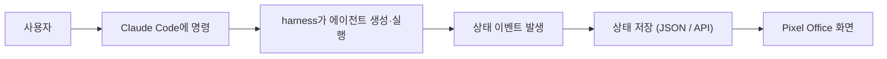
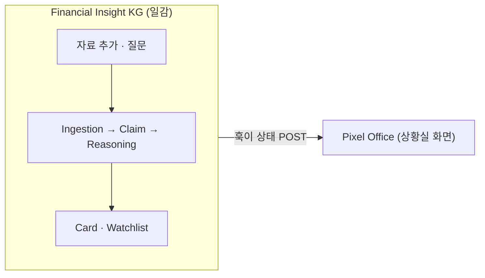

# AI Agent Pixel Office — 초보자 구현 매뉴얼

> [!abstract] 한 줄 요약
> **harness = 에이전트를 만들고 실행하는 도구.** Pixel Office = 그 에이전트들이 일하는 모습을 보여주는 **화면**.
> harness를 바꾸지 않습니다. 옆에 "Pixel Office Adapter"를 붙일 뿐입니다.
> 여러분이 하는 일은 이번에도 **프롬프트 붙여넣기(입력)** 와 **명령어 실행**뿐입니다.

---

## 0. 무엇을 만드나

화면 속 캐릭터는 진짜 에이전트가 아니라, **에이전트의 상태를 캐릭터로 매핑**한 것입니다.

| 에이전트 | 캐릭터 | 상태 예시 |
|---|---|---|
| Researcher | 연구원 | running · "논문 검색 중" |
| Coder | 개발자 | running · "백테스트 코딩" |
| Backtester | 퀀트 | waiting · "전략 대기" |
| Reviewer | 검토자 | completed · "검토 완료" |
| Slide Builder | 발표자 | idle |

상태는 다섯 가지뿐입니다: `idle · running · waiting · completed · error`. 이 값에 따라 색·진행률·말풍선이 바뀝니다.



> [!tip] 초보자 원칙 — 3단계로 쪼갠다
> 한 번에 완성하지 않습니다. ① 가짜 상태판 → ② harness 에이전트 연결 → ③ 픽셀 사무실 꾸미기. 각 단계가 독립적으로 돌아갑니다.

---

## 1. 사전 준비 — 자체 완결 설치

처음 한 번만 합니다. 이미 깔린 것은 건너뛰세요.

> [!example] [입력] 어디서? — 터미널 (도구 설치)
> ```bash
> # 1) Node.js (프런트) — 없으면 https://nodejs.org 에서 LTS 설치
> # 2) Python 3.10+ (백엔드) — 없으면 https://python.org 에서 설치
> # 3) Claude Code
> npm install -g @anthropic-ai/claude-code
> # 4) 에이전트 팀 기능 켜기
> export CLAUDE_CODE_EXPERIMENTAL_AGENT_TEAMS=1
> # 5) harness 플러그인 (Claude Code 안에서)
> #    /plugin marketplace add revfactory/harness
> #    /plugin install harness@harness
> ```

> [!note] [출력] 확인
> ```bash
> node --version && python3 --version && claude --version
> ```
> 세 버전이 모두 뜨면 준비 완료입니다. (VS Code는 편집용 권장이나 필수는 아닙니다.)

> [!tip] 파이썬 패키지
> 백엔드 패키지(`fastapi`, `uvicorn`)는 3단계에서 프로젝트 폴더에 설치합니다. 지금 미리 깔 필요 없습니다.

---

## 2. 프로젝트 + 가짜 상태판 만들기

먼저 harness 없이, **가짜(Mock) 상태판**부터 만들어 화면이 뜨는 것을 확인합니다.

> [!example] [입력] 어디서? — VS Code 터미널
> ```bash
> mkdir harness-pixel-office && cd harness-pixel-office
> claude
> ```

> [!example] [입력] 프롬프트 · Claude Code
> ````text
> 초보자용 AI Agent Pixel Office 데모를 만들어줘.
>
> - 프런트: React + TypeScript + Vite. 백엔드: FastAPI.
> - 에이전트 상태는 처음엔 Mock 데이터로 시작한다(harness 아직 연결 안 함).
> - 에이전트 종류: Planner, Researcher, Strategy Extractor, Python Coder,
>   Backtester, Reviewer, Slide Builder.
> - 각 에이전트 상태: idle / running / waiting / completed / error.
>   상태에 따라 색·진행률이 다르게.
> - 화면엔 에이전트 카드가 격자로 보이면 된다(사무실 맵은 나중에).
>
> 한 번에 복잡하게 만들지 말고 최소 실행 버전부터. 먼저 폴더 구조와
> 실행 방법을 제시하고, 내가 "다음"이라고 하면 코드를 작성해라.
> ````

> [!note] [출력] Claude가 생성
> ```text
> backend/main.py            frontend/src/App.tsx
> backend/agent_status.json  frontend/src/components/AgentCard.tsx
> README.md                  frontend/src/data/mockAgents.ts
> ```

---

## 3. 실행해보기

> [!example] [입력] 어디서? — 터미널 2개
> ```bash
> # 터미널 1 (백엔드)
> cd backend && pip install fastapi uvicorn && uvicorn main:app --reload --port 8000
> ```
> ```bash
> # 터미널 2 (프런트)
> cd frontend && npm install && npm run dev
> ```

> [!success] [출력] 브라우저에서 http://localhost:5173
> ```text
> Planner        Running
> Researcher     Running
> Python Coder   Waiting
> Backtester     Idle
> Reviewer       Completed
> ```
> 아직 가짜 상태판입니다. 화면이 뜨는 것만 확인하면 성공입니다.

---

## 4. harness 에이전트 연결

harness는 `.claude/agents/` 폴더에 에이전트를 `.md` 파일로 만듭니다. Pixel Office가 이 폴더를 읽어 실제 에이전트 목록을 만듭니다.

> [!example] [입력] 프롬프트 · Claude Code
> ````text
> 이제 harness와 연결하는 Adapter를 만들어줘.
>
> - .claude/agents/ 폴더의 각 .md 파일을 에이전트 하나로 등록한다.
> - 파일 이름을 에이전트 이름으로 쓴다(researcher.md → Researcher).
> - 초기 상태는 idle.
> - 백엔드에 GET /agents/from-harness API를 만든다.
> - 프런트는 이 API를 호출해 에이전트 목록을 보여준다.
> ````

> [!note] [출력]
> `backend/harness_adapter.py` 생성 → 화면의 에이전트 목록이 실제 `.claude/agents/` 기준으로 바뀝니다.

---

## 5. 상태를 실시간으로 흐르게 — 두 가지 방법

에이전트가 "일하는 중"처럼 보이려면 상태가 계속 갱신돼야 합니다. 방법은 두 가지이고, **B가 진짜 자동화**입니다.

| 방법 | 원리 | 난이도 | 추천 |
|---|---|---|---|
| A. 수동 JSON | Claude가 단계마다 `agent_status.json`을 직접 수정 | 쉬움 | 맛보기용 |
| B. 훅 자동 전송 | Claude Code 훅이 상태를 백엔드로 자동 POST | 중간 | 실사용 |

### 5.1 방법 A — 수동 JSON (맛보기)

> [!example] [입력] 프롬프트 · Claude Code
> ````text
> agent_status.json으로 상태를 관리해줘.
> - 백엔드에 GET /agents/status (읽기), POST /agents/status (갱신) API.
> - 프런트는 1초마다 상태를 다시 읽어 화면을 갱신(폴링).
> 그리고 앞으로 에이전트 작업은 시작·진행·완료 시점에 이 파일을 갱신해라.
> ````

> [!note] [출력] agent_status.json 예시
> ```json
> [{ "agent":"Researcher", "status":"running", "task":"논문 검색", "progress":60 },
>  { "agent":"Backtester", "status":"waiting", "task":"전략 대기", "progress":0 }]
> ```

> [!warning] 한계
> Claude가 매번 파일을 직접 고쳐야 해서 빠뜨리기 쉽습니다. 진짜로 쓰려면 방법 B로 넘어가세요.

### 5.2 방법 B — 훅으로 자동 전송 (추천)

Claude Code에는 작업 흐름의 특정 시점에 스크립트를 실행하는 **훅(hook)** 이 있습니다. 서브에이전트가 **시작(SubagentStart)** 하거나 **끝날(SubagentStop)** 때, 도구를 쓴 뒤(PostToolUse) 자동으로 상태를 백엔드에 보낼 수 있습니다. 손으로 JSON을 고칠 필요가 없어집니다.

> [!example] [입력] 프롬프트 · Claude Code
> ````text
> Claude Code 훅으로 에이전트 상태를 자동 전송하게 해줘.
>
> - .claude/settings.json에 훅을 등록한다:
>   · SubagentStart → 그 에이전트를 running으로 백엔드에 POST
>   · SubagentStop  → completed로 POST
>   · PostToolUse   → progress를 조금씩 올려 POST (선택)
> - 각 훅은 이벤트 JSON(agent_type 등)을 받아
>   http://localhost:8000/agents/event 로 POST 하는 작은 스크립트다.
> - 백엔드는 이 이벤트를 받아 상태를 저장하고, 프런트는 폴링으로 갱신한다.
> - 스크립트는 .claude/hooks/ 아래에 두고, 실패해도 Claude 작업을
>   막지 않도록 async로 처리해라.
> ````

> [!note] [출력]
> `.claude/settings.json`(훅 등록) + `.claude/hooks/report_status.py`(POST 스크립트) 생성. 이제 harness 에이전트가 실제로 돌 때마다 화면이 저절로 바뀝니다.

> [!tip] 왜 훅이 정답인가
> 훅은 "모델이 기억해서" 하는 게 아니라 **시스템이 자동으로** 실행합니다. Claude가 상태 갱신을 빠뜨릴 일이 없습니다. `agent_type`, `agent_id` 값이 이벤트에 담겨 오므로 캐릭터에 바로 매핑됩니다.

---

## 6. 픽셀 사무실로 꾸미기

카드형이 잘 돌면, 사무실 평면도 위에 캐릭터를 배치합니다.

> [!example] [입력] 프롬프트 · Claude Code
> ````text
> 화면을 Pixel Office 스타일로 바꿔줘.
> - 배경은 사무실 평면도. 각 에이전트는 책상 위 캐릭터로.
> - 고정 위치: Planner=좌상, Researcher=좌중, Strategy Extractor=중앙,
>   Python Coder=중앙우, Backtester=하중, Reviewer=우상, Slide Builder=우하.
> - 상태에 따라 말풍선 표시, running이면 작은 애니메이션.
> - 상단에 요약 배지(Total / Working / Waiting / Completed / Error / Progress),
>   우측에 Activity Feed와 선택한 에이전트의 Detail 패널, 하단에 Workflow 단계.
> ````

> [!note] [출력]
> 업로드한 참고 화면처럼 상단 배지 · 사무실 맵 · 우측 활동 피드 · 하단 워크플로가 있는 대시보드가 나옵니다.

---

## 7. 실전 활용 — Momentum 연구 자동화

버튼 하나로 에이전트 7명이 순서대로 일하는 데모입니다. 실제로 돌려보는 곳까지 담습니다.

### 7.1 워크플로 추가 (프롬프트)

> [!example] [입력] 프롬프트 · Claude Code
> ````text
> Momentum 연구 데모 워크플로를 추가해줘.
> 사용자 입력 예: "최신 Momentum 논문을 읽고 전략을 추출한 뒤
> 백테스트하고 발표자료 초안을 만들어줘."
>
> 실행 순서(각 단계 = 캐릭터 하나):
>   1. Planner            워크플로 설계
>   2. Researcher         논문 검색
>   3. Strategy Extractor 팩터 규칙 추출
>   4. Python Coder       백테스트 코드 작성
>   5. Backtester         백테스트 실행
>   6. Reviewer           결과 점검
>   7. Slide Builder      발표자료 초안 생성
>
> - 처음엔 각 단계를 Mock으로 3초씩 실행한다(진짜 논문·코드 없이 흐름부터).
> - 단계마다 상태를 갱신해 프런트에서 실시간으로 바뀌게 한다
>   (5단계에서 훅을 붙였으면 훅으로, 아니면 agent_status.json으로).
> - 화면 상단에 "▶ Momentum 데모 시작" 버튼을 하나 만든다.
> - 백엔드에 POST /demo/momentum/start API를 만들어 버튼이 이걸 호출한다.
> ````

> [!note] [출력]
> 시작 버튼 + `POST /demo/momentum/start` API가 생깁니다. 버튼을 누르면 캐릭터들이 순서대로 running → completed로 바뀝니다.

### 7.2 실제로 돌려보기

> [!example] [입력] 어디서? — 터미널 2개 + 브라우저
> ```bash
> # 터미널 1 (백엔드)
> cd backend && uvicorn main:app --reload --port 8000
> # 터미널 2 (프런트)
> cd frontend && npm run dev
> ```
> 브라우저 `http://localhost:5173` → 상단 **▶ Momentum 데모 시작** 클릭.

> [!success] [출력] 화면에서 보이는 흐름
> ```text
> Planner: 설계 → Researcher: 검색 → Strategy Extractor: 팩터 추출
> → Python Coder: 코딩 → Backtester: 실행 → Reviewer: 점검
> → Slide Builder: 슬라이드
> ```
> 하단 Workflow 바에서 각 단계가 Pending → Running → Done으로 넘어갑니다.

### 7.3 Mock에서 진짜로 (선택)

흐름이 잘 돌면, Mock을 실제 작업으로 하나씩 바꿉니다. 한 번에 다 하지 말고 단계별로 교체합니다.

> [!example] [입력] 프롬프트 · Claude Code
> ````text
> Momentum 데모의 Mock을 실제 작업으로 단계별로 바꿔줘. 지금은 Researcher부터.
> - Researcher: 논문 검색을 실제 웹 검색으로(공개 자료만).
> - Strategy Extractor: 검색 결과에서 팩터 규칙을 실제로 추출.
> - Python Coder~Backtester: 간단한 모멘텀 백테스트 코드를 실제 생성·실행.
> 나머지는 아직 Mock으로 두고, 하나 바꿀 때마다 나에게 확인받아라.
> ````

> [!warning] 순서 지키기
> 반드시 **흐름(Mock) → 개별 교체** 순으로 합니다. 처음부터 진짜 백테스트를 붙이면 어디서 막혔는지 알기 어렵습니다.

---

## 8. 입력·출력 치트시트

| 단계 | 무엇을 | 어디에 | 형태 |
|---|---|---|---|
| 준비 | 도구 설치 | 터미널 | 설치 명령 |
| 상태판 | Mock 데모 생성 | Claude Code | 프롬프트 붙여넣기 |
| 실행 | 백엔드·프런트 | 터미널 2개 | uvicorn / npm run dev |
| 연결 | harness Adapter | Claude Code | 프롬프트 |
| **자동화** | **훅으로 상태 전송** | **Claude Code** | **프롬프트(방법 B)** |
| 꾸미기 | 픽셀 사무실 UI | Claude Code | 프롬프트 |
| 데모 | Momentum 워크플로 | 브라우저 | 시작 버튼 |

> [!quote] 핵심 개념 정리
> harness=에이전트 제작 · Claude Code=실행 · 훅=상태 자동 신고 · FastAPI=상태 서버 · React=화면 · 폴링/WebSocket=실시간 갱신. 처음엔 **JSON + 1초 폴링**으로 충분하고, 나중에만 WebSocket을 붙입니다.

---

## 9. 자주 막히는 곳

> [!warning] 문제 해결
> - **화면은 뜨는데 상태가 안 변해요** → 방법 A(수동)면 정상. 방법 B(훅)로 바꾸세요.
> - **훅이 안 먹어요** → `.claude/settings.json`에 등록됐는지 `/hooks`로 확인. 매처는 대소문자를 구분합니다.
> - **CORS 에러** → 백엔드에 프런트 주소(localhost:5173)를 허용하라고 Claude에 요청.
> - **포트 충돌** → 8000/5173이 쓰이는 중이면 다른 포트로 바꿔달라고 요청.

---

# 다음 단계 — Financial Insight KG와 연결

> [!info] 목표
> 이전에 만든 **금융 인사이트 지식그래프(KG)** 시스템을 "일감"으로, Pixel Office를 그 일감이 처리되는 "상황실 화면"으로 합칩니다. KG 파이프라인이 돌 때 그 진행 상황을 픽셀 사무실에서 실시간으로 봅니다.

## 10. 연결 아이디어

두 시스템은 이미 같은 뼈대(harness + Claude Code + 에이전트 팀)를 씁니다. 그래서 **KG의 에이전트를 Pixel Office 캐릭터에 매핑**하기만 하면 됩니다.

| KG 에이전트 (V1/V2) | Pixel Office 캐릭터 | 언제 running |
|---|---|---|
| Data Ingestion | 수집원 | URL을 추출·저장할 때 |
| Claim Extraction | 분석원 | 주장을 뽑을 때 |
| Graph Reasoning | 전략가 | 인사이트 쿼리를 돌릴 때 |
| Credibility Learning | 채점관 | 결과로 신뢰도 갱신할 때 |
| Insight Card Designer | 발표자 | 카드를 만들 때 |
| Compliance Reviewer | 감사관 | 근거·추적성 점검할 때 |



## 11. 연결하는 법 — 프롬프트 하나

두 프로젝트를 나란히 두고(또는 KG 폴더 안에서), Pixel Office 백엔드를 켠 뒤 아래를 붙여넣습니다.

> [!example] [입력] 프롬프트 · Claude Code (KG 프로젝트에서)
> ````text
> 이 Financial Insight KG를 Pixel Office 상황실 화면과 연결해줘.
>
> - KG의 에이전트(Ingestion, Claim, Reasoning, Credibility, Card, Compliance)를
>   Pixel Office 캐릭터에 매핑한다.
> - KG의 add(자료 추가)·ask(질문) 파이프라인이 각 단계를 지날 때,
>   Claude Code 훅(SubagentStart/Stop, PostToolUse)이 상태를
>   http://localhost:8000/agents/event 로 자동 POST 하게 한다.
> - 인사이트 카드가 완성되면 Slide/Card 캐릭터를 completed로,
>   Compliance 점검이 걸리면 해당 캐릭터를 error로 표시한다.
> - 훅 스크립트는 KG 쪽 .claude/hooks/에 두고, 실패해도 KG 작업을
>   막지 않게 async로. Pixel Office 코드는 그대로 재사용한다.
> ````

> [!success] [출력] 이렇게 쓰인다
> KG에서 `NVIDIA 실적 준비해줘`라고 물으면 → 픽셀 사무실에서 수집원 → 분석원 → 전략가 → 발표자 순으로 캐릭터가 일하고, 마지막에 발표자가 인사이트 카드를 들고 completed가 됩니다.

## 12. 연결하면 이렇게 보인다 — 질문별 사무실 화면

KG 질문마다 어떤 캐릭터가 순서대로 일하는지입니다. 여러분은 KG에 평소처럼 묻기만 합니다.

> [!example] [입력] "NVIDIA 실적 준비해줘"
> ```text
> 수집원(running) → 분석원 → 전략가 → 발표자(completed, 카드 들고)
> ```

> [!example] [입력] "주장 늘었는데 결과 안 난 기업은?"
> ```text
> 전략가만 running (그래프 탐색) → 후보 목록 completed
> ```

> [!example] [입력] "반도체는 누가 잘 맞혀?"
> ```text
> 채점관 running (신뢰도 조회) → 랭킹 completed
> ```

> [!example] [입력] "금리 1% 내리면?" (V2)
> ```text
> 전략가 running (시나리오 추론) → 근거 약하면 감사관이 error 표시
> ```

> [!note] [출력] 공통
> 상단 배지(Working/Completed)와 우측 Activity Feed가 실시간으로 갱신됩니다. 즉 **KG의 6개 응용사례가 그대로 사무실 화면의 움직임**이 됩니다.

> [!tip] 한 줄
> 질문 = 일감 투입, 사무실 화면 = 그 일감이 처리되는 모습. 결과(카드·후보)는 KG가, 진행 상황은 Pixel Office가 보여줍니다.

## 13. 두 시스템의 역할 정리

> [!note] 한눈에
> - **Financial Insight KG** = 실제로 일을 하는 **엔진**(자료→그래프→추론→카드).
> - **Pixel Office** = 그 일의 진행을 보여주는 **계기판**. 판단·결과에는 관여하지 않는다.
> - 연결 고리는 **Claude Code 훅** 하나 — KG를 건드리지 않고 상태만 흘려보낸다.

> [!quote] 마무리
> KG가 "무엇을 아는가"라면, Pixel Office는 "지금 누가 무엇을 하고 있는가"입니다. 둘을 합치면, 공개 정보로 돌아가는 리서치 엔진과 그것을 지켜보는 상황실이 한 화면에 놓입니다.
