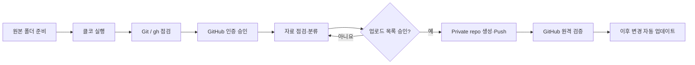
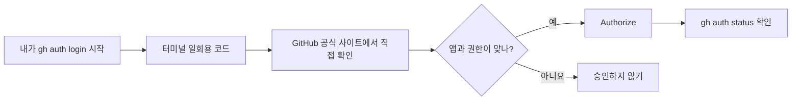

# Claude Code로 GitHub 생성·업로드·검증: 실습 2단계

> [!summary] 핵심 목표
> GitHub 웹사이트에서 파일을 직접 올리지 않고, Claude Code에게 **설치 확인 → 인증 안내 → 로컬 자료 분류 → 비공개 저장소 생성 → 업로드 → 검증 → 반복 업데이트**를 시킨다. 로그인·권한 승인과 자료 공개 판단은 사람이 한다.

## 0. 한눈에 보기



## 1. 실습 시작

### Windows
1. 탐색기에서 **업로드할 자료가 들어 있는 폴더**를 연다.
2. 주소창에 `powershell`을 입력하고 Enter한다.
3. 열린 창에서 `claude`를 실행한다.
4. `claude` 명령이 없으면 설치부터 진행한다. 자세한 설치 방법: https://code.claude.com/docs/en/setup

### macOS
1. Terminal 앱을 연다.
2. `cd `를 입력하고 Finder의 자료 폴더를 터미널로 끌어다 놓아 경로를 붙인 후 Enter한다.
3. `claude`를 실행한다.

> [!tip] 위치 확인
> Claude Code에 `현재 작업 폴더의 절대 경로와 보이는 파일 10개를 알려줘`라고 말해, 올바른 폴더인지 먼저 확인한다.

## 2. 준비물과 최초 로그인

- GitHub 계정: https://github.com
- Claude Code가 정상 실행되는 계정/설치 환경
- Git (`git --version`으로 확인)
- GitHub CLI (`gh --version`으로 확인)

Claude Code에게 이렇게 입력한다.

```text
운영체제와 현재 폴더를 먼저 확인하세요.
git --version, gh --version, gh auth status를 실행하세요.
없는 도구만 공식 설치 방법으로 준비하되 실행 전 승인받으세요.
GitHub 로그인이 없다면 gh auth login --web으로 브라우저 인증을 도와주세요.
비밀번호, 인증 코드, 토큰을 대화창에 입력하도록 요구하지 마세요.
설정이 완료되면 GitHub 사용자명과 인증 성공 여부만 보고하세요.
```

**사용자가 클릭할 것**: 설치 승인 → GitHub 브라우저 로그인 → 필요한 2FA/MFA 인증 → 앱 연결 승인. (앱이나 OS 상태에 따라 일부 단계는 나타나지 않을 수 있음.)


## 2-A. 브라우저 인증 완전 가이드: 초보자 수강생 필독

> [!important] 수강생에게 먼저 설명할 한 문장
> **브라우저 인증은 내 GitHub 비밀번호를 클코에게 건네주는 절차가 아닙니다.** 내가 시작한 GitHub CLI 연결 요청을 **GitHub 공식 웹사이트에서 직접 검토하고 허락**하는 과정입니다. 요청하지 않은 인증이라면 승인하지 않습니다.

### ① Claude Code 로그인과 GitHub 로그인을 구별하기

| 항목 | Claude Code 로그인 | GitHub CLI 브라우저 인증 |
|---|---|---|
| 목적 | Claude Code 자체를 이용 | GitHub 저장소 생성·Push |
| 대표 진입 방법 | Claude Code 실행 후 로그인 안내 또는 `/login` | `gh auth login` 또는 `gh auth login --web` |
| 화면 | Claude 공식 로그인 | GitHub 공식 사이트 (`github.com`) |
| 성공 확인 | Claude Code가 정상 응답 | `gh auth status`에서 본인 계정 확인 |

두 로그인은 **별개**입니다. Claude에 로그인되어 있어도 GitHub 인증은 필요할 수 있습니다. 회사·학교 계정이라면 추가적인 조직 승인이 나타날 수 있습니다.

### ② 수강생이 따라 하는 GitHub 인증 5단계

**STEP 1 — 인증 시작:** 클코에게 아래 프롬프트를 붙여넣습니다. 컴퓨터에서 직접 실행한다면 PowerShell/터미널에서 `gh auth login`을 사용합니다.

```text
GitHub CLI 브라우저 인증을 초보자 눈높이로 도와주세요.
먼저 gh 설치 여부와 gh auth status를 확인해주세요.
로그인이 필요하면 gh auth login --web을 시작해주세요.
화면에 나타나는 선택지는 한 단계씩 설명해주세요.
인증코드·비밀번호·토큰을 클코 대화창에 입력하도록 요구하지 마세요.
공식 GitHub 웹사이트가 맞는지와 앱 권한을 내가 검토하도록 안내해주세요.
인증 후 gh auth status만으로 성공 여부를 검증해주세요.
```

**STEP 2 — 터미널 선택:** 선택 화면이 나타나면 일반적인 개인 GitHub 계정은 `GitHub.com` → `HTTPS` → `Login with a web browser`를 선택합니다. 항목과 순서는 gh 버전·기존 설정에 따라 다를 수 있습니다.

```text
예시(버전별로 화면이 다를 수 있음)
Where do you use GitHub?               > GitHub.com
Preferred protocol for Git operations? > HTTPS
How would you like to authenticate?    > Login with a web browser
```

**STEP 3 — 코드 확인:** 단말기에 표시되는 일회용 코드(예: `ABCD-EFGH` — **실제 코드 아님**)를 직접 확인합니다. **코드를 강사, 친구, 단체 채팅, 클코 대화창에 보내지 않습니다.** 코드가 보이지 않고 바로 브라우저 승인 화면이 뜨면 브라우저 안내를 따르면 됩니다.

**STEP 4 — GitHub에서 승인:** 브라우저가 자동으로 열리지 않으면 주소창에 `https://github.com/login/device`를 **직접 입력**합니다. 주소가 정확히 `github.com`인지 확인하고, 본인이 터미널에서 본 코드를 GitHub 페이지에 입력합니다. 로그인·MFA(2단계 인증)가 나타나면 GitHub 페이지에서 본인이 완료합니다. 이어 앱 이름(일반적으로 `GitHub CLI`)과 요청 권한을 읽고 **본인이 시작한 요청일 때만** `Authorize`를 누릅니다.

**STEP 5 — 성공 확인:** 다시 클코 화면/터미널로 돌아옵니다. 승인 후 다음 명령으로 연결된 계정과 상태를 점검합니다.

```bash
gh auth status
```

정상이라면 `github.com`과 본인의 GitHub 사용자명이 보입니다. **화면 문구는 버전에 따라 다릅니다.** 인증이 끝났다는 사실과 **저장소가 생성·업로드되었다는 사실은 서로 다릅니다.** 저장소 작업은 다음 단계에서 별도로 수행합니다.



### ③ 어떤 권한에 동의하는지: 무조건 '허용'은 금지

- GitHub CLI 인증은 이후 로컬 도구가 사용자를 대신해 GitHub API 및 저장소에 접근하도록 할 수 있습니다. **새 저장소 하나에만 한정되는 권한이라고 가정하면 안 됩니다.** 특히 `repo` 범위는 기존 Private 저장소에도 접근 가능하게 할 수 있습니다.
- GitHub에서는 앱 이름과 권한 범위를 확인한 뒤, 뜻을 모르거나 예상과 다르면 **승인하지 말고 강사에게 화면의 앱 이름만** 설명합니다. 코드는 전달하지 않습니다.
- `gh`는 인증정보를 운영체제 자격 증명 저장소 등에 보관할 수 있습니다. 원칙적으로 **본인 PC에서만 인증**하고, 실습실 공용 PC에서는 인증을 가급적 피합니다.
- 이메일 비밀번호, 개인 액세스 토큰(PAT), MFA 복구코드를 클코 채팅이나 실습 파일에 입력하면 안 됩니다.

### ④ 정상 / 중단 신호

| 정상 신호 | 즉시 중단해야 할 신호 |
|---|---|
| 내가 방금 `gh auth login`을 시작함 | 인증을 시작하지 않았는데 알림·코드가 옴 |
| 브라우저 주소가 정확히 `github.com`임 | 비슷한 철자의 낯선 도메인으로 연결됨 |
| 앱이 GitHub CLI이며 요청 권한을 이해함 | 모르는 앱·과도한 권한 요청이 나타남 |
| 계정 정보는 GitHub 공식 화면에서만 입력함 | 강사·메신저·클코가 코드나 비밀번호를 달라고 함 |

### ⑤ 인증 중 자주 생기는 문제와 해결

| 상황 | 초보자에게 안내할 조치 |
|---|---|
| 브라우저가 열리지 않음 | 터미널의 코드 확인 → `https://github.com/login/device` 직접 열기 |
| 코드가 유효하지 않음/만료됨 | 기존 화면을 닫고 `gh auth login --web`을 다시 시작하여 **새 코드** 사용 |
| 승인했는데 터미널 반응 없음 | 터미널로 돌아가 상태를 확인하고 잠시 후 `gh auth status`; 안 되면 새 인증 시도 |
| GitHub 계정이 다름 | `gh auth status` 확인 → 다른 계정이면 `gh auth switch` 또는 로그아웃 후 다시 로그인 |
| MFA/패스키 추가 요청 | **GitHub 공식 로그인 화면에서만** 안내대로 진행; 강사가 코드를 대신 받지 않음 |
| 조직 승인/SSO 요청 | 조직 관리자 정책을 확인; 실습은 개인 계정으로 진행하는 편이 간단함 |
| 클코는 로그인됨, GitHub 연결은 실패 | 서로 별개이므로 `gh auth status`로 GitHub CLI 인증을 다시 확인 |

### ⑥ 인증 취소·공용 PC에서 실습을 마칠 때

- 로컬 GitHub CLI 로그아웃: 터미널에서 `gh auth logout` (필요시 계정을 선택).
- GitHub 웹사이트에서 앱 접근 권한을 검토하거나 취소하려면 **프로필 → Settings → Applications → Authorized OAuth Apps**로 이동하여 해당 앱의 권한을 확인·취소합니다. 앱 종류에 따라 **Authorized GitHub Apps**도 확인합니다.
- 공용 PC에서 로컬 로그아웃을 해도 브라우저 로그인, 캐시 또는 다른 인증정보가 남을 수 있습니다. 가능하면 본인 노트북에서 실습하고, 공용 PC 사용 후에는 GitHub 웹사이트에서도 로그아웃하세요.
- `gh auth status --show-token`, `gh auth token` 등 **토큰을 출력하는 명령을 화면 공유 중 사용하지 마세요.**

### ⑦ 강사가 60초 동안 읽어줄 안내 멘트

> “지금 보시는 인증은 Claude Code에 비밀번호를 알려주는 것이 아닙니다. 여러분이 GitHub CLI 연결을 시작했고, GitHub 공식 사이트에서 앱 이름과 권한을 확인해 직접 승인하는 절차입니다. 일회용 숫자·문자는 본인만 사용하세요. 강사에게 보내지 않아도 됩니다. 화면이 다르면 억지로 누르지 말고 손을 들어 알려주세요. 인증이 끝나도 파일은 아직 올라가지 않습니다. 다음 단계에서 업로드 목록을 확인한 뒤 진행하겠습니다.”

### ⑧ 수강생 인증 완료 체크리스트

- [ ] 내 PC에서 내가 직접 GitHub 연결을 시작했다.
- [ ] URL이 `github.com`인지 확인했다.
- [ ] 인증코드·비밀번호·토큰을 채팅/단체방에 공유하지 않았다.
- [ ] 앱 이름과 권한을 읽은 뒤 승인했다.
- [ ] `gh auth status`에서 **내 GitHub 계정**을 확인했다.
- [ ] 인증 완료와 GitHub 자료 업로드 완료가 다르다는 것을 이해했다.

**공식 참고:** [GitHub CLI 로그인](https://cli.github.com/manual/gh_auth_login) · [GitHub CLI 인증 상태](https://cli.github.com/manual/gh_auth_status) · [GitHub OAuth 앱 권한 검토/취소](https://docs.github.com/en/apps/oauth-apps/using-oauth-apps/reviewing-your-authorized-oauth-apps)

---

## 3. 새 GitHub 저장소 만들기 (새 프로젝트)

`prompts/A_새_저장소_전체자동화.txt`를 열어 전체 복사 후 붙여넣는다. 예시 Repo 이름은 `auto-ax-course`; 다른 이름으로 만들려면 지시문 첫 부분을 수정한다.

핵심 제약은 다음과 같다.

- 원본 폴더 파일을 **복사**해 별도 작업 위치에서 분류한다.
- `Private`로 만든다.
- `.gitignore`에 비밀정보·임시파일 패턴을 설정하지만 이것만으로 민감정보 검사가 끝나는 것은 아니다.
- 업로드할 파일 목록을 먼저 보고 사용자가 승인해야 `gh repo create`와 push를 실행한다.
- 결과의 URL·커밋·원격 파일 목록까지 검증한다.

클코가 사용할 수 있는 공식 명령 예시는 다음과 같다. **사용자가 직접 실행할 필요는 없다.**

```bash
# 새로운 로컬 Git 저장소가 아닌지 먼저 확인한 후 사용
git init -b main
git add README.md lectures slides images data prompts CLAUDE.md .gitignore
git commit -m "Initial upload: course materials"
gh repo create auto-ax-course --private --source=. --remote=origin --push
```

> [!warning] 중복 저장소 주의
> 현재 폴더가 이미 Git 저장소이거나 원격 저장소 이름이 같으면 위 명령을 그대로 반복하면 안 된다. 클코가 기존 연결을 확인한 뒤 별도 처리하도록 지시했다. 로컬에 이미 README가 있다면 새 원격을 만들 때 `--add-readme`를 같이 쓸 필요가 없다.

## 4. 클코가 보여줘야 할 중간 승인 화면 예시

| 체크 | 예상 보고 | 사용자 행동 |
|---|---|---|
| 원본 폴더 | 경로, 파일 수, 총 크기 | 올바른 폴더인지 확인 |
| 인증 | GitHub 사용자명, 상태 | 내 계정인지 확인 |
| 신규 저장소 | `auto-ax-course`, Private | 공개 범위 확인 |
| 업로드 파일 | 이름·크기·폴더 목록 | 제외할 자료 지시 |
| 커밋 계획 | 커밋 메시지와 변경 파일 | 승인 또는 수정 요청 |
| 결과 | GitHub URL, 원격 커밋 | 브라우저에서 실제 확인 |

## 5. 기존 GitHub 저장소에 자료 넣기 (중요한 별도 경로)

**이미 있는 저장소를 새로 만들지 않는다.** `prompts/B_기존_저장소_안전업데이트.txt`를 이용한다.

```text
내 기존 저장소 [OWNER/REPO]에 새로운 강의자료를 추가하려고 합니다.
같은 이름의 원격 저장소를 새로 만들지 마세요.
먼저 gh auth status, gh repo view, 현재 git 상태를 확인하세요.
원격 저장소를 clone(복제)한 뒤 원본 자료를 복사하여 추가하세요.
변경 목록과 비밀정보 검사를 보고하고 승인을 받은 다음,
협업 저장소면 별도 브랜치에 push하고 PR을 만들어 검토받게 해주세요.
```

단독 작업과 달리 공동작업 저장소에서는 **branch → commit → push → Pull Request(PR)**를 권장한다.

## 6. 이후 파일 수정·추가 시

`prompts/C_반복업데이트.txt`를 복사한다. 클코는 원격 변화를 먼저 확인하고 승인한 변경만 커밋·푸시한다.


## 7. 정상 완료 검증

클코에 아래처럼 확인한다.

```text
저장소 업로드가 진짜로 끝났는지 확인하세요.
1. gh repo view에서 저장소 URL과 Private 여부
2. git remote -v에서 원격 주소
3. git status에서 미반영 변경사항 여부
4. 마지막 커밋과 원격 파일이 실제 존재하는지
5. 업로드/제외된 파일의 개수와 예외 항목
6. 다음에 같은 저장소를 업데이트할 위치와 명령
을 한눈에 보는 표로 보고하세요.
```

예시 성공 출력은 다음과 같다. **실제 성공을 뜻하는 것은 아니다.**

```text
Repository: [OWNER]/auto-ax-course
Visibility: Private
Branch: main
Remote status: push 확인
README: 확인
Sensitive files: 제외 처리 확인
Working tree: clean
URL: https://github.com/[OWNER]/auto-ax-course
```

## 8. 오류가 날 때

| 증상 | 클코에게 할 말 |
|---|---|
| `'gh' is not recognized` / `gh: command not found` | `gh 설치와 PATH를 확인하고 해결해줘` |
| `not logged in` | `gh auth login --web으로 안전하게 인증을 안내해줘` |
| `Author identity unknown` | `Git 커밋 사용자 이름과 이메일을 확인하고 나에게 실제 값을 물어봐` |
| `repository already exists` | `기존 원격 저장소와 충돌 없이 연결할 방법을 제안해줘` |
| `nothing to commit` | `변경 대상 파일이 올바른 폴더에 있는지 점검해줘` |
| `non-fast-forward` | `원격 변경을 fetch해서 비교하고, 강제 푸시하지 마` |
| `file larger than 100 MiB` | `Git LFS 또는 별도 배포 방식을 제안하고, 커밋 이력에서 큰 파일이 들어갔는지도 확인해줘` |

> [!important] 큰 파일과 민감정보
> 일반 GitHub 저장소에서는 50 MiB 이상 파일에 경고가 나오며 **100 MiB 초과 파일은 차단**된다. 100 MiB 초과 동영상과 원본 대용량 데이터는 Git LFS 사용 또는 Google Drive 같은 파일 보관 수단을 검토한다. 비밀정보는 `.gitignore`만 믿지 말고 **파일 내용까지 점검**해야 한다. 이미 Git에 커밋된 파일은 나중에 .gitignore에 추가하는 것만으로 이력에서 제거되지 않는다.

## 9. Claude Code 작업 규칙을 저장해 반복 지시 줄이기

`sample_repository/CLAUDE.md`를 새 프로젝트에 복사하거나 클코에게 작성시키면 된다. 여기에는 다음을 짧게 적는다.

- 원본 보존
- 비밀정보/대용량 파일 검사
- GitHub push 전 파일 목록 승인
- 공개 전환·강제 푸시 금지
- 협업 시 브랜치와 PR 사용

> [!note] 비용
> GitHub 계정은 무료로 시작할 수 있지만 Claude Code 이용은 사용자 계정/요금제/호출 방식에 따라 이용료와 사용량 제한이 달라질 수 있다. Git LFS 사용량에도 별도 제한 및 과금 조건이 있을 수 있다.

## 10. 최종 체크리스트

- [ ] 지금 열어둔 Claude Code가 올바른 프로젝트 폴더에서 실행된다.
- [ ] Git/gh 설치와 인증이 성공했다.
- [ ] 브라우저 인증에서 앱·권한을 직접 확인하고 코드를 타인에게 전달하지 않았다.
- [ ] 새 저장소인지 기존 저장소인지 확인했다.
- [ ] Private와 최종 대상 GitHub 계정이 맞다.
- [ ] 원본이 보존되고 업로드 목록을 직접 승인했다.
- [ ] 민감정보·대용량 파일을 점검했다.
- [ ] 커밋/푸시 성공을 원격에서 확인했다.
- [ ] 반복 업데이트 프롬프트를 보관했다.

---

## 공식 참고 자료

- GitHub 공식 기기 인증 URL: https://github.com/login/device
- GitHub OAuth 앱 권한 검토/취소: https://docs.github.com/en/apps/oauth-apps/using-oauth-apps/reviewing-your-authorized-oauth-apps

- Claude Code 설치: https://code.claude.com/docs/en/setup
- GitHub CLI 로그인: https://cli.github.com/manual/gh_auth_login
- GitHub CLI 저장소 생성: https://cli.github.com/manual/gh_repo_create
- GitHub CLI 상태 확인: https://cli.github.com/manual/gh_auth_status
- GitHub 대용량 파일: https://docs.github.com/en/repositories/working-with-files/managing-large-files/about-large-files-on-github
