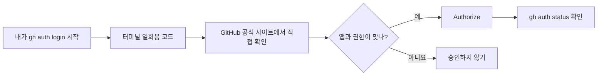

# GitHub 브라우저 인증: 수강생 5단계 따라 하기

**학습 목표:** GitHub CLI를 본인 계정에 안전하게 연결하고, 다른 사람에게 비밀번호·일회용 인증코드·토큰을 노출하지 않은 채 인증 결과를 확인한다.

> [!important] 수강생에게 먼저 설명할 한 문장
> **브라우저 인증은 내 GitHub 비밀번호를 클코에게 건네주는 절차가 아닙니다.** 내가 시작한 GitHub CLI 연결 요청을 **GitHub 공식 웹사이트에서 직접 검토하고 허락**하는 과정입니다. 요청하지 않은 인증이라면 승인하지 않습니다.

### ① Claude Code 로그인과 GitHub 로그인을 구별하기

| 항목 | Claude Code 로그인 | GitHub CLI 브라우저 인증 |
|---|---|---|
| 목적 | Claude Code 자체를 이용 | GitHub 저장소 생성·Push |
| 대표 진입 방법 | Claude Code 실행 후 로그인 안내 또는 `/login` | `gh auth login` 또는 `gh auth login --web` |
| 화면 | Claude 공식 로그인 | GitHub 공식 사이트 (`github.com`) |
| 성공 확인 | Claude Code가 정상 응답 | `gh auth status`에서 본인 계정 확인 |

두 로그인은 **별개**입니다. Claude에 로그인되어 있어도 GitHub 인증은 필요할 수 있습니다. 회사·학교 계정이라면 추가적인 조직 승인이 나타날 수 있습니다.

### ② 수강생이 따라 하는 GitHub 인증 5단계

**STEP 1 — 인증 시작:** 클코에게 아래 프롬프트를 붙여넣습니다. 컴퓨터에서 직접 실행한다면 PowerShell/터미널에서 `gh auth login`을 사용합니다.

```text
GitHub CLI 브라우저 인증을 초보자 눈높이로 도와주세요.
먼저 gh 설치 여부와 gh auth status를 확인해주세요.
로그인이 필요하면 gh auth login --web을 시작해주세요.
화면에 나타나는 선택지는 한 단계씩 설명해주세요.
인증코드·비밀번호·토큰을 클코 대화창에 입력하도록 요구하지 마세요.
공식 GitHub 웹사이트가 맞는지와 앱 권한을 내가 검토하도록 안내해주세요.
인증 후 gh auth status만으로 성공 여부를 검증해주세요.
```

**STEP 2 — 터미널 선택:** 선택 화면이 나타나면 일반적인 개인 GitHub 계정은 `GitHub.com` → `HTTPS` → `Login with a web browser`를 선택합니다. 항목과 순서는 gh 버전·기존 설정에 따라 다를 수 있습니다.

```text
예시(버전별로 화면이 다를 수 있음)
Where do you use GitHub?               > GitHub.com
Preferred protocol for Git operations? > HTTPS
How would you like to authenticate?    > Login with a web browser
```

**STEP 3 — 코드 확인:** 단말기에 표시되는 일회용 코드(예: `ABCD-EFGH` — **실제 코드 아님**)를 직접 확인합니다. **코드를 강사, 친구, 단체 채팅, 클코 대화창에 보내지 않습니다.** 코드가 보이지 않고 바로 브라우저 승인 화면이 뜨면 브라우저 안내를 따르면 됩니다.

**STEP 4 — GitHub에서 승인:** 브라우저가 자동으로 열리지 않으면 주소창에 `https://github.com/login/device`를 **직접 입력**합니다. 주소가 정확히 `github.com`인지 확인하고, 본인이 터미널에서 본 코드를 GitHub 페이지에 입력합니다. 로그인·MFA(2단계 인증)가 나타나면 GitHub 페이지에서 본인이 완료합니다. 이어 앱 이름(일반적으로 `GitHub CLI`)과 요청 권한을 읽고 **본인이 시작한 요청일 때만** `Authorize`를 누릅니다.

**STEP 5 — 성공 확인:** 다시 클코 화면/터미널로 돌아옵니다. 승인 후 다음 명령으로 연결된 계정과 상태를 점검합니다.

```bash
gh auth status
```

정상이라면 `github.com`과 본인의 GitHub 사용자명이 보입니다. **화면 문구는 버전에 따라 다릅니다.** 인증이 끝났다는 사실과 **저장소가 생성·업로드되었다는 사실은 서로 다릅니다.** 저장소 작업은 다음 단계에서 별도로 수행합니다.



### ③ 어떤 권한에 동의하는지: 무조건 '허용'은 금지

- GitHub CLI 인증은 이후 로컬 도구가 사용자를 대신해 GitHub API 및 저장소에 접근하도록 할 수 있습니다. **새 저장소 하나에만 한정되는 권한이라고 가정하면 안 됩니다.** 특히 `repo` 범위는 기존 Private 저장소에도 접근 가능하게 할 수 있습니다.
- GitHub에서는 앱 이름과 권한 범위를 확인한 뒤, 뜻을 모르거나 예상과 다르면 **승인하지 말고 강사에게 화면의 앱 이름만** 설명합니다. 코드는 전달하지 않습니다.
- `gh`는 인증정보를 운영체제 자격 증명 저장소 등에 보관할 수 있습니다. 원칙적으로 **본인 PC에서만 인증**하고, 실습실 공용 PC에서는 인증을 가급적 피합니다.
- 이메일 비밀번호, 개인 액세스 토큰(PAT), MFA 복구코드를 클코 채팅이나 실습 파일에 입력하면 안 됩니다.

### ④ 정상 / 중단 신호

| 정상 신호 | 즉시 중단해야 할 신호 |
|---|---|
| 내가 방금 `gh auth login`을 시작함 | 인증을 시작하지 않았는데 알림·코드가 옴 |
| 브라우저 주소가 정확히 `github.com`임 | 비슷한 철자의 낯선 도메인으로 연결됨 |
| 앱이 GitHub CLI이며 요청 권한을 이해함 | 모르는 앱·과도한 권한 요청이 나타남 |
| 계정 정보는 GitHub 공식 화면에서만 입력함 | 강사·메신저·클코가 코드나 비밀번호를 달라고 함 |

### ⑤ 인증 중 자주 생기는 문제와 해결

| 상황 | 초보자에게 안내할 조치 |
|---|---|
| 브라우저가 열리지 않음 | 터미널의 코드 확인 → `https://github.com/login/device` 직접 열기 |
| 코드가 유효하지 않음/만료됨 | 기존 화면을 닫고 `gh auth login --web`을 다시 시작하여 **새 코드** 사용 |
| 승인했는데 터미널 반응 없음 | 터미널로 돌아가 상태를 확인하고 잠시 후 `gh auth status`; 안 되면 새 인증 시도 |
| GitHub 계정이 다름 | `gh auth status` 확인 → 다른 계정이면 `gh auth switch` 또는 로그아웃 후 다시 로그인 |
| MFA/패스키 추가 요청 | **GitHub 공식 로그인 화면에서만** 안내대로 진행; 강사가 코드를 대신 받지 않음 |
| 조직 승인/SSO 요청 | 조직 관리자 정책을 확인; 실습은 개인 계정으로 진행하는 편이 간단함 |
| 클코는 로그인됨, GitHub 연결은 실패 | 서로 별개이므로 `gh auth status`로 GitHub CLI 인증을 다시 확인 |

### ⑥ 인증 취소·공용 PC에서 실습을 마칠 때

- 로컬 GitHub CLI 로그아웃: 터미널에서 `gh auth logout` (필요시 계정을 선택).
- GitHub 웹사이트에서 앱 접근 권한을 검토하거나 취소하려면 **프로필 → Settings → Applications → Authorized OAuth Apps**로 이동하여 해당 앱의 권한을 확인·취소합니다. 앱 종류에 따라 **Authorized GitHub Apps**도 확인합니다.
- 공용 PC에서 로컬 로그아웃을 해도 브라우저 로그인, 캐시 또는 다른 인증정보가 남을 수 있습니다. 가능하면 본인 노트북에서 실습하고, 공용 PC 사용 후에는 GitHub 웹사이트에서도 로그아웃하세요.
- `gh auth status --show-token`, `gh auth token` 등 **토큰을 출력하는 명령을 화면 공유 중 사용하지 마세요.**

### ⑦ 강사가 60초 동안 읽어줄 안내 멘트

> “지금 보시는 인증은 Claude Code에 비밀번호를 알려주는 것이 아닙니다. 여러분이 GitHub CLI 연결을 시작했고, GitHub 공식 사이트에서 앱 이름과 권한을 확인해 직접 승인하는 절차입니다. 일회용 숫자·문자는 본인만 사용하세요. 강사에게 보내지 않아도 됩니다. 화면이 다르면 억지로 누르지 말고 손을 들어 알려주세요. 인증이 끝나도 파일은 아직 올라가지 않습니다. 다음 단계에서 업로드 목록을 확인한 뒤 진행하겠습니다.”

### ⑧ 수강생 인증 완료 체크리스트

- [ ] 내 PC에서 내가 직접 GitHub 연결을 시작했다.
- [ ] URL이 `github.com`인지 확인했다.
- [ ] 인증코드·비밀번호·토큰을 채팅/단체방에 공유하지 않았다.
- [ ] 앱 이름과 권한을 읽은 뒤 승인했다.
- [ ] `gh auth status`에서 **내 GitHub 계정**을 확인했다.
- [ ] 인증 완료와 GitHub 자료 업로드 완료가 다르다는 것을 이해했다.

**공식 참고:** [GitHub CLI 로그인](https://cli.github.com/manual/gh_auth_login) · [GitHub CLI 인증 상태](https://cli.github.com/manual/gh_auth_status) · [GitHub OAuth 앱 권한 검토/취소](https://docs.github.com/en/apps/oauth-apps/using-oauth-apps/reviewing-your-authorized-oauth-apps)

---

## 강사용 3분 미니 실습

1. 강사가 인증 시작 전 `gh auth status`를 시연하고, 이미 로그인된 경우 **재로그인하지 않아도 된다**고 알린다.
2. 미로그인 수강생만 `gh auth login --web`을 시작한다.
3. 인증화면의 계정·앱 이름·접근 범위는 본인이 확인한다. **코드 낭독, 채팅 전송, 화면 공유를 요구하지 않는다.**
4. `gh auth status`로 본인 계정만 확인한다.
5. 연결 직후 개인 저장소는 여전히 생성되지 않았음을 확인하고, 업로드는 별도 실습에서 실행한다.

**중요:** 공식 GitHub 앱의 인증 방식이나 문구는 버전에 따라 달라질 수 있다. 본 가이드의 코드는 가상 예시다.
