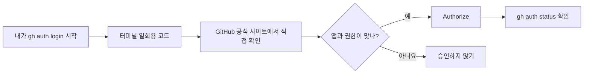

# Claude Code로 GitHub 저장소 생성·자료 업로드·업데이트하기

> [!summary] 목표
> 사용자는 한국어로 지시하고 Claude Code가 파일 정리, README 작성, Git 저장소 초기화, GitHub 저장소 생성, 업로드(push), 변경사항 업데이트까지 수행한다. 단 **로그인·2단계 인증·권한 승인·최종 공개 승인**은 사용자가 직접 수행한다.

## 0. 전체 과정


용어: **Repo**는 온라인 자료 저장소, **Commit**은 변경 이력 저장, **Push**는 로컬 변경사항을 GitHub에 전송한다는 뜻이다. `gh`는 GitHub의 공식 CLI이다.

## 1. 준비물

- GitHub 계정: <https://github.com>
- Claude Code 이용 가능한 계정과 로컬 Claude Code
- 인터넷 연결
- 업로드할 자료 폴더(예: `auto-ax-course`)

### 1-1. Claude Code 설치 여부 확인

터미널에서 `claude --version`을 실행한다. 정상 동작하면 설치를 생략한다.

**Windows PowerShell** (설치가 필요한 경우):

```powershell
winget install Anthropic.ClaudeCode
```

**macOS 터미널** (설치가 필요한 경우):

```bash
curl -fsSL https://claude.ai/install.sh | bash
```

설치가 끝나면 **새 터미널 창**을 열고 `claude`를 실행한다. Claude 계정 로그인이 필요하면 브라우저 안내를 따른다.

> [!note]
> Claude Code는 GitHub 서비스와 다른 제품이므로 각각 인증할 수 있다. 설치와 인증은 운영체제 및 기존 설정에 따라 달라진다.

## 2. Git과 GitHub CLI 설정을 클코에게 맡기기

Claude Code 입력창에 아래 **프롬프트 A**를 복사한다.

### 프롬프트 A — 최초 설정

```text
나는 GitHub 초보자입니다. 현재 컴퓨터에서 GitHub 저장소 생성과 자료 업로드를
Claude Code가 수행하도록 준비해 주세요.

1. 운영체제와 현재 작업 폴더를 확인하세요.
2. git --version, gh --version, gh auth status를 실행해 설치·로그인 상태를 확인하세요.
3. 없는 도구만 공식 경로로 설치하세요. 설치 전 나에게 승인받으세요.
4. gh 인증이 없으면 gh auth login --web을 안내·실행하고,
   내 브라우저에서 직접 로그인 및 권한 승인할 수 있도록 단계별로 설명하세요.
5. 비밀번호·인증 토큰·일회용 코드를 채팅에 요구하거나 출력하지 마세요.
6. gh auth status와 git --version으로 최종 연결을 검증하세요.
7. 성공한 항목/실패한 항목/내가 직접 해야 하는 일을 구분해 한국어로 보고하세요.

기존 Git 설정과 GitHub 저장소를 임의로 변경·삭제하지 마세요.
```

**사용자가 할 일:** 브라우저에 GitHub 로그인 및 MFA 화면이 나타나면 직접 인증한다. 일부 설치에서는 OS 권한 승인도 필요하다.

참고: Windows에서 `gh` 설치 공식 명령은 `winget install --id GitHub.cli --source winget`, Mac(Homebrew)은 `brew install gh`이다. `git`이 없다면 Windows에서 Git for Windows 설치가 필요할 수 있다. 가능하면 설치 여부를 Claude Code가 먼저 확인하게 한다.


## 2-A. (필독) GitHub 브라우저 인증 5단계와 보안

> [!important] 수강생에게 먼저 설명할 한 문장
> **브라우저 인증은 내 GitHub 비밀번호를 클코에게 건네주는 절차가 아닙니다.** 내가 시작한 GitHub CLI 연결 요청을 **GitHub 공식 웹사이트에서 직접 검토하고 허락**하는 과정입니다. 요청하지 않은 인증이라면 승인하지 않습니다.

### ① Claude Code 로그인과 GitHub 로그인을 구별하기

| 항목 | Claude Code 로그인 | GitHub CLI 브라우저 인증 |
|---|---|---|
| 목적 | Claude Code 자체를 이용 | GitHub 저장소 생성·Push |
| 대표 진입 방법 | Claude Code 실행 후 로그인 안내 또는 `/login` | `gh auth login` 또는 `gh auth login --web` |
| 화면 | Claude 공식 로그인 | GitHub 공식 사이트 (`github.com`) |
| 성공 확인 | Claude Code가 정상 응답 | `gh auth status`에서 본인 계정 확인 |

두 로그인은 **별개**입니다. Claude에 로그인되어 있어도 GitHub 인증은 필요할 수 있습니다. 회사·학교 계정이라면 추가적인 조직 승인이 나타날 수 있습니다.

### ② 수강생이 따라 하는 GitHub 인증 5단계

**STEP 1 — 인증 시작:** 클코에게 아래 프롬프트를 붙여넣습니다. 컴퓨터에서 직접 실행한다면 PowerShell/터미널에서 `gh auth login`을 사용합니다.

```text
GitHub CLI 브라우저 인증을 초보자 눈높이로 도와주세요.
먼저 gh 설치 여부와 gh auth status를 확인해주세요.
로그인이 필요하면 gh auth login --web을 시작해주세요.
화면에 나타나는 선택지는 한 단계씩 설명해주세요.
인증코드·비밀번호·토큰을 클코 대화창에 입력하도록 요구하지 마세요.
공식 GitHub 웹사이트가 맞는지와 앱 권한을 내가 검토하도록 안내해주세요.
인증 후 gh auth status만으로 성공 여부를 검증해주세요.
```

**STEP 2 — 터미널 선택:** 선택 화면이 나타나면 일반적인 개인 GitHub 계정은 `GitHub.com` → `HTTPS` → `Login with a web browser`를 선택합니다. 항목과 순서는 gh 버전·기존 설정에 따라 다를 수 있습니다.

```text
예시(버전별로 화면이 다를 수 있음)
Where do you use GitHub?               > GitHub.com
Preferred protocol for Git operations? > HTTPS
How would you like to authenticate?    > Login with a web browser
```

**STEP 3 — 코드 확인:** 단말기에 표시되는 일회용 코드(예: `ABCD-EFGH` — **실제 코드 아님**)를 직접 확인합니다. **코드를 강사, 친구, 단체 채팅, 클코 대화창에 보내지 않습니다.** 코드가 보이지 않고 바로 브라우저 승인 화면이 뜨면 브라우저 안내를 따르면 됩니다.

**STEP 4 — GitHub에서 승인:** 브라우저가 자동으로 열리지 않으면 주소창에 `https://github.com/login/device`를 **직접 입력**합니다. 주소가 정확히 `github.com`인지 확인하고, 본인이 터미널에서 본 코드를 GitHub 페이지에 입력합니다. 로그인·MFA(2단계 인증)가 나타나면 GitHub 페이지에서 본인이 완료합니다. 이어 앱 이름(일반적으로 `GitHub CLI`)과 요청 권한을 읽고 **본인이 시작한 요청일 때만** `Authorize`를 누릅니다.

**STEP 5 — 성공 확인:** 다시 클코 화면/터미널로 돌아옵니다. 승인 후 다음 명령으로 연결된 계정과 상태를 점검합니다.

```bash
gh auth status
```

정상이라면 `github.com`과 본인의 GitHub 사용자명이 보입니다. **화면 문구는 버전에 따라 다릅니다.** 인증이 끝났다는 사실과 **저장소가 생성·업로드되었다는 사실은 서로 다릅니다.** 저장소 작업은 다음 단계에서 별도로 수행합니다.



### ③ 어떤 권한에 동의하는지: 무조건 '허용'은 금지

- GitHub CLI 인증은 이후 로컬 도구가 사용자를 대신해 GitHub API 및 저장소에 접근하도록 할 수 있습니다. **새 저장소 하나에만 한정되는 권한이라고 가정하면 안 됩니다.** 특히 `repo` 범위는 기존 Private 저장소에도 접근 가능하게 할 수 있습니다.
- GitHub에서는 앱 이름과 권한 범위를 확인한 뒤, 뜻을 모르거나 예상과 다르면 **승인하지 말고 강사에게 화면의 앱 이름만** 설명합니다. 코드는 전달하지 않습니다.
- `gh`는 인증정보를 운영체제 자격 증명 저장소 등에 보관할 수 있습니다. 원칙적으로 **본인 PC에서만 인증**하고, 실습실 공용 PC에서는 인증을 가급적 피합니다.
- 이메일 비밀번호, 개인 액세스 토큰(PAT), MFA 복구코드를 클코 채팅이나 실습 파일에 입력하면 안 됩니다.

### ④ 정상 / 중단 신호

| 정상 신호 | 즉시 중단해야 할 신호 |
|---|---|
| 내가 방금 `gh auth login`을 시작함 | 인증을 시작하지 않았는데 알림·코드가 옴 |
| 브라우저 주소가 정확히 `github.com`임 | 비슷한 철자의 낯선 도메인으로 연결됨 |
| 앱이 GitHub CLI이며 요청 권한을 이해함 | 모르는 앱·과도한 권한 요청이 나타남 |
| 계정 정보는 GitHub 공식 화면에서만 입력함 | 강사·메신저·클코가 코드나 비밀번호를 달라고 함 |

### ⑤ 인증 중 자주 생기는 문제와 해결

| 상황 | 초보자에게 안내할 조치 |
|---|---|
| 브라우저가 열리지 않음 | 터미널의 코드 확인 → `https://github.com/login/device` 직접 열기 |
| 코드가 유효하지 않음/만료됨 | 기존 화면을 닫고 `gh auth login --web`을 다시 시작하여 **새 코드** 사용 |
| 승인했는데 터미널 반응 없음 | 터미널로 돌아가 상태를 확인하고 잠시 후 `gh auth status`; 안 되면 새 인증 시도 |
| GitHub 계정이 다름 | `gh auth status` 확인 → 다른 계정이면 `gh auth switch` 또는 로그아웃 후 다시 로그인 |
| MFA/패스키 추가 요청 | **GitHub 공식 로그인 화면에서만** 안내대로 진행; 강사가 코드를 대신 받지 않음 |
| 조직 승인/SSO 요청 | 조직 관리자 정책을 확인; 실습은 개인 계정으로 진행하는 편이 간단함 |
| 클코는 로그인됨, GitHub 연결은 실패 | 서로 별개이므로 `gh auth status`로 GitHub CLI 인증을 다시 확인 |

### ⑥ 인증 취소·공용 PC에서 실습을 마칠 때

- 로컬 GitHub CLI 로그아웃: 터미널에서 `gh auth logout` (필요시 계정을 선택).
- GitHub 웹사이트에서 앱 접근 권한을 검토하거나 취소하려면 **프로필 → Settings → Applications → Authorized OAuth Apps**로 이동하여 해당 앱의 권한을 확인·취소합니다. 앱 종류에 따라 **Authorized GitHub Apps**도 확인합니다.
- 공용 PC에서 로컬 로그아웃을 해도 브라우저 로그인, 캐시 또는 다른 인증정보가 남을 수 있습니다. 가능하면 본인 노트북에서 실습하고, 공용 PC 사용 후에는 GitHub 웹사이트에서도 로그아웃하세요.
- `gh auth status --show-token`, `gh auth token` 등 **토큰을 출력하는 명령을 화면 공유 중 사용하지 마세요.**

### ⑦ 강사가 60초 동안 읽어줄 안내 멘트

> “지금 보시는 인증은 Claude Code에 비밀번호를 알려주는 것이 아닙니다. 여러분이 GitHub CLI 연결을 시작했고, GitHub 공식 사이트에서 앱 이름과 권한을 확인해 직접 승인하는 절차입니다. 일회용 숫자·문자는 본인만 사용하세요. 강사에게 보내지 않아도 됩니다. 화면이 다르면 억지로 누르지 말고 손을 들어 알려주세요. 인증이 끝나도 파일은 아직 올라가지 않습니다. 다음 단계에서 업로드 목록을 확인한 뒤 진행하겠습니다.”

### ⑧ 수강생 인증 완료 체크리스트

- [ ] 내 PC에서 내가 직접 GitHub 연결을 시작했다.
- [ ] URL이 `github.com`인지 확인했다.
- [ ] 인증코드·비밀번호·토큰을 채팅/단체방에 공유하지 않았다.
- [ ] 앱 이름과 권한을 읽은 뒤 승인했다.
- [ ] `gh auth status`에서 **내 GitHub 계정**을 확인했다.
- [ ] 인증 완료와 GitHub 자료 업로드 완료가 다르다는 것을 이해했다.

**공식 참고:** [GitHub CLI 로그인](https://cli.github.com/manual/gh_auth_login) · [GitHub CLI 인증 상태](https://cli.github.com/manual/gh_auth_status) · [GitHub OAuth 앱 권한 검토/취소](https://docs.github.com/en/apps/oauth-apps/using-oauth-apps/reviewing-your-authorized-oauth-apps)

---

## 3. 로컬 자료 폴더 준비

예시 프로젝트: **한국 자동차 산업 AX 교육자료**.

- Windows 예시: `C:\Users\<사용자>\Documents\auto-ax-course`
- Mac 예시: `~/Documents/auto-ax-course`

자료 폴더 안에 PDF, PPTX, MD, PNG, CSV 등을 넣는다. 이미 폴더가 있다면 그대로 사용한다.

**중요:** Claude Code는 시작한 작업 폴더 바깥을 읽을 때 추가 권한이 필요할 수 있다. 해당 폴더에서 `claude`를 실행하거나, 사용자가 자료 폴더의 경로를 알려주고 필요한 접근을 승인한다. 원본은 삭제하지 않는다.

## 4. 저장소 생성과 첫 업로드를 한 번에 시키기

다음 **프롬프트 B**에서 폴더 경로 및 저장소 이름만 바꾼다.

### 프롬프트 B — 최초 구축 마스터 프롬프트

```text
당신은 GitHub 저장소 구축 및 강의자료 관리 담당자입니다.

목표:
내 컴퓨터의 한국 자동차 산업 AX 교육자료를 안전하게 정리하고,
내 GitHub 계정에 새 저장소를 만들어 업로드하세요.

설정:
- 원본 자료 위치: [현재 작업 폴더 또는 여기에 실제 경로 입력]
- GitHub 저장소 이름: auto-ax-course
- 설명: 한국 자동차 산업 AX 교육 및 실습자료
- 공개 설정: Private (비공개, 변경 금지)
- 업로드 기준: 내가 승인한 파일만

절차:
1. 작업 폴더를 확인하고 파일 목록/크기/확장자를 조사하세요.
2. git, gh, GitHub 로그인 상태를 확인하고 없을 때만 준비하세요.
3. 동일한 원격 저장소 또는 기존 git remote가 있는지 확인하세요.
   기존 저장소가 있다면 중복 생성하거나 덮어쓰기 전에 내 승인을 받으세요.
4. 자료를 다음 폴더로 분류해 제안하세요.
   lectures/ slides/ images/ data/ prompts/
   원본을 이동·삭제하지 말고 필요한 경우 작업 폴더에 복사해 정리하세요.
5. README.md에 프로젝트 소개, 자료 목록, 사용법, 실습 순서를 한국어로 작성하세요.
6. .gitignore를 작성하고 비밀번호·API 키·토큰·.env·인증 파일·개인정보·
   캐시·임시파일을 검사해 제외하세요. 대용량 파일도 별도 보고하세요.
7. 업로드 예정 파일 전체 목록과 공개 위험을 보고하고 최종 승인받으세요.
8. 승인 후 로컬 Git 저장소를 초기화(기존 저장소면 상태 유지)하고
   변경사항을 커밋하세요.
9. gh repo create의 --private, --source, --push 옵션을 이용해
   GitHub 저장소를 생성하고 업로드하세요.
10. gh repo view, git remote -v, git status, git log로 확인하고
    원격 파일이 실제 보이는지도 가능한 방법으로 검증하세요.
11. 마지막에 GitHub URL, 업로드 파일 개수, 커밋, 제외 파일,
    문제 발생 여부, 다음 업데이트 방법을 한국어로 정리하세요.

안전 규칙:
- 계정 로그인·2단계 인증·도구 실행 권한 승인은 내가 합니다.
- 공개(Public) 전환, 기존 자료 삭제, force push, 기밀정보 업로드는 하지 마세요.
- 막히면 오류를 설명하고 안전한 대안을 시도하세요.
- 동일 저장소가 있으면 새로 만들지 말고 먼저 알려주세요.
```

### 내부적으로 사용할 수 있는 명령 예시(사용자가 직접 입력할 필요 없음)

```bash
git init -b main
git add .
git commit -m "Initial upload: course materials"
gh repo create auto-ax-course --private --source=. --remote=origin --push
```

**주의:** 위 명령은 *기존 Git 저장소·원격 연결이 없는 새 프로젝트*를 가정한 예시다. 기존 원격 저장소가 있으면 클코가 먼저 상황을 판단해야 하며, 무조건 그대로 실행하면 안 된다.

## 5. 자료가 바뀌었을 때 업데이트

기존 자료를 수정하거나 새 파일을 폴더에 넣은 다음 다음 프롬프트를 이용한다.

### 프롬프트 C — 재업로드

```text
현재 프로젝트의 변경사항을 GitHub에 업데이트해 주세요.
1. 현재 branch, git status, 원격 저장소를 먼저 확인하세요.
2. 원격에서 다른 사람이 변경한 내용이 있는지 안전하게 확인하세요.
3. 새로 추가·수정·삭제된 파일을 요약하고 비밀정보를 재검사하세요.
4. 파일 삭제나 충돌이 발견되면 자동으로 덮어쓰지 말고 승인받으세요.
5. 필요한 경우 안전하게 pull 한 뒤, 내가 승인한 변경만 commit/push하세요.
6. GitHub에서 반영 상태를 검증하고 변경 내역과 URL을 알려주세요.
force push를 사용하지 마세요.
```

## 6. 실습 참가자와 공동 작업할 때

먼저 `Private`로 만들고, 공개 강의자료인 것이 확인되면 사용자 승인 후 `Public`으로 변경하는 편이 안전하다. 단순 다운로드용이면 링크를 공유한다. 공동 수정은 GitHub Collaborators 권한을 부여하고, 중요한 작업은 브랜치와 Pull Request(PR)로 검토할 수 있다.

### 프롬프트 D — 공동 작업 준비

```text
현재 GitHub 저장소를 수강생이 읽기 쉽게 정리해 주세요.
README에 강의자료 사용법, 다운로드 방법, 디렉터리 설명을 추가하고,
CONTRIBUTING.md에 공동 작업 및 Pull Request 절차를 초보자용으로 작성하세요.
기존 공개 범위와 사용자 접근 권한은 변경하지 말고 제안만 해주세요.
```

## 7. 실패할 때 확인할 항목

| 메시지/증상 | 클코에게 시킬 일 |
|---|---|
| `gh: command not found` | GitHub CLI 설치 및 PATH 확인 |
| `You are not logged in` | `gh auth login --web` 안내 |
| `git: command not found` | Git 설치 및 실행 경로 확인 |
| `nothing to commit` | 새 변경사항이 없는지 확인 |
| `repository already exists` | 기존 저장소와 `git remote -v` 점검 |
| `permission denied` | GitHub 계정/권한/로그인 상태 확인 |
| `file is larger than 100 MB` | 파일 분리, 외부 보관 또는 Git LFS 적합성 검토 |
| `non-fast-forward` 또는 충돌 | 덮어쓰지 말고 원격 변경 사항 비교 |

> [!warning] 공개 전 점검
> GitHub에 한 번 올라간 비밀정보는 단순히 최신 커밋에서 삭제해도 이전 이력에 남을 수 있다. 따라서 업로드 **전** 검사가 핵심이다. Private 저장소도 암호 저장 공간은 아니다.

## 8. 완료 체크리스트

- [ ] Claude Code 실행 가능
- [ ] Git 설치 확인
- [ ] GitHub CLI(`gh`) 설치 확인
- [ ] GitHub 브라우저 인증 완료
- [ ] 자료 폴더 확인
- [ ] README 및 폴더 정리
- [ ] 업로드 파일/비밀정보 점검
- [ ] Private 저장소 생성
- [ ] 첫 Commit과 Push 성공
- [ ] GitHub 웹에서 파일 확인
- [ ] 업데이트 프롬프트 보관

## 9. 참고: 공식 문서

- Claude Code 설치: <https://code.claude.com/docs/en/setup>
- GitHub CLI 인증: <https://cli.github.com/manual/gh_auth_login>
- GitHub CLI 저장소 생성: <https://cli.github.com/manual/gh_repo_create>
- GitHub 공식 로컬 프로젝트 업로드: <https://docs.github.com/en/migrations/importing-source-code/using-the-command-line-to-import-source-code/adding-locally-hosted-code-to-github>

---

**초보자에게 추천하는 시작점:** A로 환경·인증을 점검한 뒤, B로 Private 저장소를 만들고, 다음부터는 C로 업데이트한다.
