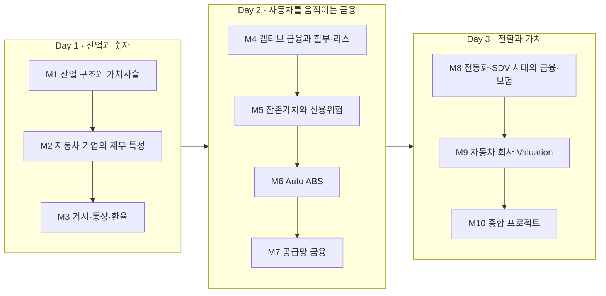
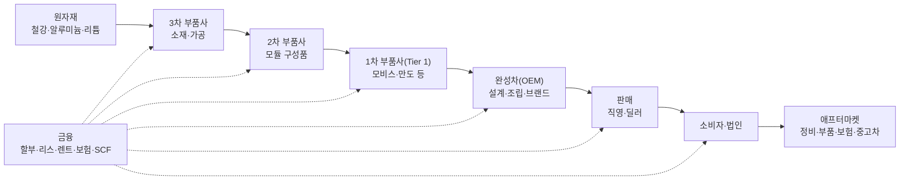
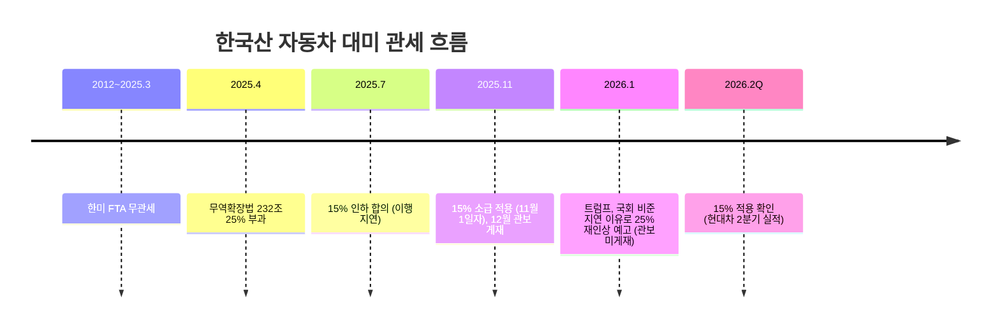
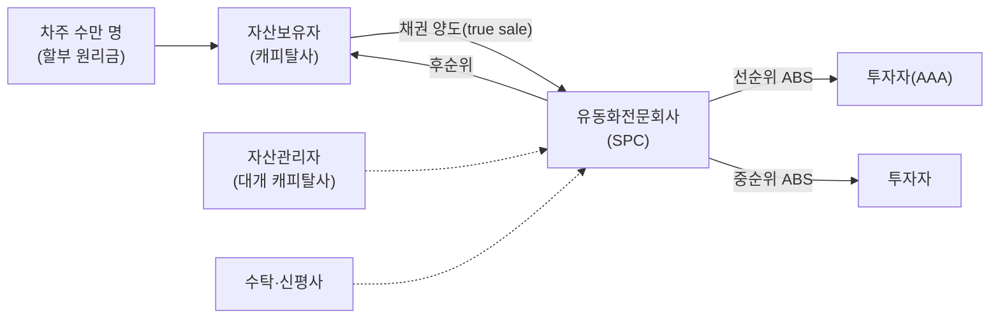
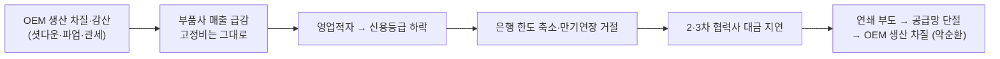

# 자동차 산업과 금융 — 3일 집중과정 (24시간)

> [!summary] 한 줄 요약
> 자동차는 **제조업이면서 금융업**이다. 차 한 대가 팔리려면 소비자 금융(할부·리스)이, 만들어지려면 부품사 공급망 금융이, 굴러가려면 보험이, 그리고 회사의 몸값을 매기려면 **제조 부문과 금융 부문을 나눠 보는 밸류에이션**이 필요하다. 3일 동안 ① 산업 구조와 숫자 → ② 자동차를 움직이는 금융 → ③ 전동화 시대의 금융과 **Valuation** 순서로 "누가 어떤 위험을 지고, 그 위험이 기업가치에 어떻게 반영되는가"를 따라간다.

> [!info] 이 노트의 관점
> - **제조 + 금융의 결합**: 현대차의 2026년 상반기 영업이익 중 약 1/4을 금융부문이 벌었다. 자동차 회사를 이해하려면 캡티브 금융을 반드시 같이 봐야 한다.
> - **실무 용어 그대로**: OEM, 캡티브(captive) 금융, RV(잔존가치), PD·LGD·EAD, ABS, SCF, SOTP, EV/EBITDA 등은 업계 표기 그대로 쓴다.
> - **최신 수치**: 관세·실적·연체율·EV 보급·멀티플을 2026년 10월 기준으로 확인했다. 출처는 문서 끝.
> - **Valuation은 Day 3의 중심 모듈(4시간)**: 사이클 산업의 멀티플 함정, 산업·금융 부문 분리, SOTP, 지주구조 할인, 미래사업 옵션가치까지 다룬다.

---

## 과정 지도

| 일차 | 모듈 | 시간 | 핵심 질문 |
|---|---|---|---|
| Day 1 | M1 산업 구조와 가치사슬 | 2h | 자동차 한 대의 돈은 누구에게 나뉘어 가는가? |
| | M2 자동차 기업의 재무 특성 | 3h | 왜 판매량 10% 감소가 이익 30% 감소가 되는가? |
| | M3 거시·통상·환율 | 3h | 관세 10%p와 환율 10원은 이익을 얼마나 바꾸는가? |
| Day 2 | M4 캡티브 금융과 할부·리스 | 2.5h | 자동차 회사는 왜 금융회사를 거느리는가? |
| | M5 잔존가치와 신용위험 | 1.5h | 리스의 진짜 위험은 차주인가, 중고차 가격인가? |
| | M6 Auto ABS | 1.5h | 자동차 대출은 어떻게 증권이 되는가? |
| | M7 공급망 금융 | 2.5h | 부품사는 왜 흑자인데도 돈이 마르는가? |
| Day 3 | M8 전동화·SDV 시대의 금융·보험 | 2h | 배터리·충전·자율주행은 금융을 어떻게 바꾸는가? |
| | **M9 자동차 회사 Valuation** | **4h** | 같은 이익인데 왜 테슬라와 도요타의 몸값은 30배 차이인가? |
| | M10 종합 프로젝트 | 2h | 가상 완성차·부품사의 자금조달과 가치평가를 설계하라 |

---

# Day 1 · 산업과 숫자

## M1. 자동차 산업 구조와 가치사슬 (2h)

> [!abstract] 결론 먼저
> 자동차 산업은 **완성차(OEM) 정점의 피라미드형 공급망**이다. 이익은 **완성차와 애프터마켓·금융**에, 위험(가격 인하 압력·물량 변동)은 **하위 부품사**에 상대적으로 몰린다. 금융은 이 사슬의 모든 마디에 끼어 있다.

### 1-1. 기본지식 — 가치사슬 한눈에

| 주체 | 하는 일 | 돈 버는 방식 | 핵심 위험 |
|---|---|---|---|
| 완성차(OEM) | 설계·조립·브랜드·판매 | 차량 마진 + 금융 + 부품·서비스 | 물량 변동, 리콜, 관세, 기술전환 |
| 1차 부품사 | 모듈·시스템 공급 | 납품 마진, 일부 글로벌 OEM 다변화 | **고객 집중**, 연간 단가 인하(CR) |
| 2·3차 부품사 | 구성품·가공 | 얇은 마진, 물량 의존 | 원자재 가격, 인건비, 유동성 |
| 딜러·판매 | 소매판매 | 판매 수수료, 금융·보험 알선 수수료 | 재고(floor plan) 금리 |
| 캡티브 금융 | 할부·리스·딜러금융 | 이자마진 + RV 관리 | 신용·잔존가치·조달 |
| 애프터마켓 | 정비·부품·중고차 | 반복 수익 | 전동화로 정비 수요 감소 |

> [!tip] 용어 — CR(Cost Reduction)
> OEM이 부품사에 매년 요구하는 **납품단가 인하**. 원자재 가격이 오를 때 부품사 마진을 압박하는 구조적 요인이다. 2023년 10월 시행된 **납품대금 연동제**(주요 원재료 가격 변동분을 납품대금에 반영)가 이 비대칭을 일부 완화하려는 제도다.

### 1-2. 자동차 산업의 경제적 특성

| 특성 | 의미 | 금융적 함의 |
|---|---|---|
| 거대한 고정비 | 공장·금형·R&D·플랫폼 개발 | **영업레버리지** 큼 → 이익 변동성 큼 (M2) |
| 경기 민감(cyclical) | 내구재, 구매 연기 가능 | 사이클 정점의 낮은 P/E 함정 (M9) |
| 할부 구매가 일반적 | 차값이 연봉 수준 | **금리가 수요를 직접 좌우** |
| 규제 산업 | 연비·배출가스·안전 | 리콜·충당부채, 보조금 의존 |
| 무역·통상 민감 | 글로벌 생산·수출 | 관세·환율이 이익에 직결 (M3) |
| 기술 전환기 | 전동화·SDV·자율주행 | 대규모 capex + 미래가치 논쟁 (M9) |

### 1-3. 사례 — 한국 자동차 산업의 위기사(史)와 금융

| 연도 | 사건 | 금융과의 연결 |
|---|---|---|
| 1997 | **기아 부도유예** | 재벌 차입경영의 붕괴, 외환위기의 도화선 중 하나 |
| 2000 | 대우자동차 부도 | 채권단 관리 → 2002 GM 인수(GM대우) |
| 2009 | 쌍용차 법정관리 | 이후 마힌드라 인수 → 2021 재회생 → KG그룹 인수 |
| 2018 | 한국GM 군산공장 폐쇄 | 협력사 유동성 경색 → 정부 3.5조원 규모 부품업계 금융지원(만기연장·우대보증·회사채 발행지원) |
| 2020 | 코로나 공장 셧다운 | 2·3차 협력사 유동성 위기, 상생특별보증 |
| 2021 | 반도체 공급난 | 신차 출고 지연 → 중고차 가격 급등 → 리스 잔존가치 이익 |
| 2025~26 | 미국 관세 | 현대차·기아 2025년 관세 비용 약 7.2조원 |

### 1-4. 실습 ① — 3,000만원짜리 차의 돈은 어디로 가는가 (20분)

신차 한 대 가격(부가세 제외 약 2,700만원)이 **원자재·부품사·OEM 마진·판매비·세금·금융 수수료**로 어떻게 나뉘는지 팀별로 추정해 파이차트로 그려라. 이후 공개 자료(완성차 매출원가율·영업이익률, 부품사 영업이익률)와 비교해 **어느 마디의 마진이 가장 얇은가**를 토론한다.

---

## M2. 자동차 기업의 재무 특성 (3h)

> [!abstract] 결론 먼저
> 자동차 회사의 숫자는 세 가지로 읽는다. ① **영업레버리지**: 물량이 조금만 줄어도 이익은 크게 준다. ② **두 개의 재무제표**: 제조(자동차) 부문과 금융 부문은 사업 모델이 완전히 달라 **반드시 나눠** 본다. ③ **운전자본·충당부채**: 부품사의 현금은 CCC가, 완성차의 숨은 부채는 품질보증 충당부채가 좌우한다.

### 2-1. 영업레버리지 — 판매 10% 감소가 이익 33% 감소가 되는 이유

$$
\text{DOL} = \frac{\%\Delta \text{영업이익}}{\%\Delta \text{매출}} = \frac{\text{공헌이익}}{\text{영업이익}} = \frac{\text{매출} - \text{변동비}}{\text{매출} - \text{변동비} - \text{고정비}}
$$

> [!example] 손계산 — 가상의 완성차
> 매출 100, 변동비 80(재료비 등), 고정비 14(감가상각·R&D·인건비) → 영업이익 6, 공헌이익 20.
> $\text{DOL} = 20/6 \approx 3.3$ → **판매 −10% ⇒ 영업이익 약 −33%** ($6 \to 4$).
> 현대차의 2026년 2분기 실적 설명에서 부품사 공급 이슈에 따른 생산 차질과 고정비 부담이 이익 감소 요인으로 언급된 것이 바로 이 구조다.

### 2-2. 두 개의 재무제표 — 제조 부문 vs 금융 부문

| 항목 | 자동차(제조) 부문 | 금융 부문(캡티브) |
|---|---|---|
| 자산 | 공장·재고·개발비 | **할부·리스 채권, 운용리스 차량** |
| 부채 | 매입채무, 차입금 일부 | **회사채·ABS·CP (영업용 부채)** |
| 수익 | 차량 판매 | 이자수익, 리스료 |
| 적정 레버리지 | 낮음 (순현금 선호) | **높음** (부채비율 수백 %가 정상) |
| 보는 지표 | 영업이익률, FCF, 순현금 | NIM, 연체율, 대손비용률, ROE |
| 밸류에이션 | P/E, EV/EBITDA | **P/B (ROE 기반)** |

> [!warning] 함정 — 연결 부채비율을 그대로 쓰면 안 된다
> 현대차의 연결 재무상태표에는 현대캐피탈·현대카드·HCA(현대캐피탈 아메리카)의 막대한 차입금이 합쳐져 있다. 이를 "현대차의 차입금"으로 보고 EV(기업가치)를 계산하면 **기업가치가 크게 왜곡**된다. 금융 부문 부채는 은행 예금처럼 **영업용 부채**이므로, 실무에서는 **제조 부문 순현금(Net cash of industrial operations)** 을 따로 계산한다. (M9-3)

**현대차 실적 구조 (2026년 상반기)**

| 구분 | 매출 | 영업이익 |
|---|---|---|
| 연결 전체 | 95.2조원 | 5.37조원 (전년비 −25.8%) |
| 자동차 부문 | 71.0조원 | 3.85조원 (전년비 약 −25%) |
| **금융 부문** | **18.5조원** | **1.34조원** |

→ 금융 부문이 영업이익의 **약 25%** 를 담당하며 자동차 부문 부진을 완충했다. 2분기만 보면 금융부문 매출 9.5조원(+15.7%), 영업이익 약 0.76조원(+16%)으로 성장했다.

### 2-3. 운전자본과 현금전환주기 (CCC)

$$
\text{CCC} = \text{DSO(매출채권회전일)} + \text{DIO(재고회전일)} - \text{DPO(매입채무회전일)}
$$

- **완성차**: 협상력이 커서 DPO가 길고, 딜러·캡티브 금융을 통해 판매대금을 빨리 회수 → CCC가 짧거나 음(−)일 수 있다.
- **부품사**: OEM에 대한 매출채권 회수는 정해진 주기를 따르는데, 하위 협력사·원자재 결제는 먼저 나간다 → **CCC가 길고 운전자본에 현금이 묶인다**. 물량이 급증해도(!) 운전자본 증가로 현금이 마를 수 있다.

> [!example] 손계산 — 부품사 A
> 매출 1,200억(일 3.3억), DSO 60일, DIO 30일, DPO 30일 → CCC 60일 → 운전자본 약 200억 필요.
> 매출이 20% 늘면 운전자본도 약 40억 더 필요 → **성장할수록 차입이 늘어난다.** 이것이 M7 공급망 금융이 존재하는 이유다.

### 2-4. 숨은 부채 — 품질보증 충당부채와 리콜

- 자동차 회사는 판매 시점에 **미래 무상수리 비용을 추정해 충당부채**로 쌓는다(품질비용).
- 엔진 결함 리콜 등 대규모 품질 이슈는 **일회성 충당금 전입**으로 분기 이익을 크게 흔든다.

> [!warning] 사례 — 폭스바겐 디젤게이트(2015)
> 배출가스 조작이 드러나며 리콜·벌금·배상으로 수백억 유로 규모 비용이 발생했다. 금융 측면 파급: ① 디젤차 **중고차 가격 하락 → 리스 잔존가치 손실**(M5), ② 회사채 스프레드 급등, ③ ESG 투자자 이탈. **품질·규제 리스크가 금융 부문 자산가치까지 전이**된 대표 사례.

### 2-5. 실습 ② — 사업보고서로 부문 분리하기 (60분)

DART에서 현대차 또는 기아의 반기보고서 **영업부문 정보** 주석을 찾아 다음을 작성하라.

1. 부문별 매출·영업이익 표
2. 금융 부문 이익 비중의 3개년 추이
3. 연결 차입금 중 금융 부문 차입금 비중 → **제조 부문 순현금(순차입금)** 추정

---

## M3. 거시·통상·환율 — 이익의 외생 변수 (3h)

> [!abstract] 결론 먼저
> 한국 완성차의 이익은 **관세·환율·금리**라는 세 개의 다이얼에 크게 좌우된다. 2025~26년은 한미 FTA 무관세가 **15% 관세**로 바뀐 구조적 전환기다. 금리는 소비자 할부금리를 통해 수요를, 캡티브 금융의 조달비용을 통해 마진을 동시에 흔든다.

### 3-1. 미국 관세 — 무관세에서 15%로

- **2025년 실제 비용**: 현대차·기아가 대미 자동차 관세로 부담한 비용 약 **7.2조원**(현대차 4.1조, 기아 3.1조). 현대차 2025년 매출은 6.3% 늘었지만 영업이익은 19.5% 감소.
- **민감도(증권사 추정)**: 15% 적용 시 양사 연간 관세 비용 약 6.5조원, 25% 복귀 시 10.8조원(대당 약 6,000달러). 관세 10%p 인상 시 영업이익 전망치가 현대차 약 −23%, 기아 약 −21%.
- **경쟁 구도**: 과거 FTA로 일본차 대비 2.5%p 관세 우위였으나 이제 **일본·EU와 같은 15%** 에서 경쟁.

> [!example] 손계산 — 관세의 이익 효과
> 대미 수출 단가(관세 과세가격) 3만 달러, 연 60만 대.
> - 15%: 대당 4,500달러 × 60만 = **27억 달러**(환율 1,400원 → 약 3.8조원)
> - 25%: 대당 7,500달러 × 60만 = **45억 달러**(약 6.3조원)
> 차이 약 2.5조원. 이를 **가격 전가(소비자) · 원가 절감(부품사 CR) · 현지생산 확대(capex) · 마진 감내(주주)** 로 어떻게 나눌지가 경영 의사결정이다.

> [!question] 토론 — 관세 비용은 결국 누가 지는가?
> 경제학의 **조세귀착(tax incidence)** 관점에서, 수요의 가격탄력성이 높으면(경쟁차 많음) OEM이, 낮으면 소비자가 더 부담한다. 부품사는 CR 압력으로, 국내 생산 기반은 현지화로 간접 부담한다. 관세가 **국내 부품 생태계**에 주는 장기 영향을 토론하라.

### 3-1b. 최신 상황 — 관세는 레벨 변화로 흡수됐다 (2026년 2분기 기준)

- 현대차는 2026년 2분기에도 **15%** 를 적용받아 분기 관세 비용 약 **0.9조원**을 냈다. 25%가 온전히 적용된 2025년 3분기(약 1.8조원)의 절반이다.
- 2026년 2분기 영업이익은 2.85조원으로 20.8% 감소했지만, 관세 비용은 전 분기와 비슷했다. 감소 요인은 인센티브(약 −0.4조), 원자재(약 −0.4조, 원가 절감으로 절반 상쇄), 협력사 화재(약 −0.2조), 글로벌 도매 판매 −6.9%였고, 하이브리드가 약 +0.4조를 상쇄했다.
- **남은 변수**: 대미투자특별법 처리, 미국 대법원의 상호관세 판결. 자동차·부품 관세는 무역확장법 232조가 근거라 판결 결과가 그대로 적용된다고 단정하기 어렵다.

| 분기 | 2Q25 | 3Q25 | 4Q25 | 1Q26 | 2Q26 |
|---|---|---|---|---|---|
| 적용 세율 | 25% | 25% | 11월부터 15% | 15% | 15% |
| 현대차 관세 비용(조원) | 0.83 | 1.8 | 1.5 | 약 0.9 | 약 0.9 |

### 3-1c. 관세 부담의 하도급 전가와 공정거래

관세 부담을 나누는 것 자체는 위법이 아니지만, **방식**에 따라 하도급법 문제가 된다. (법률 자문이 아니라 조문의 일반적 틀이다.)

| 방식 | 문제가 되는 모습 | 관련 규정 |
|---|---|---|
| 부당한 대금 결정 | 협의 없이 전 협력사에 일률적 단가 인하 | 하도급대금 결정 조항 |
| 부당 감액 | 이미 계약된 물량의 대금을 사후에 삭감 | 감액 금지 조항 |
| 경제적 이익 요구 | 관세 '분담금'·'협력금' 명목의 금전 요구 | 경제적 이익 요구 금지 |
| 조정 협의 거부 | 조정 요청 후 10일 내 협의 미개시 (30일 내 미합의 시 분쟁조정) | 제16조의2 |

- 관세가 '공급원가'에 포함되는지는 조문에 명시가 없다.
- 공정위는 2026년 4월 성우하이텍이 금형 등 위탁 780건의 계약서에 '하도급대금 조정 요건·방법·절차'를 빠뜨린 것을 제재했다(시정명령·과징금 4,600만원).
- 반대 측면: 2025년 7월 현대차와 은행들은 관세 피해 중소 부품사 지원을 연 1.3조원 이상으로 늘렸다(정책보증 1조원+, P-CBO 2,600억원+).
- 경제적 쟁점: 통제할 수 없는 외부 충격을 협상력으로 하위에 넘기면, 영업이익률 1~2%인 2·3차 협력사에 위험이 몰리고 결국 OEM 공급망이 흔들린다(M7 악순환).

### 3-2. 환율 — 원화 약세는 왜 좋은가, 언제 나쁜가

| 경로 | 원화 약세(원/달러↑)의 효과 |
|---|---|
| 수출 매출 | 원화 환산 매출↑ → **이익↑** (가장 큰 효과) |
| 해외법인 이익 환산 | 원화 환산 이익↑ |
| 수입 원자재·부품 | 원가↑ (일부 상쇄) |
| 금융 부문(HCA 등) | 달러 자산·이익 환산↑ |
| 경쟁 | 엔화 동반 약세 시 효과 반감 |

$$
\Delta \text{영업이익} \approx \text{순달러 노출액} \times \Delta(\text{원/달러})
$$

> [!tip] 자연헤지(natural hedge)
> 현지생산(미국 조지아 메타플랜트 등)을 늘리면 달러 매출과 달러 원가가 함께 생겨 **순노출이 줄어든다.** 관세 대응용 현지화가 동시에 환율 민감도를 낮추는 효과가 있다.

### 3-3. 금리 — 수요와 마진에 동시에 작동

- **수요**: 할부 월납입액은 금리에 민감 → 금리 1%p 상승 시 3년 할부 월납입액 약 1.5% 상승(M4 공식).
- **캡티브 마진**: 조달금리(여전채·ABS)↑ → 마진 압박. 단, 조달 만기가 길면 시차가 있다.
- **한국 상황(2026)**: 기준금리 2.50% → 7월 2.75% → 8월 3.00%로 인상 전환. 여전채 금리 상승은 캐피탈사의 신차금융 가격경쟁력을 떨어뜨린다.

### 3-4. 실습 ③ — 이익 민감도 표 만들기 (60분)

가상 완성차의 기본 영업이익을 10조원으로 두고 다음 변수 조합의 **영업이익 민감도 표(Tornado chart)** 를 만들라: 대미 관세(15%/25%), 원/달러(1,300/1,400/1,500), 미국 판매량(±10%), 할부금리(±1%p). 어떤 변수가 가장 큰가? 경영진이 **통제할 수 있는 변수와 없는 변수**를 구분하라.

---

# Day 2 · 자동차를 움직이는 금융

## M4. 캡티브 금융과 할부·리스·렌트 (2.5h)

> [!abstract] 결론 먼저
> **캡티브 금융(captive finance)** 은 완성차 그룹 소속 금융회사다. 존재 이유는 ① 판매 촉진(저금리 프로모션), ② 딜러 재고금융, ③ 고객 데이터와 재구매 관리, ④ **잔존가치(RV) 관리**를 통한 브랜드 가치 방어다. 소비자 상품은 **할부(소유) · 리스(이용권 + 선택적 인수) · 장기렌트(서비스 포함 이용)** 로 나뉜다.

### 4-1. 기본지식 — 캡티브 금융은 왜 있는가

| 기능 | 내용 | 예시 |
|---|---|---|
| 판매 촉진 | OEM이 금리를 보조(subvention)해 실질 가격 인하 | "36개월 무이자" |
| 딜러 금융 | 딜러 재고 매입자금(Floor plan) | 미국 딜러 재고금융 |
| 고객 생애주기 | 만기 시점에 재구매 유도 | 리스 만기 → 신차 리스 |
| RV 관리 | 리스 반납차를 인증중고차로 재판매 | 현대 인증중고차 |
| 정보 우위 | 차종별 고장률·RV를 가장 잘 앎 | 정교한 RV 설정 |

- **현대캐피탈**: 현대차·기아의 국내 유일 승용 캡티브, 국내 자동차금융 1위. 해외 법인 네트워크로 글로벌 자산 약 130조원 규모.
- 글로벌: Toyota Financial Services, GM Financial, Ford Credit, Ally(옛 GMAC).

> [!warning] 사례 — GMAC에서 Ally로 (2008~09)
> GM의 캡티브였던 GMAC은 자동차 금융을 넘어 **서브프라임 주택담보대출(ResCap)** 까지 확장했다가 금융위기 때 대규모 손실을 냈다. 미 정부 구제금융(TARP)을 받고 **Ally Financial**로 재탄생했다. 교훈: **캡티브는 본업(자동차) 근처에 있을 때 강하다.** 2023년 현대캐피탈이 부동산 PF 대신 "자동차 중심 우량 포트폴리오"를 강조한 것도 같은 맥락이다.

### 4-2. 상품 비교 — 할부 vs 리스 vs 장기렌트

| 구분 | 할부금융 | 금융리스·운용리스 | 장기렌트 |
|---|---|---|---|
| 소유권 | 고객(근저당 설정) | 리스사 (만기 인수 선택) | 렌트사 |
| 번호판 | 일반 | 일반 | '하·허·호' |
| 보험·정비 | 고객 | 고객(일부 포함 상품) | **렌트료에 포함** |
| 월 부담 | 높음 (원금 전액 상환) | 낮음 (**RV만큼 원금 미상환**) | 중간 (서비스 포함) |
| RV 위험 | 없음 | **리스사(운용리스) 또는 고객** | 렌트사 |
| 근거 법 | 여신전문금융업법(할부금융업) | 여신전문금융업법(시설대여업) | 여객자동차운수사업법 |

### 4-3. 할부 월납입액 — 원리금균등상환

$$
PMT = P \cdot \frac{r}{1-(1+r)^{-n}}
$$

- $P$: 할부원금, $r$: 월 이자율(연이율/12), $n$: 개월 수

> [!example] 손계산 — 3,000만원, 연 6%, 36개월
> $r = 0.005$, $(1.005)^{36} \approx 1.1967$, $(1.005)^{-36} \approx 0.8356$
> $PMT = 3{,}000\text{만} \times \frac{0.005}{1-0.8356} = 3{,}000\text{만}\times 0.03042 \approx$ **91.3만원/월**
> 총 납입 약 3,285만원 → 이자 약 285만원.
> 연 7%로 오르면 약 92.6만원 → **금리 1%p ↑ = 월 약 1.4% ↑**.

### 4-4. 리스료 — 잔존가치(RV)만큼 싸지는 원리

$$
\text{월 리스료} \approx \left(C - \frac{RV}{(1+r)^{n}}\right)\cdot \frac{r}{1-(1+r)^{-n}}
$$

- $C$: 취득원가, $RV$: 만기 시 예상 잔존가치

> [!example] 손계산 — 5,000만원 차, 36개월 후 RV 50%(2,500만원), 연 6%
> RV 현재가치 $= 2{,}500/1.1967 \approx 2{,}089$만원
> 상환 대상 $= 5{,}000 - 2{,}089 = 2{,}911$만원
> 월 리스료 $\approx 2{,}911\text{만} \times 0.03042 \approx$ **88.6만원**
> 같은 차를 할부로 사면 $5{,}000\text{만}\times0.03042 \approx 152.1$만원. → **리스가 싼 이유는 RV를 리스사가 떠안기 때문**이며, 그 RV 추정이 틀리면 리스사가 손실을 본다(M5).

### 4-5. 사례 — 미국 EV 세액공제와 '리스 우회로'

미국 IRA의 7,500달러 EV 세액공제는 소비자 구매 시 **북미 생산·배터리 요건**이 까다로웠지만, **상업용 차량 세액공제**는 요건이 느슨해 리스사(캡티브)가 공제를 받고 리스료 인하로 넘겨주는 구조가 널리 쓰였다. 한국산 EV도 이 '리스 우회로'로 경쟁력을 유지했다. 이 공제는 **2025년 9월 30일 종료**됐고, 이후 캡티브의 EV 리스 구조와 RV 가정이 재조정됐다. → **정책 변화가 캡티브 금융의 상품 설계와 손익을 직접 바꾼다.**

### 4-6. 실습 ④ — 고객에게 가장 유리한 상품은? (40분)

고객 프로필 3명(① 사회초년생, 연 1만km 운전 ② 개인사업자, 비용처리 원함 ③ 3년마다 차를 바꾸는 EV 선호 고객)에게 할부·리스·장기렌트 중 무엇을 권할지, **총비용(TCO)과 RV 위험의 귀속**을 근거로 설명하라. 단, 금융소비자보호법의 **적합성 원칙**을 고려한다.

---

## M5. 잔존가치와 신용위험 (1.5h)

> [!abstract] 결론 먼저
> 자동차 금융의 손실은 두 갈래다. ① 차주가 못 갚는 **신용위험**(PD·LGD·EAD), ② 차 값이 예상보다 떨어지는 **잔존가치(RV) 위험**. 둘은 연결돼 있다 — 중고차 가격이 떨어지면 담보가치가 줄어 **LGD가 커진다.**

### 5-1. 기대손실 — 신용위험의 기본 공식

$$
EL = PD \times LGD \times EAD
$$

| 기호 | 의미 | 자동차 금융에서 |
|---|---|---|
| PD | 부도확률 | 신용점수·소득·DTI에 따라 |
| LGD | 부도 시 손실률 $= 1 - \text{회수율}$ | **중고차 처분가격**에 좌우 |
| EAD | 부도 시 익스포저 | 잔여 원금 |

> [!example] 손계산 — 1건 기대손실과 필요 스프레드
> EAD 2,000만원, PD 연 3%, LGD 40% → $EL = 2{,}000 \times 0.03 \times 0.40 = 24$만원/년
> 원금 대비 **1.2%** → 대출금리는 최소 "조달금리 + 운영비 + 1.2% + 자본비용"이어야 한다.
> 중고차 가격 급락으로 LGD가 60%가 되면 EL은 1.8%로 상승.

### 5-2. RV 위험의 메커니즘

$$
\text{RV 손익(반납 1대)} = \text{실제 처분가} - \text{계약 RV}
$$

| 국면 | 중고차 가격 | 리스사 RV 손익 |
|---|---|---|
| 2021~22 반도체 공급난 | 신차 출고 지연으로 **급등** | 반납차 처분 이익 |
| 2023~24 EV 가격 인하 경쟁 | 신차 가격 인하 → **중고 EV 급락** | 반납 EV 처분 손실 |
| 대규모 리콜·브랜드 훼손 | 해당 차종 급락 | 손실 |

> [!warning] 사례 — Hertz의 EV 매각(2024)
> 렌터카 회사 Hertz는 EV를 대량 도입했지만, 신차 가격 인하로 **중고 EV 가치가 급락**하고 수리비도 높아 2024년 초 EV 약 2만 대 매각을 결정하며 대규모 손상차손을 인식했다. 교훈: EV의 RV는 **배터리 건강도(SoH)·기술 진부화·신차 가격 정책**에 크게 좌우된다 → RV 추정이 내연기관차보다 훨씬 어렵다(M8 배터리 금융과 연결).

### 5-3. 미국 서브프라임 오토론 — 2026년의 경고등

- Fitch 기준 **서브프라임 오토 ABS 60일 이상 연체율이 2026년 1월 6.90%로 1990년대 집계 이래 최고**를 기록했고, 2월 6.80%로 소폭 하락했다.
- 프라임 차주의 60일 연체율은 2025년 말 0.43% 수준 → **서브프라임이 프라임의 10배 이상**.
- 2025년 말 서브프라임 연환산 순손실률 9.63%, 회수율 지수 32.86%로 하락 — 고연식·고주행 차량 비중 증가로 **LGD 악화**.
- Fitch는 관세 불확실성·고용 둔화로 2026년 오토 ABS 성과가 2025년보다 나빠질 것으로 전망.

> [!warning] 사례 — Tricolor 파산(2025.9)
> 텍사스의 중고차 판매 + 서브프라임 대출 일체형 회사 Tricolor는 신용점수가 없는 차주 비중이 큰 고객층을 상대로 했고, 2025년 9월 **청산(Chapter 7)** 에 들어갔다. **동일 대출채권을 여러 차입처에 이중 담보로 제공(double-pledging)** 한 의혹이 제기됐고, 은행 웨어하우스 라인과 ABS 투자자가 손실을 입었다. 교훈: ① **판매와 금융을 한 회사가 다 하면 심사 규율이 약해진다.** ② 비현실적으로 좋은 회수율은 경고 신호다. ③ 담보의 **실재성·유일성 검증**(실사)이 신용분석의 출발점이다.

### 5-3b. 연체율 상승의 원인 분해 — 전기차와 AI는 어디에 있나

| 요인 | 작동 경로 | 증거 수준 |
|---|---|---|
| 차값·금리 (감당 가능성) | 월납입 부담↑ → PD↑ | 강함 — Fitch가 꼽은 핵심 요인 |
| 고용 둔화 | 소득 충격 → PD↑ | 중간 — Fitch의 2026 악화 요인 |
| 전기차 가격 하락 | 중고가↓ → LGD·RV↑ (주로 캡티브 리스) | 중간 — 3년 된 EV 경매가 원가의 약 40% (2022년 약 90%) |
| AI와 청년 실업 | 청년 소득 충격 → PD↑ | 약함 — St. Louis Fed: 18~24세 실업률 상승의 약 1/3, NBER: 대졸자 실업 유의하지 않음 |

- 서브프라임 연체 상승은 고용이 탄탄하던 2023년부터 시작됐다 — AI 이전부터 감당 가능성이 주원인이다.
- 리스 반납 EV는 2028년 약 80만 대로 정점이 예상되고, 예상보다 대당 약 1만 달러 낮게 평가될 것으로 본다. 2025년 EV 리스는 테슬라 약 22.9만, GM 약 10.2만, 현대차·기아 약 7.8만 대였다.

### 5-4. 실습 ⑤ — RV 스트레스 테스트 (30분)

EV 운용리스 포트폴리오 1만 대, 대당 계약 RV 2,500만원. 중고 EV 가격이 −10%/−20%/−30% 떨어지고 반납률이 각각 40%/60%/80%라면 **RV 손실 총액**은? 리스사가 RV 위험을 줄이는 방법(보수적 RV 설정, 배터리 보증 연계, OEM의 RV 보장, 반납차 인증중고 재판매)을 비교하라.

---

## M6. Auto ABS — 자동차 대출이 증권이 되는 과정 (1.5h)

> [!abstract] 결론 먼저
> 캐피탈사는 예금이 없으므로 **회사채·CP·ABS**로 조달한다. 자동차 할부채권은 **소액·분산·짧은 만기·담보 존재**라는 특징 덕분에 대표적인 ABS 기초자산이다. 핵심은 **진정한 매각(true sale) · 신용보강 · 현금흐름 순위(waterfall)** 다.

### 6-1. 구조

### 6-2. 신용보강과 워터폴

| 신용보강 | 설명 |
|---|---|
| 후순위 구조(Subordination) | 손실을 후순위가 먼저 흡수 |
| 초과담보(OC) | 기초자산 > 발행액 |
| 초과스프레드(Excess spread) | 대출금리 − ABS 금리 − 비용 = 1차 손실 쿠션 |
| 준비금(Reserve account) | 현금 적립 |
| 조기상환 트리거 | 연체율이 기준 초과 시 원금 선순위 상환 |

$$
\text{초과스프레드} = \text{기초자산 평균금리} - \text{ABS 가중평균금리} - \text{서비싱·기타 비용}
$$

> [!example] 손계산 — 손실이 어디까지 버티나
> 기초자산 1,000억(평균 9%), 선순위 850억(4%) / 후순위 150억(캐피탈사 보유). 연 손실률 4%면 연 손실 40억.
> 초과스프레드 ≈ $1{,}000\times9\% - 850\times4\% - 10(\text{비용}) = 90 - 34 - 10 = 46$억 → 첫해 손실은 초과스프레드로 흡수.
> 손실률이 10%로 치솟으면(서브프라임 순손실률 수준) 54억이 후순위로 넘어간다 → **후순위를 보유한 캐피탈사가 1차 손실을 진다**(위험 보유 의무, skin in the game).

### 6-3. 교훈 — Tricolor와 '서류상의 AAA'

Tricolor의 AAA ABS도 파산 직전까지 액면 근처에서 거래되다 후순위 채권이 액면의 일부로 폭락했다. **신용보강 구조가 아무리 좋아도 기초자산이 실재하지 않으면 무의미**하다. 구조화금융의 리스크는 수학보다 **실사·서비싱·사기 위험**에서 터진다.

---

## M7. 공급망 금융 — 부품사의 현금 (2.5h)

> [!abstract] 결론 먼저
> 부품사는 **흑자여도 현금이 마를 수 있다**: 긴 CCC, OEM 물량 변동, CR 압력, 원자재 가격. 공급망 금융(SCF)은 **OEM의 높은 신용도를 하위 협력사로 내려보내** 이 간극을 메운다. 그러나 불투명한 SCF는 **숨은 부채**가 되어 파산의 뇌관이 된다(First Brands).

### 7-1. 기본지식 — 부품사 유동성 위기의 전형적 경로

### 7-2. 공급망 금융 도구

| 도구 | 구조 | 효과 |
|---|---|---|
| **상생결제** (2015~) | 1차 협력사가 받은 OEM 결제채권을 2·3차로 그대로 넘겨, 하위사도 **OEM 신용으로 조기 현금화** | 하위 협력사 금융비용 절감, 대금 지급 보장 |
| 리버스 팩토링 (Reverse factoring) | OEM이 승인한 매입채무를 금융기관이 공급사에 **할인 선지급** | 공급사 DSO 단축, OEM은 DPO 연장 |
| 매출채권 팩토링 | 공급사가 매출채권을 금융기관에 매각 | 즉시 유동성 (상환청구권 유무 중요) |
| 동반성장펀드·상생보증 | OEM 예치금 기반 저리 대출, 보증기관 특례보증 | 위기 시 유동성 |
| 정책금융 | P-CBO(회사채 담보부증권), 만기연장, 우대보증 | 신용등급 낮은 부품사 회사채 발행 지원 |
| 납품대금 연동제 (2023.10~) | 주요 원재료 가격 변동을 납품대금에 반영 | 원자재 위험의 공정 배분 |

> [!example] 손계산 — 리버스 팩토링의 이득
> 부품사 매출채권 100억, 만기 90일. 부품사 자체 신용으로 할인하면 연 9% → 비용 $100\times 9\% \times 90/365 \approx 2.2$억.
> OEM 신용(연 4.5%) 기반 리버스 팩토링 → $100 \times 4.5\%\times 90/365 \approx 1.1$억. **신용도 차이만큼 약 1.1억 절감.**

### 7-3. 사례 — First Brands 파산(2025.9): 숨은 부채가 된 SCF

- 미국의 대형 **애프터마켓 부품** 회사 First Brands는 공격적인 인수합병으로 성장하며 레버리지론 시장의 큰 발행자였다.
- 2025년 9월 말 **Chapter 11**을 신청했다. 공시가 불충분한 **장부외(off-balance-sheet) 공급망 금융·매출채권 팩토링** 규모가 드러나며 차환이 막혔고, 독립 이사회가 없는 등 지배구조 경고 신호가 있었다.
- 파산 직전까지 일부 사모대출 펀드가 대출을 액면가 근처로 평가했지만, 이후 선순위 대출 가치가 크게 하락했다. CLO 등 공모 신용시장도 손실을 입었다.

> [!warning] 신용분석가의 체크리스트
> 1. **SCF·팩토링은 실질적 차입인가?** 매입채무가 비정상적으로 길어졌다면(DPO 급증) 숨은 차입을 의심
> 2. 동일 채권의 **이중 양도·담보** 여부 (Tricolor와 공통)
> 3. 지배구조: 독립 이사, 감사 의견, 재무제표 공시의 투명성
> 4. 인수합병으로 만든 성장의 **유기적 성장률**

> [!info] 회계 기준의 대응
> 이런 문제 때문에 국제회계기준(IFRS)과 미국 기준은 **공급자 금융약정(Supplier finance arrangements)** 의 조건·잔액·지급기한 변화를 주석에 공시하도록 요구사항을 강화했다(미국 기준 2023년, IFRS 2024년 회계연도부터 적용).

### 7-3b. 팩토링은 레버리지를 장부 밖으로 옮긴다

$$
\text{조정 레버리지}=\frac{\text{차입금}+\text{팩토링 잔액}+\text{공급자 금융}}{\mathrm{EBITDA}}
$$

- **회계상**: 채권 100을 매각하면 현금 98이 들어오고 차입금은 그대로다. 부채비율·이자보상배율·영업현금흐름이 좋아 보인다.
- **경제적으로**: 할인료는 사실상 이자이고, 프로그램이 멈추면 채권을 자기 돈으로 메워야 한다 — 언제든 회수될 수 있는 단기 차입과 같다.
- 예: EBITDA 100, 차입 400, 상시 팩토링 200 → 공시 4.0배, 조정 6.0배 (워크북 W16).

### 7-3c. 사모대출 시장과 부품사

**First Brands 부채 구조 (법원 제출 자료)**: 총 115억 달러 = 장부상 61억(신디케이트론 55억 + ABL 6억) + 장부외 54억(팩토링·재고금융, 112개 도산절연 구조). 2024년 말 매출의 70%를 팩토링했고, 공시 부채 기준 이자보상배율은 약 1.2배였다. 2026년 6월 청산형 계획 진행이 허용됐고 회수는 소송신탁 중심이다.

**시장 지표 (2025~26)**: Fitch 미국 사모대출 부도율 6.1%(2026.7, 12개월, 최고치), 상위 10개 상장 BDC 무수익여신 3.95%(조정 5.95%, 2Q26), PIK 비중 11% 중 사후 전환 6%(1Q25).

| 항목 | 애프터마켓 롤업형 | OEM 1차 집중형 |
|---|---|---|
| 사례 | First Brands (2025.9 Chapter 11) | Marelli (2025.6 Chapter 11) |
| 매출 구조 | 정비소·부품점 교체 부품, 반복 수요 | 완성차 직접 납품, 차종별 수주 |
| 내연기관 노출 | 일부 (필터·점화플러그·연료펌프) | 혼합 (조명·공조·전기모터 포함) |
| 부실 경로 | 부채 롤업 + 팩토링 70% + 이중담보 의혹 | LBO 부채 + 닛산·스텔란티스 주문 감소 (2022년 일본 재건 절차, 부채 약 1.1조 엔) |
| 크레딧 체크 | 조정 레버리지, 담보 유일성, EBITDA 가산 | 고객 집중도, 차환 시점의 매출 기반 |

두 회사 모두 직접 원인은 내연기관이 아니라 부채·유동성 구조였다. Marelli는 대주 약 80%가 출자전환에 합의해 KKR이 경영권을 잃었다.

### 7-4. 실습 ⑥ — 부품사 신용 심사 (60분)

가상 2차 부품사 B의 3개년 재무제표(매출 성장, 영업이익률 하락, DSO 증가, 단기차입 급증, 상위 1개 OEM 매출 비중 75%)를 받아 은행 심사역 입장에서 **여신 승인 여부와 조건**(한도·담보·재무약정·상생결제 활용)을 결정하라.

---

# Day 3 · 전환과 가치

## M8. 전동화·SDV 시대의 금융과 보험 (2h)

> [!abstract] 결론 먼저
> 전기차·소프트웨어 중심 자동차(SDV)·자율주행은 금융의 세 영역을 바꾼다. ① **자산**: 차 값의 30~40%인 배터리를 따로 금융화(BaaS)하고, 충전 인프라를 PF로 짓는다. ② **위험**: RV·배터리 SoH가 새 신용변수가 된다. ③ **보험**: 운전자 책임에서 **제조사·소프트웨어 책임**으로 무게가 이동한다.

### 8-1. EV 보급과 보조금 — 한국 2026

- 2025년 국내 전기차 판매가 22만 대를 넘고 점유율 10%를 돌파 → 정부는 **'캐즘(Chasm) 통과'** 로 판단.
- 2026년 전기 승용차 보조금 예산 약 9,360억원(2025년 대비 약 20% 증액), 내연차 → 전기차 **전환지원금** 신설.
- 기아는 2026년 9월 국내 전기차 누적 판매 10만 대를 넘겨 연간 국내 EV 10만 대를 처음 돌파한 브랜드가 됐다.
- 보조금이 소진되는 연말에 판매가 급감하는 패턴 → **보조금은 수요 곡선의 일부**이며, 캡티브는 보조금 공백기에 금리 프로모션으로 대응한다.

### 8-2. 배터리 금융 — 차체와 배터리를 분리하다

| 모델 | 구조 | 효과 | 위험 |
|---|---|---|---|
| 배터리 리스·구독 (BaaS) | 차체는 구매, 배터리는 월 구독 | 초기 구매가 인하 | 배터리 SoH·소유권 법제 |
| 배터리 보증 연계 RV | OEM이 SoH 보증 | RV 불확실성 축소 | OEM 보증부채 |
| 재사용·재활용 가치 | 사용후 배터리 ESS 재사용·소재 회수 | 잔존가치 하한 형성 | 리튬 등 금속가격 |
| **배터리 여권** (EU, 2027.2 의무) | 배터리 이력·탄소발자국·SoH 디지털 기록 | 중고 EV·배터리 가치평가의 데이터 기반 | 데이터 표준·비용 |

> [!tip] 금융의 관점
> 배터리 SoH 데이터는 **새로운 담보평가 정보**다. 정확한 SoH를 알면 중고 EV 담보대출의 LGD를 줄이고 RV를 더 공격적으로 설정할 수 있다 → **데이터를 가진 OEM 캡티브가 은행보다 유리**한 영역.

### 8-3. 충전 인프라 — 프로젝트 파이낸스

$$
\text{DSCR} = \frac{\text{현금흐름 가용액(CFADS)}}{\text{원리금 상환액}} \geq 1.2\sim1.3\ (\text{대주 요구 수준 예시})
$$

- 충전소 수익 = 충전량 × (판매단가 − 전력단가) + 부가수익. **가동률 가정**이 핵심 리스크.
- 정부 보조금·공공부지·장기 전력구매계약이 신용보강 역할. 앞서 본 **예금토큰 기반 충전시설 보조금 지급 실험**(한국은행 프로젝트 한강 2단계)도 이 영역에서 진행 중이다.

### 8-4. 자동차보험 — UBI와 자율주행 책임

| 변화 | 내용 | 보험 영향 |
|---|---|---|
| UBI (Usage-Based Insurance) | 커넥티드카·앱으로 주행거리·습관 측정 | 마일리지·안전운전 특약, 위험 기반 가격 |
| ADAS 보급 | 긴급제동·차로유지 | 사고빈도↓, 그러나 센서 수리비↑(사고심도↑) |
| EV 특성 | 고가 배터리, 수리 네트워크 부족 | 손해율 상승 압력 |
| 자율주행 | 운전 주체가 시스템으로 | 책임이 **제조사·SW**로 이동 |

> [!info] 한국의 자율주행 사고 책임 구조
> 2020년 개정 **자동차손해배상보장법**은 자율주행차 사고도 기존처럼 **운행자(보유자)의 자동차보험이 먼저 보상**하고, 차량 결함이 원인이면 보험사가 **제조사에 구상**하는 구조를 택했다. 사고 원인 규명을 위한 조사위원회와 기록장치 데이터가 핵심이다. → 보험사·제조사 사이의 **데이터 접근권**이 새로운 쟁점.

### 8-5. SDV — 하드웨어 판매에서 반복매출로

- OTA(무선 업데이트), 기능 구독(FoD: Features on Demand), 데이터 서비스 → **차량 생애 동안 반복매출(recurring revenue)**.
- 밸류에이션 함의: 반복매출 비중이 커지면 **소프트웨어식 멀티플** 일부를 주장할 수 있다(M9-6). 단, 현재 완성차 이익에서 SW 매출 비중은 아직 작다.

---

## M9. 자동차 회사 Valuation (4h) ★

> [!abstract] 결론 먼저
> 자동차 회사 가치평가의 다섯 원칙:
> 1. **사이클을 정규화하라** — 정점 이익에 P/E를 곱하면 비싸게 산다(낮은 P/E의 함정).
> 2. **제조와 금융을 분리하라** — 제조는 EV/EBITDA·P/E, 금융은 ROE 기반 P/B. 금융 부채를 EV에 넣지 마라.
> 3. **SOTP로 더하라** — 자동차 + 금융 + 지분법 계열사 + 순현금 + 미래사업 옵션.
> 4. **할인 요인을 명시하라** — 지주·순환출자 구조, 우선주 괴리, 코리아 디스카운트, 관세·규제.
> 5. **내러티브는 숫자로 검증하라** — 로봇·자율주행 옵션가치는 시나리오와 확률로 쪼개라.

### 9-1. 기본지식 — 가치평가의 세 갈래

| 방법 | 공식(핵심) | 자동차 산업에서의 쓰임 |
|---|---|---|
| 절대가치(DCF) | $V = \sum \frac{FCFF_t}{(1+WACC)^t} + \frac{TV}{(1+WACC)^T}$ | 장기 전환 시나리오(전동화 capex) 분석 |
| 상대가치(멀티플) | P/E, EV/EBITDA, P/B | 증권사 실무의 주류, 동종사 비교 |
| 합산가치(SOTP) | 사업부별 가치의 합 − 할인 | **제조·금융·계열사·신사업이 섞인 그룹에 필수** |

### 9-2. 사이클 산업의 멀티플 — '낮은 P/E의 함정'

자동차는 **경기 정점에 이익이 가장 크고 P/E가 가장 낮아 보이며**, 바닥에서는 이익이 급감해 P/E가 높아 보인다.

$$
\text{정규화 이익(mid-cycle EPS)} = \text{평균 판매량} \times \text{평균 대당 이익} \times (1-t) \;/\; \text{주식수}
$$

> [!example] 손계산 — 정점에서 산 투자자
> 정점 EPS 10,000원, P/E 4배 → 주가 40,000원 ("싸다!")
> 다음 해 판매 −10%, DOL 3.3 → 영업이익 약 −33% → EPS 6,700원. 시장이 정규화 P/E 6배를 적용하면 주가 40,200원 — **이익이 1/3 줄었는데 주가는 제자리**인 셈이고, 반대로 정점 이익에 6배를 줬다면 크게 물린다.
> → **정점 이익 × 정상 멀티플 = 과대평가.** 실무는 ① 정규화 이익, ② P/B(ROE 사이클 평균), ③ EV/EBITDA(감가상각 차이 보정)를 함께 본다.

**글로벌 완성차 멀티플 감 잡기 (2026년)**

| 회사 | 시장의 시각 | P/E 수준(대략) |
|---|---|---|
| Toyota | 하이브리드·현금창출의 우량 레거시 | 약 10배 내외, EV/EBITDA 약 9~14배 |
| 현대차 | 레거시 → 로봇·SDV 재평가 진행 | 2025년까지 4~6배 → 2026년 증권사 목표 P/E 8.8~15배로 상향 |
| 레거시 OEM 평균 | 사이클·전환 리스크 | 증권사 집계 약 9~12배 |
| Tesla | 자동차 + AI·로보택시·로봇 옵션 | **수백 배**(2026년 1분기 약 350배 수준) |

> [!question] 같은 '자동차 회사'인데 왜?
> 2025년 도요타는 테슬라보다 약 6배의 이익을 냈지만, 2026년 7월 테슬라 시가총액은 **다음 37개 완성차·부품사의 합계(약 1.4조 달러)를 웃돌았다.** 2026년 1분기 테슬라의 대당 이익은 약 2,140달러로 도요타(약 2,078달러)와 비슷했다. → 시장은 테슬라를 **자동차 이익이 아니라 미래 AI·자율주행 현금흐름의 콜옵션**으로 평가한다. 이 차이를 숫자로 분해하는 것이 9-6의 과제다.

### 9-3. 제조·금융 분리 — EV 브리지

**제조(산업) 부문 기업가치**

$$
EV_{\text{산업}} = \text{시가총액} + \text{산업부문 순차입금} + \text{비지배지분} - \text{지분법·비영업자산} - \text{금융부문 자기자본 가치}
$$

핵심 규칙:
1. **금융 부문 차입금은 순차입금에서 제외** (영업용 부채)
2. 금융 부문은 **자기자본 기준으로 따로** 가치평가
3. EBITDA도 **산업 부문 EBITDA만** 사용

**금융 부문 — ROE 기반 P/B (Gordon 성장모형 변형)**

$$
\frac{P}{B} = \frac{ROE - g}{r_e - g}
$$

> [!example] 손계산 — 캡티브 금융의 적정 P/B
> ROE 11%, 자기자본비용 $r_e$ 10%, 장기성장률 $g$ 3% → $P/B = (0.11-0.03)/(0.10-0.03) = 0.08/0.07 \approx 1.14$배.
> ROE가 8%로 떨어지면 $0.05/0.07 \approx 0.71$배 → **ROE가 자본비용을 밑돌면 장부가 아래로 평가**된다. 실무 보고서에서는 금융 부문에 P/E 9~12배를 적용하기도 한다(2026년 초 한 증권사는 금융부문 목표 P/E를 9배→12배로 상향).

### 9-4. SOTP — 손계산 예제: 가상의 'K모터스'

| 구성 요소 | 가정 | 방법 | 가치(조원) |
|---|---|---|---|
| ① 자동차 부문 | 정규화 순이익 8.0조 | P/E 8배 | 64.0 |
| ② 금융 부문 | 자기자본 15조, ROE 11% | P/B 1.14배 | 17.1 |
| ③ 상장 계열사 지분 | 지분 시가 20조 | 30% 할인 | 14.0 |
| ④ 산업부문 순현금 | 10조 | 장부가 | 10.0 |
| ⑤ 신사업 옵션(로봇) | 아래 9-6 시나리오 | 확률가중 | 6.0 |
| **합계(지주·구조 할인 전)** | | | **111.1** |
| 지주구조·거버넌스 할인 | 10% | | −11.1 |
| **주주가치** | | | **100.0** |

주당가치 = 100조 ÷ 발행주식수(보통주 + 우선주 환산). 시가총액과 비교해 상승여력을 계산한다.

> [!info] 실제 증권사 SOTP 구성 예 (2026)
> - 한 증권사는 현대차 목표가치를 **본업 111조 + 로봇 35조 + SDV 6조 = 151조원**으로 제시했다(로봇은 해외 로봇 상장사 PSR에 할인 적용).
> - 다른 증권사는 자동차 사업에 **테슬라를 제외한 글로벌 OEM 평균 PER 8.8배**를 적용해 85.5조원, 로봇사업 26.8조원을 더했다.
> - 같은 회사라도 **로봇 옵션가치 가정 하나로 목표가가 수십 % 달라진다** → 옵션가치는 별도 줄로 분리해 투명하게 제시해야 한다.

### 9-5. DCF — 전환기 자동차 회사의 현금흐름

$$
FCFF = EBIT(1-t) + D\&A - \text{Capex} - \Delta NWC
$$

$$
TV = \frac{FCFF_{T+1}}{WACC - g}
\qquad
WACC = \frac{E}{V}r_e + \frac{D}{V}r_d(1-t)
$$

자동차 DCF에서 특히 조심할 것:

| 항목 | 함정 | 실무 처리 |
|---|---|---|
| Capex | 전동화·현지공장 투자 피크 → 단기 FCF 급감 | 투자 사이클을 명시적 기간에 반영, TV는 정상화 capex |
| 개발비 자본화 | 한국 OEM은 R&D 일부를 자산화 → EBIT 과대 가능 | 자본화 개발비를 비용으로 재분류해 비교 |
| 품질보증 충당부채 | 부채성 항목 누락 | 부채로 차감하거나 현금흐름에 반영 |
| 금융 부문 | FCFF에 섞으면 왜곡 | **산업부문만 DCF**, 금융은 P/B로 별도 |
| 터미널 성장률 | 사양산업 vs 모빌리티 성장 | 보수적 $g$ (명목 GDP 이하) |
| 관세·환율 | 단일 시나리오 | 시나리오 가중(15%/25% 관세 × 환율) |

> [!example] 손계산 — 관세 시나리오 가중 DCF
> 관세 15% 유지 시 기업가치 120조(확률 70%), 25% 복귀 시 95조(확률 30%) → 기대가치 $0.7\times120 + 0.3\times95 = 112.5$조.
> 관세 불확실성의 '비용' = 120 − 112.5 = **7.5조**. 협상 타결 뉴스에 주가가 급등하는 이유를 숫자로 설명할 수 있다.

### 9-6. 미래사업 옵션 — 로봇·자율주행을 어떻게 값 매기나

옵션가치는 '꿈'이 아니라 **확률 × 성공 시 가치 − 투자비**로 쪼갠다.

$$
V_{\text{옵션}} = \sum_{s} p_s \cdot \frac{V_s}{(1+r)^{T_s}} - PV(\text{추가 투자})
$$

> [!example] 손계산 — K모터스 로봇 사업
> | 시나리오 | 확률 | 2032년 사업가치 | 현재가치($r=15\%$, 6년) |
> |---|---|---|---|
> | 대성공(양산·외부 판매) | 15% | 100조 | 43.2조 |
> | 부분 성공(자사 공장 활용) | 35% | 20조 | 8.6조 |
> | 실패 | 50% | 0 | 0 |
> 기대 현재가치 $= 0.15\times43.2 + 0.35\times8.6 = 6.5 + 3.0 = 9.5$조, 추가 투자 현재가치 3.5조 → **옵션가치 약 6조** (9-4 표의 ⑤).
> 시장 시가총액이 이 값보다 훨씬 큰 로봇 프리미엄을 반영한다면, **암묵적으로 어떤 확률을 가정하고 있는지 역산**해 보라(Reverse DCF).

> [!warning] 역사의 교훈 — 2021년 '애플카' 기대
> 2021년 초 애플과의 협력 기대감으로 현대차의 12개월 선행 P/E가 크게 치솟았지만, 협력이 무산되자 일회성 이벤트로 끝났다. 2026년 로봇·자율주행 재평가가 지속되려면 **양산 일정·외부 매출·마진** 같은 검증 가능한 이정표가 필요하다.

### 9-7. 할인 요인 — 한국 자동차주의 구조적 디스카운트

| 할인 요인 | 내용 | 해소 경로 |
|---|---|---|
| 지주·순환출자 구조 | 그룹 내 지분이 얽혀 소수주주 가치 희석 우려 | 지배구조 개편, 상법 개정에 따른 이사 충실의무 확대 |
| 우선주 괴리 | 보통주 대비 큰 할인 | 우선주 소각·전환 |
| 주주환원 | 과거 낮은 배당성향 | 밸류업 공시, **TSR(총주주환원율) 목표**(현대차 35% 수준 제시), 자사주 소각 |
| 관세·지정학 | 대미 수출 의존 | 현지생산, 협상 타결 |
| 노사 관계 | 파업 리스크 | 생산 안정성 |

$$
\text{TSR(총주주환원율)} = \frac{\text{배당총액} + \text{자사주 매입·소각액}}{\text{지배주주 순이익}}
$$

> [!example] 2026년의 재평가
> 현대차 PBR은 2025년까지 0.5배 안팎에서 2026년 1배 안팎으로 올라섰다(증권사 추정치 기준). 동력은 ① 관세 15% 합의로 인한 불확실성 축소, ② 주주환원(TSR) 이행, ③ 로봇(보스턴다이나믹스)·자율주행 내러티브였다. 동시에 주가 변동성도 커져 52주 고가·저가 차이가 수배에 달했다 → **멀티플 재평가는 이익 성장보다 빠르고, 되돌림도 빠르다.**

### 9-8. 부품사 Valuation — 다른 점

| 항목 | 완성차 | 부품사 |
|---|---|---|
| 멀티플 수준 | 상대적 높음 | 통상 낮음 (CR 압력, 고객 집중) |
| 핵심 변수 | 판매량·믹스·관세 | **고객 다변화, 전동화 부품 비중, 단가 연동** |
| 리스크 | 브랜드·리콜 | 특정 OEM·차종 의존, 운전자본 |
| 프리미엄 요인 | SDV·로봇 | 글로벌 OEM 수주잔고(backlog), EV·전장 비중 |

> [!tip] 수주잔고 할인
> 부품사는 **수주잔고 × 예상 마진 × 실현확률**을 할인해 성장성을 평가한다. 단, OEM의 생산계획 축소(EV 캐즘 등)로 수주가 실현되지 않을 위험을 반드시 반영하라.

### 9-9. 실습 ⑦ — 현대차(또는 기아) SOTP 직접 해 보기 (90분)

1. **데이터**: DART 반기보고서(부문정보), 최근 증권사 리포트 2~3개의 실적 추정치
2. **자동차 부문**: 정규화 순이익을 정하고 동종사 P/E 범위(8~12배)로 가치 범위 산출
3. **금융 부문**: 자기자본·ROE로 P/B 산출
4. **지분법 계열사**: 보유 상장사 지분의 시가 × (1 − 할인율)
5. **산업부문 순현금**: 금융 부문 차입금 제외 후 계산
6. **옵션가치**: 로봇·SDV를 3시나리오로 분해
7. **할인**: 지주구조·우선주 반영 → **주당가치와 현재 주가 비교**
8. **민감도**: 관세(15/25%) × 자동차 P/E(8/10/12배) 표

> [!note]- 해설 포인트
> - 증권사마다 목표주가가 크게 다른 이유는 대개 **자동차 P/E 가정과 옵션가치 가정** 두 줄에서 나온다.
> - 금융 부문을 P/E로 할지 P/B로 할지에 따라 수조 원 차이가 난다 → ROE와 자본비용으로 근거를 대라.
> - "싸다/비싸다"를 판단하기 전에 **현재 주가가 암묵적으로 가정하는 P/E와 옵션 확률을 역산**하라.

---

## M10. 종합 프로젝트 (2h)

> [!abstract] 미션
> 팀별로 둘 중 하나를 선택해 10분 발표한다.

**과제 A — 가상 완성차 'K모터스'의 미국 공장 투자 의사결정**
- 미국 신공장 6조원 투자: 관세 회피 효과 vs 국내 공장 가동률 하락
- 자금조달 구조 설계(회사채·현지 정책금융·내부현금), 캡티브 금융의 현지 할부·리스 전략
- 투자 전후 **SOTP 가치 변화**와 주주환원(TSR) 영향 제시

**과제 B — 가상 2차 부품사 'B정밀'의 전동화 전환 자금조달**
- 내연기관 부품 매출 80% → 2030년 EV 부품 50% 목표, 설비투자 800억 필요
- 은행 대출·정책금융·상생결제·SCF·지분투자(PE) 중 최적 조합 설계
- **First Brands식 숨은 부채**를 피하는 공시·지배구조 원칙 포함
- 전환 성공·실패 시나리오별 기업가치 비교

| 평가 항목 | 배점 |
|---|---|
| 산업 이해(관세·전동화·공급망) | 20 |
| 금융 구조 설계의 타당성 | 25 |
| Valuation 논리와 숫자의 일관성 | 30 |
| 위험 식별과 대응 | 15 |
| 발표 | 10 |

---

# 부록

## 부록 A. 핵심 공식 모음

| 구분 | 공식 |
|---|---|
| 영업레버리지 | $\text{DOL} = \frac{\text{공헌이익}}{\text{영업이익}}$ |
| 현금전환주기 | $\text{CCC} = \text{DSO} + \text{DIO} - \text{DPO}$ |
| 할부 월납입 | $PMT = P\cdot\frac{r}{1-(1+r)^{-n}}$ |
| 리스료 | $\left(C - \frac{RV}{(1+r)^n}\right)\cdot\frac{r}{1-(1+r)^{-n}}$ |
| 기대손실 | $EL = PD \times LGD \times EAD$ |
| 초과스프레드 | 기초자산 금리 − ABS 금리 − 비용 |
| DSCR | $\frac{CFADS}{\text{원리금}}$ |
| FCFF | $EBIT(1-t) + D\&A - \text{Capex} - \Delta NWC$ |
| 터미널가치 | $\frac{FCFF_{T+1}}{WACC-g}$ |
| 금융부문 P/B | $\frac{ROE-g}{r_e-g}$ |
| 옵션가치 | $\sum p_s \frac{V_s}{(1+r)^{T_s}} - PV(\text{투자})$ |
| TSR | $\frac{\text{배당} + \text{자사주 매입·소각}}{\text{지배순이익}}$ |

## 부록 B. 핵심 용어

| 용어 | 영어 | 의미 |
|---|---|---|
| OEM | Original Equipment Manufacturer | 완성차 업체 |
| Tier 1·2·3 | | 부품 공급 단계 |
| CR | Cost Reduction | 연례 납품단가 인하 요구 |
| 캡티브 금융 | Captive finance | 완성차 그룹 소속 금융사 |
| 금리 보조 | Subvention | OEM이 할부금리를 대신 부담 |
| 플로어플랜 | Floor plan financing | 딜러 재고금융 |
| 잔존가치 | Residual Value (RV) | 리스 만기 시 예상 차량가치 |
| SoH | State of Health | 배터리 건강도 |
| PD·LGD·EAD | | 부도확률·부도시손실률·부도시익스포저 |
| ABS | Asset-Backed Securities | 자산유동화증권 |
| 진정한 매각 | True sale | 자산보유자 파산과 절연된 양도 |
| SCF | Supply Chain Finance | 공급망 금융 |
| 리버스 팩토링 | Reverse factoring | 구매기업 신용 기반 공급사 선지급 |
| 상생결제 | | OEM 결제채권을 하위 협력사까지 전달 |
| UBI | Usage-Based Insurance | 운행 기반 보험 |
| SDV | Software-Defined Vehicle | 소프트웨어 중심 자동차 |
| OTA | Over-the-Air | 무선 소프트웨어 업데이트 |
| SOTP | Sum-of-the-Parts | 사업부별 합산 가치평가 |
| 정규화 이익 | Mid-cycle earnings | 사이클 평균 이익 |
| TSR | Total Shareholder Return (여기서는 총주주환원율) | 배당 + 자사주 / 순이익 |

## 부록 C. 사례 색인

| 사례 | 모듈 | 핵심 교훈 |
|---|---|---|
| 기아 부도(1997), 대우차(2000), 쌍용차(2009·2021) | M1 | 차입경영과 산업 구조조정 |
| 한국GM 군산공장 폐쇄(2018) | M1, M7 | 부품 생태계 유동성 전이 |
| 폭스바겐 디젤게이트(2015) | M2, M5 | 품질·규제 → RV·금융 전이 |
| 미국 관세 25%→15%→재인상 예고(2025~26) | M3, M9 | 조세귀착, 시나리오 가치평가 |
| GMAC → Ally(2008~09) | M4 | 캡티브의 본업 이탈 위험 |
| 미국 EV 세액공제 리스 우회로·종료(2025.9) | M4 | 정책이 상품 설계를 바꾼다 |
| Hertz EV 매각(2024) | M5 | EV 잔존가치 위험 |
| 미국 서브프라임 오토 연체 최고(2026.1) | M5 | 소비자 신용 사이클 |
| Tricolor 파산(2025.9) | M5, M6 | 이중담보·실사 실패 |
| First Brands 파산(2025.9) | M7 | 장부외 SCF = 숨은 부채 |
| 현대차 금융부문의 이익 완충(2026 상반기) | M2, M9 | 제조·금융 분리 분석 |
| 테슬라 vs 도요타 밸류에이션(2026) | M9 | 이익 vs 옵션가치 |
| 현대차 애플카 기대(2021) vs 로봇 재평가(2026) | M9 | 내러티브의 검증 이정표 |
| 관세 하도급 전가(2026) | M3 | 계약서의 대금 조정 조항이 분쟁의 출발점 |
| 연체 원인 분해(2026) | M5 | PD는 감당 가능성, LGD는 전기차 |
| Marelli(2025.6) | M7 | OEM 1차 부품사의 LBO·고객 집중 위험 |

## 부록 D. 주요 출처 (2026.10 확인)

- 현대차 2026 상반기 실적·금융부문 — 비즈워치: https://news.bizwatch.co.kr/article/industry/2026/07/23/0030
- 현대차 2Q26 부문 실적·SOTP — 교보증권: https://stock.pstatic.net/stock-research/company/62/20260724_company_609944000.pdf , 대신증권: https://stock.pstatic.net/stock-research/company/15/20260724_company_87987000.pdf
- 현대차 SOTP(자동차·금융 목표 P/E) — https://stock.pstatic.net/stock-research/company/18/20260126_company_830873000.pdf , SK증권: https://stock.pstatic.net/stock-research/company/64/20260115_company_499270000.pdf
- 관세 경과와 민감도 — 비즈워치: https://news.bizwatch.co.kr/article/industry/2026/02/05/0030 , 데일리안: https://www.dailian.co.kr/news/view/1602948/ , 세계일보: https://www.segye.com/newsView/20251114509348 , SBS Biz: https://biz.sbs.co.kr/amp/article/20000276340
- 미국 서브프라임 오토 연체 — Trading Economics(Fitch): https://tradingeconomics.com/united-states/car-loan-delinquency , Auto Remarketing: https://autoremarketing.com/subprime/fitch-continues-dialogue-about-affordability-delinquency
- Tricolor·First Brands — Neuberger Berman: https://www.nb.com/insights/article-lessons-from-first-brands-and-tricolor , iCapital: https://icapital.com/insights/investment-market-strategy/icapital-market-pulse-behind-the-recent-private-credit-noise/ , Cambridge Associates: https://www.cambridgeassociates.com/insight/do-the-recent-bankruptcies-of-first-brands-and-tricolor-suggest-trouble-ahead-in-private-credit/
- 한국 EV 보급·보조금 — 데일리안: https://www.dailian.co.kr/news/view/1593770/
- 테슬라·도요타 밸류에이션 — 24/7 Wall St.: https://247wallst.com/investing/2026/07/24/toyota-made-6-times-more-profit-than-tesla-last-year-tesla-stock-is-still-worth-more-than-the-next-37-automakers-combined/ , MarketScreener(Toyota): https://uk.marketscreener.com/quote/stock/TOYOTA-MOTOR-CORPORATION-10697942/valuation/
- 현대캐피탈 개요 — https://jasoseol.com/companies/1509/insights
- 관세 최신·2Q26 실적 — 경향신문(2026.7.23): https://www.khan.co.kr/article/202607231623001/ , 뉴시스(2026.2.15): https://www.newsis.com/view/NISX20260213_0003515155
- 하도급법 제16조의2 — https://korea.legal/wiki/%ed%95%98%eb%8f%84%ea%b8%89%ea%b1%b0%eb%9e%98-%ea%b3%b5%ec%a0%95%ed%99%94%ec%97%90-%ea%b4%80%ed%95%9c-%eb%b2%95%eb%a5%a0-%ec%a0%9c16%ec%a1%b0%ec%9d%982/ , 경기일보(2026.4.6): https://www.kyeonggi.com/article/20260406580490 , 현대차·은행 지원(2025.7): https://v.daum.net/v/20250724184235967
- 연체 원인 — St. Louis Fed 요약: https://www.metaintro.com/blog/st-louis-fed-ai-one-third-young-adult-unemployment-2026 , NBER 요약: https://www.centralbanking.com/node/7977076 , EV 리스: https://www.jalopnik.com/2141006/leased-ev-financing-crisis/
- 사모대출·부품사 — IFoA First Brands: https://blog.actuaries.org.uk/2026/7/private-credit-first-brands-case-study/ , Investing.com: https://www.investing.com/news/company-news/judge-allows-first-brands-to-advance-liquidation-plan-backed-by-creditors-4740928 , Marelli: https://www.ttnews.com/articles/auto-part-marelli-bankruptcy , BDC 지표: https://angelinvestorsnetwork.com/market-analysis/bdc-non-accrual-rates-q2-2026-data
