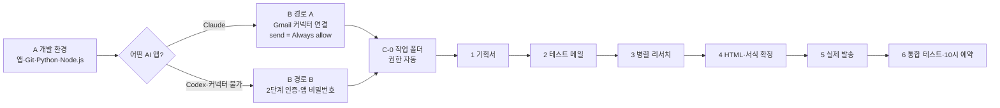

# 뉴스레터 자동 발송 에이전트 — 구현 절차 II

> [!summary] 결론
> **빈 폴더 하나 → 기획서 → 병렬 리서치 → HTML 뉴스레터 → Gmail 발송 → 매일 10시 예약.**
> 사용자는 코드를 한 줄도 쓰지 않는다. 단계마다 프롬프트 하나를 붙여넣고 결과를 확인·승인만 한다.
> Gmail 발송은 두 경로 중 하나를 고른다 — **경로 A: Gmail 커넥터(Claude 앱, 가장 쉬움)** / **경로 B: SMTP(Codex 공통, 영상 방식)**.

> [!warning] I판 정정
> I판(영상 설명 기준)의 "MCP 커넥터는 초안만 작성, 실제 발송 불가"는 **현재 틀린 설명**이다.
> Claude의 Gmail 커넥터는 2026년 8월부터 발송·답장·전달을 지원하고, 쓰기 도구를 'Always allow'로 두면 승인 없이 보낸다.
> 예약 메뉴 이름도 'Scheduled(예약 작업)'로 바뀌었다(이전 이름: 루틴).

## 0. 전체 흐름



| 구분 | 내용 |
|---|---|
| 도구 | Claude 데스크톱 앱(Claude Code) 또는 ChatGPT 데스크톱 앱(Codex) |
| 메일 연동 | 경로 A: Gmail 커넥터(MCP) / 경로 B: SMTP + 구글 앱 비밀번호 |
| 산출물 | 매일 10:00 Gmail로 도착하는 HTML 뉴스레터 |
| 실습 자료 | [Padlet](https://padlet.com/hamsterthemerciless/_ai-agent-8nlnki65jxpz6h3j) |
| 함께 쓰는 파일 | `Newsletter_Agent_Prompts_Staged_II.txt` (단계별 프롬프트, 경로 A/B) |

---

## 1. 배경 지식

### 1-1. 채팅 AI와 에이전트의 차이

> [!info] 에이전트가 할 수 있는 4가지
> 1. **긴 작업**: 여러 절차를 이어서 처리, 대용량 자료 검토·생성
> 2. **병렬 처리**: 여러 일을 동시에 나눠 처리 → 업무 시간 단축
> 3. **외부 서비스 제어**: Gmail 등 거의 제한 없이 다룸
> 4. **내 PC 제어**: 파일·프로그램을 직접 실행

### 1-2. 용어 10개

| 용어 | 쉬운 뜻 | 이 실습에서는 |
|---|---|---|
| 에이전트 | 일을 끝까지 해 주는 AI | 뉴스레터를 조사·작성·발송 |
| 프롬프트 | AI에게 보내는 지시문 | 단계별 프롬프트 6개 |
| 작업 폴더 | 에이전트의 작업장 | `뉴스레터 에이전트` 폴더 |
| 서브에이전트 | 일을 나눠 받는 보조 AI | 관점별로 동시에 조사 |
| 스킬 | 작업별 설명서 파일 | 리서치·HTML·발송·예약 |
| 커넥터(MCP) | AI와 외부 서비스를 잇는 연결 | 경로 A의 Gmail 발송 |
| SMTP | 메일을 보내는 표준 방식 | 경로 B의 Gmail 발송 |
| 앱 비밀번호 | 앱 전용 16자리 비밀번호 | 경로 B에서 에이전트에게 주는 권한 |
| `.env` | 비밀값을 적어 두는 파일 | 경로 B에서만 사용 |
| 예약 작업 | 정해진 시각 자동 실행 | 매일 오전 10시 발송 |

### 1-3. Gmail 연동 방식 비교 (2026.10 기준)

| 항목 | 경로 A · Gmail 커넥터 | 경로 B · SMTP (영상 방식) |
|---|---|---|
| 준비 | 구글 로그인으로 연결 | 2단계 인증 + 앱 비밀번호 + `.env` |
| 무인 발송 | 메일 보내기 도구를 'Always allow'로 | 처음부터 승인 없음 |
| 쓸 수 있는 앱 | Claude 앱 | Claude · Codex 공통 |
| 주의 | 쓰기 도구 기본값은 'Needs approval' | 로그인 비밀번호와 혼동 |
| 회사 계정 | 관리자가 막을 수 있음 | 관리자가 막을 수 있음 |

> API 방식은 권한이 가장 넓지만 구글 쪽 세팅이 번거로워 제외한다.

---

## 2. 사전 세팅

### A. 개발 환경 (Padlet A)

| 칸 | 어디 | 입력 | 출력 |
|---|---|---|---|
| A-1 AI 앱 | [claude.com/download](https://claude.com/download) 또는 [Codex 시작하기](https://chatgpt.com/ko-KR/codex/get-started/) | 설치 → 로그인 → Claude Code(Codex) 화면 | 대화창 아래 폴더·권한·모델 버튼 |
| A-2 Git | [git-scm.com/install/windows](https://git-scm.com/install/windows) | 기본값으로 Next | Finish |
| A-2 Python | [python.org/downloads](https://www.python.org/downloads/) | Install Manager 말고 최신 3.15.x | Setup was successful |
| A-2 Node.js | [nodejs.org/ko/download](https://nodejs.org/ko/download) | Windows 설치 프로그램 → Next | Finish |
| A-3 연결 | 에이전트 대화창 | 아래 문장 입력 | 설정 완료 메시지 |

```text
Git, Python, Node.js를 내가 직접 설치했어.
AI 에이전트 환경에서 활용할 수 있도록 세팅해 주세요.
```

### B. Gmail 준비 — 내 경로 하나만

**경로 A (Claude 앱 · Gmail 커넥터)**

1. Claude 앱 › Customize(사용자 지정) › Connectors › Browse connectors › Gmail → 연결 → 구글 로그인 → 권한 허용
2. 같은 화면의 도구 권한 목록에서 **메일 보내기(send) 도구만** `Needs approval` → `Always allow`
   - 초안·삭제·라벨 등 다른 쓰기 도구는 그대로 둔다.
   - 불안하면 처음엔 그대로 두고, 6단계 예약 전에 바꿔도 된다.
3. Claude Code 대화창에서 확인: 「Gmail 커넥터가 보이는지 확인해 주세요」

> [!warning] Always allow는 '내 이름으로 바로 보낸다'는 뜻이다. 받는 사람은 나 하나로 둔다.

**경로 B (SMTP · 앱 비밀번호 — Padlet B)**

1. Google 계정 → 보안 → **2단계 인증** 켜기 (이미 켜져 있으면 생략)
2. [myaccount.google.com/apppasswords](https://myaccount.google.com/apppasswords) → 앱 이름 `뉴스레터 발송 에이전트` → 만들기
3. **16자리 앱 비밀번호**를 메모장에 보관 (채팅창에 붙여넣지 않는다)

### C-0. 작업 폴더

1. 새 폴더 `뉴스레터 에이전트` 생성 → AI 앱 대화창 폴더 아이콘 → 폴더 열기
2. 권한 **자동**, 모델 기본값, 노력 **중간**

| 권한 모드 | 동작 |
|---|---|
| 수동 | 모든 작업마다 허락 요청 |
| 계획 | 작업 전에 계획을 먼저 승인 |
| **자동** | 위험할 때만 질문 |
| 권한 무시 | 끝까지 묻지 않음 |

---

## 3. 구현 6단계 — 단계마다 프롬프트 하나

> [!important] 규칙 3가지
> 1. 여섯 프롬프트를 **같은 대화창**에서 순서대로 넣는다.
> 2. 각 단계의 **완료 기준**을 확인한 뒤에만 다음 프롬프트를 넣는다.
> 3. 실패하면 같은 프롬프트를 다시 넣지 말고 **오류 문장을 통째로 붙여넣는다**.
>
> 대화가 끊겨 새 채팅에서 이어 갈 때는 맨 앞에: 「폴더의 작업기획서.md를 먼저 읽고, ○단계부터 이어서 진행해 주세요.」

| 단계 | 프롬프트가 시키는 일 | 완료 기준 |
|---|---|---|
| 1 기획서 | 목표·조건 전달, 질문 후 기획서 작성 | `작업기획서.md` 생성 |
| 2 메일 연동 | 경로 A: 커넥터 테스트 / 경로 B: 앱 비밀번호 안내·`.env` | 테스트 메일 도착 |
| 3 병렬 리서치 | 관점별 서브에이전트 조사 + 리서치 스킬 | 관점별 md 파일 생성 |
| 4 HTML 작성 | 종합·미리보기·피드백 + HTML 스킬 | 서식 '확정' |
| 5 실제 발송 | 본문으로 발송 + 발송 스킬 | 메일함 서식·링크 정상 |
| 6 완성·예약 | 통합 테스트 + 매일 10시 예약 | 예약 목록에 10:00 |

> [!example]- 단계별 프롬프트 전문 (Padlet C 원문을 단계별로 재구성 — 펼쳐서 복사)
> ```text
> [1단계]
> # 목표
> 매일 아침 사용자의 관심사를 리서치해 HTML 뉴스레터로 만들고 제 Gmail로 보내는 에이전트를 만들려고 합니다.
> - 작업 기획서는 폴더에 md 파일로 작성할 것
>   - 에이전트 구조까지 구체적으로 기획합니다 (폴더 구조·에이전트 정의 파일·Skills 등)
>   - 리서치·HTML 작성·메일 발송·예약 실행은 각각 스킬로 나눌 것
> - 완성한 에이전트가 뉴스레터를 만들 때마다 "{오늘 날짜}_{주제}" 업무 폴더를 새로 만들고, 관점별 리서치 결과와 완성한 HTML 뉴스레터는 그 폴더에 바로 저장하도록 세팅할 것
>
> # 지켜야 할 조건
> - 리서치: 관심사를 관점별로 나눠 관점마다 서브에이전트로 병렬 리서치, 로그인·결제 없는 공개 소스만 사용
> - 작성: 항목마다 출처 링크, 스타일은 HTML 안에 넣고 외부 파일·스크립트 금지
> - 발송 (경로 A): 연결된 Gmail 커넥터로 보내고, HTML은 첨부가 아니라 메일 본문으로
> - 발송 (경로 B): Gmail SMTP, 계정 정보는 루트 폴더 .env에서 읽기, 앱 비밀번호는 코드·기획서에 적지 않기, HTML은 첨부가 아니라 메일 본문으로
>   ※ 발송 줄은 내 경로 하나만 남긴다
>
> # 이번 단계에서 할 일
> - 아직 아무것도 만들지 말고 작업 기획서만 작성해 주세요.
> - 기획서에는 전체 6단계를 담아 주세요:
>   1 기획서 → 2 메일 발송 환경 → 3 병렬 리서치 → 4 HTML 뉴스레터 → 5 실제 발송 → 6 통합 테스트·매일 오전 10시 예약
> - 쓰기 전에 받을 Gmail 주소, 매일 받고 싶은 관심사(주가 추이, 비즈니스 영어 표현, 관심 분야 트렌드 등), 그 안에서 챙겨 볼 관점을 저에게 물어봐 주세요.
> - 다 쓰면 요약해서 보여 주고 제 승인을 기다려 주세요.
>
> [2단계 · 경로 A]
> 기획서대로 2단계를 진행해 주세요.
> - 연결된 Gmail 커넥터로 본문만 있는 테스트 메일을 제 Gmail 주소로 보내 주세요.
> - 커넥터가 보이지 않으면 연결 방법을 차례대로 안내해 주세요.
> - .env 파일이나 앱 비밀번호는 만들지 마세요.
>
> [2단계 · 경로 B]
> 기획서대로 2단계를 진행해 주세요.
> - 2단계 인증 켜기부터 앱 비밀번호 16자리 발급까지 방법을 차례대로 안내해 주세요.
> - 루트 폴더에 아래 형식의 .env 파일을 만들고, 제가 앱 비밀번호만 넣으면 되도록 나머지 값은 채워 주세요.
>   GMAIL_ADDRESS=myname@gmail.com
>   GMAIL_APP_PASSWORD=abcdefghijklmnop
>   SMTP_HOST=smtp.gmail.com
>   SMTP_PORT=587
> - 제가 "저장 완료"라고 하면 본문만 있는 테스트 메일을 SMTP로 보내 주세요.
>
> [3단계]
> 3단계를 진행해 주세요.
> - 기획서의 관점마다 서브에이전트를 하나씩 두고 동시에 조사해 주세요.
> - 결과는 newsletters/{오늘 날짜}_{주제}/ 폴더에 관점별 md 파일로 저장해 주세요.
> - 이 과정을 리서치 스킬로 만들어 다음에도 같은 방식으로 돌게 해 주세요.
> - 끝나면 파일 목록과 관점별 핵심 3줄을 보여 주세요.
>
> [4단계]
> 4단계를 진행해 주세요.
> - 3단계 md 파일을 종합해 HTML 뉴스레터를 만들고 브라우저로 열어 보여 주세요.
> - 같은 회차 폴더에 저장해 주세요.
> - 제 피드백으로 서식을 다듬고, 제가 "확정"이라고 하면 그 서식을 HTML 작성 스킬에 반영해 다음부터 같은 서식으로 만들어 주세요.
>
> [5단계]
> 5단계를 진행해 주세요.
> - 확정한 HTML 뉴스레터를 기획서에 정한 방식(Gmail 커넥터 또는 SMTP)으로, 첨부가 아니라 메일 본문으로 제 Gmail에 보내 주세요.
> - 이 과정을 메일 발송 스킬로 만들어 주세요.
> - 보낸 뒤 메일함에서 확인할 점을 알려 주세요.
>
> [6단계]
> 6단계를 진행해 주세요.
> - 리서치부터 발송까지 하나의 흐름으로 묶어 처음부터 한 번 실행해 주세요.
> - 문제가 없으면 매일 오전 10시에 스스로 실행되도록 루틴/스케줄을 등록하고, 예약 실행도 스킬로 정리해 주세요.
> - 마지막으로 완성된 폴더 구조와 각 파일의 역할을 표로 보여 주세요.
> ```

### 단계별 [어디 · 입력 · 출력 · 피드백]

| 단계 | 어디 | 입력 | 출력 | 피드백 |
|---|---|---|---|---|
| 1 | 대화창(폴더 열림) | 1단계 프롬프트 | 질문 3개 → `작업기획서.md` | 주제 반영만 확인, 고칠 점은 「환율 관점도 넣어 주세요」처럼 |
| 2-A | 대화창 → Gmail | 2단계(경로 A) 프롬프트 | 테스트 메일 도착 | 승인 창이 뜨면 send 도구 Always allow 확인 |
| 2-B | `.env` → Gmail | 2단계(경로 B) 프롬프트 → `GMAIL_APP_PASSWORD=` 뒤 16자리 → Ctrl+S → 「저장 완료」 | 테스트 메일 도착 | 안 오면 스팸함, 그래도 없으면 오류 붙여넣기 |
| 3 | 대화창 → 회차 폴더 | 3단계 프롬프트 | 관점별 md 파일 | 「금리 관점은 빼고 반도체 관점을 넣어 주세요」 |
| 4 | 브라우저 미리보기 | 4단계 프롬프트 | HTML 초안 | 「종목 등락은 표로」 등 → 만족하면 「확정」 |
| 5 | Gmail 받은편지함 | 5단계 프롬프트 | 뉴스레터 메일 | 서식·링크 확인 → 「잘 보여요」 |
| 6 | Code 탭 › Scheduled(예약 작업) · Codex는 스케줄 | 6단계 프롬프트 → 예약 승인 | 메일 1통 추가 + 예약 목록 10:00 | **Run now**로 한 번 실행 → 승인 창이 뜨면 '항상 허용' |

> [!tip] Run now가 핵심
> 예약 작업은 실행 중 승인이 필요하면 그 자리에서 멈춘다. 등록 직후 **Run now**로 한 번 돌려 승인을 '항상 허용'으로 끝내 두면, 다음부터 10시 실행이 멈추지 않는다. 경로 A는 B단계의 Always allow 설정이 같은 역할을 한다.

---

## 4. 완성된 폴더 구조

```text
뉴스레터 에이전트/
├─ CLAUDE.md          # 에이전트 정의서 (Codex는 AGENTS.md)
├─ .env               # 경로 B만 — 메일 계정·앱 비밀번호
├─ 작업기획서.md       # 1단계에서 합의한 설계도
├─ .claude/
│  ├─ agents/         # 관점별 리서치 서브에이전트
│  └─ skills/
│     ├─ research/    # 병렬 리서치
│     ├─ html/        # 뉴스레터 작성 (확정 서식)
│     ├─ send-mail/   # 발송 (커넥터 또는 SMTP)
│     └─ schedule/    # 매일 10시 예약
└─ newsletters/
   └─ {오늘 날짜}_{주제}/   # 관점별 리서치 md + 완성 HTML
```

| 위치 | 역할 | 언제 여나 |
|---|---|---|
| `CLAUDE.md` | 에이전트 정의서 | 동작 방식을 바꿀 때 |
| `.env` | 메일 계정·비밀번호 (경로 B) | 비밀번호를 바꿀 때 |
| `작업기획서.md` | 합의한 설계도 | 주제·관점을 바꿀 때 |
| `.claude/` agents·skills | 단계별 부품 | 서식·절차를 바꿀 때 |
| `newsletters/{날짜_주제}` | 회차별 기록 | 결과·근거를 볼 때 |

> 파일·폴더 이름은 에이전트가 정하므로 조금 다를 수 있다. 직접 고치기보다 「이 파일을 이렇게 바꿔 줘」라고 시킨다.

---

## 5. 재사용 — 한 줄로 다른 뉴스레터

새 채팅 → 같은 폴더 지정 →

```text
데일리 영어 회화를 주제로 뉴스레터 만들어서 나에게 보내 주세요.
```

---

## 6. 막히는 지점

| 증상 | 원인 | 대처 |
|---|---|---|
| 오류 메시지가 뜬다 | 환경 차이 | 오류 문장을 통째로 붙여넣고 설명 |
| 메일 발송 실패 (경로 B) | 로그인 비밀번호 입력 | 16자리 앱 비밀번호로 교체 |
| 테스트 메일이 없다 | 스팸함 분류 | 스팸함 확인 → '스팸 아님' |
| 화면이 영상과 다르다 | 버전·설정 차이 | 폴더에 파일이 쌓이는지 확인 |
| 예약이 멈춰 있다 | 승인 대기 | 실행 기록에서 승인 · 경로 A는 send 도구 Always allow |
| 10시에 안 온다 | PC 절전·앱 꺼짐 | 아래 실행 조건 확인 — 켜지면 놓친 실행이 한 번 몰아서 돈다 |

### 예약 실행 조건

- 데스크톱 예약 작업은 **PC가 켜져 있고 Claude 앱이 실행 중**일 때만 돈다.
- Windows: 작업 관리자(Ctrl+Shift+Esc) › 시작 앱 › Claude(또는 ChatGPT) '사용' / Mac: 시스템 설정 › 일반 › 로그인 항목
- Claude 설정의 **Keep computer awake**를 켜면 절전으로 건너뛰지 않는다.
- PC가 꺼져도 도는 **클라우드 예약 작업**도 있지만, 내 PC 폴더를 못 쓰고 GitHub 저장소가 필요해 이번 범위 밖이다.

---

## 7. 확장 아이디어

- **사내 데이터로 출처 교체**: 사내 클라우드·드라이브 → 데일리 매출 현황, 프로젝트별 진행 현황
- **개인용**: 데일리 외국어 회화, 오늘의 운세 등

---

## 8. 체크리스트

- [ ] A-1 AI 앱 설치·로그인 · A-2 Git·Python·Node.js · A-3 세팅 요청
- [ ] B 경로 A: Gmail 커넥터 연결 + send 도구 Always allow / 경로 B: 2단계 인증 + 앱 비밀번호
- [ ] C-0 폴더 생성·열기 · 권한 자동 · 노력 중간
- [ ] 1~5단계 프롬프트 → 각 완료 기준 확인
- [ ] 6단계 프롬프트 → 예약 목록 10:00 → **Run now**로 한 번 실행·승인 정리
- [ ] 시작 앱에 Claude/ChatGPT 등록 · Keep computer awake

---

## 출처

- [Claude 고객센터 — Use Google Workspace connectors](https://support.claude.com/en/articles/10166901-use-google-workspace-connectors)
- [Engadget — How to let Claude send emails for you (2026.9)](https://www.engadget.com/2249396/how-to-let-claude-send-emails/)
- [iTechPost — Claude's Gmail automation (2026.8.18)](https://www.itechpost.com/articles/237061/20260818/anthropic-claudes-gmail-automation-here-lets-users-send-emails-automatically-without-approval.htm)
- [Claude Code Docs — Desktop scheduled tasks](https://code.claude.com/docs/en/desktop-scheduled-tasks)
- [Claude Code Docs — Cloud scheduled tasks](https://code.claude.com/docs/en/routines)
