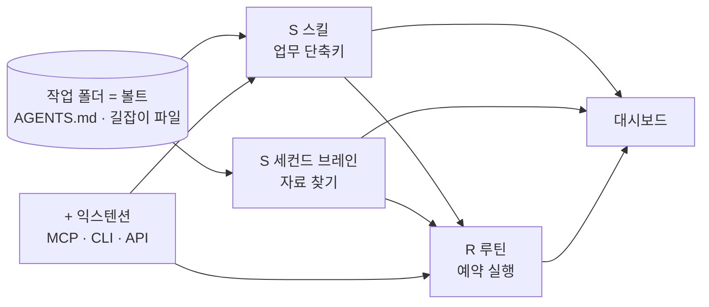
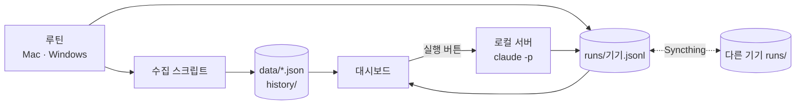

# 나만의 AI 업무 시스템 — SSR+ 4단계 구현 가이드 II

> [!info] II판에서 바뀐 것
> - 대시보드 프롬프트를 **데이터 계약 → 수집 스크립트 → 화면** 세 단계로 나눴다. 화면부터 만들면 숫자가 가짜로 채워지기 때문이다.
> - 루틴은 끝날 때마다 `dashboard/data/runs/<기기이름>.jsonl`에 실행 결과를 남긴다. 그래서 꺼 둔 컴퓨터의 루틴도 대시보드에 보인다.
> - Syncthing 제외 목록에서 `dashboard/data/`를 뺐다. 실행 로그와 수집 데이터가 두 컴퓨터 사이를 오가야 하기 때문이다.
> - 화면은 영상과 똑같을 필요가 없다. 대신 숫자가 살아 있는지, 스킬 버튼이 도는지, 다른 기기의 루틴이 보이는지 세 가지를 점검한다.

> [!summary] 결론
> 1. 대시보드는 **결과물**이다. 먼저 스킬 → 세컨드 브레인 → 루틴 → 익스텐션 순으로 바닥을 깐다.
> 2. 네 단계는 모두 **하나의 작업 폴더(볼트)** 위에서 돌아간다. 이 폴더를 Claude Code 프로젝트이자 옵시디언 볼트로 겸용한다.
> 3. 대시보드는 마지막에 Claude Code에게 "이 폴더를 한 화면에 보여 주는 로컬 웹앱을 만들어라"라고 시켜서 만든다. 별도 도구를 배울 필요가 없다.



---

## 1. 영상 요약

### 1.1 대시보드 화면 구성

| 위치 | 내용 | 뒤에서 받치는 단계 |
|---|---|---|
| 왼쪽 위 | 유튜브·뉴스레터 현황, 이번 달 목표, 캘린더 | 익스텐션(데이터 수집) + 루틴(매일 갱신) |
| 오른쪽 위 | 메일함 요약 | 익스텐션(Gmail 커넥터) |
| 가운데 | 세컨드 브레인 그래프·검색 | 세컨드 브레인(길잡이 파일) |
| 아래 | 스킬 실행 버튼(모델 선택 가능), 예약 루틴 목록 | 스킬 + 루틴 |
| 기타 | 이미지·영상 라이브러리, 마크다운 뷰어 | 직접 만든 익스텐션 |

### 1.2 SSR+ 단계별 수준

| 단계 | 초급 | 중급 | 고급 |
|---|---|---|---|
| **S 스킬** | 기본 스킬(skill-creator)로 말만 해서 스킬 생성 | 스킬 폴더에 참고 자료(style.md, 로고, HTML·코드 조각)를 넣는다 | 스킬이 낡지 않게 **스킬을 고치는 스킬**을 둔다 |
| **S 세컨드 브레인** | 폴더 하나 + `AGENTS.md`/`CLAUDE.md`에 지침 기록 | 주제별 **길잡이 파일**(파일 링크 모음, 위키 페이지 같은 것)과 그 대문 역할의 `AGENTS.md` | 나에게 맞는 **탐색기**(그래프 뷰·계층 뷰·미리 보기)를 직접 만든다 |
| **R 루틴** | Claude 데스크톱 앱의 예약 작업 | 상시 켜진 컴퓨터(남는 PC 또는 클라우드 서버)에 Hermes 같은 상주 에이전트 + Syncthing 동기화 | 처음부터 클라우드에 Claude Code와 자료를 모두 둔다(아직 완성 단계 아님) |
| **+ 익스텐션** | 데스크톱 앱의 기본 커넥터(Gmail, Google Drive 등) | MCP → CLI → API 순으로 찾아 연결. 커넥터 찾기도 스킬로 만든다 | 없으면 직접 만든다(마크다운 뷰어, 콘텐츠 라이브러리 등) |

> [!note] 원칙
> 같은 작업을 **두 번 이상** 시켰다면 스킬로 만든다. 스킬이 "단축키"라면 루틴은 "오전 9시에 그 단축키를 눌러라"이다.

### 1.3 자막 오기 정정

| 자막 | 실제 |
|---|---|
| LMS를 선호합니다 | Hermes(헤르메스) Agent — 뒤 문장에서 헤르메스로 정정됨 |
| 싱크싱 | Syncthing(파일 동기화 프로그램) |
| 나무키 페이지 | 나무위키 같은 주제별 안내 페이지 |
| MCP, 클릭, API | MCP, **CLI**, API |
| 오픈 클로나 그록봇 | OpenClaw 계열 등 상주형 에이전트 |

---

## 2. 구현 설계 — 무엇을 어디에 두는가

### 2.1 폴더 구조 (3창고 Knowledge OS와 겸용)

기존 [[obsidian-second-brain|3창고 Knowledge OS]]를 그대로 바닥으로 쓴다. 새로 추가하는 것은 `_index/`(길잡이 파일), `.claude/skills/`, `dashboard/` 세 곳뿐이다.

```text
ai-os/                      ← 옵시디언 볼트 = Claude Code 프로젝트
├── AGENTS.md               ← 대문. 항상 읽힘 (CLAUDE.md는 @AGENTS.md 한 줄)
├── CLAUDE.md
├── _index/                 ← 길잡이 파일 (주제별 링크 모음)
│   ├── content.md          ← 강의·덱·영상
│   ├── research.md         ← 논문·연구
│   ├── business.md         ← 제안서·견적·고객
│   └── dev.md              ← 코드·MVP
├── 01_PROJECTS/            ← 실행
├── 02_OPERATIONS/          ← 운영 (루틴 산출물 포함)
│   └── briefings/          ← 모닝 브리핑이 매일 쌓이는 곳
├── 03_PKM/                 ← 발견 (원문·노트)
├── .claude/skills/         ← 개인 스킬 (볼트와 함께 동기화)
└── dashboard/              ← 로컬 웹앱 (5단계에서 생성)
    └── data/               ← 수집 스크립트와 루틴이 갱신하는 JSON
        ├── history/        ← 채널 지표 일별 스냅샷 (전일 대비 계산용)
        └── runs/           ← 기기별 루틴 실행 로그 (mac.jsonl, windows.jsonl)
```

### 2.2 데이터 흐름

- **수집 스크립트**가 메일, 캘린더, 채널 지표를 읽어 `dashboard/data/*.json`에 쓰고, 채널 값은 `history/`에 날마다 스냅샷으로 남긴다.
- **루틴**은 수집 스크립트와 브리핑을 실행하고, 끝날 때마다 `runs/<기기이름>.jsonl`에 결과를 한 줄 남긴다.
- **대시보드**는 그 JSON과 `_index/`, 스킬 폴더를 읽어 보여 주기만 한다.
- **스킬 실행 버튼**은 로컬 서버가 `claude -p` (Codex 스킬이면 `codex exec`)로 스킬을 호출하고, 결과를 `runs/`에 기록한다.



이렇게 나누면 대시보드가 죽어도 시스템은 그대로 돈다.

---

## 3. 단계별 구현 — 프롬프트 중심

각 단계는 **[어디서] → [입력] → [출력] → [피드백]** 순서다.

### STEP 0. 작업 폴더 만들기 (10분)

> [!example] 볼트 초기화
> **[어디서]** 터미널에서 `ai-os` 폴더로 이동한 뒤 `claude` 실행
> **[입력]**
> ```text
> 이 폴더를 내 AI 업무 시스템의 루트로 만든다.
> 2.1의 폴더 구조를 그대로 만들고, git 저장소로 초기화해라.
> CLAUDE.md는 "@AGENTS.md" 한 줄만 둔다.
> AGENTS.md는 아직 비워 두고 다음 단계에서 같이 쓴다.
> ```
> **[출력]** 폴더 트리, 첫 커밋
> **[피드백]** 옵시디언에서 "폴더를 볼트로 열기"로 열어 보이는지 확인

### STEP 1. 스킬 (S) — 반복 업무를 단축키로

**초급: 말로 만들기**

> [!example] 첫 스킬 3개 만들기
> **[어디서]** Claude Code (같은 폴더)
> **[입력]**
> ```text
> skill-creator 스킬을 써서 내가 지난 한 달 동안 두 번 이상 반복한 업무를 스킬로 만들고 싶다.
> 먼저 나에게 질문 5개만 해서 후보를 뽑고, 상위 3개를 .claude/skills/ 아래에 만들어라.
> 각 스킬의 description은 "언제 쓰는지"가 한 문장으로 드러나게 써라.
> ```
> **[출력]** `.claude/skills/<이름>/SKILL.md` 3개
> **[피드백]** 새 세션에서 스킬 이름을 부르지 않고 업무만 말했을 때 스킬이 발동되는지 확인

**중급: 참고 자료를 스킬 안에 넣기**

```text
.claude/skills/quote-hwp/
├── SKILL.md          ← "references/를 먼저 읽어라"라고 적는다
├── references/
│   ├── business-info.md   ← 사업자 정보·단가표
│   └── style.md           ← 문체·양식 규칙
└── assets/
    └── template.hwpx      ← 견적서 양식 원본
```

> [!tip] 코드 조각을 통째로 넣는다
> HTML 템플릿이나 빌드 스크립트를 `assets/`에 넣어 두면 AI가 매번 처음부터 짜지 않아 빠르고 결과가 일정하다. 이미 쓰고 있는 덱 스킬들(zeroone-pitch-deck, report-navy-deck)이 이 구조다.

**고급: 스킬을 고치는 스킬**

> [!example] 방식 A — 스킬마다 업데이트 기능 추가
> **[입력]**
> ```text
> .claude/skills/의 모든 SKILL.md 끝에 "업데이트 절차" 절을 추가해라.
> 내용: 사용자가 결과를 고치면 그 차이를 references/changelog.md에 기록하고,
> 같은 수정이 두 번 나오면 SKILL.md 규칙 자체를 고치자고 제안한다.
> ```

> [!example] 방식 B — 전체 스킬 점검 스킬 만들기
> **[입력]**
> ```text
> skill-reviewer라는 스킬을 만들어라.
> 역할: 최근 대화 기록에서 스킬이 발동된 대화를 읽고, 사용자가 반복해서 고친 부분,
> 발동돼야 했는데 안 된 경우, 낡은 양식을 찾아 스킬별 개선안을 표로 낸다.
> 고치기 전에 반드시 나에게 확인받는다.
> ```
> **[피드백]** 개선안 표 → 승인한 것만 반영 → git 커밋으로 이전 버전 보관

### STEP 2. 세컨드 브레인 (S) — AI가 알아서 찾게

**초급: AGENTS.md 작성**

> [!example] AGENTS.md 만들기
> **[입력]**
> ```text
> 나와 인터뷰하듯 질문해서 AGENTS.md를 작성해라. 항목은 다음과 같다.
> 1) 나는 누구이고 어떤 일을 하는가
> 2) 항상 지킬 규칙 (언어, 파일명은 영어, 용어 표기 원칙, 산출 형식)
> 3) 업무 영역별로 먼저 볼 길잡이 파일 (_index/*.md)
> 4) 하지 말 것
> 200줄을 넘기지 말고, 자세한 내용은 길잡이 파일로 넘겨라.
> ```

**중급: 길잡이 파일 만들기**

길잡이 파일은 "폴더 정리" 대신 "링크 정리"다. 파일은 어디에 있어도 되고, 길잡이만 정확하면 된다.

```markdown
# content — 강의·덱·영상 길잡이

## 진행 중
- [[01_PROJECTS/baf60080/README|연기금 운용전략]] — 주차별 덱
- [[01_PROJECTS/aicc/README|AICC 구현 실습]]

## 자주 찾는 원본
- 촬영 원본: `D:/video/raw/` (최신이 위)
- 덱 스킬 규칙: [[.claude/skills/zeroone-pitch-deck/SKILL]]

## 하위 길잡이
- [[_index/content-video]] · [[_index/content-decks]]
```

> [!example] 길잡이 파일 자동 생성
> **[입력]**
> ```text
> 볼트 전체를 훑어 _index/ 아래에 주제별 길잡이 파일을 만들어라.
> 각 파일은 "진행 중 / 자주 찾는 원본 / 하위 길잡이" 세 절로 쓰고 위키링크를 쓴다.
> AGENTS.md의 "업무 영역별 길잡이" 절도 이에 맞춰 고쳐라.
> 길잡이에 없는 고아 파일 목록은 _index/orphans.md로 따로 낸다.
> ```
> **[피드백]** "지난번 촬영 원본 찾아 줘"처럼 모호하게 물어서 바로 찾는지 시험

**고급: 나만의 탐색기**

> [!example] 탐색기 웹앱
> **[입력]**
> ```text
> dashboard/explorer/에 로컬 웹앱을 만들어라.
> - AGENTS.md를 중심 노드로 _index/와 위키링크 연결을 그래프로 그린다
> - 계층 뷰로 전환할 수 있다
> - 파일을 누르면 오른쪽에 마크다운 미리 보기
> - 상단 검색창은 파일명과 본문을 모두 찾는다
> 단일 명령(npm run explorer)으로 뜨게 해라.
> ```

> [!note] 옵시디언을 이미 쓰고 있다면
> 그래프 뷰·검색은 옵시디언이 이미 한다. 고급 탐색기는 대시보드 가운데 패널에 들어갈 때만 만든다.

### STEP 3. 루틴 (R) — 정해진 시간에 자동 실행

**초급: 데스크톱 앱 예약 작업**

> [!example] 모닝 브리핑
> **[어디서]** Claude 데스크톱 앱 → Code 탭 → 예약 작업 → 새 작업
> **[입력]** (매일 08:50)
> ```text
> Gmail, Google Calendar, 볼트의 01_PROJECTS를 읽고 오늘 브리핑을 만들어라.
> 1) 오늘 일정  2) 답장이 필요한 메일 상위 5개  3) 마감이 임박한 프로젝트
> 결과를 02_OPERATIONS/briefings/YYYY-MM-DD.md에 쓴다.
> 끝나면 dashboard/data/runs/<기기이름>.jsonl에
> {"routine":"morning-briefing","device":"mac","at":"<시각>","result":"완료"} 한 줄을 남긴다.
> ```
> **[출력]** 매일 아침 브리핑 md + JSON
> **[피드백]** 일주일 돌려 보고 빠진 항목을 프롬프트에 추가

> [!warning] 한계
> 데스크톱 예약 작업은 컴퓨터와 앱이 켜져 있을 때만 돈다. 영상에서 루틴이 하나만 보인 이유가 이것이다.

**중급: 상시 켜진 실행기 + 동기화**

| 선택지 | 장점 | 단점 |
|---|---|---|
| 남는 PC + Hermes Agent | 비용 없음, 자료가 집에 있음 | 정전·재부팅 관리 필요 |
| 클라우드 VPS + Hermes Agent | 24시간 안정 | 월 비용, 자료가 외부 서버에 있음 |
| Claude 클라우드 예약 작업 | 설치 없음 | 로컬 파일 접근 불가 → 볼트를 git 저장소로 올려야 함 |

동기화는 Syncthing으로 `ai-os/` 폴더 하나만 묶는다. `.claude/skills/`도 볼트 안에 있으므로 스킬이 같이 넘어간다. Hermes 설치·운용은 [[hermes-agent-field-manual]], [[hermes-agent-recipes]] 참고.

> [!example] 동기화 설정을 AI에게 시키기
> **[어디서]** 메인 PC의 Claude Code → 이어서 상시 PC의 Hermes
> **[입력]**
> ```text
> Syncthing을 설치하고 ai-os 폴더를 "보내기·받기" 공유로 설정해라.
> .git/, node_modules/, .env는 .stignore로 제외한다.
> dashboard/data/는 제외하지 않는다 (실행 로그가 오가야 한다).
> 상시 PC 쪽에서 받을 기기 ID를 나에게 알려 주고, 연결 확인 방법을 안내해라.
> ```
> **[피드백]** 메인 PC에서 메모 하나를 만들고 1분 안에 상시 PC에 생기는지 확인

**고급: 전부 클라우드로**

자료를 git 원격 저장소에 두고 실행도 클라우드에서 한다. 영상 시점 기준으로 아직 완성형이 아니므로, 지금은 중급으로 운영하면서 루틴 하나(모닝 브리핑)만 클라우드로 옮겨 시험해 보는 정도가 현실적이다.

### STEP 4. 익스텐션 (+) — 외부 도구 연결

**초급: 기본 커넥터**

Claude 앱 설정 → 커넥터에서 Gmail, Google Calendar, Google Drive, Slack을 연결한다. 연결 후 "오늘 받은 메일 중 답장이 필요한 것"처럼 바로 시킬 수 있다.

**중급: MCP → CLI → API 순으로 찾기**

| 종류 | 연결 난이도 | 예 |
|---|---|---|
| MCP | 낮음 | 공공데이터·건축물대장 MCP |
| CLI | 중간 | `gh`, `yt-dlp`, 사내 도구 CLI |
| API | 높음 | 유튜브 Data API, 뉴스레터 플랫폼 API |

> [!example] 커넥터 찾기 스킬
> **[입력]**
> ```text
> connector-finder 스킬을 만들어라.
> 사용자가 "X를 연결하고 싶다"고 하면
> 1) X용 MCP 서버를 검색하고 README를 읽어 설치 절차를 요약한다
> 2) 없으면 CLI, 그다음 API를 찾는다
> 3) 각 후보의 인증 방식, 비용, 신뢰도(공식 여부·최근 업데이트)를 표로 낸다
> 4) 내가 고르면 설치하고 연결 시험까지 한다. 키 입력은 내가 직접 한다.
> ```

**고급: 직접 만들기**

> [!example] 아이디어가 없을 때
> **[입력]**
> ```text
> 내 볼트와 최근 한 달 작업 기록을 보고, 내가 반복적으로 불편해한 지점을 찾아
> 직접 만들면 좋을 익스텐션 후보 5개를 제안해라.
> 각 후보마다 만드는 데 걸릴 시간과 필요한 준비물을 적어라.
> ```

후보 예: 마크다운 다중 창 뷰어, 덱·그림 라이브러리(PPTX 썸네일 갤러리), 강의 영상 원본 라이브러리.

### STEP 5. 대시보드 — 전체를 한 화면에

화면은 영상과 똑같을 필요가 없다. 순서만 지킨다. **데이터 계약을 먼저 정하고, 수집 스크립트로 채우고, 화면은 마지막에 씌운다.**

> [!example] 5-1 · 데이터 계약
> **[어디서]** Claude Code (볼트 루트)
> **[입력]**
> ```text
> dashboard/data/에 다음 JSON 스키마와 예시를 만들어라.
> - channels.json: 채널별 현재값, 전일값, 수집 시각, 갱신 기한(24시간)
> - goals.json: 기간, D-day, 항목별 진행률
> - calendar.json: 월간 일정과 주차별 일정 수
> - mail.json: 최근 20건(보낸 사람, 제목, 날짜, 읽음 여부)과 확인 시각
> - skills.json: .claude/skills와 Codex 스킬 폴더를 스캔한 목록
>   (에이전트, 이름, 설명, 상태, 최근 실행 시각)
> - routines.json: 루틴마다 기기(mac/windows), 일정
> - brain.json: AGENTS.md와 _index 영역별 파일 수와 파일 목록
> 루틴은 끝날 때마다 dashboard/data/runs/<기기이름>.jsonl에 실행 결과를 한 줄 남긴다.
> 이 폴더는 Syncthing으로 두 컴퓨터가 공유한다.
> 스키마는 dashboard/data/SCHEMA.md에 표로 정리해라.
> ```
> **[출력]** JSON 예시 파일들과 `SCHEMA.md`
> **[피드백]** 스키마 표를 읽고 빠진 칸이 있으면 이 단계에서 고친다. 화면을 만든 뒤 고치면 세 곳을 다시 손봐야 한다.

> [!example] 5-2 · 수집 스크립트
> **[입력]**
> ```text
> 유튜브는 YouTube Data API, 메일과 캘린더는 연결된 커넥터로
> 5-1의 JSON을 채우는 수집 스크립트를 dashboard/collect/에 만들어라.
> 채널 값은 날마다 data/history/에 스냅샷으로 남기고 전일 대비를 계산한다.
> skills.json과 brain.json은 폴더를 스캔해 다시 만든다.
> 수집 스크립트는 모닝 루틴에 묶고, 끝나면 runs/에 결과를 한 줄 남긴다.
> API 키는 .env에서만 읽는다.
> ```
> **[출력]** 수집 스크립트, 실제 값으로 채워진 JSON
> **[피드백]** JSON의 수집 시각이 방금 시각으로 바뀌었는지 확인

> [!example] 5-3 · 화면
> **[입력]**
> ```text
> dashboard/에 로컬 웹앱을 만들어라. data/의 JSON과 runs/만 읽는다.
> 3열로 배치한다. 테마는 자유롭게 하되 포인트 색은 하나만 쓴다.
> - 왼쪽: 채널 카드(현재값, 전일 대비, 수집 시각. 기한을 넘기면 '갱신 필요' 표시),
>   목표와 D-day, 월간 캘린더와 선택한 날짜의 일정, 최근 파일, 다른 대시보드 링크
> - 가운데: 세컨드 브레인. 영역별 파일 수와 탐색기(검색, 미리 보기)
> - 오른쪽: 메일(안 읽은 수, 최근 20건, 확인 시각),
>   스킬(검색, 에이전트 표시, 상태, 실행 버튼),
>   루틴(runs/의 모든 기기 로그를 모아 기기 이름, 일정, 최근 결과)
> 실행 버튼은 로컬 서버가 claude -p (Codex 스킬은 codex exec)로 호출하고
> 결과를 runs/<기기이름>.jsonl에 남긴다.
> 실행은 localhost에서만 받고 외부 접속은 막아라.
> npm run dashboard 하나로 뜨게 해라.
> ```
> **[출력]** `http://localhost:<포트>` 대시보드

> [!check] 화면 점검 — 디자인보다 이 세 가지
> 1. **숫자가 살아 있는가.** 루틴이 돈 뒤 채널과 메일 값이 바뀌고 수집 시각이 보인다.
> 2. **스킬 버튼이 실제로 도는가.** 누르면 볼트에 산출 파일이 생기고 카드에 완료가 표시된다.
> 3. **꺼 둔 컴퓨터의 루틴도 보이는가.** 상시 PC에서 돈 루틴 결과가 메인 PC 대시보드에 나타난다.

---

## 4. 4주 실행 일정

| 주 | 할 일 | 완료 기준 |
|---|---|---|
| 1주 | STEP 0~1: 볼트 정비, 스킬 3개, 참고 자료 넣기 | 반복 업무 3개를 스킬 이름 없이 시켜도 발동 |
| 2주 | STEP 2: AGENTS.md, `_index/` 길잡이, 고아 파일 정리 | 모호한 요청으로 원하는 파일을 바로 찾음 |
| 3주 | STEP 3~4: 모닝 브리핑, Gmail·캘린더 연결, Syncthing + Hermes | 컴퓨터를 꺼 둔 날에도 브리핑이 생성됨 |
| 4주 | STEP 5 (데이터 계약 → 수집 → 화면) + skill-reviewer | 화면 점검 세 가지 통과, 주 1회 스킬 개선안 수령 |

## 5. 점검 체크리스트

- [ ] `CLAUDE.md`가 `@AGENTS.md`를 불러온다
- [ ] `AGENTS.md`가 200줄 이하이고 길잡이 파일로 연결된다
- [ ] 스킬마다 description이 "언제 쓰는지" 한 문장이다
- [ ] 스킬 수정 이력이 git에 남는다
- [ ] 루틴 산출물이 `02_OPERATIONS/briefings/`에 매일 쌓인다
- [ ] Syncthing 제외 목록에 `.git/`, `node_modules/`, `.env`가 있고 `dashboard/data/`는 없다
- [ ] 모든 루틴이 끝날 때 `runs/<기기이름>.jsonl`에 한 줄을 남긴다
- [ ] `channels.json`의 수집 시각이 24시간 안이다
- [ ] API 키는 `.env`에만 있고 볼트 동기화·git에서 제외돼 있다
- [ ] 대시보드 실행 서버는 localhost만 받는다

## 관련 노트
- [[obsidian-second-brain]] — 3창고 Knowledge OS
- [[hermes-agent-field-manual]] · [[hermes-agent-recipes]] — 상시 실행기
