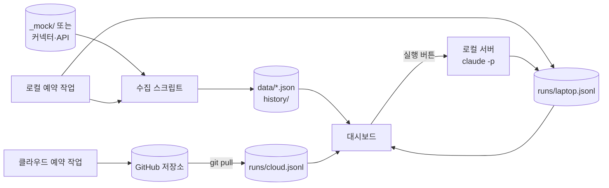

# 나만의 AI 업무 시스템 — SSR+ 설계 가이드 III

> [!summary] 결론
> 1. 대시보드는 **결과물**이다. 스킬 → 세컨드 브레인 → 루틴 → 익스텐션 순으로 바닥을 깔고, 화면은 마지막에 씌운다.
> 2. 네 단계는 모두 **ai-os 볼트**라는 작업 폴더 하나 위에서 돈다.
> 3. **노트북 한 대로 일하면 Hermes와 Syncthing은 필요 없다.** 루틴은 로컬 예약 작업으로 돌리고, 노트북을 닫아도 돌아야 하는 일만 클라우드 예약 작업으로 보낸다.
> 4. 모든 작업은 **Claude 데스크톱 앱의 Code 탭**에서 프롬프트로 시킨다. 사람은 붙여 넣고 확인한다.

> [!info] 문서 두 개의 역할
> - **이 문서** — 영상 요약, 시스템 설계, 실습이 끝난 뒤 **내 업무로 옮기는 법**
> - **[[ssr-plus-lab-guide|실습 가이드]]** — 실습 키트(가상 회사 '모아랩')로 Lab 0~6을 따라 하는 프롬프트 전문
>
> II판과 달라진 점: 상시 PC·Hermes·Syncthing 구성을 노트북 한 대 구성으로 바꿨다. 실행 로그는 `mac/windows` 대신 `laptop/cloud`로 나눈다. 단계별 프롬프트는 실습 가이드로 옮겼다.

---

## 1. 용어 — ai-os 볼트란 무엇인가

**볼트(vault)** 는 옵시디언에서 쓰는 말로, 노트와 자료를 담아 두는 **폴더 하나**를 가리킨다. 옵시디언은 이 폴더를 열어 노트 사이의 링크와 그래프를 보여 준다.

**ai-os** 는 이 강의에서 그 폴더에 붙인 이름이다. "AI 업무 시스템(AI operating system)"이라는 뜻이다. 이 폴더 하나가 세 가지 역할을 동시에 한다.

| 역할 | 무엇으로 쓰이나 |
|---|---|
| 옵시디언 볼트 | 사람이 노트를 읽고 링크를 따라가는 곳 |
| Claude Code 프로젝트 폴더 | Code 탭에서 이 폴더를 열면 AGENTS.md와 스킬을 읽고 일한다 |
| 자동화의 바닥 | 루틴의 결과, 대시보드 데이터, 실행 로그가 모두 여기에 쌓인다 |

옵시디언이 없어도 된다. 옵시디언은 폴더를 보기 좋게 보여 주는 도구일 뿐이고, 시스템은 폴더와 Claude Code만으로 돈다.

> [!note] 실습 키트의 ai-os
> `SSR_Plus_수강생배포.zip`을 풀면 `SSR_Plus_수강생배포/ai-os/` 폴더가 나온다. 가상 회사 모아랩의 볼트로, 가람물류 교육 프로젝트와 회의록, 단가표, 지난 견적서, 정리 안 된 메모, 가상 메일·캘린더·채널 데이터가 들어 있다. 실습이 끝나면 이 구조를 그대로 복사해 내 볼트로 쓴다.

---

## 2. 영상 요약

### 2.1 대시보드 화면 구성

| 위치 | 내용 | 뒤에서 받치는 단계 |
|---|---|---|
| 왼쪽 위 | 유튜브·뉴스레터 현황, 이번 달 목표, 캘린더 | 익스텐션(데이터 수집) + 루틴(매일 갱신) |
| 오른쪽 위 | 메일함 요약 | 익스텐션(Gmail 커넥터) |
| 가운데 | 세컨드 브레인 그래프·검색 | 세컨드 브레인(길잡이 파일) |
| 아래 | 스킬 실행 버튼(모델 선택 가능), 예약 루틴 목록 | 스킬 + 루틴 |
| 기타 | 이미지·영상 라이브러리, 마크다운 뷰어 | 직접 만든 익스텐션 |

화면 모양은 영상과 같을 필요가 없다. 숫자가 살아 있는지, 스킬 버튼이 실제로 도는지, 다른 곳에서 돈 루틴도 보이는지만 지키면 된다.

### 2.2 SSR+ 단계별 수준 (노트북 한 대 기준)

| 단계 | 초급 | 중급 | 고급 |
|---|---|---|---|
| **S 스킬** | 스킬 크리에이터에게 말해서 만든다 | 스킬 폴더에 참고 자료(양식 규칙, 단가표, 코드 조각)를 넣는다 | 스킬을 고치는 장치를 둔다 |
| **S 세컨드 브레인** | AGENTS.md에 지침을 적는다 | 주제별 길잡이 파일(`_index/`)을 만든다 | 나만의 탐색기를 만든다 |
| **R 루틴** | 로컬 예약 작업 | 클라우드 예약 작업을 더한다 (GitHub 저장소 경유) | 두 번째 컴퓨터가 생기면 Hermes를 둔다 |
| **+ 익스텐션** | 기본 커넥터를 클릭해 연결한다 | MCP → CLI → API 순으로 찾는다. 찾기 자체를 스킬로 만든다 | 없으면 직접 만든다 |

> [!note] 원칙
> 같은 작업을 **두 번 이상** 시켰다면 스킬로 만든다. 스킬이 "단축키"라면 루틴은 "오전 9시에 그 단축키를 눌러라"이다.

### 2.3 자막 오기 정정

| 자막 | 실제 |
|---|---|
| LMS를 선호합니다 | Hermes(헤르메스) Agent — 뒤 문장에서 헤르메스로 정정됨 |
| 싱크싱 | Syncthing(파일 동기화 프로그램) |
| 나무키 페이지 | 나무위키 같은 주제별 안내 페이지 |
| MCP, 클릭, API | MCP, **CLI**, API |

---

## 3. 노트북 한 대 구성

영상의 화자는 메인 컴퓨터와 집의 상시 컴퓨터 두 대를 쓴다. 노트북 한 대로 일하면 맞출 두 번째 컴퓨터가 없으므로 구성이 단순해진다.

| 영상의 구성 | 노트북 한 대 구성 |
|---|---|
| 상시 PC + Hermes | 로컬 예약 작업 (데스크톱 앱) |
| Syncthing | 필요 없음 |
| 꺼져도 도는 루틴 | 클라우드 예약 작업 (선택, Pro 이상) |
| 실행 로그 mac / windows | `runs/laptop.jsonl`, `runs/cloud.jsonl` |

| | 로컬 예약 작업 | 클라우드 예약 작업 |
|---|---|---|
| 실행 위치 | 내 노트북 | Anthropic 클라우드 |
| 노트북이 잠들면 | 그 시각을 건너뛰고, 깨어나면 가장 최근에 놓친 한 번만 실행한다 (7일 이내) | 상관없이 돈다 |
| 볼트 파일 | 바로 읽고 쓴다 | 못 읽는다. GitHub 저장소를 매번 새로 받는다 |
| 만드는 곳 | Code 탭 → 예약(Scheduled) → 새 작업 → Local, 또는 세션에서 말로 | Code 탭 → 예약 → 새 작업 → Cloud, 또는 claude.ai/code/routines |
| 결과를 올리는 곳 | 볼트에 바로 | 저장소에 커밋 (기본은 `claude/` 브랜치 → main을 명시) |

> [!tip] 노트북 사용자를 위한 두 가지
> - 앱 설정의 **Keep computer awake**는 유휴 잠자기를 막는다. 덮개를 닫으면 여전히 잠든다.
> - 오전 브리핑이 밤에 돌 수 있으므로, 프롬프트에 "낮 12시 이후에 돌면 제목에 '[놓친 브리핑]'을 붙여라" 같은 안전장치를 넣는다.

Hermes가 필요해지는 때는 세 가지다. 항상 켜 둘 두 번째 컴퓨터가 생겼을 때, 메신저로 밖에서 일을 시키고 싶을 때, Claude 외의 모델로 루틴을 돌리고 싶을 때다. 그때는 [[hermes-agent-field-manual]]을 따른다.

---

## 4. 시스템 설계

### 4.1 폴더 구조

실습 키트의 `ai-os/`와 같은 구조다. 처음 받았을 때는 아래의 `AGENTS.md`, `_index/`, `.claude/skills/`, `dashboard/`가 없고, 실습에서 Claude Code가 만든다.

```text
ai-os/                          ← 볼트 = Code 탭에서 여는 폴더
├── AGENTS.md                   ← 대문. 세션마다 읽힌다 (Lab 2)
├── CLAUDE.md                   ← "@AGENTS.md" 한 줄
├── _index/                     ← 길잡이 파일 (Lab 2)
│   ├── content.md  business.md  research.md  ops.md
│   └── orphans.md              ← 어디에도 연결 안 된 파일
├── 01_PROJECTS/                ← 진행 중인 일
├── 02_OPERATIONS/              ← 사업자 정보, 단가표, 견적서, 회의록, 목표, 브리핑
├── 03_PKM/                     ← 공부 노트, 아이디어
├── inbox/                      ← 정리 안 된 메모
├── media/raw/                  ← 촬영 원본
├── _mock/                      ← 실습용 가상 외부 데이터 (실제 업무에서는 지운다)
├── .claude/skills/             ← 개인 스킬 (Lab 1, 4)
└── dashboard/                  ← 대시보드 (Lab 5)
    ├── collect/                ← 수집 스크립트
    └── data/
        ├── *.json              ← 화면이 읽는 데이터
        ├── history/            ← 채널 지표 일별 스냅샷
        └── runs/               ← laptop.jsonl, cloud.jsonl
```

### 4.2 데이터 흐름



- **수집 스크립트**는 `MOCK=1`이면 `_mock/`을, `MOCK=0`이면 커넥터와 API를 읽어 `data/*.json`을 채운다.
- **대시보드**는 JSON과 `runs/`를 읽어 보여 주기만 한다.
- **실행 버튼과 예약 작업**은 끝날 때마다 `runs/`에 한 줄을 남긴다.
- **클라우드 작업**의 결과는 저장소를 거쳐 노트북의 `git pull`로 들어온다.

### 4.3 대시보드 만드는 순서

화면부터 만들면 숫자가 가짜로 채워진다. 순서는 **데이터 계약 → 수집 스크립트 → 화면**이다. 각 단계의 프롬프트는 실습 가이드 Lab 5에 있다.

---

## 5. 실습 — 실습 가이드로 따라 한다

| Lab | 내용 | 모아랩 실습 과제 | 완료 기준 |
|---|---|---|---|
| 0 | 환경 준비 | 키트 풀기, 도구 설치, 저장소 만들기 | 가상 데이터 마지막 날짜가 오늘 |
| 1 | 스킬 | 가람물류 킥오프 회의록으로 견적서 스킬 | 합계 3,000,000원(부가세 별도) |
| 2 | 세컨드 브레인 | AGENTS.md, 길잡이, 고아 파일 | "ep42 A캠 최종 원본"을 바로 찾는다 |
| 3 | 루틴 | 모닝 브리핑, 주간 정리 | 놓친 날이 '[놓친 브리핑]'으로 표시된다 |
| 4 | 익스텐션 | 가상 데이터 규칙, 커넥터 찾기 스킬 | 후보 비교표와 사람이 할 단계가 나온다 |
| 5 | 대시보드 | 데이터 계약, 수집, 화면 | 화면 점검 세 가지 통과 |
| 6 | 클라우드 (선택) | 비공개 저장소, 주간 리뷰 | cloud 실행이 루틴 칸에 보인다 |

---

## 6. 실습 뒤 내 업무로 옮기기

> [!example] 6-1 · 내 볼트 만들기
> **[어디서]** Code 탭 → 폴더 `ai-os`
> **[입력]**
> ```text
> 이 실습 볼트를 바탕으로 내 업무 볼트를 만들려고 한다.
> 1) 문서 폴더 아래 my-ai-os를 만들고 폴더 구조, .claude/skills/, dashboard/를 복사해라.
>    01_PROJECTS, 02_OPERATIONS, 03_PKM, inbox, media, _mock의 모아랩 자료는 복사하지 않는다.
> 2) AGENTS.md는 모아랩 내용을 지우고, 나와 인터뷰하듯 질문해서 새로 써라.
> 3) 내가 알려 주는 기존 업무 폴더들을 읽어 _index/ 길잡이를 만들어라. 파일은 옮기지 않는다.
> ```
> **[피드백]** 새 볼트에서 내 업무로 모호한 질문을 두 개 해 본다

> [!example] 6-2 · 가상 데이터를 실제 데이터로
> **[어디서]** claude.ai 설정에서 Gmail·Google Calendar 커넥터를 먼저 연결한 뒤, Code 탭 → 폴더 `my-ai-os`
> **[입력]**
> ```text
> dashboard/collect/의 설정을 MOCK=0으로 바꿔라.
> 메일과 일정은 연결된 커넥터에서, 유튜브는 YouTube Data API에서 읽게 해라.
> API 키 발급은 내가 하고 .env에만 넣는다. 발급 절차를 단계별로 안내해라.
> 바꾼 뒤 수집을 한 번 돌려 data/의 수집 시각과 값이 바뀌었는지 보여 줘라.
> ```
> **[피드백]** 메일 본문이 대시보드나 로그에 그대로 남지 않는지 확인한다

> [!example] 6-3 · 예약 작업을 새 볼트로
> **[입력]**
> ```text
> 실습 볼트의 morning-briefing, weekly-tidy 예약 작업을 my-ai-os 폴더 기준으로 새로 만들어라.
> _mock/ 단계는 빼고 수집 스크립트를 첫 단계로 둔다.
> 다 만들면 실습 볼트의 예약 작업은 일시 중지해라.
> ```

---

## 7. 점검 체크리스트

- [ ] `CLAUDE.md`가 `@AGENTS.md`를 불러온다
- [ ] `AGENTS.md`가 200줄 이하이고 길잡이 파일로 연결된다
- [ ] 스킬마다 description이 "언제 쓰는지" 한 문장이다
- [ ] 스킬 수정 이력이 git에 남는다
- [ ] 브리핑이 `02_OPERATIONS/briefings/`에 매일 쌓이고, 놓친 날은 표시된다
- [ ] 모든 예약 작업이 끝날 때 `runs/laptop.jsonl` 또는 `runs/cloud.jsonl`에 한 줄을 남긴다
- [ ] `channels.json`의 수집 시각이 24시간 안이다
- [ ] API 키는 `.env`에만 있고 git에서 제외돼 있다
- [ ] 클라우드 작업을 쓴다면 저장소가 비공개이고 main에 푸시한다
- [ ] 대시보드 실행 서버는 localhost만 받는다

## 관련 노트
- [[ssr-plus-lab-guide]] — 실습 가이드 (Lab 0~6 프롬프트 전문)
- [[claude-ai-os-ssr-plus-II]] — 이전 판 (상시 PC·Hermes 구성)
- [[obsidian-second-brain]] — 3창고 Knowledge OS
- [[hermes-agent-field-manual]] — 두 번째 컴퓨터가 생겼을 때

## 출처
- [Schedule recurring tasks in Claude Code Desktop](https://code.claude.com/docs/en/desktop-scheduled-tasks.md)
- [Automate work with scheduled tasks](https://code.claude.com/docs/en/routines.md)
