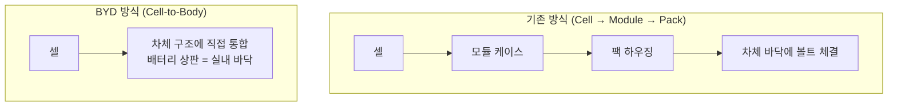
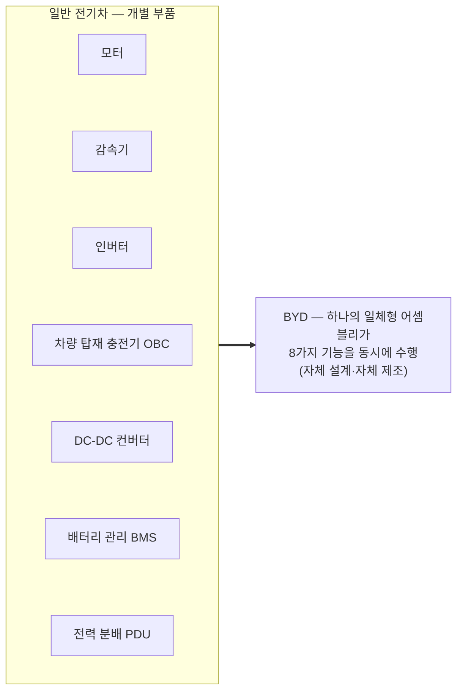

# 일본 엔지니어가 BYD 전기차를 분해하며 깨달은 것

> [!summary] 한 줄 결론
> 일본 엔지니어들이 BYD 전기 세단을 나사 하나까지 분해한 결과, **동일 사양을 일본·유럽 업체가 만들면 원가가 약 30% 높다**는 결론에 도달했다. 원인은 개별 부품 기술이 아니라 **배터리·전장·공급망을 처음부터 전기차에 맞춰 다시 설계한 구조**에 있었다. 일본은 기술에서 뒤처진 것이 아니라, 강점이 내연기관 시대에 맞춰져 있었다.

---

## 1. 배경 — 일본식 경쟁차 분해(teardown)는 어떻게 하는가

일본 자동차 업계는 수십 년간 경쟁사 차량을 정해진 표준 절차로 분해해 왔다. 미국 픽업트럭과 독일 고급 세단도 같은 방식으로 분해했고, 결론은 대체로 "경쟁자도 괜찮지만 우리가 더 싸고 가볍고 효율적으로 만들 수 있다"였다. 이 작업은 사실상 일본이 여전히 최고임을 확인하는 자기 증명 과정이었다.

- 정가로 사는 이유는 "특별 사양을 받았다"는 논란을 피하기 위해서다.
- 분해팀은 차체·파워트레인·전장·소재 엔지니어와 **원가 분석가**로 구성된다.
- 원가 분석가가 답해야 할 질문은 두 가지다. 이 부품을 만드는 데 얼마가 드는가, 그리고 우리는 왜 이 가격에 만들 수 없는가.

---

## 2. 첫인상 — 외관과 마감은 "평범하다"

| 점검 항목 | 관찰 결과 |
|---|---|
| 패널 간 단차(gap) | 꽤 좋지만 완벽하지는 않았다 |
| 도장 두께 | 유럽 차 평균 수준이었다 |
| 펜더·도어 가장자리 | 서둘러 생산한 흔적이 일부 보였다 |
| 고무 마감·하부 플라스틱 패널 | 제대로 처리되어 있었다 |

여기서 끝났다면 보고서 제목은 "괜찮고 저렴한 차" 정도였을 것이다. 진짜 이야기는 차를 들어 올려 바닥을 본 순간 시작되었다.

---

## 3. 핵심 발견 ① — 배터리가 곧 차체 바닥이다 (Cell-to-Body, CTB)

일반적인 전기차는 **셀 → 모듈 → 팩(별도 박스)** 순서로 조립한 뒤, 팩을 차체 바닥에 볼트로 고정한다. BYD 차량에는 이 박스가 없었다. 셀이 차체 구조에 직접 붙어 있고, 배터리 상단 패널이 실내 바닥 역할을 했다.

**효과의 연쇄**

1. 모듈 케이스, 지지 브래킷, 수십 개의 볼트가 사라졌다.
2. 배터리 높이가 몇 cm 낮아져 차 전체를 낮출 수 있다.
3. 차가 낮아지면 공기저항이 줄고, 같은 배터리로 더 멀리 간다.
4. 배터리가 구조재 역할을 하므로 비틀림 강성(torsional stiffness)이 올라간다.
5. **원가 분석가를 가장 놀라게 한 점**은 생산 라인의 조립 공정 수가 크게 줄었다는 사실이다.

> [!quote] 영상의 핵심 문장 (의역)
> 자동차 산업의 승자는 가장 좋은 아이디어를 가진 회사가 아니라, 그 아이디어를 매일 수천 번 실현할 수 있는 회사다.

CTB 개념 자체는 대부분의 회사가 논의해 본 적이 있다. 차이는 BYD가 이것을 **저가 양산차에 실제로 넣어 팔고 있다**는 점이다.

---

## 4. 핵심 발견 ② — LFP 배터리에 대한 역발상 베팅

| 구분 | NCM (니켈·코발트·망간) | LFP (리튬인산철) |
|---|---|---|
| 에너지 밀도 | 높다 | 낮다 |
| 저온 성능 | 상대적으로 양호하다 | 추위에 약하다 |
| 핵심 원자재 | 니켈·코발트가 필요하다 (비싸고 가격 변동이 크며 채굴 윤리 문제가 있다) | 니켈·코발트를 쓰지 않는다 |
| 열 안정성 | 상대적으로 낮다 | 높아서 화재 위험이 낮다 |
| 충방전 수명 | 짧은 편이다 | 길다 |

- 서구·일본은 LFP를 오랫동안 "저급 옵션"으로 봤고, 한국 배터리 3사도 NCM에 집중했다. 겨울이 혹독한 나라에서는 합리적인 판단이었다.
- 중국은 LFP가 인기를 잃어 가던 시기에 오히려 베팅했고, 수년간 성능을 개선하며 LFP 중심 공급망을 구축했다.
- 이후 원자재 가격이 급등하자 판이 뒤집혔다. 타협으로 보이던 선택이 **차량당 수백만 원의 원가 우위**로 바뀌었다.

---

## 5. 핵심 발견 ③ — 8-in-1 통합 파워트레인

일반 전기차는 보닛을 열면 부품이 따로따로 있다. 각자 하우징, 커넥터, 냉각 계통을 갖추고, 각기 다른 공급사와 계약해 들여온다.

결과는 분명하다. 전선과 커넥터가 줄고, 고장 지점이 줄고, 조립 시간이 짧아진다. 원가 분석가가 특히 주목한 점은 **외부 공급사에 지불하는 금액이 줄었다**는 것이다.

---

## 6. 핵심 발견 ④ — 수직계열화(vertical integration)

- 일본(그리고 한국)의 자동차 산업은 완성차가 설계하고 수백 개 전문 협력사가 부품을 공급하는 **계열(keiretsu)형 공급 네트워크**로 성장했다. 수십 년간 세계가 존경한 시스템이다.
- 그런데 전기차는 움직이는 부품 수가 급감한다. 그러자 이 강력한 시스템이 **단계마다 각자 마진을 요구하는 중간 단계의 연쇄**로 바뀌었다.
- BYD는 배터리, 전력반도체, 모터, 전장까지 거의 모든 것을 직접 만든다. 세계가 반도체 대란으로 생산을 멈췄을 때도 BYD는 칩을 자체 생산했기 때문에 정상 가동했다.

> [!important] 엔지니어들의 깨달음
> 분해에서 발견한 것은 독특한 특허 몇 개가 아니었다. **한 회사가 공급망 전체를 장악하고 있다**는, 따라 할 수 없는 사실이었다.

---

## 7. 핵심 발견 ⑤ — 존(zonal) 전자 아키텍처와 OTA

분해팀은 차량의 와이어링 하니스 전체를 꺼내 바닥에 펼치고 무게를 쟀다. 가솔린차보다 확실히 짧고 가벼웠다.

| 구분 | 기존 분산형 아키텍처 | BYD의 존 아키텍처 |
|---|---|---|
| 제어기 | 수십 개의 소형 ECU가 기능별로 차 곳곳에 흩어져 있다 | 앞·뒤·실내를 담당하는 고성능 존 컴퓨터 몇 대가 관리한다 |
| 배선 | 길고 복잡한 네트워크로 서로 통신한다 | 가까운 부품과 짧은 선으로 연결된다 |
| 공급 구조 | ECU마다 공급사가 달라 아무도 전체를 통제하지 않는다 | 제조사가 전체를 통제한다 |
| 무선 업데이트(OTA) | 사실상 불가능하다 | 스마트폰처럼 가능하다 |

짧은 배선은 무게와 구리 비용을 줄이고, 조립 시간을 단축하며, 장기 부식 위험도 낮춘다. 더 중요한 것은 **밤사이 소프트웨어 업데이트로 크루즈 컨트롤이나 회생제동 감각을 개선할 수 있다**는 점이다.

---

## 8. 약점 — 보고서가 공정하게 기록한 부분

| 약점 | 내용 |
|---|---|
| 소재 | 일본·독일 업체가 쓰는 알루미늄이나 고급 합금 대신 철강을 많이 써서 차가 무겁다. 전기차에서 무게는 가속·정지 때마다 내는 세금과 같다 |
| 실내 | 멀리서 보면 큰 화면, 부드러운 소재, 스티칭으로 비싸 보인다. 뜯어 보면 단순한 플라스틱 구조, 클립, 저렴한 스펀지다 |
| 품질 일관성 | 용접 검사 결과 일본 차보다 편차가 컸다. 제조 공정이 아직 성숙 단계에 이르지 못했다는 신호다 |
| 장기 내구성 | 10~15년 뒤 성능은 검증할 방법이 없다. 중국 전기차 산업의 업력이 짧기 때문이다. 일본 차의 내구성은 수백만 대의 실데이터로 입증되어 왔다 |

> [!note] 실내 마감은 결함이 아니라 전략이다
> 중국 업체는 고객이 **보고 만지는 곳**에 돈을 쓰고, 보지 않는 곳에서 최대한 아낀다. 일본은 반대로 아무도 보지 않는 곳까지 완벽하게 마감한다. 훌륭한 철학이지만 차량마다 수백 달러가 더 든다.

---

## 9. 원가 판정 — "냉정한 결론"

- 일본이나 유럽의 어떤 회사도 **같은 사양과 주행거리**의 차를 이 가격에 만들 수 없다.
- 격차가 몇 %라면 협력사와의 협상으로 메울 수 있다. 실제 격차는 **두 자릿수, 약 30%** 였다.
- 영업이익률이 약 8%에 불과한 산업에서 30%의 원가 격차는 협상의 문제가 아니라 판결이다.

$$
\underbrace{\text{원가 격차}}_{\approx 30\%} \;\gg\; \underbrace{\text{업계 영업이익률}}_{\approx 8\%}
$$

---

## 10. 의미 — "복제품이 아니다"

엔지니어들은 작업을 마친 뒤 "복사"나 "짝퉁"이라는 단어를 쓰지 않았다. 지난 30년간 서구와 일본이 스스로에게 해 온 위로, 즉 "중국차는 남의 디자인을 베끼는 공장일 뿐"이라는 이야기는 더 이상 통하지 않는다.

**BYD의 진짜 무기는 "짐이 없다는 것"이다.**

- 오래된 공장이 하나도 없다.
- 협력사와의 장기 계약에 묶여 있지 않다.
- 과거의 설계 유산에 얽매이지 않는다.

**일본의 역설**

| 시점 | 일본의 선택 |
|---|---|
| 1997년 | 세계 최초의 양산 하이브리드차를 내놓았다 |
| 2010년 | 대중시장 순수 전기차를 처음으로 내놓았다 |
| 이후 | 충전 인프라 부족, 소비자 미준비, 높은 배터리 가격을 근거로 하이브리드에 집중했다. 당시 데이터로는 실수가 아니었다 |

일본이 쌓은 강점은 변속기, 연료분사기, 배기 시스템 같은 **수천 개 정밀 부품과 협력사 간의 완벽한 협업 능력**이다. 배터리가 가장 비싼 부품이고 소프트웨어가 가장 중요한 요소인 차로 넘어가는 것은 단순한 결정이 아니라, 쌓아 온 강점을 스스로 허물고 처음부터 다시 짓는 일이다.

**중국의 국가 차원 베팅**

- 15년간 배터리 생산, 충전소 설치, 구매 보조금에 꾸준히 투자했다.
- 전기 버스·택시 전환을 의무화하고, 과학자를 초빙하고, 다른 대륙의 원자재까지 확보했다.
- 예산의 큰 부분이 낭비되었고 수십 개 회사가 파산했으며 보조금만 노린 유령 회사도 많았다.
- 그러나 세계에서 가장 가혹한 시장을 통과한 소수의 생존 기업이 남았고, 이들이 지금 유럽식 계산으로는 상상할 수 없는 가격에 전기차를 만들고 있다.

> [!important] 가장 큰 발견
> 일본이 반세기 동안 쌓아 온 힘, 즉 **수천 개 정밀부품 협력사 간의 협업 능력**이 더 이상 이 산업에서 가장 중요한 능력이 아니라는 것.

---

## 11. 일본의 대응

당황 대신 조용하고 체계적인 대응이 나왔다.

1. 더 많은 기업이 중국 차를 사서 직접 분해하기 시작했다.
2. 공동 연구 그룹을 만들어 차세대 배터리, 특히 **전고체 배터리** 개발에 집중하고 있다. 성공하면 판도를 바꿀 수 있다.
3. 제품 설계 단순화에 착수했다. 부품을 통합하고, 전용 금형 수를 줄이며, 전자 아키텍처를 처음부터 새로 짜는 것을 우선순위에 두었다.
4. 수십 년간 치열하게 경쟁하던 기업들이 손을 잡았다. 이번 전쟁은 혼자서는 이길 수 없다는 판단이다.

---

## 12. 시장 전략 관점 — 진짜 위협은 제3시장이다

- 일본 내수 시장은 외국 브랜드가 뚫기 매우 어렵다. 고객 충성도가 높고, 촘촘한 정비망과 계열 문화가 있다.
- 그러나 중국 브랜드는 도쿄에서 이길 필요가 없다. **동남아시아, 남미, 중동, 아프리카, 그리고 브랜드보다 가격이 중요한 일부 유럽 국가**만 가져가면 된다.
- 문제는 이 시장들이 일본 업체가 수십 년간 안정적인 이익을 거둬 온 곳이라는 점이다. **현대차·기아가 치열하게 경쟁하는 곳**이기도 하다.

---

## 13. 생각해 볼 질문

- 계열형 협력사 네트워크(일본·한국 모델)가 전기차 시대에 비용 구조상 불리해진다면, 한국 완성차와 부품사는 어떤 형태로 재편되어야 하는가?
- 원가 30% 격차 중 구조적 요인(CTB, 통합 파워트레인, 존 아키텍처)과 정책적 요인(보조금, 규모의 경제)은 각각 얼마나 되는가?
- 품질 일관성과 장기 내구성이라는 약점은 시간이 지나면 해소되는 문제인가, 아니면 일본·한국이 지킬 수 있는 지속적 해자(moat)인가?
- 전고체 배터리는 판을 뒤집을 카드인가, 아니면 LFP 공급망이 이미 만든 원가 우위를 넘기 어려운가?

---

> [!warning] 출처와 유의 사항
> - 원본: 자동차 분해 관련 유튜브 영상 자동 생성 자막(약 19분). 자막의 오탈자와 혼재된 표현(예: 구입가 "약 30,000달러"와 운송비 "약 4천만 원")은 영상 표기를 그대로 따랐으며 별도로 검증하지 않았다.
> - 영상은 특정 차종을 명시하지 않고 "BYD의 전기 세단"이라고만 언급한다. 자막상 한국 출시 모델로 아토3·씰·돌핀이 거론된다.
> - 영상 스스로 밝히듯 특정 차량의 구매나 회피를 권하는 내용이 아니다.
